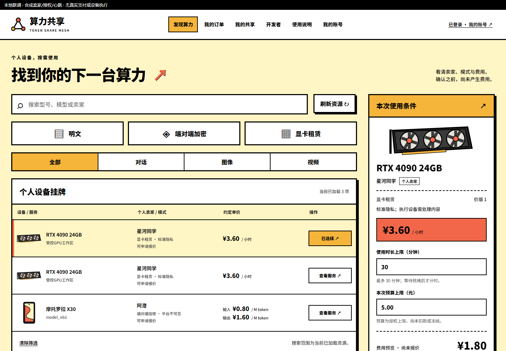
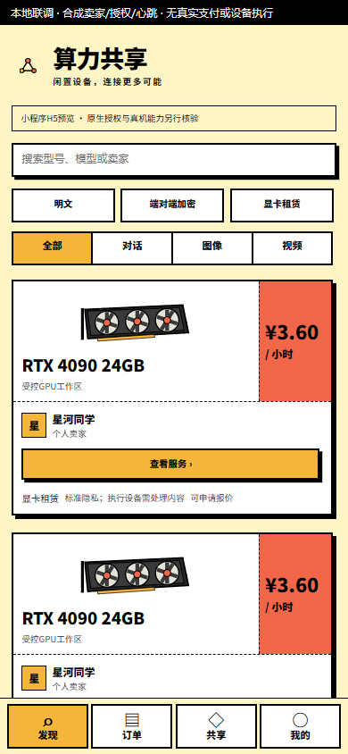
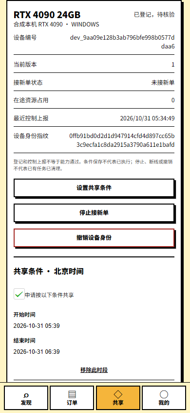

# Token Share Mesh

<!-- Generated from dev/repository/README.en.md.in; run dev/tools/构建仓库文档.py. -->

## R022 · Encrypted native result custody and three protocol outputs

Original native output now moves into a separate AES-256-GCM result store before compute cleanup. Defaults reserve 16 × 8 MiB for five minutes. Synchronized original compute can release its GPU while its exact order/local-generation result remains readable. Process-only keys, one reader, reserved quotas and expiration bound custody; key loss or ambiguous submission never reruns inference. PIPE_2 adds actual input counts and the matched original stop index.

An authorized original result renders OpenAI Chat, Responses or Anthropic Messages as JSON/SSE with UTF-8, usage options, stop semantics and bounded writes. Defaults are 512 KiB JSON and 64 KiB per event. Responses repeats final text and needs explicit capability budgeting before public activation; overflow cannot emit a false success tail. A local write Receipt is not buyer ACK, trusted usage or payment evidence.

This is a PLAINTEXT/STANDARD source subset, not E2E/LP. Node CLI execution stays disabled. Seventeen new regular Go cases bring the manifest to 275; six separately tagged actual Windows worker/synthetic C ABI cases include encrypted custody and all three protocol outputs. Real models/GPUs, a separate execution identity, independent official SDK certification, public result transport, funds and full acceptance remain pending. The early supervisor shutdown timeout and first tagged failure are preserved; later passing runs do not resolve historical timing risks.

[RC-001—060](docs/技术开发/附录-原生文本结果加密保管与标准协议交付.md) · [R022 evidence](dev/tests/evidence/R022-验证报告.md) · [All 56 tasks](dev/progress/R022-本轮实现与完整待办.md).

## R021 · Native C API worker and bounded private pipes

This round adds a replaceable llama.cpp C++ worker and Go InputAdapter. Locally approved pack/model/template hashes control loading; three strict text profiles preserve their semantics before the approved chat template and actual tokenizer. Directed anonymous content pipes, a separate cancellation pipe, two 64-KiB output buffers and original-owner once-only submission bound execution. Model weights are reused; each task synchronizes, clears KV and frees its context before its original cleanup receipt. Process exit remains UNKNOWN.

`Owner-approved pack → exclusive resource preparation → Open/warm-up → trusted HostKernel → original ticket.Start → authorized content sink → native synchronization/clear → original cleanup projection`. Node CLI execution remains disabled. Public output/SSE/ACK, trusted usage, real models/GPUs, a separate low-privilege service, E2E, LM Studio compatibility and other device kernels still need implementation/qualification. Tests with a synthetic C ABI DLL exercise the actual Windows process; they are not real inference or LP acceptance.

[42 kernel constraints](docs/技术开发/附录-原生LLM受限管道与可替换worker.md) · [Current evidence](dev/tests/evidence/R021-验证报告.md) · [All 56 tasks and 222 open steps](dev/progress/R021-本轮实现与完整待办.md). Historical R016/R019/R020 timing and archive limitations remain; the delivery goal is ACTIVE.

## R020 · 原生执行宿主 / Persistent native execution host

R020 adds a persistent native execution host with an independently provisioned issuer public pin and original order/kernel approval. The original claim is encrypted and committed before networking; missing replies and restarts retain that exact command. Bounded manifest/input reads produce an in-memory ticket. An explicit InputAdapter hands original bytes to the existing once-only native supervisor; an old receipt cannot submit content again. Cleanup is projected only from the original execution journal with the same lease and metadata hash. Corrupted selectors cannot hide unfinished commands, and missing or mismatched anchored state is never recreated. Windows reuses actual DPAPI/private ACLs; Linux remains cross-built with protocol fixtures. CLI host-init/host-status do not install or run models; execution_enabled remains false. This covers three PLAINTEXT/STANDARD text profiles. Metadata encryption does not provide content E2E or provider blindness. Real tokenizers/kernels, output/usage/ACK/renewal, payment channels, LP/PE/rental and complete acceptance remain open. The 37/95 control-operation and 65-table/664-column/113-FK counts are unchanged. Previously published SQL001–010 and execution DDL bytes are preserved; a separate native host SQLite schema is new. All 56 tasks/222 development steps and unresolved R016/R019 slow-metadata timing risks remain open; the goal stays ACTIVE.

`Recover control state → Begin → Prepare → trusted HostKernel → node.RunSupervised → ticket.Start → original cleanup projection`.

The embedding must reject pending, revoked or draining control state before new work, couple the watchdog to the existing control loop, and recheck state after termination. A standalone watchdog test is not a complete production daemon.

[EH-001—036](docs/技术开发/附录-原生执行宿主与内容适配接线.md) · [R020 evidence](dev/tests/evidence/R020-验证报告.md) · [All 56 tasks](dev/progress/R020-本轮实现与完整待办.md)。

**A C2C market for user-owned compute, with standard AI APIs and explicit privacy choices.**

[简体中文](README.zh-CN.md) · [Documentation map](dev/repository/README.md) · [Development plan](dev/开发细则总表.md) · [Changelog](CHANGELOG.md)


Token Share Mesh connects buyers with people voluntarily offering idle Windows/Linux GPUs, Android devices, or explicitly authorized upstream AI capacity. The seller sets availability and price and remains the seller of record. The platform provides discovery, contracts, routing, scheduling and transaction evidence, and charges a disclosed fee.

<details>
<summary>Validation attempts and open timing risks</summary>

The first R020 complete run passed 177 / failed 73 / skipped 0. Migration 001 in a legacy-upgrade child DB hit the existing statement timeout; a contemporaneous checkpoint reported 110.501s sync, and later cases exhausted the unchanged 220s package context. The H5 journey separately terminated after 237.63s without a final receipt; its failure screenshot is retained. Underlying storage and browser causes remain unproven. Validation now runs independent native tests before starting PG, explicitly observes enabled/checked Taro consent, and journals failure evidence earlier. Product source, published SQL, existing assertions and time bounds are unchanged. Later passing runs do not establish timing stability or erase these failures. [Full failure archive / 完整失败归档](dev/tests/evidence/R020-full-attempt1-archive.json)。

The second R020 run completed only the native segment: 113 passed / 2 failed / 0 skipped. Two existing supervisor cases returned ErrShutdown within the unchanged cleanup bound; the failed run did not independently observe final disk ownership. Both database test executables compiled, but the runner incorrectly expected test2json to be a standalone executable and stopped during preparation. PostgreSQL and both browser segments never started. The runner now uses the pinned Go tool entry; product Go source, assertions, SQL and runtime deadlines are unchanged. Original events, the runner and build digests are retained. A later pass does not establish cleanup timing stability. [Partial failure archive / 部分失败归档](dev/tests/evidence/R020-full-attempt2-archive.json)。

Five legacy-migration tests in the fourth complete R020 run failed because the precompiled-test runner did not preserve go test package working directories; their fixture could not read the five real pre-006 SQL files. The test-launch cause is identified and corrected by restoring package working directories, without changing fixtures, product source or published SQL. This is separate from the first-run SQL timeout and second-run supervisor cleanup failures, whose underlying causes remain unproven. [Failure archive / 失败归档](dev/tests/evidence/R020-full-attempt4-archive.json)。

The fifth complete R020 run passed 249 / failed 1 / skipped 0. Native 115 cases, database core and Web passed; H5 page interactions also passed and the browser closed, but the test-only multi-device heartbeat UPDATE deadlocked with the market FOR SHARE transaction (40P01), reported by test cleanup. Both waits and the batch statement are retained. Synthetic heartbeats now use independent per-device autocommit statements, preserving the 5s tick, real 45s freshness, every fixture device and all error assertions, without retries or ignored failures. This fixture correction does not prove production deadlocks absent or resolve earlier unproven cleanup/storage/H5 timing causes. [Failure archive / 失败归档](dev/tests/evidence/R020-full-attempt5-archive.json)。

The historical attempt 4/5 archiver omitted nested media directories. Exact original SHA-256 matches recovered 8/18 and 9/18 assets; all eight historical MP4/GIF files re-encoded from retained original frames match their original digests. Nineteen original PNG files are unavailable and individually listed. The final 14 frontend screenshots, four frontend MP4/GIF files and reader assets are complete. Missing historical files are not used as current verification evidence. [Historical media retention inventory](dev/tests/evidence/R020-historical-media-recovery.json)。

</details>


## R019 · 原清单与输入 / Restricted manifest and original input

R019 adds restricted manifest and exact original input delivery for an already claimed lease: 37/95 explicitly registered control operations, 65 tables / 664 columns / 113 foreign keys. INT-094/095 are added to the authoritative contract and permanent registry first. Both GETs require the original signed device and recheck its original buyer key/route/order, same-payment funds, qualification, full existing hold, device version, input, physical owner, both fences and unchanged expiry using the shared order-first lock sequence. The delivery service has no issuer private key. Input requires original AES-GCM/AAD, separately keyed versioned HMAC and same-profile Preflight, then returns the original bytes. The native receiver requires an independent issuer pin and original order/route/mode plus locally approved kernel facts; it neither approves nor starts a kernel. This is a trusted PLAINTEXT/STANDARD authenticated transport hop: a ciphertext digest is not a signed plaintext commitment, E2E or provider blindness. Reads never ACK execution, renew, reassign, complete delivery jobs, bill or release a resource. Published 001–010 and client SQLite bytes remain unchanged. Durable host commands, real tokenizer/kernels/usage/channel, E2E/LP/PE/rental and complete acceptance remain open.

The first R019 complete run passed 233 / failed 1: the existing TestSupervisorMetadataStepsHaveIndependentBudgets returned ErrShutdown under injected slow metadata. That failure did not authorize release; final disk ownership was not independently observed in that failed run. Exact original logs and 18 media files are archived. The standalone diagnostic emitted no test events before its outer build/process timeout, so it has no passing result. The second complete native/browser attempt repeated unchanged source, assertions and runtime bounds; the subsequent frozen-registry correction is documented separately. A later pass does not establish the cause or timing stability; DEV-53 remains open.

The second R019 complete run also passed 233 / failed 1: the slow-metadata case passed, while the existing unknown-registry case could not read its expected occupied snapshot after shutdown. Exact logs, source evidence and 18 media files are separately archived. A subsequent correction preserves already quarantined/stopping/cleaning owners without repeated writes when a frozen kernel binding is absent, visits every resource before reporting incomplete shutdown, and retains bounded cancellation for other matching original owners. A mixed-resource regression was added without relaxing existing assertions or bounds. This does not establish the cause of the R016 or first R019 slow-metadata failure; DEV-53 remains open.

[DG-001—030](docs/技术开发/附录-原设备清单与输入受限交付.md) · [R019 evidence](dev/tests/evidence/R019-验证报告.md) · [All 56 tasks](dev/progress/R019-本轮实现与完整待办.md)。

`PrepareLeaseClaim → PrepareManifest → independent pin + Approval → AcceptDelivery → PrepareInput → AcceptInput`; `P11_INPUT_DELIVERY_KEYS_FILE` explicitly enables the separately keyed content service. CLI inference stays disabled.

## R018 · 原设备签名领取 / Native original-lease claim

R018 adds authenticated native delivery of the original signed lease: 35/93 registered control operations and 65 tables / 664 columns / 113 foreign keys. Only the original device proof can claim; its original command ID equals Idempotency-Key and is permanently bound to the same lease by forward migration 010 with one atomic safe event. Every recovery rechecks the original scoped buyer key/route, order and same-payment funds, eligibility, full existing hold, encrypted input metadata, physical owner, both fences and unchanged expiry. The delivery service has explicit public verifiers only: it cannot decrypt, issue, renew, reassign, ACK execution, complete delivery tasks or bill. Generic metadata workers can claim or exhaust only their supported kinds, leaving execution-delivery intents untouched. Independent device pins/approved plans, input/manifest transport, durable host execution commands, real kernels/usage/channel, E2E/LP/PE and rental remain open. Published 001–009 and client SQLite bytes are unchanged; history stays UNBOUND_CLAIM.

[CL-001—028](docs/技术开发/附录-原设备签名领取与原租约交付.md) · [R018 evidence](dev/tests/evidence/R018-验证报告.md) · [All 56 tasks](dev/progress/R018-本轮实现与完整待办.md)。

`P11_LEASE_VERIFIERS_FILE` → `P11_LEASE_VERIFIERS_1` public verifier configuration; `P11_PAYMENT_ENVIRONMENT` must be explicit. Without the file, claim stays 503. Native `PrepareLeaseClaim → Send → UnverifiedClaim` returns metadata requiring independent `executionlease.Verify`; CLI inference remains disabled.

## Current implementation

This repository contains **React/Taro Alipay pages, React/Vite Web, shared control logic and a runnable Go/PostgreSQL service subset**, alongside full specifications. The frozen Neubrutalism UI covers marketplace, authoritative quotes, owner orders awaiting payment, and provider pairing/policy/drain/revocation controls. Inference, full device execution, customer E2E content encryption, real payments and the complete platform remain unfinished. Captures label synthetic authorization/qualification; Taro captures show H5, not native Alipay. Provider controls also exercise a real Windows CLI, without GPU execution.

The [NB-R1 requirements](docs/需求推进/NB-1.0/README.md) connect the [five final design pages](dev/design/新粗野主义-v1.0/README.md) with ten supporting views, 48 requirement refinements, 96 unexecuted scenarios and six open contract gaps. New offers use GPU hours or separate input/output prices per M token (1,000,000 tokens). Media runs within controlled GPU rentals without extra per-item charges. R003 implements NB_PRICE_1, exact calculation and quote/order services; R004 adds identity/HTTP; R005 adds seller submissions and versioned listing control. Arbitrary hourly rental sessions, renewals, final billing, trusted usage and production budget-admission integration remain unfinished; historical orders retain their original prices.

| Item | Evidence/status |
| --- | --- |
| Development baseline | 20 modules / 56 tasks / 222 steps / 47 constraints |
| Implementation tasks | 31 in progress · 23 not started · 1 conditional · 1 deferred |
| Latest source round | R022 · PASSED_FOR_CONTROL_AND_RELAY_SUBSET_ONLY |
| Native test evidence | 275 passed · control/native/relay source subsets only |
| Full product acceptance | 80 NOT_EXECUTED |
| Source goal | ACTIVE |

R017 connects internal native-text input and initial lease admission: the actual body is strictly validated and stored with AES-256-GCM. The original order, current scoped key/qualification, same-order funding and existing full per-call hold are rechecked before an explicitly FREE native-device resource, dual fences, metadata manifest, signed first lease (at most 45 seconds within the original hard deadline), safe event and durable delivery intent commit atomically. Original-key recovery never replaces input/owner or renews authority; expiry, revocation and unknown outcomes retain budget and ownership. This protects PLAINTEXT storage only, not customer E2E or provider blindness. Model listeners, actual claim/content delivery, production secrets/independent trust, real engines/usage/payments and LP/PE remain pending. Forward009 adds seven columns/one FK; 001–008 and native SQLite DDL retain their bytes. The scope remains 34/93 operations and 65 tables. Platform generations stop at the persisted signed-bigint limit. [EI-001–030](docs/技术开发/附录-原生输入加密与首租约原子准入.md) · [R017](dev/tests/evidence/R017-验证报告.md) · [56/222](dev/progress/R017-本轮实现与完整待办.md)。

The first R016 full run passed183 and failed one existing signed-renewal cleanup case under its original 400ms bound; resources were retained. Three unchanged isolated repeats passed, but the cause is unproven. A later full pass does not establish timing stability; DEV-53 remains open. See the [development record](dev/tests/evidence/R016-development-attempts.json).

Historical R016 adds original-call preparation: current scoped-key, original order and same-order funding facts are rechecked, then INPUT_PENDING, the full per-call budget hold, one call slot and a safe event commit atomically. Original-key recovery does not reserve twice; changed parameters or keys conflict. Cancellation, expiry and unknown results retain the original intent and hold. Only a versioned HMAC of the transient request digest is persisted. Forward migration 008 adds six columns; 001–007 and native SQLite DDL retain their exact bytes. The scope remains 34/93 operations and 65 tables, with three native text profiles under PLAINTEXT/STANDARD. There is no model listener, Lease/Grant issuer or inference. Input-ready/resource admission, trusted usage, real payments, E2E and route UI remain pending. See [RI-001–024](docs/技术开发/附录-原调用准备与次数预算原子接线.md), [R016 evidence](dev/tests/evidence/R016-验证报告.md) and [all 56 tasks/222 open steps](dev/progress/R016-本轮实现与完整待办.md).

Historical R015 adds confirmed original-order routes and scoped standard-SDK keys. Three owner-session control operations bring the implemented count to 34/93; routes freeze the original seller, listing revision, model, text protocol, price, budget, call ceiling and expiry. ResolveTx selects exactly one key-bound model/profile and rejects ambiguity, revocation or mismatch without seller failover. Forward-only 007 adds five columns and quarantines legacy routes; API startup verifies every embedded migration record. Only PLAINTEXT/STANDARD and the three native text profiles are implemented. Resolution grants no funds or execution; durable invocation/call accounting, real payments, E2E and route-configuration UI remain pending. See [RC-001–022](docs/技术开发/附录-已确认订单路由与标准SDK绑定实施细则.md), [R015 source evidence](dev/tests/evidence/R015-验证报告.md) and [all 56 tasks / 222 open steps](dev/progress/R015-本轮实现与完整待办.md).

R014 adds order-local budget transactions: reserve an original purpose once, consume the actual amount from an existing immutable trade qualification, or release on a qualified zero. Parent-row updates keep ordinary SQL concurrency and stale higher-isolation snapshots from overbooking. Forward migration 006 adds eight columns; all legacy reservation states remain fully held as unverified, and inconsistent history aborts the upgrade. Capacity is not a wallet, paid funds, route/lease admission or GPU release. Qualified-source generation and production admission integration remain pending. See [OBC-001–017](docs/技术开发/附录-订单预算预留与资格化消耗实施细则.md), [current R014 source evidence](dev/tests/evidence/R014-验证报告.md) and [all 56 tasks/222 open steps](dev/progress/R014-本轮实现与完整待办.md).

R013 fixes cancellable native metadata admission, pre-SQL cancellation poisoning, transaction-time lease extension and backend deadline drift. MetadataTimeout now has an independent 2s default per operation (20ms–5s), capped by shutdown deadlines; signed leases and backend call limits are unchanged. Repeated identical mappings and already-persisted stop phases avoid redundant writes. Durable cleanup completion wakes shutdown after slot release, preventing false poll-based timeouts without extending the deadline. Five controlled negative regressions and their failed attempts are retained; current native/full and browser evidence is reported separately. The CLI still enables no inference or hardware qualification. See [NMD-001–013](docs/技术开发/附录-原生元数据事务与执行截止修正.md), [R013 source evidence](dev/tests/evidence/R013-验证报告.md), [current UI evidence](dev/tests/evidence/R013-frontend-checks.json) and [all 56 tasks/222 open steps](dev/progress/R013-本轮实现与完整待办.md).

R012 adds a fixed-seller/contract/route native text relay for Chat Completions, stateless Responses and Messages JSON/SSE subsets. It validates exact fields, separate stream terminals, scoped headers/secrets, no retry and bounded cancellation/deadlines/backpressure. Twenty-one new Go cases (20 relay and one supervisor regression) bring the total to 134, using owned loopback synthetic backends and explicit admission/secret fixtures. No paid inference listener, production route/funding gate, SDK certification, real engine stop, billable usage or content E2E is claimed. Unchanged 21-case TS/three-target build receipts are reused only after source/output/log hash checks; both browser journeys rerun against the current Windows node binary. A deterministic regression fixes stale post-cleanup snapshots being reported as failed shutdowns, without touching replacement owners. The API remains 31/93 operations, 65 platform tables and byte-identical migrations 001–005. See [source evidence](dev/tests/evidence/R012-验证报告.md), [frontend evidence](dev/tests/evidence/R012-frontend-checks.json), [BRC-001–024](docs/技术开发/附录-固定路由协议转发核心实施细则.md) and [all 56 tasks/222 pending steps](dev/progress/README.md). Field allowlists compare complete names exactly; delimiter-bearing forged keys are rejected in request and response regression cases.

**Historical R012 follow-up validation:** the initial R012 full run passed 134 cases in published commit `694f9be`. The exact-field follow-up changes only three relay Go files and passes all 20 relay cases. Another 114 cases reuse only immutable, byte-identical source/module/input evidence; the final R012 full rerun passed 127 cases and FAILED seven existing short-deadline cases, and a serialized diagnostic FAILED six. Host contention was observed but is not a proven cause. No lease, cleanup or test deadline was widened. This is not a current 134-case full pass. See the failure lists and reuse proof in the source report above.

The new contract uses hour_rate for AVAILABLE_HOUR, or both input_rate/output_rate for TOKEN_1M. Each rate has an integer numerator in fen and a positive denominator, together with fee ownership, commission and rounding versions. At 360 fen/hour, 30 minutes costs at most 180 fen; 1M input at 80 fen/M plus 0.25M output at 160 fen/M totals 120 fen. Quotes freeze seller, environment, policy, rates and budget. Creating an order rechecks admission and atomically writes WAITING_PAYMENT, quote consumption, consent audit and outbox. It does not pay, lock a GPU or execute work. A 350 fen/hour rate cannot be rounded into the legacy integer-fen/minute column.

## Current identity and HTTP flow

The native control command is `p11-api`. Explicitly configure the selected development database, application identity and secret-file paths, then apply migrations; [environment variables and call order](dev/repository/USAGE.md) are documented. It listens on loopback and enables no test login, model or payment shortcut. The [embedded route manifest](dev/src/api/internal/http/routes.json) drives 34 actual operations and is checked against the 93-operation canonical contract; the other operations remain pending.

Seller submissions remain SUBMITTED and grant neither SELLER nor sale admission. New listings require approved regions, owner-specific concrete models/capabilities and explicit platform fees. Edits create future revisions without changing sold contracts; exit closes new admission while existing obligations continue. Provider pairing/policy/drain/revocation pages are implemented; the complete listing editor, real review, hardware qualification, execution endpoint and controlled publication remain unfinished.

The native miniapp explicitly selects ALIPAY_NATIVE_NONCE_1: a 32-byte server-generated one-time proof stored only as a digest, then my.getAuthCode and POST exchange. Bearer remains memory-only; restart requires authorization. This is not client-generated PKCE and uses neither Math.random nor timestamps. Command IDs use an independent memory-only HMAC counter seed, never content keys. Web/H5 uses WebCrypto S256, bound Cookie/state and the implemented callback; OAuth URL parameters and temporary proof are consumed immediately. Session transport is HttpOnly/Strict Cookie plus Origin/CSRF for writes. Login is not KYC or seller approval; new accounts receive BUYER only. Unknown exchange requires fresh authorization.

Current UI/HTTP trade stops at qualified market → frozen quote → explicit buyer confirmation → WAITING_PAYMENT. Unknown writes retain an owner-partitioned original key/body and recover that request after reload; the server rechecks current authorization before replay. API keys cannot purchase. Inference endpoints, payment-success processing and the complete frontend remain unfinished.

## Implemented provider control flow

An approved seller explicitly creates a five-minute pairing credential, disclosed once. The native installation generates a fresh Ed25519 identity and submits its public key, OS/release, resource kind and concrete model. Registration produces PAIRED with sharing disabled. The original enrollment key/fields recover the same device; no secret is redisclosed. Reinstallation requires a fresh key and pairing.

Subsequent P11_DEVICE_ED25519_1 proofs bind method, authority, exact URI, raw-body digest, idempotency key, If-Match and Content-Type; timestamps allow ±60 seconds and nonces are durably deduplicated. This custom control profile is separate from content encryption and is not HTTP Message Signatures. The Go library exposes NewClient→Prepare→Send→Close. Unknown writes require explicit recovery of the same prepared command with a fresh proof; there are no automatic retries or replacement command IDs. Owners use their account session and a strong ETag to set sharing windows, one slot, disk and phone battery/temperature/charging conditions. Drain/revoke close admission while actual stopping/cleanup remains the execution endpoint’s responsibility.

Configure the separate P11_DEVICE_PAIRING_PEPPER_FILE or pairing stays closed. p11-node provides init/enroll/recover/status/heartbeat/run with bounded piped stdin. Windows DPAPI or Linux Secret Service protects the master; the AES-GCM journal and OS lock persist original commands before transmission. Reports stay UNKNOWN with execution_enabled=false; no engine/listener starts. An approved SELLER explicitly selects platform/name and confirms ownership in the sharing page. Credentials are masked and revealed only on request, then used in the owner CLI; leaving removes them. A lost first reply recovers metadata only; a new intent requires fresh confirmation. Beijing-time windows, integer MB and phone conditions require a strong ETag and responsibility confirmation. Refresh after saving; drain/revocation do not acknowledge GPU cleanup. Real Linux keyrings, production RuntimeSupervisor process isolation/actual engine adapters, signed rental ownership, independent platform trust and content E2E remain pending. See [bilingual usage](dev/repository/USAGE.md), [provider UI constraints](docs/技术开发/附录-提供方双端设备管理与原请求恢复.md) and [native agent specification](docs/技术开发/附录-原生提供方控制代理与本地恢复.md).

## Native execution metadata and ownership

After explicit owner enrollment, execution-init creates one SQLite store anchored first in the existing OS-key-protected AES-GCM journal. execution-status opens that same store and exposes only resource phases/counters and receipt count. A missing/corrupt/mismatched store is never recreated, and reopening quarantines every previous owner. No command accepts a lease or prompt, launches an engine or enables paid work; execution_enabled remains false.

The library validates the existing signed Lease against an independently approved plan and a separately trusted Ed25519 platform key. It persists original command IDs, uint64 job/resource fences and backend mapping before external effects. Managed local use, jobs and maintenance share one physical digest and local owner generation; unsigned rental grants are refused. A duplicate or ambiguous submission queries the original request. Renewals require a higher signed revision, immutable terms/environment and a fixed hard deadline; absolute/monotonic expiry or clock rollback closes authority. Only current backend stop plus complete token/workspace cleanup with the matching owner generation can release a resource. This state machine does not itself prove a real backend stopped or perform GPU/key/file cleanup.

SQLite contains bounded control metadata only, not prompts, output, media or content keys; its page cache is limited to 2MiB, mmap is disabled and the database is capped at 16384 4KiB pages. It is not the encrypted content store. Exact CGO-free SQLite dependencies and bundled notices are recorded; no VM or model copy is added. Full engine/resource discovery, platform issuer/trust lifecycle, production timer/engine integration, rental parent sessions, content E2E and physical performance tests remain pending. [Complete numbered specification](docs/技术开发/附录-原生执行收件箱与资源门闩实施细则.md) · [usage and recovery](dev/repository/USAGE.md).

## Running supervisor and backend recovery

The watchdog uses only metadata Work records, never prompts, argv, paths, URLs or content keys. Registrations bind environment/capability/manifest exactly and cannot silently fall back. An adapter must honor bounded contexts, query/cancel the original request authoritatively, and prove STOPPED before generation-scoped cleanup. Cancel ACK, network loss, missing PID or a shutdown timeout cannot release a resource. Unknown control commands or revoked/draining state close admission while recovery remains available. The trusted embedding API is NewSupervisor → RunSupervised; paid task reception and production engine adapters are not exposed by the CLI. [Complete usage](dev/repository/USAGE.md) · [NSV-001–020](docs/技术开发/附录-原生执行监督与后端恢复实施细则.md).

## Screenshots and recording







[Web provider conditions](dev/media/R022/screenshots/web-provider-conditions.png) · [Revoked identity state](dev/media/R022/screenshots/miniapp-provider-revoked.png)


[Web MP4](dev/media/R022/recordings/web-transaction.mp4) · [Taro H5 MP4](dev/media/R022/recordings/miniapp-transaction.mp4) · [Web GIF](dev/media/R022/recordings/web-transaction.gif) · [Unknown-order reply](dev/media/R022/screenshots/web-order-pending.png) · [Product provenance](dev/media/frontend-manifest.json)

Compiled pages connect a real local HTTP/database chain. Synthetic OAuth/qualifications/device heartbeats exist only in the test binary. There is no real authorization, payment, device execution or model result. The following reader captures have a separate provenance record.


[Watch/download the MP4 recording](dev/media/recordings/readers-tour.mp4) · [Search screenshot](dev/media/screenshots/whitepaper-search.png) · [Mobile-width reader](dev/media/screenshots/whitepaper-mobile.png) · [Media provenance and reproduction](dev/repository/MEDIA.md)

The Chinese readers demonstrate local search/navigation. Reader and product captures have separate manifests; neither demonstrates a model result, successful payment or real device execution.

## Three service modes

| Mode | What the buyer purchases | Content handling | Execution and acceptance |
| --- | --- | --- | --- |
| Plaintext | A specified model call or approved media workflow | The platform gateway and performing seller can process plaintext; any upstream processor must be disclosed | Contract-bound execution, trusted usage/result evidence |
| End-to-end encrypted | A task for an explicitly confirmed seller endpoint | Buyer-local gateway encrypts; platform relays ciphertext; seller service decrypts for inference and encrypts results back | Bound identity, authenticated streams and buyer receipt |
| GPU rental | A bounded period in an approved GPU application environment | The selected environment/privacy policy governs content | Both parties ready before billable availability; hard expiry and actual cleanup |

Encryption is a processing path, while privacy strength is a separate qualification. `PLATFORM_BLIND` hides content from the platform, but the executing device processes plaintext. Local protections aim to make routine UI/file/log/API/packet inspection harder for ordinary and intermediate users. They do not claim protection from advanced memory/GPU extraction or full host control. `ATTESTED_CONFIDENTIAL` is a separate conditional capability requiring genuine end-to-end hardware evidence; it remains disabled.

## Request routing and API compatibility

The planned data plane accepts **OpenAI Chat Completions**, **OpenAI Responses** and **Anthropic Messages**, plus explicitly approved media/audio subsets. A published compatibility profile defines supported models, fields, tools, streaming events and limits. Unsupported semantics are rejected rather than silently dropped.

```text
Plaintext:
App / standard SDK -> platform Sub2API-like gateway
                   -> confirmed seller adapter -> native engine / authorized upstream

Encrypted:
App / standard SDK -> buyer-local or paired trusted-LAN gateway
                   -> ciphertext relay -> seller-private gateway -> native worker
Response           <- local authentication/decryption <- ciphertext <- seller encryption
```

Routing configuration binds the actual seller, immutable contract, mode, model/workflow, budget and deadline. Standard SDK requests do not need private JSON fields. Missing routing configuration cannot default to plaintext or purchase compute automatically. A single order permits at most one disclosed retry within the same seller's eligible devices; changing sellers requires the buyer to confirm a new transaction.

The plaintext core is intended to reuse or adapt a Sub2API-like implementation after revision, license and dependency review. Default account pooling, cross-seller rotation, wallet logic and content telemetry must not bypass the C2C contract. The encrypted path has a buyer-side and seller-side local forwarding core; the platform must not decrypt it. See [gateway design](docs/技术开发/07-统一协议网关与Sub2API改造.md).

## Provider software and kernel choices

| Provider | Planned local software | Replacement policy |
| --- | --- | --- |
| Windows/Linux private LLM | Native supervisor + C++ worker embedding the llama.cpp C API, connected by controlled pipes | Approved engine/model/template/backend versions; no plaintext HTTP inference hop in the private path |
| Windows/Linux compatible LLM | LM Studio CLI (`lms`), llmster and actual inference runtime | Three independently versioned layers; compatibility does not itself grant local privacy qualification |
| Windows/Linux media | Complete native ComfyUI environment, PrivacyBridge and approved image/video/audio/3D capability packs | Explicit provider consent, limited node/dependency allowlist, staged validation and drain-before-switch |
| Android | A pinned LMA fork with Java/Kotlin and internal JNI inference bridge | Executable changes through signed APK updates; model downloads are separate; no arbitrary executable hot loading |

Providers control whether they participate, resource/time limits, eligible kernels, installation consent and published prices. The scheduler chooses only among already approved resources within the accepted contract. The provider UI shows resource usage, component versions, task stage, earnings and stop controls; privacy tasks do not expose prompts or outputs through ordinary UI/history/log APIs. GPU/phone support is a development target, not an already verified capability.

## End-to-end encryption design

The current candidate uses libsodium sealed boxes for per-object stream-key wrapping, `secretstream_xchacha20poly1305` for authenticated sequential records and separate Ed25519 signatures for endpoint identity and context. Exact library revisions, bindings, cross-platform byte vectors and independent review are still required. A sealed box does not authenticate its sender; signatures and independently verified endpoint identity are mandatory.

1. Confirm seller, recipient identity/key version, environment and contract through a disclosed trust procedure. Platform-delivered key and fingerprint alone do not constitute independent verification.
2. Create an `INPUT_PENDING/PREPARED` context bound to order/job/attempt/token/recipient. It grants no execution right and holds no GPU lock.
3. Buyer encrypts inputs; platform forwards ciphertext and minimal routing metadata. Only after input, funding, permission and capacity checks can the platform issue a signed execution lease.
4. Seller checks the job token and physical-resource lock generation, decrypts within the controlled native path, and runs the approved engine.
5. Encrypt outputs before their first persistent write. Buyer authenticates/decrypts and submits a signed acceptance or rejection receipt. Delivery recovery can continue after GPU cleanup without granting new execution rights.

The proposed `BINARY_STREAM_1` carries a bounded header and sequential authenticated records (`uint32be length + uint64be sequence + ciphertext`). Plaintext records are at most 64 KiB, including the 8-byte internal header. A single stream shares a 4 MiB buffer budget; this is a design limit, not a benchmark. `END` itself uses `TAG_FINAL`; closing a socket is not successful completion. Resumption retransmits original ciphertext, never blindly reruns inference.

Only task data is encrypted at rest. Model weights remain in native read-only/mmap-compatible files; the design adds no VM, RAM disk or resident second model copy. Random reads use separately authenticated local segments after complete object verification, not arbitrary seeking inside one secretstream. Detailed [protocol](docs/技术开发/08-端到端加密协议与密钥实现设计.md) and [low-overhead local design](docs/技术开发/附录-低开销隐私执行完整方案.md) remain the implementation authority.

## Contracts, scheduling and money

- Quotes and orders freeze buyer/seller, listing revision, eligible devices, kernel environment, capability/profile, price, platform fee, budget, deadline and acceptance policy.
- All engines and service modes on the same physical GPU share one resource lock. Job fencing and resource-generation fencing are separate, persistent and monotonic. Rental subtasks do not release their parent session lock.
- Cancellation, timeout or disconnection does not make a GPU reusable until actual stop/cleanup is confirmed. Delivery acknowledgements cannot clean up a newer owner.
- Money uses bounded integer fen and rational cumulative pricing. Rounding each stream chunk independently is forbidden. Result acceptance, consumption evidence, accounting and seller settlement are separate events.
- Financial operations retain a unique original business reference. An unknown outcome is queried under that reference; it is not blindly recreated. Generic jobs are limited to approved query/cleanup/notification operations.

The payment design follows the Alipay Payathon Machine Pay/A402 path: precreate, a payment challenge, buyer payment, proof verification and then authorized delivery. A normal OpenAI/Anthropic SDK does not automatically pay a `402`. The miniapp/Web or an explicitly payment-capable local program must complete the authorized payment interaction. Actual personal-seller eligibility, service registration, fees, refund and settlement support require independent channel confirmation. No real transaction or C2C settlement qualification has been demonstrated. See the [payment specification and dated official sources](docs/技术开发/13-支付退款账务与渠道结算.md).

## Build and use the current frontends

Use native Node22.14.0/npm10.9.2 from the clone root. Dependencies, cache and outputs remain under runtime.

```powershell
python -X utf8 dev/tools/前端开发.py bootstrap
python -X utf8 dev/tools/前端开发.py check
python -X utf8 dev/tools/前端开发.py test
python -X utf8 dev/tools/前端开发.py build
```

Alipay output is runtime/frontend/builds/miniapp-alipay; H5 is miniapp-h5, Web is web. Native builds require an explicit P11_FRONTEND_API_BASE and actual application identity; an empty address blocks native login. Web/H5 defaults to same-origin control. Authorize → select seller/model/mode → enter limits/budget → obtain authoritative quote → explicitly confirm → wait for payment. If a reply is unknown, reload and use “核对原请求” with the original parameters. Provider pairing/policy/drain/revocation are available; seller qualification/listing views are read-only and payment stays closed. See the [bilingual frontend guide](dev/src/frontend/README.md).

After building, the native database verification command below runs real compiled UI/HTTP/PostgreSQL journeys. The test binary temporarily supplies synthetic OAuth/qualifications/device heartbeats, captures actual screenshots/recordings and closes its browser/database. It cannot approve real sales. H5 does not validate native Alipay behavior.

## Run what exists today

Run commands from the clone root. The native bootstrap and database harness currently target **Windows amd64**, with **Python 3.13** recommended for the pinned documentation wheels. Native Node22.14.0/npm10.9.2 is used for the frontends, reader checks and media capture. Downloads, caches and temporary databases stay in `runtime/`.

```powershell
git clone git@github.com:copypasteltd/Token-Share-Mesh.git
cd Token-Share-Mesh

# Documentation dependencies, reconstruction and structural checks
python -X utf8 dev/tools/文档工具.py bootstrap
python -X utf8 dev/tools/文档工具.py build
python -X utf8 dev/tools/文档工具.py check

# Read the real offline readers locally; Ctrl+C stops this local server
python -X utf8 dev/tools/预览文档.py --port 8765
```

Open `http://127.0.0.1:8765/`, search by requirement ID or keyword and follow the chapter links. The generated HTML files can also be opened directly. This local read-only preview is not a platform deployment and does not expose `runtime/`, `.git` or directory listings.

```powershell
# Explicit native tool download/bootstrap; no system database service installation
python -X utf8 dev/tools/获取原生工具链.py
python -X utf8 dev/tools/原生开发.py mod download

# Disposable loopback PostgreSQL -> real tests -> instance stopped
python -X utf8 dev/tools/核验原生源码.py --round R017
python -X utf8 dev/tools/原生数据库验证.py --round R017
python -X utf8 dev/tools/核验前端源码.py --round R017
python -X utf8 dev/tools/整理原生验证证据.py --round R017
```

These commands explicitly target R017 and preserve earlier evidence. The full runner isolates core, Web and H5 into three sequential Go processes, with freshly migrated and subsequently dropped native databases for each browser journey; all 204 unique top-level IDs and both browser children must pass. The strict consolidator rejects failed current runs. The 150ms lease case records either safe zero-submission rejection or one deadline-bounded submission, without increasing lease or metadata budgets; the historical R012 helper cannot substitute for R017 full validation. Build the frontends and native binary before database/browser integration. Missing database configuration in a bare `go test` causes database cases to skip; that does not equal a native integration pass. The Linux admin/API/node commands are cross-compiled only; no Linux runtime or GPU acceptance is claimed. For an explicitly selected PostgreSQL 17 database, the CLI supports `migrate` and `check-schema` using `P11_DATABASE_URL`; see [usage and recovery notes](dev/repository/USAGE.md).

Optional subsets: `python -X utf8 dev/tools/原生数据库验证.py --round R017 --suite route` or `--suite budget` / `--suite execution` writes separate `R017-route-*`, `R017-budget-*` or `R017-execution-*` evidence. These cannot replace all 204 regression cases or product acceptance.

## Intended buyer and seller usage

**Buyer:** choose a seller/capability → inspect mode, privacy, price and limits → accept an immutable quote/order → complete authorized payment → configure the contract-bound SDK route → run the task or rental → authenticate and accept the result → handle any dispute with minimal necessary evidence. For encrypted tasks, install/pair the local gateway before sending content.

**Seller:** enroll → pair a device → approve a kernel/model/node set and resource policy → pass applicable capability/license checks → publish a listing and price → opt in to scheduling → see stages/resources/earnings → stop new work and drain existing work when changing kernels or withdrawing. Android availability additionally depends on consent, charging, network, temperature and foreground lifecycle rules.

These are specified user journeys. They become runnable only as the corresponding entries in the implementation tracker are completed and verified.

## Repository map

```text
README.md / README.zh-CN.md       English and Chinese entry points
CHANGELOG*.md                    Synchronized release notes
dev/src/go.mod                   One Go module
dev/src/api/cmd/p11-admin/        Native migration/check CLI
dev/src/api/cmd/p11-api/          Native loopback identity/control API
dev/src/api/internal/http/       34-operation registration and credential adapters
dev/src/internal/                Database, keys, idempotency, durable jobs
dev/src/shared/                  IDs, safe errors, clock, money
dev/src/tests/integration/       Real PostgreSQL tests
dev/planning/ + dev/contracts/   Maintained plan and generated 56-task manifest
dev/modules/ + dev/docs/         20 module specifications and 222 substeps
dev/progress/                    Per-round delivery and complete pending tables
dev/tools/                       Native, documentation, media and repository tools
dev/repository/                  Bilingual supporting guides and README templates
dev/media/                       Actual screenshots, MP4, GIF and provenance
dev/src/frontend/ + miniapp/ + web/  Shared TS and both client sources
dev/src/client/                 Native control CLI/journal/key adapters/protocol
dev/licenses/                    Current Go and frontend dependency notices
docs/白皮书/                     Detailed requirements and offline reader
docs/技术开发/                   Architecture, protocols, SQL and offline reader
scripts/                        Existing authoritative document generators
runtime/                        Local data/tools/models/caches — never committed
```

React + Taro is selected for the Alipay miniapp; React + Vite for Web. Desktop providers use native processes and Android uses a real LMA fork. Local Docker, WSL, QEMU/VMs and Android emulators are excluded. Server deployment, public HTTPS and observability engineering are explicitly deferred.

## Contributing and keeping releases in sync

Read [CONTRIBUTING](CONTRIBUTING.md) and [the synchronization workflow](dev/repository/SYNCHRONIZATION.md). Update the maintained README templates, both changelogs and the full 56-task tracker for each meaningful round. Regenerate affected specifications; refresh real media when the illustrated UI or usage changes; validate before committing and pushing `main` to the configured repository. Never force-push over another contributor's changes.

Applied migrations and content-addressed files retain exact bytes across checkout; `.gitattributes` prevents silent line-ending conversion. Do not rewrite an applied migration. Runtime data, secrets, downloaded kernels/models and binaries stay out of Git. Third-party notices are recorded separately and do not establish upstream API or model resale authorization.

## Documentation entry points

- [Complete development rules and numbered constraints](dev/开发细则总表.md)
- [Requirements whitepaper](docs/白皮书/00-阅读导航与需求基线.md)
- [Technical implementation navigation](docs/技术开发/00-技术文档导航与实施基线.md)
- [System design / 系统方案](dev/repository/SYSTEM_DESIGN.md)
- [Usage / 使用指南](dev/repository/USAGE.md)
- [Media / 演示媒体](dev/repository/MEDIA.md)
- [Implementation evidence and every outstanding task](dev/progress/README.md)

