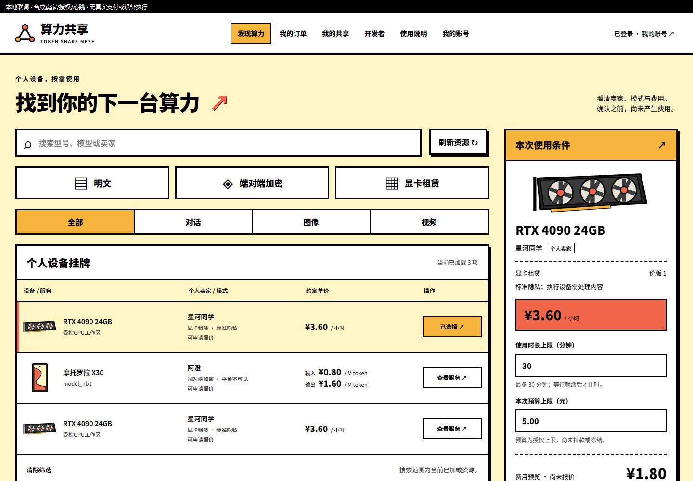
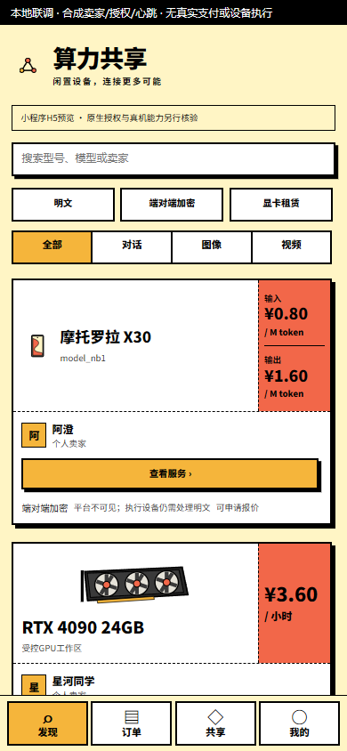
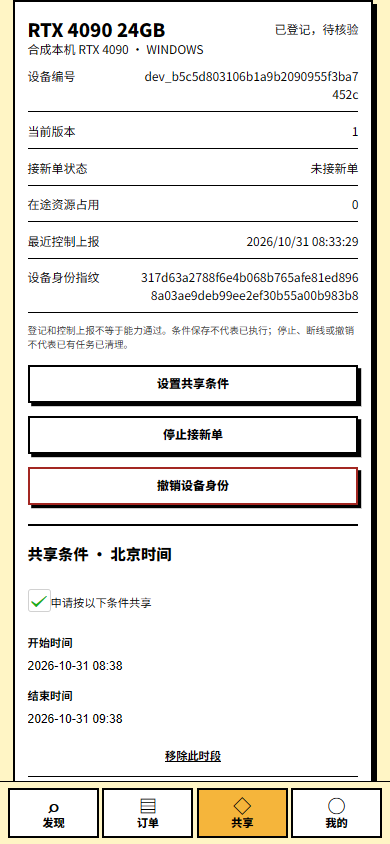
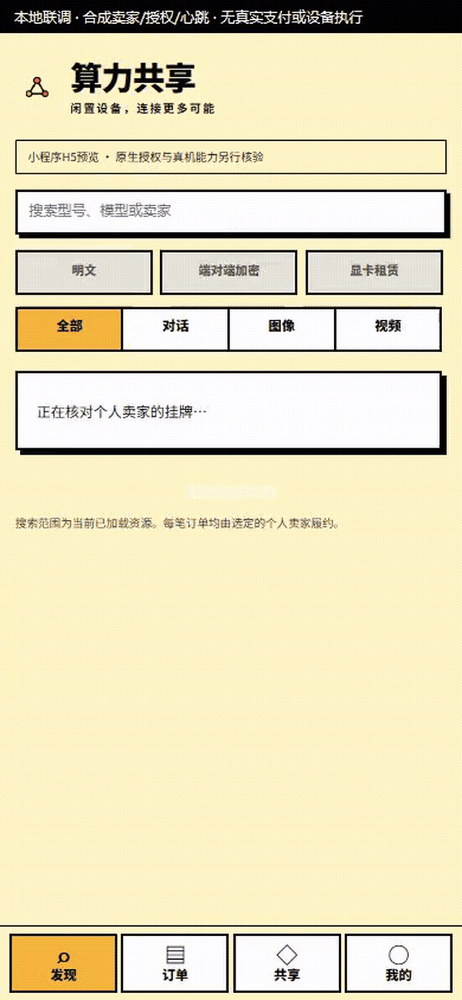
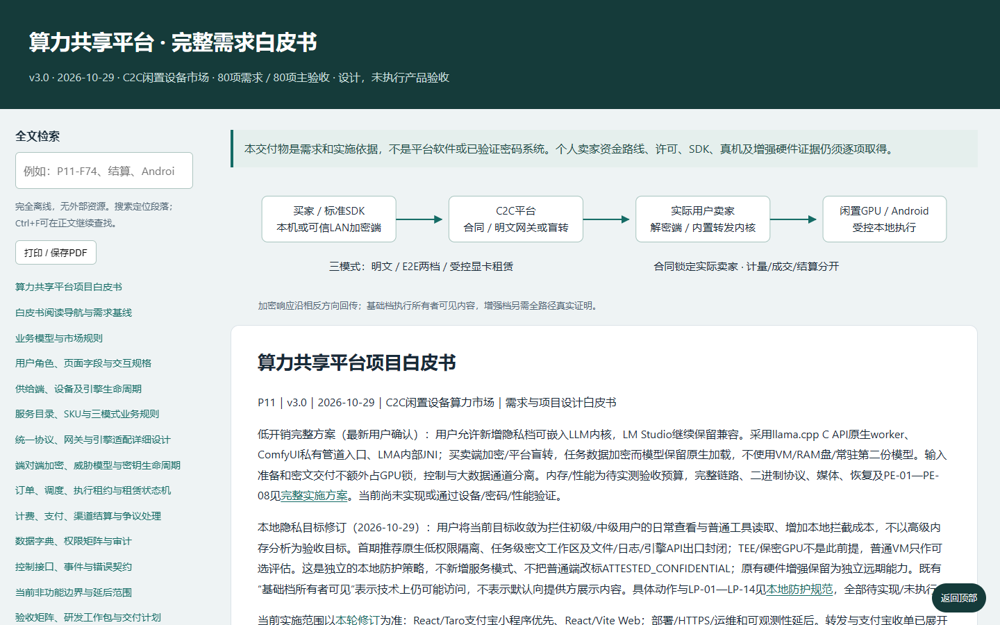
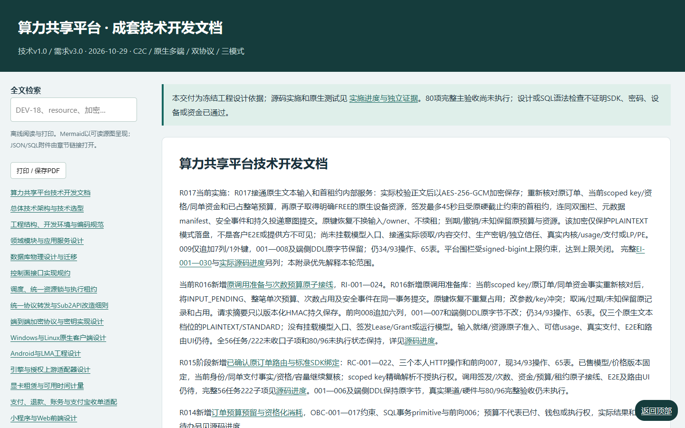
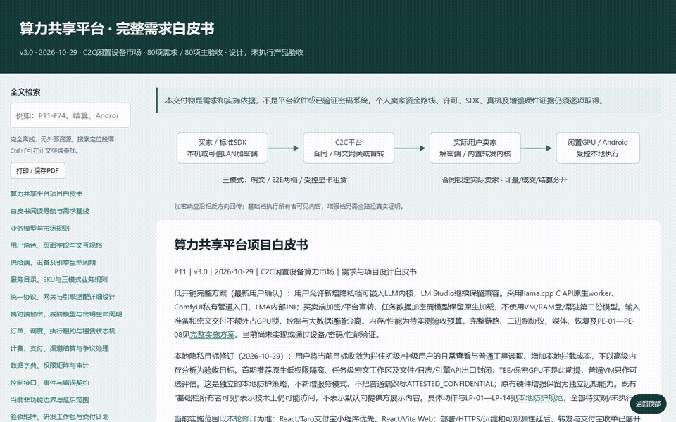

# Token Share Mesh

<!-- Generated from dev/repository/README.en.md.in; run dev/tools/构建仓库文档.py. -->

<!-- R026-ER-CURRENT -->
R026 adds [ER-001–050](docs/技术开发/附录-账户设备公钥目录与原请求发布源码.md): public-only bundle/rotation verification, current account/device binding, immutable public-key purpose claims, reference-only idempotency with current rereads, non-forking signed rotation, explicit version revocation, bounded own listings, original C2C order discovery, six HTTP registrations/the same native DB host, original AEAD client publication intents and five metadata CLI actions. 022/DATA085–086 are source only: 121 planned operations/158 schemas/86 tables/81 control HTTP and three SDK entries. 35 new test definitions including two independent native compositions are uncompiled/unexecuted; 022 is unapplied and no new media is captured. Account binding proves neither independent endpoint trust nor content-key possession, funds, execution or a cipher-channel grant. Existing plaintext lease guards stay closed to E2E. Platform E2E grants/blind storage, private SDK/Host execution, trusted pairing UI, JNI/media, global 4MiB flow/reorder, LOCAL_SEGMENTED_1, independent meters/receipts/real qualification, explicit expired/lost-key and unknown-file recovery and all other production wiring remain open. All 56 tasks/222 steps stay in the same CODE_FIRST round; this is not a completed round.
<!-- /R026-ER-CURRENT -->

<!-- R026-SOURCE-HISTORY -->
The following source snapshots retain their earlier scope and counts. The ER notice above and the full progress registry describe the current state.
<!-- /R026-SOURCE-HISTORY -->

R026 extends [hourly rental source RN-001—110](docs/技术开发/附录-小时租赁授权与累计计量源码细则.md) with independently authenticated original grants, strict Chat/Responses/Messages text input, one-use random RAM AEAD envelopes, a rental-only llama private-pipe adapter, a SQL-independent monotonic deadline loop and owned node shutdown. No fabricated T1 job/attempt or seller/device/model/privacy fallback is used. Original synchronized cleanup receipts and actual process/pipe joins precede any local slot release. See the [rental runtime](dev/src/client/rentalruntime/README.md).

**SOURCE_ONLY / UNVERIFIED.** All 67 rental test definitions remain unexecuted; no compilation, migration, model/GPU/phone run occurred. This RAM AEAD covers GPU_RENTAL/STANDARD text and provides neither network E2E nor provider blindness. Unknown stop/cleanup retains the original owner; unjoined shutdown retains the node lock/master key. Public SDK/model listeners, owner approval UI/independent readiness, real acquiring/paid renewal, confirmed metering, Android rental media, E2E/LP and platform cleanup/budget release remain open. Counts stay at 48 control/nine rental HTTP handlers, 98 planned operations and 71 platform tables. Published DDL bytes are unchanged. All 56 tasks/222 steps remain open until full-scope code precedes batch validation.

2026-11-06: **R026 is in the full-scope code phase (SOURCE_ONLY / UNVERIFIED)**. Complete all production-code work before batch compilation, tests and debugging. The [56-task / 222-step plan](dev/全量代码优先实施清单.md) separates implementation from acceptance. Latest LMA v1.0.0/code65 is pinned and an [Android media overlay](dev/src/client/android/README.md) is being implemented for private image/video execution and chunk-encrypted results. Control wiring, complete encrypted/recovery paths and physical-phone acceptance remain in scope. All R025 test counts below belong to the original R025 revision, not this new source.

The Android source now includes a local owner panel, the existing foreground service/private Binder, independent device identity and approvals, durable original control reports, one-slot progress forwarding, pre-create workspace ownership, conservative reboot cleanup and signed renewal verification. See [Android operation and limitations](dev/src/client/android/README.md) and the [LM contract](docs/技术开发/附录-LMA多模态派生内核与全量代码阶段.md). Eight physical-device boundary tests are source definitions only; no APK or test run is claimed. Original ownership now precedes ACK; identical signed renewals preserve the accepted clock, and confirmed cleanup supersedes pending older progress. These replay rules remain unverified.

Source-only T1 execution continuation rechecks the original admission and stores both signed revisions in forward 012. Separate cleanup recovery in 013 retains the failed report and keeps its lease revoked. Android receives continuations using independent pins/approval, stable signed identity and durable revisions, and reports periodically. Full M1 media admission, desktop integration and all other code remain open; this does not complete media dispatch or paid GPU-rental renewal.

R025 connects an owned native Host session, independent local approval, the original physical GPU/ticket, encrypted result custody and three protocol renderers. A transient input binding preserves the asset ciphertext digest; shutdown waits for its worker and closes owned result readers. The 300 regular, six synthetic ABI, three direct real CUDA and three real Host CUDA top-level cases are recorded separately; platform issuer/order/payment remain synthetic. Full product, E2E/LP, SDK, trusted usage/ACK and funds qualification remain open. See [round](dev/progress/R025-本轮实现与完整待办.md) and [NH contract](docs/技术开发/附录-原生宿主内核接线与输入驻留绑定.md).

## Current implementation

This repository contains **React/Taro Alipay pages, React/Vite Web, shared control logic and a runnable Go/PostgreSQL service subset**, alongside full specifications. The frozen Neubrutalism UI covers marketplace, authoritative quotes, owner orders awaiting payment, and provider pairing/policy/drain/revocation controls. Inference, full device execution, customer E2E content encryption, real payments and the complete platform remain unfinished. Captures label synthetic authorization/qualification; Taro captures show H5, not native Alipay. Provider controls also exercise a real Windows CLI, without GPU execution.

The [NB-R1 requirements](docs/需求推进/NB-1.0/README.md) connect the [five final design pages](dev/design/新粗野主义-v1.0/README.md) with ten supporting views, 48 requirement refinements, 96 unexecuted scenarios and six open contract gaps. New offers use GPU hours or separate input/output prices per M token (1,000,000 tokens). Media runs within controlled GPU rentals without extra per-item charges. R003 implements NB_PRICE_1, exact calculation and quote/order services; R004 adds identity/HTTP; R005 adds seller submissions and versioned listing control. Arbitrary hourly rental sessions, renewals, final billing, trusted usage and production budget-admission integration remain unfinished; historical orders retain their original prices.

| Item | Evidence/status |
| --- | --- |
| Development baseline | 20 modules / 56 tasks / 222 steps / 47 constraints |
| Implementation tasks | 50 in progress · 4 not started · 1 conditional · 1 deferred |
| Latest source round | R025 · PASSED_FOR_CONTROL_AND_RELAY_SUBSET_ONLY |
| Native test evidence | 300 passed · control/native/relay source subsets only |
| Full product acceptance | 80 NOT_EXECUTED |
| Source goal | ACTIVE |

R017 connects internal native-text input and initial lease admission: the actual body is strictly validated and stored with AES-256-GCM. The original order, current scoped key/qualification, same-order funding and existing full per-call hold are rechecked before an explicitly FREE native-device resource, dual fences, metadata manifest, signed first lease (at most 45 seconds within the original hard deadline), safe event and durable delivery intent commit atomically. Original-key recovery never replaces input/owner or renews authority; expiry, revocation and unknown outcomes retain budget and ownership. This protects PLAINTEXT storage only, not customer E2E or provider blindness. Model listeners, actual claim/content delivery, production secrets/independent trust, real engines/usage/payments and LP/PE remain pending. Forward009 adds seven columns/one FK; 001–008 and native SQLite DDL retain their bytes. The scope remains 34/93 operations and 65 tables. Platform generations stop at the persisted signed-bigint limit. [EI-001–030](docs/技术开发/附录-原生输入加密与首租约原子准入.md) · [R017](dev/tests/evidence/R017-验证报告.md) · [56/222](dev/progress/R017-本轮实现与完整待办.md)。

The first R016 full run passed183 and failed one existing signed-renewal cleanup case under its original 400ms bound; resources were retained. Three unchanged isolated repeats passed, but the cause is unproven. A later full pass does not establish timing stability; DEV-53 remains open. See the [development record](dev/tests/evidence/R016-development-attempts.json).

Historical R016 adds original-call preparation: current scoped-key, original order and same-order funding facts are rechecked, then INPUT_PENDING, the full per-call budget hold, one call slot and a safe event commit atomically. Original-key recovery does not reserve twice; changed parameters or keys conflict. Cancellation, expiry and unknown results retain the original intent and hold. Only a versioned HMAC of the transient request digest is persisted. Forward migration 008 adds six columns; 001–007 and native SQLite DDL retain their exact bytes. The scope remains 34/93 operations and 65 tables, with three native text profiles under PLAINTEXT/STANDARD. There is no model listener, Lease/Grant issuer or inference. Input-ready/resource admission, trusted usage, real payments, E2E and route UI remain pending. See [RI-001–024](docs/技术开发/附录-原调用准备与次数预算原子接线.md), [R016 evidence](dev/tests/evidence/R016-验证报告.md) and [all 56 tasks/222 open steps](dev/progress/R016-本轮实现与完整待办.md).

Historical R015 adds confirmed original-order routes and scoped standard-SDK keys. Three owner-session control operations bring the implemented count to 34/93; routes freeze the original seller, listing revision, model, text protocol, price, budget, call ceiling and expiry. ResolveTx selects exactly one key-bound model/profile and rejects ambiguity, revocation or mismatch without seller failover. Forward-only 007 adds five columns and quarantines legacy routes; API startup verifies every embedded migration record. Only PLAINTEXT/STANDARD and the three native text profiles are implemented. Resolution grants no funds or execution; durable invocation/call accounting, real payments, E2E and route-configuration UI remain pending. See [RC-001–022](docs/技术开发/附录-已确认订单路由与标准SDK绑定实施细则.md), [R015 source evidence](dev/tests/evidence/R015-验证报告.md) and [all 56 tasks / 222 open steps](dev/progress/R015-本轮实现与完整待办.md).

R014 adds order-local budget transactions: reserve an original purpose once, consume the actual amount from an existing immutable trade qualification, or release on a qualified zero. Parent-row updates keep ordinary SQL concurrency and stale higher-isolation snapshots from overbooking. Forward migration 006 adds eight columns; all legacy reservation states remain fully held as unverified, and inconsistent history aborts the upgrade. Capacity is not a wallet, paid funds, route/lease admission or GPU release. Qualified-source generation and production admission integration remain pending. See [OBC-001–017](docs/技术开发/附录-订单预算预留与资格化消耗实施细则.md), [current R014 source evidence](dev/tests/evidence/R014-验证报告.md) and [all 56 tasks/222 open steps](dev/progress/R014-本轮实现与完整待办.md).

R013 fixes cancellable native metadata admission, pre-SQL cancellation poisoning, transaction-time lease extension and backend deadline drift. MetadataTimeout now has an independent 2s default per operation (20ms–5s), capped by shutdown deadlines; signed leases and backend call limits are unchanged. Repeated identical mappings and already-persisted stop phases avoid redundant writes. Durable cleanup completion wakes shutdown after slot release, preventing false poll-based timeouts without extending the deadline. Five controlled negative regressions and their failed attempts are retained; current native/full and browser evidence is reported separately. The CLI still enables no inference or hardware qualification. See [NMD-001–013](docs/技术开发/附录-原生元数据事务与执行截止修正.md), [R013 source evidence](dev/tests/evidence/R013-验证报告.md), [current UI evidence](dev/tests/evidence/R013-frontend-checks.json) and [all 56 tasks/222 open steps](dev/progress/R013-本轮实现与完整待办.md).

R012 adds a fixed-seller/contract/route native text relay for Chat Completions, stateless Responses and Messages JSON/SSE subsets. It validates exact fields, separate stream terminals, scoped headers/secrets, no retry and bounded cancellation/deadlines/backpressure. Twenty-one new Go cases (20 relay and one supervisor regression) bring the total to 134, using owned loopback synthetic backends and explicit admission/secret fixtures. No paid inference listener, production route/funding gate, SDK certification, real engine stop, billable usage or content E2E is claimed. Unchanged 21-case TS/three-target build receipts are reused only after source/output/log hash checks; both browser journeys rerun against the current Windows node binary. A deterministic regression fixes stale post-cleanup snapshots being reported as failed shutdowns, without touching replacement owners. The API remains 31/93 operations, 65 platform tables and byte-identical migrations 001–005. See [source evidence](dev/tests/evidence/R012-验证报告.md), [frontend evidence](dev/tests/evidence/R012-frontend-checks.json), [BRC-001–024](docs/技术开发/附录-固定路由协议转发核心实施细则.md) and [all 56 tasks/222 pending steps](dev/progress/README.md). Field allowlists compare complete names exactly; delimiter-bearing forged keys are rejected in request and response regression cases.

**Historical R012 follow-up validation:** the initial R012 full run passed 134 cases in published commit `694f9be`. The exact-field follow-up changes only three relay Go files and passes all 20 relay cases. Another 114 cases reuse only immutable, byte-identical source/module/input evidence; the final R012 full rerun passed 127 cases and FAILED seven existing short-deadline cases, and a serialized diagnostic FAILED six. Host contention was observed but is not a proven cause. No lease, cleanup or test deadline was widened. This is not a current 134-case full pass. See the failure lists and reuse proof in the source report above.

The new contract uses hour_rate for AVAILABLE_HOUR, or both input_rate/output_rate for TOKEN_1M. Each rate has an integer numerator in fen and a positive denominator, together with fee ownership, commission and rounding versions. At 360 fen/hour, 30 minutes costs at most 180 fen; 1M input at 80 fen/M plus 0.25M output at 160 fen/M totals 120 fen. Quotes freeze seller, environment, policy, rates and budget. Creating an order rechecks admission and atomically writes WAITING_PAYMENT, quote consumption, consent audit and outbox. It does not pay, lock a GPU or execute work. A 350 fen/hour rate cannot be rounded into the legacy integer-fen/minute column.

## Current identity and HTTP flow

The native control command is `p11-api`. Explicitly configure the selected development database, application identity and secret-file paths, then apply migrations; [environment variables and call order](dev/repository/USAGE.md) are documented. It listens on loopback and enables no test login, model or payment shortcut. The [embedded route manifest](dev/src/api/internal/http/routes.json) drives 34 actual operations and is checked against the 93-operation canonical contract; the other operations remain pending.

Seller submissions remain SUBMITTED and grant neither SELLER nor sale admission. New listings require approved regions, owner-specific concrete models/capabilities and explicit platform fees. Edits create future revisions without changing sold contracts; exit closes new admission while existing obligations continue. Provider pairing/policy/drain/revocation pages are implemented; the complete listing editor, real review, hardware qualification, execution endpoint and controlled publication remain unfinished.

The native miniapp explicitly selects ALIPAY_NATIVE_NONCE_1: a 32-byte server-generated one-time proof stored only as a digest, then my.getAuthCode and POST exchange. Bearer remains memory-only; restart requires authorization. This is not client-generated PKCE and uses neither Math.random nor timestamps. Command IDs use an independent memory-only HMAC counter seed, never content keys. Web/H5 uses WebCrypto S256, bound Cookie/state and the implemented callback; OAuth URL parameters and temporary proof are consumed immediately. Session transport is HttpOnly/Strict Cookie plus Origin/CSRF for writes. Login is not KYC or seller approval; new accounts receive BUYER only. Unknown exchange requires fresh authorization.

Current UI/HTTP trade stops at qualified market → frozen quote → explicit buyer confirmation → WAITING_PAYMENT. Unknown writes retain an owner-partitioned original key/body and recover that request after reload; the server rechecks current authorization before replay. API keys cannot purchase. Inference endpoints, payment-success processing and the complete frontend remain unfinished.

## Implemented provider control flow

An approved seller explicitly creates a five-minute pairing credential, disclosed once. The native installation generates a fresh Ed25519 identity and submits its public key, OS/release, resource kind and concrete model. Registration produces PAIRED with sharing disabled. The original enrollment key/fields recover the same device; no secret is redisclosed. Reinstallation requires a fresh key and pairing.

Subsequent P11_DEVICE_ED25519_1 proofs bind method, authority, exact URI, raw-body digest, idempotency key, If-Match and Content-Type; timestamps allow ±60 seconds and nonces are durably deduplicated. This custom control profile is separate from content encryption and is not HTTP Message Signatures. The Go library exposes NewClient→Prepare→Send→Close. Unknown writes require explicit recovery of the same prepared command with a fresh proof; there are no automatic retries or replacement command IDs. Owners use their account session and a strong ETag to set sharing windows, one slot, disk and phone battery/temperature/charging conditions. Drain/revoke close admission while actual stopping/cleanup remains the execution endpoint’s responsibility.

Configure the separate P11_DEVICE_PAIRING_PEPPER_FILE or pairing stays closed. p11-node provides init/enroll/recover/status/heartbeat/run with bounded piped stdin. Windows DPAPI or Linux Secret Service protects the master; the AES-GCM journal and OS lock persist original commands before transmission. Reports stay UNKNOWN with execution_enabled=false; no engine/listener starts. An approved SELLER explicitly selects platform/name and confirms ownership in the sharing page. Credentials are masked and revealed only on request, then used in the owner CLI; leaving removes them. A lost first reply recovers metadata only; a new intent requires fresh confirmation. Beijing-time windows, integer MB and phone conditions require a strong ETag and responsibility confirmation. Refresh after saving; drain/revocation do not acknowledge GPU cleanup. Real Linux keyrings, production RuntimeSupervisor process isolation/actual engine adapters, signed rental ownership, independent platform trust and content E2E remain pending. See [bilingual usage](dev/repository/USAGE.md), [provider UI constraints](docs/技术开发/附录-提供方双端设备管理与原请求恢复.md) and [native agent specification](docs/技术开发/附录-原生提供方控制代理与本地恢复.md).

## Native execution metadata and ownership

After explicit owner enrollment, execution-init creates one SQLite store anchored first in the existing OS-key-protected AES-GCM journal. execution-status opens that same store and exposes only resource phases/counters and receipt count. A missing/corrupt/mismatched store is never recreated, and reopening quarantines every previous owner. No command accepts a lease or prompt, launches an engine or enables paid work; execution_enabled remains false.

The library validates the existing signed Lease against an independently approved plan and a separately trusted Ed25519 platform key. It persists original command IDs, uint64 job/resource fences and backend mapping before external effects. Managed local use, jobs and maintenance share one physical digest and local owner generation; unsigned rental grants are refused. A duplicate or ambiguous submission queries the original request. Renewals require a higher signed revision, immutable terms/environment and a fixed hard deadline; absolute/monotonic expiry or clock rollback closes authority. Only current backend stop plus complete token/workspace cleanup with the matching owner generation can release a resource. This state machine does not itself prove a real backend stopped or perform GPU/key/file cleanup.

SQLite contains bounded control metadata only, not prompts, output, media or content keys; its page cache is limited to 2MiB, mmap is disabled and the database is capped at 16384 4KiB pages. It is not the encrypted content store. Exact CGO-free SQLite dependencies and bundled notices are recorded; no VM or model copy is added. Full engine/resource discovery, platform issuer/trust lifecycle, production timer/engine integration, rental parent sessions, content E2E and physical performance tests remain pending. [Complete numbered specification](docs/技术开发/附录-原生执行收件箱与资源门闩实施细则.md) · [usage and recovery](dev/repository/USAGE.md).

## Running supervisor and backend recovery

The watchdog uses only metadata Work records, never prompts, argv, paths, URLs or content keys. Registrations bind environment/capability/manifest exactly and cannot silently fall back. An adapter must honor bounded contexts, query/cancel the original request authoritatively, and prove STOPPED before generation-scoped cleanup. Cancel ACK, network loss, missing PID or a shutdown timeout cannot release a resource. Unknown control commands or revoked/draining state close admission while recovery remains available. The trusted embedding API is NewSupervisor → RunSupervised; paid task reception and production engine adapters are not exposed by the CLI. [Complete usage](dev/repository/USAGE.md) · [NSV-001–020](docs/技术开发/附录-原生执行监督与后端恢复实施细则.md).

## Inspect a local native GPU package

After preparing the pinned native toolchain as described below, build the worker, explicitly fetch/verify the frozen research inputs, then build the node:

```powershell
python dev/tools/构建原生LLM内核.py --fetch
python dev/tools/准备真实LLM验证包.py --fetch --model-mirror hf-mirror
python dev/tools/核验原生源码.py --round R024
$meshPackage = Get-Content runtime/native-llama/preparation.json -Raw | ConvertFrom-Json
@{ package=$meshPackage.package; package_sha256=$meshPackage.package_sha256 } | ConvertTo-Json -Compress | & ./runtime/bin/p11-node.exe gpu-discover --runtime-root "$PWD/runtime"
```

Use PowerShell 7 with UTF-8 input. The explicit fetch may download roughly 1.2 GB of pinned runtime/model inputs plus the compiler; these stay ignored in `runtime/`. Discovery verifies pins and returns actual board metadata with `execution_enabled=false` and `qualification=NOT_GRANTED`. It loads no model and opens no content server. The owner must then select the exact UUID/PCI and independently approve its environment. `kernel-inspect` validates that selection without inference; native execution is currently an embedding/test-library path, and the node does not expose a public inference command. Formal Host/marketplace approval remains pending. See the [32 identity requirements](docs/技术开发/附录-物理显卡身份探测与启动绑定.md).

## Screenshots and recording







[Web provider conditions](dev/media/R025/screenshots/web-provider-conditions.png) · [Revoked identity state](dev/media/R025/screenshots/miniapp-provider-revoked.png)



[Web MP4](dev/media/R025/recordings/web-transaction.mp4) · [Taro H5 MP4](dev/media/R025/recordings/miniapp-transaction.mp4) · [Web GIF](dev/media/R025/recordings/web-transaction.gif) · [Unknown-order reply](dev/media/R025/screenshots/web-order-pending.png) · [Product provenance](dev/media/frontend-manifest.json)

Compiled pages connect a real local HTTP/database chain. Synthetic OAuth/qualifications/device heartbeats exist only in the test binary. There is no real authorization, payment, device execution or model result. The following reader captures have a separate provenance record.







[Watch/download the MP4 recording](dev/media/recordings/readers-tour.mp4) · [Search screenshot](dev/media/screenshots/whitepaper-search.png) · [Mobile-width reader](dev/media/screenshots/whitepaper-mobile.png) · [Media provenance and reproduction](dev/repository/MEDIA.md)

The Chinese readers demonstrate local search/navigation. Reader and product captures have separate manifests; neither demonstrates a model result, successful payment or real device execution.

## Three service modes

| Mode | What the buyer purchases | Content handling | Execution and acceptance |
| --- | --- | --- | --- |
| Plaintext | A specified model call or approved media workflow | The platform gateway and performing seller can process plaintext; any upstream processor must be disclosed | Contract-bound execution, trusted usage/result evidence |
| End-to-end encrypted | A task for an explicitly confirmed seller endpoint | Buyer-local gateway encrypts; platform relays ciphertext; seller service decrypts for inference and encrypts results back | Bound identity, authenticated streams and buyer receipt |
| GPU rental | A bounded period in an approved GPU application environment | The selected environment/privacy policy governs content | Both parties ready before billable availability; hard expiry and actual cleanup |

Encryption is a processing path, while privacy strength is a separate qualification. `PLATFORM_BLIND` hides content from the platform, but the executing device processes plaintext. Local protections aim to make routine UI/file/log/API/packet inspection harder for ordinary and intermediate users. They do not claim protection from advanced memory/GPU extraction or full host control. `ATTESTED_CONFIDENTIAL` is a separate conditional capability requiring genuine end-to-end hardware evidence; it remains disabled.

## Request routing and API compatibility

The planned data plane accepts **OpenAI Chat Completions**, **OpenAI Responses** and **Anthropic Messages**, plus explicitly approved media/audio subsets. A published compatibility profile defines supported models, fields, tools, streaming events and limits. Unsupported semantics are rejected rather than silently dropped.

```text
Plaintext:
App / standard SDK -> platform Sub2API-like gateway
                   -> confirmed seller adapter -> native engine / authorized upstream

Encrypted:
App / standard SDK -> buyer-local or paired trusted-LAN gateway
                   -> ciphertext relay -> seller-private gateway -> native worker
Response           <- local authentication/decryption <- ciphertext <- seller encryption
```

Routing configuration binds the actual seller, immutable contract, mode, model/workflow, budget and deadline. Standard SDK requests do not need private JSON fields. Missing routing configuration cannot default to plaintext or purchase compute automatically. A single order permits at most one disclosed retry within the same seller's eligible devices; changing sellers requires the buyer to confirm a new transaction.

The plaintext core is intended to reuse or adapt a Sub2API-like implementation after revision, license and dependency review. Default account pooling, cross-seller rotation, wallet logic and content telemetry must not bypass the C2C contract. The encrypted path has a buyer-side and seller-side local forwarding core; the platform must not decrypt it. See [gateway design](docs/技术开发/07-统一协议网关与Sub2API改造.md).

## Provider software and kernel choices

| Provider | Planned local software | Replacement policy |
| --- | --- | --- |
| Windows/Linux private LLM | Native supervisor + C++ worker embedding the llama.cpp C API, connected by controlled pipes | Approved engine/model/template/backend versions; no plaintext HTTP inference hop in the private path |
| Windows/Linux compatible LLM | LM Studio CLI (`lms`), llmster and actual inference runtime | Three independently versioned layers; compatibility does not itself grant local privacy qualification |
| Windows/Linux media | Complete native ComfyUI environment, PrivacyBridge and approved image/video/audio/3D capability packs | Explicit provider consent, limited node/dependency allowlist, staged validation and drain-before-switch |
| Android | A pinned LMA fork with Java/Kotlin and internal JNI inference bridge | Executable changes through signed APK updates; model downloads are separate; no arbitrary executable hot loading |

Providers control whether they participate, resource/time limits, eligible kernels, installation consent and published prices. The scheduler chooses only among already approved resources within the accepted contract. The provider UI shows resource usage, component versions, task stage, earnings and stop controls; privacy tasks do not expose prompts or outputs through ordinary UI/history/log APIs. GPU/phone support is a development target, not an already verified capability.

## End-to-end encryption design

The current candidate uses libsodium sealed boxes for per-object stream-key wrapping, `secretstream_xchacha20poly1305` for authenticated sequential records and separate Ed25519 signatures for endpoint identity and context. Exact library revisions, bindings, cross-platform byte vectors and independent review are still required. A sealed box does not authenticate its sender; signatures and independently verified endpoint identity are mandatory.

1. Confirm seller, recipient identity/key version, environment and contract through a disclosed trust procedure. Platform-delivered key and fingerprint alone do not constitute independent verification.
2. Create an `INPUT_PENDING/PREPARED` context bound to order/job/attempt/token/recipient. It grants no execution right and holds no GPU lock.
3. Buyer encrypts inputs; platform forwards ciphertext and minimal routing metadata. Only after input, funding, permission and capacity checks can the platform issue a signed execution lease.
4. Seller checks the job token and physical-resource lock generation, decrypts within the controlled native path, and runs the approved engine.
5. Encrypt outputs before their first persistent write. Buyer authenticates/decrypts and submits a signed acceptance or rejection receipt. Delivery recovery can continue after GPU cleanup without granting new execution rights.

The proposed `BINARY_STREAM_1` carries a bounded header and sequential authenticated records (`uint32be length + uint64be sequence + ciphertext`). Plaintext records are at most 64 KiB, including the 8-byte internal header. A single stream shares a 4 MiB buffer budget; this is a design limit, not a benchmark. `END` itself uses `TAG_FINAL`; closing a socket is not successful completion. Resumption retransmits original ciphertext, never blindly reruns inference.

Only task data is encrypted at rest. Model weights remain in native read-only/mmap-compatible files; the design adds no VM, RAM disk or resident second model copy. Random reads use separately authenticated local segments after complete object verification, not arbitrary seeking inside one secretstream. Detailed [protocol](docs/技术开发/08-端到端加密协议与密钥实现设计.md) and [low-overhead local design](docs/技术开发/附录-低开销隐私执行完整方案.md) remain the implementation authority.

## Contracts, scheduling and money

- Quotes and orders freeze buyer/seller, listing revision, eligible devices, kernel environment, capability/profile, price, platform fee, budget, deadline and acceptance policy.
- All engines and service modes on the same physical GPU share one resource lock. Job fencing and resource-generation fencing are separate, persistent and monotonic. Rental subtasks do not release their parent session lock.
- Cancellation, timeout or disconnection does not make a GPU reusable until actual stop/cleanup is confirmed. Delivery acknowledgements cannot clean up a newer owner.
- Money uses bounded integer fen and rational cumulative pricing. Rounding each stream chunk independently is forbidden. Result acceptance, consumption evidence, accounting and seller settlement are separate events.
- Financial operations retain a unique original business reference. An unknown outcome is queried under that reference; it is not blindly recreated. Generic jobs are limited to approved query/cleanup/notification operations.

The payment design follows the Alipay Payathon Machine Pay/A402 path: precreate, a payment challenge, buyer payment, proof verification and then authorized delivery. A normal OpenAI/Anthropic SDK does not automatically pay a `402`. The miniapp/Web or an explicitly payment-capable local program must complete the authorized payment interaction. Actual personal-seller eligibility, service registration, fees, refund and settlement support require independent channel confirmation. No real transaction or C2C settlement qualification has been demonstrated. See the [payment specification and dated official sources](docs/技术开发/13-支付退款账务与渠道结算.md).

## Build and use the current frontends

Use native Node22.14.0/npm10.9.2 from the clone root. Dependencies, cache and outputs remain under runtime.

```powershell
python -X utf8 dev/tools/前端开发.py bootstrap
python -X utf8 dev/tools/前端开发.py check
python -X utf8 dev/tools/前端开发.py test
python -X utf8 dev/tools/前端开发.py build
```

Alipay output is runtime/frontend/builds/miniapp-alipay; H5 is miniapp-h5, Web is web. Native builds require an explicit P11_FRONTEND_API_BASE and actual application identity; an empty address blocks native login. Web/H5 defaults to same-origin control. Authorize → select seller/model/mode → enter limits/budget → obtain authoritative quote → explicitly confirm → wait for payment. If a reply is unknown, reload and use “核对原请求” with the original parameters. Provider pairing/policy/drain/revocation are available; seller qualification/listing views are read-only and payment stays closed. See the [bilingual frontend guide](dev/src/frontend/README.md).

After building, the native database verification command below runs real compiled UI/HTTP/PostgreSQL journeys. The test binary temporarily supplies synthetic OAuth/qualifications/device heartbeats, captures actual screenshots/recordings and closes its browser/database. It cannot approve real sales. H5 does not validate native Alipay behavior.

## Run what exists today

Run commands from the clone root. The native bootstrap and database harness currently target **Windows amd64**, with **Python 3.13** recommended for the pinned documentation wheels. Native Node22.14.0/npm10.9.2 is used for the frontends, reader checks and media capture. Downloads, caches and temporary databases stay in `runtime/`.

```powershell
git clone git@github.com:copypasteltd/Token-Share-Mesh.git
cd Token-Share-Mesh

# Documentation dependencies, reconstruction and structural checks
python -X utf8 dev/tools/文档工具.py bootstrap
python -X utf8 dev/tools/文档工具.py build
python -X utf8 dev/tools/文档工具.py check

# Read the real offline readers locally; Ctrl+C stops this local server
python -X utf8 dev/tools/预览文档.py --port 8765
```

Open `http://127.0.0.1:8765/`, search by requirement ID or keyword and follow the chapter links. The generated HTML files can also be opened directly. This local read-only preview is not a platform deployment and does not expose `runtime/`, `.git` or directory listings.

```powershell
# Explicit native tool download/bootstrap; no system database service installation
python -X utf8 dev/tools/获取原生工具链.py
python -X utf8 dev/tools/原生开发.py mod download

# Disposable loopback PostgreSQL -> real tests -> instance stopped
python -X utf8 dev/tools/核验原生源码.py --round R017
python -X utf8 dev/tools/原生数据库验证.py --round R017
python -X utf8 dev/tools/核验前端源码.py --round R017
python -X utf8 dev/tools/整理原生验证证据.py --round R017
```

These commands explicitly target R017 and preserve earlier evidence. The full runner isolates core, Web and H5 into three sequential Go processes, with freshly migrated and subsequently dropped native databases for each browser journey; all 204 unique top-level IDs and both browser children must pass. The strict consolidator rejects failed current runs. The 150ms lease case records either safe zero-submission rejection or one deadline-bounded submission, without increasing lease or metadata budgets; the historical R012 helper cannot substitute for R017 full validation. Build the frontends and native binary before database/browser integration. Missing database configuration in a bare `go test` causes database cases to skip; that does not equal a native integration pass. The Linux admin/API/node commands are cross-compiled only; no Linux runtime or GPU acceptance is claimed. For an explicitly selected PostgreSQL 17 database, the CLI supports `migrate` and `check-schema` using `P11_DATABASE_URL`; see [usage and recovery notes](dev/repository/USAGE.md).

Optional subsets: `python -X utf8 dev/tools/原生数据库验证.py --round R017 --suite route` or `--suite budget` / `--suite execution` writes separate `R017-route-*`, `R017-budget-*` or `R017-execution-*` evidence. These cannot replace all 204 regression cases or product acceptance.

## Intended buyer and seller usage

**Buyer:** choose a seller/capability → inspect mode, privacy, price and limits → accept an immutable quote/order → complete authorized payment → configure the contract-bound SDK route → run the task or rental → authenticate and accept the result → handle any dispute with minimal necessary evidence. For encrypted tasks, install/pair the local gateway before sending content.

**Seller:** enroll → pair a device → approve a kernel/model/node set and resource policy → pass applicable capability/license checks → publish a listing and price → opt in to scheduling → see stages/resources/earnings → stop new work and drain existing work when changing kernels or withdrawing. Android availability additionally depends on consent, charging, network, temperature and foreground lifecycle rules.

These are specified user journeys. They become runnable only as the corresponding entries in the implementation tracker are completed and verified.

## Repository map

```text
README.md / README.zh-CN.md       English and Chinese entry points
CHANGELOG*.md                    Synchronized release notes
dev/src/go.mod                   One Go module
dev/src/api/cmd/p11-admin/        Native migration/check CLI
dev/src/api/cmd/p11-api/          Native loopback identity/control API
dev/src/api/internal/http/       34-operation registration and credential adapters
dev/src/internal/                Database, keys, idempotency, durable jobs
dev/src/shared/                  IDs, safe errors, clock, money
dev/src/tests/integration/       Real PostgreSQL tests
dev/planning/ + dev/contracts/   Maintained plan and generated 56-task manifest
dev/modules/ + dev/docs/         20 module specifications and 222 substeps
dev/progress/                    Per-round delivery and complete pending tables
dev/tools/                       Native, documentation, media and repository tools
dev/repository/                  Bilingual supporting guides and README templates
dev/media/                       Actual screenshots, MP4, GIF and provenance
dev/src/frontend/ + miniapp/ + web/  Shared TS and both client sources
dev/src/client/                 Native control CLI/journal/key adapters/protocol
dev/licenses/                    Current Go and frontend dependency notices
docs/白皮书/                     Detailed requirements and offline reader
docs/技术开发/                   Architecture, protocols, SQL and offline reader
scripts/                        Existing authoritative document generators
runtime/                        Local data/tools/models/caches — never committed
```

React + Taro is selected for the Alipay miniapp; React + Vite for Web. Desktop providers use native processes and Android uses a real LMA fork. Local Docker, WSL, QEMU/VMs and Android emulators are excluded. Server deployment, public HTTPS and observability engineering are explicitly deferred.

## Contributing and keeping releases in sync

Read [CONTRIBUTING](CONTRIBUTING.md) and [the synchronization workflow](dev/repository/SYNCHRONIZATION.md). Update the maintained README templates, both changelogs and the full 56-task tracker for each meaningful round. Regenerate affected specifications; refresh real media when the illustrated UI or usage changes; validate before committing and pushing `main` to the configured repository. Never force-push over another contributor's changes.

Applied migrations and content-addressed files retain exact bytes across checkout; `.gitattributes` prevents silent line-ending conversion. Do not rewrite an applied migration. Runtime data, secrets, downloaded kernels/models and binaries stay out of Git. Third-party notices are recorded separately and do not establish upstream API or model resale authorization.

## Documentation entry points

- [Complete development rules and numbered constraints](dev/开发细则总表.md)
- [Requirements whitepaper](docs/白皮书/00-阅读导航与需求基线.md)
- [Technical implementation navigation](docs/技术开发/00-技术文档导航与实施基线.md)
- [System design / 系统方案](dev/repository/SYSTEM_DESIGN.md)
- [Usage / 使用指南](dev/repository/USAGE.md)
- [Media / 演示媒体](dev/repository/MEDIA.md)
- [Implementation evidence and every outstanding task](dev/progress/README.md)

## R026 ComfyUI source checkpoint / 源码检查点

R026 adds [CE-001–036](docs/技术开发/附录-ComfyUI完整环境安装与原节点登记源码.md): independently pinned/signed complete catalogs and local license/node consent, bounded immutable ZIP installation and whole-tree checks, the original node AEAD registry, shared physical maintenance selection and five metadata-only local CLI operations. Official source is pinned to ComfyUI v0.44.0/2c75dc1b379a59e0880619d029607af5169a62ef; no complete actual runtime archive ships yet. All 31 new test definitions remain uncompiled/unexecuted. Media worker/first-write encryption/rental integration, actual qualification and performance remain open. RN-110/67 rental tests and every 56/222 task/step remain open until full-scope code precedes batch validation. No DDL change/migration.

## R026 MW-001—044 私有媒体源码继续 / Private media source

R026 adds [MW-001–044](docs/技术开发/附录-ComfyUI私有媒体执行与本地加密源码.md): a fixed native private Comfy worker, exact CUDA UUID/PCI, finite recipes, PNG/fragmented MP4/PCM WAV/geometry GLB encoders, original workspace anchors, encrypted pre-create reservations, chunked GCM and a Go single-use original-scope receipt/private-frame boundary. All 44 new test definitions remain uncompiled/unexecuted. The actual host launcher, rental-media Backend, complete runtime archives, public delivery, OS low-privilege/E2E and performance remain open. CE31/RN67 and all 56 tasks/222 steps remain open until full-scope code precedes batch validation. No SQL change.

## R026 CH-001—036 原环境与宿主源码继续 / Original environment and host source

R026 adds [CH-001–036](docs/技术开发/附录-ComfyUI原环境持有与本机进程接线源码.md): original Comfy environment lifetime references, fixed native process/three pipes, PIPE_2 preparation/one-shot original grant ACK/monotonic deadlines and original ProviderRental preparation wiring. All 29 new test definitions are uncompiled/unexecuted. CH-033–036 rental-media Backend, authenticated workspace/recovery cleanup, public delivery, complete runtime archives/OS low privilege/E2E, independent readiness/metering/paid renewal/platform release remain open. All 56 tasks/222 steps remain open; no SQL change, migration or engine run. Full-scope source precedes batch validation; a source checkpoint is not a completed development round.

## R026 WS-001—030 原媒体工作区与结果托管源码 / Original media workspace and custody source

R026 adds [WS-001–030](docs/技术开发/附录-租内媒体工作区与结果托管源码.md): original rental media workspace reservations/native migration 003 source, node-owned directory lifetimes/retirement/cleanup-only recovery, authenticated RAM media input, typed child adapter and result-key custody/revocation. All 23 new test definitions are uncompiled/unexecuted. Public SDK/media sessions, independent stopped-work reconciliation/readiness/paid renewal/hour meters/platform release, complete runtime archives/OS low privilege/E2E/performance remain open. All 56 tasks/222 steps remain unaccepted. Native 003 is registered as source only; no migration or runtime was executed. Complete all source before batch validation; this source checkpoint is not a completed development round.

## R026 MS-001—036 原媒体会话监督与停止回收源码 / Original media-session supervision source

R026 adds [MS-001–036](docs/技术开发/附录-原租赁媒体会话监督与停止回收源码.md): node-owned original media-session supervision, independent monotonic withdrawal, the actual typed Comfy leaf, once-only original authorization/one pending input, actual joins, stop-before-cleanup, combined text/media node closure, result retention/revocation and local-session cleanup CAS source. All 27 new test definitions are uncompiled/unexecuted. Public media SDK/final ACK, independent readiness/hour meters/paid renewal/platform fund release, physical crash reconciliation, complete runtime archives/OS low privilege/E2E/performance remain open. All 56 tasks/222 steps remain unaccepted. No SQL changes or migrations. Complete all production source, dependency wiring and test source before batch validation. This source checkpoint is not a completed development round.

## R026 MG-001—036 原租赁媒体入口与加密缓存源码 / Original-rental media gateway source

R026 adds [MG-001–036](docs/技术开发/附录-原租赁媒体兼容入口与加密缓存源码.md): an original-rental local STANDARD media handler, approved Images/explicit legacy Videos/WAV speech/Responses assets, strict requests and independent scopes, AES-GCM staging, original-id HMAC replay, result capacity reserved before submission, complete authenticated results before encrypted caching/ranges, and actual node-owned HTTP/callback/cache joins. All 37 new test definitions remain uncompiled/unexecuted. Public SDK/listeners/E2E media transport/final ACK, independent readiness/hour meters/paid renewal/physical reconciliation/platform fund release, complete real recipes/low privilege/performance remain open. All 56 tasks/222 steps remain unaccepted. No SQL changes or migrations. Complete all production source, dependency wiring and test source before batch validation. This is a source checkpoint, not a completed development round.

## R026 MP-001—040 原支付边界与凭证恢复源码 / Original-payment boundaries and recovery source

R026 adds [MP-001–040](docs/技术开发/附录-MachinePay原支付边界与凭证恢复源码.md): original personal-seller payment bindings and two key pins, a native RSA2 precreate/verify adapter, bounded A402, strict original Payment-Proof, AES-GCM/native ciphertext artifacts, monotonic and late-paid facts, funding guards, refund capacity and original-scope reconciliation. All 49 new test definitions remain uncompiled/unexecuted; synthetic-key lazy initialization now uses the pinned standard library two-result interface. Platform transactions/outbox/unique consumption/signed receipt archive/secret and authority registry, authenticated HTTP/SDK/PayLauncher, exclusive host and durable recovery workers, actual refund/payout/commission/statements and trusted usage/hour meters/ledger remain unwired. No real personal-seller/channel qualification or charging is enabled. All 56 tasks/222 steps remain open. No SQL changes/migrations. Complete all production source, actual dependency wiring and test source before batch validation. This is a source checkpoint, not a completed development round.

## R026 PT-001—040 支付事务与原凭据恢复源码 / Original-payment transactions and recovery source

R026 adds [PT-001–040](docs/技术开发/附录-MachinePay支付事务与原凭据恢复源码.md): original personal-seller payment/PAY-intent/context/outbox transactions, independent reviewer evidence and sale gates, commit-before-once precreate, complete signed envelopes and separate archive keys, atomic receipt/payment/channel/outbox updates, encrypted original-proof QUERY/jobs, capability-filtered generation recovery and actual operation joins. Forward016/DATA072–074 yields 98 planned operations/74 platform tables/48 control HTTP operations. All 16 new test definitions remain uncompiled/unexecuted; no migration ran. API/worker hosts and secret registry/rotation, HTTP/SDK/A402/PayLauncher, uniquely usable funds/current refund-device-deadline admission, full refunds/payouts/fees/statements/paid renewal/trusted metering/acceptance/ledger and real qualification remain open. All 56 tasks/222 steps remain unaccepted. Complete all production source, actual dependency wiring and test source before batch validation. This is a source checkpoint, not a completed development round.

## R026 PH-001—040 原生支付宿主与本人接口 / Native payment host and owner HTTP source

R026 adds [PH-001–040](docs/技术开发/附录-MachinePay原生宿主与本人支付接口源码.md): explicit native registration, independent secrets and proof/receipt keyrings, bounded rooted files, dedicated original recovery/expiry, actual joins before key release, two existing authenticated payment create/get HTTP operations and API/worker entrypoints. Current source: 50 control HTTP operations/98 planned operations/74 platform tables; no SQL changes. All 12 new test definitions and earlier R026 source remain uncompiled/unexecuted. SDK/Proof/A402/PayLauncher, unique funds/current refund-device-deadline admission, full qualified refunds/payouts/fees/statements/renewal/trusted metering/acceptance/ledger and real qualification remain open. All 56 tasks/222 steps are unaccepted. Complete all production source, actual wiring and test source before batch validation; this is not a completed round.

## R026 GF-001—040 原订单资金分配与当前准入 / Original allocation and current admission source

R026 adds [GF-001–040](docs/技术开发/附录-原订单资金唯一分配与当前准入源码.md): unique original-order allocation DATA075/forward source 017, metadata-only admission after verified payment, atomic READY/outbox, current parties/four approvals/gate/refund/deadline guard and route/rental/scoped-key consumers. Current source: 50 control HTTP operations/98 planned operations/75 platform tables; 14 new test definitions remain uncompiled/unexecuted, and 017 is unapplied. Only the explicit zero-fee profile is wired. Legacy positive flag fixtures, SDK/Proof/A402/PayLauncher, full qualified fees/refunds/payouts/statements/renewal/trusted metering/acceptance/ledger and real qualification remain open. All 56 tasks/222 steps are unaccepted. Complete all production source, actual dependency wiring and test source before batch validation; this is not a completed round.

## R026 CK-001—040 原付款挑战与双端恢复 / Original checkout challenge and recovery source

R026 adds [CK-001–040](docs/技术开发/附录-原订单付款挑战与双端恢复源码.md): original-seller payment options, unique original-order payment lookup, original 402 challenge, single-header proof submission/recovery, React/Taro and React/Vite original checkout panels, a metadata-only recovery journal and session-generation guards. Current source: 55 control HTTP operations/103 planned operations/124 schemas/75 platform tables; 26 new test definitions are uncompiled/unexecuted. No SQL changes or migrations. The approved actual PayLauncher/miniapp integration, prepayment original-buyer SDK authority, SDK data-plane recovery, cross-client wallet recovery, full fees/refunds/payouts/commission/statements/renewal/trusted metering/acceptance/ledger, legacy positive fixtures and real qualification remain open. No approved PayLauncher is installed: payment launch stays disabled. Existing screenshots/GIFs predate these source changes; fresh captures wait for full-source batch validation. All 56 tasks/222 steps remain open; this is not a completed round.

## R026 RF-001—040 原退款适配与加密归档 / Original refund adapter and encrypted archive source

R026 adds [RF-001–040](docs/技术开发/附录-原退款协议与渠道恢复源码.md): a separate conditional original-refund profile/intent, native RSA2 submit/query, pre-dispatch UNKNOWN preparation, three-second submit and ten-second query boundaries, generations, monotonic success and encrypted complete signed refund archives. Submit refund_fee is the original trade cumulative total; only an exact signed original-refund query can confirm this partial refund. 32 new test definitions are uncompiled/unexecuted. Counts stay at 103 planned operations/124 schemas/75 platform tables/55 control HTTP operations; no SQL changes or migrations. Default Machine Pay still exposes only precreate/verify. Actual original-transaction refund qualification, durable cumulative locks/dispatch watermarks/jobs, refund host/worker/HTTP and full fees/commission/payout/reconciliation remain open. The CK approved PayLauncher/prepayment SDK authority/data-plane recovery, GF031 legacy positive fixtures and all 56 tasks/222 steps remain open. Complete production source, actual dependency wiring and test source precede batch validation and fresh media capture; this is not a completed development round.

## R026 RT-001—040 原退款事务与宿主恢复 / Original refund transactions and native host recovery source

R026 adds [RT-001–040](docs/技术开发/附录-原退款持久事务与宿主恢复源码.md): original-refund service/current independent unused-consideration decisions, offline RSA reverification after paid-archive decryption, work/cleanup/budget/cumulative guards, atomic refund intents/channel requests/jobs/outbox/idempotency, pre-dispatch UNKNOWN, original-number recovery/dual generations and optional native host composition. New 018 and DATA076/077 keep counts at 103 planned operations/124 schemas/77 platform tables/55 control HTTP operations; 23 new test definitions are uncompiled/unexecuted and 018 is unapplied. The unused-consideration branch does not complete fees/earned-service reversals/commission/renewal/payout/reconciliation. Public refund HTTP, reviewer/aftersale UI, reviewed retries, actual original-transaction qualification and CK/GF follow-ups remain open. All 56 tasks/222 steps stay open. Complete production source, actual wiring and test source precede batch validation and fresh media; this is not a completed development round.

## R026 RA-001—040 退款申请与双端审核 / Refund applications and independent review source

R026 adds [RA-001–040](docs/技术开发/附录-退款申请独立审核与双端售后源码.md): original buyer applications/participant reads, current independent financial review atomically composed with the original refund, rejection/coordinated revocation, seven control HTTP operations/same native host, Taro/React aftersale views/Web review desk and safe original-command recovery/session epochs. 019/DATA078 are source only; 108 planned operations/128 schemas/78 platform tables/62 control HTTP operations. 32 new test definitions remain uncompiled/unexecuted; 019 is unapplied. An application is neither approval nor a channel result. Full fee/earned-service reversals, commission/renewal/payout/reconciliation, reviewed retries/historical imports, dispute disclosure/reviewer lifecycle, CK/GF and actual qualification remain open. All 56 tasks/222 steps remain open. Complete production source, actual wiring and test source precede batch validation and fresh media; this is not a completed round.

## R026 DA-001—040 交付签收与可信账务 / Original delivery, independent usage and billing source

R026 adds [DA-001–040](docs/技术开发/附录-交付签收独立计量与镜像账源码.md): original delivery/local signed-report recovery, unique current-buyer acceptance/cancellation, independent metering verification, cumulative rational price/commission deltas, atomic qualification/original budget/append-only mirrors, six existing control operations/same native host and Taro/React provisional bills. 020/DATA079–081 are source only; 108 planned operations/137 schemas/81 platform tables/68 control HTTP operations. 42 new/extended test definitions remain uncompiled/unexecuted; 020 is unapplied. Actual result transport/local buyer receipt, the independent meter producer/real qualification, same-seller retry/E2E rewrap/media/durable expiry/disputes, full fee reversals/renewal/payout/reconciliation, reviewed history recovery and CK/GF remain open. All 56 tasks/222 steps remain open. Complete production source, actual wiring and test source precede batch validation and fresh media; this is not a completed round.

## R026 DC-001—045 原结果传输与本地接收 / Original result transport and local receipt source

R026 adds [DC-001–045](docs/技术开发/附录-原结果分块传输与本地接收源码.md): original PLAINTEXT/STANDARD chunked AEAD storage/full verification, provider upload/original status recovery, current-session scoped read-only delegation, native encrypted receipt/explicit export, React/Taro and Web local review, cancellation/rejection/expiry retirement and seven HTTP operations. 021/DATA082–084 are source only; 115 planned operations/150 schemas/84 tables/75 control HTTP operations. 40 new test definitions are uncompiled/unexecuted; 021 is unapplied. The platform can decrypt this profile: it is not E2E. SDK/provider-daemon wiring, the independent meter producer/real qualification, E2E/media/same-seller retry/durable expiry, full fee reversals/renewals/payout/reconciliation, reviewed history and CK/GF remain open. All 56 tasks/222 steps remain open. Complete source/actual wiring/test source precede batch validation and fresh media; this is not a completed round.

## R026 SI-001—040 标准SDK原订单入口 / Original native SDK ingress source

R026 adds [SI-001–040](docs/技术开发/附录-标准SDK原订单文本入口源码.md): three non-streaming native text SDK endpoints, original request idempotency, atomic original-order/budget/encrypted-input/first-lease admission, same-key read-only fully verified results, bounded waiting/concurrency and optional native host with actual caller join. 31 new test definitions are uncompiled/unexecuted. The 115 planned control operations/150 schemas/84 tables/75 control HTTP registrations stay unchanged; three data-plane endpoints are separate. No SQL changes or migrations. Live SSE/provider-daemon orchestration, SDK pre-payment authorization/approved PayLauncher, E2E/media/independent meters/real qualification, durable buyer deadlines/disputes, complete settlement/reconciliation and CK/GF remain open. All 56 tasks/222 steps stay in the same round. CF-01–05 require complete source/actual wiring/test source before batch validation and new media; this is not a completed round.

## R026 PD-001—045 原生提供方常驻编排 / Original native provider orchestration source

R026 adds [PD-001–045](docs/技术开发/附录-原生提供方常驻接单与签名续期源码.md): explicit native host-run orchestration, independently approved local GPU warm-up, frozen resident kernels and per-original-manifest binding, one control owner with actual local-gate heartbeat, durable original progress/signed continuation, immutable RECEIVE versus current lease hashes, original output/cleanup recovery, local cache retirement after remote READY and cleanup ACK, and joined shutdown source. 31 new test definitions are uncompiled/unexecuted; one historical definition is renamed. The 115 planned control operations/150 schemas/84 tables/75 control HTTP and three SDK data-plane registrations stay unchanged; no SQL/migration. Only PLAINTEXT/STANDARD native text is wired. Other engine daemons/live SSE/E2E/media/independent meters/real qualification, SDK pre-payment authorization/approved PayLauncher, empty-claim version recovery/old-process custody/capacity rotation/crash-ciphertext cleanup, same-seller retry/durable deadlines/disputes, full settlement/reconciliation and CK/GF remain open. All 56 tasks/222 steps stay in this round. Complete production wiring and test source precede batch validation and new media under CF01–05; this is not a completed development round.

## R026 KE-001—050 端点密钥与签名密文流 / Endpoint keys and signed cipher source

R026 adds [KE-001–050](docs/技术开发/附录-端点密钥与签名二进制密文流源码.md): pinned libsodium/JCS source, original OS-root/single-writer AEAD key vault, separate key purposes and eight metadata CLI operations, independent pins/original rotation-receipt recovery/revocation/join, signed BINARY_STREAM_1/encrypted END/ciphertext-only manifest/opaque structural inspection, exact-party composition/full INPUT barrier/shared preflight and separate transport deadlines. 31 new test definitions are uncompiled/unexecuted; the dependency tool has not run. An independent unpublished envelope schema is added; 115 planned control operations/150 existing registered schemas/84 tables/75 control HTTP and three SDK data-plane registrations stay unchanged, with no SQL/migration. Platform E2E authorization/blind storage/original retransmission, local SDK/actual Host/LOCAL_SEGMENTED_1, Android JNI/media/bounded reorder, original acceptance/independent meters and real qualification remain open. This is not a usable or qualified complete E2E path. All 56 tasks/222 steps stay open; complete production wiring/test source precede batch validation and new media. This is not a completed development round.

## R026 IC-001—050 原密文托管与不可变补传 / Original cipher custody and retry source

R026 adds [IC-001–050](docs/技术开发/附录-原密文托管与不可变补传源码.md): original OS-root/single-writer AEAD ciphertext custody, full reservation/durable WRITING before encryption, original READY-manifest replay/no re-encryption after interruption, complete signed opaque checks/exact-byte ranges, public-only key custody/revocation, serial expiry/full-slot cancellation/actual join, both parent owners canceled before either join, four native APIs and three metadata CLI operations. 26 new test definitions are uncompiled/unexecuted, including four separate native-tag compositions. This is not LOCAL_SEGMENTED_1, private END, execution, acceptance or trusted usage. Platform E2E grants/blind persistence/actual network recovery, local SDK/private Host/Android JNI/media/global 4 MiB flow and reorder/independent meters/real qualification and explicit unknown-replacement recovery remain open. 115 planned control operations/150 existing registered schemas/84 tables/75 control HTTP and three SDK data-plane registrations stay unchanged; no SQL/migration. All 56 tasks/222 steps remain in the same CODE_FIRST round; complete production wiring/test source precede batch validation and new media. This is not a completed round.

## R026 ER-001—050 账户设备公钥目录 / Account and device public endpoint directory source

R026 adds [ER-001–050](docs/技术开发/附录-账户设备公钥目录与原请求发布源码.md): public-only bundle/rotation verification, current account/device binding, immutable public-key purpose claims, reference-only idempotency with current rereads, non-forking signed rotation, explicit version revocation, bounded own listings, original C2C order discovery, six HTTP registrations/the same native DB host, original AEAD client publication intents and five metadata CLI actions. 022/DATA085–086 are source only: 121 planned operations/158 schemas/86 tables/81 control HTTP and three SDK entries. 35 new test definitions including two independent native compositions are uncompiled/unexecuted; 022 is unapplied and no new media is captured. Account binding proves neither independent endpoint trust nor content-key possession, funds, execution or a cipher-channel grant. Existing plaintext lease guards stay closed to E2E. Platform E2E grants/blind storage, private SDK/Host execution, trusted pairing UI, JNI/media, global 4MiB flow/reorder, LOCAL_SEGMENTED_1, independent meters/receipts/real qualification, explicit expired/lost-key and unknown-file recovery and all other production wiring remain open. All 56 tasks/222 steps stay in the same CODE_FIRST round; this is not a completed round.
