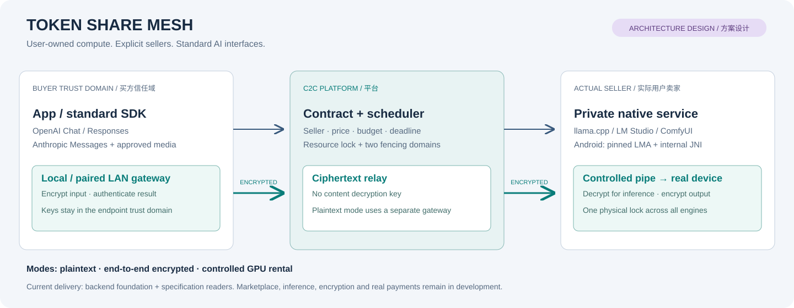
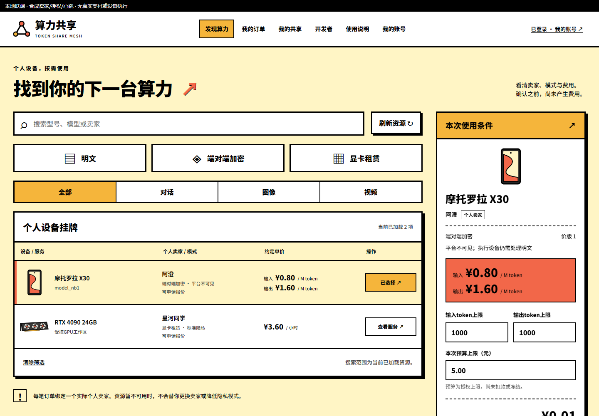
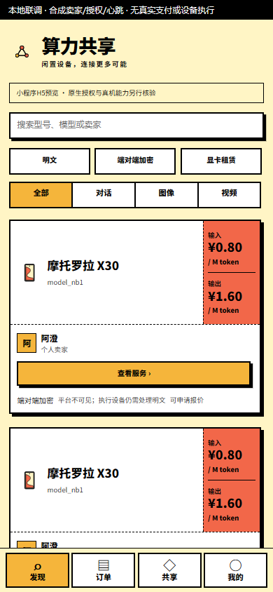
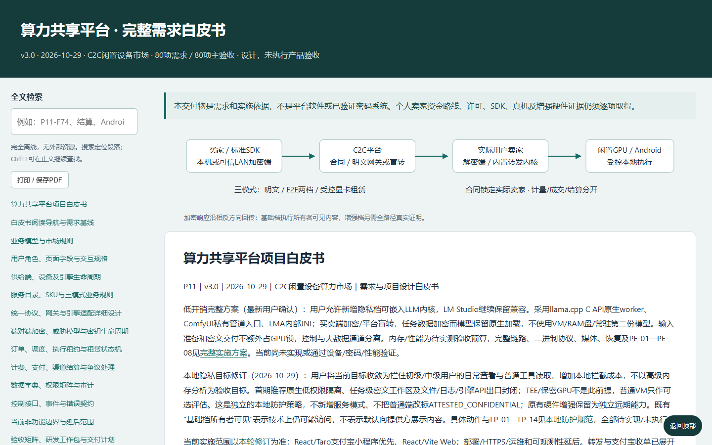
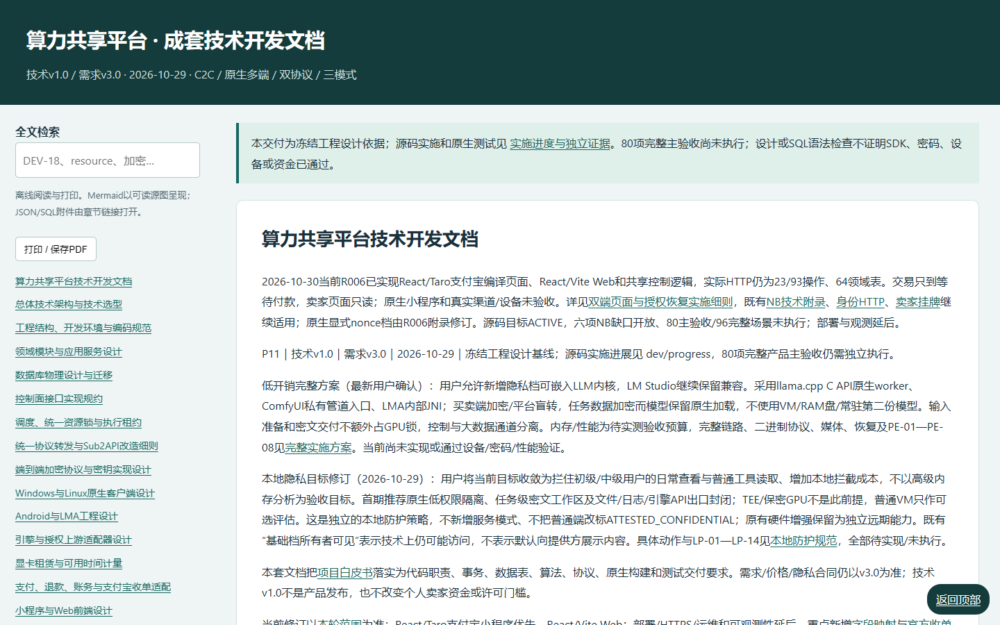
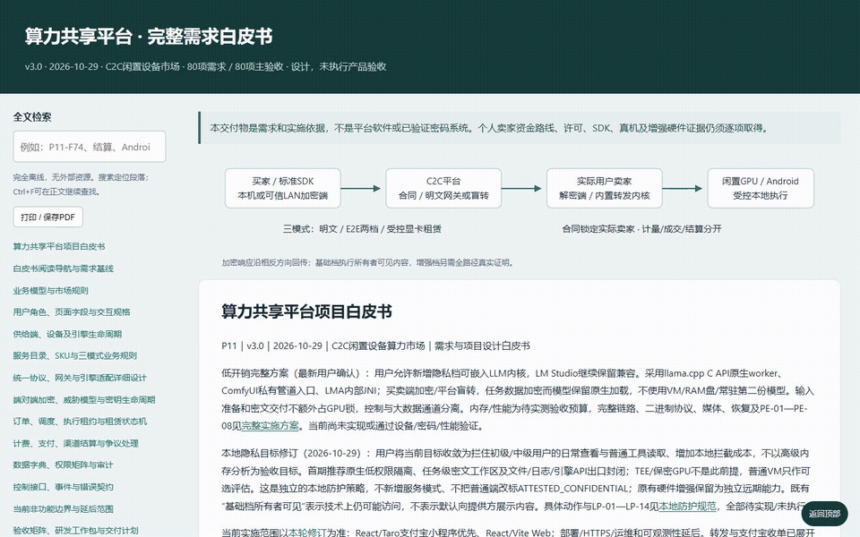

# Token Share Mesh · 算力共享平台

<!-- Generated from dev/repository/README.zh-CN.md.in; run dev/tools/构建仓库文档.py. -->

**用户自愿共享闲置算力的 C2C 平台，使用标准 AI 接口，明确选择隐私边界。**

[English](README.md) · [文档导航](dev/repository/README.md) · [开发细则](dev/开发细则总表.md) · [更新说明](CHANGELOG.zh-CN.md)



Token Share Mesh 连接需要算力的买家与自愿提供闲置 Windows/Linux 显卡、Android 手机或获明确授权上游 AI 能力的个人卖家。卖家自主决定价格和开放时段、直接向买家履约；平台提供发现、合同、路由、调度和交易证据，并收取披露的费用。

## 当前实现状态

仓库包含可运行的 **React/Taro支付宝小程序页面、React/Vite Web、共享控制逻辑及Go/PostgreSQL后端子集**，配有完整需求和技术细则。R006按选定新粗野主义落地市场、报价确认、本人订单和共享只读页，并处理丢失建单回执后的原请求恢复。当前交易仅到等待付款；模型服务、设备客户端、内容加密、真实支付和完整平台仍待完成。产品截图明确使用合成授权/卖家资格/设备心跳，Taro画面为H5预览。

[NB-R1需求推进](docs/需求推进/NB-1.0/README.md)将[五页最终设计](dev/design/新粗野主义-v1.0/README.md)接入十辅助界面、48项需求细化、96个未执行验收场景和六项开放缺口。新售GPU按小时，LLM输入/输出分别按M token（1,000,000 token）；媒体在受控GPU租赁内执行且不另按作品收费。R003已实现NB_PRICE_1价格合同、精确计算和报价建单应用服务，R004接入身份及HTTP子集，R005加入卖家申请与挂牌版本控制；任意小时价租赁/续租/账单、可信usage和并发预算仍待完成，旧订单价版不改。

| 项目 | 证据/状态 |
| --- | --- |
| 开发基线 | 20模块 / 56任务 / 222子项 / 47约束 |
| 实施任务 | 17项进行中 · 37项待开发 · 1项条件能力 · 1项延后 |
| 最新源码轮次 | R006 · PASSED_FOR_CONTROL_SERVICES_ONLY |
| 原生测试证据 | 45项通过，仅控制应用服务范围 |
| 完整产品验收 | 80项全部未执行 |
| 源码目标 | ACTIVE |

当前64领域表、23/93个控制操作。R006新增双端实际控制页面、共享DTO/金额预览/状态模型、明确原生授权证明档及有界响应读取；原有卖家申请、同意、挂牌未来修订/ETag继续保留。45项Go原生用例和13项共享TS用例通过；双端浏览器实际连HTTP与临时数据库，丢失回执后原键恢复、数据库各确认一单一事件。支付宝原生仅编译，真实授权/审核/支付/设备、完整挂牌编辑和开发者配对仍未完成。见[原生证据](dev/tests/evidence/R006-验证报告.md)、[前端证据](dev/tests/evidence/R006-frontend-checks.json)、[双端实施细则](docs/技术开发/附录-双端交易页面与授权恢复实施约束.md)及[全部56项进度](dev/progress/README.md)。

新价合同把AVAILABLE_HOUR的hour_rate，或TOKEN_1M的input_rate/output_rate明确分开；每项均含整数分子/正整数分母、费用承担、佣金和取整版。360分/小时的30分钟最坏180分；80分/M输入加160分/M输出，1M输入与0.25M输出共120分。报价冻结卖家、环境、政策、价格及预算，建单复核后只进入WAITING_PAYMENT；订单、报价消费、同意审计和outbox同事务。它不代表已支付、已锁GPU或已执行。350分/小时不能舍入写进旧整数分/分钟列。

## 当前身份与HTTP使用逻辑

本机控制命令为`p11-api`，先显式配置所选开发数据库、应用身份和密钥文件并执行迁移；[完整环境变量及调用顺序](dev/repository/USAGE.md)提供步骤。命令只监听loopback，不自动启用任何测试登录、模型或支付。实际23路由由[源码登记](dev/src/api/internal/http/routes.json)驱动，与93操作权威契约逐项核对；其余操作仍待开发。

卖家申请只到SUBMITTED，不自动授予SELLER或开售。新挂牌要求已批准地区、本人具体型号/能力及显式平台费用配置；修改只产生未来修订，保留已售合同。退出只停新准入，原资金和资源记录等待各自善后。真实卖家审核、设备配对、受控发布与卖家写流程页面仍是待办。

原生小程序显式选ALIPAY_NATIVE_NONCE_1：服务端签发32字节一次性随机证明、数据库仅存摘要，再my.getAuthCode→POST兑换→仅内存保留Bearer；重启重新授权。它不冒称客户端PKCE，不使用Math.random或时间戳。命令号由独立内存种子与HMAC计数派生，不作内容密钥。Web/H5使用WebCrypto S256、绑定Cookie/state及实际回调，兑换后会话只在HttpOnly/Strict Cookie，写操作另带Origin/CSRF；回调即删URL参数及临时证明。登录不等于KYC/卖家资格，新账号只获BUYER；未知兑换重新授权，不重发原码。

当前HTTP及页面交易止于市场查询→报价冻结→本人确认建单→读取WAITING_PAYMENT订单。未知写按账号保存原键/原参数，刷新后核对原请求；会话/角色撤销在服务端回放前再次核查，API key不能代购。尚无推理HTTP入口或付款成功处理，完整前端仍在推进。

## 页面截图、录屏与 GIF






[Web操作MP4](dev/media/recordings/web-transaction.mp4) · [Taro H5操作MP4](dev/media/recordings/miniapp-transaction.mp4) · [Web GIF](dev/media/recordings/web-transaction.gif) · [订单待确认](dev/media/screenshots/web-order-pending.png) · [产品媒体来源](dev/media/frontend-manifest.json)

以上为编译源码连接真实本地HTTP/数据库的页面；合成OAuth、资格和设备心跳仅存在于测试二进制中，无真实支付宝授权、付款或设备执行。以下文档阅读器媒体单独保留来源。







[查看/下载 MP4 录屏](dev/media/recordings/readers-tour.mp4) · [搜索画面](dev/media/screenshots/whitepaper-search.png) · [窄屏阅读画面](dev/media/screenshots/whitepaper-mobile.png) · [媒体来源及复现](dev/repository/MEDIA.md)

阅读器录制仅展示本地检索/跳转；产品录制与文档录制分别登记，均不演示模型结果、支付成功或真机算力。

## 三种服务模式

| 模式 | 买方购买的权益 | 内容处理 | 执行与验收 |
| --- | --- | --- | --- |
| 明文模式 | 指定模型调用或受批准的媒体工作流 | 平台网关、履约卖家及已披露上游可以处理明文 | 合同约束执行，凭可信用量/结果证据验收 |
| 端对端加密模式 | 指定卖家端点处理的任务 | 买方本机网关加密、平台盲转、卖方服务解密计算并反向加密结果 | 绑定身份、认证流和买方签名回执 |
| 显卡租赁模式 | 受批准 GPU 应用环境的一段有界可用时间 | 内容权限遵循选定环境及隐私政策 | 双方就绪后形成可用计费区间，到期硬停止并确认清理 |

加密链路与隐私强度分别管理。`PLATFORM_BLIND` 对平台隐藏正文，执行设备仍需处理明文。本地防护提高初级、中级用户通过普通界面、文件、日志、API、抓包读取的门槛，不承诺抵御高级内存/GPU 提取或完整系统接管。`ATTESTED_CONFIDENTIAL` 是独立条件能力，必须取得真实完整硬件路径证据，目前关闭。

## 请求转发与标准接口

规划的数据面支持 **OpenAI Chat Completions、OpenAI Responses、Anthropic Messages**，以及逐项获准的媒体、音频接口子集。兼容档位明确模型、字段、工具调用、流事件和限额；不支持的语义明确拒绝，不悄悄丢字段。

```text
明文：
应用 / 标准 SDK → 平台 Sub2API 类网关
                → 合同确认的卖方适配器 → 原生内核 / 授权上游

加密：
应用 / 标准 SDK → 买方本机或已配对可信局域网网关
                → 平台密文中转 → 卖方私有网关 → 原生 worker
结果           ← 本地认证解密 ← 密文中转 ← 卖方加密
```

路由配置绑定实际卖家、不可变合同、模式、模型/工作流、预算和期限。标准 SDK 不需要私有必填 JSON 字段；没有确认路由时，不默认明文或自动购买算力。同一订单最多一次在同卖家已披露合格设备内重派；跨卖家须买家确认新交易。

明文核心计划复用或改造 Sub2API 类服务，先冻结源码版本、许可与依赖；账户池、跨卖家轮换、钱包收费和内容遥测不能绕开 C2C 合同。加密链路的买卖双方均运行本地转发内核，平台不能接管解密。详见[协议网关细则](docs/技术开发/07-统一协议网关与Sub2API改造.md)。

## 算力提供方运行什么

| 提供方 | 规划在本机运行的内容 | 内核替换边界 |
| --- | --- | --- |
| Windows/Linux 隐私 LLM | 原生管理服务、嵌入 llama.cpp C API 的 C++ worker、受控管道 | 核准内核/模型/模板/后端版本，隐私路径不经过明文 HTTP 推理端口 |
| Windows/Linux 兼容 LLM | LM Studio CLI（lms）、llmster、实际推理 runtime | 三层分别版本化；兼容成功不自动获得本地隐私资格 |
| Windows/Linux 媒体 | 完整原生 ComfyUI、PrivacyBridge、图像/视频/音频/3D 能力包 | 提供方明确确认，有限节点/依赖白名单，暂存验证、排空后切换 |
| Android | 固定 LMA 源码二开、Java/Kotlin 基座及内部 JNI 推理桥 | 可执行代码随受签 APK 更新；模型独立下载，不任意热加载可执行代码 |

提供方决定是否共享、资源和时段上限、可用内核、安装授权及挂牌价格。调度器只在已同意资源与买方接受的合同范围内选执行端。提供方界面展示资源、组件版本、任务阶段、收益及停止控制；隐私任务不通过普通 UI、历史或日志 API 展示 prompt 和结果。显卡、手机支持仍是开发目标，尚未取得真实设备验收。

## 端对端加密技术方案

当前候选为 libsodium sealed box 封装每对象流钥，`secretstream_xchacha20poly1305` 认证顺序记录，独立 Ed25519 签名绑定端点身份和上下文。库版本、语言绑定、跨端黄金字节向量及独立评审尚待完成。sealed box 本身不认证发送者，必须另核签名和独立可信端点身份。

1. 先确认实际卖家、接收身份/公钥版本、环境及合同，披露首次信任过程。平台同时给公钥和指纹不能充当独立核验。
2. 建立绑定 order/job/attempt/token/recipient 的 `INPUT_PENDING/PREPARED` 上下文，此时无执行权、不锁 GPU。
3. 买方加密输入，平台仅转密文及必要路由信息。输入、资金、许可和容量均通过后，才签发执行租约。
4. 卖方同时检查任务 token 与物理资源锁代次，在受控原生路径解密并调用获准内核。
5. 结果首次落盘前即加密；买方认证、解密并签名接受/拒绝。GPU 清理释放后可继续补传合法密文，交付恢复不产生新执行权。

`BINARY_STREAM_1` 候选格式为有界流头与顺序认证记录（`uint32be 长度 + uint64be 序号 + 密文`）。明文记录最多 64KiB，包含 8 字节内部头；单流各阶段共享 4MiB 缓冲预算。这些是设计约束，不是性能实测。业务 `END` 自身使用 `TAG_FINAL`，断开连接不代表成功结束。恢复只重传原密文，不盲目重跑推理。

仅加密任务数据，模型保留只读、mmap 兼容的原生加载路径，不引入虚拟机、RAM 盘或常驻第二份模型。随机读取使用完整对象核验后的独立认证本地分段，不在一个 secretstream 中任意 seek。实施权威为[完整加密协议](docs/技术开发/08-端到端加密协议与密钥实现设计.md)和[低开销本地方案](docs/技术开发/附录-低开销隐私执行完整方案.md)。

## 合同、调度与资金逻辑

- 报价和订单冻结买卖双方、挂牌版本、设备集合、内核环境、能力/协议档位、价格、平台费、预算、期限和验收政策。
- 同一物理 GPU 的全部内核和模式共用资源门闩；任务围栏与跨任务资源代次分开、持久且单调递增。租赁子任务不释放父会话锁。
- 取消、超时或断线后，必须实际停算和清理确认才能复用设备。旧交付回执不能清理新的资源所有者。
- 金额使用有界整数分及有理累计计价，不对每个流块重复向上舍入。结果接受、消费证据、记账和卖家结算分别成立。
- 资金操作保留原业务号。未知状态按原号查询，不盲目新建；通用后台任务只接受批准的查询、清理和通知。

支付设计沿用支付宝黑客松 Machine Pay/A402：预下单、支付挑战、买方付款、凭据验付后才授权交付。普通 OpenAI/Anthropic SDK 不会自动支付 `402`，需要小程序/Web 或明确具备支付能力的本地程序承接。个人卖家准入、服务注册、抽佣、退款及结算能力仍须渠道单独确认；当前未创建真实交易或证明 C2C 结算资格。详见[支付细则和带日期的官方来源](docs/技术开发/13-支付退款账务与渠道结算.md)。

## 构建并使用当前前端

使用原生Node22.14.0/npm10.9.2，从克隆根执行；依赖、编译产物和缓存只在runtime。

```powershell
python -X utf8 dev/tools/前端开发.py bootstrap
python -X utf8 dev/tools/前端开发.py check
python -X utf8 dev/tools/前端开发.py test
python -X utf8 dev/tools/前端开发.py build
```

支付宝原生产物在runtime/frontend/builds/miniapp-alipay；H5在miniapp-h5，Web在web。原生构建须显式配置P11_FRONTEND_API_BASE及实际应用身份，空地址阻止登录；Web/H5空地址使用同源控制面。登录→选个人卖家/型号/模式→填用量预算→取正式报价→主动确认合同→等待付款。回执未知刷新后点击“核对原请求”，不换参数或新下单。共享目前只读资格/挂牌，配对与付款关闭。见[双语前端使用说明](dev/src/frontend/README.md)。

实际本地联调可在构建后运行下列原生数据库验证命令；Go测试二进制临时提供合成OAuth/资格/设备心跳及编译页面，自动截图录制、验证原请求恢复，并停止浏览器/数据库。该夹具不能用于真实开售；Taro H5不代表真机通过。

## 运行当前已有内容

以下命令在克隆根目录执行。原生下载和数据库验证入口目前面向 **Windows amd64**；固定文档 wheel 推荐 **Python 3.13**。Node.js22.14.0/npm10.9.2用于当前前端、阅读器与录制。所有下载、缓存和临时数据库留在 `runtime/`。

```powershell
git clone git@github.com:copypasteltd/Token-Share-Mesh.git
cd Token-Share-Mesh

# 固定文档依赖、重建、结构核验
python -X utf8 dev/tools/文档工具.py bootstrap
python -X utf8 dev/tools/文档工具.py build
python -X utf8 dev/tools/文档工具.py check

# 本机真实阅读器；Ctrl+C 停止
python -X utf8 dev/tools/预览文档.py --port 8765
```

打开 `http://127.0.0.1:8765/`，按需求编号或关键词检索并跳转章节，也可直接打开生成的 HTML。预览只读公开文档，不开放 `runtime/`、`.git` 和目录列表；这属于本地文档阅读入口。

```powershell
# 显式下载固定原生工具，不安装系统数据库服务
python -X utf8 dev/tools/获取原生工具链.py
python -X utf8 dev/tools/原生开发.py mod download

# 临时 loopback PostgreSQL → 真实测试 → 确认关闭
python -X utf8 dev/tools/原生数据库验证.py --round R006
python -X utf8 dev/tools/核验原生源码.py --round R006
python -X utf8 dev/tools/整理原生验证证据.py --round R006
```

后三条生成当前源码的R006范围证据，保留R001/R003/R004/R005历史记录。直接运行 `go test` 而未配置数据库时，数据库场景会明确跳过，不能当原生集成通过。Linux admin/API命令仅交叉编译，尚无Linux运行或GPU验收结论。对明确选择的PostgreSQL17，可用`P11_DATABASE_URL`环境变量运行`migrate`、`check-schema`，见[详细使用及恢复说明](dev/repository/USAGE.md)。

## 买卖双方未来使用逻辑

**买方：**选择卖家/能力 → 确认模式、隐私、价格及限额 → 接受不可变报价/订单 → 完成授权支付 → 配置合同路由和 SDK → 执行任务或租赁 → 认证并接受结果 → 按最小必要证据处理售后。加密任务发送正文前须先安装、配对本地网关。

**卖方：**入驻 → 配对设备 → 同意内核/模型/节点和资源政策 → 通过对应能力/许可核验 → 自主挂牌定价 → 开启接单 → 查看阶段、资源及收益 → 退出或换内核时停新单并排空。Android 另受本人同意、充电、网络、温度和前台生命周期约束。

以上为已规格化的用户旅程，对应实施项完成并取得证据后才可真实使用。

## 仓库组织

```text
README.md / README.zh-CN.md       英文与中文完整入口
CHANGELOG*.md                    同步更新说明
dev/src/go.mod                   单 Go 模块
dev/src/api/cmd/p11-admin/        原生迁移/检查命令
dev/src/api/cmd/p11-api/          原生本机身份/控制接口
dev/src/api/internal/http/       23操作注册与鉴权适配
dev/src/internal/                数据库、密钥、计价、市场、报价订单、幂等与任务
dev/src/shared/                  ID、安全错误、时钟、金额
dev/src/tests/integration/       真实 PostgreSQL 测试
dev/planning/ + dev/contracts/   人工细则源及生成的56任务清单
dev/modules/ + dev/docs/         20模块细则、222开发子项
dev/progress/                    每轮实现表和完整待办快照
dev/tools/                       原生、文档、媒体及仓库工具
dev/repository/                  双语补充指南及README人工模板
dev/media/                       真实截图、MP4、GIF及来源
dev/licenses/                    当前Go依赖许可
docs/白皮书/                     完整需求及离线阅读器
docs/技术开发/                   架构、协议、SQL及离线阅读器
scripts/                        既有权威文档生成器
runtime/                        本机数据、工具、模型、缓存，不入Git
```

支付宝小程序使用 React + Taro，Web 使用 React + Vite；桌面采用原生进程，Android 基于真实 LMA 二开。本地 Docker、WSL、QEMU/虚拟机、Android 模拟器均不使用。服务器部署、公网 HTTPS、运维与可观测性工程明确延后。

## 后续开发与同步

遵守[贡献约定](CONTRIBUTING.md)和[更新同步流程](dev/repository/SYNCHRONIZATION.md)。每轮维护 README 人工模板、中英更新说明及全部 56 项进度，重建受影响规范；界面或使用逻辑变化同步更新真实媒体；核验后提交并推送配置的 `main`，不强推覆盖其他贡献者历史。

已执行迁移和内容寻址文件按原字节检出，`.gitattributes` 防止换行转换破坏摘要；后续迁移只能新增版本。运行数据、秘密、下载内核/模型及编译产物不入库。第三方许可证单独登记，不据此推导上游 API 或模型转售资格。

## 完整文档入口

- [开发细则总表及编号约束](dev/开发细则总表.md)
- [完整白皮书导航](docs/白皮书/00-阅读导航与需求基线.md)
- [技术开发导航](docs/技术开发/00-技术文档导航与实施基线.md)
- [系统方案](dev/repository/SYSTEM_DESIGN.md)
- [使用指南](dev/repository/USAGE.md)
- [演示媒体](dev/repository/MEDIA.md)
- [实施证据及全部待办](dev/progress/README.md)

