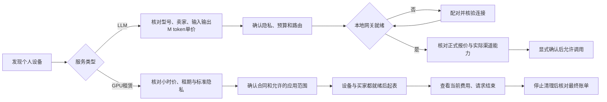

# NB-D02 · 信息架构与用户流程

## 1. 用户、入口与责任

| 角色 | 主要目标 | 设计入口 | 关键限制 |
| --- | --- | --- | --- |
| 买方 | 找资源、核实卖家/单价、连接应用、控制费用 | 发现、订单、Web市场 | 付款/授权前确认具体卖家与合同；不自动换卖家/降隐私 |
| 提供方 | 自主挂牌闲置GPU/手机，管理接单与收入 | 共享、设备客户端 | 自主选择内核/模型/配方与定价；任务明文不出现在平台提供方UI |
| 兼任买卖双方用户 | 在同一账户下切换使用与共享 | 固定底部导航 | 不混淆“我的订单”与“我的挂牌”，不展示他人设备为本人资产 |

五图使用两组演示视角：P01/P02/P03/P05是示例买家；P04是星河同学的卖家视角。市场手机属于阿澄，P04的努比亚Z20属于星河同学；不是一人假扮双方自购。

## 2. 小程序信息架构

| 主导航 | 一级内容 | 关联辅助页 | 最终图 |
| --- | --- | --- | --- |
| 发现 | 搜索、模式入口、用途分类、个人卖家资源 | 搜索结果、筛选、服务详情、卖家信息、合同确认 | P01/P02 |
| 订单 | 本人消费订单列表、状态分类 | GPU租赁详情、LLM用量明细、账单、售后/争议 | P03为GPU详情代表 |
| 共享 | 本人设备、挂牌草稿、接单策略、预估与已结算区分 | 配对设备、编辑报价、能力安装确认、共享时段 | P04 |
| 我的 | 账户、授权、协议、渠道资格、帮助 | 网关绑定、卖家资格、资金记录、客服 | 不另出主稿，沿用本套组件 |

详情页不再叠固定四导航；保持返回与主要行动。搜索/筛选保留上下文，返回市场时恢复之前滚动和筛选。未登录可浏览允许公开的资源，涉及下单/设备/订单时触发登录，不把未知用户展示为已认证卖家。

## 3. Web信息架构

顶部横向导航：工作台、算力市场、我的订单、本地网关、API密钥、账单。P05表现算力市场；“工作台”是连接/使用资源后的应用入口，不等于平台拥有设备。资源比较与合同摘要同屏，但报价变化、卖家变化和预算改变必须重新确认。

## 4. 买方流程

P02是阿澄手机LLM详情；P03是另一张已运行GPU租赁订单，不把点击P02直接跳到不同卖家的GPU订单。P01→手机P02和P01→GPU详情→合同→P03是两条明确路径。未出图的GPU详情沿用P02票据布局，替换成小时/租期/标准隐私字段，不能沿用手机的M token输入输出价。

## 5. 提供方流程

运行本机设备客户端 → 在本人账户配对设备 → 核对真实型号与能力 → 选择允许安装的内核/模型/白名单能力包 → 填小时或M token报价、模式和共享时段 → 显示准入状态 → 资格/能力通过才上架 → 管理接新单 → 已有任务按合同停止/清理 → 对账。

小程序用于登记、查看、授权和控制；不在小程序里运行LM Studio、ComfyUI、LMA、模型或解密worker。Windows/Linux需本机客户端；Android需LMA二开客户端。用户选择接纳什么能力，平台只在已发布能力和本地门闩允许范围内调度。

“停止接新单”与“结束当前会话”是不同操作。前者不抢断运行任务；用户自用抢占涉及当前合同和停止流程时，必须单独确认并显示实际处理状态。

## 6. 未出图页面如何延展

| 辅助页 | 使用的固定组件 | 需要新增的内容，不能凭图片猜测 |
| --- | --- | --- |
| 搜索/筛选 | 搜索框、模式入口、分类单元、空状态 | 型号/模型、模式、单位、设备类型、排序 |
| GPU服务详情 | 资源票、小时价格、时长/预算、合同动作 | 就绪起表、支持能力、隐私、清理与取消规则 |
| 合同确认 | 卖家身份、费用票据、确认项、状态横幅 | 价版、收款人、费率包含、权限和截止 |
| 本地网关配对 | 状态横幅、验证码输入、确认弹层 | 一次性配对、目标账户、连接验证、撤销 |
| 编辑挂牌 | 字段标签、金额输入、价格单位、提交反馈 | 卖家自主价格、输入输出分别定价、版本生效范围 |
| LLM用量账单 | 用量/费用列表、原始token明细、合同链接 | 输入/输出/缓存分类不可重计，未知用量状态 |
| 售后/争议 | 订单身份、原因选择、证据上传、处理时间线 | 加密只收必要可选证据，不索整批内容钥 |

这些页纳入设计规则，未各自生成约束图；不声称五图已覆盖全部交互和真实验收。
