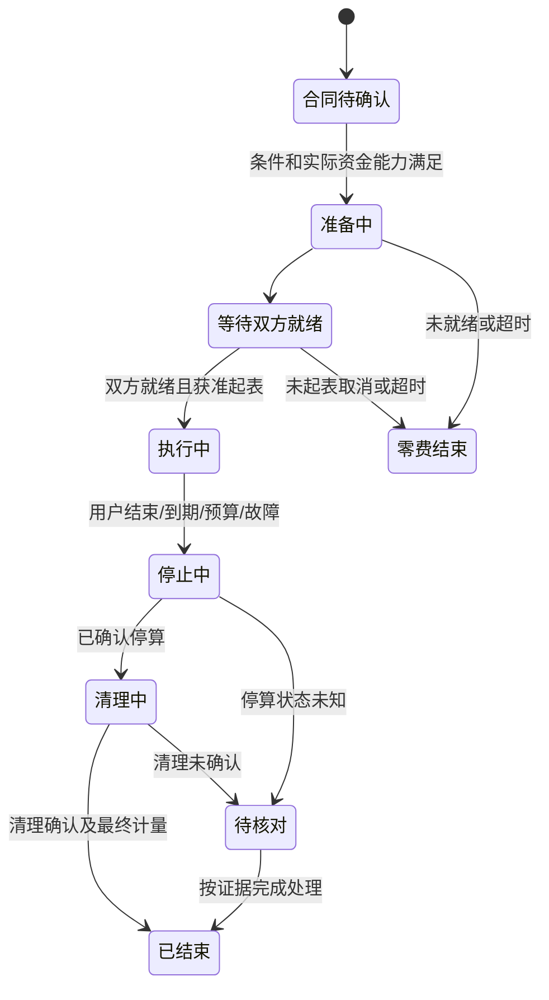

# NB-D06 · 交互状态与隐私边界

## 1. 三模式的表达

| 模式 | 典型页面/计价 | 内容路径与UI说明 | 不得推断 |
| --- | --- | --- | --- |
| 明文 | 相应模型/媒体能力的受支持合约 | 平台类Sub2API网关可处理请求；披露真实模式 | 有锁图标就意味着平台无明文 |
| 端对端加密 | P02手机LLM；M token双价 | 买方本机/可信LAN网关加密，平台无钥中转，供给端执行；基础档平台不可见，执行设备处理明文 | 普通进程隔离等于硬件保密；设备主人绝对不可见 |
| 显卡租赁 | P03/P05；小时 | 受控应用服务、就绪起表、停止清理；当前示例标准隐私 | 自动获得E2E租赁、shell/RDP/admin或任意节点安装权限 |

“平台不可见”和“提高初/中级本地拦截门槛”是不同承诺。端侧低开销隐私内核、任务文件加密、受控管道等可以提高读取门槛，不能把普通设备改标为已验证硬件机密计算。高强度增强档按原需求独立准入，本套不画成已就绪产品。

## 2. LLM连接与确认状态

| 状态 | 用户看到什么 | 允许操作 | 下一步条件 |
| --- | --- | --- | --- |
| 未连接 | 本地网关未连接 | 查看配对方法、启动本地程序、扫描/输入配对 | 本人授权配对 |
| 配对中 | 正在核验目标网关 | 取消、查看目标标识 | 一次性授权及身份核验通过 |
| 已连接未确认 | 网关已连接，待确认卖家与合同 | 核对路由、单位、价版、模式、预算 | 正式报价/能力/渠道均支持 |
| 可调用 | 当前路由与预算已确认 | 在可信本地应用调用、查看用量 | 请求仍需对应合约/资源准入 |
| 断开 | 网关连接已断开 | 重连、结束授权 | 不能自动把密文调用转明文 |
| 身份/能力不匹配 | 网关身份不匹配或该档位暂不可用 | 核验/选择其他可售能力 | 买方明确重新确认 |

配对成功不等于付款成功，也不等于GPU已锁定。E2E输入准备、资金/许可/容量检查与实际执行授权分开；界面以实际状态驱动按钮，不让“连接网关并继续”成为隐含扣款动作。

## 3. GPU租赁生命周期

“已结束”不自动等于已退款/已结算/设备可再次租用。若停算或清理未知，资源隔离继续按既有规则，前端不能根据超时自行显示可用。起表前准备/加载不收费；买家离线、设备断线、续租等按合同截止与可信区间处理，不让前端倒计时控制实际计量。

## 4. 关键操作后果

| 操作 | 确认文案要点 | 提交后状态 | 失败/未知 |
| --- | --- | --- | --- |
| 确认租赁条件 | 卖家/具体设备、小时价、时长、预算、标准隐私 | 待正式确认/准备中，按渠道事实显示 | 过期重新报价；不换卖家兜底 |
| 结束会话 | 将请求停止当前算力，费用待最终核对 | 停止中，再清理中 | 保留原操作号查询，不显示已释放 |
| 停止接新单 | 已有会话继续按合同处理 | 接新单关闭，当前仍运行 | 本机确认前显示设置待同步 |
| 编辑挂牌价格 | 只影响未来新价版 | 草稿/待发布 | 活跃订单沿用原价版 |
| 切换模式/卖家 | 展示目标与隐私/价格变化 | 新报价/新合同或按原单结束 | 不静默降级、不原单改卖家 |
| 安装能力/更换内核 | 范围、下载大小、许可、设备影响 | 等待提供方本机确认，必要时排空维护 | 不在活动会话中无感热换 |

## 5. 支付和结算文案

支付未发起、等待支付、渠道结果待确认、已支付、履约中、待结算、退款处理中、已退款、争议处理是独立事实。渠道返回未知时查询原号，不能换新号反复收款/退款。

P02“尚未产生费用”只是尚未付费调用的示例状态；P05“确认租赁条件”只是合同前置；P04“预估收入/未结算”不创造钱包。渠道资格未通过时可以浏览/配置能力，付费按钮必须依据实际能力禁用并解释原因，不能把赛事API等同所有C2C分账能力已批准。

## 6. 内容与权限最小化

- 提供方小程序/Web共享面板只显示任务身份、资源/能力、运行状态、必要用量与财务，不回显买方Prompt、图片、音视频、路径、历史内容或密钥。
- E2E结果在买方可信网关解密，平台订单页不先拉明文预览再声称无钥。需要争议证据时提供用户主动选择的最小副本。
- 客户端安装包、配对令牌和API密钥不放在设计稿、导出截图、默认日志或公开文档示例里。一次性秘密只在受控流程展示。
- 本机所有者仍有设备控制权；普通UI隐藏不构成硬件级秘密证明。无真实证明就不显示“增强保密已验证”。
