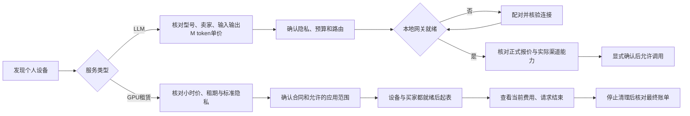
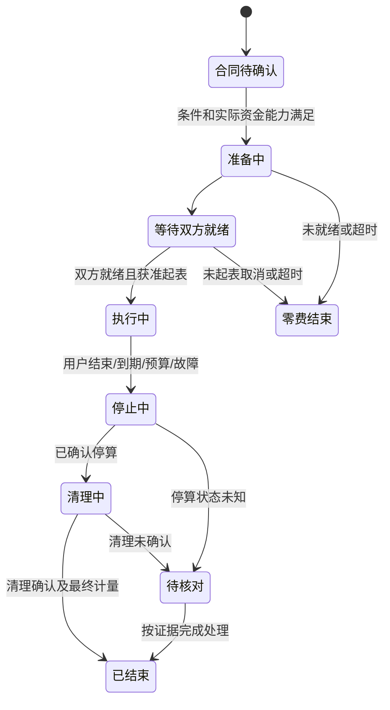

# Token Share Mesh · 新粗野主义完整设计规范 NB-1.0

设计文档合订阅读版；原始章节和JSON保持权威。图为AI视觉概念，源码阶段见[实施登记](../../progress/README.md)。

---

# Token Share Mesh · 新粗野主义设计规范

设计版本NB-1.0｜2026-10-30｜用户已选择方向04。状态：冻结视觉基线；源码阶段见[实施登记](../../progress/README.md)。

本套定义小程序优先、Web配套的完整视觉与交互约束。五张最终约束图是页面结构和风格参考，文字、数值、状态与本套规则共同约束实现；生图中的细小字形、标志、像素偏差不反过来修改业务规则。所有价格、设备状态与收益为演示数据，不代表真实挂牌、性能、收费或到账。

后续需求已接入[NB-R1需求推进入口](../../../docs/需求推进/NB-1.0/README.md)：48项子需求/96个场景、十辅助界面、六契约缺口与既有DEV/F/T映射。视觉五图保持NB-1.0；当前继续源码实施，最新轮次见[实施进度](../../progress/README.md)，已实现子集与仍开放缺口见[技术实施约束](../../../docs/技术开发/附录-NB价版与交易服务实施约束.md)。新售媒体先通过按小时受控GPU租赁，独立LLM输入输出M token双价；旧合同和未承接契约另行处理。

## 文件入口

| 编号 | 文档 | 覆盖内容 |
| --- | --- | --- |
| NB-D00 | 本文 | 权威顺序、阅读路径、图片和范围 |
| NB-D01 | [视觉系统与设计令牌](01-视觉系统与设计令牌.md) | 材质、色彩、字体、间距、边框、阴影、网格 |
| NB-D02 | [信息架构与用户流程](02-信息架构与用户流程.md) | 买卖双方职责、导航、五页关系、相关辅助页 |
| NB-D03 | [组件规范与状态](03-组件规范与状态.md) | 22个组件及交互、异常、适配规则 |
| NB-D04 | [五页逐屏规格](04-五页逐屏规格.md) | 五张约束图的逐区内容、操作、权限和状态 |
| NB-D05 | [计价单位与费用展示](05-计价单位与费用展示.md) | 小时、M token、金额精度、费用包含关系、算例 |
| NB-D06 | [交互状态与隐私边界](06-交互状态与隐私边界.md) | 就绪、运行、停止、清理、网关、支付与隐私 |
| NB-D07 | [跨端适配与前端承接](07-跨端适配与前端承接.md) | React/Taro与React/Vite、布局、能力、交付接口 |
| NB-D08 | [文案内容与资产规范](08-文案内容与资产规范.md) | 具体型号、图标、资源插画、状态和错误文案 |
| NB-D09 | [验收与交付约束](09-验收与交付约束.md) | 编号化验收、检查范围、图片偏差与版本规则 |
| NB-D10 | [设计追踪与实施边界](10-设计追踪与实施边界.md) | 对接既有技术要求、待实现项、设计变更边界 |
| NB-D11 | [设计令牌JSON](design-tokens.json) | 可供后续前端转换的声明式令牌；不是已实现组件 |
| NB-D12 | [统一示例数据](示例数据.json) | 五页共用的卖家、具体型号、单位、价格与状态 |

先读D01/D02，再读D04/D05/D06；后续实现组件时用D03/D07/D08，交付核查用D09。支付、协议、资金和安全事实仍以项目既有需求/技术源为准；本套不新建一份API或资金账本。

## 五张最终约束图

图片目录：[04-最终设计约束](../../../output/imagegen/2026-10-30-04-最终设计约束/)。每张是一页完整界面，无手机外壳。

| 页面编号 | 页面 | 尺寸 | 主要职责 | 原图 |
| --- | --- | --- | --- | --- |
| UI-P01 | 小程序算力市场 | 1024×1536 | 混合浏览个人GPU与具体手机型号 | [查看](../../../output/imagegen/2026-10-30-04-最终设计约束/UI-P01-小程序-算力市场.png) |
| UI-P02 | 小程序LLM服务详情 | 1024×1536 | 核对手机卖家、输入输出单价与本地网关 | [查看](../../../output/imagegen/2026-10-30-04-最终设计约束/UI-P02-小程序-LLM服务详情.png) |
| UI-P03 | 小程序GPU订单详情 | 1024×1536 | 查看租赁计时、当前费用与停止状态 | [查看](../../../output/imagegen/2026-10-30-04-最终设计约束/UI-P03-小程序-GPU订单详情.png) |
| UI-P04 | 小程序提供方共享 | 1024×1536 | 管理本人GPU、手机草稿与接新单策略 | [查看](../../../output/imagegen/2026-10-30-04-最终设计约束/UI-P04-小程序-提供方共享.png) |
| UI-P05 | Web算力工作台 | 1536×1024 | 比较资源并核对按小时租赁合同 | [查看](../../../output/imagegen/2026-10-30-04-最终设计约束/UI-P05-Web-算力工作台.png) |

完成文件检查后的实际图片摘要、尺寸与逐张看图记录保存在图片目录的delivery-manifest.json与production/visual-review.json；总览为真实原图派生预览，不替代五张主稿。

## 冻结的设计决定

1. 风格只采用新粗野主义：粗黑结构线、硬偏移阴影、浅黄背景、白票卡、橙色主动作、强调型号与费用。
2. 小程序4个主导航为发现、订单、共享、我的；详情用返回和底部行动区。Web采用横向导航、左资源比较、右合同票据。
3. 市场首页展示混合供给，三模式为入口，不把所有卡片默认标成同一种隐私模式。每个挂牌独立标注模式。
4. GPU租赁只展示“小时”单价；LLM输入和输出只展示“M token”单价，1 M token=1,000,000 token。时长选择可显示分钟，账单数量仍展示原始确认时间/用量。
5. 设备名称必须明确。市场手机为阿澄的“摩托罗拉 X30”；提供方示例为星河同学自己的“努比亚 Z20”草稿，不能混为同一资产。
6. 卖家身份、价版、模式、隐私与预算需要买家明确确认。普通GPU租赁使用标准隐私；不得因选择了同一视觉样式就默认开启E2E租赁。
7. 预估、当前累计、最终应付、卖家预估净额与已结算收入分开。平台佣金已包含在示例单价内，不能在末步再次加到买家总价。
8. 这套交付物始终是设计规范和AI概念图；源码与仓库同步另按当前实施登记推进。图片不代表真实内核、GPU、手机、支付或部署已经运行或通过验收。

## 来源与权威

最新用户选择与小时/M token要求 → 本套业务文案/状态和令牌 → 五张约束图的结构与视觉 → 历史候选。旧五套设计只保留过程，不再作为最终实施样式。

本轮实际加载了[Anthropic frontend-design](https://github.com/anthropics/skills/tree/main/skills/frontend-design)与[UI UX Pro Max](https://github.com/nextlevelbuilder/ui-ux-pro-max-skill)。按GitHub公开快照，综合库为184754星，设计专用UI UX库为142473星，是本次设计专用检索候选中最高；不把仓库星标说成单个技能星标。采用其Neubrutalism专门记录，并按C2C供给、具体型号、计费与隐私规则重新组织页面。图片只通过用户指定sub2-image-gen脚本及gpt-image-2.5生成。

---

# NB-D01 · 视觉系统与设计令牌

## 1. 设计意图

主题是“个人设备的透明交易票据”。让型号、卖家、单价、模式和执行状态先被看见。粗线用于区分可操作区域与合同字段；硬阴影用于体现可点击层级；不把每个标签都做成装饰贴纸。界面不采用玻璃、渐变卡片、软阴影或大面积发光。

## 2. 语义色彩

| 令牌 | 色值 | 用途 | 配对文字 |
| --- | --- | --- | --- |
| color.canvas | #FFF5C5 | 主画布、页面留白 | #000000 |
| color.surface | #FFFFFF | 资源票卡、输入区、正文面板 | #000000 |
| color.ink | #000000 | 标题、正文、边框、硬阴影 | — |
| color.primary | #F26749 | 主要行动、价格强调区 | #000000 |
| color.selected | #F5B53B | 当前导航/分类/选中单元格 | #000000 |
| color.mutedText | #3A3A3A | 次要说明、辅助字段 | 白或浅黄背景 |
| color.success | #276846 | 已确认就绪/成功的图标和短标签 | 白底配色，不只靠颜色区分 |
| color.danger | #A32722 | 失败、强制停止、金额异常提示 | 白底配色，不用橙色代替全部错误 |
| color.disabledSurface | #E5E2D8 | 不可用操作底色 | #59574E；必须同时有禁用语义 |

正文黑字在白/浅黄面板上；橙、黄按钮也用黑字。不能为了“品牌统一”使用白色小字叠橙底而降低可读性。成功/错误颜色只出现在相关状态，不用红绿区分两种计价单位。

## 3. 文字层级

中文采用思源黑体/Noto Sans SC或系统等价无衬线；实施时按许可确认字体资源，优先使用系统回退，避免远程字体阻塞。粗标题以700—900字重形成新粗野主义性格，正文400—500；金额使用等宽数字特性，不把正文改成代码等宽字体。

| Token | 小程序逻辑px | Web px | 字重/行高 | 用途 |
| --- | ---: | ---: | --- | --- |
| type.hero | 34 | 44 | 900 / 1.12 | 市场品牌/页面主标题，限制2行 |
| type.title | 24 | 30 | 800 / 1.25 | 页面标题与主要设备型号 |
| type.section | 19 | 22 | 700 / 1.3 | 区块标题 |
| type.price | 34 | 40 | 900 / 1.05 | GPU单价与订单当前费用 |
| type.body | 15 | 16 | 500 / 1.5 | 主要说明、表单、卖家 |
| type.label | 13 | 14 | 600 / 1.4 | 标签、规格、价格单位 |
| type.caption | 12 | 12 | 400 / 1.5 | 次要帮助文字；不承载唯一金额/风险说明 |

设计图1024像素宽不是1024逻辑px：实施按375逻辑px/750rpx设计，位图仅用于结构参考。价格数字与单位为不可拆散的语义组；“M token”禁止在M与token之间换行，具体型号可按词组换行但不能截掉后缀。

## 4. 空间与形状

| Token | 逻辑值 | 规则 |
| --- | --- | --- |
| space | 4/8/12/16/24/32/48 | 以4为基准；模块间16—24，区内8—12 |
| page.gutter.mobile | 16 | 狭屏12；不得低于安全触控留白 |
| page.gutter.web | 24—32 | 与内容最大宽度共同调整 |
| border.structural | 3px #000 | 票卡、按钮、主要输入/导航格 |
| border.internal | 1—2px #000 | 区内字段、表格分割；不围住每个词 |
| radius.control | 0—3px | 输入、按钮、方块导航，保持硬边 |
| radius.ticket | 0 | 可选票据缺口不进入触控边界，不用大圆角 |
| shadow.raised | 5px 5px 0 #000 | 主行动/资源票，必须无模糊 |
| shadow.hover | 6px 6px 0 #000 | Web hover可用，不改变网格占位 |
| shadow.pressed | 2px 2px 0 #000 | 点击视觉反馈，父容器保留外边界空间 |

## 5. 网格与密度

小程序为单列信息流；资源票据内部可左右分栏，狭屏下价格区移到型号下方，避免过小字体。最多一个大GPU主票加一个紧凑手机票出现在首屏，不要求所有手机都首屏放完。

Web≥1200px采用资源区约2/3、合同区约1/3，主列最小600px，摘要约320—400px。资源比较表需保持设备/卖家/模式/单价关联。1024—1199px缩小导航间距并可将合同区移到下方；<1024px转单列资源卡，不能把整张桌面表缩成无法点击的小图。

## 6. 图标、插画与动效

品牌为三节点连线，黑色结构线加橙/黄色节点，保持比例和组内画法。正式实现需要独立SVG，不能从AI图中切模糊Logo当最终资产；支付宝胶囊由平台提供，不在Web复制。

导航/状态图标采用同一族粗线或同一层级统一实心，建议24px视觉尺寸。设备主图独立于交互组件：可以用有授权的真实素材或相同风格插画，不能把AI生成外观当作卖家真实设备证明。

动效只为操作反馈：80—150ms按压，150—200ms展开/切换；不循环抖动价格、阴影或CPU/GPU图。不加自动滚动成交播报。减少动态效果时直接状态切换，仍保留文本反馈。

## 7. 禁用的样式漂移

- 不添加10—30px圆角胶囊海、磨砂透明面板、蓝紫渐变背景或统一柔影卡片。
- 不把新粗野主义理解为低可读性：字号/对齐/金额/安全区必须稳定。
- 不把过度倾斜、贴纸、水印、装饰英文、虚假“已认证”当风格元素。
- 不把五张图的细微黑线粗细差当作五套令牌；后续实现统一用本文件/JSON值。

---

# NB-D02 · 信息架构与用户流程

## 1. 用户、入口与责任

| 角色 | 主要目标 | 设计入口 | 关键限制 |
| --- | --- | --- | --- |
| 买方 | 找资源、核实卖家/单价、连接应用、控制费用 | 发现、订单、Web市场 | 付款/授权前确认具体卖家与合同；不自动换卖家/降隐私 |
| 提供方 | 自主挂牌闲置GPU/手机，管理接单与收入 | 共享、设备客户端 | 自主选择内核/模型/配方与定价；任务明文不出现在平台提供方UI |
| 兼任买卖双方用户 | 在同一账户下切换使用与共享 | 固定底部导航 | 不混淆“我的订单”与“我的挂牌”，不展示他人设备为本人资产 |

五图使用两组演示视角：P01/P02/P03/P05是示例买家；P04是星河同学的卖家视角。市场手机属于阿澄，P04的努比亚Z20属于星河同学；不是一人假扮双方自购。

## 2. 小程序信息架构

| 主导航 | 一级内容 | 关联辅助页 | 最终图 |
| --- | --- | --- | --- |
| 发现 | 搜索、模式入口、用途分类、个人卖家资源 | 搜索结果、筛选、服务详情、卖家信息、合同确认 | P01/P02 |
| 订单 | 本人消费订单列表、状态分类 | GPU租赁详情、LLM用量明细、账单、售后/争议 | P03为GPU详情代表 |
| 共享 | 本人设备、挂牌草稿、接单策略、预估与已结算区分 | 配对设备、编辑报价、能力安装确认、共享时段 | P04 |
| 我的 | 账户、授权、协议、渠道资格、帮助 | 网关绑定、卖家资格、资金记录、客服 | 不另出主稿，沿用本套组件 |

详情页不再叠固定四导航；保持返回与主要行动。搜索/筛选保留上下文，返回市场时恢复之前滚动和筛选。未登录可浏览允许公开的资源，涉及下单/设备/订单时触发登录，不把未知用户展示为已认证卖家。

## 3. Web信息架构

顶部横向导航：工作台、算力市场、我的订单、本地网关、API密钥、账单。P05表现算力市场；“工作台”是连接/使用资源后的应用入口，不等于平台拥有设备。资源比较与合同摘要同屏，但报价变化、卖家变化和预算改变必须重新确认。

## 4. 买方流程

P02是阿澄手机LLM详情；P03是另一张已运行GPU租赁订单，不把点击P02直接跳到不同卖家的GPU订单。P01→手机P02和P01→GPU详情→合同→P03是两条明确路径。未出图的GPU详情沿用P02票据布局，替换成小时/租期/标准隐私字段，不能沿用手机的M token输入输出价。

## 5. 提供方流程

运行本机设备客户端 → 在本人账户配对设备 → 核对真实型号与能力 → 选择允许安装的内核/模型/白名单能力包 → 填小时或M token报价、模式和共享时段 → 显示准入状态 → 资格/能力通过才上架 → 管理接新单 → 已有任务按合同停止/清理 → 对账。

小程序用于登记、查看、授权和控制；不在小程序里运行LM Studio、ComfyUI、LMA、模型或解密worker。Windows/Linux需本机客户端；Android需LMA二开客户端。用户选择接纳什么能力，平台只在已发布能力和本地门闩允许范围内调度。

“停止接新单”与“结束当前会话”是不同操作。前者不抢断运行任务；用户自用抢占涉及当前合同和停止流程时，必须单独确认并显示实际处理状态。

## 6. 未出图页面如何延展

| 辅助页 | 使用的固定组件 | 需要新增的内容，不能凭图片猜测 |
| --- | --- | --- |
| 搜索/筛选 | 搜索框、模式入口、分类单元、空状态 | 型号/模型、模式、单位、设备类型、排序 |
| GPU服务详情 | 资源票、小时价格、时长/预算、合同动作 | 就绪起表、支持能力、隐私、清理与取消规则 |
| 合同确认 | 卖家身份、费用票据、确认项、状态横幅 | 价版、收款人、费率包含、权限和截止 |
| 本地网关配对 | 状态横幅、验证码输入、确认弹层 | 一次性配对、目标账户、连接验证、撤销 |
| 编辑挂牌 | 字段标签、金额输入、价格单位、提交反馈 | 卖家自主价格、输入输出分别定价、版本生效范围 |
| LLM用量账单 | 用量/费用列表、原始token明细、合同链接 | 输入/输出/缓存分类不可重计，未知用量状态 |
| 售后/争议 | 订单身份、原因选择、证据上传、处理时间线 | 加密只收必要可选证据，不索整批内容钥 |

这些页纳入设计规则，未各自生成约束图；不声称五图已覆盖全部交互和真实验收。

---

# NB-D03 · 组件规范与状态

以下22个组件是后续React/Taro、React/Vite的设计合同，未代表已实现组件。状态不只靠颜色表达。尺寸均为逻辑px，窄屏允许换行，不缩小金额/型号来硬塞。

| 编号 | 组件 | 结构与尺寸 | 状态/行为 | 必须避免 |
| --- | --- | --- | --- | --- |
| NB-C01 | 品牌与页头 | 三节点标志、名称；详情为返回+页名 | 标志不可抢主任务；标题最多2行 | Web复制支付宝胶囊；返回退出未确认表单不提示 |
| NB-C02 | 搜索框 | 可见标签/占位、搜索/清除；高度48，3px边框 | 空、输入、搜索中、无结果、失败；回车与按钮等效 | 仅靠放大镜无名称；搜索日志含私密prompt |
| NB-C03 | 模式入口/切换 | 三个方形单元，单元≥44高 | 市场为入口无默认全局模式；详情只选真实支持的模式 | 将GPU租赁默认标基础E2E；静默降级 |
| NB-C04 | 用途分类 | 全部/对话/图像/视频，横行或2行 | active用黄色+字重/可访问状态；空筛选可重置 | 多个分类无意同时选中；纯色作为唯一提示 |
| NB-C05 | GPU资源票 | 型号/规格、设备图、个人卖家、模式、小时价、动作 | 正常、已选、离线、售罄、不可售；不可售保留原因 | 换成平台自营；缺卖家；价格无单位 |
| NB-C06 | 手机资源票 | 具体型号、模型、个人卖家、输入/输出M token价 | 正常、已选、离线、能力未验证 | “Android设备”作主标题；把输入价冒充统一价 |
| NB-C07 | 卖家身份 | 小头像、昵称、个人卖家、必要资格状态 | 可进入真实卖家详情；缺头像用同风格占位 | AI头像当实名认证证明；虚构认证/评分 |
| NB-C08 | 价格与单位 | 数字与单位同一语义组；小时或M token | 单价、预估、当前、最终均需明确标签 | 数字换行丢单位；已含费用再次加价 |
| NB-C09 | 隐私/模式标签 | 文本+图标，标准隐私/平台不可见分别表达 | 可打开简短边界说明；增强档只在有资格时出现 | 用锁图标承诺设备主人绝对不可见 |
| NB-C10 | 能力/规格单元 | 单元含短标签、值，可2列 | 不支持项明确禁用/不展示；真实能力来自设备清单 | 因设备有GPU就画全能力已就绪 |
| NB-C11 | 主/次/危险按钮 | 44—48高；3px边框；主橙、次白、选中黄；硬影 | normal/pressed/focus/loading/disabled；避免双提交 | loading仍可重复触发；危险动作只换文字无确认 |
| NB-C12 | 小程序底部导航 | 4等宽格，图标+发现/订单/共享/我的 | 选中黄色；安全区独立；仅一级页使用 | 详情再叠导航和行动条；遮住最后资源票 |
| NB-C13 | Web导航 | 横向品牌+6入口+账户 | 当前页面明确；窄屏菜单可收起但保留入口 | 桌面手机状态栏；过小导航文字 |
| NB-C14 | 合同费用票据 | 卖家/服务、计价、预算、佣金包含、当前阶段 | 报价中、可确认、已过期、价格变动、不可售 | 过期价继续提交；新卖家替换原单 |
| NB-C15 | 预算/时长输入 | 可见标签、金额/时长、单位、辅助说明 | 正常/编辑/越界/格式错/只读；十进制定点处理 | JS浮点参与资金结算；用预算暗示已冻结钱 |
| NB-C16 | 网关状态条 | 状态图标、名称、行动、必要目标设备 | 未连接/配对中/连接中/已验证/断开/身份不匹配 | 检测到端口即声称网关已验证；自动转明文 |
| NB-C17 | 订单状态横幅 | 唯一当前状态、订单号、更新时间 | 就绪前/运行/停止中/清理中/已结束/待核对/异常 | 仅动画倒计时冒充服务器确认 |
| NB-C18 | 计时与用量 | 确认时长/费用、上限、剩余；LLM原始量分类 | 活跃显示更新时间；未知区间标待核对 | 前端墙钟直接收费；未知用量填0并记最终 |
| NB-C19 | 本人设备票 | 具体型号、运行/草稿/维护状态、价版、控制 | 查看会话、停止接新单、编辑挂牌分别授权 | 修改报价追溯已运行合同；把他人设备列为本人 |
| NB-C20 | 确认弹层/抽屉 | 标题、目标卖家/设备、后果、取消、确认 | 停止会话、模式/卖家改变、离开未保存表单 | 点击遮罩当同意；停止后立刻标已释放 |
| NB-C21 | 空/加载/错误区域 | 对应当前模块，不换整页骨架 | skeleton、空、可恢复错误、未知/处理中 | skeleton伪造成功金额；无限转圈无下一步 |
| NB-C22 | 合同/账单/结果入口 | 关联原订单与权限，显示具体操作名 | 查看合同、查看用量、打开网关、申请处理 | 提供方看到原始prompt/结果缩略图；平台私自解密 |

## 组件组合与层级

一个资源票内的“查看服务”是主导航行为，不表示买下。一个合同票内只有一个主要确认动作。含两个LLM价时，“输入”和“输出”作为两个平等价格行，不能把小号输出价藏在按钮旁。

模式/用途不共享同一个组件状态源：模式描述执行/隐私路径，用途描述能力。标准隐私和平台不可见也不是“是否在线”的状态；在线只表示当前连接与能力状态，不等于可立即履约。

## 表单与反馈细则

1. 金额输入拒绝负值、指数写法、超出精度和上限；保留用户输入并显示字段级错误。合同定价和预算以服务器快照为准。
2. 输入/输出LLM单价各有标签、单位、精度说明；缓存等价格仅在合同真实支持时增加，不把两个字段变成模糊“起”。
3. 状态变更等待服务端结果。请求超时显示“操作结果待确认”，保留原操作号查询；不重新生成重复停止/下单/退款。
4. 对已有会话改变模式、内核或卖家，不是简单的外观切换；需按原合同结束或按已有批准范围操作。
5. Toast只传达非关键短反馈。费用变化、停止待确认、网关身份错误要在原位置保留说明。

## 可访问性与操作

- 小程序触控区至少44×44逻辑px，相邻关键按钮间距至少8；图标可小于触控区域。
- Web控件可键盘聚焦，focus使用明确外描边与留白，不靠硬阴影变化代替焦点。逻辑顺序与视觉顺序一致。
- 价格、状态变化对读屏使用完整语义，不每秒播报金额。计费定时器不反复打断读屏。
- 文本放大时价格区、按钮和说明可增高；底部固定行动区对应内容需等量内边距。
- 不能仅凭静态图声称已通过对比度、读屏、键盘、缩放与真机验收；后续依D09执行。

---

# NB-D04 · 五页逐屏规格

本文件对应UI-P01—UI-P05五张最终约束图。页面字段以[统一示例数据](示例数据.json)为唯一演示源；不要从历史图片抄取价格或单位。字段表是显示语义，不是新API定义。

## UI-P01 · 小程序算力市场

目标：在同一市场比较真实个人的不同设备服务。角色：买方。路由概念：发现首页。

| 区域 | 内容与布局 | 交互/校验 |
| --- | --- | --- |
| 页头 | 品牌、支付宝系统胶囊、简短说明 | 不在自绘层覆盖系统触控区 |
| 搜索 | 型号、模型、卖家 | 查询/清空；返回时保留条件 |
| 模式入口 | 明文、端对端加密、显卡租赁，默认都不选 | 进入对应模式结果；不能把混合卡片全标E2E |
| 用途行 | 全部/对话/图像/视频，全部选中 | 按能力筛选；无结果可清除 |
| GPU大票 | RTX4090·24GB、星河同学、个人卖家、ComfyUI、显卡租赁、标准隐私、¥3.60/小时 | 查看GPU服务；不在卡片直接扣款 |
| 手机短票 | 摩托罗拉X30、阿澄、Qwen3B、E2E、输入¥0.80/M token、输出¥1.60/M token | 查看P02；手机标题不可退化成系统类别 |
| 导航 | 发现选中，其余订单/共享/我的 | 身份与数据各自隔离；底部有安全区 |

资源离线显示“暂不可接单”，保留查看详情/收藏等允许操作，不替买家换同价卖家。列表缺型号/单价/模式时不能当正常可售卡片展示。价格过长允许资源票增高，不截断单位。

## UI-P02 · 小程序LLM服务详情

目标：核对具体手机卖家、双价、E2E边界与预算，完成网关连接准备。角色：买方。来源：P01阿澄手机。

| 区域 | 固定内容 | 行为与状态 |
| --- | --- | --- |
| 页头 | 返回、服务详情、系统胶囊 | 返回市场恢复上下文 |
| 资源票 | 摩托罗拉X30、Qwen3B·对话、阿澄/个人卖家 | 型号/卖家与上一页一致；真实设备图另需证据 |
| 双价票 | 输入¥0.80/M token；输出¥1.60/M token | 两价同层级；不得以输入最低价冒充总价 |
| 能力单元 | 本地推理、OpenAI兼容、Anthropic兼容 | 真实能力不足时不能因概念图启用；兼容范围按适配器能力披露 |
| 隐私区 | E2E选中；“平台不可见；执行设备仍需处理明文” | 不出现高级保密/所有者绝对不可见标签 |
| 预算 | 上限¥5.00；输入输出分别计量 | 预算是用户授权上限，不等于已扣/已冻结 |
| 费用说明 | 最终按实际用量结算；费用已含约定平台佣金 | 使用前不编造精确最终token费用 |
| 网关条 | 本地网关未连接 | 触发配对说明/目标确认；不能直接提交明文 |
| 行动区 | 尚未产生费用、连接网关并继续 | 连接完成后仍需确认正式合同及可用支付能力 |

网关未验证、端点身份不匹配或E2E能力不满足时，付费调用不可启用。小程序不把Prompt填到平台表单后再声称内容不可见。需要填写内容时转向买方可信网关/支持该流程的客户端。

## UI-P03 · 小程序GPU订单详情

目标：把“运行中、当前计费、上限、停止请求”展示清楚。角色：买方。此为GPU租赁分支的独立示例订单，不是P02手机订单改了卖家。

| 区域 | 演示值 | 解释/约束 |
| --- | --- | --- |
| 状态横幅 | 执行中；TSM20261030001 | 来自服务端确认状态，不来自本地动画 |
| 资源票 | RTX4090·24GB、星河同学、GPU租赁/标准隐私 | 不贴“平台不可见”标签 |
| 单价 | ¥3.60/小时 | 费率绑定本订单价版 |
| 计费区 | 已计费10分钟；当前费用¥0.60 | 对应已确认可用区间600秒；不是从页面打开时起算 |
| 时长区 | 本次上限30分钟；剩余20分钟 | 剩余估算不能延长服务器期限 |
| 预算/预估 | ¥5.00预算；30分钟预计¥1.80 | 当前/预计/上限三个概念分开 |
| 过程 | 就绪→执行中→停止清理→已结束 | 未就绪零计费；停止和清理是待确认阶段 |
| 使用入口 | 在工作台使用算力 | 只给当前订单允许的应用权限，不授系统管理员权限 |
| 操作 | 联系卖家、查看合同、结束会话 | 结束需二次确认，成功提交只进入停止中 |

异常：资源断线/计量空档显示待核对，不能自动填入有效计费时长；停止未知显示“已请求结束，正在确认停算”；清理未确认不能显示“资源已释放”；最终账单到达后切换为最终费用并显示差异理由。

## UI-P04 · 小程序提供方共享

目标：让自发挂出设备的个人控制能力、价格和接新单。角色：卖家星河同学。

| 区域 | 演示值 | 行为与约束 |
| --- | --- | --- |
| 页头 | 我的共享、星河同学 | 不能出现“平台机房资源”定位 |
| 摘要 | 运行设备1；预估服务收入¥0.57；未结算 | 不是钱包余额或已到账收入 |
| GPU票 | 本人的RTX4090，运行中，3.60/小时，当前会话10分钟 | 查看会话；停止接新单；不显示买家Prompt/产物 |
| 手机草稿 | 本人的努比亚Z20，Qwen3B，未上架 | 草稿输入0.80/M token、输出1.60/M token；编辑挂牌 |
| 设备添加 | 添加设备；运行设备客户端后配对 | 本人授权配对；不替用户暗装任意执行代码 |
| 接单策略 | 充电时共享、时段、温度/电量条件 | 以设备客户端实际确认结果生效，不能只改UI就显示已执行 |
| 导航 | 共享选中 | 订单入口仍为消费订单，提供方会话在本人设备内关联 |

运行中不能热换引擎、任意装节点或追改当前合同费率。编辑只影响新价版/草稿；维护需排空或按约终止。设备未就绪/许可未通过/个人卖家收款资格不足时，明确未上架/不可收费原因。

## UI-P05 · Web算力工作台

目标：桌面比较个人资源并核对GPU租赁条件。角色：买方。资源表与右合同票据绑定同一选中资源。

| 区域 | 内容 | 行为与约束 |
| --- | --- | --- |
| 顶部导航 | 品牌+6入口+正常账户控件 | 无手机状态栏和支付宝胶囊 |
| 搜索/用途/模式入口 | 与P01语义相同 | 进入筛选不修改已创建订单 |
| 资源表GPU | 星河同学4090、显卡租赁/标准隐私、3.60/小时 | 选中后右栏与设备/卖家一致 |
| 资源表手机 | 阿澄X30、Qwen3B、E2E、输入0.80/输出1.60/M token | 换选应将右栏改为手机合同，不能只换设备名保留小时价 |
| 合同票 | 星河同学4090、使用30分钟、预算5.00、等待就绪后起计时 | 时长/预算改变需重新报价；不预示已起表 |
| 费用预览 | 卖家服务1.71+平台佣金0.09=买家合计1.80 | 已包含，不在付款页重复加0.09 |
| 动作 | 确认租赁条件、查看合同 | 先核资格/资源/正式报价，不将确认按钮描绘成付款成功 |

Web不提供平台自营“保证可用”假象；无资源时使用空状态。右栏定位不能覆盖表格，窄屏移到下方并显示当前选中设备摘要。取消/超时/换价时显示明确状态，不偷换卖家重试。

---

# NB-D05 · 计价单位与费用展示

## 1. 用户最新单位要求

正式界面单价只采用“小时”或“M token”。GPU可用算力租赁按小时展示；LLM输入/输出按M token展示。M为十进制百万：`1 M token = 1,000,000 token`，不是千token，也不是1,048,576。

| 服务 | 市场单价 | 明细数量 | 示例 |
| --- | --- | --- | --- |
| GPU受控租赁 | ¥/小时 | 已确认可用时间，可显示时分秒和小时换算 | ¥3.60/小时，10分钟=1/6小时 |
| LLM输入 | 输入¥/M token | 实际输入原始token数，可附M换算 | 输入¥0.80/M token |
| LLM输出 | 输出¥/M token | 实际输出原始token数，可附M换算 | 输出¥1.60/M token |
| 其他缓存类别 | 明确类别的¥/M token | 只在合同和可信usage实际支持时展示 | 不默认画“缓存免费” |

用户可以选择30分钟时长；这不改变对外小时单价。技术计量仍可保存毫秒和原始token数，不能因显示单位变化就把实际数量四舍五入成整数小时/整数M再收费。图片产出量是能力/结果信息，不能成为当前价格单位。

## 2. 示例数字与包含关系

| 情景 | 演示计算 | UI解释 |
| --- | --- | --- |
| GPU小时价 | 360分/小时 | 显示¥3.60/小时 |
| 30分钟预计 | 360×1800/3600=180分 | 预计¥1.80；不是已经支付 |
| 已确认10分钟 | 360×600/3600=60分 | 当前¥0.60；待最终核对 |
| 平台佣金示例 | floor(180×500/10000)=9分 | 已包含¥0.09，不向买家重复加收 |
| 卖家预计净额 | 180−9=171分 | 示例¥1.71；未证明已结算/到账 |
| 运行10分钟卖家预估 | 60−floor(60×500/10000)=57分 | P04预估¥0.57，不是可提现余额 |
| LLM累计会话算例 | 输入1,000,000×80/1,000,000 + 输出250,000×160/1,000,000 =120分 | 累计¥1.20；不是单次上下文承诺 |

LLM算例是多请求累计，用于说明单位和分项，绝不宣称手机模型单次支持百万上下文。5%佣金只为示例，与实际商业费率/渠道费/税项没有确认关系；真实合同必须披露实际承担人和算法版本。

## 3. 精度与取整

1. 金额权威使用CNY整数分；单价和数量乘积使用合同版本约定的整数/有理数精度，不用二进制浮点生成应付额。
2. GPU同价合同按确认可用区间并集累计，不逐心跳取整；未就绪、准备、经证故障和未知空档不自动收费。当前费用只显示服务端确认累计值。
3. LLM按合同分类的真实usage累计；输入/缓存是否包含关系必须有明确约定，避免重复计数。E2E缺可信用量时显示待核对/不可售，不能让平台猜测密文里的token。
4. 如合同采用累计向上取到分：先按精确单价×有效数量累计，再对合同累计总额取整，并减去已记金额；不可每个流式块/每秒重新进位。
5. 平台佣金按既有规则对最终保留合格成交额累计向下取分；`卖家净额=成交额−佣金−已披露卖家承担项`。示例只含佣金，不虚构实际渠道费。
6. 每次修订保留价版、用量来源、确认区间、取整版与差额原因，界面账单展示可解释结果，不把“当前费用”伪装成最终收费。

## 4. 与既有计量的衔接

既有[租赁设计](../../../docs/技术开发/12-显卡租赁与可用时间计量.md)首版为整数分/分钟与毫秒计量。本套示例¥3.60/小时可精确换算为6分/分钟，因此显示与旧示例算法可一致；UI不再展示分钟单价。

任意新的小时价若无法精确映射既有价版，必须使用正式支持的有理数价版/明确价格步长，或拒绝该报价；不能在前端四舍五入后悄悄改卖家价格。本轮未迁移数据库、修改API或验收资金算法。普通媒体任务由按作品改成小时服务，是后续产品/合同能力变更，不把普通任务伪装成已经支持的租赁或自动兼容的旧合同。

LLM按百万仅为报价展示，不改变底层原始token数量；不得重写历史订单价版。新报价统一显示新单位，历史单保留其原始合同且需清楚标明历史口径，不用新显示回算历史实付。

## 5. 价格、预算和支付状态

| 名称 | 含义 | 不可混淆为 |
| --- | --- | --- |
| 单价 | 某个卖家/价版的数量费率 | 本次最终总价 |
| 预估 | 由计划时长/已知边界计算 | 已扣款或保底费用 |
| 预算上限 | 买方授权的最大消费约束 | 钱包余额、银行已冻结资金 |
| 当前累计 | 当前已确认可用时间/usage的暂计 | 最终结算/到账 |
| 最终应付 | 完成计量/退款/争议后确认结果 | 渠道支付成功或卖家收到钱 |
| 预估收入 | 当前暂计卖家份额 | 保证收益、可提现资产 |

GPU示例30分钟预计1.80，小于预算5.00；不能因余额上限更高就把时限自动放大。LLM详情只显示双价、预算及“尚未产生费用”，不伪造未知最终token费。

按[现行收单设计](../../../docs/技术开发/13-支付退款账务与渠道结算.md)核对渠道支持：不能把预算上限展示成渠道已承诺冻结/事后补扣，也不能以内部金额字段充当可提现钱包。渠道资格与按量模式未通过时，确认/收费动作受能力门槛约束，不因有设计图就开放。

## 6. 价格文案规范

- 使用“¥3.60 / 小时”“输入 ¥0.80 / M token”“输出 ¥1.60 / M token”。数字、币种、方向、单位同时出现。
- 不用“0.80起”遮住输出价；也不用“每M”而省略token。
- 允许数量显示“输入8,000 token（0.008 M token）”，不把它变成按千报价。
- 费用字段显式标注“预计/当前/最终”，平台佣金是否已含必须出现在合同与费用明细。
- API/合同单价不完整时显示“报价暂不可用”，不以0.00替代未知价格。

---

# NB-D06 · 交互状态与隐私边界

## 1. 三模式的表达

| 模式 | 典型页面/计价 | 内容路径与UI说明 | 不得推断 |
| --- | --- | --- | --- |
| 明文 | 相应模型/媒体能力的受支持合约 | 平台类Sub2API网关可处理请求；披露真实模式 | 有锁图标就意味着平台无明文 |
| 端对端加密 | P02手机LLM；M token双价 | 买方本机/可信LAN网关加密，平台无钥中转，供给端执行；基础档平台不可见，执行设备处理明文 | 普通进程隔离等于硬件保密；设备主人绝对不可见 |
| 显卡租赁 | P03/P05；小时 | 受控应用服务、就绪起表、停止清理；当前示例标准隐私 | 自动获得E2E租赁、shell/RDP/admin或任意节点安装权限 |

“平台不可见”和“提高初/中级本地拦截门槛”是不同承诺。端侧低开销隐私内核、任务文件加密、受控管道等可以提高读取门槛，不能把普通设备改标为已验证硬件机密计算。高强度增强档按原需求独立准入，本套不画成已就绪产品。

## 2. LLM连接与确认状态

| 状态 | 用户看到什么 | 允许操作 | 下一步条件 |
| --- | --- | --- | --- |
| 未连接 | 本地网关未连接 | 查看配对方法、启动本地程序、扫描/输入配对 | 本人授权配对 |
| 配对中 | 正在核验目标网关 | 取消、查看目标标识 | 一次性授权及身份核验通过 |
| 已连接未确认 | 网关已连接，待确认卖家与合同 | 核对路由、单位、价版、模式、预算 | 正式报价/能力/渠道均支持 |
| 可调用 | 当前路由与预算已确认 | 在可信本地应用调用、查看用量 | 请求仍需对应合约/资源准入 |
| 断开 | 网关连接已断开 | 重连、结束授权 | 不能自动把密文调用转明文 |
| 身份/能力不匹配 | 网关身份不匹配或该档位暂不可用 | 核验/选择其他可售能力 | 买方明确重新确认 |

配对成功不等于付款成功，也不等于GPU已锁定。E2E输入准备、资金/许可/容量检查与实际执行授权分开；界面以实际状态驱动按钮，不让“连接网关并继续”成为隐含扣款动作。

## 3. GPU租赁生命周期

“已结束”不自动等于已退款/已结算/设备可再次租用。若停算或清理未知，资源隔离继续按既有规则，前端不能根据超时自行显示可用。起表前准备/加载不收费；买家离线、设备断线、续租等按合同截止与可信区间处理，不让前端倒计时控制实际计量。

## 4. 关键操作后果

| 操作 | 确认文案要点 | 提交后状态 | 失败/未知 |
| --- | --- | --- | --- |
| 确认租赁条件 | 卖家/具体设备、小时价、时长、预算、标准隐私 | 待正式确认/准备中，按渠道事实显示 | 过期重新报价；不换卖家兜底 |
| 结束会话 | 将请求停止当前算力，费用待最终核对 | 停止中，再清理中 | 保留原操作号查询，不显示已释放 |
| 停止接新单 | 已有会话继续按合同处理 | 接新单关闭，当前仍运行 | 本机确认前显示设置待同步 |
| 编辑挂牌价格 | 只影响未来新价版 | 草稿/待发布 | 活跃订单沿用原价版 |
| 切换模式/卖家 | 展示目标与隐私/价格变化 | 新报价/新合同或按原单结束 | 不静默降级、不原单改卖家 |
| 安装能力/更换内核 | 范围、下载大小、许可、设备影响 | 等待提供方本机确认，必要时排空维护 | 不在活动会话中无感热换 |

## 5. 支付和结算文案

支付未发起、等待支付、渠道结果待确认、已支付、履约中、待结算、退款处理中、已退款、争议处理是独立事实。渠道返回未知时查询原号，不能换新号反复收款/退款。

P02“尚未产生费用”只是尚未付费调用的示例状态；P05“确认租赁条件”只是合同前置；P04“预估收入/未结算”不创造钱包。渠道资格未通过时可以浏览/配置能力，付费按钮必须依据实际能力禁用并解释原因，不能把赛事API等同所有C2C分账能力已批准。

## 6. 内容与权限最小化

- 提供方小程序/Web共享面板只显示任务身份、资源/能力、运行状态、必要用量与财务，不回显买方Prompt、图片、音视频、路径、历史内容或密钥。
- E2E结果在买方可信网关解密，平台订单页不先拉明文预览再声称无钥。需要争议证据时提供用户主动选择的最小副本。
- 客户端安装包、配对令牌和API密钥不放在设计稿、导出截图、默认日志或公开文档示例里。一次性秘密只在受控流程展示。
- 本机所有者仍有设备控制权；普通UI隐藏不构成硬件级秘密证明。无真实证明就不显示“增强保密已验证”。

---

# NB-D07 · 跨端适配与前端承接

## 1. 已定选型与路径

| 端 | 选型 | 后续实现路径 | 本轮状态 |
| --- | --- | --- | --- |
| 支付宝小程序 | React + Taro + TypeScript | dev/src/miniapp/ | 只做设计，无新增页面源码 |
| Web | React + Vite + TypeScript | dev/src/web/ | 只做设计，无新增页面源码 |
| 共享展示语义 | 纯TypeScript领域/DTO/格式器 | dev/src/frontend/packages/ | 设计约束，不新建API或账本真相 |
| 本套设计源 | Markdown/JSON与真实生图PNG | dev/design/新粗野主义-v1.0/；output/imagegen/04最终目录 | 本轮交付 |

不选用现成UI库的默认外观覆盖新粗野主义；后续可用无样式基础控件承接交互与可访问性，但视觉按NB令牌统一。不能因Web方便就把Taro主路径替换为WebView。

## 2. 可共享与不可直接共享

可共享：单位/金额显示语义、状态文案、模式/隐私枚举映射、设计令牌、示例夹具、业务数据校验、报价与状态view model。

平台分别实现：Taro View/Text/Input/Button/ScrollView与React DOM；支付宝导航/胶囊/授权/支付能力与Web账户/键盘/焦点；本地网关配对与浏览器深链支持。不能把浏览器原生DOM组件直接当Taro跨端组件，也不能把平台支付凭据复制到URL或截图里。

## 3. 小程序适配

- 以375逻辑px/750rpx作布局标尺，图片原图只供比例参照。通过Taro获取实际状态栏、胶囊与安全区，不自绘冒牌支付宝胶囊。
- 320px窄屏：资源票改为型号/内容在上、价格在下；LLM双价可两行，不保留过窄双列。底部导航仍四等分。
- 375—430px：按最终图主结构实现。金额、M token单位、手机型号不能被ellipsis隐藏。
- 字体放大时卡片允许增高、滚动；不能把五张约束图当“所有设备必须一屏”的硬高度。底部action/nav设对应内容inset，避免覆盖。
- 没有hover依赖。表单键盘出现时保留当前字段/错误可见，底部行动区按平台安全区调整。

## 4. Web适配

| 宽度 | 布局 | 交互 |
| --- | --- | --- |
| ≥1440 | 顶部横导航；资源区/摘要区约2:1；最大内容宽1600左右 | 表格行可选、右栏合同明确跟随 |
| 1200—1439 | 保持双列，收紧间距，摘要最小320 | 不缩小单价和模式文字 |
| 1024—1199 | 合同可落到资源表下方；导航适度收起 | 显示当前资源摘要，避免选中项失联 |
| <1024 | 资源表转票卡、合同区单列；需要时提供锚点跳转 | 不是缩小桌面截图，保留键盘与触控 |

硬阴影需要预留5—8px外溢空间，不被overflow裁掉。焦点描边与黑边分开可辨。右栏sticky不能挡住表格或页面尾部，也不在狭屏挤占全文宽度。

## 5. 状态与显示适配层

设计语义由现有合同/订单/用量数据映射，不新建前端“已支付/已运行”推断。建议分离：

| 展示模型 | 来自哪些权威事实 | UI只做什么 |
| --- | --- | --- |
| ResourceView | 实际卖家/设备/挂牌/能力/价版 | 展示型号、模式、可售/不可售原因 |
| QuoteView | 不可变报价/合同、单位、预算、费用承担 | 格式化、明确预估与包含关系 |
| GatewayView | 本人配对/身份/路由与连接确认 | 显示未连接/待核验/可用，不猜内容 |
| SessionView | 当前订单、资源代次、确认区间、截止、停止清理 | 显示状态/确认用量，不用本地钟计费 |
| ProviderView | 本人设备、接单策略、已确认状态、账务证据 | 区分预估/未结算/已结算，不编造钱包 |

字段缺失时显示待确认/不可用，不用零、成功、在线等乐观默认值。价版变更或状态冲突时停止主动作并获取最新正式信息。

## 6. 资产交付和实现顺序

先建立金额/单位/状态/隐私格式语义及令牌 → 基础输入/按钮/票卡 → P01/P02与网关准备 → 合同/计时/停止状态的P03/P05 → 本人设备与草稿P04 → 异常、缩放、读屏和真机核验。该顺序是恢复开发后的设计建议，不在本轮启动源码实施。

PNG不充当运行时整页背景；最终图中的图标、设备图、品牌需要拆成独立可授权资源/组件。文案来自文本规范，不能从AI图OCR后作为业务真相。部署、HTTPS、可观测性不在本套规划范围。

---

# NB-D08 · 文案内容与资产规范

## 1. 内容优先级

资源型号 → 实际卖家 → 能力/模式 → 带单位单价 → 关键状态/动作 → 次要说明。一个动作名对应一个后果；不使用“立即赚取”“一键隐身”“绝对安全”等夸张承诺。

| 场景 | 使用文案 | 规则 |
| --- | --- | --- |
| 发现 | 搜索型号、模型或卖家 | 搜索资源，不收集买方Prompt |
| GPU价格 | ¥3.60 / 小时 | 不省略小时；数字与单位同组 |
| LLM双价 | 输入 ¥0.80 / M token；输出 ¥1.60 / M token | 输入/输出都出现，M token不换成千token |
| 具体手机 | 摩托罗拉 X30；努比亚 Z20 | 型号来自设备资料核验，不用“Android设备”替代 |
| 网关未连 | 本地网关未连接 / 连接网关并继续 | 不暗示连接即扣款 |
| 基础E2E | 平台不可见；执行设备仍需处理明文 | 详细说明可展开，不删除后半句造成绝对保密误解 |
| 普通GPU租赁 | 显卡租赁 / 标准隐私 | 不显示“平台不可见”作默认徽章 |
| 起表前 | 等待就绪后起计时 | 不显示执行中、已计费或付款成功 |
| 当前费用 | 当前费用 / 当前费用待最终核对 | 与预估和最终账单区别 |
| 卖家收入 | 预估服务收入 / 未结算 | 不使用可提现余额或已到账 |
| 停止接单 | 停止接新单 | 不把它说成结束当前会话 |

## 2. 缺失、异常和恢复文案

| 场景 | 标题/说明 | 操作 |
| --- | --- | --- |
| 无资源 | 暂无符合条件的设备 | 清除筛选 |
| 设备离线 | 该设备暂不可接单 | 查看其他设备，用户自行选择 |
| 型号未知 | 设备型号待补充 | 提供方补充核验；不发布泛化假型号 |
| 报价过期 | 报价已过期，请重新确认 | 更新报价 |
| 模式不支持 | 该设备暂不支持所选模式 | 查看支持能力；不自动转明文 |
| 预算非法 | 请输入允许范围内的预算 | 保留输入并定位字段 |
| 网关身份错误 | 网关身份不匹配，暂不能调用 | 核验网关 |
| 用量未知 | 用量待核对，暂不生成最终费用 | 查看状态/稍后更新 |
| 结束未知 | 已请求结束，正在确认停算 | 查询原请求；不再次下单 |
| 清理未知 | 资源仍在清理确认中 | 等待/联系支持，不显示已释放 |
| 设备设置未同步 | 设置待设备确认 | 重试同步/查看设备连接 |
| 渠道结果未知 | 支付结果待确认 | 查询原订单，不重复付款 |

错误说明具体可采取的下一步，不能只写“系统异常”“失败了”。状态变更不反复弹窗打断用户。涉及金额/隐私/执行后果的信息保留在页面，不只出现在瞬时Toast。

## 3. 型号、模型与能力证据

设备型号和模型名是两个字段。手机写“摩托罗拉 X30”，其模型写“Qwen 3B”；不能用模型名替代设备型号，也不能因手机标明某型号就声称拥有某跑分/上下文长度。示例权重版本、许可、内核/性能能力在本轮没有真实设备验证。

提供方更换内核/模型/节点要形成新的能力/环境版本，用户界面先显示维护或草稿；不把“可更新”写成运行时可随意热换。Windows LM Studio兼容、隐私原生内核、完整ComfyUI白名单能力和Android LMA路线按技术规范分别处理。

## 4. 图标与设备图

- 品牌三节点标志后续制作独立矢量，粗线与角度在组件中统一。AI图里的标志作为视觉草图，不用其像素裁切充当最终Logo。
- 功能图标应同一族与层级；OpenAI/Anthropic兼容可以用清楚的文字和通用接口图标，不把生成的品牌符号当官方资产或合作背书。
- 设备图可有自然阴影和材质，但容器、按钮、价格区保持硬边平面，不把设备插画的渐变扩散成UI主题渐变。
- 实际卖家设备照片必须归属正确，提供方授权且不含序列号、住址、私人桌面等无关内容。生成示意图不当作实物证据。
- 用户头像有缺省同风格占位。不同卖家即使占位相同，昵称/ID也必须保持区分；头像不承担唯一身份判断。

## 5. 截图与导出

最终五图是AI视觉概念，不是可操作页面截图。分享包保留设计版本、页面ID、尺寸、原图摘要、生成模型和目视检查记录，不包含API密钥、真实配对码、用户内容或真实资金凭据。

PNG用于选型和跨端约束；后续真实页面截图/录屏需另记录来源，不用本图替代已经实现/验收的证据。当前图中系统胶囊仅表示预留区域，实施时以支付宝原生系统控件为准。

---

# NB-D09 · 验收与交付约束

## 1. 证据等级

本轮允许确认：实际生成图存在、PNG可解码、尺寸/摘要、逐张目视的主要字段/结构/风格、本套文档链接与令牌结构。不能由此确认：页面可点击、Taro/Web已实现、可访问性实测、真实资金、加密/GPU/手机执行、性能与渠道资格。

最终逐图看图记录在图片目录production/visual-review.json；结构核验在本目录artifact-checks.json。以下“实现验收”在本轮均保持NOT_EXECUTED，设计条目不填成产品通过。

## 2. 编号化清单

| 编号 | 约束 | 本轮/后续证据 |
| --- | --- | --- |
| NB-A001 | 恰好五张主稿，对应P01—P05，无拼屏样机 | 本轮文件/目视 |
| NB-A002 | 四张竖图1024×1536，一张Web1536×1024，均PNG | 本轮完整解码与尺寸 |
| NB-A003 | 五页都使用04粗黑边、硬影、黄白底、橙黄强调 | 本轮目视；实现再核令牌 |
| NB-A004 | 输入/输出只用M token单价，M=百万 | 本轮逐图+数据；实现账务用量测试 |
| NB-A005 | GPU单价只用小时，分钟只作时长选择/数量 | 本轮逐图；实现格式与合同测试 |
| NB-A006 | 具体手机型号X30/Z20与主人正确，不是泛Android | 本轮逐图/数据；实现资源归属 |
| NB-A007 | 星河GPU与阿澄手机是不同卖家合同 | 本轮逐图；实现换卖家确认测试 |
| NB-A008 | 标准GPU租赁没有平台不可见承诺 | 本轮逐图；实现能力门槛 |
| NB-A009 | 手机E2E说明执行设备仍需处理明文 | 本轮P02/P05目视；实现隐私链路验收 |
| NB-A010 | 双价输入0.80、输出1.60都可读，未藏输出价 | 本轮P01/P02/P04/P05目视 |
| NB-A011 | 30分钟1.80=1.71+0.09，费用已含不重复加 | 本轮数据算例/P05；实现原生账务测试 |
| NB-A012 | 10分钟当前0.60，预估收入0.57且未结算 | 本轮P03/P04/算例；实现计量对账 |
| NB-A013 | 预估/当前/最终/预算/到账不是同一个状态 | 本轮文案；实现订单状态测试 |
| NB-A014 | 小程序预留状态/胶囊/安全区；Web无手机胶囊 | 本轮逐图；实现Taro真机布局 |
| NB-A015 | 一级页四导航、详情返回/行动条，不叠导航 | 本轮逐图；实现路由/返回测试 |
| NB-A016 | 共享页不出现买方Prompt、产物、秘密、虚构钱包 | 本轮P04目视；实现权限/数据检验 |
| NB-A017 | 主动作表意明确且没有假支付/提现成功 | 本轮逐图；实现渠道/幂等测试 |
| NB-A018 | 5图原始SHA、锚点、模型、修订可追溯 | 本轮manifest/生成记录 |
| NB-A019 | NB-D00—D12源齐全，内部链接有效，JSON可解析 | 本轮结构核验 |
| NB-A020 | 合订本/缩略图/导出包标明概念稿，不冒充真实截图 | 本轮文件/说明 |
| NB-A021 | 最小触控44×44、间距≥8、狭屏不丢型号/单位 | 实现真机/尺寸检查NOT_EXECUTED |
| NB-A022 | 读屏、键盘、焦点、文本放大、减少动态效果 | 实现可访问性NOT_EXECUTED |
| NB-A023 | 320/375/430手机与1024/1200/1440+Web适配 | 实现响应式NOT_EXECUTED |
| NB-A024 | 合同过期/金额变化重新确认，不能原单换卖家 | 实现交互/并发NOT_EXECUTED |
| NB-A025 | 网关必须核身份/模式/能力，不能断开后降明文 | 实现真实E2E链路NOT_EXECUTED |
| NB-A026 | 就绪前零计费，确认可用区间才起表 | 实现物理设备/计量NOT_EXECUTED |
| NB-A027 | 本地时钟/动画不成为计费或延期权威 | 实现时钟回拨/离线NOT_EXECUTED |
| NB-A028 | 停止中→清理中→已结束按真实证据，未知不解锁 | 实现停止/清理NOT_EXECUTED |
| NB-A029 | 停止接新单不抢断当前合同，改价不追溯 | 实现供给客户端NOT_EXECUTED |
| NB-A030 | 手机只充电共享/温度电量规则经客户端确认 | 实现Android真机NOT_EXECUTED |
| NB-A031 | 金额整数/有理数累计，无逐块进位与重复分类 | 实现账务/usageNOT_EXECUTED |
| NB-A032 | 真实按量渠道/C2C卖家能力未准入不能收费 | 真实渠道资格NOT_EXECUTED |
| NB-A033 | 退款/支付未知查原号，不重复操作 | 真实渠道与幂等NOT_EXECUTED |
| NB-A034 | 公共UI不包含内容钥/API key/真实配对码 | 本轮导出检查；实现泄露检查NOT_EXECUTED |
| NB-A035 | 安装/换内核/白名单节点需要本人授权，运行中不热换 | 实现原生引擎/许可NOT_EXECUTED |
| NB-A036 | 无浏览器遗留、无虚拟化/真实设备调度 | 本轮工具记录；本轮未调用浏览器和虚拟化 |

## 3. 已知图像局限如何处理

系统胶囊在生成图中是示意，正式实施由支付宝系统提供；不按不同图片中的细微图标形态手绘多种胶囊。设备外观、头像与品牌图形为概念素材，需替换为可授权的准确资产。字重、线宽、圆角与色值以设计令牌收敛，不能从1024图按物理像素机械复制。

若最终图出现错误单位、卖家、价格、隐私或缺核心区块，必须先修图再作为约束，不用文档脚注掩盖。提供方页曾漏系统页头，已另行生成修订候选；采用前需实际看图，旧图保存在历史记录而不计入五张最终主稿。

## 4. 变更与冻结

页面ID固定，不重排：新增页面从UI-P06起。NB-C组件/ NB-A约束不回收已有编号。修改单位、模式、隐私、主要导航或核心合同字段，需更新相关源文档、令牌/示例数据、对应约束图与manifest；只改细微字距可作补丁修订并记录来源。

当前NB-1.0是用户选定风格后的第一套设计交付，不代表用户逐页终审或实现验收。当前源码已按完整实施目标继续，实际状态见[实施登记](../../progress/README.md)；设计检查不能把既有DEV任务标COMPLETE，也不能替代页面、设备或资金验收。

---

# NB-D10 · 设计追踪与实施边界

2026-10-30后续需求推进：以[NB-R1需求增量](../../../docs/需求推进/NB-1.0/README.md)接入五页、十辅助界面和48项子需求/96个场景。[字段与六契约缺口](../../../docs/需求推进/NB-1.0/03-字段动作与契约缺口.md)明确小时/M token双价、型号/收益投影、可信程序配对和整机停止接新单；[计价衔接](../../../docs/需求推进/NB-1.0/04-计价与账单衔接.md)补齐精度及旧合同规则。下文“本轮”保留设计交付历史，当前未恢复源码或执行API/SQL迁移，五图不变。

## 1. 与既有规范的映射

| 本套内容 | 既有权威依据 | 设计承接 |
| --- | --- | --- |
| C2C个人设备/卖家 | [交易与市场规则](../../../docs/交易/C2C交易与市场规则.md) | P01/P04显示个人卖家、本人设备和自主报价；不画平台自营 |
| 统一模型协议入口 | [协议需求](../../../docs/协议/统一API与本地加密网关需求.md)、[网关技术](../../../docs/技术开发/07-统一协议网关与Sub2API改造.md) | P02兼容标签与网关准备，不在小程序创建另一私有调用协议 |
| E2E与密钥 | [端到端协议](../../../docs/技术开发/08-端到端加密协议与密钥实现设计.md) | 基础档平台不可见；不画硬件增强已验证 |
| 本地内容防护 | [本地防护](../../../docs/技术开发/附录-本地内容隐私防护与分级验收.md)、[低开销隐私路线](../../../docs/技术开发/附录-低开销隐私执行完整方案.md) | 提供方UI不展示Prompt/产物；不把UI隐藏等同内存不可读 |
| 原生供给内核 | [内核替换规范](../../../docs/技术开发/附录-供给端内核封装与替换规范.md) | P04配对、维护、能力草稿，运行中不无感替换 |
| GPU受控租赁 | [租赁计量](../../../docs/技术开发/12-显卡租赁与可用时间计量.md) | P03/P05就绪起表、当前费用、停止清理、标准隐私 |
| 支付与C2C资金 | [收单/结算](../../../docs/技术开发/13-支付退款账务与渠道结算.md)、[白皮书计费](../../../docs/白皮书/08-计费支付结算与争议.md) | 预算与已支付分开、佣金已含、不编造提现钱包 |
| 前端与范围 | [本轮选型](../../../docs/技术开发/附录-本轮范围与端侧选型修订.md) | React/Taro优先，React/Vite配套，不规划部署与可观测性 |
| 已有开发拆解 | [开发细则](../../开发细则总表.md)、[源码进展](../../progress/README.md) | NB编号仅为设计编号，不篡改INT/DATA/DEV或源码完成状态 |

## 2. 本轮变更

| 变更编号 | 决定 | 影响 |
| --- | --- | --- |
| NB-CH01 | 用户选04新粗野主义 | 五套候选归历史；新增五张最终约束图 |
| NB-CH02 | 单价展示统一小时/M token | 新图全部重绘价格区；更新双价/精度/时长/费用文案 |
| NB-CH03 | 手机显示具体型号 | 市场X30与提供方Z20分别绑定正确卖家 |
| NB-CH04 | 采用4小程序+1Web页面集合 | 覆盖发现、LLM详情、GPU订单、提供方共享、桌面市场 |
| NB-CH05 | 混合市场模式入口与服务模式分开 | 不将全部GPU/手机强制默认为基础E2E |
| NB-CH06 | 费用与实际能力明确 | 价格/佣金示例不变成真实费率、收单/钱包/收入承诺 |

## 3. 后续实现需承接而未执行的工作

| 范围 | 需要的结果 | 当前状态 |
| --- | --- | --- |
| 组件/页面 | 基于NB令牌实现React/Taro与React/Vite真实组件 | NOT_IMPLEMENTED_THIS_ROUND |
| 价版适配 | 小时展示、原始时间、M token双价与既有有理数/整数资金映射 | DESIGN；无数据库迁移 |
| 模式/路由 | 资源、卖家、隐私、预算与真实网关能力绑定 | DESIGN；无新执行授权 |
| 真机布局 | 系统胶囊、安全区、键盘、字体放大、触控区 | NOT_EXECUTED |
| 交互/无障碍 | 空/加载/错误/未知、键盘、读屏、焦点、响应式 | NOT_EXECUTED |
| 设备/密码/支付 | 原生设备、E2E证据、真实用量、渠道资格和账务 | NOT_EXECUTED |

本轮没有修改API/OpenAPI/SQL/协议源和生成白皮书，也不新建平行资金逻辑。本套追加的小时/M token显示要求是恢复实施时必须承接的最新UI约束；不能擅自覆盖历史合同或声称所有旧任务计价已迁移。

## 4. 本轮工具与来源

图像经用户指定sub2-image-gen的gpt-image-2.5/high/PNG，首页编辑选定04参考，其他四页参考新的最终首页；P04追加页头一致性修订。提示词、摘要和修订链随图保存，不含网关凭据。

使用的开源设计技能及星标快照沿用本轮V2调研，保存在output/imagegen/2026-10-30-五种结构风格-V2/production/research/。下载副本只位于项目，未覆盖全局技能。图像生成使用原指定脚本，没有切换图片供应商/模型，没有浏览器、虚拟化、GPU或手机调度。

设计制作阶段曾暂停源码；当前R003已继续实施，源码、仓库同步和完整待办以[实施登记](../../progress/README.md)为准。设计文档与AI概念图不能作为真实页面截图/录屏、全产品完成或测试通过的证据；当前阅读器截图/录屏只证明对应规范页面的实际展示。

