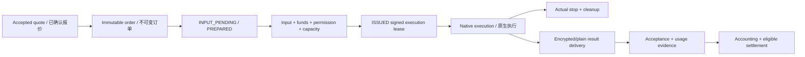

# System design / 系统方案

R011 implementation: [native supervisor and backend recovery](../../docs/技术开发/附录-原生执行监督与后端恢复实施细则.md). A bounded watchdog uses the existing SQLite owner/fences, frozen backend bindings and original command IDs. Control drain/revocation closes admission and waits for confirmed stop/cleanup. Synthetic metadata adapters do not prove production engines, process isolation, E2E or GPU performance. Platform remains 31/93 operations and 65 tables.

R011实施为执行监督循环与原生控制联动；原请求恢复期间的提供方资料加载时序已在Web/Taro修正。真实内核、完整KernelRegistry、内容加密/支付及56任务/222子项仍待收口。

The detailed requirements and technical chapters are authoritative; this guide
connects them into a single system. Data-plane behavior below remains planned.
The delivered Go foundation is identified separately in the implementation tracker.

完整需求和技术章节为权威；本文串起完整链路。下述数据面仍为待实现方案，已交付 Go 基础以实施进度和真实测试证据单独登记。

## Actors and boundaries / 角色与边界

| Actor / 角色 | Responsibility / 职责 |
| --- | --- |
| Buyer / 买方 | Confirm seller, capability, privacy, price, payment and acceptance / 确认卖家、能力、隐私、价格、支付和验收 |
| Seller / 卖方 | Voluntary device sharing, installation consent, price and fulfillment / 自愿共享设备、确认安装、自主定价并履约 |
| Platform / 平台 | Marketplace, immutable contracts, scheduling, routing and transaction evidence / 市场、不可变合同、调度、转发和交易证据 |
| Local gateways / 本地网关 | Bind credentials, protect content and preserve supported standard API semantics / 绑定凭据、保护内容并保留已支持的标准接口语义 |
| Native engine / 原生内核 | Execute only approved model/workflow under an issued lease / 仅凭已签发租约执行获准模型或工作流 |
| Payment channel / 支付渠道 | Actual authorized collection, verification and supported refunds/settlement / 实际获准的收单、验付及其支持的退款、结算 |

The platform does not become the compute seller by pooling devices. Every order
retains its seller. Upstream subscription access is eligible only where the
provider's terms and authorization permit this use.

平台不通过设备池变为算力自营方。每单保留实际卖家；上游订阅只有明确许可和授权允许时才能挂牌。

## State and authority / 状态与执行权

`PREPARED` is not a GPU reservation. A lease includes both job fencing and the
physical resource generation. Releasing a GPU requires actual stop/cleanup;
delivery can continue under its own scope after compute ownership ends. A stale
worker cannot stop or clean a newer owner's work. Rentals retain their session
lock across subtasks and release it only at the session's actual termination.

`PREPARED` 不占 GPU；租约绑定任务围栏及物理资源代次。设备释放以实际停算、清理为准，交付可独立继续；旧 worker 不得停止或清理新所有者。租赁子任务保留父会话资源锁。

## Forwarding and privacy / 转发与隐私

Plaintext: SDK → contract-bound platform gateway → same-seller adapter → engine.
Encrypted: SDK → buyer-local gateway → platform ciphertext relay → seller-local
gateway → private pipe/JNI engine. Responses reverse the path. All media uses an
explicitly approved OpenAI/Anthropic-compatible profile; unsupported tool or event
semantics are rejected.

明文：SDK → 合同绑定平台网关 → 同卖家适配器 → 内核。加密：SDK → 买方本地网关 → 平台盲转 → 卖方本地网关 → 私有管道/JNI 内核；结果反向返回。媒体同样须经批准的兼容档位，不静默丢弃工具或事件语义。

The crypto candidate combines independently verified endpoint identity, separate
Ed25519 signatures, sealed stream keys and authenticated secretstream records.
Key purposes, directions and object/attempt contexts are distinct. Sequential
streaming and locally segmented random reads are different formats. Authentication
failure, replay, truncation or an unknown profile fails closed. No automatic
plaintext downgrade is permitted. See the [protocol authority](../../docs/技术开发/08-端到端加密协议与密钥实现设计.md).

密码候选组合独立身份核验、独立 Ed25519 签名、封装流钥和认证 secretstream；用途、方向、对象/attempt 分离。网络顺序流与本地随机分段分别定义。认证失败、重放、截断或未知档位拒绝，不能自动降为明文。精确版本和跨端验证仍未完成。

## Provider execution / 提供方执行

Native GPU calls remain native. Private LLM workers embed llama.cpp; the LM Studio
compatibility branch retains `lms`, llmster and runtime as replaceable layers.
ComfyUI runs a complete approved environment with a private bridge and finite node
allowlist. Android is a real LMA fork using internal JNI. Shared content is kept
out of ordinary UI/history/log/loopback interfaces; task files are encrypted,
while model files retain normal native loading. No VM/RAM disk/model duplicate is
introduced by the design.

GPU 调用保持原生；隐私 LLM 嵌入 llama.cpp，LM Studio 三层兼容保留。ComfyUI 完整环境、私有桥和有限白名单；Android 真实 LMA 二开走内部 JNI。任务正文不开放给普通 UI/历史/日志/loopback API；任务文件加密，模型正常原生加载，不引入 VM、RAM 盘或重复常驻模型。

## Payment and acceptance / 支付与成交

Payment proof is not execution permission and not result acceptance. Verify the
original payment reference and its binding before funding qualification; issue
execution rights only after all other checks. Unknown financial outcomes query
the original operation. Trusted consumption, result acceptance, journal entries,
refund obligations and seller settlement remain separate. Do not invent an
unverified channel settlement endpoint or assume C2C seller onboarding is approved.

支付凭据不等于执行权或结果验收。先按原号核验支付及绑定，再形成资金资格；其余检查通过后才授权执行。资金未知查原操作。可信用量、接受、记账、退款义务和卖家结算分开，不虚构未证实的渠道结算接口或假定个人准入已获准。

## Authority map / 权威入口

| Topic / 主题 | Source / 来源 |
| --- | --- |
| Requirements / 需求 | [Whitepaper navigation](../../docs/白皮书/00-阅读导航与需求基线.md) |
| Gateway / 网关 | [Protocol forwarding](../../docs/技术开发/07-统一协议网关与Sub2API改造.md) |
| Provider / 提供方 | [Kernel packaging](../../docs/技术开发/附录-供给端内核封装与替换规范.md) |
| Local protection / 本地保护 | [Low-overhead design](../../docs/技术开发/附录-低开销隐私执行完整方案.md) |
| Payments / 支付 | [Collection and settlement](../../docs/技术开发/13-支付退款账务与渠道结算.md) |
| Development / 开发 | [56 tasks / 222 steps](../开发细则总表.md) |
| Actual evidence / 实际证据 | [Implementation progress](../progress/README.md) |

## Current identity implementation / 当前身份实施

R004 separates verified Alipay identity exchange, single-use challenge state, current user/role/session checks and a 13-route native HTTP adapter. Authorization codes and channel tokens are not stored; session/API-key digests use HMAC. WEB uses HttpOnly/Strict Cookie plus Origin/CSRF; MINIAPP uses memory-held Bearer sessions. The transports are not interchangeable. Trade mutations recheck credentials and roles before replay. Registration is BUYER only, never KYC or seller approval.

R004将支付宝验签适配、一次性挑战、当前用户/角色/会话及13操作原生HTTP分层。渠道码/令牌不落库，凭据摘要用HMAC。Web只读Cookie加Origin/CSRF，小程序内存Bearer，禁止混用；交易回放前重核身份/角色。初始仅BUYER，不能冒称KYC或卖家资格。

The embedded route manifest is checked against 93 canonical operations. Forward 003 adds two identity tables to the immutable 60-table base (62 current). All 34 local cases passed with signed synthetic provider responses; real Alipay authorization, UI, payment and provider execution remain pending. See [identity/HTTP authority](../../docs/技术开发/附录-身份登录与HTTP交易实施约束.md).

嵌入路由对照93操作权威契约；003前向新增2身份表，基础60表原字节保留，当前62表。34项局部测试使用签名合成响应通过，真实授权、UI、支付及提供方执行仍待完成，不能将有限注册当全平台可用。

## R005 seller submissions and future revisions / 卖家申请与未来修订

Account-owned seller applications retain submitted claims without granting SELLER or copying requested regions into approved regions. New listing definitions resolve owned model/capability rows, validate the explicit platform fee policy, create immutable revisions and use strong resource ETags for concurrent changes. Submission rechecks exact scope approvals and remains SUBMITTED; controlled review/publication is still required. Exiting atomically disables new admission while retaining sold contracts, money records and resource fences.

本人申请仅留待审材料，不授SELLER或批准地区；挂牌从本人设备/能力推导具体型号与环境，核对显式平台费用，新增不可变修订，以强ETag处理并发。提交重核组合证据后仍待审，受控审核发布未完成。退出原子停止新准入并保留已售合同、资金和资源围栏。详见[实施细则](../../docs/技术开发/附录-卖家申请与挂牌版本实施约束.md)。R006阶段为64表、23/93操作，45项Go与13项TS局部验证；已有实际Web/Taro H5交易控制页，支付宝原生仅编译，真实渠道/设备、完整前端与产品仍未验收。

## R007 provider control / 提供方身份控制

The current catalog has 65 tables and 31/93 control operations. An approved account owner creates an explicit short-lived pairing credential; the native installation registers a unique Ed25519 public key and a concrete self-reported model. The credential is disclosed only once, registration starts PAIRED with sharing off, and original enrollment recovery returns the same identity. No capability or permission is inferred from a model name.

当前65表、31/93操作。本人合格卖家明确配对，本机登记独立公钥与具体自报型号；秘密只显一次，原登记意图恢复同设备。默认PAIRED/不开共享，型号不等于许可或可售资格。

P11_DEVICE_ED25519_1 proofs bind exact routing/body and command headers, ±60-second timestamps and persistent nonces. Device heartbeats carry strictly increasing uint64 decimal sequences and current policy versions; server receipt time governs liveness. Neither IDLE nor replayed Ack renews authority or clears resource locks. Account-owned policy updates, drain and revoke preserve existing attempt owners/generations, including quarantine. Device identity keys are separate from E2E content keys.

签名绑定原路由/正文/幂等键/ETag/媒体类型，nonce持久防重放。心跳严格递增且绑定当前版本，服务端时钟决定在线；IDLE/原Ack回放不续权、不清锁。本人策略/停止/撤销保留在途owner/代次与隔离；控制钥与E2E内容钥分离。

At R007 the native package was a bounded signing/HTTP transport. R008 below adds a persistent native control agent and OS key adapters; hardware qualification, execution inbox/stop/cleanup and LMA/engine integration remain pending. R009 implements the owner control UI; full execution remains independent. See [R007 control specification](../../docs/技术开发/附录-设备配对身份与控制协议实施约束.md) and [historical local evidence](../tests/evidence/R007-验证报告.md); real channel/device/product acceptance remains unexecuted.

## R008 native control agent / 原生控制代理

p11-node is an explicit foreground, outbound-only control process. Current-user DPAPI on Windows or an unlocked Linux Secret Service protects a random state master. The bounded AES-GCM journal retains the installation seed, exact pending enrollment/heartbeat and counter high water; an OS writer lock spans network operations. A write reaches the network only after its original intent is durably saved. Restart/unknown replies preserve the original identity/body/key and sign fresh nonces. Windows DPAPI, ACLs and actual process termination/recovery are locally exercised; Linux keyring behavior remains protocol-fixture/cross-compilation evidence only.

本人决定初始化、登记和前台运行，status提供不含秘密的型号/设备/版本/序号投影。明确原心跳拒绝后先查当前身份/版本/序号，才允许下一心跳；未知结果不换命令。当前只报UNKNOWN，不启动内核、不接受任务、不报空闲、不清锁或产可信usage。同用户存储保护不是客户内容防护，独立低权限执行、SQLite inbox、统一资源门闩及内容网关仍待完成。详见[完整本地恢复规范](../../docs/技术开发/附录-原生提供方控制代理与本地恢复.md)。

原生Go包只交付签名/HTTP库；系统钥库、设备资格、本机执行/停止清理与LMA/内核仍待完成。R009接入提供方配对/策略/停止撤销，完整执行另行验证。真实渠道/设备与完整产品验收不因局部控制测试改变。

## R009 owner control UI / 本人设备控制界面

React/Taro and React/Vite share owner-bound DTOs and a strict non-secret command allowlist. Pairing secrets stay in page memory and are removed on lifecycle/authority changes. Original POST/PATCH method, key, body and strong If-Match survive lost replies. Policy ACK and current device state are separate projections; stale versions require a fresh read. Drain/revoke never release an execution fence or assert cleanup. The actual local Windows CLI journey is evidence of control identity only; GPU/Android, content E2E, payments and full acceptance remain pending.

设计承接NB04共享页，详见[完整双端细则](../../docs/技术开发/附录-提供方双端设备管理与原请求恢复.md)；不新增API/数据表/迁移，31/93操作、65表、001—005原字节保持。

## R010 native metadata gate / 原生执行元数据门闩

The existing Lease DTO is verified against independent approved order/manifest/kernel state and a separately trusted platform public key. The native gate persists inbox/receipt, uint64 job/resource high waters, local owner generation and original backend mapping in one bounded SQLite store. The same node OS lock protects both the encrypted control anchor and database lifecycle. Managed local work, maintenance and jobs share the physical resource; signed rental ownership remains pending.

重开、双截止或回拨关闭执行并保留owner；重复提交只查原backend。签名新修订才可续短截止，当前backend确认停算和完整清理经owner比较更新后才FREE。SQLite不存正文/内容钥且不是加密内容库；状态机不代替实际停止/删除，也不开启完整执行。具体流程/编号/固定签名域与剩余门槛见[原生执行细则](../../docs/技术开发/附录-原生执行收件箱与资源门闩实施细则.md)。

## R012 bound text relay / 固定路由文本转发核

A core owns one immutable seller, route, contract, profile, model mapping and upstream endpoint. Exact JSON/text preflight precedes the explicit durable admission port; upstream secrets are separately resolved by seller/reference. Native dialect state machines preserve actual terminals and bounded usage candidates. No pool, redirect, environment proxy, POST replay or cross-mode fallback is inherited.

平台STANDARD明文域与未来卖方E2E_BASIC解密域由可信配置区分，CipherRelay不使用正文核。库仅取消HTTP并返回Outcome，原执行停止/清理、可信计费和入站租约由其他生产模块接入；未挂载可售入口。详见[完整BRC细则](../../docs/技术开发/附录-固定路由协议转发核心实施细则.md)。

Exact-field follow-up: request/response field names use whole-name equality, including delimiter-bearing negative cases. All 20 current relay cases pass, while the latest full rerun failed seven existing short-deadline cases. The 114 unchanged-package cases use only immutable, identical-source baseline evidence; six serialized diagnostic failures are retained too. / 当前补充验证受限，不能宣称全量通过，见[逐项证据和失败](../tests/evidence/R012-验证报告.md)。
