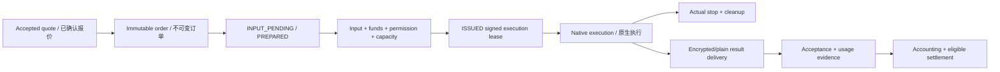

# System design / 系统方案

The detailed requirements and technical chapters are authoritative; this guide
connects them into a single system. Data-plane behavior below remains planned.
The delivered Go foundation is identified separately in the implementation tracker.

完整需求和技术章节为权威；本文串起完整链路。下述数据面仍为待实现方案，已交付 Go 基础以实施进度和真实测试证据单独登记。

## Actors and boundaries / 角色与边界

| Actor / 角色 | Responsibility / 职责 |
| --- | --- |
| Buyer / 买方 | Confirm seller, capability, privacy, price, payment and acceptance / 确认卖家、能力、隐私、价格、支付和验收 |
| Seller / 卖方 | Voluntary device sharing, installation consent, price and fulfillment / 自愿共享设备、确认安装、自主定价并履约 |
| Platform / 平台 | Marketplace, immutable contracts, scheduling, routing and transaction evidence / 市场、不可变合同、调度、转发和交易证据 |
| Local gateways / 本地网关 | Bind credentials, protect content and preserve supported standard API semantics / 绑定凭据、保护内容并保留已支持的标准接口语义 |
| Native engine / 原生内核 | Execute only approved model/workflow under an issued lease / 仅凭已签发租约执行获准模型或工作流 |
| Payment channel / 支付渠道 | Actual authorized collection, verification and supported refunds/settlement / 实际获准的收单、验付及其支持的退款、结算 |

The platform does not become the compute seller by pooling devices. Every order
retains its seller. Upstream subscription access is eligible only where the
provider's terms and authorization permit this use.

平台不通过设备池变为算力自营方。每单保留实际卖家；上游订阅只有明确许可和授权允许时才能挂牌。

## State and authority / 状态与执行权

`PREPARED` is not a GPU reservation. A lease includes both job fencing and the
physical resource generation. Releasing a GPU requires actual stop/cleanup;
delivery can continue under its own scope after compute ownership ends. A stale
worker cannot stop or clean a newer owner's work. Rentals retain their session
lock across subtasks and release it only at the session's actual termination.

`PREPARED` 不占 GPU；租约绑定任务围栏及物理资源代次。设备释放以实际停算、清理为准，交付可独立继续；旧 worker 不得停止或清理新所有者。租赁子任务保留父会话资源锁。

## Forwarding and privacy / 转发与隐私

Plaintext: SDK → contract-bound platform gateway → same-seller adapter → engine.
Encrypted: SDK → buyer-local gateway → platform ciphertext relay → seller-local
gateway → private pipe/JNI engine. Responses reverse the path. All media uses an
explicitly approved OpenAI/Anthropic-compatible profile; unsupported tool or event
semantics are rejected.

明文：SDK → 合同绑定平台网关 → 同卖家适配器 → 内核。加密：SDK → 买方本地网关 → 平台盲转 → 卖方本地网关 → 私有管道/JNI 内核；结果反向返回。媒体同样须经批准的兼容档位，不静默丢弃工具或事件语义。

The crypto candidate combines independently verified endpoint identity, separate
Ed25519 signatures, sealed stream keys and authenticated secretstream records.
Key purposes, directions and object/attempt contexts are distinct. Sequential
streaming and locally segmented random reads are different formats. Authentication
failure, replay, truncation or an unknown profile fails closed. No automatic
plaintext downgrade is permitted. See the [protocol authority](../../docs/技术开发/08-端到端加密协议与密钥实现设计.md).

密码候选组合独立身份核验、独立 Ed25519 签名、封装流钥和认证 secretstream；用途、方向、对象/attempt 分离。网络顺序流与本地随机分段分别定义。认证失败、重放、截断或未知档位拒绝，不能自动降为明文。精确版本和跨端验证仍未完成。

## Provider execution / 提供方执行

Native GPU calls remain native. Private LLM workers embed llama.cpp; the LM Studio
compatibility branch retains `lms`, llmster and runtime as replaceable layers.
ComfyUI runs a complete approved environment with a private bridge and finite node
allowlist. Android is a real LMA fork using internal JNI. Shared content is kept
out of ordinary UI/history/log/loopback interfaces; task files are encrypted,
while model files retain normal native loading. No VM/RAM disk/model duplicate is
introduced by the design.

GPU 调用保持原生；隐私 LLM 嵌入 llama.cpp，LM Studio 三层兼容保留。ComfyUI 完整环境、私有桥和有限白名单；Android 真实 LMA 二开走内部 JNI。任务正文不开放给普通 UI/历史/日志/loopback API；任务文件加密，模型正常原生加载，不引入 VM、RAM 盘或重复常驻模型。

## Payment and acceptance / 支付与成交

Payment proof is not execution permission and not result acceptance. Verify the
original payment reference and its binding before funding qualification; issue
execution rights only after all other checks. Unknown financial outcomes query
the original operation. Trusted consumption, result acceptance, journal entries,
refund obligations and seller settlement remain separate. Do not invent an
unverified channel settlement endpoint or assume C2C seller onboarding is approved.

支付凭据不等于执行权或结果验收。先按原号核验支付及绑定，再形成资金资格；其余检查通过后才授权执行。资金未知查原操作。可信用量、接受、记账、退款义务和卖家结算分开，不虚构未证实的渠道结算接口或假定个人准入已获准。

## Authority map / 权威入口

| Topic / 主题 | Source / 来源 |
| --- | --- |
| Requirements / 需求 | [Whitepaper navigation](../../docs/白皮书/00-阅读导航与需求基线.md) |
| Gateway / 网关 | [Protocol forwarding](../../docs/技术开发/07-统一协议网关与Sub2API改造.md) |
| Provider / 提供方 | [Kernel packaging](../../docs/技术开发/附录-供给端内核封装与替换规范.md) |
| Local protection / 本地保护 | [Low-overhead design](../../docs/技术开发/附录-低开销隐私执行完整方案.md) |
| Payments / 支付 | [Collection and settlement](../../docs/技术开发/13-支付退款账务与渠道结算.md) |
| Development / 开发 | [56 tasks / 222 steps](../开发细则总表.md) |
| Actual evidence / 实际证据 | [Implementation progress](../progress/README.md) |

