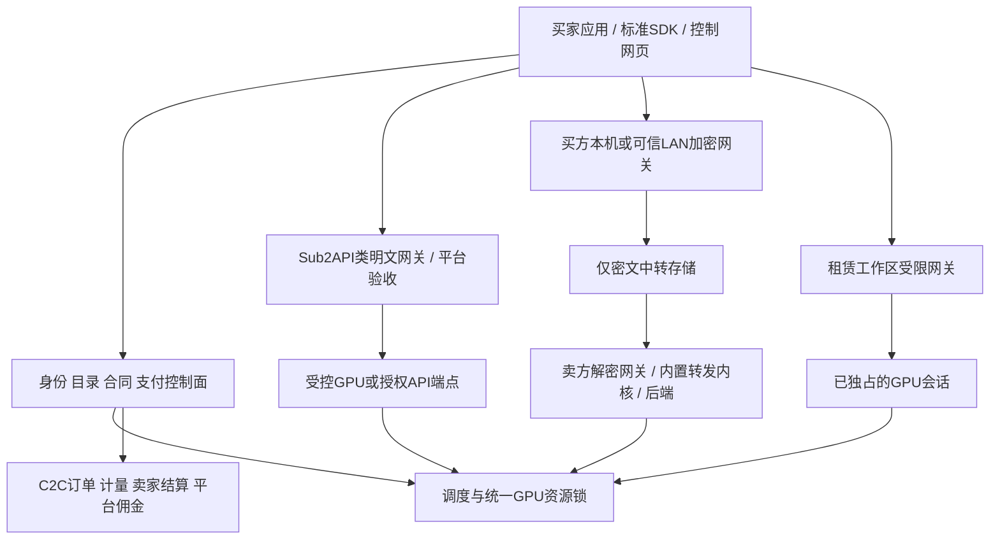

# 算力共享平台：架构、数据与接口

P11｜v3.0｜2026-10-29｜控制面/密文传输为拟建平台自有协议，模型/媒体数据面采用OpenAI或Anthropic兼容协议；支付/引擎需适配真实接口，以下不是支付宝现成字段。当前未实施。

本轮修订：小程序React＋Taro优先，独立Web React＋Vite；部署/HTTPS/运维与可观测性延后。以[当前范围](技术开发/附录-本轮范围与端侧选型修订.md)、[协议转发](技术开发/07-统一协议网关与Sub2API改造.md)和[赛事收单](技术开发/13-支付退款账务与渠道结算.md)覆盖相冲突段落；原F/T编号保留，不代表全部在本轮实施或已通过。

完整深化与实施细则见[白皮书阅读导航](白皮书/00-阅读导航与需求基线.md)和[80项逐项实施规格](白皮书/15-需求逐项实施规格.md)。本文件保留快捷需求入口；v3.0新增详规、契约和追踪，不代表软件已实现。

本次供给内核修订：Windows LLM以lms CLI＋llmster＋可替换推理runtime封装；图像/视频/音频/3D以完整ComfyUI原生内核及有限节点白名单封装；Android基于LMA源码二开。Linux原生双引擎保留。详见[内核封装与替换规范](技术开发/附录-供给端内核封装与替换规范.md)，当前均设计待实现，第三方许可/实机证据未取得。

## 控制面与三条数据路径

控制面负责身份、元数据、合同、支付、资源锁和证据账。明文管线有输入检查/解码验收权限；密文管线没有内容钥、明文预览或解码权限；租赁管线负责会话控制和可用时长，不把工作区子任务都变成买家付费任务。密钥/服务账号/对象命名空间与权限分别配置，不能只在UI隐藏同一个解密接口。

初期一个原生控制面API、协调/验收工作进程、原生关系数据库和对象存储；节点出站HTTPS/WSS/长轮询，不暴露本地8188。开发缓存/数据库/模型/所有运行产物在本项目 runtime 内。禁止调用本地Docker、WSL、虚拟机等环境。远端供给者主动选安装位置，不接管其桌面。

## 统一标准入口和网关边界

全部模型/媒体数据路径经OpenAI/Anthropic兼容入口；明文在平台Sub2API类网关解析转发，加密由买方本地/LAN程序加密、平台盲转、卖方本地程序解密后经内置同类内核执行，响应反向加密。平台不能将密文服务接到自己的明文网关做格式转换。完整路径/字段/流式/部署规范见[统一API与本地加密网关](协议/统一API与本地加密网关需求.md)。

OpenAI数据面使用/v1/chat/completions、/v1/responses及已发布媒体子集，Anthropic使用/v1/messages及已发布扩展；自有控制面仍为/v1/p11，密文帧是独立版本传输协议。标准SDK连接本地/平台Base URL，模式、卖家、预算从已确认RouteContract解析；不能把内部202/job响应直接返回成同步完成，也不强加私有必填JSON字段。

后续代码边界：dev/src/gateway/platform/为明文适配，dev/src/gateway/core/为可复用内核，dev/src/gateway/cipher-relay/为无钥密文服务；dev/src/client/crypto-gateway/为买卖端程序，dev/src/client/protocol/openai/、anthropic/、envelope/分别存协议实现。目前仅建立空目录，无产品代码。Android为轻量适配，不假设完整中心服务可直接运行。

## C2C卖家合同与能力组合

实际供给为用户自愿挂牌的闲置设备。订单买卖双方独立，平台提供撮合/技术规则并收明确佣金；不采购容量或默认自营。自助卖家、Listing/价版、订单seller归属、基本信誉与资金路线见[交易规则](交易/C2C交易与市场规则.md)。

Windows供给端由RuntimeSupervisor封装lms/llmster/runtime和完整ComfyUI环境，后者覆盖图/视频/音频/3D及有限节点安装；Linux保留原生双引擎，Android基于LMA源码二开。新增provider_os/arch、runtime_kind/version、accelerator_backend/observed_offload、model/tokenizer/quantization/template、task_types/protocol_features，资源种类为LOCAL_GPU/ANDROID_DEVICE/AUTHORIZED_API；本地LLM不使用上游订阅库存。

统一适配器映射后端request/prompt/job ID，具备探测/准备/执行/取消/结果/清理语义。两桌面引擎共用GPU锁；Android自用聊天/本地API/多模态与共享订单共执行门闩，电量/热/网络/前台状态参与准入。Linux用真实原生节点，Android用真机，禁止用本地虚拟化或模拟器代替。见[多端规格](供给端/00-供给端能力矩阵.md)。

每个新报价显式包含 `service_mode`、`privacy_profile`、`resource_kind`，允许组合由[三模式总览](模式/00-三模式总览与边界.md)发布。合同快照还固定buyer_id/seller_id/listing_id、卖家价版/平台费率/费用承担、设备集合、内容可见方、区域、版本/证据、计量单位、预算/时限、取消退款、验收与数据/责任条款；`contract_hash`签名/支付引用均绑定该快照。

加密公开参数和私密参数分离。公开参数足以匹配已冻结SKU和资源边界，prompt、代码、私密seed等放密文；不能把解密所需信息回填到平台普通参数列。租赁合同明确可操作环境和权限，不等同任意主机控制。

## 数据实体与唯一性

| 实体 | 核心字段 | 约束 |
| --- | --- | --- |
| Seller/PlatformAgreement | user_id、verified_identity、device_rights、region、allowed_modes、data_terms、channel_payee、fee/settlement_terms | 自助申请；身份/许可/收结款合格后可售，平台协议与买卖订单分开 |
| Listing/ListingVersion | listing_id、seller_id、device_set、capability、schedule、capacity、seller_price、accept_policy、state | 卖家自主挂牌/改未来价/下架；旧版不可变，不超卖 |
| Review/Reputation/Appeal | buyer/seller/order、eligible_event、rating、sample_window、reply、decision | 真实订单评价；基本信誉与申诉，不伪造或付费删差评 |
| Device/Identity/RecipientKey | device_id、auth_cert、content_key_id、fingerprint、key_chain、revocation | 认证钥与内容钥分离，平台不持内容私钥；硬件指纹不作认证 |
| Capability/LicenseEvidence | modes/profiles、GPU/driver、model/workflow/environment_hash、benchmark、region、licenses | 可售能力与证据逐项匹配，不凭GPU型号开启增强档 |
| AttestationPolicy/Evidence | challenge、device/workload/key_binding、measurements、policy_version、expires、verifier | 证据新鲜且绑定买家确认的接收钥，变化重新证明 |
| SKU/PriceVersion/FeeVersion | listing/seller、resource_kind、mode/profile、unit、seller_rate、commission_bps、channel_cost_owner、bounds、policy_versions | 无独立平台采购价；任务/用量/租时卖家价与费用历史不可变 |
| Quote/Admission | contract_hash、buyer/seller/listing/price/fee、expires、queue_slot/physical_hold、state | 先匹配确认实际卖家再付款；任务准入与租赁占位分开 |
| Order/Payment/Refund | buyer/seller/listing、quote_id、channel_payee、authorization/settlement_ref、gmv_fen、refund_fen、related_order、states | seller与挂牌/支付收款归属一致；换卖家新单；授权非到账 |
| EncryptionIntent/Envelope | work_item_id、contract_hash、recipient/key_id、buyer_return_key、delivery_revision、cipher_hash | 不存明文钥/哈希；意向不赋执行权限；放钥换端需买家确认 |
| Job/Attempt/ExecutionLease | order、state、attempt/token、device、deadline、accepted_attempt、prompt_id | 每job最多一个接受尝试；旧token无写回权 |
| CipherDelivery/BuyerReceipt | job/attempt、cipher_manifest_hash、delivery_revision、buyer_signature、decision、deadline | 密文到达与买家接受分开，一次交付最多一个有效决策链 |
| Asset/Artifact | owner、job/session、object_key、cipher/plain类型、bytes、hash、expires | 分命名空间；权限不允许覆盖/列他人对象；明文哈希不出加密信封 |
| GPUResourceLock | gpu_resource_id、owner_type/id、token、state、cleanup_required | 服务任务与租赁共锁；PREPARING/ACTIVE/CLEANING不可再次分配 |
| RentalSession/ReadyReceipt | resource/env、max_duration/budget、state、ready_refs、start/stop、disconnect_policy | 双端就绪确认后才起表，结束后清理确认才解资源锁 |
| SessionToken/Workspace | tenant、session/device/env/token、scopes、expires、quota | 不提供主机权限；撤销、到期、串会话均拒绝 |
| AvailabilityInterval/UsageEvent | session/request、seq、start/end、evidence、source、confidence、dedup | 区间不重叠、重传去重；GPU忙碌遥测不当可用租时 |
| MeterStatement | session、price_segments、billable_ms、charge_fen、budget、refund | 同价全会话汇总取整，唯一结算版本，修订追加冲正 |
| AcceptanceReceipt | job/attempt、type、checks、validator_version、buyer_receipt_ref | 明文平台验收/加密买家验收明确类型；租时不用伪accepted_job |
| TradeLedger/SellerSettlement/PlatformFee | order/seller、evidence_type/id、unit/qty、qualified_gmv/refund/commission/channel_cost/net_fen、fee_version、state、reversal_of | 成交额/卖家款/佣金独立，整单取整/退款重算，证据各唯一；不是平台卖家结算账 |
| ChannelSettlementBatch/Item | seller_payee、eligible_ids、fee/refund_refs、channel_ref、reviewers、state | 获准渠道结算，一卖家款只进一个有效项；未知先查，不以私人转账替代 |
| ProtocolProfile/MappingVersion | family/API/SDK_version、paths/headers/fields/events/errors、supported/rejected、adapter_hash | 已发布子集不可静默改语义；必需字段不能伪造 |
| RouteContract/GatewayIdentity | buyer/seller/listing、mode/privacy、model/protocol/fee、budget、gateway_role/key/region、authorization_ref | 已确认配置解析标准请求；缺模式不默认明文，不跨卖家账户池轮转 |
| RelayRequest/StreamCheckpoint | request/order/attempt/token、backend_id、stream/revision/sequence、terminal、dedup/receipt_ref | 内部重连不新购；SDK无稳定键不按内容猜重试；旧token无写回权 |
| EncryptedFrame/Manifest | context/recipient/direction、seq/type、cipher_hash/bytes、final_commitment、expires | AEAD绑定合同和帧序；平台无钥/正文；缺终块不完整 |
| UsageEvidence/ProtocolUsage | original_protocol、model/tokenizer/version、source、input/cache/output/reasoning、buyer_receipt、confidence | 协议字段与可收费证据分开，无可信计量不估算出账，租赁子调用不另收费 |
| Dispute/Audit/Outbox | entity_ids、reason、consent/evidence_refs、actor、event_id | 仅保留必要证据，变更与持久发件箱同事务 |

账务以整数分计CNY，不把预授权当实收，不把待确认应付当可提现。输入内容、内容私钥与普通交易凭据分开，不因财务留存保留全部素材。

## 服务任务调度和状态

报价初拟15分钟有效，密文输入传输使用独立EncryptionIntent且不得占满GPU。输入就绪后执行准入初拟90秒；每买家初拟最多2个活动服务任务，每SKU排队/预留上限为`min(20, 2×合格在线节点数)`，扣除被租赁占用资源。上述均为业务配置，不是官方支付有效期。

可履约凭证和输入就绪后创建任务；原子筛模式/隐私/区域/授权/版本/资源，再取GPU锁及job锁、生成attempt和递增token。执行租约45秒、心跳10秒。失效尝试不得自行继续/写正式结果，最多一次在同卖家已披露设备集合重派；跨卖家结束原单并经买家确认新单，不自动迁移。迟到结果隔离，可能重复计算但不重复计费/正式交付。

明文状态：`QUEUED → RUNNING → VALIDATING_PLATFORM → ACCEPTED`，另有重试/失败/取消。完整上传且当前token有效才转平台验收租约；独立解码后唯一接受，平台验收进程重启可恢复，不依赖节点无限续租。

加密状态：`BINDING_RECIPIENT → INPUT_READY → QUEUED → RUNNING → DELIVERY_AVAILABLE → VERIFYING_BUYER → ACCEPTED / REJECTED / UNVERIFIED`。换端插入`WAITING_REENCRYPT`，买家重新放钥前不发执行权。平台只校验密文清单/签名与回执，不创建明文验收任务。

基础图像总处置时限初拟300秒，从可履约且输入就绪起，包含排队、最多一次重派、上传和对应验收。加密补放钥等待初拟最多120秒、本地验收窗口初拟120秒，均受原总期限限制，实际剩余时间显示给买家。视频独立时限。支付最终结算/银行退款到账不伪装成GPU处理耗时。

加密签名回执绑定合同、交付版本、当前attempt与密文清单；接受/拒绝/取消/超时用条件更新竞争唯一合法状态。无回执超时退款/释放授权，不伪造验收；只有平台过错或公示限额保障的补偿走独立责任事件；未接受不自动产生平台兜底。内容已被本地解密后不能技术收回，支付支持与风险限额是独立启用条件。

## 租赁准备、计量与结束

物理占位初拟90秒，准备和READY等待买家初拟各120秒；有效支付凭证、资源锁、环境/连接/基准和买家ready_receipt共同满足才生成起表事件。活动状态、可用时长区间、收退款状态分开。

每10秒形成有序可用性确认，区间上限/来源、平台收取时间与节点签名均保留；单个ACK不能追认任意长离线区间。协调器采用服务端可信计时/持久水位，客户端壁钟回拨无效；平台重启未知空档不直接收费。节点失联后只累计至最后有证据确认点，故障检测的45秒等待不自动计费；更早故障证据可申请冲正。此协议提供可对账证据，不宣称恶意主机性能不可伪造。

分钟费率R、累计可用毫秒D对应`ceil(R×D/60000)`整数分，受已确认预算上限控制；同价续租累加一次取整。正常空闲/买家正常操作占用计费，准备/平台供给故障/结束清理不计。同一证据形成卖家挂牌成交额，按费用版计算佣金和卖家应结净额，不设独立采购分钟价。

默认买家断线宽限60秒后停止，断线继续须事先明确选择且不突破时间/金额；续租需新预算/价格确认和实际付款能力。到期本地与平台都停止放行/执行；客户端持久记录期限，重启无平台再验证不得恢复。无法确认是否停干净的GPU隔离，不能靠TTL自动再租。

结束顺序：幂等结束请求 → 冻结可计费截止点/撤会话权限 → 停当前引擎任务 → 最终计量/退款 → 清工作区和密钥 → 节点清理确认/残留检测 → 解除资源锁。故障默认终结原设备租约，另开设备必须买家重新确认。细则见[租赁规格](模式/02-显卡租赁模式需求.md)。

## 买家接口合同

本节仅列自有控制面，基路径`/v1/p11`；兼容推理数据面见前文和协议专项。v3.0以[控制面OpenAPI](白皮书/contracts/openapi-control-v3.0.json)为完整路径/字段草案，以下为摘要，不沿用旧artifacts、access-tokens、renew或billing/orders的示意路径。写接口用租户/动作范围幂等键，同键不同请求拒绝。返回安全错误结构，不返回解密异常正文。真实402由官方SDK适配生成，不用样例模拟已接通。

| 方法与路径 | 主要输入/输出 | 模式约束 |
| --- | --- | --- |
| GET /services | seller/listing、mode/profile/resource、region、cursor；能力/挂牌价/费用/评价样本 | 未核准个人收结款或增强证明不可售 |
| POST /quotes | listing版本、模式、公开规格/预算；返回实际seller和费用快照 | E2E无私密参数；不等同锁GPU |
| POST /orders | quote/contract_hash、披露确认、caller_key | 业务订单冻结实际卖家与合同 |
| POST /orders/{order_id}/payment-intents | order版本、获准渠道能力 | UNKNOWN查原支付，不重购 |
| POST /assets、POST /assets/{asset_id}/complete | order、当前attempt、类型/字节/摘要、上传清单 | 明文/密文分管线，不按密文MIME解码 |
| POST /encryption-intents | quote、买方回传key_id、指定端点与信任策略 | 公钥经recipients登记；不发平台内容私钥 |
| POST /recipients/{recipient_id}/attestation-challenges | 意向、随机挑战、keyhash、策略 | 证明须绑定新鲜挑战与正确key |
| GET /recipients/{recipient_id}/evidence | challenge_id | 买方独立验证，不凭平台自称合格 |
| POST /jobs | order/version、caller_key、明文input_asset_refs或encryption_intent_id | E2E先INPUT_PENDING/PREPARED，无执行权，不占GPU |
| GET /jobs/{job_id} | 当前attempt/token/recipient及任务状态 | 资金/退款另查原对象，不混单status |
| POST /jobs/{job_id}/envelopes | 当前attempt/token、封装对象及输入清单 | 放钥/输入与资金/容量均通过才ISSUED；换端重新核验 |
| POST /jobs/{job_id}/receipts | 接受/拒绝、交付版本、签名与密文清单 | E2E本地验收，不收私钥 |
| POST /jobs/{job_id}/cancel | expected_version、reason_code | 与接受/执行条件更新竞争 |
| GET /jobs/{job_id}/results | 正式交付、对象与接受状态 | 权益按模式与真实支付合同授权 |
| POST /assets/{asset_id}/transfer-grants | 当前版本、传输目的与可选Range | 本人单对象短时授权，重领免费 |
| POST /rental-sessions | order、设备环境、预算与断线政策 | 仅合格GPU；占位/准备不立即起表 |
| GET /rental-sessions/{session_id} | 就绪/活动/可用累计/预算/期限/清理 | 退款另对象跟踪 |
| POST /rental-sessions/{session_id}/ready | 环境版、连接/就绪证据与预算 | 设备device-ready独立提交，双端和资金通过才起表 |
| POST /rental-sessions/{session_id}/access-grants | 限定会话scope，期限不超过hard_deadline | 无主机/任意代码权限 |
| POST /rental-sessions/{session_id}/renewals | 新quote、预算、期限及明确确认 | 不自动续租，不绕支付 |
| POST /rental-sessions/{session_id}/stop | 当前版本及原因 | 冻结截止、撤权、对账、清理 |
| GET /rental-sessions/{session_id}/statement | 整会话计量、区间分页、价段引用及金额 | 分页不分段多取整，无按张重复收费 |
| POST /disputes | order、类型、选择披露证据 | 不要求历史内容私钥 |
| GET /orders、GET /orders/{order_id}/bill | 本人订单分页及逐单账单 | 成交/退款/佣金/费用与到账分开 |
| POST /seller/listings、PATCH /seller/listings/{listing_id} | 卖家设备/能力/时段/价格 | 本人合格证据；未来版、If-Match |
| POST /orders/{order_id}/reviews | 真实订单评分及公开规则版本 | 禁刷单/付费删差评，申诉另走工单 |
| GET /seller/settlements | 订单成交、佣金/费用、净额、渠道状态 | 不把GMV或待结额当到账/平台收入 |

错误码新增 MODE_REQUIRED、MODE_NOT_SUPPORTED、PRIVACY_DOWNGRADE_FORBIDDEN、RECIPIENT_KEY_MISMATCH、REKEY_REQUIRED、ATTESTATION_INVALID/EXPIRED、BUYER_RECEIPT_TIMEOUT、GPU_ALREADY_HELD、RENTAL_NOT_READY、RENTAL_EXPIRED、BUDGET_EXHAUSTED、CLEANUP_UNCONFIRMED。既有支付未知、许可失效、陈旧尝试、产物不合格仍适用。

## 节点控制面

保留供应者申请/配对/注册/撤证、能力/时段、出站任务poll/ack/heartbeat、受限上传/完成/失败、收益/出款查询。任务签名绑定mode/profile、合同、资源、attempt/token、接收钥与密文清单或允许参数、版本、租约及绝对期限、nonce和key_id；节点时钟不能延长平台租约。

租赁新增节点会话prepare/ready、可用区间ack、workspace通道、stop/cleanup-receipt接口；每个都检查设备/GPU/session/token/版本，重复事件去重。内容接收钥登记及轮换、增强证明证据单独存，不上传内容私钥。普通客户端不能把`supports_confidential=true`自报当作准入证据。

本地API Relay只连批准的供应商域名，无任意base_url；基础加密在Relay端解密，平台凭证库属于明文路径。流式预算/可信usage和加密分块协议分别验证后才开。

## 账务、恢复与运行观测

接受事件/可信用量/租时结算单与actual seller、收退款、佣金、卖家结算及平台补偿通过唯一键、事务和持久发件箱关联。设备owner/listing/order/payment payee交叉校验，交易中不能转归属；更正追加冲正，渠道未知先查。每日核对GMV/退款、卖家净额、平台费用和渠道资金，恒等关系按明确费用承担成立。未收款不造收入，平台责任补偿不造卖家成交。

佣金初拟floor(最终保留成交分×费率基点/10000)，整单累计计算，退款重算佣金并冲差额。实际资金必须按获准C2C渠道运行，内部账非钱包或平台普通账户归集转付。必要商品/服务与交易信息适用至少3年法定留存时遵循该要求；素材和内容私钥不随交易证据长期保留。

监控mode/profile、job/attempt/session/device/价版，分别测排队/生成/上传/本地验收、证明失败、准备/有效租时/故障/清理。只记录安全元数据与错误码。跨模式数据访问、隐私降级、重复收费、无清理再出租为阻断告警，关闭受影响新售并保留售后。

## 内核环境绑定的数据补充

新增不可变kernel_environment_ref/digest与组件清单，能力登记必填；公开服务及订单合同保存device/capability/environment集合，签名lease及租赁授权绑定实际环境，适配命令和本地任务重复核对。ComfyUI节点目录变化使资格失效，不随同名版本继续执行。capabilities保存环境引用/hash，合同snapshot保留允许集合；不上传私人安装路径、正文或钥。

## 加密数据面与调度权限细化

以[技术08](技术开发/08-端到端加密协议与密钥实现设计.md)统一端点信任、签名流头/钥封装/AAD、BINARY_STREAM_1、LOCAL_SEGMENTED_1、END/FINAL与回执。前者新增二进制通道须补协商/Schema，不能把当前JSON帧契约改名冒充。控制面只处理公开合同/密文/签名事实，不核私密语义或AEAD，也不为token计量解密。

输入C绑定PREPARED已知job/attempt/token/recipient/环境；resource_id/resource_lock_generation由ISSUED租约另签后联核，不预签未知值。持久记录保存流头/钥ID/指纹、密文水位/hash、backend ID/最高围栏、交付版/回执去重，不保存正文钥或secretstream推送状态。计算owner与交付scope分别授权，释放显卡后原密文仍可合法补传/签收，旧回调不能影响新owner。
