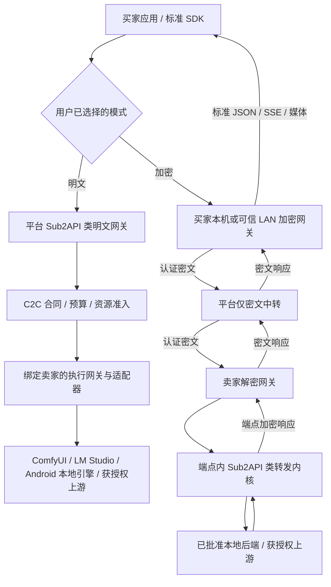

# 统一 OpenAI / Anthropic API 与本地加密网关需求

P11｜v3.0｜2026-10-29｜用户新增要求：所有模型及媒体数据请求经 OpenAI 或 Anthropic 兼容入口转发；明文使用 Sub2API 类内核，加密使用本地/局域网加解密程序及其内置转发内核。本文件为需求与架构设计，尚无网关、加密程序或兼容性实测。

低开销完整方案（最新用户确认）：用户允许新增隐私档可嵌入LLM内核，LM Studio继续保留兼容。采用llama.cpp C API原生worker、ComfyUI私有管道入口、LMA内部JNI；买卖端加密/平台盲转，任务数据加密而模型保留原生加载，不使用VM/RAM盘/常驻第二份模型。输入准备和密文交付不额外占GPU锁，控制与大数据通道分离。内存/性能为待实测验收预算，完整链路、二进制协议、媒体、恢复及PE-01—PE-08见[完整实施方案](../技术开发/附录-低开销隐私执行完整方案.md)。当前尚未实现或通过设备/密码/性能验证。

本地隐私目标修订（2026-10-29）：在E2E的PLATFORM_BLIND之上增加本地日常访问防护，保护从解密、内置转发到引擎/编码/结果加密的直接出口；平台仍只盲转，OpenAI/Anthropic标准JSON/SSE/媒体接口不增加私有必填字段。外层TLS/认证不能遮住末端裸HTTP，具体引擎未验证时不能标已防本机抓包；普通原生进程不取得ATTESTED_CONFIDENTIAL标签。目标不含高级内存分析，见[完整本地策略](../技术开发/附录-本地内容隐私防护与分级验收.md)。当前设计未实现。

当前实施范围以[本轮修订](../技术开发/附录-本轮范围与端侧选型修订.md)为准：React/Taro支付宝小程序优先、React/Vite Web；部署/HTTPS/运维和可观测性延后。转发与支付宝收单已展开到技术详规，历史需求ID和未执行状态保留。

完整深化与实施细则见[白皮书阅读导航](../白皮书/00-阅读导航与需求基线.md)和[80项逐项实施规格](../白皮书/15-需求逐项实施规格.md)。本文件保留快捷需求入口；v3.0新增详规、契约和追踪，不代表软件已实现。

## 确认范围与术语

本产品仍为用户自愿挂牌闲置显卡、手机和获授权模型服务的 C2C 市场。协议与网关是交易的技术通路，不改变实际卖家、自主挂牌价格、费用、支付与责任。商业约束见 [C2C规则](../交易/C2C交易与市场规则.md)。

“所有数据请求”指买家调用已售模型/工作流的请求、响应、流式事件及媒体内容，统一从兼容入口进入。市场、报价、付款、设备身份、心跳、租约、密文信封及文件传输仍有专门控制/传输协议；不会把付款或设备心跳伪装成模型对话。ComfyUI 等引擎内部保留原生接口，由适配器连接，买家无需直接调用原生 /prompt。

平台同时提供 OpenAI 和 Anthropic 两类入口。每种可售能力至少明确支持其中一种；文本基础服务计划同时支持 Messages、Chat Completions 与 Responses 的已发布子集。协议形状兼容不代表模型品牌、能力、质量、上下文、工具或计量完全等价。不能把本地模型冒充 Claude / OpenAI 原厂模型。

“解包后的密文再转发”在实现中分为：验证外层信封、解密得到标准请求明文、交给端点内的转发内核。平台不做其中的内容解密。普通推理不直接处理密文；若把解密后的请求发回平台的明文网关，则不满足平台不可见。

## 三个网关角色与公共内核

| 组件 | 所在位置 | 内容权限与职责 |
| --- | --- | --- |
| Platform Plaintext Gateway | 平台受控原生服务 | 接收标准请求；鉴权、绑定卖家订单、协议校验/转换、预算准入、明文调度/验收、响应回传 |
| Buyer Crypto Gateway | 买家本机或其明确信任的局域网主机 | 对应用暴露兼容 API；端点/合同确认、内容预检、加密发送、解密回包、重建标准 JSON/SSE、签名回执 |
| Seller Execution Gateway | 卖家设备或已披露的同卖家可信局域网主机 | 出站连接平台；核执行租约/合同、解密、调用内置转发内核及批准后端、加密响应/计量证据、停止与清理 |
| Opaque Cipher Relay | 平台独立密文服务 | 只做已认证的信封/密文转发、受限存储、大小/流量/租约检查；无内容钥、无正文解析与格式转换 |
| Relay Core | 网关内的软件模块或受限子进程 | 标准协议解析/输出、能力校验、允许的格式转换、流式处理、连接器、取消与安全错误；可基于 Sub2API 评估裁剪改造 |

同一原生安装包可以同时具备买方/卖方功能，启用角色、凭据、端口、数据目录和权限分别隔离。买方不需要卖方的上游账户池；卖方只接收自己有效订单，不获得买方其他服务或历史请求。复用内核不意味着把完整中心服务及其数据库搬到每台设备。

v3.0加密握手细化：先由EncryptionIntent确认信任端点，业务单建立后生成INPUT_PENDING/PREPARED的job/attempt/token/recipient上下文，无执行权、不锁GPU；买方据此认证加密上传并提交封装，再核资金/许可/资源准入后才签ISSUED租约。换端废旧上下文，买方重新核验放钥。完整顺序和机器契约见[加密详规](../白皮书/06-端对端加密与密钥生命周期.md)与[接口契约](../白皮书/contracts/README.md)。

## 数据路径

明文响应沿原请求链返回。加密路径中，标准请求/响应只出现在买方可信域及合同披露的执行端；平台仅见必要交易元数据与密文。买方加密网关不得以“兼容转换”为由调用平台明文网关。路径由显式配置/合同绑定，错误或加密失败时停止，不自动改走明文。

显卡租赁工作区内的模型/媒体调用也经过相同兼容入口，附着已确认的会话权限和预算；准备、起表、续租、停止仍为会话控制协议。租赁按可用时长计费，不能因内核统计了 token/图片而再按次收费。

## 对外协议与发布能力

| 接口/能力 | 兼容入口要求 | 发布条件与边界 |
| --- | --- | --- |
| 文本对话 | POST /v1/chat/completions | OpenAI 消息/参数、标准响应、finish_reason、usage、JSON 与 SSE；基础文本子集为 P0 |
| 文本 Responses | POST /v1/responses | OpenAI 输入/输出项、工具调用关联、标准事件及终态；基础无状态子集为 P0 |
| Anthropic 对话 | POST /v1/messages | 版本头、system/content blocks、tool_use/tool_result、stop_reason、usage、JSON 与 SSE；基础文本子集为 P0 |
| 模型发现 | GET /v1/models | 按入口方言输出已发布模型/挂牌映射；响应结构和分页分别验证，不假定两家列表格式相同 |
| Token 预估 | POST /v1/messages/count_tokens 等已声明入口 | 只在确有对应能力时开放；预估不替代成交计量，不能伪装上游权威 usage |
| 图像生成/编辑 | OpenAI /v1/images/generations、/v1/images/edits | 对应 JSON/multipart/返回媒体；映射批准 ComfyUI 工作流，真实支持的参数才可售 |
| 视频 | OpenAI /v1/videos、/v1/videos/{id}、/v1/videos/{id}/content 的已发布子集 | 显式异步创建、查询及媒体领取，受 P1 视频许可/配方/基准门槛约束；不承诺所有官方视频操作 |
| 嵌入、视觉、音频、结构化输出、推理扩展、厂商内置工具 | 对应已冻结官方协议或明确扩展 | 逐引擎/模型/版本发布；未知或无法安全映射时付款/执行前拒绝 |

Anthropic Messages 的图像输入不等于拥有生图/生视频输出接口。媒体生成统一采用对应 OpenAI 媒体入口，不把任意媒体任务伪装为普通文字完成。平台自有异步 /jobs、网关扩展 /images/.../async 等必须标为扩展，不能当成官方 SDK 原样支持的接口。

原有5秒/512×512视频只是待测工作流规格，不自动成为标准Videos兼容档。发布前核对锁定协议/SDK的尺寸、时长等schema；若不接受该值，需建立独立可支持的标准规格，或明确列为扩展且不冒充标准兼容。不得静默改动买方规格或在标准接口返回无效字段。

OpenAI 同步 Chat/Responses/Images 调用须返回所声明的最终响应或标准错误；不能直接把内部 202/job_id 当作标准完成结果。长时间排队应在客户端已知超时/任务期限内处理，事前验证可用调用时限；视频按异步资源语义实现。不得用无意义 SSE 心跳伪造已经开始生成。

## 兼容合同及字段映射

每次发布冻结 protocol_profile_id/version、入口族、API/SDK 版本样本、路径、认证形式、允许头/参数、流式事件、错误、已知限制、适配器与模型版本。目录给出最低文本能力和可选扩展，标记 VERIFIED / UNVERIFIED / UNSUPPORTED；未验证不宣称“完全兼容”。

公开 protocol_profile 与订单中的 processing mode / privacy profile 分开。买家可在网页/控制面或网关配置里预先绑定模式、卖家/挂牌、模型、预算和费用；应用使用普通标准 SDK 请求即可。兼容请求不强制增加非标准 JSON 字段或先把 SDK 改成调用 /v1/p11/jobs。

无可用合同/支付授权时返回安全的协议错误，网关可给用户配置指引；不能因标准请求没有 service_mode 就默认明文或静默代购。已有明确授权的模式/范围由账户/路由配置解析；未解析或冲突则拒绝。自有控制接口仍要求显式合同参数。

| 项目 | 映射/校验要求 |
| --- | --- |
| 身份与认证 | OpenAI Bearer、Anthropic Bearer 或 x-api-key 等按冻结档位支持；本地 API key、平台路由凭据、设备身份、内容钥、上游凭据分用途；不原样向其他域转发认证头 |
| system / developer / messages / input | 原生同方言优先；跨方言转换按有版本映射表，角色优先级/多段内容不可静默改变，无法保真的组合拒绝 |
| model | 对应可追踪的真实模型、卖家、挂牌和后端；别名变化不修改已售合同，不冒用官方模型身份 |
| max_tokens / max_output_tokens / temperature 等 | 按已声明语义和允许范围映射；不支持的影响语义字段执行前拒绝，不悄悄丢弃 |
| tools / tool_choice / tool result | 保留调用 ID、名称、参数、调用顺序及结果关联；默认只传结构化调用，不在卖家机执行 shell/MCP/读文件 |
| thinking / reasoning / cache / beta | 只在入口与后端真实支持时保留；厂商签名/不透明块不能编造、跨模型挪用或改写后伪称有效；beta/version 头明确校验 |
| finish / stop / error | 正常终止、长度上限、工具请求、拒绝、取消和失败分别映射；不把 error 转正常结束，不把超时改为成功 |
| usage | 输入、缓存命中/创建、输出和推理口径记录来源、互斥/包含关系及原值，转换不重复累计，不生成虚假精确值 |
| headers / metadata | 允许头白名单；正文、原始文件名、私密 URL/路径、密钥不外泄到日志、追踪头、支付附言或公开错误 |

Responses 的 previous_response_id、会话存储、后台执行、官方内置工具不属于自动得到的能力。基础档先接受显式携带上下文的无状态请求；不支持 store=true、远端状态引用等时明确拒绝或按已发布约定要求客户端关闭，不能假装保存。后续状态必须绑定买家、卖家、模型、模式及本地加密存储，不能跨卖家继承。

## Sub2API 类内核的复用要求

明文中转采用 Sub2API 类服务，优先评估基于 Wei-Shaw/sub2api 裁剪二次开发；这只是候选仓库，用户若指定其他 fork 需重新核查。当前 main 浏览快照存在 Messages、Chat Completions、Responses 等路由，但路由存在不代表本项目兼容测试或 C2C 适配完成。来源与许可证见 [核查记录](../资料/Sub2API与双协议接入核查-2026-10-29.md)。

需要保留/改造：协议接入、允许的转换、鉴权接口、上游/本地连接器、流式转发、取消、脱敏错误和可信 usage 适配。增加：卖家/订单/租约强绑定、同 GPU 资源锁、Android 后端、密文 transport、买方/卖方角色、预算与证据对接。

不得直接继承共享账户池全局轮转、跨卖家自动 failover、自建余额扣费/充值、默认平台售卖模型、以供应商自报 usage 直接结算、内容日志/后台预览或未经许可的订阅调用。内核只发候选计量事件，C2C 交易账和获准渠道为唯一正式计费结算路径。

明文平台可以部署完整服务的裁剪版；桌面客户端使用独立可打包原生模块/子进程，最小依赖和禁止正文遥测。Android 使用满足同一合同的轻量内核/适配层；能否复用同一 Go 代码、依赖体积和生命周期须实测，不要求在手机运行整套中心服务及 PostgreSQL/Redis。不能以一个中心服务承担手机实际推理来冒充 Android 供给。

改造前冻结仓库与 commit、许可、依赖、构建链、模块边界和补丁清单；本次未完成源码 commit 冻结、构建、fork 或商业许可评审。只走原生路线，不运行仓库中的 Docker/WSL/容器部署方案。

## 本机与局域网部署

默认仅监听 127.0.0.1 / ::1，并启用独立本地凭据；端口由安装配置确定，示例不能视为固定。LAN 监听需用户主动启用，绑定明确接口，提供 HTTPS、设备配对/鉴权、访问范围、撤销、并发/大小/时限限制；禁止默认开放 0.0.0.0 匿名代理。

买方 LAN 主机接触应用送入的明文和解密结果，是买方明确信任的处理端；应用到该主机也必须受保护。卖方 LAN 解密主机同样是基础档内容可见方，必须写入端点身份/所有者/地区及合同。LAN 是部署位置，不自动产生更高隐私等级。

无任意外部 base_url、路径穿越、代理 CONNECT 或任意目标下载；后端/上游及媒体获取按配置与授权白名单控制，防止访问他人服务、系统文件或云元数据。配置/管理界面只向已认证用户开放，校验浏览器 Origin/Host，防止网页借本地服务越权；不用宽泛 CORS 或把密钥放 URL。

应用的本地 API key 只用于当前网关；外发使用最小范围平台路由凭据，上游 key 仅存在获准持有者的连接器内。设备认证钥和内容接收钥分离。平台不得持内容私钥或万能恢复钥；密钥变化/撤销/证明失效时停止，恢复须用户重新确认。

## 密文信封与流式转发

外层为本平台自有的版本化密文传输协议，不声称标准 OpenAI/Anthropic 服务会直接接收密文。未经修改的 SDK 连接本地网关；本地网关把标准 HTTP 请求转换为密文 transport，卖方端解密后恢复标准请求并调用内置内核。

公开上下文仅保留经合同披露的 buyer/seller/listing/order、contract_hash、work_item/attempt/token、接收端/key_id、protocol_profile_id、方向、stream/object ID、delivery revision、分块序号、长度/哈希和必要时间/路由约束。模型/规格等仅公开最小必要部分；prompt、system、工具参数/返回、原始 URL/文件名、内容级异常、响应正文和私密计量附件放密文内。

采用成熟库的混合公钥加密与 AEAD；每请求/方向独立密钥和安全 nonce 生命周期，具体套件后续锁定。关联数据绑定合同、实际端点、尝试、方向、流与序号；终块提交此前记录/数据计数、密文内DATA摘要和结束状态，完整密文对象摘要在完成后由外层清单承诺，避免自引用。重连只重传原密文或获准的新epoch/钥/header，不从旧状态重新加密；不因TLS已启用省略应用层保护。

内部帧至少区分 HEADERS、DATA、USAGE、ERROR、END、CANCEL；除必要路由元信息，状态正文也加密。卖方在端点内处理/转换 SSE，再将完整事件或有界字节分块加密；平台不读取 event/data。买方解密后按所选方言恢复标准 Content-Type、事件顺序、工具参数增量、结束原因和最终 usage。

必须覆盖 UTF-8/JSON 跨块、多个工具并行、空增量、未知但允许的新事件、取消、超时、HTTP 状态与流中错误。起流前错误返回标准 JSON/状态；起流后按相应协议报告错误或异常终止，不能补造 message_stop、response.completed 或 [DONE]。缺 END/终止证明显示未完整，不因 socket 正常关闭记成功。

设置背压、有界缓存、最大包/对象/流量、首包/空闲/总时限；具体默认值实测冻结。平台重连只恢复已有流的经过认证帧，明确保留水位和时限，不盲重跑推理；不能宣称标准 SSE SDK 都支持无损续流。不支持续流的客户端得到可判断的中断及原请求查询指引。

浏览器可用于目录、合同和付款。满足本次加密数据面要求的买家必须启用本地/可信 LAN 程序；普通网页直传平台不标平台不可见。独立验签发布物、端点密钥确认及可信更新继续用于防范恶意平台替换代码或公钥。

## 媒体和附件

JSON、multipart、base64、输入附件、输出图像/视频、下载及 Range 领取均属于加密覆盖范围；不是只加密 prompt。密文对象原始哈希/真实文件名在信封内，平台对象清单只含安全元数据。输出 URL 不得指向平台可读取的明文对象。

买方网关可在已声明的返回协议内输出 base64，或提供本机/可信 LAN 的短时受权解密下载端点；在合同与客户端兼容性允许时才采用后一种。密文分块/范围读取必须验证相关块与最终清单，不能把未认证字节作为有效媒体交付。不支持的返回形式执行前拒绝，不能靠改字段掩盖。

ComfyUI适配器只接审核工作流及允许参数；图像/编辑/视频/音频/3D分别校验规格、节点环境与许可，协议兼容不开放任意节点、脚本或宿主文件。节点安装仅在提供方本地确认的有限批准清单内完成。手机基于LMA二开，只发布真机支持的文本/多模态能力，不因统一入口就声称具有桌面媒体能力。

## C2C 路由、重试与计量

路由配置必须绑定实际 seller_id、listing/version、设备集合、模式/档位、模型/工作流/协议/转换版本、地区、挂牌价/费用、预算与超时。固定 API key/模型别名不能被默认全局账户池悄悄换卖家。新购买必须由已确认授权或明确新确认覆盖。

同一任务最多一次在同卖家已披露且合格的设备中重派，受原总期限约束；加密换接收端需要买方重新确认/封装。跨卖家结束原单并处理未用款，确认新报价/新单。已经开始输出的流不能拼接另一设备/卖家新生成的内容伪称原流恢复。

区分应用请求、平台转发、执行尝试、流重连和资金事件。内部使用 request_id、order/attempt/token、stream/receipt/usage_id 的持久映射；转发重试不形成第二次成交，旧尝试无正式写回权。

兼容 SDK 可能自动重试。相同正文不一定是同一次调用，不得全局按内容哈希去重；有显式稳定幂等键时绑定调用范围并拒绝同键不同请求。缺稳定键的高费用调用须给出关闭 SDK 自动重试或显式幂等接入配置；执行结果未知时不由网关再自动购买。标准 SDK 可接入不等于任意 SDK 重试都能做到端到端恰好一次。

API 返回的 usage 是协议字段；只有来源可核验、符合合同的 usage/接受回执才进入交易账。加密模式不得为了算 token 把内容发回平台解密；应在执行端记录并由买方验证必要证据，仅披露必要计费数量/签名与版本。卖方签名只能证明来源，不能单独证明主机没有伪报。

若某个已声明协议响应要求必需usage字段，而当前后端无法真实提供，则该组合暂不发布为兼容；不能用虚构的0、错误缓存口径或不符合schema的空值来凑响应。是否可用于收费仍是另一项证据判断。

无可信用量则采用事前明确的有界固定请求价或保持待核验/按合同退款，不猜测扣款。固定任务继续适用完整交付与买方接受；获准流式用量服务如采用分段接受，必须有事前合同、累计签名回执及支付支持，各段唯一入账，未确认尾段不按沉默成功。未上线分段机制前保留原有无回执处置，不擅自补扣。

平台收入仍为明确佣金/服务费，GMV、卖家净额、渠道费、退款、平台补偿分开；转发内核的 balance/quota 只能做内部准入，不成为用户可转让钱包或第二套结算账。加密流量/双端 CPU/内存、连接及媒体开销应纳入平台和卖家成本，先实测再判断贡献。

## 增强加密的额外限制

基础档在卖方普通网关内解密，因此设备/网关所有者及获授权外部上游可见。增强档必须把解密、协议解析/转换、内置内核、tokenizer、CPU/GPU 推理、媒体编码、缓存/日志及响应加密全部纳入经买方认可的证明边界。

若网关在普通 Windows/Linux/LAN 主机先解密，再把明文送入“保密 GPU”，依然不满足增强档。使用 Sub2API 类内核、HTTPS、Keystore/DPAPI 或独占显卡均不自动满足保护。外部模型 API、普通 Android、增强租赁仍按原矩阵默认不开；无真实合格用户设备与完整路径证据不标可售。

## 验收与待决事项

新增 P11-F69—F80 / P11-T69—T80，与既有 F01—F68 共同追踪，详见 [功能](../02-功能需求与用户流程.md)和[验收](../05-验收测试与实施计划.md)。验证至少包括：

- 真实锁定版本 OpenAI/Anthropic SDK 指向平台或本地 Base URL，完成 JSON、SSE、工具往返、标准错误；验证明确支持/拒绝的扩展，不只做 curl 成功示例。
- 明文链路与双端加密链路分别通过；平台网关/对象/日志/遥测/错误/抓包中无加密订单明文和内容钥，且停本地程序不能自动回退到明文。
- LAN 未配对、错证书、跨用户/Origin、恶意目标地址、过期凭据、端点换钥、乱序/截断/重放、旧 token、流取消及断线恢复被正确处理。
- 图片/视频附件、multipart、base64、链接/Range 和工具参数都受保护；串流、不完整终块不计完整交付。
- 同卖家与跨卖家边界、SDK 重试、未知执行/usage、预算、租时不重复收费；卖家款/佣金仅进入唯一 C2C 账。
- Windows/Linux 物理机与 Android 真机分别验证；Android 不要求完整中心栈，也不得变成 PC/云推理代理冒充本机算力。

待冻结：具体 Sub2API 仓库/commit 与改造边界、各方言/SDK 版本、基础 Responses 子集、媒体 schema 与超时、密码库/套件、帧格式/背压上限、LAN 证书/配对、可信 usage/回执与获准支付路线。当前没有构建、实测兼容、安全评审、真实设备或付款结果。

## 执行内核、音频与3D补充

Sub2API类转发内核与可替换推理内核分离：Windows/Linux标准请求经受限适配器到原生llama.cpp隐私worker、LM Studio兼容体系或完整ComfyUI，Android经LMA二开GatewayLite到手机引擎。音频新增Speech/Transcriptions候选子集；音乐/3D用明确声明的Responses结构化资产结果档位，不新增伪官方3d/music端点，未完成SDK/异步/产物验证不可售。加密正文只在买卖端处理，环境摘要必须与合同及当前授权一致。

## 端对端协议的实施合同（本轮细化）

密码层以[技术08](../技术开发/08-端到端加密协议与密钥实现设计.md)为唯一细则：买方标准请求只在本机/可信LAN解析并加密；卖方受限服务本地解密→内置BoundRelayCore→受控引擎，输出新钥加密给买方。明文平台转发核心不得充当E2E中的中间解密端。本地入口/路由/设备认证、内容接收、身份/回执/更新签名与上游凭据分用途，认证/验付头不外发至引擎。

候选为sealed box＋secretstream＋独立Ed25519；签名流头绑定合同、端点/钥版本、attempt/token、方向/对象/stream/epoch与必要交付版，记录AAD再绑定流头摘要、长度/序号。未准备好的资源代次不塞事前输入AAD，而在ISSUED租约另校。平台只核公开权限/hash/签名，AEAD/私密语义由端侧检查。

JSON_COMPAT与新增BINARY_STREAM_1各有版本，后者建流≤16KiB、记录≤65565线字节/≤65528 DATA正文，END本身TAG_FINAL；旧JSON帧/当前channel Schema不能当成二进制兼容证明。二进制发布先补channel协商、独立Schema、字节向量及SDK/物理机/真机证据。SSE逐记录认证输出前缀，仍需最终END/协议终态与签名接受；普通SDK断流明确中断，不重新生成伪续流。

媒体64MiB明文/66MiB密文、JSON2MiB含Base64；网络流按序，买方完整认证后再从本人缓存Range。LOCAL_SEGMENTED_1仅本地完成对象随机读取，不能向平台交明文或任意seek网络流。换端须买方核新钥重封，重连仅原密文或已授权新epoch，不自动换卖家/模式。全部细化场景E2E-01—20仍NOT_EXECUTED。

## R017 明文域输入与首租约实现边界

R017接通原生文本输入和首租约内部服务：实际校验正文后以AES-256-GCM加密保存；重新核对原订单、当前scoped key/资格/同单资金和已占整笔预算，再原子取得明确FREE的原生设备资源，签发最多45秒且受原硬截止约束的首租约，连同双围栏、元数据manifest、安全事件和持久投递意图提交。原键恢复不换输入/owner、不续租；到期/撤销/未知保留原预算与资源。该加密仅保护PLAINTEXT模式落盘，不是客户E2E或提供方不可见；尚未挂载模型入口、接通实际领取/内容交付、生产密钥/独立信任、真实内核/usage/支付或LP/PE。009仅追加7列/1外键，001—008及端侧DDL原字节保留；仍34/93操作、65表。平台围栏受signed-bigint上限约束，达到上限关闭。 具体[EI-001—030](../技术开发/附录-原生输入加密与首租约原子准入.md)规定原生方言校验、原输入加密、原预算、资源与租约原子接线。端对端基础档/增强档设计不因落盘加密而视为完成，不能降级标签。

## R019 原生明文输入读取

R019接通已领取原租约的执行清单和原始输入受限交付，当前37/95显式控制操作、65表/664列/113外键。INT-094/095先登记权威契约与固定编号；两个GET仅接受原签名设备，不隐式领取。每次读取沿同一原订单优先锁序复核原买方key/路由/同单资金/资格、完整已占预算、原设备版本、输入、物理owner/双围栏和原期限。独立交付服务无签发私钥，输入必须通过原AES-GCM/AAD、独立版本化HMAC和同档位Preflight，按原始字节返回。客户端用独立公钥、原订单/路由/模式及本机内核批准核验清单和租约，有界接收输入；不自动批准内核或提交模型。此为PLAINTEXT/STANDARD可信平台经认证连接交付，密文摘要不能当原文明文签名，不是E2E或卖方不可见。领取/读取均不ACK、不续期、不重派、不完成DELIVER任务、不计费/清锁。001—010及端侧DDL原字节保持；真实宿主持久命令、tokenizer/内核/usage/渠道、E2E/LP/PE/租赁和完整验收仍待。

[完整DG细则](../技术开发/附录-原设备清单与输入受限交付.md)。标准SDK原JSON不添加私有字段，E2E保持独立路径。

## R020 原生内容交付接线

R020新增持久原生执行宿主：独立issuer公钥与原订单/本机内核批准，原领取命令在网络前加密保存，丢回执和重启始终恢复原编号。清单/输入有界接收，正文仅在内存，通过显式InputAdapter交给原生一次提交监督器；旧receipt不能重送正文。清理状态只投影原执行账本的同lease/metadata凭证。损坏索引不能隐藏原命令，缺库/错绑定拒绝重建。Windows DPAPI/私有ACL复用，Linux仅交叉构建及既有钥环协议夹具。新增host-init/host-status，不自动安装或运行模型，execution_enabled仍false。只覆盖PLAINTEXT/STANDARD三文本profile，元数据加密不等于E2E或设备所有者不可见。真实tokenizer/内核、输出回传/usage/ACK/续期、支付渠道、LP/PE/租赁和完整验收仍待；37/95控制操作及65表/664列/113外键保持，旧SQL001—010与原执行DDL字节不变，新宿主SQLite独立首发。全部56任务/222子项及R016/R019慢元数据未证明根因风险保留，目标ACTIVE。

[宿主开发约束](../技术开发/附录-原生执行宿主与内容适配接线.md)；加密盲转与受控本地执行依旧是独立未合格路径。
