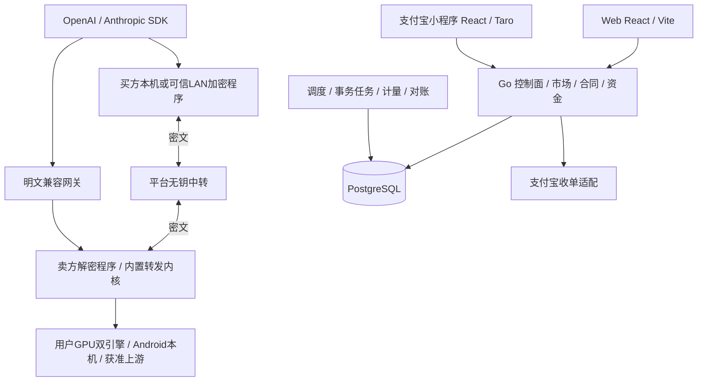

# 总体技术架构与技术选型

P11｜技术v1.0修订｜需求v3.0｜2026-10-29｜U端侧与范围要求，D设计；产品尚未实现。

低开销完整方案（最新用户确认）：用户允许新增隐私档可嵌入LLM内核，LM Studio继续保留兼容。采用llama.cpp C API原生worker、ComfyUI私有管道入口、LMA内部JNI；买卖端加密/平台盲转，任务数据加密而模型保留原生加载，不使用VM/RAM盘/常驻第二份模型。输入准备和密文交付不额外占GPU锁，控制与大数据通道分离。内存/性能为待实测验收预算，完整链路、二进制协议、媒体、恢复及PE-01—PE-08见[完整实施方案](附录-低开销隐私执行完整方案.md)。当前尚未实现或通过设备/密码/性能验证。

本轮以支付宝小程序为主要交易入口，确定React＋Taro；独立Web采用React＋Vite。HTTPS、证书、服务器部署、发布运维与可观测性不在本轮规划范围。[本轮范围](附录-本轮范围与端侧选型修订.md)覆盖此前冲突段落；鉴权、加密、支付凭据、资源锁和业务账仍是功能的一部分。

## 1. 系统组成

小程序承担发现、报价确认、付款、订单、结果、租赁控制、卖家挂牌和收益查看。Web承担开发者SDK接入、复杂文件工作流、运营财务及桌面管理。计算在自愿卖家的真实设备或获准上游执行。小程序与Android算力客户端是两个程序，后者基于LMA源码二开并运行手机本地推理/转发。

Go采用同仓模块化服务，API、worker、明文网关和密文中转以应用端口分责；这里不规定服务器数量、安装顺序或网络拓扑。基本E2E只保证平台不见正文，卖家管理员仍可见；增强档另需真实全路径证明。

## 2. 技术栈决定

| 层 | 本轮选择 | 范围与冻结条件 |
| --- | --- | --- |
| 主要客户端 | React18兼容线＋Taro4.x＋TypeScript，支付宝目标优先 | 同版CLI/runtime/React插件/支付宝插件；优先评估Webpack5，精确补丁及React组合由真机构建锁定 |
| 独立Web | React＋TypeScript＋Vite，React Router | 先与小程序统一React兼容主线；独立依赖图，不强制覆盖Taro内部构建器版本 |
| 前端共享 | npm workspaces＋纯TS领域/DTO/接口端口 | 共用金额、状态、DTO和用例；路由、网络、支付、存储及UI分端实现 |
| 状态 | Hooks/Context＋按主体隔离的服务端查询缓存 | Web优先评估TanStack Query；小程序经transport/lifecycle适配后决定是否复用，资金写操作不自动重试 |
| UI | Taro基础组件＋小程序业务组件；Web独立React组件 | 共享设计变量，不把DOM组件直接导入小程序；不以大型跨端UI库作为前置依赖 |
| 平台/worker/桌面代理 | Go1.27系列；候选源码当前要求1.27.3 | 标准net/http ServeMux、context；精确版本在原生PoC冻结 |
| 数据库及访问 | PostgreSQL17；pgx/v5＋sqlc | 显式SQL、锁、唯一约束、outbox、持久任务；缓存不决定资金或执行权 |
| 协议内核 | BoundRelayCore；优先核验Sub2API转发代码复用 | 明文在平台、E2E在卖方解密端；关闭跨卖家全局池和内置钱包 |
| 桌面界面与内核管理 | Go代理＋React本机页＋RuntimeSupervisor/EngineAdapter | Windows LLM：lms＋llmster＋可替换runtime；媒体：完整ComfyUI可替换环境/有限节点；管理与推理凭据分离 |
| Android算力端 | 基于LMA Java服务/本地引擎二开；新增Kotlin/Java互操作、Coroutines/SQLite与受控JNI | Compose仅新增页面候选；不全量重写基座，真实本机推理和轻量转发，不移植完整中心服务 |
| E2E | libsodium sealed box / secretstream＋独立身份签名，优先PoC | CGO/JNI、跨端向量和密码评阅未完成，不宣称已获得增强保护 |
| 文件 | StoragePort＋项目内受权文件目录用于开发 | 明文/密文权限隔离；本轮不选云存储部署产品 |
| 支付 | API以Machine Pay A402为主线；小程序PayLauncher独立适配 | 先落实实际seller授权；Vibe Pay平台直收作为有条件候选，不默认抽佣/托管能力 |

Taro支持React和支付宝，但各端API能力不同：[Taro介绍](https://docs.taro.zone/)、[请求支持表](https://docs.taro.zone/docs/apis/network/request/)。Web独立遵循[Vite要求](https://vite.dev/guide/)。React18是兼容性设计候选，并非“最新版本”的宣称；精确Taro/React/Node组合须真机冻结。

Go/PostgreSQL来源见[23](23-技术资料来源与事实边界.md)。当前Sub2API采用Gin/Ent/Redis，测试依赖含testcontainers；本项目net/http＋pgx＋PG任务不是原版现成栈。POC-08先证明转发核心能独立抽取；完整fork另列依赖，不能视为Android轻量内核。禁止运行会启动本地Docker/WSL/VM的上游脚本或测试。

## 3. 请求与交易边界

控制面负责实际seller、挂牌版、能力、模式/隐私、预算、付款和执行授权。模型JSON保持OpenAI/Anthropic规范，路由来自预确认RouteContract，不要求seller_id、privacy或ciphertext成为SDK私有必填字段。

明文链为标准请求→平台校验/资金准入→同seller内核→引擎→标准JSON/SSE。加密链为SDK→买方程序解析/加密→平台盲转→卖方解密/内置内核→引擎，响应反向加密。租赁调用绑定会话，只收约定可用租时，不另触发每次A402付款。

A402是支付挑战，普通OpenAI/Anthropic SDK不会自动完成支付宝付款。原SDK可先在小程序/Web付款后调用，或使用买方程序的显式A402桥接。挑战/验付必须在模型SSE起流前完成。[13支付](13-支付退款账务与渠道结算.md)定义50元/12小时边界、验付、UNKNOWN恢复与C2C绑定。

## 4. 当前实施重点

先落小程序交易控制面与React Web共享客户端，重点完成三文本入口、字段/工具/SSE转换、固定seller路由、Sub2API裁剪、真实usage与唯一资金副作用；再联调加密、租赁和Android真实执行。三模式、多端与两档加密仍在需求体系，未通过组合保持关闭。部署、证书、运维和可观测性不列为本轮文档/开发设计完成条件；静态文档不构成支付或安全验收。

## 5. 供给内核选型补全

内核替换是本地产品功能：客户端不绑定一次安装的路径/版本，执行包、协议转发核心、模型与配方分别演进。ComfyUI图像/视频/音频/3D各自批准节点/依赖/模型及产物规格；lms/llmster/runtime三层版本独立冻结；Android采用LMA派生工程，并以APK固定native组件替换可执行代码。

环境摘要从能力贯穿合同、签名执行授权和本地任务。维护先停新单/排空、共资源门闩、验证/切换或合格旧版回滚，不恢复已延后的服务器部署或观测范围。细则见[内核封装附录](附录-供给端内核封装与替换规范.md)。
