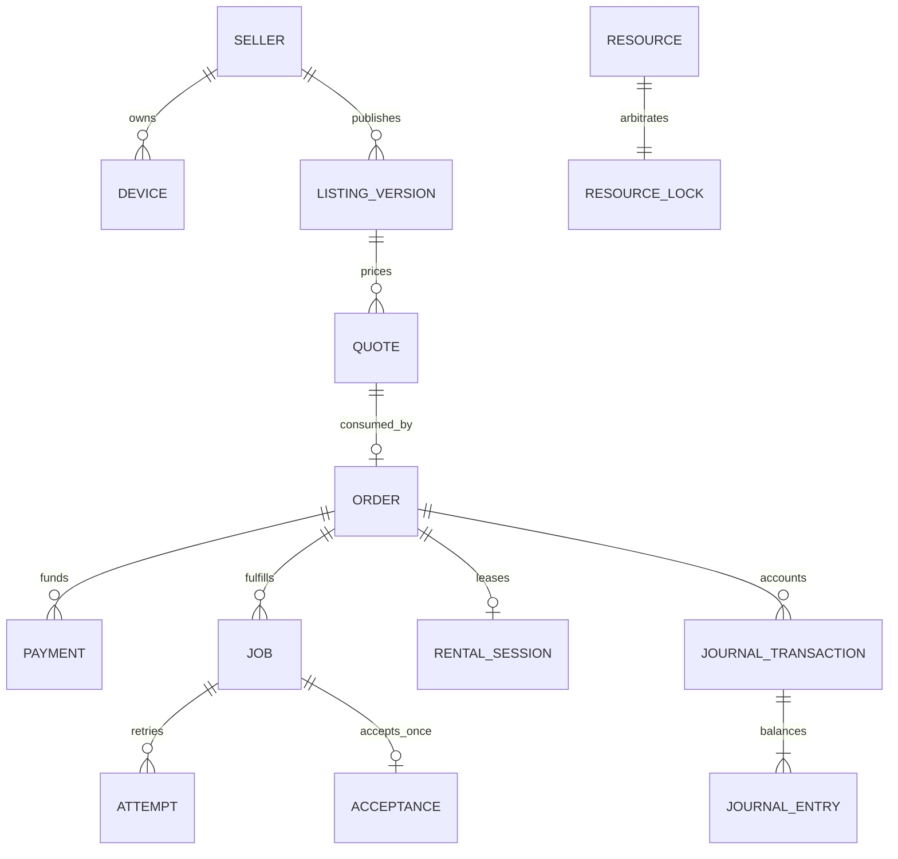

# 数据库物理设计与迁移

P11｜技术v1.0｜需求v3.0｜PostgreSQL17设计；[DDL草案](database/schema-draft.sql)、[并发查询草案](database/transaction-patterns.sql)。R001已在临时原生实例执行初始迁移和选定约束测试，[证据](../../dev/tests/evidence/R001-验证报告.md)与源码进展单独记录；完整业务及恢复验收仍待完成。

## 1. 类型和分区

schema为p11；entity_id为不含PII的稳定text，服务生成并验证格式；金额money_fen为0—JSON安全整数上界的bigint，负向冲正只出现在有明确借贷语义的journal_entries。序号/fencing/资源代次内部bigint，HTTP一律规范十进制字符串。timestamptz统一UTC显示；事务用数据库可信时刻，检测耗时不依赖客户端壁钟。

规范化保存seller、buyer、listing_revision、device、policy、状态及资金引用；合同正文JSONB是不可变快照，不用任意JSON替代关键外键。报价terms不可变，consumed_by/consumption_kind仅允许一次性从空变已消费；订单和续租共用消费触发器，不能跨表复用同quote。续租以不可变附约保存，session汇总可更新，原orders合同不覆盖。E2E内容不进JSONB，公开参数只含已批准尺寸/模型/协议/预算。控制面hash明确sha256语义，不能存可猜prompt明文hash。

初期不物理分表；通过复合索引控制查询。日志/事件日后按时间分区必须保留全局业务唯一键或独立去重索引表，不能分区后让同支付号/接受证据重复。

## 2. 表组

| 表组 | 权威事实 | 主要约束 |
| --- | --- | --- |
| users/role_grants/api_keys/consents | 主体、授权、撤销 | scoped key仅摘要；角色授予审计 |
| seller_profiles/devices/resources/resource_locks | 实际卖家与物理执行资源 | device＋seller复合唯一，当前资源只一行锁 |
| evidence/capabilities/listings/listing_versions/listing_devices | 许可/组合资格与未来挂牌版 | 显式seller归属、旧版不覆盖 |
| quotes/orders/route_contracts/budget_reservations | 报价、合同、调用授权、预算 | quote只被一个order消耗，预算原子预留 |
| payments/refunds/channel_requests | 原资金/退款/未知查询 | provider＋原请求键唯一；未知不能新建第二次副作用 |
| jobs/attempts/execution_leases/deliveries/acceptances | 当前执行与唯一接受 | job/order/seller/device交叉FK；job唯一接受 |
| recipient_keys/encryption_intents/envelopes/cipher_channels | 无私钥的端点与密文引用 | key版不可变、current attempt/token绑定 |
| assets/transfer_grants/deletion_tasks | 单对象权限/清理 | order归属与尝试、对象类型、过期与删除标记 |
| rental_sessions/rental_renewals/availability_intervals/meter_statements | 起表/期限、合格可用区间和计费版 | 单次start、区间去重、不超预算、清理前锁不释放 |
| usage_evidence/trade_qualifications/journal_transactions/journal_entries | 可核用量、成交资格与不可变会计镜像 | 证据唯一，分录平衡，禁止改删历史 |
| settlements/settlement_items/settlement_batches/batch_items | 个人卖家应结和渠道批次 | 每有效应结源只对应一个item，复核与提交分权 |
| reviews/disputes/appeals/evidence_grants | 评价资格、售后与最小披露 | 本单主体/版本约束，内容访问限时 |
| outbox_events/inbox_events/durable_jobs/audit_events/feature_gates/releases | 幂等事件、后台任务和发布 | 消费者＋event唯一，认领代次，证据绑定开关 |

准确表/字段/约束由SQL和生成的[表结构目录](database/表结构目录.md)逐项列出。本草案的强制约束分三层：数据库可表达的FK/唯一/CHECK；事务内必须重查的跨行状态/金额；实际设备/渠道提供的外部证据。不能声称DDL能证明实际GPU停止或真实到账。

## 3. 关键关系

核心复合FK确保attempt.seller和order.seller相同、device.owner同seller；接受引用同job/current尝试。仍需事务检查当前token、证据有效期与owner未转移。设备转让不得UPDATE seller覆盖历史，先撤证/清理后以新identity登记。

## 4. 索引与锁序

查询索引：(buyer_id,created_at,id)、(seller_id,created_at,id)、挂牌状态/地区/能力、(job_id,fencing_token)、资源PRIMARY KEY、支付/退款渠道原号、outbox(state,available_at,id)、后台任务(state,run_at,id)。稳定cursor绑定排序、筛选hash和本人scope，禁止用任意SQL排序字符串。

事务锁序定义为：业务order→job或session→按resource_id排序的resource_locks→attempt/lease→资金/退款累计→账/结算项；同类多条按ID排序。准入先拿业务锁，再对候选资源使用NOWAIT/有限重试，worker认领只锁队列表并立即提交，不持队列表锁去反向抢order。详见[06](06-调度资源锁与执行租约.md)。

## 5. 迁移与数据修复

版本迁移append-only，工具记录版本/hash/执行人/环境，先在本项目专用原生库执行up并核约束，再在可丢弃库演练回滚。生产账/合同禁止通用down删除，采用兼容修复迁移；大表索引CONCURRENTLY单独步骤，不能藏在事务迁移。

每次变更评审旧读端、新写端、回填、锁持有时长、失败恢复、备份/删除标记和资金一致性。修账经审批追加journal冲正，不手改余额/原凭证。恢复数据库后重新核撤证、当前租约、支付未知和outbox副作用，再开放新售。

schema草案含财务平衡/不可改删触发器；语法分析不等于触发器体编译与实际权限隔离通过。必须用原生PostgreSQL跑并发、FK错误、deferred约束和恢复场景。

R003增加[前向002](database/migrations/002_nb_contract_guards.sql)：补挂牌设备绑定不可变、订单必须原样继承报价快照/预算/买卖主体，NB订单列必须匹配合同模式/隐私/佣金/摘要。001已有挂牌版本不可变，不能重建同名触发器。迁移执行及失败回滚另见R003实际证据；基础60表字段目录不包含新触发器正文，不能把目录当成全部迁移。新小时/双价暂存在版本化JSON，旧租赁分钟列尚未迁移，详见[NB实施约束](附录-NB价版与交易服务实施约束.md)。

## 内核环境字段

capabilities新增kernel_environment_ref、kernel_environment_digest非空字段，模型/配方/协议/模式资格与实际环境绑定；订单合同snapshot持久保存kernel_bindings，租赁environment_revision解析不可变环境，执行清单/lease也签入摘要。本次仍60表，字段目录由DDL重建；JSON合法不能替应用验证组件、许可、设备归属和原始清单字节。R001已执行初始迁移；真实内核环境与设备验证仍未执行。

## R015 已确认路由实施边界

已实现三项本人会话路由控制与事务内scoped-key精确解析，控制操作增至34/93；007前向追加5列，原001—006及端侧DDL不改，旧路由隔离。仅PLAINTEXT/STANDARD、三种native文本profile；冻结原订单、同单已登记付款、卖家/版本/模型/价格/费用和上限，不产生执行权或付款。标准请求不要求私有路由JSON，歧义不换卖家。完整字段、错误、幂等/当前状态、启动迁移检查与待接入调用签发器见 [RC-001—022](附录-已确认订单路由与标准SDK绑定实施细则.md)。

## R016原调用准备实施边界

R016新增原调用准备库：当前scoped key/原订单/同单资金事实重新核对后，将INPUT_PENDING、整笔单次预算、次数占用及安全事件在同一事务提交。原键恢复不重复占用；改参数/key冲突；取消/过期/未知保留原记录和占用。请求摘要只以版本化HMAC持久保存。前向008追加六列，001—007和端侧DDL原字节不改；仍34/93操作、65表。仅三个原生文本档位的PLAINTEXT/STANDARD；没有挂载模型入口、签发Lease/Grant或运行模型。输入就绪/资源原子准入、可信usage、真实支付、E2E和路由UI仍待。详见[RI-001—024](附录-原调用准备与次数预算原子接线.md)。RouteInvocationPrepared是元数据事实，不是执行投递；后续TX04仍需输入、资源owner和签名租约。

## R017 当前源码接线

R017接通原生文本输入和首租约内部服务：实际校验正文后以AES-256-GCM加密保存；重新核对原订单、当前scoped key/资格/同单资金和已占整笔预算，再原子取得明确FREE的原生设备资源，签发最多45秒且受原硬截止约束的首租约，连同双围栏、元数据manifest、安全事件和持久投递意图提交。原键恢复不换输入/owner、不续租；到期/撤销/未知保留原预算与资源。该加密仅保护PLAINTEXT模式落盘，不是客户E2E或提供方不可见；尚未挂载模型入口、接通实际领取/内容交付、生产密钥/独立信任、真实内核/usage/支付或LP/PE。009仅追加7列/1外键，001—008及端侧DDL原字节保留；仍34/93操作、65表。平台围栏受signed-bigint上限约束，达到上限关闭。 详见[EI-001—030](附录-原生输入加密与首租约原子准入.md)；原各章完整设计及未完成门槛继续有效。
