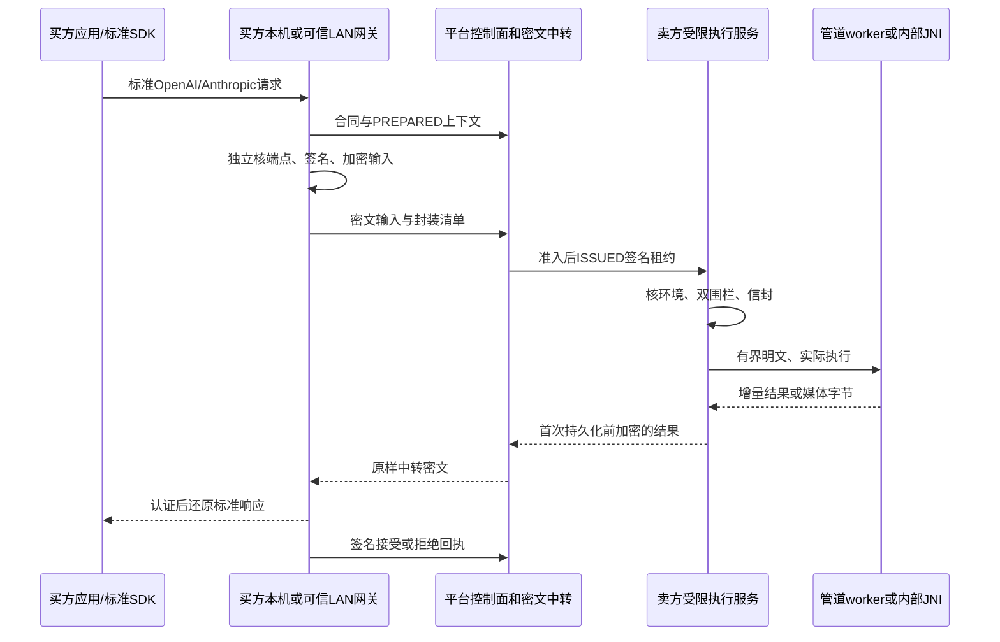

# 端到端加密协议与密钥实现设计

P11｜技术v1.0细化｜需求v3.0｜2026-10-29｜F32—F40/F69—F80；DEV-29—32/37/44。本文为工程设计权威源，密码库精确版本、互操作及独立评审尚未冻结，产品未实现，所有E2E子场景NOT_EXECUTED。

## 1. 当前方案与保护边界

双端为买方本机或明确配对的可信LAN网关，与指定卖方的受限原生执行服务。平台只做交易、调度和密文中转；模型在卖方受控路径中处理明文。这不是密文直接推理，也不以传输加密证明设备所有者绝对不可读。

隐私LLM采用LLAMA_CPP_NATIVE：C++ worker嵌入llama.cpp C API，受控管道连接；LM Studio的lms/llmster/runtime保留兼容，最后一跳HTTP/WS与诊断日志未封闭前不得获得相应本地隐私资格。ComfyUI采用完整原生环境、私有管道入口及有限节点白名单；Android在固定LMA二开工程内走内部JNI。见[低开销完整方案](附录-低开销隐私执行完整方案.md)和[本地防护验收](附录-本地内容隐私防护与分级验收.md)。

本地防护目标是提高初级/中级用户通过界面、文件、普通日志、原生历史/API、loopback抓包及简单改包读内容的门槛；不以高级内存/GPU读取、注入或完整系统接管为验收范围。PLATFORM_BLIND与本地策略分别验收；ATTESTED_CONFIDENTIAL仍须真实CPU/GPU全路径证明，普通原生服务、DPAPI/Keystore或VM均不自动获得该标签。

所有开发产物留本项目；不运行本地Docker/WSL/QEMU/VM/模拟器。不增加部署、公网HTTPS/证书或可观测性规划；本机/LAN入口的配对和内容保护属于端侧功能。

## 2. 端点、进程与可见性



| 位置 | 正文可见性与职责 |
| --- | --- |
| 买方应用、买方网关 | 买方信任域；本人授权结果/短时缓存，不自动云同步钥和正文 |
| 买方可信LAN主机 | 可见明文，须事先披露/配对；应用到网关也须保护，LAN不改变档位 |
| 平台业务服务器、交易/调度、对象仓、中转 | 无正文/内容私钥；只保留最小路由/计费证据、密文及密文摘要 |
| 卖方服务、BoundRelayCore、获准worker/编码器 | 执行中处理明文；有界RAM/受控管道/加密任务文件，不开放正文查询 |
| 卖方UI、托盘、普通管理API | 不提供正文；显示组件/模型/节点、版本、资源/阶段、收益、启停 |
| 获准外部上游 | 调用时可见；须单独许可并披露，仅基础档Relay，不获得硬件增强资格 |

Taro小程序与React/Vite Web承担目录、合同、支付、订单与管理；平台网页/服务器不能代替本地加密端。买卖角色可同安装包，但凭据、内容目录和权限分开。

## 3. 分层、版本与契约出处

| 层 | 定义与边界 |
| --- | --- |
| 应用接口 | 已声明OpenAI Chat/Responses、Anthropic Messages及批准媒体子集；标准SDK不增加私有必填JSON字段 |
| 控制面 | [OpenAPI草案](../白皮书/contracts/openapi-control-v3.0.json)的意向/任务/信封/交付/回执；身份、资金、执行权独立校验 |
| JSON_COMPAT | [cipher-frame-v3.0.schema.json](../白皮书/contracts/cipher-frame-v3.0.schema.json)只约束旧JSON外壳，不证明握手/密码正确 |
| BINARY_STREAM_1 | 本文低开销网络流候选；不符合旧JSON帧Schema，不在旧channel响应中偷换格式 |
| LOCAL_SEGMENTED_1 | 本地只读随机缓存候选，不等于网络secretstream可以任意seek |
| 机器设计清单 | [e2e-protocol-plan-v1.0.json](contracts/e2e-protocol-plan-v1.0.json)，记录字段/规则/未执行子场景，不是可运行实现 |

API方言profile、cipher transport profile、crypto suite与local storage profile分别版本化并绑定合同政策/环境。BINARY_STREAM_1上线前须补齐channel协商/版本契约、独立Schema、黄金字节向量及两端实测；旧OpenAPI没有自动获得二进制通道能力。未知/未获批组合拒绝，不回退明文、其他卖家或未确认档位。

## 4. 密码路线与钥职责

优先PoC为libsodium高层sealed box封装随机流钥，secretstream_xchacha20poly1305认证顺序记录，独立Ed25519签身份与上下文。sealed box不认证发送者，必须同时核独立签名、端点身份和调用授权；secretstream管理nonce及内部重钥，不手造nonce算法。HPKE仅为另一未来suite候选，须独立格式/向量/评审，不与本路线拼接。[sealed box官方说明](https://doc.libsodium.org/public-key_cryptography/sealed_boxes)、[secretstream官方说明](https://doc.libsodium.org/secret-key_cryptography/secretstream)。

| 凭据/钥 | 生成与持有、用途 |
| --- | --- |
| 本地应用API key | 买方网关生成、本人应用持有；仅本地入口，不发送给卖方/引擎 |
| 平台路由凭据、设备认证凭据 | 各自身份域发放，最小scope；不当内容钥、回执钥或无限付款授权 |
| 卖方内容接收钥对 | 指定受限服务生成并保存私钥；只解封输入，平台/UI/其他供给设备无私钥 |
| 买方结果接收钥对 | 买方网关生成、私钥留买方信任域；解封输出，不由平台代管 |
| 输入流/对象钥 | 买方CSPRNG生成；每attempt/对象/方向/epoch独立，仅封给当前卖方端 |
| 输出流/对象钥 | 卖方CSPRNG生成；不复用输入钥，封给合同确认的买方公钥 |
| 控制流钥、本地缓存对象钥 | 对应端点独立生成，不借用内容流钥 |
| 端点身份签名钥、买方回执签名钥 | 各自生成，分用途受限保存；Ed25519不直接当sealed box钥，不默认转换复用 |
| 平台执行授权签名钥 | 平台授权域持有；只签调度/资源权限，不能解内容或代买方接受 |
| 发布/更新签名钥 | 独立发布域；软件来源不等于端点身份或内容恢复权限 |

Go用最薄受审CGO封装，C++/Android JNI使用同一批准C库。库精确版本、commit/hash、编译选项、ABI、绑定与许可证冻结后才产生获准suite标识，不用来源不明的DLL/so。Keystore不直接支持的静态钥材料用受保护wrap key封装，不声称所有算法都原生硬件托管。

静态身份/接收私钥按专用账号进入适用OS秘密存储；流/工作区临时钥尽量仅在受控原生RAM短存，清理FFI临时副本，不进普通SQLite、argv/env、UI、日志或诊断包。托管运行时/分页文件/系统接管下不能保证擦除所有副本；不以全局禁swap或锁住整模型增加内存负担。

## 5. 首次信任、轮换、撤销与丢钥

首次信任绑定实际seller、执行recipient、接收钥版本/指纹、签名身份、地区、环境摘要与合同。采用独立可信证书链或已核验独立渠道；同一平台页面同时给公钥和“独立指纹”不充分。TOFU只发现后续变化，不能证明首次没有替换，须披露。买方回传公钥也由已绑定买方身份确认，卖方不接受中转临时替换。

| 事件 | 新任务 | 在途/历史内容 |
| --- | --- | --- |
| 计划轮换 | 旧身份签新钥，核用途/有效期/撤销/固定指纹政策 | 原合同仍绑原钥，不重标历史接收者 |
| 无旧钥恢复、重装/转让 | 新身份并重新独立核验，确认前停放钥 | 身份恢复不解旧内容，平台不转封 |
| 怀疑泄漏/撤销 | 停相关新放钥/执行/可售资格 | 取消未执行，运行中按约停止/隔离；重新授权且终态允许才交既有密文 |
| 买方结果私钥丢失 | 新配对只影响未来合同 | 旧结果可能无法恢复，平台无万能恢复钥 |
| 模型/内核/端点变化 | 新环境重新准入/绑定 | 排空在途，不沿旧证明向新端放钥 |

新信封放钥、ISSUED前、执行前及重连核撤销；状态过期/不可确认则停止新放钥/执行，不以宽松离线缓存继续。每流不逐token查询目录。撤销不能收回已被执行端获取的明文或复制钥。

静态接收公钥封装不承诺完整前向保密：将来私钥泄漏可能解开留存旧钥信封。缩短旧钥/密文留存只能降低暴露；若需临时会话密钥交换，另批成熟协议/suite，不自行加DH补丁。

## 6. 公开元数据、规范字节与签名

公开仅合同披露的参与者/挂牌/order/job/attempt、端点/钥版本、协议档位、对象/流、方向/epoch、必要交付版、密文字节/hash、期限及最小计费证据。平台仍见大小/时序/公开模型/交易关系，不承诺匿名或流量隐藏。

prompt/system/developer、工具参数/返回、私有URL/原文件名/路径、输入/结果明文摘要、详细错误、私密HTTP头/响应及详细usage附件均加密。必要总用量按事前合同另作签名计费证据公开，不把原始usage结构整体上传。

规范化候选为UTF-8 RFC8785 JCS，用库实现，不用普通JSON stringify代替。解析先拒绝重复键/非法Unicode/非有限数，版本字段封闭；不对prompt原字节做Unicode归一化。大计数器为无前导零的规范十进制字符串；网络sequence/epoch上限2^64−1，来自现有数据库的job fencing_token/资源代次另受PostgreSQL bigint正数上限2^63−1限制，不因线格式扩大而回绕。时间/枚举规范化。[JCS规范](https://www.rfc-editor.org/rfc/rfc8785)。

使用固定ASCII域前缀（含末尾0x00）和明确字节拼接；流头、钥信封绑定、记录AAD、交付清单、回执各用不同域。确切域常量/计数器/序列化字节必须进入黄金向量，文字设计不替代互操作。

当前候选摘要为SHA-256；密文摘要字段用小写hex，记录AAD中的H摘要用原始32字节。域候选为ASCII字符串P11/E2E/BINARY_STREAM_1/加下表后缀，再追加一个0x00字节；它不是字符串中的反斜线加数字0。常量作为草案固定用于PoC，生产冻结仍需向量与评审。

| 用途 | 后缀 | 待签/哈希字节 |
| --- | --- | --- |
| C绑定摘要 | CONTEXT | 域＋UTF-8 JCS(C)，SHA-256 |
| H摘要 | HEADER_HASH | 域＋UTF-8 JCS(H)，SHA-256 |
| 流头签名 | HEADER_SIGNATURE | 域＋UTF-8 JCS(H)，Ed25519 detached |
| 记录AAD | RECORD_AAD | 域＋原始H摘要＋uint32be(body_len)＋uint64be(sequence) |
| 交付清单签名 | MANIFEST_SIGNATURE | 域＋UTF-8 JCS(不含signature的清单) |
| 买方回执签名 | RECEIPT_SIGNATURE | 域＋UTF-8 JCS(不含signature的回执及路径/合同上下文) |

本地分段另用P11/E2E/LOCAL_SEGMENTED_1/SEGMENT或MANIFEST＋0x00＋UTF-8 JCS(受限存储上下文)作为AAD，不借用网络域或将整个库状态序列化。

## 7. 签名流头、钥信封与AAD

下表为BINARY_STREAM_1逻辑字段组，不修改标准SDK请求，不冒称现有控制Schema已有全部字段。

| 组 | 必须绑定的内容 |
| --- | --- |
| 协议与算法 | profile/version、suite ID、canonicalization ID、库stream header |
| 订单与身份 | contract_hash、order/job/attempt、job fencing_token、seller、执行recipient、买方recipient/钥ID、发送签名钥ID |
| 流对象 | direction（BUYER_TO_SELLER/SELLER_TO_BUYER）、purpose（INPUT/OUTPUT/CONTROL）、object_id、stream_id、epoch |
| 端点与政策 | 本方向内容接收recipient/key ID及指纹、kernel_environment_digest、已确认privacy/local policy引用、截止 |
| 交付 | OUTPUT绑定事先保留的delivery_id/正整数delivery_revision；INPUT不预填未来输出交付版 |
| 封装与签名 | sealed材料或不可变引用及密文摘要、sender signature、signature profile |

制作顺序固定，避免摘要/签名循环：

1. 新生成32字节stream key，由库init_push取得header。构造基础上下文C，包含上表除封装/签名外已知字段，计算带域前缀的C摘要。
2. sealed box私密载荷为stream key、C摘要、库header、封装版本。C不包含sealed密文摘要及后续签名。
3. unsigned header H＝C＋sealed材料/引用/密文摘要＋签名档位；发送者签带域前缀的JCS(H)。完整流头为H与detached signature，引用材料先限长/验hash再解封。
4. 接收者先核身份/签名/合同/限额/撤销，再解封比对C摘要与库header。每记录AAD＝固定记录域＋H摘要＋本记录body_len的4字节大端值＋sequence的8字节大端值；不含自身密文摘要。

sealed私密载荷也用有界JCS，只有封装版本、32字节钥的base64url、C摘要hex与库header的base64url；原始sealed材料≤4096字节。inline材料与asset引用互斥，引用只能是本订单获准的不可变密文对象，不接受任意URL；密文长度/摘要都在H签名内。

每流H不变；改端点/方向/对象/交付版/epoch须新流/钥/header。随机header公开，钥不公开；sequence从0严格递增，禁止回绕。

PREPARED尚未知的resource_id/resource_lock_generation不放入事前输入AAD，不用占位后改签。ISSUED租约另签这两个字段；执行服务同时核租约与C中的contract/job/attempt/token、recipient、环境一致。认证加密、身份签名和执行授权分别校验。

## 8. BINARY_STREAM_1字节布局与限额

建流候选为header_len:uint32be＋JCS编码的完整已签流头；长度不含自身，最大16384字节，分配前检查。流头内小型二进制材料用规范无填充base64url；不把大媒体Base64。

线记录为body_len:uint32be＋sequence:uint64be＋secretstream_ciphertext；body_len包含seq与密文、不含自身。密文长度须匹配批准库ABYTES；升级改变格式须新profile。解密后8字节内部头为type:u8、flags:u8、reserved:u16be、payload_len:u32be，再接payload。本版flags/reserved均0，长度须一致，未知type拒绝。

| 项目 | 候选硬上限/定义 |
| --- | --- |
| 解密后记录 / DATA正文 | 65536字节含内部头 / 65528字节 |
| secretstream密文 | 65553字节；当前候选ABYTES＝17 |
| body_len / 完整线记录 | 最小33字节、最大65561字节 / 最多65565字节 |
| 记录额外开销 | 满DATA块37字节约0.06%，不含建流/网络开销 |
| 聚合与flush | 文本最多8ms或满块发送，HEADERS/终态/取消及时flush |
| 缓冲 | 单流各阶段共享4MiB；重排32条且2MiB，也计入总额 |
| 对象 | JSON请求2MiB含Base64；单媒体明文64MiB/密文66MiB，SKU可更小 |
| spool | 默认每活动资源256MiB且受设备总额约束，先预留再接收 |

长度先检查再分配，安全加法，不信外层解压大小；不压缩密文或隐藏降级为旧JSON大对象。网关有界解析仍处理UTF-8/JSON/SSE跨DATA边界。

## 9. 记录语义、终块与交付清单

| type | 载荷与顺序 |
| --- | --- |
| 1 HEADERS | 首条：加密method/path/允许头或status/Content-Type；CONTROL则为目标操作/引用，不伪装HTTP请求；不带可外发本地/付款凭据 |
| 2 DATA | 原协议正文、SSE字节或媒体片，保持语义/顺序，不把块边界当事件边界 |
| 3 USAGE | 有界版本化真实用量附件，不是平台自动结算权 |
| 4 ERROR | 加密详细错误，平台只有安全分类码 |
| 5 END | 最后一条业务记录，使用库TAG_FINAL，不再追加独立空FINAL记录 |
| 6 CANCEL | 独立CONTROL流取消请求，绑原任务/attempt/权限，不插入已结束数据流 |

其他记录用TAG_MESSAGE；本版不开放应用任意传PUSH/REKEY等标记，库内部nonce/重钥由批准实现处理。CONTROL有独立钥/header与最终END，独立队列避免被媒体堵塞。

END含SUCCESS/FAILED/CANCELED、此前record数量、此前DATA数量/字节及DATA明文摘要、必要标准终态承诺；不包含END自身，明文hash留密文内，END序号等于此前record数。END、TAG_FINAL及标准响应终态全合法才完整；FINAL无END、END非FINAL、之后追加、摘要冲突/标准事件截断均失败，socket关闭不算成功。

最终外层交付清单在密文写完后产生：绑定合同/原attempt/token、delivery/revision、对象/流头引用、线密文总字节/hash、签名身份/有效期。整对象摘要覆盖建流前缀、完整已签流头及全部线记录，排除外层清单自身；清单签名排除自身signature。不自引用、不公开DATA明文hash。

binary候选的cipher_manifest_hash由外层登记/回执携带，计算SHA-256(完整已签清单的UTF-8 JCS字节)；清单内不得再含自身manifest_hash字段。先签unsigned manifest、再对含signature的完整对象求外部摘要，买方与平台都按同一原始规范字节验证，不把两个摘要范围混用。

SSE逐记录认证后可实时交应用，只是已认证前缀，未取得最终完整/成交状态；不为等FINAL缓存整流。完整媒体认证/验收后再打开。密码完整性不证明输出质量、算力真实或卖方usage诚实。

## 10. 准备、准入、执行和释放

1. 确认卖家、模式/政策、预算/规格与端点，独立核信任；路由凭据不自动授权新购买。
2. 建INPUT_PENDING/PREPARED的job/attempt/token/recipient与输入期限。准备通知仅限额密文缓存/磁盘预留，不锁GPU、不调用引擎。
3. 买方完整预检P0 JSON/附件，加密提交签名清单；平台只核外层长度/hash/签名/授权，不能声称已验AEAD或私密语义。未单独批准的增量输入不提前执行。
4. 资金/许可/环境、密文引用、截止/空间/容量都通过后，平台原子取物理资源代次并签ISSUED。收到sealed key或HTTP成功不等于执行权。
5. 卖方核租约签名/撤销/期限、recipient/环境、job token及跨job资源围栏，持久inbox、取得本地门闩，再开信封/认证输入，受限解码/语义检查后才交BoundRelayCore/worker。
6. 如要在ISSUED前复杂解码，须另有明确有界预处理授权且不调用GPU；不能拿PREPARED扩大权限。本版默认授权后解码，失败尽快清理，不由平台代验明文。
7. 输出新钥/流头/预留交付版，编码字节首次持久化前加密。GPU/NVENC仍工作就持锁；实际停算、任务KV/张量清理确认后释放。
8. 释放后原密文补传/回执走短时单对象交付权，不占GPU，不获得新推理权；租赁子任务不释放会话锁。

取消分两条权限路径：已认证平台订单取消/签名到期控制，以及端点间密文CONTROL/CANCEL；二者都核订单/原attempt/当前计算owner并幂等停止，不绕过本地用户停止权或合同硬截止。需要保密的取消说明放密文；平台只有安全原因码，取消确认不等于GPU已停，清理仍须真实确认。

```text
核执行租约与当前资源owner → 核签名流头/合同/环境/端点/撤销/限额
→ 开sealed key并核C摘要 → 按精确AAD顺序认证 → 私密请求校验
→ 持久后端映射再执行（未知先query） → 首次持久化前加密输出
→ 真停算/清理后释放计算门闩 → 按原交付scope补传及签收
```

## 11. 回执、接受和计费证据

买方核发送身份、合同/原attempt/token、结果接收钥、交付版/清单、记录认证及SKU规格/标准终态/usage来源。只有本人批准的自动验收策略或明确操作产生ACCEPT，不仅因解密成功就代签质量验收。

签名输入为固定回执域＋JCS对象，绑定路径job、contract_hash及现有ReceiptWrite的receipt_id、attempt/token、delivery_id/revision、cipher_manifest_hash、decision、signer_key_id、signature_profile_id、signed_at；排除signature自身。平台核买方身份/用途、时间窗及交付范围，原子竞争唯一合法终态。

原attempt/token的交付资格不同于当前GPU占有权；resource_generation增大不使合法旧结果失去签收资格。但已取消/超时/替代且无交付资格的attempt不能用旧签名改终态。同receipt_id+相同内容幂等，同ID不同内容、过期/错版/错签拒绝。

无回执不自动成功；固定请求按UNVERIFIED/退款或释放规则，不按节点自报usage补扣。分段计费另须事前合同、累计回执、获准渠道。解密后拒付的公平交换风险用限额/责任/申诉管理，撤URL不能收回明文；支付/接受/清理证据各自独立。

## 12. 重连、重排、重试与崩溃恢复

| 情况 | 必须动作和禁止事项 |
| --- | --- |
| 断线、原状态未丢 | 只重传已持久原密文；不以相同seq再次push生成新密文 |
| 已认证重复 | 核保留的原记录摘要后幂等丢弃；不能再次推进pull状态/触发模型；超保存窗口从头认证或拒绝 |
| 缺帧/乱序 | 缓存≤32条/2MiB，只认证下一连续记录，超窗/冲突停止，不跳块 |
| push状态丢失 | 重传已完成原密文；需重新封装则有效业务授权下新epoch/钥/header，不凭旧状态续发 |
| pull状态丢失 | 有旧钥且权限有效才从原header/seq0重放认证，已交前缀不重复交付/收费，不能从检查点随机解密 |
| 临时钥丢失 | 先查后端/租约，按有效合同申请重授权/重封或失败；不找平台恢复钥、不盲重跑 |
| SDK连接已断 | 明确异常中断，仅获准资源查询/取回继续原结果，不称所有SSE SDK都支持无损续流 |
| 同卖家换端 | 仅一次重派，废旧执行上下文，核新端并由买方重封，受原总期限/预算约束 |
| 跨卖家 | 原单处置后买方确认新报价/新单，不默认池轮换 |

epoch只是获准传输代次，不是新执行权。只有仍存在的原始内容/获准副本才能重新封装；钥/内容均丢失不能恢复。交付失败不授权重做推理；提交UNKNOWN先按原backend ID查询，不把新生成拼在旧SSE后。

持久化只存合同/钥ID/指纹、最高job token/资源代次、inbox/backend ID、流头/密文引用/hash、水位、交付/回执幂等与清理标记，不存正文钥/可继续push的原始状态。SQLite/文件持久化时序须故障注入，只有确认落盘的密文记录可补传。

## 13. 本地加密存储、媒体与Range

仅加密任务输入/中间物/结果，不每请求解密公开权重/tokenizer，保持只读mmap/原生加载。不加模型副本、全片RGB副本或RAM盘；文本有界RAM、媒体编码直入加密sink，先写普通文件再加密不合格。

LOCAL_SEGMENTED_1对完成对象提供只读随机访问：每对象随机32字节root key、1MiB明文段；每段新随机secretstream header、单条TAG_FINAL流，AAD绑storage profile/object/合同/attempt/用途/段号/长度。manifest另用新header、认证加密及独立用途域，含总长/段数/各段密文hash。manifest完整认证后才解码，每段先认证后释放；不原地覆写，修改产生新对象/钥/manifest。

manifest元数据候选≤64KiB，校段大小/总段数/总长与安全乘加；64MiB输入最多64段，中间展开另受明确预算，不因压缩小就放任解码。桌面LRU最多4段、Android2段，计入全局内容缓冲，并发读取共享缓存。

网络secretstream不能跳第N条。P0 Range必须买方完整顺序认证且核终块/清单后，从本人缓存/已验证本地分段对象提供；平台只授权密文范围取回，不代表能随机解密。PNG/file-like、批准视频分块VAE与FFmpeg管道/fMP4、音频顺序编码及GLB分段导出见[完整方案](附录-低开销隐私执行完整方案.md)；不能受控file-like/seek的节点不进隐私白名单。

## 14. 本地服务与低开销约束

桌面每设备一个原生服务，集成NodeAgent/crypto/BoundRelayCore/门闩；worker通过定向继承FD/句柄，控制/DATA分通道。隐私入口不启动llama-server或Comfy原生Web服务，不监听正文HTTP/WS；UI没有读正文/导钥/任意文件/引擎管理代理。Windows专用低权限服务身份、Linux专用非root账号，显式目录/管道ACL。

Android复用LMA内部Java/JNI/同库密码封装，不加Go/Node/Python/第二份模型。共享任务不进个人聊天/WebView/API/相册/logcat/自动备份，通知只状态/停止；可执行组件随受签APK更新，无任意so/dex热加载。

所有引擎/模式、自用/维护共一物理resource_id门闩，旧回调核当前owner+generation；密码CPU并发桌面2/Android1，控制不排媒体后，默认单GPU一个活动任务。加密不增加GPU任务、不降低精度/画质/上下文。

未实测D预算：桌面新增常驻≤64MiB/活动≤96MiB，Android≤12/24MiB；桌面吞吐退化≤3%、E2E p95≤5%，Android E2E p95≤8%。完整缓冲/首包/控制预算见[资源边界](20-性能容量与可观测性.md)及完整方案。同机同模型/后端/精度/上下文/配方，每分支至少30次A/B，记录进程树RSS/PSS/commit、VRAM/CPU/IO；不用正式版隐私旁路作弊。

## 15. 错误、清理及更新

平台仅已登记安全原因码；“换钥/认证失败/截断/超限/后端未知”等是分类描述，新增枚举先改错误契约，不能临时把异常正文拼code。起流前返回标准错误，起流后按支持方言报错/异常终止，不补造成功终止事件。

终态立即禁新执行/写入、清RAM流钥/KV/张量/临时FD与不必要缓存，晚到回调不触下一任务。平台输入终态后24小时/结果默认7天；节点成功或会话结束1小时、失败/离线24小时补清为数据上限，不要求多留钥。完整买方结果密文补传不需节点保留正文钥。

tombstone/待办和账证分开；退款不回滚最高围栏/资金事实。密码擦除不证明磁盘物理零残留/系统无副本/恶意所有者没截获。kernel_environment_digest绑定合同/租约/命令/本地记录；库/llama/ggml、PrivacyBridge/Python/节点/编码器或LMA native变更均排空、维护、重验，只回到仍批准版本，不热换在途环境。

## 16. 增强档独立门槛

买方政策/独立可信域核challenge、接收钥绑定、固件/驱动/调试撤销及CPU/GPU/互联、解密/转发/tokenizer/推理/编码/日志/回传全路径测量。普通主机先解密再送保密GPU仍不合格；当前无真实合格设备/完整证据，关闭增强。自哈希/签名更新只提高普通改包成本，不证明恶意宿主没换整个客户端。

## 17. 联调子场景与完成条件

以下细化既有F/T与DEV，不新增已完成主验收；全部NOT_EXECUTED。机器清单记录职责/证据，不用结构核验代替密码/设备测试。

| 子场景 | 必须取得的真实证据 | 任务 |
| --- | --- | --- |
| E2E-01 首次信任 | 换钥、伪独立指纹、TOFU首次风险、结果钥替换 | DEV-29 |
| E2E-02 用途隔离 | auth/content/identity/receipt/update互不越权，私钥不上平台 | DEV-29/30 |
| E2E-03 密码互通 | 官方与Go/C++/Android同字节开封/签名/AAD/FINAL向量 | DEV-30/44 |
| E2E-04 签名字节 | JCS/重复键/Unicode/整数/域前缀/无循环摘要 | DEV-29/30 |
| E2E-05 上下文绑定 | 逐字段篡改、串单/反向/跨端/旧attempt/环境替换拒绝 | DEV-30 |
| E2E-06 执行准入 | PREPARED不锁卡/不推理，旧双围栏不能执行/清新任务 | DEV-18/30 |
| E2E-07 二进制解析 | 长度溢出/超限、type/flags/reserved/版本错误拒绝 | DEV-30/31 |
| E2E-08 标准API | 固定SDK三文本JSON/SSE/工具/错误/usage及媒体还原 | DEV-26/27/30 |
| E2E-09 终态完整 | END/FINAL/标准终止缺失、摘要冲突/追加不成功 | DEV-30/31 |
| E2E-10 重传背压 | 原字节重复/冲突/超窗、pull重放、4MiB总额 | DEV-30/31 |
| E2E-11 崩溃恢复 | push状态/钥丢失、SQLite/文件时序故障不盲重跑 | DEV-21/30 |
| E2E-12 回执并发 | 同ID不同内容、过期/旧版、接受拒绝取消超时唯一终态 | DEV-19/31 |
| E2E-13 计算交付分权 | 释放GPU后原结果可补传签收，不获新计算权 | DEV-18/31 |
| E2E-14 轮换撤销 | 正常/泄漏轮换、离线状态、重装/丢钥/换端重封 | DEV-29/30 |
| E2E-15 分段Range | 换段/坏manifest/截断/LRU并发、完整认证后Range | DEV-30/37 |
| E2E-16 媒体出口 | PNG/视频/音频/GLB无普通temp/预览/日志泄漏 | DEV-22/37 |
| E2E-17 多端LAN | 两桌面OS/Android真机，未配对/错证书/Origin拒绝 | DEV-21/44 |
| E2E-18 本地攻击 | LP-01—14界面/抓包/日志/改包，LM兼容单独资格 | DEV-21/23/44 |
| E2E-19 性能资源 | 同环境30次A/B、spool/缓冲/控制、不增GPU加密 | DEV-51 |
| E2E-20 增强拒绝 | 伪/过期/不完整证明、普通设备/升级不解锁 | DEV-32 |

发布须独立信任可用、精确库/格式冻结、channel协商契约补齐、跨语言向量/独立评审、SDK/真机/本地隐私/性能通过，且满足既有许可/收单/成交规则。文档/Schema外壳夹具仅验证设计一致性。
