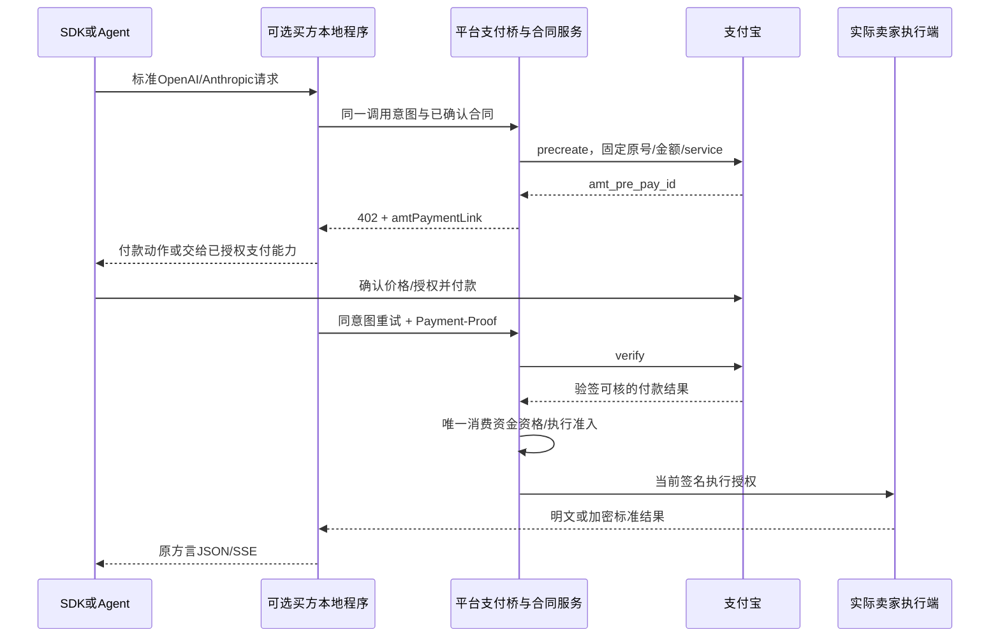

# 支付、退款、账务与支付宝收单适配

P11｜技术v1.0修订｜需求v3.0｜2026-10-29｜F09/F17—F21/F39/F44/F53/F61/F77；D工程设计，官方事实与C2C适用性分别标识。未创建真实交易。

## 1. 从赛事到具体产品

[赛事页](https://aipay.alipay.com/community/events/payathon-2026)将Machine Pay作为按可核用量收费的赛道；本项目API收费主线选它。小程序是主要交易界面，但界面框架不决定收单产品，不能直接把网页/APP接入说明替换成小程序原生支付权限。

| 路径 | 本项目决定 | 关键边界 |
| --- | --- | --- |
| Machine Pay / A402 | API固定有界调用优先实现的收单适配 | 实际个人seller、服务注册及第三方代调用资格先核；按当前API预下单/付款/验付后履约 |
| 小程序付款交互 | 独立PayLauncher，经获准产品返回的托管购买/原生交易/授权动作衔接 | 小程序返回不是付款成功；amt_pre_pay_id不是可随意塞给原生支付API的trade_no |
| Vibe Pay / 即刻收平台模式 | 有条件备选，不自动开启 | 官方说明用户直付创作者；平台合作/个人准入及本类算力用途仍需正式确认；没有默认平台抽佣/托管能力 |
| Token Pay | 当前不作GPU分钟租赁的代用品 | 连续订阅不同于一次租期、续租附录或卖家闲置资源交易 |

当前Machine Pay指南是precreate→402→用户付款→Payment-Proof→verify→交付；不根据产品页通用示意强行实现“验付后执行，再调用未证实settle接口”。当前公开指南没有证明可按未知最终token金额事后自动补扣、可退预占或C2C分账。

## 2. 最新官方字段与本地映射

以下以2026-10-28更新的[预下单API](https://aipay.alipay.com/docs/ai-receive/api-list/alipay-aipay-agent-payment-precreate.html)和[验付API](https://aipay.alipay.com/docs/ai-receive/api-list/alipay-aipay-agent-payment-verify.html)优先于较旧概览；不可变版本证据实施时再冻结。

| 官方字段/规则 | 本地映射/检查 |
| --- | --- |
| precreate：out_trade_no，必填、最长32 | 生成唯一渠道原号，不直接截断长本站ID；映射payment/order/purpose/intent且不可改 |
| service_id，必填 | 已注册服务与实际seller/应用授权绑定；从可信配置查，禁止买方指定任意服务 |
| goods_name，必填、最长32 | 订单公开服务名，不含prompt/文件名等私人输入 |
| amount，元字符串，单笔不超过50元 | 从整数分格式化固定两位；本profile只允许1—5000分，不用浮点或超限拆单绕约束 |
| pay_before，不能超过当前时间后12h | 取渠道12h、报价/订单/授权有效期中的更短者，保持时区；过期先查/关闭原交易，不盲建新扣款 |
| currency，当前API必填且仅CNY | 固定CNY；较旧指南写可选，本项目遵循API必填 |
| 返回amt_pre_pay_id | 持久绑定原payment，通过402的amtPaymentLink传出，不当作trade_no |
| verify入参trade_no/payment_proof/client_session | 从严格解析后的Payment-Proof取；API把client_session列可选，本项目保留渠道实际提供值，禁止自造会话凭据 |
| verify返回code/sign/active/amount/out_trade_no/trade_no | 验签、业务成功、active=true、金额与原号/交易号一致，核本地应用/服务/seller环境绑定 |
| verify.resource_id已废弃且可选 | 不依赖它绑定资源；本地out_trade_no→不可变合同/服务/调用绑定为权威，有值也不覆盖本地归属 |

较旧[集成指南](https://aipay.alipay.com/docs/ai-receive/MACHINE_PAY.html)仍提示检查resource_id，最新API标其废弃；实现必须记录这一差异，不能要求每次非空或自行杜撰替代字段。验付响应没有直接给出的payee/service字段，从预下单时固定的应用授权、service注册与渠道证据确认，不伪称这些字段由verify返回。

## 3. A402完整时序与标准SDK

明文直连SDK可跳过B，402原样返回；普通OpenAI/Anthropic SDK不会自动支付。推荐消费者先在小程序/Web完成同一服务订单付款再调用；需Agent自动衔接时，显式使用支持A402的支付能力或买方本地程序。模型请求仍为标准JSON，支付信息在头/控制面。不要让SDK在收到402后无穷自动重试。

Payment-Proof为Base64编码的JSON载荷，包含protocol.payment_proof/trade_no与method.client_session等实际字段；Base64不是加密或验签。D头上限16KiB，限制解码/重复键/嵌套，格式无效拒绝，规范以冻结渠道版本为准。凭据视为敏感秘密，不入普通日志、错误正文、URL、浏览器持久存储或卖方模型请求。需要暂存恢复时仅用服务端受限加密凭据引用。

一次付费对应唯一履约意图；对同trade_no/原意图重复请求返回原执行/结果，不能多跑。跨order/seller/service重用凭据拒绝。verify超时进入UNKNOWN并查原交易/同凭据，不重新收费。只有确认原交易不可履约且无扣款/退款义务后，才允许用户明确发起新支付意图。所有挑战必须在模型SSE起流前完成。

## 4. C2C收款主体与平台费用

卖家自愿挂牌，买家向实际卖家购买服务。MerchantBinding设计快照包含seller_id、产品/环境、app_id、service_id、授权主体、app_auth_token_ref及授权/资格证据、有效期；它是本站内部结构，不是新增支付宝API字段。第三方代调用按[官方指南](https://aipay.alipay.com/docs/ai-receive/MACHINE_PAY.html)的app_auth_token授权方式评估，自研应用不伪造该令牌。

付款前明确实际收款主体与平台费；不能把所有seller服务统一挂成平台自营商户，事后普通转账来代替渠道资格。支付给个人、第三方代调用、费用/分账、争议退款、到账和赛事统计归属均须E01/E02证明。尚无证据时不默认平台代收、托管或抽佣。

D目标是渠道允许的卖家直收或正式获准的分账服务。若产品只能卖家直收且不支持佣金扣取，平台佣金只能走另外获准且用户明示的服务费/渠道安排；没有安排则保持待定，不从外部seller账户擅扣。用户实付、卖家实收、平台收入和镜像应结分别记录。

## 5. 不同计费业务如何落渠道

| 业务 | 当前设计 | 不支持时处理 |
| --- | --- | --- |
| 固定图像/有界文本请求 | 执行前冻结小额固定价，单笔1—5000分，预付/验付后执行 | 无合格接受按已核原路退款规则，退款能力没验证不开放该SKU |
| 按token最终计费 | 先验证可核usage及正式渠道差额/退款能力 | 当前API只证明固定amount预付；不能承诺未知金额自动后扣。可另售明确固定边界SKU，不偷偷改在途价 |
| 基础E2E | 平台只接订单/金额，正文和内容钥留端侧；接受/回执决定业务成交资格 | 无签收不造佣金；已付钱和已成交分别处理，退款路径先验 |
| GPU租赁 | 按合同整数分/分钟、真实可用区间，资金覆盖已确认租期；续租独立意图/不可变附录 | 不能把最高预算当最终收入；必须验证未用部分退款或获准预占方案，否则该渠道组合关闭 |
| 即刻收次数/积分 | 单seller/单商品的已获准权益，独立查询/核销 | 不能变跨seller现金钱包，不能用不可逆核销模拟可退预算预留 |

50元是当前Machine Pay单笔限制，不是整个平台价格承诺；超限不自动拆成多笔规避。租赁到期/续租不能在已运行SSE中插入402。新租期付款确认、条款附录应用与执行授权分别推进，UNKNOWN不默认延时。

## 6. 即刻收候选的准确限制

[平台指南](https://aipay.alipay.com/docs/vibe-pay/nowpay/platform/platfrom-guide.html)说明收费配置/托管购买、访问决策及次数/积分核销；[产品页](https://aipay.alipay.com/products/vibe-pay)说明用户资金直接到创作者，不经过平台。该路径适合进一步核对本平台个人seller直收，却不自动等于已批准算力C2C市场。

只映射同seller、同挂牌版的out_product_id/external_owner_id，受益人external_buyer_id由服务端身份推导。charge.query/initialize管理配置，purchase.consult/create提供访问/购买，quota.query/verify/refresh处理额度。回跳后查权威权益，未知核销沿原out_request_no查询。

当前指南明确不提供核销撤销，不含自动续费/任意天数/时长有效期内续购；“月/季”是日历周期，不等于按分钟GPU可用租时。原生时长包不能替代本项目租赁计量。额度查询不是预占，先查询再直接执行有并发超用风险；核销成功后交付失败如何承担，必须先有获准处理方案。未解决退款/公平交付/平台费与准入，候选不进入本轮真实收费主链。

## 7. ChannelPaymentPort与持久化

接口按产品capabilities分开：CreateIntent、VerifyProof、QueryPayment、Close、CreateRefund/QueryRefund、Settlement/QuerySettlement、Reconciliation。只有实际产品支持才暴露，不为Machine Pay编造capture/settle/退款API。Go适配可使用已审核支持该新method的SDK或受支持OpenAPI通用调用；不能仅因旧Go SDK支持支付宝，就假设包含2026新接口。精确版本及RSA2签验向量在POC-06冻结。

TX-03先存payments/channel_requests和outbox，提交后外调，回写前校验签名、环境、原号、金额和绑定。channel_binding_snapshot冻结内部产品/应用/service/授权引用，prepay_reference与channel_reference分开；provider/environment/trade_no唯一消费。严禁在safe_result中保存原payment_proof/client_session/app_auth_token或完整原包。

当前Machine Pay验证有效的已付款证据满足所有绑定后可形成该产品SETTLED；不能把它永远当未来待扣授权，也不能把precreate成功当SETTLED。其他获准产品的AUTHORIZED与SETTLED保留区分。通知/查询乱序只按产品允许的单调状态收敛，旧PENDING不能覆盖确定实付；未知保留恢复任务。

## 8. 价格、账务、退款与收益

整数分、有理单价、高精度累加后按冻结规则取整，预算封顶。佣金D公式为floor(retained_gmv_fen*bps/10000)，部分退款后重算目标并追加冲正；佣金/渠道费承担/周期当前不设虚假正式值。

journal_transactions/entries为渠道和业务应结的追加会计镜像，不是钱包。原始来源唯一、同事务借贷和为零、历史不可改删。实际渠道已付、业务接受/最终计量、卖家可结资格和实际到账分别保存。seller直收不再触发同笔平台出款；只有获准分账/结算能力的路径才生成SubmitSettlement副作用。

退款锁原支付累计，已成功/在途/UNKNOWN均占用可退额度；未收款只关闭，不称已退款。未知查原请求，不二扣/二退/二出款。取消/接受竞争按原模式合同处理；E2E无回执不默认成功，租赁准备与不可确认可用尾段不计费。已到账售后按渠道协议处理，不擅扣卖家外部账户。

## 9. 本轮验收设计

POC-06需验证实际seller收款身份、service/app授权、1分/5000分/超限、12h/过期、402头和凭据格式、验签/active/错金额/原号/跨单重放、resource_id缺失、重复回调、验付丢响应、无usage、退款未知与到账。小程序测真实PayLauncher动作/前后台/取消/返回查单；只有沙箱不能证明正式资格或赛事付费用户。计费/对账属于业务功能，本轮不建设监控告警或部署链。
