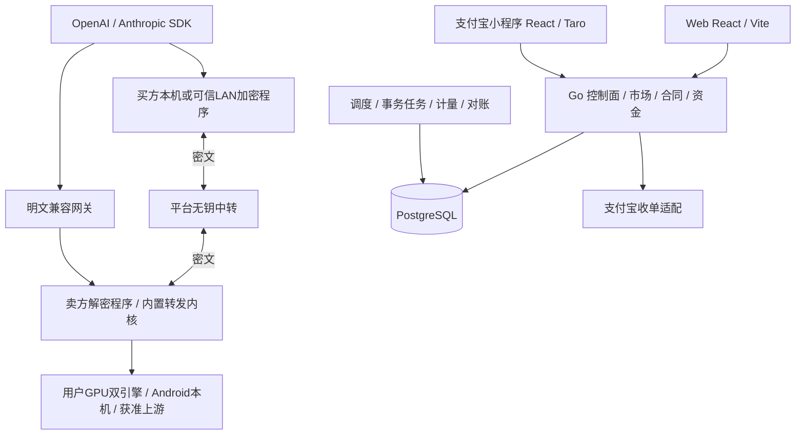
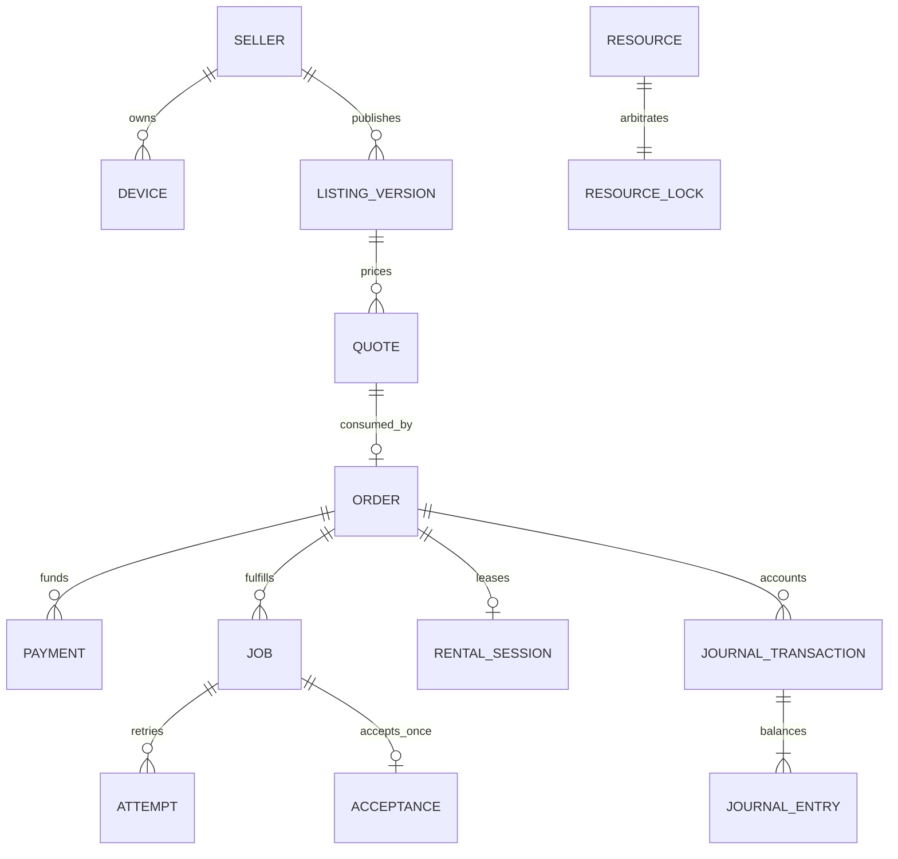
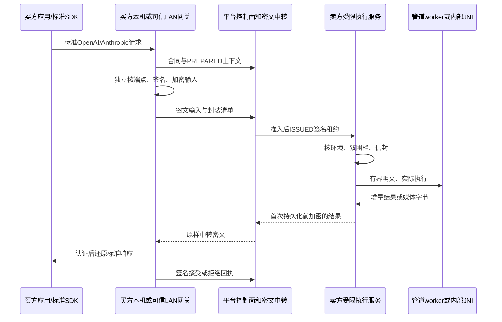
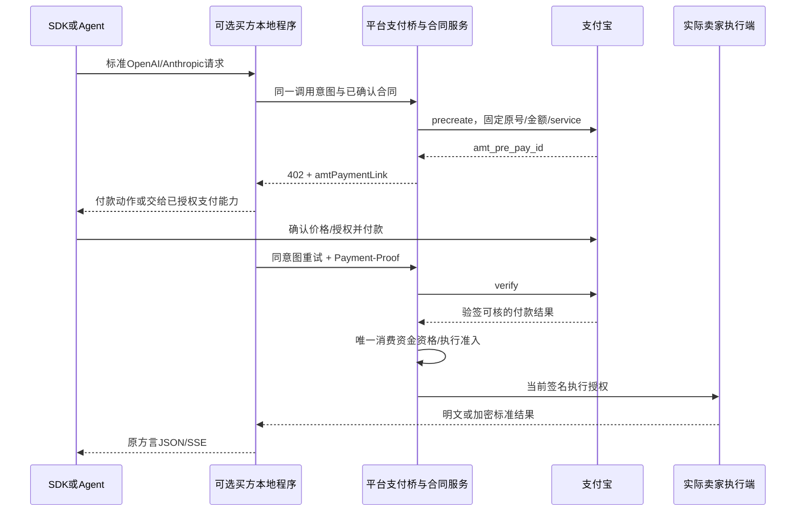
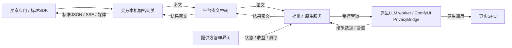
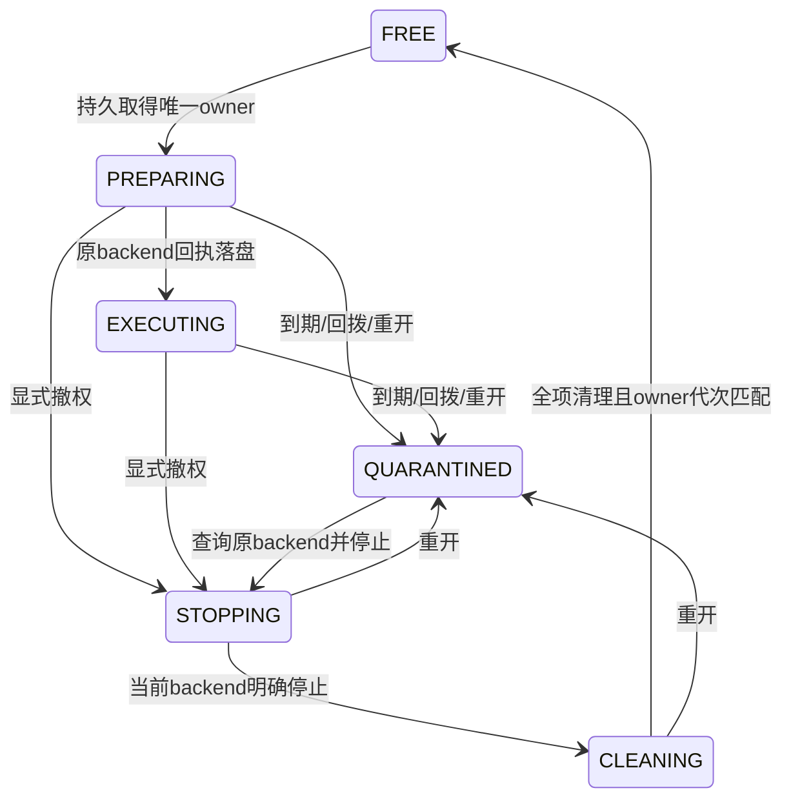
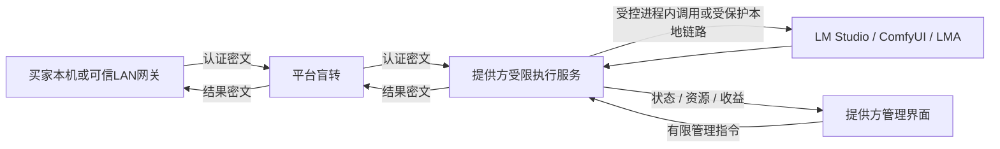

# 算力共享平台成套技术开发文档

P11｜技术v1.0｜需求v3.0｜2026-10-29｜工程设计，产品/数据库/密码/资金/设备均未验收。

[原始导航](00-技术文档导航与实施基线.md)；[离线HTML](技术开发文档完整阅读版-v1.0.html)。

## 目录

- [算力共享平台技术开发文档](#chapter-00)
- [总体技术架构与技术选型](#chapter-01)
- [工程结构、开发环境与编码规范](#chapter-02)
- [领域模块与应用服务设计](#chapter-03)
- [数据库物理设计与迁移](#chapter-04)
- [控制面接口实现规约](#chapter-05)
- [调度、统一资源锁与执行租约](#chapter-06)
- [统一协议转发与Sub2API改造细则](#chapter-07)
- [端到端加密协议与密钥实现设计](#chapter-08)
- [Windows与Linux原生客户端设计](#chapter-09)
- [Android与LMA工程设计](#chapter-10)
- [引擎与授权上游适配器设计](#chapter-11)
- [显卡租赁与可用时间计量](#chapter-12)
- [支付、退款、账务与支付宝收单适配](#chapter-13)
- [小程序与Web前端设计](#chapter-14)
- [文件、媒体与对象存储](#chapter-15)
- [身份、授权与安全工程](#chapter-16)
- [事件、事务发件箱与后台任务](#chapter-17)
- [测试工程与故障验证](#chapter-18)
- [部署与运维范围记录：本轮延后](#chapter-19)
- [请求资源边界与本轮验证范围](#chapter-20)
- [开发任务分解与需求追踪](#chapter-21)
- [技术决策、依赖与验证计划](#chapter-22)
- [技术资料来源与事实边界](#chapter-23)
- [80项需求技术追踪](#chapter-24)
- [dev 开发路径与细则索引](#chapter-25)
- [NB价版与交易服务实施约束](#chapter-26)
- [NB-1.0设计与需求的技术衔接](#chapter-27)
- [低开销隐私执行完整方案](#chapter-28)
- [供给端内核封装、替换与节点白名单规范](#chapter-29)
- [协议字段映射与兼容档位](#chapter-30)
- [协议调用与联调示例](#chapter-31)
- [卖家申请与挂牌版本实施约束](#chapter-32)
- [原生执行收件箱与资源门闩实施细则](#chapter-33)
- [原生执行监督与后端恢复实施细则](#chapter-34)
- [R008 原生提供方控制代理与本地恢复](#chapter-35)
- [双端交易页面与授权恢复实施约束](#chapter-36)
- [固定路由协议转发核心实施细则](#chapter-37)
- [开发任务清单](#chapter-38)
- [控制接口实施映射](#chapter-39)
- [提供方双端设备管理与原请求恢复](#chapter-40)
- [本地内容隐私防护与分级验收](#chapter-41)
- [本轮范围与端侧选型修订](#chapter-42)
- [R007 设备配对、身份与控制协议实施约束](#chapter-43)
- [身份登录与HTTP交易实施约束](#chapter-44)
- [PostgreSQL物理设计附件](#chapter-45)
- [PostgreSQL表结构目录](#chapter-46)

<a id="chapter-00"></a>

## 算力共享平台技术开发文档

2026-10-30当前R010：新增原生SQLite元数据收件箱、签名执行租约验证、物理资源共门闩、双高水位及到期/重开隔离和清理比较更新。端侧5表与平台65领域表分开；平台仍31/93操作，001—005迁移原字节不改。p11-node显式execution-init/status只初始化/查询，未开放任务领取或模型执行。具体约束与待接入门槛见[原生执行收件箱与资源门闩实施细则](#chapter-33)及[当前进度](../../dev/progress/README.md)。

2026-10-30当前R009：React/Taro小程序与React/Vite Web已接入一次性配对、本人设备分页、共享条件及停止/撤销，后端仍31/93操作、65领域表。配对秘密只留页内存；原请求恢复保留方法/键/正文/强ETag，保存不自授设备执行资格。交易仍止于等待付款。实际范围见[提供方双端细则](#chapter-40)、[设备控制合同](#chapter-43)、[原生代理](#chapter-35)及[当前源码进度](../../dev/progress/README.md)。原生支付宝容器、真实渠道/物理设备/内核/内容加密与完整平台仍待验收，六项NB缺口开放、80主验收/96完整场景未执行；部署与观测延后。

P11｜技术v1.0｜需求v3.0｜2026-10-29｜冻结工程设计基线；源码实施进展见 dev/progress，80项完整产品主验收仍需独立执行。

低开销完整方案（最新用户确认）：用户允许新增隐私档可嵌入LLM内核，LM Studio继续保留兼容。采用llama.cpp C API原生worker、ComfyUI私有管道入口、LMA内部JNI；买卖端加密/平台盲转，任务数据加密而模型保留原生加载，不使用VM/RAM盘/常驻第二份模型。输入准备和密文交付不额外占GPU锁，控制与大数据通道分离。内存/性能为待实测验收预算，完整链路、二进制协议、媒体、恢复及PE-01—PE-08见[完整实施方案](#chapter-28)。当前尚未实现或通过设备/密码/性能验证。

本地隐私目标修订（2026-10-29）：用户将当前目标收敛为拦住初级/中级用户的日常查看与普通工具读取、增加本地拦截成本，不以高级内存分析为验收目标。首期推荐原生低权限隔离、任务级密文工作区及文件/日志/引擎API出口封闭；TEE/保密GPU不是此前提，普通VM只作可选评估。这是独立的本地防护策略，不新增服务模式、不把普通端改标ATTESTED_CONFIDENTIAL；原有硬件增强保留为独立远期能力。既有“基础档所有者可见”表示技术上仍可能访问，不表示默认向提供方展示内容。具体动作与LP-01—LP-14见[本地防护规范](#chapter-41)，全部待实现/未执行。

本套文档把[项目白皮书](../白皮书/算力共享平台项目白皮书-v3.0.md)落实为代码职责、事务、数据表、算法、协议、原生构建和测试交付要求。需求/价格/隐私合同仍以v3.0为准；技术v1.0不是产品发布，也不改变个人卖家资金或许可门槛。

当前修订以[本轮范围](#chapter-42)为准：React/Taro支付宝小程序优先，React/Vite Web；部署/HTTPS/运维和可观测性延后。重点新增[字段映射](#chapter-30)与[官方收单核查](../资料/赛事收单与前端选型核查-2026-10-29.md)。

当前供给内核路线：Windows/Linux隐私LLM以llama.cpp原生worker封装，LM Studio的lms CLI＋llmster＋runtime保留兼容；图像/视频/音频/3D以完整ComfyUI原生内核及有限节点白名单封装；Android基于LMA源码二开。Linux原生双引擎保留。详见[内核封装与替换规范](#chapter-29)，当前均设计待实现，第三方许可/实机证据未取得。

最新开发路径为 `dev/`，细则按 20 模块/56 任务/222 子项/47 约束编号。先看[开发细则总表](../../dev/开发细则总表.md)及[路径与细则索引](#chapter-25)，再进入下列专项；docs 继续保存规范源，runtime 继续保存运行数据。

### 阅读顺序

| 工作 | 文档 |
| --- | --- |
| 架构/技术负责人 | [01架构选型](#chapter-01)、[02工程规范](#chapter-02)、[03模块边界](#chapter-03) |
| 数据库/后端 | [04物理数据库](#chapter-04)、[05控制接口](#chapter-05)、[06调度并发](#chapter-06) |
| 网关/安全 | [07兼容协议与Sub2API](#chapter-07)、[08加密协议](#chapter-08)、[16身份安全](#chapter-16) |
| 客户端/引擎 | [09桌面原生端](#chapter-09)、[10Android](#chapter-10)、[11引擎](#chapter-11) |
| 租赁/计量/财务 | [12租赁](#chapter-12)、[13支付账务](#chapter-13) |
| 前端/媒体 | [14小程序与Web](#chapter-14)、[15文件媒体](#chapter-15) |
| 异步/测试/范围 | [17事件工作进程](#chapter-17)、[18测试](#chapter-18)、[19部署延后](#chapter-19)、[20协议资源边界](#chapter-20) |
| 排期/评审 | [21开发任务](#chapter-21)、[22技术决策](#chapter-22)、[23来源](#chapter-23) |
| 实施附件 | [SQL设计](#chapter-45)、[全部控制操作实施映射](#chapter-39)、[56项开发任务](#chapter-38)、[80项需求技术追踪](#chapter-24)、[协议联调示例](#chapter-31)、[机器映射/内部契约](contracts/README.md)、[评审与交付模板](templates/README.md) |

[离线技术文档合订版](技术开发文档完整阅读版-v1.0.html)支持全文检索与打印；[Markdown合订版](技术开发文档完整阅读版-v1.0.md)同源。历史白皮书保持独立，技术套件不重复维护第二份厂商API定义。

### 状态与实施顺序

U=用户已确认；D=本套技术设计；E=必须取得外部/实际运行证据；H=商业假设。Go/PostgreSQL等设计目标有官方来源核对，不代表已在本机安装。构建工具、依赖、源码、许可证以实际实施时的锁文件和不可变材料冻结。

实施主线：基础环境/身份→卖家挂牌与证据→合同/资金适配→资源/原生引擎→标准明文网关→计量/交易账→双端加密→租赁→Android组合验证→完整收费试点。Android和租赁设计并未从P0范围删除；增强/视频/获准上游仍须独立门槛。跨模块可按稳定端口开发，禁止通过假支付/假机密或平台自营供给填补外部证据。

### 不变量

1. 实际卖家、挂牌版、模式、隐私、地区、价费、预算、deadline、验收政策进入不可变合同。
2. 每个物理资源一套锁，所有引擎、买卖角色、自用入口、租赁与清理共用；当前token才有正式写回权。
3. E2E的PREPARED只提供加密绑定上下文，无执行权、不占GPU；输入/封装、资金、许可和容量全部通过才ISSUED。
4. 至少一次传输配合幂等/围栏，保证正式接受和资金副作用唯一；不承诺所有故障下物理计算恰好一次。
5. 基础加密端点所有者可见；增强须真实全路径证明。任何失败不静默换卖家、降档或改明文。
6. 资金UNKNOWN先查原单；无个人C2C渠道资格不收费。内核余额不变现金钱包，GMV与平台收入分开。

### 工作目录与生成规则

唯一根目录`E:\dev\sandbox\支付宝黑客松\算力共享平台`。本套位于docs/技术开发；schema/SQL均为设计附件，不是迁移已执行。脚本在scripts，运行/工具依赖在runtime。严禁调度本地Docker/WSL/VM/Android模拟器；Linux/Android验证必须物理机/真机。只读网页抓取不打开本地浏览器；后续UI测试须关闭不用标签。

需求追踪：F01—F80→MOD模块→DEV任务→API/数据/契约→T01—T80及技术子场景→真实证据。文档构建和核验命令见[02](#chapter-02)，检查报告见[技术文档核验](../评审/技术开发文档核验-v1.0.md)。

### 当前端对端协议的阅读入口

先读[08加密实现设计](#chapter-08)的17节：双端与信任、钥职责/生命周期、签名/AAD、二进制记录/终块、执行与交付、回执/恢复、本地缓存/Range、20项未执行验收。再对照[低开销执行方案](#chapter-28)的引擎/媒体/内存/GPU预算及[机器加密清单](contracts/e2e-protocol-plan-v1.0.json)。这些源与合订阅读器同步，旧JSON契约不证明新二进制通道已支持。

### R005卖家控制实施入口

[卖家申请与挂牌版本实施约束](#chapter-32)说明本人申请/同意/退出、强ETag、未来修订、具体型号/费率/证据/排期重核和004迁移边界。当前23/93操作、64表，43项局部测试；真实审核/渠道/设备/前端仍待实现，80主验收状态不变。

### R006双端页面实施入口

[页面、授权与未知恢复约束](#chapter-36)说明NB视觉、共享合同、原生服务端nonce与Web S256区别、原键恢复、实际浏览器/数据库联调和媒体来源。迁移准入锁单独有界等待30秒，取得锁后恢复普通3秒锁/15秒语句限制；SQL文件不改字节。

### R007设备身份控制实施入口

[设备配对、身份与控制协议](#chapter-43)细化一次性配对、登记恢复、Ed25519逐请求证明、持久nonce防重放、心跳与版本、共享策略、停止撤销及005前向迁移。提供方控制库不等于完整执行客户端；配对默认关闭共享，停止撤销不能误释放资源锁。31/93控制操作、65张表，真实设备/资金/引擎与完整产品验收仍待完成。

### R008原生提供方控制代理实施入口

[原生控制代理与本地恢复](#chapter-35)实现p11-node前台控制、Windows DPAPI/Linux Secret Service适配、加密单命令日志与进程锁、原登记/心跳恢复、当前身份核验与有界退避。Windows系统保护和原生子进程恢复有局部实测；Linux钥库仅夹具及交叉编译。共享仍默认关闭、心跳只报UNKNOWN，完整执行inbox/资源门闩/内核/内容加密仍待交付。

R011实施附录：[原生执行监督与后端恢复实施细则](#chapter-34)，覆盖NSV-001—020及局部源码证据，不改变完整产品验收。

R012实施附录：[固定路由协议转发核心实施细则](#chapter-37)，BRC-001—024记录三种原生文本档位、流终态/权限/有界I/O与生产接线门槛；不改变完整SDK/引擎/密码验收。


<a id="chapter-01"></a>

## 总体技术架构与技术选型

P11｜技术v1.0修订｜需求v3.0｜2026-10-29｜U端侧与范围要求，D设计；产品尚未实现。

低开销完整方案（最新用户确认）：用户允许新增隐私档可嵌入LLM内核，LM Studio继续保留兼容。采用llama.cpp C API原生worker、ComfyUI私有管道入口、LMA内部JNI；买卖端加密/平台盲转，任务数据加密而模型保留原生加载，不使用VM/RAM盘/常驻第二份模型。输入准备和密文交付不额外占GPU锁，控制与大数据通道分离。内存/性能为待实测验收预算，完整链路、二进制协议、媒体、恢复及PE-01—PE-08见[完整实施方案](#chapter-28)。当前尚未实现或通过设备/密码/性能验证。

本轮以支付宝小程序为主要交易入口，确定React＋Taro；独立Web采用React＋Vite。HTTPS、证书、服务器部署、发布运维与可观测性不在本轮规划范围。[本轮范围](#chapter-42)覆盖此前冲突段落；鉴权、加密、支付凭据、资源锁和业务账仍是功能的一部分。

### 1. 系统组成



小程序承担发现、报价确认、付款、订单、结果、租赁控制、卖家挂牌和收益查看。Web承担开发者SDK接入、复杂文件工作流、运营财务及桌面管理。计算在自愿卖家的真实设备或获准上游执行。小程序与Android算力客户端是两个程序，后者基于LMA源码二开并运行手机本地推理/转发。

Go采用同仓模块化服务，API、worker、明文网关和密文中转以应用端口分责；这里不规定服务器数量、安装顺序或网络拓扑。基本E2E只保证平台不见正文，卖家管理员仍可见；增强档另需真实全路径证明。

### 2. 技术栈决定

| 层 | 本轮选择 | 范围与冻结条件 |
| --- | --- | --- |
| 主要客户端 | React18兼容线＋Taro4.x＋TypeScript，支付宝目标优先 | 同版CLI/runtime/React插件/支付宝插件；优先评估Webpack5，精确补丁及React组合由真机构建锁定 |
| 独立Web | React＋TypeScript＋Vite，React Router | 先与小程序统一React兼容主线；独立依赖图，不强制覆盖Taro内部构建器版本 |
| 前端共享 | npm workspaces＋纯TS领域/DTO/接口端口 | 共用金额、状态、DTO和用例；路由、网络、支付、存储及UI分端实现 |
| 状态 | Hooks/Context＋按主体隔离的服务端查询缓存 | Web优先评估TanStack Query；小程序经transport/lifecycle适配后决定是否复用，资金写操作不自动重试 |
| UI | Taro基础组件＋小程序业务组件；Web独立React组件 | 共享设计变量，不把DOM组件直接导入小程序；不以大型跨端UI库作为前置依赖 |
| 平台/worker/桌面代理 | Go1.27系列；候选源码当前要求1.27.3 | 标准net/http ServeMux、context；精确版本在原生PoC冻结 |
| 数据库及访问 | PostgreSQL17；pgx/v5＋sqlc | 显式SQL、锁、唯一约束、outbox、持久任务；缓存不决定资金或执行权 |
| 协议内核 | BoundRelayCore；优先核验Sub2API转发代码复用 | 明文在平台、E2E在卖方解密端；关闭跨卖家全局池和内置钱包 |
| 桌面界面与内核管理 | Go代理＋React本机页＋RuntimeSupervisor/EngineAdapter | Windows LLM：lms＋llmster＋可替换runtime；媒体：完整ComfyUI可替换环境/有限节点；管理与推理凭据分离 |
| Android算力端 | 基于LMA Java服务/本地引擎二开；新增Kotlin/Java互操作、Coroutines/SQLite与受控JNI | Compose仅新增页面候选；不全量重写基座，真实本机推理和轻量转发，不移植完整中心服务 |
| E2E | libsodium sealed box / secretstream＋独立身份签名，优先PoC | CGO/JNI、跨端向量和密码评阅未完成，不宣称已获得增强保护 |
| 文件 | StoragePort＋项目内受权文件目录用于开发 | 明文/密文权限隔离；本轮不选云存储部署产品 |
| 支付 | API以Machine Pay A402为主线；小程序PayLauncher独立适配 | 先落实实际seller授权；Vibe Pay平台直收作为有条件候选，不默认抽佣/托管能力 |

Taro支持React和支付宝，但各端API能力不同：[Taro介绍](https://docs.taro.zone/)、[请求支持表](https://docs.taro.zone/docs/apis/network/request/)。Web独立遵循[Vite要求](https://vite.dev/guide/)。React18是兼容性设计候选，并非“最新版本”的宣称；精确Taro/React/Node组合须真机冻结。

Go/PostgreSQL来源见[23](#chapter-23)。当前Sub2API采用Gin/Ent/Redis，测试依赖含testcontainers；本项目net/http＋pgx＋PG任务不是原版现成栈。POC-08先证明转发核心能独立抽取；完整fork另列依赖，不能视为Android轻量内核。禁止运行会启动本地Docker/WSL/VM的上游脚本或测试。

### 3. 请求与交易边界

控制面负责实际seller、挂牌版、能力、模式/隐私、预算、付款和执行授权。模型JSON保持OpenAI/Anthropic规范，路由来自预确认RouteContract，不要求seller_id、privacy或ciphertext成为SDK私有必填字段。

明文链为标准请求→平台校验/资金准入→同seller内核→引擎→标准JSON/SSE。加密链为SDK→买方程序解析/加密→平台盲转→卖方解密/内置内核→引擎，响应反向加密。租赁调用绑定会话，只收约定可用租时，不另触发每次A402付款。

A402是支付挑战，普通OpenAI/Anthropic SDK不会自动完成支付宝付款。原SDK可先在小程序/Web付款后调用，或使用买方程序的显式A402桥接。挑战/验付必须在模型SSE起流前完成。[13支付](#chapter-13)定义50元/12小时边界、验付、UNKNOWN恢复与C2C绑定。

### 4. 当前实施重点

先落小程序交易控制面与React Web共享客户端，重点完成三文本入口、字段/工具/SSE转换、固定seller路由、Sub2API裁剪、真实usage与唯一资金副作用；再联调加密、租赁和Android真实执行。三模式、多端与两档加密仍在需求体系，未通过组合保持关闭。部署、证书、运维和可观测性不列为本轮文档/开发设计完成条件；静态文档不构成支付或安全验收。

### 5. 供给内核选型补全

内核替换是本地产品功能：客户端不绑定一次安装的路径/版本，执行包、协议转发核心、模型与配方分别演进。ComfyUI图像/视频/音频/3D各自批准节点/依赖/模型及产物规格；lms/llmster/runtime三层版本独立冻结；Android采用LMA派生工程，并以APK固定native组件替换可执行代码。

环境摘要从能力贯穿合同、签名执行授权和本地任务。维护先停新单/排空、共资源门闩、验证/切换或合格旧版回滚，不恢复已延后的服务器部署或观测范围。细则见[内核封装附录](#chapter-29)。


<a id="chapter-02"></a>

## 工程结构、开发环境与编码规范

P11｜技术v1.0｜需求v3.0｜2026-10-29｜下面 dev/src 为工程结构；源码实施状态见 dev/progress。Go 的 *_test.go 在同一 Go 模块内随包或 dev/src/tests/integration 存放，跨端入口/证据在 dev/tests。

### 1. 仓库布局

```text
dev/                       # 用户指定开发根目录
  src/
    go.mod                 # 实施时创建单Go模块，当前无代码
    api/cmd/p11-api/
    api/internal/http/     # 仅HTTP适配，不供worker反向导入
    internal/{identity,market,catalog,orders,payments,dispatch,rental,assets,metering,finance,support,outbox,governance}/
    scheduler/cmd/p11-worker/
    gateway/{cmd,platform,core,cipher-relay}/
    client/{windows,linux,android,crypto-gateway,adapters,protocol}/
    client/kernel/{registry,supervisor,manifests,node-installer}/
    client/android/{upstream,platform-bridge,gateway-lite}/
    shared/{domain,ports,policy,ids,money,clock}/
    frontend/{package.json,package-lock.json,packages}/
    miniapp/{src,config,package.json}/  # React/Taro/Alipay
    web/{src,package.json}/            # React/Vite
  tests/{contract,integration,fault,physical,security,finance}/
  workflows/               # 审核配方/参数schema/版本，不放任意用户代码
  tools/                   # 新开发与文档细则工具
  planning/                # 人工维护的细则源数据
  modules/                 # 20模块生成细则
  docs/                    # 编号、约束、依赖、接口/数据追踪、交付规则
  contracts/               # 结构化开发清单
  评审/                    # 仅文档结构核验，不冒称产品测试
docs/技术开发/{database,contracts,templates}/  # 既有权威规范源
runtime/{models,kernels,kernel-staging,db,objects,client-work,logs,tmp,tooling,cache}/
scripts/                   # 既有白皮书/技术文档生成与核验
```

Go internal导入规则须与目录层级一致：api/internal/http只由dev/src/api子树引用；共同应用服务放dev/src/internal，API和worker都在src子树内，可合法引用同一事务编排。模块跨界通过应用端口，不能import别人的私有实现或形成循环。如拆独立module须先记录ADR及版本，不让dev/src目录出现彼此循环go.mod。各cmd只做组合/配置/生命周期，不放业务规则。

### 2. 环境和命令

Windows原生PowerShell＋Go/Node/PostgreSQL客户端＋必要MSVC/SDK；Linux原生系统工具链和真实GPU驱动；Android原生JDK/SDK/NDK、Gradle及ADB真机。工具精确版本、来源、许可证、哈希在锁定清单记录；本项目工具缓存和生成物不写其他项目。禁止Docker、WSL、VM和模拟器，包括第三方仓库默认脚本或测试容器库。

以下是产品实现后将提供的命令约定，不表示当前文件存在：p11-api --config、p11-worker --config、p11-node pair/start/drain/doctor、p11-gateway buyer/seller/doctor、p11-admin migrate/check。所有危险动作需明确环境/目标，默认不连接生产；不能仅通过一条环境变量让支付沙箱变正式。

文档工具命令（源码工具及原生数据库验证另见 dev/源码使用说明.md）：

```powershell
python -X utf8 scripts/构建技术开发文档.py
python -X utf8 scripts/核验技术开发文档.py
python -X utf8 scripts/核验需求文档.py
python -X utf8 dev/tools/构建开发细则.py
python -X utf8 dev/tools/核验开发细则.py
```

文档依赖Markdown/jsonschema；SQL可用项目runtime/tooling中的pglast作语法分析。没有PostgreSQL原生实例时只能报告SQL语法/结构检查，不写“迁移通过”。白皮书改变时另执行已有白皮书构建与核验。

### 3. 编码与契约

Go：context首参且传播取消/截止；错误用类型/安全码，内部cause不得直接返回用户；金额math/big或有界整数安全运算，绝不float64；UTC持久时间与单调本地耗时分离。Clock/ID/Random/Payment/Storage/Engine接口可注入；生产密码随机用受支持安全库，不复用测试种子。

TypeScript strict，服务器状态和本地表单状态分开；生成/手写DTO须与OpenAPI校验，未知枚举显示安全未知态。Kotlin sealed结果类型表达未知/拒绝/可恢复错误，CoroutineScope绑定服务生命周期，终止网络任务不自动宣称后端停算。

标准SDK请求是外部厂商契约，不能简单套DisallowUnknownFields拒绝所有已合法字段；按已发布profile明确字段/版本规则。自有控制DTO拒绝未知关键字段、重复JSON键、非有限数与非法Unicode；只解码一次，限真实编码字节，签名使用固定规范字节。

### 4. 变更和评审

每个开发分支关联DEV任务与F/T编号，交付代码、迁移/契约差异、负向场景、原生运行说明、许可、真实证据与已知限制。新增schema先兼容读取，写入能力逐组合发布；删除字段需迁移与旧版退出计划。

禁止把秘密/节点数据/真实交易带进提交、日志、快照或测试夹具；提交锁文件和SBOM，排除runtime及第三方许可证不允许分发的模型。评审关注seller归属、模式不降级、资源锁、资金未知、接受唯一、清理再用，不以代码覆盖率替代这些场景。

### 5. 开发完成与产品完成

单模块完成：端口实现、契约符合、状态与错误正确、必要测试/恢复可重复、文档和证据齐。组合可售：额外满足真实OS/设备/模型/许可/SDK/模式/渠道全部门槛。构建成功、HTTP200和安装完成均不单独形成可售结论。


<a id="chapter-03"></a>

## 领域模块与应用服务设计

P11｜技术v1.0｜需求v3.0｜2026-10-29｜模块登记见[机器目录](contracts/technical-module-catalog-v1.0.json)。

### 1. 模块责任

| 模块 | 应用服务/权威数据 | 允许依赖 | 不能承担 |
| --- | --- | --- | --- |
| MOD-01身份 | PrincipalResolver、RolePolicy、KeyService、ConsentService | 时钟/秘密端口 | 用API key直接替代付款授权 |
| MOD-02市场卖家 | SellerOnboarding、ListingRevision、Discovery | 身份/能力证据 | 平台采购库存或静默替卖家改价 |
| MOD-03目录证据 | CapabilityQualification、LicenseReview、ProfileCatalog | 身份/对象材料 | 把材料/硬件自报当真实通过 |
| MOD-04合同订单 | QuoteService、OrderService、RouteContractService、BudgetReservation | 市场/资格/资金端口 | 改已售seller/模式/价版 |
| MOD-05支付 | PaymentIntent、ChannelQuery、RefundCommand | 合同/财务端口 | 持有用户可转让钱包 |
| MOD-06调度资源 | Admission、ResourceArbiter、AttemptLease、Fence | 合同/资格/设备 | 在PREPARED执行或只凭TTL复用 |
| MOD-07桌面执行 | AgentLifecycle、LocalInbox、AdapterSupervisor | 租约/本地资源 | 误杀个人引擎或接任意图/代码 |
| MOD-08Android | ShareService、InferenceGate、MobileAdapter | 身份/协议/本地资源 | 代理PC却标手机执行 |
| MOD-09兼容明文网关 | ProfileValidator、DialectAdapter、BoundRelayCore | 合同/调度/受控后端 | 默认跨卖家账号轮换 |
| MOD-10端侧加密 | TrustStore、EnvelopeService、StreamCrypto、LocalAcceptance | 本地身份/库/合同 | 把正文/钥回送平台明文内核 |
| MOD-11密文中转 | CipherChannel、OpaqueObjectRelay、FrameQuota | 外层身份/执行授权 | 解密/正文映射/估token |
| MOD-12租赁 | SessionCoordinator、WorkspaceGrant、AvailabilityMeter | 资源/合同/资金 | 主机权限/无限续租 |
| MOD-13文件 | AssetRegistry、TransferGrant、LifecycleCleaner | 归属/存储端口 | 任意URL/路径或密文解码 |
| MOD-14计量 | UsageVerifier、MeterStatement、PriceCalculator | 合同/可核证据 | 设备自报即扣费 |
| MOD-15财务 | LedgerService、SettlementEligibility、Reconciler | 接受/支付/计量证据 | 重复出款或覆盖旧分录 |
| MOD-16售后信誉 | ReviewEligibility、Dispute、Appeal | 本人订单/证据权限 | 付费删差评、索全部私钥 |
| MOD-17治理发布 | FeatureGate、ReleaseDecision、Revocation | 资格/安全/资金证据 | 无证强开组合 |
| MOD-18事件工作进程 | OutboxPublisher、InboxDedup、DurableJob | 各模块公开端口 | 设备伪造资金成功事件 |
| MOD-19小程序/Web | React/Taro交易页、React/Vite开发者/后台、TypedAPIClient、PayLauncher | 公开控制API与纯TS包 | UI守卫替代后端权限，DOM/原生支付参数混用 |
| MOD-20测试验证 | SDK/Schema、原生故障与范围核验 | 受权原生测试端口 | 文档代替产品验收；部署/可观测性本轮延后 |

### 2. 应用服务形状

Command包含Principal、RequestID、IdempotencyKey、ExpectedVersion、受限DTO；服务先验证权限/合同策略，再在TxRunner内锁权威记录、更新状态和写outbox。返回领域结果映射HTTP，不从handler拼接跨模块SQL。Query按本人scope投影，不自动加载内容/KYC；批量导出也逐条授权。

端口分为Repository/UnitOfWork、Clock/ID、ChannelPayment、ObjectStorage、EngineAdapter、DeviceTransport、CryptoProvider、AttestationVerifier、Notification、AuditWriter。依赖方向为handler→application→domain/port→基础设施实现；domain不import HTTP、SDK、SQL或第三方推理引擎。

### 3. 跨模块事务

同一数据库的一致性边界由用例编排，允许同事务更新订单、资源、接受、账证与outbox；各模块通过Tx句柄/受控Repository协作，不互改私有表。跨外部服务只发持久意向，禁止边持锁边调用模型/支付宝/对象服务。

事件消费重查权威状态；先到事件不是最终真相。资金/接受的唯一键在数据库，内存锁/本地缓存不足。C2C合同校验集中在PolicyService并在关键写入口再次核seller、device owner与payee资格。

### 4. 模块测试边界

领域规则用纯函数验证金额/状态；Repository集成用项目专用原生PostgreSQL；外部端口用显式fixture与真实适配报告分别标记。Engine fake可测协调逻辑但不能生成物理设备通过记录；支付fake不产正式渠道凭据；证明mock永不解锁正式增强。

错误对象有稳定code、retryability、safe_message、evidence_ref；只有受控诊断端能读脱敏内部cause。相同安全策略在网页版、API、SDK、MCP和本地入口一致生效。

### 内核领域端口补充

MOD-07新增RuntimeSupervisor/KernelRegistry/NodeAllowlistInstaller，掌管已批准环境选择/暂存/验证/切换/恢复，不能替订单签发执行权；MOD-08确定LMA派生App/PlatformBridge。MOD-03负责环境和节点资格，MOD-04冻结kernel_bindings，MOD-06校签名授权及环境，MOD-09保持协议语义，MOD-13验图/视频/音频/3D产物；本地维护与付费执行共资源门闩。

### R005实施补充

本人卖家申请、同意回执与未来挂牌控制已接入原生应用服务及HTTP；[实施细则](#chapter-32)为当前有限档位。申请与提交不授角色/自批或开售；实际审批、渠道/设备来源、完整发布和前端仍待实现，不能用合成夹具补齐。


<a id="chapter-04"></a>

## 数据库物理设计与迁移

P11｜技术v1.0｜需求v3.0｜PostgreSQL17设计；[DDL草案](database/schema-draft.sql)、[并发查询草案](database/transaction-patterns.sql)。R001已在临时原生实例执行初始迁移和选定约束测试，[证据](../../dev/tests/evidence/R001-验证报告.md)与源码进展单独记录；完整业务及恢复验收仍待完成。

### 1. 类型和分区

schema为p11；entity_id为不含PII的稳定text，服务生成并验证格式；金额money_fen为0—JSON安全整数上界的bigint，负向冲正只出现在有明确借贷语义的journal_entries。序号/fencing/资源代次内部bigint，HTTP一律规范十进制字符串。timestamptz统一UTC显示；事务用数据库可信时刻，检测耗时不依赖客户端壁钟。

规范化保存seller、buyer、listing_revision、device、policy、状态及资金引用；合同正文JSONB是不可变快照，不用任意JSON替代关键外键。报价terms不可变，consumed_by/consumption_kind仅允许一次性从空变已消费；订单和续租共用消费触发器，不能跨表复用同quote。续租以不可变附约保存，session汇总可更新，原orders合同不覆盖。E2E内容不进JSONB，公开参数只含已批准尺寸/模型/协议/预算。控制面hash明确sha256语义，不能存可猜prompt明文hash。

初期不物理分表；通过复合索引控制查询。日志/事件日后按时间分区必须保留全局业务唯一键或独立去重索引表，不能分区后让同支付号/接受证据重复。

### 2. 表组

| 表组 | 权威事实 | 主要约束 |
| --- | --- | --- |
| users/role_grants/api_keys/consents | 主体、授权、撤销 | scoped key仅摘要；角色授予审计 |
| seller_profiles/devices/resources/resource_locks | 实际卖家与物理执行资源 | device＋seller复合唯一，当前资源只一行锁 |
| evidence/capabilities/listings/listing_versions/listing_devices | 许可/组合资格与未来挂牌版 | 显式seller归属、旧版不覆盖 |
| quotes/orders/route_contracts/budget_reservations | 报价、合同、调用授权、预算 | quote只被一个order消耗，预算原子预留 |
| payments/refunds/channel_requests | 原资金/退款/未知查询 | provider＋原请求键唯一；未知不能新建第二次副作用 |
| jobs/attempts/execution_leases/deliveries/acceptances | 当前执行与唯一接受 | job/order/seller/device交叉FK；job唯一接受 |
| recipient_keys/encryption_intents/envelopes/cipher_channels | 无私钥的端点与密文引用 | key版不可变、current attempt/token绑定 |
| assets/transfer_grants/deletion_tasks | 单对象权限/清理 | order归属与尝试、对象类型、过期与删除标记 |
| rental_sessions/rental_renewals/availability_intervals/meter_statements | 起表/期限、合格可用区间和计费版 | 单次start、区间去重、不超预算、清理前锁不释放 |
| usage_evidence/trade_qualifications/journal_transactions/journal_entries | 可核用量、成交资格与不可变会计镜像 | 证据唯一，分录平衡，禁止改删历史 |
| settlements/settlement_items/settlement_batches/batch_items | 个人卖家应结和渠道批次 | 每有效应结源只对应一个item，复核与提交分权 |
| reviews/disputes/appeals/evidence_grants | 评价资格、售后与最小披露 | 本单主体/版本约束，内容访问限时 |
| outbox_events/inbox_events/durable_jobs/audit_events/feature_gates/releases | 幂等事件、后台任务和发布 | 消费者＋event唯一，认领代次，证据绑定开关 |

准确表/字段/约束由SQL和生成的[表结构目录](#chapter-46)逐项列出。本草案的强制约束分三层：数据库可表达的FK/唯一/CHECK；事务内必须重查的跨行状态/金额；实际设备/渠道提供的外部证据。不能声称DDL能证明实际GPU停止或真实到账。

### 3. 关键关系



核心复合FK确保attempt.seller和order.seller相同、device.owner同seller；接受引用同job/current尝试。仍需事务检查当前token、证据有效期与owner未转移。设备转让不得UPDATE seller覆盖历史，先撤证/清理后以新identity登记。

### 4. 索引与锁序

查询索引：(buyer_id,created_at,id)、(seller_id,created_at,id)、挂牌状态/地区/能力、(job_id,fencing_token)、资源PRIMARY KEY、支付/退款渠道原号、outbox(state,available_at,id)、后台任务(state,run_at,id)。稳定cursor绑定排序、筛选hash和本人scope，禁止用任意SQL排序字符串。

事务锁序定义为：业务order→job或session→按resource_id排序的resource_locks→attempt/lease→资金/退款累计→账/结算项；同类多条按ID排序。准入先拿业务锁，再对候选资源使用NOWAIT/有限重试，worker认领只锁队列表并立即提交，不持队列表锁去反向抢order。详见[06](#chapter-06)。

### 5. 迁移与数据修复

版本迁移append-only，工具记录版本/hash/执行人/环境，先在本项目专用原生库执行up并核约束，再在可丢弃库演练回滚。生产账/合同禁止通用down删除，采用兼容修复迁移；大表索引CONCURRENTLY单独步骤，不能藏在事务迁移。

每次变更评审旧读端、新写端、回填、锁持有时长、失败恢复、备份/删除标记和资金一致性。修账经审批追加journal冲正，不手改余额/原凭证。恢复数据库后重新核撤证、当前租约、支付未知和outbox副作用，再开放新售。

schema草案含财务平衡/不可改删触发器；语法分析不等于触发器体编译与实际权限隔离通过。必须用原生PostgreSQL跑并发、FK错误、deferred约束和恢复场景。

R003增加[前向002](database/migrations/002_nb_contract_guards.sql)：补挂牌设备绑定不可变、订单必须原样继承报价快照/预算/买卖主体，NB订单列必须匹配合同模式/隐私/佣金/摘要。001已有挂牌版本不可变，不能重建同名触发器。迁移执行及失败回滚另见R003实际证据；基础60表字段目录不包含新触发器正文，不能把目录当成全部迁移。新小时/双价暂存在版本化JSON，旧租赁分钟列尚未迁移，详见[NB实施约束](#chapter-26)。

### 内核环境字段

capabilities新增kernel_environment_ref、kernel_environment_digest非空字段，模型/配方/协议/模式资格与实际环境绑定；订单合同snapshot持久保存kernel_bindings，租赁environment_revision解析不可变环境，执行清单/lease也签入摘要。本次仍60表，字段目录由DDL重建；JSON合法不能替应用验证组件、许可、设备归属和原始清单字节。R001已执行初始迁移；真实内核环境与设备验证仍未执行。


<a id="chapter-05"></a>

## 控制面接口实现规约

P11｜技术v1.0｜需求v3.0｜2026-10-29｜规范源为[93操作OpenAPI草案](../白皮书/contracts/openapi-control-v3.0.json)，实现映射见[附录](#chapter-39)。本套不复制一份易漂移的OpenAPI。

R004接入13操作原生子集；实际路由由源码嵌入登记驱动并与权威OpenAPI核对，详见[身份登录与HTTP实施约束](#chapter-44)。其余控制操作、完整Schema一致性和产品验收仍待完成。

### 1. HTTP处理管线

request_id→真实编码字节限额→认证/时效/撤销→自有DTO严格解码→scope与对象归属→幂等认领→应用服务→事务/外部意向→安全错误或响应。读取资源同样核owner，不从body.seller_id信任身份；敏感存在性按一致404策略。处理完释放请求体/上传临时文件。

浏览器Cookie会话必须CSRF；标准SDK只用其方言认证头，不接受跨Origin匿名代理。设备/配对凭据单独scope，不能领退款/财务API。后台制单、复核和提交是独立授权动作，设备不得提交PaymentSettled或发布审核决定。

### 2. 幂等记录

唯一键为principal＋operationId＋resource_scope＋Idempotency-Key。首次事务写REQUESTED及安全请求digest，后续同键同输入返回原资源/结果；不同输入409。未完成时返回可查询原引用，不阻塞无限等待。原始secret、prompt和HTTP响应全包不作为缓存内容。

幂等记录不得在外部资金UNKNOWN期间过期而允许新动作；过期策略随操作风险和渠道追溯期冻结。支付/退款/出款另有唯一channel_requests，API重试与第三方回调去重分开。只有明确未发出且权威失败才允许同意图继续，不靠客户端随机换key自救。

登录挑战/兑换/注销使用明确SINGLE_USE_AUTH_FLOW而非普通业务回放；挑战和授权码认领一次，UNKNOWN需新授权，不缓存可重发会话秘密。匿名只限INT-090/091，其他读写认证/scope规则不因此放宽。

### 3. 并发版本

PATCH未来挂牌/资源策略要求If-Match；需要expected_version的动作同时核body，若两者都有须一致。返回冲突时附安全当前版本/状态，不覆盖旧合同。read模型的version是资源版本，不与事件schema/SDK版/模型hash混用。

列表默认20/上限100；本轮市场子集上限50，游标采用不可伪造的范围绑定编码；逐对象授权再返回。创建状态资源返回201不等于生成完成；模型同步入口由网关等待/流式返回，绝不把控制面job JSON/201/202当Chat Completions成功。

### 4. 关键用例事务

| 操作 | 事务内 | 提交后 | 恢复 |
| --- | --- | --- | --- |
| createOrder | quote有效/归属/未耗用、合同hash/同意、唯一order/outbox | 通知投影 | 同key查同order |
| createPaymentIntent | 锁order、核获准资金路径、建channel_request意向 | 调真实渠道 | 超时UNKNOWN查询原外部键 |
| createJob(E2E) | 核本人order/intent，建INPUT_PENDING和PREPARED/token/recipient | 返回待输入上下文 | 无GPU执行；换端新token重封 |
| registerEnvelope | 校当前context、资产归属、封装/签名结构 | 调准入worker | 未准入不执行；旧token拒绝 |
| recordBuyerReceipt | 校本人签名/当前交付/期限，接受唯一竞争，写outbox | 财务资格和通知 | 重复只复用原接受，冲突409 |
| confirmRentalReady | 双端ready/支付/锁/环境同版，单次started_at | 签工作区grant | 未发start无工作；重复不重起表 |
| createRefund | 锁原支付/退款累计，创建原退款意向 | 原渠道动作 | 查询同refund，累计不超实收 |
| submitSettlementBatch | 核双人/资格/源账唯一，生成外部请求键 | 原批次提交 | unknown查原batch/item，不再建第二批 |

控制Lease草案和内部执行合同必须携带resource_id及resource_lock_generation用于跨job资源围栏；已同步尚未发布的权威OpenAPI设计源，不能仅在某个客户端私加未签字段。签名覆盖完整声明，设备仅按已认可的版本执行；当前仍未运行验证。

心跳续约使用ProgressAck，不是普通Ack；CONTINUE带新版本完整签名Lease，细节见[06](#chapter-06)。幂等记录可保存经字段白名单过滤的safe_response以重放原签名版本，不能引用一条不断更新的lease行来假称原响应；不得保存prompt、媒体、key或解密内容。

一次性API key是响应重放例外：仅新建首次返回secret_once，数据库只留摘要与key_id；相同幂等意图重试返回409 SECRET_ALREADY_ISSUED及已有key引用，不重建、不重新展示secret。首次响应丢失时本人可查询/撤销该key，再显式新建新意图。该规则必须进入SDK/UI负向测试，不通过持久化明文secret实现“原响应重放”。

### 5. 错误/限流/超时

遵循白皮书错误映射；request_id放头和安全error，body不泄露其他租户存在、解密异常正文或上游密钥。429带有界Retry-After，限流按主体/设备/路由，不允许换key叠加超过买方并发。

控制请求读/写/整体deadline独立配置，普通查询目标p95≤1秒而非所有写必须1秒完成。网络超时后查询原业务引用；支付/推理是独立状态，禁止让handler超时直接把外部交易改FAILED。关闭客户端连接只触发取消意向，后端停算另有证据。

### 6. 实施出口

每项OpenAPI operationId有唯一handler、MOD归属、DEV任务、鉴权/幂等/事务类、主需求/测试引用。CI比较权威操作全集与实现登记，不允许未实现路由返回假200；适配中扩展先改源schema/示例和差异记录再生成客户端。

### 内核绑定准入

CapabilityWrite增加环境引用/hash；Service及ContractSnapshot返回/冻结KernelBinding集合，签名Lease核kernel_environment_digest。报价消费与签权需再次核已批准环境、组件/节点撤销和当前设备状态，变化使原报价失效；既售合同不修改。模型SDK无需新增私有环境字段，路由按预确认合同解析。Rental grant/environment_revision及续租同样固定原环境。


<a id="chapter-06"></a>

## 调度、统一资源锁与执行租约

R010实施补充：[原生执行收件箱与资源门闩实施细则](#chapter-33)已落实签名租约元数据、SQLite收件箱、同物理资源的受管本地/任务/维护门闩和停止清理状态比较；本程序仍不执行模型。平台签发、真实内核/停止/删除、租赁父会话、内容加密和完整RuntimeSupervisor继续待接入。以下完整目标不能被局部基座测试替代。

P11｜技术v1.0｜需求v3.0｜2026-10-29｜关联F10—F16/F36/F41—F47/F64/F77。算法为D；故障场景未执行。

低开销完整方案（最新用户确认）：用户允许新增隐私档可嵌入LLM内核，LM Studio继续保留兼容。采用llama.cpp C API原生worker、ComfyUI私有管道入口、LMA内部JNI；买卖端加密/平台盲转，任务数据加密而模型保留原生加载，不使用VM/RAM盘/常驻第二份模型。输入准备和密文交付不额外占GPU锁，控制与大数据通道分离。内存/性能为待实测验收预算，完整链路、二进制协议、媒体、恢复及PE-01—PE-08见[完整实施方案](#chapter-28)。当前尚未实现或通过设备/密码/性能验证。

### 1. 两个代次

job.fencing_token只识别本任务当前attempt；resource_lock_generation识别同物理资源跨job/session的占有代次。签名执行租约同时绑定两者、resource_id、seller/device、合同hash、开始/绝对截止、允许引擎与配方。设备持久化本资源最高已接受代次，拒绝旧代次消息；job token正确仍不能覆盖另一个会话的资源锁。

PREPARED绑定指定接收端和job token但不占资源；后来实际准入时原子取得资源代次。如果同端仍合格可不改密文的job上下文；签名租约另绑定实际资源代次。需换接收端则废旧attempt/token，买方重封后再准入。

### 2. 准入事务TX-04

1. 找到有界候选job，不持候选队列行锁跨模块工作；核总期限未过、活动买家上限和SKU队列。
2. 按全局锁序锁order→job，核实际seller、资金可履约凭据、输入/封装、资格/地区/版本；排队不自动代表可执行。
3. 对同seller已披露候选设备按ID确定锁序，FOR UPDATE NOWAIT或短等待取得FREE资源；检查未清理、已售租赁、自用和本地状态。
4. 递增资源代次、写锁owner/phase、当前attempt与有45秒D期限的execution_lease；写AttemptIssued和投递任务同事务。
5. 提交后出站通知设备；重复通知带同lease不重复submit。DB提交响应丢失时查原attempt/lease。

锁竞争只做有界退避，不持业务锁等待引擎。未获得资源继续有界队列或到准入90秒D截止失败；不能替换实际卖家。数据库锁防超卖，实际主机占用仍需本地门闩/基准，不能承诺恶意卖家无其他进程。

### 3. 领取、续约与本地持久化

设备主动出站claim，服务器仅返回本seller/device可执行租约，签名与当前代次验证后客户端先写本地RECEIVED和任务幂等ID，再向专用后端submit。后端请求ID映射持久化；收到重复消息先query历史，不能新排第二次。

心跳10秒D、租约45秒D，续约按服务器可信时间和原总deadline取较早，seq去重。设备本地单调耗时加签名绝对截止共同防时钟回拨；重启需要向平台重新核有效权，不能仅加载磁盘旧ACTIVE继续执行。

progress响应为ProgressAck：CONTINUE必须带完整新签名Lease，固定lease_id/attempt/job token/resource代次，lease_revision递增；STOP要求停止，NO_CHANGE不延长。设备先验签/合同/执行manifest/hash/not_before/hard_deadline，持久化更高revision后才更新本地截止；普通Ack、HTTP200或自身发送心跳均无续期权。重复同sequence/幂等键复用原响应，迟到旧revision不可把截止回滚或覆盖撤销。

Lease满足not_before≤issued_at<expires_at≤hard_deadline≤原合同/任务截止；manifest固定已批准引擎/模型/配方/profile和允许动作，不含正文。续期只延短租约、不延硬截止、不改变manifest/实际seller。无法收到有效续约则在原expires_at前停止后端；确认停止/清理前仍不复用资源。Query/Cancel/Cleanup可引用过期原上下文，但不赋新执行权。

心跳/执行租约控制执行，上传完成后的明文验收有独立worker租约；不让设备无限续约等待平台解码。E2E密文完整后WAITING_BUYER，平台不运行解密验收。

### 4. 故障与重派TX-05

失联先围栏旧attempt，记录未知实际停算与隔离资源；不凭TTL把同一物理卡FREE。符合原约的同卖家另一台已披露合格设备可最多重派一次，保持预算/总期限；E2E等买方重封，无放钥无新执行权。旧节点重连先停/清/核对，再恢复可售。

跨seller必须结束原单、处理未用款、买家确认新seller/报价和关联新order。输出一半的标准SSE不可把另一模型/节点续流拼成原结果；恢复只能重传既有认证字节或明确中断。

### 5. 接受与取消TX-06

接受事务锁order→job→current attempt，核token/交付版/期限/模式证据，再INSERT唯一acceptance与更新job。取消走同锁序竞争终态。数据库唯一job_id确保重复/并发接受只产生一次权益，财务消费再以接受证据去重。

终态后迟到结果隔离留安全故障摘要，不能覆盖正式交付或产生收益。accepted_attempt可证明正式选择唯一，不能证明底层只计算一次。

### 6. 队列和worker

outbox/后台任务用SKIP LOCKED认领可避免多个worker抢同任务，但会跳过被锁行，不提供严格全局FIFO。D策略为同seller/SKU按created_at/优先级择候选，定期扫描等待最久项/超期项避免饥饿；排序不得绕过合同和资金。

worker认领有claim_generation/claim_until，回写比较代次，崩溃后新worker安全接管。认领成功不等于外部副作用可重复，渠道请求仍用独立固定键。参考[PostgreSQL行锁](https://www.postgresql.org/docs/17/explicit-locking.html)与[SELECT锁定语义](https://www.postgresql.org/docs/17/sql-select.html)。

### 内核维护与双围栏

设备内核维护先原子停新准入并排空；无在途任务/有效租赁、实际停止及清理后才取得同资源本地维护门闩，维护不是可售FREE。Lease及签名清单绑定kernel_environment_digest，客户端和文件清单核对；新内核不能替旧合同履约。回滚保留最高token/资源代次、原backend映射和删除/账证，QUERY/CANCEL沿旧环境，不盲目重提。


<a id="chapter-07"></a>

## 统一协议转发与Sub2API改造细则

P11｜技术v1.0修订｜需求v3.0｜2026-10-29｜F69—F80；D实施规约，未fork、未构建或验证SDK。

低开销完整方案（最新用户确认）：用户允许新增隐私档可嵌入LLM内核，LM Studio继续保留兼容。采用llama.cpp C API原生worker、ComfyUI私有管道入口、LMA内部JNI；买卖端加密/平台盲转，任务数据加密而模型保留原生加载，不使用VM/RAM盘/常驻第二份模型。输入准备和密文交付不额外占GPU锁，控制与大数据通道分离。内存/性能为待实测验收预算，完整链路、二进制协议、媒体、恢复及PE-01—PE-08见[完整实施方案](#chapter-28)。当前尚未实现或通过设备/密码/性能验证。

### 1. 四个边界

| 边界 | 职责 | 内容可见性 |
| --- | --- | --- |
| 模型数据入口 | OpenAI Chat/Responses、Anthropic Messages及已批准媒体子集 | 明文在平台；E2E只在买方/卖方端 |
| 自有控制面 | /v1/p11：seller、合同、付款、job、租赁、资源授权 | 必要业务元数据，不承载E2E正文 |
| A402支付桥 | 预下单、402挑战、Payment-Proof验付、同请求恢复 | 金额/订单/凭据，不把模型内容送支付宝 |
| 密文传输 | 已签上下文、密文帧/对象、反向密文响应 | 平台无内容钥，不解析方言/工具/usage |

对外模型JSON不新增私有必填字段。RouteContract先绑定真实seller、listing_revision、公开model、协议profile、mode/privacy、计费依据、预算/期限；模型key只索引该合同。缺路由、模型歧义、资格失效或模式不匹配，在执行/收费前拒绝，不自动购入或默认明文。

### 2. 标准入口与兼容档位

| 入口 | 首轮设计 | 暂未实现时的明确行为 |
| --- | --- | --- |
| GET /v1/models | 仅返回当前路由允许的真实公开别名 | 不返回其他seller或伪造原厂模型 |
| POST /v1/chat/completions | 文本JSON/SSE；n=1；已冻结长度/采样子集 | 视觉/tools/structured output等逐模型开，不静默丢字段 |
| POST /v1/responses | store=false无状态文本、输出项和语义SSE | previous_response_id、background、内置工具/状态存储未支持即拒绝 |
| POST /v1/messages | 固定anthropic-version，system/content、max_tokens、JSON/SSE | thinking/cache/beta/tools按真实后端另开，不能伪造签名或缓存命中 |
| POST /v1/images/generations、/v1/images/edits | 经证据批准的模型/参数及multipart子集 | 未验证的模型/size/edit字段拒绝；没有Anthropic生图API就不编造 |
| Videos标准create/get/content | 仅目标SDK和引擎均通过时发布 | 控制面job≠标准视频job；尚未验证组合关闭 |

每profile必须给出API/SDK版本、输入/输出方言、支持字段/枚举、原生或转换方式、模型/引擎证据、模式/OS、限制、usage来源和拒绝规则，见[字段映射](#chapter-30)。原生直通优先；跨方言仅允许已证实语义等价的子集。兼容一个HTTP入口不代表Claude Code/Codex全部应用功能可用。

### 3. 请求处理算法

1. 识别路径/方法与Content-Type；头/真实编码字节限额；拒绝歧义长度、重复关键JSON键、非法Unicode及无效数值。模型JSON按发布profile处理，不能简单拒绝所有未来合法字段或默认忽略影响意图字段。
2. 解析Authorization或x-api-key到本站主体/route；验证版本、scope、owner、模式、公开model、实际seller及合同期限。输入中的upstream_url、任意代理头不能改变目标。
3. 纯预检字段、输入对象/配方、输出上限和价格可执行性；不支持能力先400，体积超限413。有限文件抓取也须授权/大小检查；E2E输入获取在买方端完成。
4. 建立调用意图/稳定幂等映射，解析资金路径。缺资金时只发A402挑战/控制面待付，不锁GPU、不向引擎提交。
5. E2E先建立INPUT_PENDING/PREPARED上下文并封装上传；它没有执行权、不占GPU。输入/封装、资金/许可/容量齐后才签发ISSUED执行租约。
6. 原子预算预留＋当前attempt/资源代次准入；持锁事务不能跨网络。BoundRelayCore仅接受验证过的合同和执行授权，选择该seller披露范围内的一个后端。
7. 提交引擎前持久化intent与可恢复backend引用；返回丢失进入QUERY_ORIGINAL，不盲目重算。首响应前核后端状态/方言，随后写标准JSON或SSE。
8. 完成后分别形成协议终态、原始usage候选、模式有效接受及账单；HTTP200/密文到达不是成交证据。finally传播停止意图，查询实际停算，清理确认后才释放资源。

### 4. BoundRelayCore实现端口

```text
IngressAdapter -> ProfileValidator -> ContractResolver -> PaymentGate
              -> AdmissionPort -> BoundRelayCore -> EngineTransport
              <- DialectWriter <- StreamTranslator <- EngineEvent
```

RelayInvocation包含route/contract_hash、seller/device/resource及围栏、authority_kind、profile/version、model_binding、budget/deadline、billing_mode和仅在授权明文域可访问的body_ref。JOB_LEASE带job/attempt/lease/token；RENTAL_SESSION带session/invocation/accessgrant/terms_revision，不能同时携两类执行权。

端口职责：IngressAdapter处理HTTP方言；FieldPolicy产生逐字段PASS/MAP/REJECT决定；ContractResolver只查已确认路由；BackendSelector只能选择当前seller且合格的后端；EngineTransport负责execute/query/cancel；StreamTranslator维护工具/输出项状态；DialectWriter输出原入口方言；UsageEvidencePort提交候选证据；Ledger/价格权威仍在平台交易服务。无接收任意base_url或跨卖家池的参数。

内部结构保留原方言AST与可用原始字节、角色优先级、内容块、工具ID/索引/参数片段、结束原因和usage口径；不要压成唯一字符串。直通只改已批准model/上游认证等字段；转换生成目标AST并记录所用mapping版本，不将内容写入平台审计。未知且可能改变意图的字段，不具备已批准直通条件时在执行前拒绝。

拟代码包：dev/src/gateway/core/{invocation,profiles,fieldpolicy,contracts,backends,stream,usage}、core/dialects/{openai-chat,openai-responses,anthropic-messages}、core/transports/{lmstudio,comfyui,authorized-upstream}。这是本项目计划目录，不宣称上游已有同名可抽取包。

### 5. HTTP头和凭据

| 类别 | 规则 |
| --- | --- |
| 本站模型认证 | OpenAI入口Bearer，Messages入口x-api-key；同请求冲突身份拒绝，不把买方本站key原样送引擎 |
| 方言头 | Content-Type/Accept与冻结anthropic-version；anthropic-beta仅白名单且有证据的值；不支持值显式拒绝 |
| 幂等 | Idempotency-Key为可选传输扩展；key绑定主体/route/操作/请求语义摘要与合同版本，不能取代渠道out_trade_no |
| 付费头 | amtPaymentLink为402响应头；Payment-Proof只交受权支付桥，解析验付后剥离，不送模型/卖家引擎 |
| 逐跳/代理头 | 不盲传Connection及其指名字段、Transfer-Encoding、Host、Cookie、代理认证或任意转发目标头；长度重算 |
| 上游认证 | 在实际执行域按seller绑定的secret_ref取凭据；不由用户JSON覆盖，不把上游key返回买方 |
| 响应 | 重写合法Content-Type、长度和安全请求ID；Set-Cookie、内部地址、provider调试包不直出；标准限流/重试头按已核profile筛选 |

RequestID只关联业务意图，不用用户可控trace头驱动权限。E2E场景支付凭据与外层授权是平台可见元数据，模型认证/目标上游key和正文不进入盲转层；卖方不得把本地解密内容再发回平台明文网关。

### 6. 三种方言的SSE

状态：VALIDATED→WAIT_FUNDS→ADMITTED→UPSTREAM_CONNECTING→HEADERS_SENT→STREAMING→TERMINAL_VALIDATED→CLOSED。失败分BEFORE_HEADERS、AFTER_HEADERS、EXECUTION_UNKNOWN，不能因连接关闭而补发成功终态。

parser按字节→增量UTF-8→SSE行/空行事件→方言JSON四层；TCP chunk不是JSON或token边界。处理CRLF/LF、跨块字符、多行data、注释/keepalive；[DONE]只在其方言合法位置识别。设置事件/头/参数限额：D单事件1MiB、累计单工具参数1MiB、头合计32KiB；与总请求/单流缓冲/预算共同取严限，SKU可下调。

| 方言 | 需要保存的状态 | 结束判断 |
| --- | --- | --- |
| Chat | choices[index]、delta角色/文本、tool_calls[index]的id/name/arguments片段 | 每choice的真实finish_reason；若请求stream_options.include_usage则按后端证据产生usage块；[DONE]不替代缺失的业务结果 |
| Responses | response.id、output_index/item_id/content_index；output item及function_call arguments各自增量 | completed、incomplete、failed/cancelled按实际状态，不把长度截断映射completed；不随意追加Chat的[DONE] |
| Messages | message_start、content_block_start/delta/stop按index关联，message_delta累计状态/usage | message_stop且必要块闭合；ping不是内容；error、redacted/thinking/signature块按已支持能力处理 |

工具参数碎片先按顺序拼接，到合法块结束后才解析JSON；不得把半段JSON触发为客户端工具执行。跨方言tool_use.id/function_call.call_id保持往返一一对应；工具执行仍由调用方承担，转发内核不执行shell/browser工具。thinking/signature_delta只能原生可信直通，不能由普通文本伪造。

输出使用目标SDK真实事件字段，不靠客户端猜测所有增量都是text。未知事件若官方允许忽略且不影响终态可按profile处理，否则安全中断并保留未完成状态；不得丢失工具/拒绝等关键语义继续报成功。参考[OpenAI流](https://developers.openai.com/api/docs/guides/streaming-responses)、[Anthropic流](https://platform.claude.com/docs/en/build-with-claude/streaming)。

### 7. 背压、超时和取消

首字节期限、有效事件空闲期、绝对总deadline按SKU/profile冻结；keepalive不能延长总期限。每调用有一个有界缓冲预算4MiB，不能每层各分配无限4MiB；并发总内存也有准入上限。写端阻塞暂停读取并向引擎传压，超时取消；不使用无界channel或将长流整体读进内存。

客户端断开→context取消→引擎stop/cancel→持久化状态→查原backend ID→停止/清理确认。ComfyUI全局interrupt只可在确认由该资源独占当前执行且不会杀他人时使用；未知停止状态隔离资源。基础库/进程取消不等于GPU已停。租赁请求取消仅终止该invocation，是否结束session由会话合同/显式stop决定。

已发HTTP头不能改成402/429/500；按方言允许的标准error/failed事件输出或异常关闭，不追加自造成功终块。E2E还需库FINAL＋认证业务END，EOF仅是连接结束。任何流已发内容后不得偷偷重试/拼接第二次答案。

### 8. 幂等与同卖家重试

稳定key同主体/route/操作＋同语义返回同原意图，异参数409；控制面重领结果不新收款。摘要仅在允许访问正文的域计算/保存，E2E平台不收prompt hash。SDK未提供稳定键时两段相同正文可能是两次真实意图，不能仅靠内容去重。文档示例要求付费调用关闭SDK自动重试或固定传输头；不宣称无key能保证网络重试绝不二次购买。

引擎尚未接收且无副作用才允许短重连；提交后未知先QUERY_ORIGINAL。一个订单最多一次已披露且合格的同seller重派，沿原预算/总deadline，新attempt及token，换端需新PREPARED和买方核验重封。跨seller关闭/退未用金额，用户确认新报价/关联新单；不得继承Sub2API默认全局轮换。

### 9. E2E与租赁的特殊路径

E2E由买方本地入口接收标准JSON/HTTP认证，在可信域执行字段校验、素材取回、A402桥接及加密。平台只处理外层上下文、凭证/预算和密文。卖方验证合同/租约/资源代次后解密，调用同语义内核；SSE事件或媒体在密文通道反传，买方认证后还原标准HTTP。平台不能为E2E直接做token计数、内容缓存或明文兼容转换。

基础档seller所有者能见解密后的内核/推理内容；增强档必须把解密、转换、内核、模型/CPU-GPU、前后处理/编码及输出保护都纳入真实证明。普通Go进程/Keystore不形成增强能力。[08密码](#chapter-08)仍为密码层权威。

租赁中的每次标准调用带内部RENTAL_SESSION上下文，复用session锁/terms_revision，不创建独立按量销售，也不再次A402。到期/撤销拒绝新调用并按硬截止停止已有执行；续租必须是同价同环境的签名附录，不能更改旧合同。

### 10. 计量、错误与媒体

usage分protocol_usage与billable_evidence。协议数字也须真实；不因缺数据填0/猜值。无法满足目标SDK要求的usage字段时，该profile不能宣称完整兼容/按token收费；可在明确的新固定价SKU中提供已验证的输出子集。Chat总token及cache/reasoning包含关系、Messages输入/缓存各口径、Responses用量映射分别核对，不能简单相加重复收费。

400用于字段/方言不支持，401认证无效，403合同/scope不符，404无本人资源，409幂等冲突，413体积，429配额，502后端响应错误，503临时无合格容量，504期限；402只用于真实支付挑战。OpenAI error和Messages error分别按各自结构序列化，内部安全码不能伪装成厂商未定义type。错误返回可理解字段/能力原因，不回显prompt、secret或上游原包。

媒体输入URL由允许执行域受控读取，限制重定向/大小/超时/目标；封禁任意本机/内网探测，但不能错误封禁本人明确配置的受控本地引擎。Images到ComfyUI只走审核recipe，不接受用户任意graph/custom node；prompt_id及文件ID留在内部。同步接口不能回私有202 job冒充兼容，超时只报告失败/查询原执行。标准异步视频另按目标SDK流程验证。

E2E产物不放平台明文URL；买方完整认证缓存后提供base64或本人受权本地URI，响应总字节也需预检。ordered secretstream不支持任意跳块解密，Range只能在完整认证后的本地对象上提供。

### 11. Sub2API改造与完成证据

| 原组件 | 改造要求 | 必须证明 |
| --- | --- | --- |
| 方言解析/stream/合法连接器 | 包装在上述端口，冻结原生直通/转换profile | 固定commit差异、字段/事件与SDK回归 |
| 账号池/调度 | 受ContractResolver和seller边界约束 | 失效/限流/重试均不会跨seller/地区/隐私 |
| 充值/积分/钱包 | 不接入资金权威 | 收款/退款/交易账只用本站C2C链 |
| 内容预览/缓存/遥测 | 关闭正文采集；E2E不回平台 | 仅做泄漏负向验证，不建设观测系统 |
| Redis/Gin/Ent耦合 | POC-08先做依赖切片与原生构建 | 不能称原版已无Redis；Android使用轻量等价适配 |
| 发布/容器脚本 | 不执行；部署本轮不设计 | 无本地Docker/WSL/VM/testcontainers启动 |

LICENSE/NOTICE、锁定源码/补丁和依赖图先评审；能抽取则复用，不能脱离中心依赖时评估边界明确的等价实现，不用选型表宣称已经改好。验收按[映射附录](#chapter-30)的正负场景及固定SDK/OS/模式证据执行；当前全部NOT_EXECUTED。

### 12. 供给内核与新增媒体档位

转发核心与推理内核独立：Windows LLM为lms管理的llmster/runtime本地API；图/视频/音频/3D为完整ComfyUI环境＋有限节点，Android为LMA二开轻量桥。新增AUDIO_SPEECH、AUDIO_TRANSCRIPTIONS、RESPONSES_ASSET_RECIPE三种设计档位（当前共11种）；前两者遵循标准音频语义，音乐/3D仅用明确声明的Responses结构化资产结果，不伪造端点。background/retrieve/cancel和产物领取必须冻结SDK验证，尚未开放。FW19—FW22补充音频字段/二进制与multipart、音乐/3D结构化/异步、资产外部引用及环境漂移拒绝；与既有FW01—FW18合计22项，均未执行。

### 14. 加密链路对转发内核的具体约束

BuyerGateway与SellerGateway使用相同协议语义和受限转换规则，平台CipherRelay不导入正文解析/转换/内容缓存模块。卖方服务在核ISSUED、环境与双围栏后解密；BoundRelayCore只接已认证有界请求，不接受买方任意backend/base_url或透传管理操作。输入本地API key/平台验付proof不流入worker。

JSON_COMPAT、BINARY_STREAM_1和LOCAL_SEGMENTED_1分层，由[技术08](#chapter-08)定义；新增二进制channel协商/Schema未完成不能在现有帧通道偷换。请求HEADERS、响应status/允许头、DATA、USAGE、ERROR、END/CANCEL的内容都在认证密文内；跨DATA的SSE/UTF-8/工具增量保持原语义，不逐token签名。END使用库TAG_FINAL并核标准终态，起流后认证失败不能伪造成功事件。

重连只补传持久原密文；接收可从头认证但不得重复交已输出前缀。SDK HTTP断开如实报错，不再次购买/推理。计算资源清理释放后原结果按原attempt/token和交付scope继续，不能因新resource_generation丢失合法交付，也不能用交付scope提交新模型任务。

### R012源码边界更新

已实现dev/src/gateway/core独立Sub2API类转发库，无复制Sub2API源码/新Go依赖；固定同卖家合同及精确后端，三个原生文本JSON/SSE子集，生产Authorizer/SecretSource必须显式实现。详见[BRC-001—024](#chapter-37)。尚未挂载模型路由，支付/预算/Lease原子准入、原backend持久恢复、跨方言、工具、媒体及E2E接线仍待；原11市场profile及FW01—FW22不因此转为发布/完整验收通过。


<a id="chapter-08"></a>

## 端到端加密协议与密钥实现设计

P11｜技术v1.0细化｜需求v3.0｜2026-10-29｜F32—F40/F69—F80；DEV-29—32/37/44。本文为工程设计权威源，密码库精确版本、互操作及独立评审尚未冻结，产品未实现，所有E2E子场景NOT_EXECUTED。

### 1. 当前方案与保护边界

双端为买方本机或明确配对的可信LAN网关，与指定卖方的受限原生执行服务。平台只做交易、调度和密文中转；模型在卖方受控路径中处理明文。这不是密文直接推理，也不以传输加密证明设备所有者绝对不可读。

隐私LLM采用LLAMA_CPP_NATIVE：C++ worker嵌入llama.cpp C API，受控管道连接；LM Studio的lms/llmster/runtime保留兼容，最后一跳HTTP/WS与诊断日志未封闭前不得获得相应本地隐私资格。ComfyUI采用完整原生环境、私有管道入口及有限节点白名单；Android在固定LMA二开工程内走内部JNI。见[低开销完整方案](#chapter-28)和[本地防护验收](#chapter-41)。

本地防护目标是提高初级/中级用户通过界面、文件、普通日志、原生历史/API、loopback抓包及简单改包读内容的门槛；不以高级内存/GPU读取、注入或完整系统接管为验收范围。PLATFORM_BLIND与本地策略分别验收；ATTESTED_CONFIDENTIAL仍须真实CPU/GPU全路径证明，普通原生服务、DPAPI/Keystore或VM均不自动获得该标签。

所有开发产物留本项目；不运行本地Docker/WSL/QEMU/VM/模拟器。不增加部署、公网HTTPS/证书或可观测性规划；本机/LAN入口的配对和内容保护属于端侧功能。

### 2. 端点、进程与可见性



| 位置 | 正文可见性与职责 |
| --- | --- |
| 买方应用、买方网关 | 买方信任域；本人授权结果/短时缓存，不自动云同步钥和正文 |
| 买方可信LAN主机 | 可见明文，须事先披露/配对；应用到网关也须保护，LAN不改变档位 |
| 平台业务服务器、交易/调度、对象仓、中转 | 无正文/内容私钥；只保留最小路由/计费证据、密文及密文摘要 |
| 卖方服务、BoundRelayCore、获准worker/编码器 | 执行中处理明文；有界RAM/受控管道/加密任务文件，不开放正文查询 |
| 卖方UI、托盘、普通管理API | 不提供正文；显示组件/模型/节点、版本、资源/阶段、收益、启停 |
| 获准外部上游 | 调用时可见；须单独许可并披露，仅基础档Relay，不获得硬件增强资格 |

Taro小程序与React/Vite Web承担目录、合同、支付、订单与管理；平台网页/服务器不能代替本地加密端。买卖角色可同安装包，但凭据、内容目录和权限分开。

### 3. 分层、版本与契约出处

| 层 | 定义与边界 |
| --- | --- |
| 应用接口 | 已声明OpenAI Chat/Responses、Anthropic Messages及批准媒体子集；标准SDK不增加私有必填JSON字段 |
| 控制面 | [OpenAPI草案](../白皮书/contracts/openapi-control-v3.0.json)的意向/任务/信封/交付/回执；身份、资金、执行权独立校验 |
| JSON_COMPAT | [cipher-frame-v3.0.schema.json](../白皮书/contracts/cipher-frame-v3.0.schema.json)只约束旧JSON外壳，不证明握手/密码正确 |
| BINARY_STREAM_1 | 本文低开销网络流候选；不符合旧JSON帧Schema，不在旧channel响应中偷换格式 |
| LOCAL_SEGMENTED_1 | 本地只读随机缓存候选，不等于网络secretstream可以任意seek |
| 机器设计清单 | [e2e-protocol-plan-v1.0.json](contracts/e2e-protocol-plan-v1.0.json)，记录字段/规则/未执行子场景，不是可运行实现 |

API方言profile、cipher transport profile、crypto suite与local storage profile分别版本化并绑定合同政策/环境。BINARY_STREAM_1上线前须补齐channel协商/版本契约、独立Schema、黄金字节向量及两端实测；旧OpenAPI没有自动获得二进制通道能力。未知/未获批组合拒绝，不回退明文、其他卖家或未确认档位。

### 4. 密码路线与钥职责

优先PoC为libsodium高层sealed box封装随机流钥，secretstream_xchacha20poly1305认证顺序记录，独立Ed25519签身份与上下文。sealed box不认证发送者，必须同时核独立签名、端点身份和调用授权；secretstream管理nonce及内部重钥，不手造nonce算法。HPKE仅为另一未来suite候选，须独立格式/向量/评审，不与本路线拼接。[sealed box官方说明](https://doc.libsodium.org/public-key_cryptography/sealed_boxes)、[secretstream官方说明](https://doc.libsodium.org/secret-key_cryptography/secretstream)。

| 凭据/钥 | 生成与持有、用途 |
| --- | --- |
| 本地应用API key | 买方网关生成、本人应用持有；仅本地入口，不发送给卖方/引擎 |
| 平台路由凭据、设备认证凭据 | 各自身份域发放，最小scope；不当内容钥、回执钥或无限付款授权 |
| 卖方内容接收钥对 | 指定受限服务生成并保存私钥；只解封输入，平台/UI/其他供给设备无私钥 |
| 买方结果接收钥对 | 买方网关生成、私钥留买方信任域；解封输出，不由平台代管 |
| 输入流/对象钥 | 买方CSPRNG生成；每attempt/对象/方向/epoch独立，仅封给当前卖方端 |
| 输出流/对象钥 | 卖方CSPRNG生成；不复用输入钥，封给合同确认的买方公钥 |
| 控制流钥、本地缓存对象钥 | 对应端点独立生成，不借用内容流钥 |
| 端点身份签名钥、买方回执签名钥 | 各自生成，分用途受限保存；Ed25519不直接当sealed box钥，不默认转换复用 |
| 平台执行授权签名钥 | 平台授权域持有；只签调度/资源权限，不能解内容或代买方接受 |
| 发布/更新签名钥 | 独立发布域；软件来源不等于端点身份或内容恢复权限 |

Go用最薄受审CGO封装，C++/Android JNI使用同一批准C库。库精确版本、commit/hash、编译选项、ABI、绑定与许可证冻结后才产生获准suite标识，不用来源不明的DLL/so。Keystore不直接支持的静态钥材料用受保护wrap key封装，不声称所有算法都原生硬件托管。

静态身份/接收私钥按专用账号进入适用OS秘密存储；流/工作区临时钥尽量仅在受控原生RAM短存，清理FFI临时副本，不进普通SQLite、argv/env、UI、日志或诊断包。托管运行时/分页文件/系统接管下不能保证擦除所有副本；不以全局禁swap或锁住整模型增加内存负担。

### 5. 首次信任、轮换、撤销与丢钥

首次信任绑定实际seller、执行recipient、接收钥版本/指纹、签名身份、地区、环境摘要与合同。采用独立可信证书链或已核验独立渠道；同一平台页面同时给公钥和“独立指纹”不充分。TOFU只发现后续变化，不能证明首次没有替换，须披露。买方回传公钥也由已绑定买方身份确认，卖方不接受中转临时替换。

| 事件 | 新任务 | 在途/历史内容 |
| --- | --- | --- |
| 计划轮换 | 旧身份签新钥，核用途/有效期/撤销/固定指纹政策 | 原合同仍绑原钥，不重标历史接收者 |
| 无旧钥恢复、重装/转让 | 新身份并重新独立核验，确认前停放钥 | 身份恢复不解旧内容，平台不转封 |
| 怀疑泄漏/撤销 | 停相关新放钥/执行/可售资格 | 取消未执行，运行中按约停止/隔离；重新授权且终态允许才交既有密文 |
| 买方结果私钥丢失 | 新配对只影响未来合同 | 旧结果可能无法恢复，平台无万能恢复钥 |
| 模型/内核/端点变化 | 新环境重新准入/绑定 | 排空在途，不沿旧证明向新端放钥 |

新信封放钥、ISSUED前、执行前及重连核撤销；状态过期/不可确认则停止新放钥/执行，不以宽松离线缓存继续。每流不逐token查询目录。撤销不能收回已被执行端获取的明文或复制钥。

静态接收公钥封装不承诺完整前向保密：将来私钥泄漏可能解开留存旧钥信封。缩短旧钥/密文留存只能降低暴露；若需临时会话密钥交换，另批成熟协议/suite，不自行加DH补丁。

### 6. 公开元数据、规范字节与签名

公开仅合同披露的参与者/挂牌/order/job/attempt、端点/钥版本、协议档位、对象/流、方向/epoch、必要交付版、密文字节/hash、期限及最小计费证据。平台仍见大小/时序/公开模型/交易关系，不承诺匿名或流量隐藏。

prompt/system/developer、工具参数/返回、私有URL/原文件名/路径、输入/结果明文摘要、详细错误、私密HTTP头/响应及详细usage附件均加密。必要总用量按事前合同另作签名计费证据公开，不把原始usage结构整体上传。

规范化候选为UTF-8 RFC8785 JCS，用库实现，不用普通JSON stringify代替。解析先拒绝重复键/非法Unicode/非有限数，版本字段封闭；不对prompt原字节做Unicode归一化。大计数器为无前导零的规范十进制字符串；网络sequence/epoch上限2^64−1，来自现有数据库的job fencing_token/资源代次另受PostgreSQL bigint正数上限2^63−1限制，不因线格式扩大而回绕。时间/枚举规范化。[JCS规范](https://www.rfc-editor.org/rfc/rfc8785)。

使用固定ASCII域前缀（含末尾0x00）和明确字节拼接；流头、钥信封绑定、记录AAD、交付清单、回执各用不同域。确切域常量/计数器/序列化字节必须进入黄金向量，文字设计不替代互操作。

当前候选摘要为SHA-256；密文摘要字段用小写hex，记录AAD中的H摘要用原始32字节。域候选为ASCII字符串P11/E2E/BINARY_STREAM_1/加下表后缀，再追加一个0x00字节；它不是字符串中的反斜线加数字0。常量作为草案固定用于PoC，生产冻结仍需向量与评审。

| 用途 | 后缀 | 待签/哈希字节 |
| --- | --- | --- |
| C绑定摘要 | CONTEXT | 域＋UTF-8 JCS(C)，SHA-256 |
| H摘要 | HEADER_HASH | 域＋UTF-8 JCS(H)，SHA-256 |
| 流头签名 | HEADER_SIGNATURE | 域＋UTF-8 JCS(H)，Ed25519 detached |
| 记录AAD | RECORD_AAD | 域＋原始H摘要＋uint32be(body_len)＋uint64be(sequence) |
| 交付清单签名 | MANIFEST_SIGNATURE | 域＋UTF-8 JCS(不含signature的清单) |
| 买方回执签名 | RECEIPT_SIGNATURE | 域＋UTF-8 JCS(不含signature的回执及路径/合同上下文) |

本地分段另用P11/E2E/LOCAL_SEGMENTED_1/SEGMENT或MANIFEST＋0x00＋UTF-8 JCS(受限存储上下文)作为AAD，不借用网络域或将整个库状态序列化。

### 7. 签名流头、钥信封与AAD

下表为BINARY_STREAM_1逻辑字段组，不修改标准SDK请求，不冒称现有控制Schema已有全部字段。

| 组 | 必须绑定的内容 |
| --- | --- |
| 协议与算法 | profile/version、suite ID、canonicalization ID、库stream header |
| 订单与身份 | contract_hash、order/job/attempt、job fencing_token、seller、执行recipient、买方recipient/钥ID、发送签名钥ID |
| 流对象 | direction（BUYER_TO_SELLER/SELLER_TO_BUYER）、purpose（INPUT/OUTPUT/CONTROL）、object_id、stream_id、epoch |
| 端点与政策 | 本方向内容接收recipient/key ID及指纹、kernel_environment_digest、已确认privacy/local policy引用、截止 |
| 交付 | OUTPUT绑定事先保留的delivery_id/正整数delivery_revision；INPUT不预填未来输出交付版 |
| 封装与签名 | sealed材料或不可变引用及密文摘要、sender signature、signature profile |

制作顺序固定，避免摘要/签名循环：

1. 新生成32字节stream key，由库init_push取得header。构造基础上下文C，包含上表除封装/签名外已知字段，计算带域前缀的C摘要。
2. sealed box私密载荷为stream key、C摘要、库header、封装版本。C不包含sealed密文摘要及后续签名。
3. unsigned header H＝C＋sealed材料/引用/密文摘要＋签名档位；发送者签带域前缀的JCS(H)。完整流头为H与detached signature，引用材料先限长/验hash再解封。
4. 接收者先核身份/签名/合同/限额/撤销，再解封比对C摘要与库header。每记录AAD＝固定记录域＋H摘要＋本记录body_len的4字节大端值＋sequence的8字节大端值；不含自身密文摘要。

sealed私密载荷也用有界JCS，只有封装版本、32字节钥的base64url、C摘要hex与库header的base64url；原始sealed材料≤4096字节。inline材料与asset引用互斥，引用只能是本订单获准的不可变密文对象，不接受任意URL；密文长度/摘要都在H签名内。

每流H不变；改端点/方向/对象/交付版/epoch须新流/钥/header。随机header公开，钥不公开；sequence从0严格递增，禁止回绕。

PREPARED尚未知的resource_id/resource_lock_generation不放入事前输入AAD，不用占位后改签。ISSUED租约另签这两个字段；执行服务同时核租约与C中的contract/job/attempt/token、recipient、环境一致。认证加密、身份签名和执行授权分别校验。

### 8. BINARY_STREAM_1字节布局与限额

建流候选为header_len:uint32be＋JCS编码的完整已签流头；长度不含自身，最大16384字节，分配前检查。流头内小型二进制材料用规范无填充base64url；不把大媒体Base64。

线记录为body_len:uint32be＋sequence:uint64be＋secretstream_ciphertext；body_len包含seq与密文、不含自身。密文长度须匹配批准库ABYTES；升级改变格式须新profile。解密后8字节内部头为type:u8、flags:u8、reserved:u16be、payload_len:u32be，再接payload。本版flags/reserved均0，长度须一致，未知type拒绝。

| 项目 | 候选硬上限/定义 |
| --- | --- |
| 解密后记录 / DATA正文 | 65536字节含内部头 / 65528字节 |
| secretstream密文 | 65553字节；当前候选ABYTES＝17 |
| body_len / 完整线记录 | 最小33字节、最大65561字节 / 最多65565字节 |
| 记录额外开销 | 满DATA块37字节约0.06%，不含建流/网络开销 |
| 聚合与flush | 文本最多8ms或满块发送，HEADERS/终态/取消及时flush |
| 缓冲 | 单流各阶段共享4MiB；重排32条且2MiB，也计入总额 |
| 对象 | JSON请求2MiB含Base64；单媒体明文64MiB/密文66MiB，SKU可更小 |
| spool | 默认每活动资源256MiB且受设备总额约束，先预留再接收 |

长度先检查再分配，安全加法，不信外层解压大小；不压缩密文或隐藏降级为旧JSON大对象。网关有界解析仍处理UTF-8/JSON/SSE跨DATA边界。

### 9. 记录语义、终块与交付清单

| type | 载荷与顺序 |
| --- | --- |
| 1 HEADERS | 首条：加密method/path/允许头或status/Content-Type；CONTROL则为目标操作/引用，不伪装HTTP请求；不带可外发本地/付款凭据 |
| 2 DATA | 原协议正文、SSE字节或媒体片，保持语义/顺序，不把块边界当事件边界 |
| 3 USAGE | 有界版本化真实用量附件，不是平台自动结算权 |
| 4 ERROR | 加密详细错误，平台只有安全分类码 |
| 5 END | 最后一条业务记录，使用库TAG_FINAL，不再追加独立空FINAL记录 |
| 6 CANCEL | 独立CONTROL流取消请求，绑原任务/attempt/权限，不插入已结束数据流 |

其他记录用TAG_MESSAGE；本版不开放应用任意传PUSH/REKEY等标记，库内部nonce/重钥由批准实现处理。CONTROL有独立钥/header与最终END，独立队列避免被媒体堵塞。

END含SUCCESS/FAILED/CANCELED、此前record数量、此前DATA数量/字节及DATA明文摘要、必要标准终态承诺；不包含END自身，明文hash留密文内，END序号等于此前record数。END、TAG_FINAL及标准响应终态全合法才完整；FINAL无END、END非FINAL、之后追加、摘要冲突/标准事件截断均失败，socket关闭不算成功。

最终外层交付清单在密文写完后产生：绑定合同/原attempt/token、delivery/revision、对象/流头引用、线密文总字节/hash、签名身份/有效期。整对象摘要覆盖建流前缀、完整已签流头及全部线记录，排除外层清单自身；清单签名排除自身signature。不自引用、不公开DATA明文hash。

binary候选的cipher_manifest_hash由外层登记/回执携带，计算SHA-256(完整已签清单的UTF-8 JCS字节)；清单内不得再含自身manifest_hash字段。先签unsigned manifest、再对含signature的完整对象求外部摘要，买方与平台都按同一原始规范字节验证，不把两个摘要范围混用。

SSE逐记录认证后可实时交应用，只是已认证前缀，未取得最终完整/成交状态；不为等FINAL缓存整流。完整媒体认证/验收后再打开。密码完整性不证明输出质量、算力真实或卖方usage诚实。

### 10. 准备、准入、执行和释放

1. 确认卖家、模式/政策、预算/规格与端点，独立核信任；路由凭据不自动授权新购买。
2. 建INPUT_PENDING/PREPARED的job/attempt/token/recipient与输入期限。准备通知仅限额密文缓存/磁盘预留，不锁GPU、不调用引擎。
3. 买方完整预检P0 JSON/附件，加密提交签名清单；平台只核外层长度/hash/签名/授权，不能声称已验AEAD或私密语义。未单独批准的增量输入不提前执行。
4. 资金/许可/环境、密文引用、截止/空间/容量都通过后，平台原子取物理资源代次并签ISSUED。收到sealed key或HTTP成功不等于执行权。
5. 卖方核租约签名/撤销/期限、recipient/环境、job token及跨job资源围栏，持久inbox、取得本地门闩，再开信封/认证输入，受限解码/语义检查后才交BoundRelayCore/worker。
6. 如要在ISSUED前复杂解码，须另有明确有界预处理授权且不调用GPU；不能拿PREPARED扩大权限。本版默认授权后解码，失败尽快清理，不由平台代验明文。
7. 输出新钥/流头/预留交付版，编码字节首次持久化前加密。GPU/NVENC仍工作就持锁；实际停算、任务KV/张量清理确认后释放。
8. 释放后原密文补传/回执走短时单对象交付权，不占GPU，不获得新推理权；租赁子任务不释放会话锁。

取消分两条权限路径：已认证平台订单取消/签名到期控制，以及端点间密文CONTROL/CANCEL；二者都核订单/原attempt/当前计算owner并幂等停止，不绕过本地用户停止权或合同硬截止。需要保密的取消说明放密文；平台只有安全原因码，取消确认不等于GPU已停，清理仍须真实确认。

```text
核执行租约与当前资源owner → 核签名流头/合同/环境/端点/撤销/限额
→ 开sealed key并核C摘要 → 按精确AAD顺序认证 → 私密请求校验
→ 持久后端映射再执行（未知先query） → 首次持久化前加密输出
→ 真停算/清理后释放计算门闩 → 按原交付scope补传及签收
```

### 11. 回执、接受和计费证据

买方核发送身份、合同/原attempt/token、结果接收钥、交付版/清单、记录认证及SKU规格/标准终态/usage来源。只有本人批准的自动验收策略或明确操作产生ACCEPT，不仅因解密成功就代签质量验收。

签名输入为固定回执域＋JCS对象，绑定路径job、contract_hash及现有ReceiptWrite的receipt_id、attempt/token、delivery_id/revision、cipher_manifest_hash、decision、signer_key_id、signature_profile_id、signed_at；排除signature自身。平台核买方身份/用途、时间窗及交付范围，原子竞争唯一合法终态。

原attempt/token的交付资格不同于当前GPU占有权；resource_generation增大不使合法旧结果失去签收资格。但已取消/超时/替代且无交付资格的attempt不能用旧签名改终态。同receipt_id+相同内容幂等，同ID不同内容、过期/错版/错签拒绝。

无回执不自动成功；固定请求按UNVERIFIED/退款或释放规则，不按节点自报usage补扣。分段计费另须事前合同、累计回执、获准渠道。解密后拒付的公平交换风险用限额/责任/申诉管理，撤URL不能收回明文；支付/接受/清理证据各自独立。

### 12. 重连、重排、重试与崩溃恢复

| 情况 | 必须动作和禁止事项 |
| --- | --- |
| 断线、原状态未丢 | 只重传已持久原密文；不以相同seq再次push生成新密文 |
| 已认证重复 | 核保留的原记录摘要后幂等丢弃；不能再次推进pull状态/触发模型；超保存窗口从头认证或拒绝 |
| 缺帧/乱序 | 缓存≤32条/2MiB，只认证下一连续记录，超窗/冲突停止，不跳块 |
| push状态丢失 | 重传已完成原密文；需重新封装则有效业务授权下新epoch/钥/header，不凭旧状态续发 |
| pull状态丢失 | 有旧钥且权限有效才从原header/seq0重放认证，已交前缀不重复交付/收费，不能从检查点随机解密 |
| 临时钥丢失 | 先查后端/租约，按有效合同申请重授权/重封或失败；不找平台恢复钥、不盲重跑 |
| SDK连接已断 | 明确异常中断，仅获准资源查询/取回继续原结果，不称所有SSE SDK都支持无损续流 |
| 同卖家换端 | 仅一次重派，废旧执行上下文，核新端并由买方重封，受原总期限/预算约束 |
| 跨卖家 | 原单处置后买方确认新报价/新单，不默认池轮换 |

epoch只是获准传输代次，不是新执行权。只有仍存在的原始内容/获准副本才能重新封装；钥/内容均丢失不能恢复。交付失败不授权重做推理；提交UNKNOWN先按原backend ID查询，不把新生成拼在旧SSE后。

持久化只存合同/钥ID/指纹、最高job token/资源代次、inbox/backend ID、流头/密文引用/hash、水位、交付/回执幂等与清理标记，不存正文钥/可继续push的原始状态。SQLite/文件持久化时序须故障注入，只有确认落盘的密文记录可补传。

### 13. 本地加密存储、媒体与Range

仅加密任务输入/中间物/结果，不每请求解密公开权重/tokenizer，保持只读mmap/原生加载。不加模型副本、全片RGB副本或RAM盘；文本有界RAM、媒体编码直入加密sink，先写普通文件再加密不合格。

LOCAL_SEGMENTED_1对完成对象提供只读随机访问：每对象随机32字节root key、1MiB明文段；每段新随机secretstream header、单条TAG_FINAL流，AAD绑storage profile/object/合同/attempt/用途/段号/长度。manifest另用新header、认证加密及独立用途域，含总长/段数/各段密文hash。manifest完整认证后才解码，每段先认证后释放；不原地覆写，修改产生新对象/钥/manifest。

manifest元数据候选≤64KiB，校段大小/总段数/总长与安全乘加；64MiB输入最多64段，中间展开另受明确预算，不因压缩小就放任解码。桌面LRU最多4段、Android2段，计入全局内容缓冲，并发读取共享缓存。

网络secretstream不能跳第N条。P0 Range必须买方完整顺序认证且核终块/清单后，从本人缓存/已验证本地分段对象提供；平台只授权密文范围取回，不代表能随机解密。PNG/file-like、批准视频分块VAE与FFmpeg管道/fMP4、音频顺序编码及GLB分段导出见[完整方案](#chapter-28)；不能受控file-like/seek的节点不进隐私白名单。

### 14. 本地服务与低开销约束

桌面每设备一个原生服务，集成NodeAgent/crypto/BoundRelayCore/门闩；worker通过定向继承FD/句柄，控制/DATA分通道。隐私入口不启动llama-server或Comfy原生Web服务，不监听正文HTTP/WS；UI没有读正文/导钥/任意文件/引擎管理代理。Windows专用低权限服务身份、Linux专用非root账号，显式目录/管道ACL。

Android复用LMA内部Java/JNI/同库密码封装，不加Go/Node/Python/第二份模型。共享任务不进个人聊天/WebView/API/相册/logcat/自动备份，通知只状态/停止；可执行组件随受签APK更新，无任意so/dex热加载。

所有引擎/模式、自用/维护共一物理resource_id门闩，旧回调核当前owner+generation；密码CPU并发桌面2/Android1，控制不排媒体后，默认单GPU一个活动任务。加密不增加GPU任务、不降低精度/画质/上下文。

未实测D预算：桌面新增常驻≤64MiB/活动≤96MiB，Android≤12/24MiB；桌面吞吐退化≤3%、E2E p95≤5%，Android E2E p95≤8%。完整缓冲/首包/控制预算见[资源边界](#chapter-20)及完整方案。同机同模型/后端/精度/上下文/配方，每分支至少30次A/B，记录进程树RSS/PSS/commit、VRAM/CPU/IO；不用正式版隐私旁路作弊。

### 15. 错误、清理及更新

平台仅已登记安全原因码；“换钥/认证失败/截断/超限/后端未知”等是分类描述，新增枚举先改错误契约，不能临时把异常正文拼code。起流前返回标准错误，起流后按支持方言报错/异常终止，不补造成功终止事件。

终态立即禁新执行/写入、清RAM流钥/KV/张量/临时FD与不必要缓存，晚到回调不触下一任务。平台输入终态后24小时/结果默认7天；节点成功或会话结束1小时、失败/离线24小时补清为数据上限，不要求多留钥。完整买方结果密文补传不需节点保留正文钥。

tombstone/待办和账证分开；退款不回滚最高围栏/资金事实。密码擦除不证明磁盘物理零残留/系统无副本/恶意所有者没截获。kernel_environment_digest绑定合同/租约/命令/本地记录；库/llama/ggml、PrivacyBridge/Python/节点/编码器或LMA native变更均排空、维护、重验，只回到仍批准版本，不热换在途环境。

### 16. 增强档独立门槛

买方政策/独立可信域核challenge、接收钥绑定、固件/驱动/调试撤销及CPU/GPU/互联、解密/转发/tokenizer/推理/编码/日志/回传全路径测量。普通主机先解密再送保密GPU仍不合格；当前无真实合格设备/完整证据，关闭增强。自哈希/签名更新只提高普通改包成本，不证明恶意宿主没换整个客户端。

### 17. 联调子场景与完成条件

以下细化既有F/T与DEV，不新增已完成主验收；全部NOT_EXECUTED。机器清单记录职责/证据，不用结构核验代替密码/设备测试。

| 子场景 | 必须取得的真实证据 | 任务 |
| --- | --- | --- |
| E2E-01 首次信任 | 换钥、伪独立指纹、TOFU首次风险、结果钥替换 | DEV-29 |
| E2E-02 用途隔离 | auth/content/identity/receipt/update互不越权，私钥不上平台 | DEV-29/30 |
| E2E-03 密码互通 | 官方与Go/C++/Android同字节开封/签名/AAD/FINAL向量 | DEV-30/44 |
| E2E-04 签名字节 | JCS/重复键/Unicode/整数/域前缀/无循环摘要 | DEV-29/30 |
| E2E-05 上下文绑定 | 逐字段篡改、串单/反向/跨端/旧attempt/环境替换拒绝 | DEV-30 |
| E2E-06 执行准入 | PREPARED不锁卡/不推理，旧双围栏不能执行/清新任务 | DEV-18/30 |
| E2E-07 二进制解析 | 长度溢出/超限、type/flags/reserved/版本错误拒绝 | DEV-30/31 |
| E2E-08 标准API | 固定SDK三文本JSON/SSE/工具/错误/usage及媒体还原 | DEV-26/27/30 |
| E2E-09 终态完整 | END/FINAL/标准终止缺失、摘要冲突/追加不成功 | DEV-30/31 |
| E2E-10 重传背压 | 原字节重复/冲突/超窗、pull重放、4MiB总额 | DEV-30/31 |
| E2E-11 崩溃恢复 | push状态/钥丢失、SQLite/文件时序故障不盲重跑 | DEV-21/30 |
| E2E-12 回执并发 | 同ID不同内容、过期/旧版、接受拒绝取消超时唯一终态 | DEV-19/31 |
| E2E-13 计算交付分权 | 释放GPU后原结果可补传签收，不获新计算权 | DEV-18/31 |
| E2E-14 轮换撤销 | 正常/泄漏轮换、离线状态、重装/丢钥/换端重封 | DEV-29/30 |
| E2E-15 分段Range | 换段/坏manifest/截断/LRU并发、完整认证后Range | DEV-30/37 |
| E2E-16 媒体出口 | PNG/视频/音频/GLB无普通temp/预览/日志泄漏 | DEV-22/37 |
| E2E-17 多端LAN | 两桌面OS/Android真机，未配对/错证书/Origin拒绝 | DEV-21/44 |
| E2E-18 本地攻击 | LP-01—14界面/抓包/日志/改包，LM兼容单独资格 | DEV-21/23/44 |
| E2E-19 性能资源 | 同环境30次A/B、spool/缓冲/控制、不增GPU加密 | DEV-51 |
| E2E-20 增强拒绝 | 伪/过期/不完整证明、普通设备/升级不解锁 | DEV-32 |

发布须独立信任可用、精确库/格式冻结、channel协商契约补齐、跨语言向量/独立评审、SDK/真机/本地隐私/性能通过，且满足既有许可/收单/成交规则。文档/Schema外壳夹具仅验证设计一致性。


<a id="chapter-09"></a>

## Windows与Linux原生客户端设计

R011实施补充：[原生执行监督与后端恢复](#chapter-34)新增运行时截止检查、原后端查询、取消/清理重试、有界退出及原生控制联动。适配器目前为合成元数据验证，真实引擎、低权限隔离及内容路径仍待；以下完整目标不能用监督循环测试替代。

R010实施补充：[原生执行收件箱与资源门闩实施细则](#chapter-33)已落实签名租约元数据、SQLite收件箱、同物理资源的受管本地/任务/维护门闩和停止清理状态比较；本程序仍不执行模型。平台签发、真实内核/停止/删除、租赁父会话、内容加密和完整RuntimeSupervisor继续待接入。以下完整目标不能被局部基座测试替代。

R008历史实施更新：[原生控制代理与本地恢复](#chapter-35)已交付p11-node控制基座、系统秘密适配及原命令恢复；以下完整执行架构中的SQLite inbox、内核监督、统一资源门闩、内容路径与发行服务仍待实现/真机验收，不能用控制CPU验证替代推理实测。

P11｜技术v1.0｜需求v3.0｜2026-10-29｜F03—F06/F11/F12/F22/F57—F60/F64—F68/F80。无安装/物理设备验证。

低开销完整方案（最新用户确认）：用户允许新增隐私档可嵌入LLM内核，LM Studio继续保留兼容。采用llama.cpp C API原生worker、ComfyUI私有管道入口、LMA内部JNI；买卖端加密/平台盲转，任务数据加密而模型保留原生加载，不使用VM/RAM盘/常驻第二份模型。输入准备和密文交付不额外占GPU锁，控制与大数据通道分离。内存/性能为待实测验收预算，完整链路、二进制协议、媒体、恢复及PE-01—PE-08见[完整实施方案](#chapter-28)。当前尚未实现或通过设备/密码/性能验证。

本地隐私目标修订（2026-10-29）：提供方UI只见组件/模型/节点、资源、任务阶段及收益，并保留停止权；正文进入独立低权限执行服务，任务文件加密，不从普通日志/预览/原生历史或文件接口读取。ComfyUI需源码内路由鉴权、受保护本地链路及首次写盘前加密；LM Studio必须单独验证lms日志通道及本机HTTP最后一跳，未封闭不得宣称已防日志/抓包。当前以提高日常访问成本为目标；策略与隐私补丁按环境摘要重新核验，见[细则](#chapter-41)。未运行实机。

### 1. 进程与目录

p11-node负责配对、出站连接、本地资源门闩、持久收件箱、RuntimeSupervisor/KernelRegistry、引擎监督、停止清理；p11-gateway负责本机/LAN标准入口及买卖端加解密。可同发行包，身份、端口、配置和数据目录分离。Go主进程不以内嵌shell执行买家输入，专用引擎进程带明确可执行文件/参数数组。Windows/Linux隐私LLM为llama.cpp C API原生worker，LM Studio兼容分支封装lms CLI＋llmster＋实际推理runtime，媒体封装ComfyUI完整原生环境及隐私管道桥；引擎包与Go客户端、协议转发内核、模型数据分别版本化。

卖家本人选择安装根目录；本开发工作区的引擎、venv、模型、日志和临时产物全部在本项目runtime。node-work按seller/device/attempt或session隔离，模型只读并记录文件归属；禁止覆盖他人ComfyUI/Python环境。loopback管理页默认本人有限权限，可选托盘不是租赁远程桌面。

### 2. 安装/服务

安装向导检查OS/架构、GPU驱动、磁盘、端口、许可及模型体积，逐组件确认下载。Windows服务或用户进程、Linux用户级systemd服务均明确启停/自启选择；不默认管理员/root。需要GPU驱动的系统安装只提示需求，不静默替用户升级。

更新先drain→等待在途/按规则结束→验证签名/hash→切原生版本目录→重新probe/必要基准→启新单。失败回滚代码/配置兼容版，不回滚已记收益、token最高代次或撤证。卸载列出本程序拥有目录，个人原有模型/引擎默认保留。

### 3. 本地状态与队列

SQLite保存device identity引用、连接游标、inbox(command_id唯一)、attempt/token/resource_generation、engine_request_id、spool位置/密文hash、kernel_environment_digest、active/候选环境引用、节点清单/用户同意、清理待办及版本。正文/内容钥不进普通SQLite；原生秘密存储独立，崩溃诊断禁敏感内存。

状态接收：先验证签名/身份/期限/资源代次→持久RECEIVED→获得本地执行锁→提交引擎→写真实request_id→进度/结果。提交结果不确定时查询引擎history及映射，不再无条件submit；无法确定则EXECUTION_UNKNOWN并向平台报告，不造失败后盲重跑。

### 4. 统一资源仲裁

所有本程序管理的ComfyUI、LLAMA_CPP_NATIVE、LM Studio、自用入口、共享任务、模型加载/卸载和租赁共用单资源门闩。手机另有相同语义实现。跨独立进程用受控本地IPC/锁文件和持久代次，单Go mutex不够；进程崩溃后要检查后端实际任务，不能因mutex消失判空闲。

资源状态FREE/PREPARING/EXECUTING/RENTED/STOPPING/CLEANING/QUARANTINED。已知个人/外部GPU占用不可控时停止新独占租赁，不误杀个人进程。监测占用只是证据，不证明恶意管理员无其他任务。

### 5. 连接和本机安全

出站HTTPS/WSS，不要求家庭路由映射8188或把引擎公网暴露。设备认证token短时/限scope，连接重建先查撤证/当前任务/最高代次。适度退避并加随机抖动，超过原合同deadline停止，不用无穷重试延长收费。

loopback默认鉴权并核Host/Origin；买方key不能用管理接口启动引擎/读磁盘。LAN另显式启用HTTPS、配对、绑定接口、允许访问方和撤销，DNS rebinding/任意目标代理拒绝。Windows凭据保护、Linuxsecret service/权限文件具体端口在POC冻结；存储保护不等于增强运行保密。

### 6. 本地停止与清理

收stop或到签名deadline立即撤会话入口，取消对应专用后端任务，查询停算，导出合法结果引用，清专用目录/缓存/钥，再发签名cleanup ACK。完成前平台锁不FREE；断电/离线待重连先清后售。失败进入隔离，用户可读诊断不含输入。

桌面最少六组合分别验证：Win/Linux各ComfyUI、LLAMA_CPP_NATIVE、LM Studio兼容，含安装回滚、冷启动、真推理、重复、断网/重启、取消、到期停止、清理、SDK/基础加密及所售租赁。不能用Windows进程或WSL代Linux物理证据。

### 7. 内核监督与版本替换

RuntimeSupervisor仅管理明确归属的普通用户原生进程；KernelRegistry保存精确版本和受签payload原始字节，分离模型、运行任务和个人数据。Windows LLM通过公开CLI管理daemon/server/model/runtime，推理经本地HTTP/SSE；三层版本分别登记，专用配置域和精确版本获取/恢复能力由POC-02证明。已有桌面实例仅兼容接入，不因daemon up返回running就视为本程序所有。

ComfyUI完整环境含Python/依赖锁、ComfyUI、批准节点及依赖、模型引用和按配方需要的媒体工具，支持图像/视频/音频/3D四类独立能力包。NodeAllowlistInstaller先校平台批准清单和本人同意，再暂存安装；启动导入前核完整启用目录。买家不得触发Manager、git/pip或更改class_type，运行期自装依赖拒绝。

本地持久化候选STAGED/VERIFIED/QUALIFIED和active引用；切换需设备停新单、无在途执行/租赁、同资源维护门闩、实际旧进程停止、新环境实测和资格更新。恢复先核原backend ID/双围栏，不把active指针的改变当成旧任务消失。用户看见安装内容/权限、更新差异和版本，回滚不回绕身份、租约或资金记录。规范及K01—K20见[内核替换附录](#chapter-29)。

### 8. 双端加密与本地内容的执行合同

提供方侧p11-node/SellerGateway/BoundRelayCore为单Go服务中的逻辑模块，不为每任务加一个网关进程；买方网关角色另有本人凭据/目录。隐私执行身份是Windows专用低权限服务身份或Linux专用非root账号；同本人账号的兼容模式不自动取得同等文件/诊断防护资格。

静态接收/签名私钥在该身份的适用OS秘密存储，UI不能读；输入/输出/control/cache钥分用途，临时RAM钥不上SQLite。受控FD/句柄只定向继承到本任务拥有的worker，不把prompt/钥放argv/env；stdout是帧、stderr只有安全原因码，控制与大媒体管道分开。原生LLM/Comfy隐私入口不开正文HTTP/WS；LM兼容的原有本地HTTP只用于未获相应隐私资格的已披露分支。

本地持久状态增加已签流头/钥版本引用、密文spool水位/hash、交付版/回执去重/清理标记，不保存secretstream push原始状态。PREPARED只缓存密文不执行；ISSUED核双围栏/环境再开封。崩溃先query后端再决定停止/重授权，不能因钥丢失重算。实际停算/清理才释放，原密文补传不需占卡；旧cleanup回调不能清下一owner。详细实现与E2E-01—20由[技术08](#chapter-08)统一约束，均未执行。


<a id="chapter-10"></a>

## Android与LMA工程设计

P11｜技术v1.0｜需求v3.0｜2026-10-29｜F62—F68/F73/F80。参考[锁定LMA核查](../资料/LMA与LMStudio接入核查-2026-10-29.md)，无修改外部仓库、APK构建或真机验证。

低开销完整方案（最新用户确认）：用户允许新增隐私档可嵌入LLM内核，LM Studio继续保留兼容。采用llama.cpp C API原生worker、ComfyUI私有管道入口、LMA内部JNI；买卖端加密/平台盲转，任务数据加密而模型保留原生加载，不使用VM/RAM盘/常驻第二份模型。输入准备和密文交付不额外占GPU锁，控制与大数据通道分离。内存/性能为待实测验收预算，完整链路、二进制协议、媒体、恢复及PE-01—PE-08见[完整实施方案](#chapter-28)。当前尚未实现或通过设备/密码/性能验证。

本地隐私目标修订（2026-10-29）：本次只要求提高日常读取/普通工具/简单改包成本。LMA派生端的平台任务走内部引擎/JNI或受限IPC，不经过个人聊天/WebView记录，不开放给原本地/LAN API；内容文件应用内加密，Keystore保护静态钥，通知/logcat/备份/诊断不留正文。提供方保留资源/收益/停止界面，普通手机不改标硬件增强。边界与待执行LP验收见[本地防护规范](#chapter-41)。

### 1. 工程组成

app：自愿共享/收益/诊断UI；identity：设备配对与凭据；share-service：明确前台生命周期；transport：出站HTTPS/WSS；gateway-lite：协议档位/解密和本地转发；engine-adapter：LMA运行时桥；resource-gate：所有自用/本地API/共享的统一门闩；local-store：任务状态/清理待办；crypto-jni：受审原生库封装。

既有LMA Java服务/EngineHost/ApiHost及WebView基座复用；新增模块候选Kotlin/Java互操作、Coroutine、Room/SQLite，新增原生页面可评估Compose，ARM64、minSdk28参考锁定LMA构建。target35是该参考提交事实，项目目标SDK/AGP/Kotlin/JDK/NDK和分发政策必须在POC-03锁定，不把旧target当永远合规。APK和大模型分离，按用户选择显示下载体积/网络/许可/哈希。

### 2. LMA接入边界

确定在本项目dev/src/client/android内基于LMA源码建立独立派生工程，并改造原生服务、模型/任务及引擎接口；参考提交`5d9e81d59273f2a656763ea3ee3401b2846a18cc`、v0.2公开版与0.3开发线分别记录。任何复用都保留代码及依赖许可，MIT代码不能替代权重/底层引擎许可。

桥接统一describe/probe/prepare/execute/query/cancel/collect/cleanup，实际模型在手机CPU/GPU/NPU路径按实测披露。网络断开PC/云后本地推理证据必须成立；不能用手机转发PC后标Android算力。旧模型/多模态代码存在不证明标准协议或设备能力通过。

### 3. 生命周期

用户点击共享→核权限/时段/充电/Wi-Fi/温度/可用内存→显示前台通知与停止按钮→配对出站→可接新任务。休眠/锁屏/来电/撤权/热/低电/切网触发停止新准入与在途策略；WorkManager只做可延迟清理/恢复，不拿它承诺持续推理。

前台服务类型必须与真实用途一致，检查实际OS/target的启动及超时限制；不能为了保活冒充dataSync，也不把某类型六小时限制套所有类型。[Android官方约束](https://developer.android.com/develop/background-work/services/fgs/timeout)。若服务类型/分发规则不允许持续共享，缩短明确窗口或不发布该能力，不root、不绕杀进程策略。

### 4. 调度与停止

single inference gate覆盖聊天、自用API、平台任务、模型切换。JNI执行不能被Coroutine取消假装停止；cancel向真实引擎发当前任务取消并等待状态/停止证据。引擎只能全局interrupt时，只有专用实例且唯一门闩确认当前任务才用；无法保证不误伤个人任务则不开放相关共享组合。

内存不足/温度未知如实显示，停止新准入；缓存/模型卸载清理在无活动占用时进行。默认充电和非计费网络，流量/功耗显示样本与可信度，不承诺赚多少或恒定速度。手机不提供本版整卡租赁/默认增强。

### 5. 本地安全与恢复

平台凭据、HF下载token、内容钥、身份签名用途分离；Android Keystore可保护静态钥引用，JNI短时内容钥不进普通备份/日志。业务共享目录与相册/聊天/自用模型隔离，不把通讯录/短信/全盘权限当共享前提。

后台被杀重启→先查本地inbox与平台当前token/期限→恢复查询或清理→再接新单。清数据/重装撤旧身份并走本人恢复，不复制历史收益；账在平台原seller，不在APP本地钱包。卸载不保证恶意副本擦除，基础档仍信任设备所有者。

### 6. 真机验证

至少两款不同系统/内存机型：本地文本、冷启动/持续热负载、SDK JSON/SSE、基本加解密JNI、锁屏/Doze/厂商杀进程、拔电/低电、Wi-Fi到流量、权限撤销、升级/重装、停止清理/用量与C2C资金。每项存OS/机型/运行时/模型/协议/模式版；无设备标未执行，禁止模拟器替代。

### 7. 源码二开、内核桥与替换

派生工程记录上游commit/本地补丁/依赖许可证，保留原声明；不修改外部LMA仓库。新增PlatformBridge/GatewayLite/LeaseGuard/LocalInbox/CryptoBridge；模型推理复用本机EngineHost/native受控路径，原本地API和共享调用进入同一InferenceGate。Responses/Messages由轻量转发按已验证档位映射，不宣称上游LMA已全部原生支持。

native可执行组件随受签APK固定，升级核ABI、桥接协议与数据库兼容；不以桌面插件替换机制下载任意so/dex到可写目录执行。模型/数据配方仍分离下载，用户选择组件体积/许可。更新前drain/实际停止；更新后先恢复最高代次/inbox/原任务/待清理，再校新环境摘要及真实能力，不复制收益或复活旧租约。K17—K20见[内核附录](#chapter-29)。

### 8. 端对端加密在LMA中的实现边界

在LMA派生工程的既有Java服务/内部JNI增加GatewayLite、同库sealed/secretstream薄封装及独立签名；不另装Go/Node/Python，不新增第二份推理进程/模型。手机是实际执行端，不由PC/云代算。静态native接收/签名材料用Keystore的受保护wrap key等适用机制保存，不虚构所有算法均由Keystore硬件直接执行；流/分段临时钥不入WebView、logcat/备份/普通偏好库。

同一PREPARED/ISSUED与双围栏、签名流头/AAD/END/回执规则见[技术08](#chapter-08)。标准协议映射在内部，不把平台共享正文回送个人聊天/ApiHost。进程被杀先恢复最高代次、backend ID与密文，钥丢失只重授权或失败，不盲重跑。结果已完整密封给买方可原字节补传，不需要保留正文钥；个人自用与共享共执行门闩。

LOCAL_SEGMENTED_1最多2段解密LRU、总内容缓冲8MiB，密文放应用内部存储，内存/温控A/B按真实手机。APK更新后重验环境/协议/ABI与LP/E2E，不将Keystore/应用私有目录标为ATTESTED_CONFIDENTIAL，所有相关验收NOT_EXECUTED。


<a id="chapter-11"></a>

## 引擎与授权上游适配器设计

P11｜技术v1.0｜需求v3.0｜2026-10-29｜统一内部设计见[Adapter Schema](contracts/engine-adapter-v1.0.schema.json)，引擎真实接口仍按其版本验证。

低开销完整方案（最新用户确认）：用户允许新增隐私档可嵌入LLM内核，LM Studio继续保留兼容。采用llama.cpp C API原生worker、ComfyUI私有管道入口、LMA内部JNI；买卖端加密/平台盲转，任务数据加密而模型保留原生加载，不使用VM/RAM盘/常驻第二份模型。输入准备和密文交付不额外占GPU锁，控制与大数据通道分离。内存/性能为待实测验收预算，完整链路、二进制协议、媒体、恢复及PE-01—PE-08见[完整实施方案](#chapter-28)。当前尚未实现或通过设备/密码/性能验证。

### 1. 公共端口

Describe列运行时/模型/协议/取消/usage真实能力；Probe做加载和最小样例；Prepare加载批准模型/配方；Execute必须有当前签名lease、本地资源锁和幂等键；Query查询原后端ID；Cancel限定当前任务；Collect收白名单产物；Cleanup清本次工作区；Health不带隐私。

输入以Schema字段为准：schema_version、operation、command_id、context、authority_payload_ref、engine_kind、protocol_profile_id、recipe_digest、kernel_environment_digest、input_asset_refs、local_protocol_body_ref和idempotency_key。context的authority_kind严格二选一：JOB_LEASE含job/attempt/lease/token，RENTAL_SESSION含session/invocation/access_grant/terms_revision；两者都固定订单/卖家/设备/资源、资源代次、合同hash和deadline。前者校签名租约manifest和当前attempt，后者校签名会话grant及锁owner_session，不为租内子调用另建按量销售job。PREPARE必须有真实执行权，不是无执行权的E2E PREPARED。协议请求正文只在明文被授权域或E2E端侧出现，不进入平台通用命令/日志；不接shell/任意Python/未知workflow或任意base_url。

结果外壳分status=SUCCEEDED/PENDING/REJECTED/FAILED/UNKNOWN和execution_state=NOT_STARTED/RUNNING/STOPPING/STOPPED/CLEANED/UNKNOWN，配真实backend_reference、安全码、retryability与本地引用。引擎运行/交付映射到任务领域状态，不混为命令status；HEALTH的SUCCEEDED不代表推理完成。UNKNOWN必须QUERY_ORIGINAL，不能自动换新命令重提。能力和计量证据各有来源/版本，device签名只能证来源，不能自动证明用量正确。

### 2. ComfyUI

封装可替换的完整ComfyUI原生环境，固定引擎/Python/节点/传递依赖/媒体工具/权重/字体与工作流hash，图像/视频/音频/3D分别提供配方和产物检查；参数schema只开放有界字段；将白名单input拷入本attempt专用目录。POST /prompt保存prompt_id并持久化，WS仅进度，/history查真实执行和结果；/view或文件收集只取本次映射。[官方路由](https://docs.comfy.org/development/comfyui-server/comms_routes)。

提交超时先查本地请求映射/后端history，不无条件再POST。取消必须确认专用实例和当前prompt归属；/interrupt具有实例影响时不能误杀其他自用任务。不得在有活动任务时/free模型。产物实际解码/尺寸/数量/帧数在对应验收方检查，非只看文件名。

### 3. LM Studio

Windows以lms CLI＋llmster＋实际推理runtime封装为主，RuntimeSupervisor通过公开CLI控制明确归属的专用实例，推理走本地API。三层版本独立可替换并绑定环境摘要，loopback认证和端口隔离；已有桌面实例仅本人明确选择的兼容路径。列表存在不等于模型已加载；Probe核实际模型hash/量化/tokenizer、GPU offload、context、输出上限、冷启动和取消能力。CPU回退换能力声明，不沿旧GPU承诺。

原生方言优先；必要协议转换在BoundRelayCore中按已验证profile；工具/JSON结构/视觉不是默认支持。每买家请求隔离会话/缓存，不读个人聊天。LM Studio desktop/llmster对外收费/分发权限分别获证前不打包或可售。[条款](https://lmstudio.ai/app-terms)。

### 4. Android/LMA

基于固定LMA源码二开EngineHost/ApiHost及平台桥，直接桥本机运行时而不是经PC/云代理，支持状态恢复和本机执行门闩。按NB-R1，新售独立LLM使用输入输出M token双价；取消/usage能力不足时关闭要求精确计价/停止的组合，不暗改固定请求价，旧有界合同仅保留历史；不能补假usage或把CPU推理标GPU/NPU。具体生命周期见[10](#chapter-10)。

### 5. 授权上游连接器

按seller＋provider＋许可范围＋套餐/地区＋模型＋并发/窗口登记，凭据留卖方本地秘密库。支付授权、卖方同意上传key都不赋予上游转供许可；缺明确下游用途授权默认关闭。不能按429轮换其他账号或卖家绕限额。

连接器只到批准host，逐跳重定向核目标，移除不应转发的认证/内部头；私密厂商错误加密回买方或脱敏。记录上游request_id、真实usage与窗口来源，未知先查询/保留，不按估算扣款。增强本版不开放外部API执行路径。

### 6. 合同/错误映射

能力不支持在收费执行前422；许可/资格缺失403；资源不足429或安全不可用；请求可能已执行为EXECUTION_UNKNOWN，交付不完整为STREAM_INCOMPLETE。引擎坏包不能直接作为用户成功对象；错误具体描述仍按隐私权限返回。协议/模型/资源变动重测，当前运行单不得悄换版本履约。

### 7. 不可变环境与节点安装端口

执行命令必须绑定kernel_environment_digest；适配器核能力/合同/签名执行清单或租赁grant、本地环境文件及节点目录一致。QUERY/CANCEL/CLEANUP沿原环境与backend映射，不随当前active指针转到新环境。环境漂移、未知节点、依赖/hash不符或已撤销返回安全拒绝并停对应新售；对可能已执行任务先查询，不无条件重提。

RuntimeSupervisor管理Stage/Validate/Activate/Rollback，NodeAllowlistInstaller仅对平台批准的固定节点/依赖且本人确认执行，买家模型key没有安装/管理权。模型/配方、内核、转发核心分别演进；替换必须drain/维护门闩/重测/更新资格，不改变既售合同或用新环境做无确认重派。LM官方最新更新命令不直接透传成自动付费任务前置。详见[环境及白名单规范](#chapter-29)。


<a id="chapter-12"></a>

## 显卡租赁与可用时间计量

2026-10-30新售采用小时单价，公式和精确桥接见[NB-R1费用衔接](../需求推进/NB-1.0/04-计价与账单衔接.md)。下文整数分/分钟是旧Schema/SQL能力，不表示任意小时价已支持；GAP-NB01需追加契约/迁移，不改已执行001。360分/小时可精确映射6分/分钟，350分/小时不可静默取成6分/分钟。租内媒体/LLM调用不叠加作品/token费，普通租赁仍STANDARD。

P11｜技术v1.0｜需求v3.0｜2026-10-29｜F41—F48。受控整卡应用服务，不授shell/RDP/admin/任意节点；本版不靠虚拟化隔离。

### 1. 预留到起表TX-08

创建session先有实际seller/device/环境/预算合同，按order→session→resource锁序占位，写RESERVED及90秒D截止。进入PREPARING时明确更新资源锁phase与120秒D准备截止，不继续用旧占位TTL释放资源。准备加载/连接/标准基准不收费。

设备提交device-ready，buyer提交ready；服务器核同环境/连接证据、资金可履约、资源代次、未超期和预算后，原子写唯一started_at/ACTIVE/签名hard_deadline，再签受控access grant。起表前不能放行工作任务，买方120秒D不确认则零费结束/清理。

### 2. 会话能力

grant只允许INVOKE/QUEUE_SELF/CANCEL_SELF/EXPORT_SELF，绑定session、seller/device/resource_generation、模型环境、scope和不超过已确认期限。所有API子调用占同资源，不新增按图/token销售。模型切换只限批准环境且耗时是否计租已披露，不能买方临时安装代码。

租内标准请求由端侧分配稳定invocation_id并持久化inbox，EngineAdapter使用RENTAL_SESSION上下文及会话授权，核resource_locks.owner_session_id/代次/terms_revision；不套用必须owner_attempt_id的普通任务准入。会话内队列容量/取消只作用本人invocation，执行串行且计费只按会话可用区间。输入/产物仍绑定原order和session权限，不能利用共享目录跨租户。

RentalAccess的credential_once设计为成熟库生成的compact JWS承载会话授权，签名不加密。受保护header固定typ/alg白名单和受信kid；claims包含iss/sub/aud/jti、iat/nbf/exp整数Unix秒，以及order/session、seller/device/resource、lock_generation、terms_revision/hash、批准manifest/hash、scope和hard_deadline。aud限定目标端点，jti即grant_id；不用调用者提供的jku/x5u取钥，不接受none或算法混淆。具体算法/库/版本由POC-10冻结，签发/撤销钥与内容钥分离。[JWS规范](https://www.rfc-editor.org/rfc/rfc7515)、[JWT安全实践](https://www.rfc-editor.org/rfc/rfc8725)。

该token仍是Bearer秘密，仅首次展示，数据库留摘要和安全claims，不留可还原完整token的签名字节；日志不收Authorization。节点验证签名、当前会话/代次、期限/撤销及本地资源门闩，不能只验JWT格式。断线执行还需持续有效的控制通道活性：D沿用10秒上报、45秒内收到本会话当前序号/terms的允许确认，否则停止；普通上报Ack本身不改变已签hard_deadline。迟到确认不能复活STOPPING/CLOSED；续租必须另签新terms/grant并撤旧授权。完整Bearer本身不允许向平台买东西或改费率。

专用文件namespace、队列和令牌防跨会话；节点基准不构成防恶意主机硬隔离。标准租赁privacy=STANDARD；加密/增强租赁组合另有完整证明/SDK/计量门槛，手写API也不能越过开关。

### 3. 区间确认TX-09

设备按10秒D上报单调区间seq/start/end/证据，平台核当前会话/代次、可信时间水位、无未来区间、无重复重叠，再生成verified区间。设备单方面自报不是最终可用事实；未知空档不收费。数据库排他/事务重查防同会话区间重叠，冲正保留原证据。

billable_ms为已确认区间并集减已证故障区间；心跳检测等待尾段不能自动算可用。首版租赁rate为整数分/分钟，采用足够精度整数计算：同价累计`min(budget, ceil(rate_fen_per_min*billable_ms/60000))`，整段一次取整，不逐心跳/子任务取整。续租仅允许同价/同费率/同环境；价费变化须结束原会话、确认新报价新单，不把SQL常量费率计算假称支持任意分段价。

纯夹具：30分/分钟、550000毫秒、预算300分→275分，若实际预收300分则原渠道退25分；这不是产品价格或支付能力声明。账单须保存区间/价段/算法版和每次修订引用。

### 4. 断线、续租和到期

买方断线默认60秒D的可用宽限后停止；选择继续也受预算/hard_deadline约束。节点断网本地按已签期限停工，重启不恢复旧会话；平台检测延迟不能增加收费。续租先新quote/预算/期限/实际资金能力与资源可用确认，再原子延签；迟到确认不能复活终态。

续租将新quote、买方确认、追加预算/支付引用、期限和同价环境写成不可变terms_snapshot/hash，terms_revision递增；原orders的合同/预算/截止不UPDATE。ContractResolver以原合同＋已APPLIED续租附约确定会话有效预算/期限；普通job仍遵原合同截止。只有资金确认和附约有效后才更新session汇总及签新grant；晚到旧terms_revision不回滚。新quote在普通订单和续租之间只能消费一次，DDL消费标记/触发器与业务幂等共同约束，原生事务测试尚未执行。

### 5. 停止与清理TX-10

stop幂等→冻结可收费上界→撤grant→停止当前专用引擎任务→确认真实停算→最终meter/退款意向→清工作区/缓存/内容钥→残留验证及当前代次ACK→解锁。清理或停算UNKNOWN进QUARANTINED，不因TTL或新心跳FREE。

故障归责按证据：未就绪零费；平台/卖家故障不收已证不可用段；早退退未用款；退款UNKNOWN查原退款，安全撤权不等待银行到账。换设备/地区/卖家另确认，不迁移同会话偷偷续跑。

### 6. 验证

同卡并发仅一租；旧grant/代次拒绝；两端ready竞态只起一次；时钟回拨/重启/区间重传/重叠不重计；同价续租不多取整；平台/设备断网到期仍停；停止但未清/仍GPU运行不得复租；租内无产物仍可形成合格有效租时。全部需真实对应设备报告。

### 租期内内核不可替换

会话准备前从合同允许集合选定一个kernel_environment_digest、模型/节点/配方及媒体类型，签名grant/environment_revision均解析同一环境。ACTIVE可切换该环境清单内事先允许的模型/配方，不可安装节点或替换CLI/daemon/runtime/ComfyUI依赖；切换引擎家族或环境版本须结束原会话、清理后按新环境重新确认。维护需租期结束/按约取消后进行。图像/视频/音频/3D的租内调用不再按次/token收费，准备/维护不是可用租时。


<a id="chapter-13"></a>

## 支付、退款、账务与支付宝收单适配

P11｜技术v1.0修订｜需求v3.0｜2026-10-29｜F09/F17—F21/F39/F44/F53/F61/F77；D工程设计，官方事实与C2C适用性分别标识。未创建真实交易。

### 1. 从赛事到具体产品

[赛事页](https://aipay.alipay.com/community/events/payathon-2026)将Machine Pay作为按可核用量收费的赛道；本项目API收费主线选它。小程序是主要交易界面，但界面框架不决定收单产品，不能直接把网页/APP接入说明替换成小程序原生支付权限。

| 路径 | 本项目决定 | 关键边界 |
| --- | --- | --- |
| Machine Pay / A402 | API固定有界调用优先实现的收单适配 | 实际个人seller、服务注册及第三方代调用资格先核；按当前API预下单/付款/验付后履约 |
| 小程序付款交互 | 独立PayLauncher，经获准产品返回的托管购买/原生交易/授权动作衔接 | 小程序返回不是付款成功；amt_pre_pay_id不是可随意塞给原生支付API的trade_no |
| Vibe Pay / 即刻收平台模式 | 有条件备选，不自动开启 | 官方说明用户直付创作者；平台合作/个人准入及本类算力用途仍需正式确认；没有默认平台抽佣/托管能力 |
| Token Pay | 当前不作GPU分钟租赁的代用品 | 连续订阅不同于一次租期、续租附录或卖家闲置资源交易 |

当前Machine Pay指南是precreate→402→用户付款→Payment-Proof→verify→交付；不根据产品页通用示意强行实现“验付后执行，再调用未证实settle接口”。当前公开指南没有证明可按未知最终token金额事后自动补扣、可退预占或C2C分账。

### 2. 最新官方字段与本地映射

以下以2026-10-28更新的[预下单API](https://aipay.alipay.com/docs/ai-receive/api-list/alipay-aipay-agent-payment-precreate.html)和[验付API](https://aipay.alipay.com/docs/ai-receive/api-list/alipay-aipay-agent-payment-verify.html)优先于较旧概览；不可变版本证据实施时再冻结。

| 官方字段/规则 | 本地映射/检查 |
| --- | --- |
| precreate：out_trade_no，必填、最长32 | 生成唯一渠道原号，不直接截断长本站ID；映射payment/order/purpose/intent且不可改 |
| service_id，必填 | 已注册服务与实际seller/应用授权绑定；从可信配置查，禁止买方指定任意服务 |
| goods_name，必填、最长32 | 订单公开服务名，不含prompt/文件名等私人输入 |
| amount，元字符串，单笔不超过50元 | 从整数分格式化固定两位；本profile只允许1—5000分，不用浮点或超限拆单绕约束 |
| pay_before，不能超过当前时间后12h | 取渠道12h、报价/订单/授权有效期中的更短者，保持时区；过期先查/关闭原交易，不盲建新扣款 |
| currency，当前API必填且仅CNY | 固定CNY；较旧指南写可选，本项目遵循API必填 |
| 返回amt_pre_pay_id | 持久绑定原payment，通过402的amtPaymentLink传出，不当作trade_no |
| verify入参trade_no/payment_proof/client_session | 从严格解析后的Payment-Proof取；API把client_session列可选，本项目保留渠道实际提供值，禁止自造会话凭据 |
| verify返回code/sign/active/amount/out_trade_no/trade_no | 验签、业务成功、active=true、金额与原号/交易号一致，核本地应用/服务/seller环境绑定 |
| verify.resource_id已废弃且可选 | 不依赖它绑定资源；本地out_trade_no→不可变合同/服务/调用绑定为权威，有值也不覆盖本地归属 |

较旧[集成指南](https://aipay.alipay.com/docs/ai-receive/MACHINE_PAY.html)仍提示检查resource_id，最新API标其废弃；实现必须记录这一差异，不能要求每次非空或自行杜撰替代字段。验付响应没有直接给出的payee/service字段，从预下单时固定的应用授权、service注册与渠道证据确认，不伪称这些字段由verify返回。

### 3. A402完整时序与标准SDK



明文直连SDK可跳过B，402原样返回；普通OpenAI/Anthropic SDK不会自动支付。推荐消费者先在小程序/Web完成同一服务订单付款再调用；需Agent自动衔接时，显式使用支持A402的支付能力或买方本地程序。模型请求仍为标准JSON，支付信息在头/控制面。不要让SDK在收到402后无穷自动重试。

Payment-Proof为Base64编码的JSON载荷，包含protocol.payment_proof/trade_no与method.client_session等实际字段；Base64不是加密或验签。D头上限16KiB，限制解码/重复键/嵌套，格式无效拒绝，规范以冻结渠道版本为准。凭据视为敏感秘密，不入普通日志、错误正文、URL、浏览器持久存储或卖方模型请求。需要暂存恢复时仅用服务端受限加密凭据引用。

一次付费对应唯一履约意图；对同trade_no/原意图重复请求返回原执行/结果，不能多跑。跨order/seller/service重用凭据拒绝。verify超时进入UNKNOWN并查原交易/同凭据，不重新收费。只有确认原交易不可履约且无扣款/退款义务后，才允许用户明确发起新支付意图。所有挑战必须在模型SSE起流前完成。

### 4. C2C收款主体与平台费用

卖家自愿挂牌，买家向实际卖家购买服务。MerchantBinding设计快照包含seller_id、产品/环境、app_id、service_id、授权主体、app_auth_token_ref及授权/资格证据、有效期；它是本站内部结构，不是新增支付宝API字段。第三方代调用按[官方指南](https://aipay.alipay.com/docs/ai-receive/MACHINE_PAY.html)的app_auth_token授权方式评估，自研应用不伪造该令牌。

付款前明确实际收款主体与平台费；不能把所有seller服务统一挂成平台自营商户，事后普通转账来代替渠道资格。支付给个人、第三方代调用、费用/分账、争议退款、到账和赛事统计归属均须E01/E02证明。尚无证据时不默认平台代收、托管或抽佣。

D目标是渠道允许的卖家直收或正式获准的分账服务。若产品只能卖家直收且不支持佣金扣取，平台佣金只能走另外获准且用户明示的服务费/渠道安排；没有安排则保持待定，不从外部seller账户擅扣。用户实付、卖家实收、平台收入和镜像应结分别记录。

### 5. 不同计费业务如何落渠道

| 业务 | 当前设计 | 不支持时处理 |
| --- | --- | --- |
| 固定图像/有界文本请求 | 执行前冻结小额固定价，单笔1—5000分，预付/验付后执行 | 无合格接受按已核原路退款规则，退款能力没验证不开放该SKU |
| 按token最终计费 | 先验证可核usage及正式渠道差额/退款能力 | 当前API只证明固定amount预付；不能承诺未知金额自动后扣。可另售明确固定边界SKU，不偷偷改在途价 |
| 基础E2E | 平台只接订单/金额，正文和内容钥留端侧；接受/回执决定业务成交资格 | 无签收不造佣金；已付钱和已成交分别处理，退款路径先验 |
| GPU租赁 | 按合同整数分/分钟、真实可用区间，资金覆盖已确认租期；续租独立意图/不可变附录 | 不能把最高预算当最终收入；必须验证未用部分退款或获准预占方案，否则该渠道组合关闭 |
| 即刻收次数/积分 | 单seller/单商品的已获准权益，独立查询/核销 | 不能变跨seller现金钱包，不能用不可逆核销模拟可退预算预留 |

50元是当前Machine Pay单笔限制，不是整个平台价格承诺；超限不自动拆成多笔规避。租赁到期/续租不能在已运行SSE中插入402。新租期付款确认、条款附录应用与执行授权分别推进，UNKNOWN不默认延时。

### 6. 即刻收候选的准确限制

[平台指南](https://aipay.alipay.com/docs/vibe-pay/nowpay/platform/platfrom-guide.html)说明收费配置/托管购买、访问决策及次数/积分核销；[产品页](https://aipay.alipay.com/products/vibe-pay)说明用户资金直接到创作者，不经过平台。该路径适合进一步核对本平台个人seller直收，却不自动等于已批准算力C2C市场。

只映射同seller、同挂牌版的out_product_id/external_owner_id，受益人external_buyer_id由服务端身份推导。charge.query/initialize管理配置，purchase.consult/create提供访问/购买，quota.query/verify/refresh处理额度。回跳后查权威权益，未知核销沿原out_request_no查询。

当前指南明确不提供核销撤销，不含自动续费/任意天数/时长有效期内续购；“月/季”是日历周期，不等于按分钟GPU可用租时。原生时长包不能替代本项目租赁计量。额度查询不是预占，先查询再直接执行有并发超用风险；核销成功后交付失败如何承担，必须先有获准处理方案。未解决退款/公平交付/平台费与准入，候选不进入本轮真实收费主链。

### 7. ChannelPaymentPort与持久化

接口按产品capabilities分开：CreateIntent、VerifyProof、QueryPayment、Close、CreateRefund/QueryRefund、Settlement/QuerySettlement、Reconciliation。只有实际产品支持才暴露，不为Machine Pay编造capture/settle/退款API。Go适配可使用已审核支持该新method的SDK或受支持OpenAPI通用调用；不能仅因旧Go SDK支持支付宝，就假设包含2026新接口。精确版本及RSA2签验向量在POC-06冻结。

TX-03先存payments/channel_requests和outbox，提交后外调，回写前校验签名、环境、原号、金额和绑定。channel_binding_snapshot冻结内部产品/应用/service/授权引用，prepay_reference与channel_reference分开；provider/environment/trade_no唯一消费。严禁在safe_result中保存原payment_proof/client_session/app_auth_token或完整原包。

当前Machine Pay验证有效的已付款证据满足所有绑定后可形成该产品SETTLED；不能把它永远当未来待扣授权，也不能把precreate成功当SETTLED。其他获准产品的AUTHORIZED与SETTLED保留区分。通知/查询乱序只按产品允许的单调状态收敛，旧PENDING不能覆盖确定实付；未知保留恢复任务。

### 8. 价格、账务、退款与收益

整数分、有理单价、高精度累加后按冻结规则取整，预算封顶。佣金D公式为floor(retained_gmv_fen*bps/10000)，部分退款后重算目标并追加冲正；佣金/渠道费承担/周期当前不设虚假正式值。

journal_transactions/entries为渠道和业务应结的追加会计镜像，不是钱包。原始来源唯一、同事务借贷和为零、历史不可改删。实际渠道已付、业务接受/最终计量、卖家可结资格和实际到账分别保存。seller直收不再触发同笔平台出款；只有获准分账/结算能力的路径才生成SubmitSettlement副作用。

退款锁原支付累计，已成功/在途/UNKNOWN均占用可退额度；未收款只关闭，不称已退款。未知查原请求，不二扣/二退/二出款。取消/接受竞争按原模式合同处理；E2E无回执不默认成功，租赁准备与不可确认可用尾段不计费。已到账售后按渠道协议处理，不擅扣卖家外部账户。

### 9. 本轮验收设计

POC-06需验证实际seller收款身份、service/app授权、1分/5000分/超限、12h/过期、402头和凭据格式、验签/active/错金额/原号/跨单重放、resource_id缺失、重复回调、验付丢响应、无usage、退款未知与到账。小程序测真实PayLauncher动作/前后台/取消/返回查单；只有沙箱不能证明正式资格或赛事付费用户。计费/对账属于业务功能，本轮不建设监控告警或部署链。


<a id="chapter-14"></a>

## 小程序与Web前端设计

2026-10-30视觉基线为[NB-1.0设计](../../dev/design/新粗野主义-v1.0/README.md)，五页/十辅助界面业务动作见[需求闭环](../需求推进/NB-1.0/02-页面与闭环流程.md)，字段和六缺口见[契约衔接](../需求推进/NB-1.0/03-字段动作与契约缺口.md)。新售小时/M token双价；预算/当前/最终/预估净额/到账分开。R009已实现双端市场/报价/待付款订单及本人设备控制子集，新增共享条件与原请求恢复见[提供方双端细则](#chapter-40)。本章其余路由仍是设计，实际状态见[进度登记](../../dev/progress/README.md)。

P11｜技术v1.0修订｜需求v3.0｜2026-10-29｜U：小程序React＋Taro优先，独立Web React＋Vite；D工程方案，尚未实现。

### 1. 端侧分工与页面

| 用例 | 支付宝小程序主入口 | Web补充入口 |
| --- | --- | --- |
| 市场 | pages/market/index、pages/service/index：真实卖家、设备/模型/隐私 | /market、/services/:listing：多条件比较 |
| 下单付款 | pages/checkout/index、pages/payment/index：快照、费用与可见方、付款 | /checkout/:quote：同一合同规则 |
| 订单结果 | pages/orders/index、pages/order/index、pages/result/index：状态/取消/接受/退款 | /orders/:id：复杂结果、大文件 |
| 租赁 | pages/rental/index：零费准备、ready、起止/账单、续租/停止 | /rentals/:id：桌面工作区和API |
| 卖家 | pages/seller/index及分包：准入、挂牌未来版、设备/时段、收益 | /seller/*：批量配置、证据 |
| 售后 | pages/support/index、pages/review/index：举证/申诉/评价 | /support/:id：授权文件操作 |
| 开发者 | pages/developer/index：路由摘要、配对指引、撤销 | /developer/routes、/developer/keys：SDK/复杂表单 |
| 运营财务 | 首轮不建小程序管理后台 | /admin/*、/finance/*：证据/开关、查单、分权复核 |

小程序tab为发现、订单、共享、我的（NB-1.0最新命名）。稳定ID进入路由，URL/二维码不放API key、正文、收款隐私或支付凭据。小程序可请求停止共享，设备原生程序负责真实停止；关页不能当作GPU停算。

### 2. 工程与共享

```text
dev/src/frontend/                  # npm workspaces根，实施时创建锁文件
  packages/{domain,api-types,api-client,ui-tokens}/
  packages/api-client/src/{ports,alipay,web}/
dev/src/miniapp/                   # React/Taro支付宝目标，独立package
  dev/src/{app.tsx,app.config.ts,pages,subpackages,components,platform}/
dev/src/web/                       # React/Vite Web，独立package
  dev/src/{app,routes,features,components,platform}/
```

工作区映射miniapp与web。共享包不依赖react-dom、Taro、window、document、Node网络/文件模块。平台网络/导航/生命周期/付款分端实现；React Router DOM只用于Web。DTO由权威OpenAPI生成或核对，生成器须保留3.1/oneOf/nullable。

Taro4.x/React18兼容线、TypeScript strict；@tarojs包同版，支付宝插件显式列入。小程序优先评估Webpack5，Web固定Vite，不覆盖对方构建器。Node24候选须分别满足Taro/插件/Vite要求。先做页面、网络、付款返回、预览和真机生命周期实验，再锁精确依赖。本轮不安装依赖或创建假工程。

### 3. 网络与状态

HttpTransport统一request(method/path/headers/body/deadline/cancel)→status/headers/body，不假设小程序有浏览器Response或AbortSignal。支付宝适配Taro.request/RequestTask，Web用fetch；SSETransport另声明能力。

[Taro请求表](https://docs.taro.zone/docs/apis/network/request/)把enableChunked标为微信能力，因此支付宝默认标准非流式JSON＋控制面任务轮询。长任务通过控制面创建/查询/领取，不把202伪装成模型同步200。若需实时文本，须另验证支付宝基础库原生接口与parser后发布；不依赖通用EventSource。Web/桌面SDK保留标准SSE。预览/下载另核文件大小与授权。

服务端实体按viewer/role/resource/version缓存，Hooks/Context只存筛选/草稿/选中项。Web优先评估TanStack Query；小程序先用受控query service，useDidShow重查、useDidHide/useUnload停轮询/连接，回前台查原单。资金mutation不自动重试；Abort只取消网络。

order/payment/job/acceptance/refund/settlement各自展示，UNKNOWN查询中而非自动重付。loading/empty/permission/expired/unknown/partial/failure/success显式建模。换账号清缓存/短凭据；API key只首次展示，不进普通持久存储。server_time用于显示倒计时，刷新不延长权威期限。

### 4. 登录与付款桥接

平台授权码经服务端交换本站会话并校验应用/用户绑定；seller与受益人从登录身份/订单推导。Web共用本站主体，跨端可用短时一次性配对票据，不混用长期token。前端不持应用私钥或app_auth_token。

PayLauncher接受判别联合HOSTED_PURCHASE、NATIVE_TRADE、A402_APPROVAL。第一类只打开渠道返回且校验过的购买页/二维码；第二类仅实际签约产品返回匹配参数时调用已验证支付宝原生交易能力；第三类交给支持的支付宝授权流程。amt_pre_pay_id、URL和trade_no不得混作一种参数；Taro.requestPayment不是所有支付宝产品的统一付款入口。

页面返回仅触发服务端查询；服务端核金额、原订单、主体/产品和验付/权益。用户取消、能力不支持、断网与未知分别显示。重复点击复用稳定意图key，409重新确认，429有限退避，超时查询原请求。详见[13支付](#chapter-13)。

### 5. 加密与本地程序

小程序管理E2E合同、付款、端点指纹、配对/撤销和签收摘要；标准SDK与加解密由买方本机/可信LAN程序处理。本轮不承诺小程序运行本地代理、任意LAN连接或持续后台流。平台小程序/Web不索私钥、不代解密。

直接在小程序输入敏感提示词并显示E2E结果，须另通过端内密码库/存储/独立身份核验/传输/真机与信任模型验证。未通过仅提供控制页，并指引到可信程序发起/领取；不能把平台JS输入页宣称为对恶意平台保密。本机React管理页属于本地程序独立授权域。

### 6. 验收设计

小程序主链：seller→模式/隐私→价费→付款/查单→任务/租赁→接受/停止→账单/退款/收益。测前后台、重复点击、拒绝授权、弱网返回、错账号、文件超限和读屏；Web测SDK配置、SSE断流/取消、财务权限及缓存隔离。当前全部NOT_EXECUTED，不含部署和可观测性。

### 7. 本地内核管理与透明性

React本机管理页展示LLM三层版本、ComfyUI/Python/节点、模型/配方及环境摘要；候选版本差异、下载体积/许可/权限先本人确认，再展示暂存/排空/验证/切换/失败/回滚状态。买家key无安装管理scope；小程序仅显示设备/能力/共享/收益摘要，不提供任意远程安装输入。Android基于LMA二开本地共享页及通知，复用真实原生状态，不把小程序作为算力执行器。


<a id="chapter-15"></a>

## 文件、媒体与对象存储

P11｜技术v1.0｜需求v3.0｜2026-10-29｜F13—F15/F22/F34/F52/F76。StoragePort与对象权限为D设计。

### 1. 生命周期

REGISTERED→UPLOADING→VERIFIED→可被对应任务引用→EXPIRED/DELETED；坏包REJECTED。先登记order/attempt/session、owner、类型、真实字节上界和摘要，再给短时单对象transfer grant；complete核字节/hash/manifest，未完成对象不可执行。幂等完成不产生第二交付。

平台生成storage_key，买方不能传绝对路径/../或猜其他人前缀。明文/密文对象不同namespace与权限；E2E MIME只能当外层说明，不送解码/缩略图/OCR。明文输入解码在有资源限制的受控进程，防压缩炸弹/帧数/像素/递归元数据，禁止调用shell处理买方路径。

### 2. 大小与上传

JSON2MiBD、单媒体64MiBD、图片解码4000万像素D，SKU可更小；base64按编码后请求大小计算。multipart分段累计限额、防过多parts/超长字段；分块断点绑定对象/归属和上传会话，完成时校总摘要/长度。输出超限必须失败或使用事前批准规格，不能偷偷压缩/缩短冒充原约。

StoragePort包含CreateUpload、CompleteUpload、Head、OpenRange、IssueReadGrant、Delete、VerifyDeletion；本地开发FS实现也必须本人scope、路径归一/重解析点检查和HTTPS授权传输。正式对象服务签名/分块/过期/备份要真实测试，FS夹具不证明云端行为。

### 3. 媒体标准接口

兼容网关将Images/Videos标准JSON/multipart映射批准配方，但不暴露任意ComfyUI图。同步Images或异步Videos的状态/响应按冻结厂商SDK，平台私有job不是官方媒体完成对象。生成文件需真实解码、尺寸/数量/编码/帧/时长/音轨检查，E2E由买方本地验。

外部URL在可信处理域按允许用途代理，核scheme/host/IP/端口/重定向、DNS重绑定、内网/云metadata地址和响应大小；买方不能修改卖方upstream目标。E2E素材URL在买方可信域读取后加密，不在平台日志/控制JSON暴露私密原URL。

### 4. 下载、Range和权限

正式领取核本人权益、退款/撤权/留存，再给5分钟D单对象grant。已签URL泄露有短期风险，应支持服务端拒绝/撤销及最短TTL；不把URL放通知、日志、公开报错。已下载副本不能由平台收回。

有序加密媒体先在买方程序顺序认证到本地授权缓存，再支持HTTP Range；多Range数量、最大读取、缓存总量和过期均受限。不能凭密文hash把任意未认证段直接返回。已规划独立LOCAL_SEGMENTED_1本地完成对象只读分段格式，仍待评审/实现；它不改变网络secretstream的顺序性质，不提供边接收边任意Range的承诺。

### 5. 清理与恢复

终态输入24小时D、结果7天D、成功节点/会话1小时D、失败/离线重连24小时D补清；账证依法/渠道独立保留，不包含所有素材和私钥。删除覆盖派生预览、检索、缓存、上传残片及备份删除标记；离线节点清理未确认隔离，平台不能证明恶意副本不存在。

对象删除任务先写tombstone/拒新grant再删物理对象，失败重试有限并告警；备份恢复先重放tombstone，不能复活已删权益。争议hold有范围/目的/到期和审批，选择性证据副本不扩大成全量正文留存。

### 6. 音频与3D产物

音频按SKU检查解码、真实时长/采样率/声道/编码与上限；3D按获准GLB等格式检查解析、几何/材质/纹理、坐标/单位及资源上限，拒绝脚本、任意外部纹理/URL和展开炸弹。未知格式不自动预览执行。音乐/3D的Responses结果描述只含结构化资产信息/受权引用，不把二进制伪装文本；E2E在买方本地验收，平台只存密文。全部方向仍待模型/协议/真实输出验证。

### 7. 端对端对象与本地缓存实施细则

由[技术08](#chapter-08)统一定义：BINARY_STREAM_1下64MiB为媒体明文上限、66MiB为含格式开销的密文对象上限；JSON2MiB仍计编码后Base64，请求/展开/密文spool分别限额。旧JSON/控制对象契约的上限不自动被重写，二进制profile发布前补齐协商/Schema及签名大小政策。

外层manifest只含受限身份/交付/密文hash，不含私有文件名或明文hash；整对象hash覆盖完整线密文字节，排除manifest自身。DATA逐块认证，END为最后TAG_FINAL并承诺此前记录/数据；媒体完整验收后买方才Range，平台不解码密文/OCR/产预览。正文首写必须进加密sink，不能先落PNG/帧目录/临时MP4再补加密。

LOCAL_SEGMENTED_1每对象独立32字节钥、1MiB段、每段新header/单消息FINAL，AAD绑定对象/合同/attempt/用途/段号/长度。manifest另有独立header/用途域，≤64KiB候选限额；完整认证清单后逐段读，桌面4段/Android2段LRU共享总缓冲。只读完成对象，修改产生新对象/钥，旧片段/旧manifest不能混拼。目录只有随机名/密文；中间展开和并发读受磁盘/内存预算，不能绕过64MiB输入限制。

成功/失败数据留存上限不要求保留临时正文钥；结果完整密封给买方后，密文spool可按原授权重传。CPU/GPU任务清理与密文文件交付分开，原attempt有交付资格时新资源代次不使其旧密文失效，但不赋新执行权。


<a id="chapter-16"></a>

## 身份、授权与安全工程

P11｜技术v1.0｜需求v3.0｜2026-10-29｜F01/F02/F32—F40/F50/F65/F66/F75。安全设计未完成实际攻击/独立评审。

低开销完整方案（最新用户确认）：用户允许新增隐私档可嵌入LLM内核，LM Studio继续保留兼容。采用llama.cpp C API原生worker、ComfyUI私有管道入口、LMA内部JNI；买卖端加密/平台盲转，任务数据加密而模型保留原生加载，不使用VM/RAM盘/常驻第二份模型。输入准备和密文交付不额外占GPU锁，控制与大数据通道分离。内存/性能为待实测验收预算，完整链路、二进制协议、媒体、恢复及PE-01—PE-08见[完整实施方案](#chapter-28)。当前尚未实现或通过设备/密码/性能验证。

本地隐私目标修订（2026-10-29）：在E2E的PLATFORM_BLIND之上增加本地日常访问防护，保护从解密、内置转发到引擎/编码/结果加密的直接出口；平台仍只盲转，OpenAI/Anthropic标准JSON/SSE/媒体接口不增加私有必填字段。外层TLS/认证不能遮住末端裸HTTP，具体引擎未验证时不能标已防本机抓包；普通原生进程不取得ATTESTED_CONFIDENTIAL标签。目标不含高级内存分析，见[完整本地策略](#chapter-41)。当前设计未实现。

### 1. 主体与凭据

R004已实现支付宝RSA2授权适配与会话控制源码，真实应用尚未联调；[实施约束](#chapter-44)记录来源、签名/状态/凭据策略及验证限制。/me只查询已认证本人，不接受请求自报用户或角色。角色BUYER/SELLER/SUPPORT/OPERATOR/FINANCE/AUDITOR独立授予，同一用户按每单角色授权；自我批准敏感后台角色禁止。

浏览器session为HttpOnly/Secure/SameSite适当值并实施CSRF，登录/登出/撤证提升session version。SDK/API key用足够安全随机，原值仅创建时显示，服务端存HMAC摘要/pepper引用；API key不能直接读KYC/结算或代表无限付款。密钥、token、cookie不进入URL/普通日志/前端持久存储。

设备配对token一次性、短时、限尝试，绑定本人pairing_id；设备身份与内容接收钥/上游凭据分开。撤证阻新执行，旧租赁按安全策略撤权；重新安装/转让必须新身份，不恢复旧有效令牌。

### 2. 授权模型

Policy(principal,operation,resource,contract,evidence,now)统一检查scope＋owner＋状态＋模式/地区＋资格/预算。角色符合仍可能因不是本单拒绝；gateway路由key没有后台权限。Repository查询明确限定buyer/seller/device，不用可猜ID替代授权。

数据库角色区分api、worker、finance、migrator、只读审计；生产不以超级用户跑应用。第一阶段以应用策略/复合FK/DB最小权限为基础，RLS如启用须额外证明连接池会话上下文不串租户，不能仅加一行SET就称隔离完成。

### 3. 本机/LAN和网络

本机监听loopback也要key、Host/Origin、受控CORS、目标允许列表，防恶意网页驱动localhost。LAN需本人明确启用、配对、HTTPS和撤销，不能临时0.0.0.0裸开代理。对外HTTPS/WSS验证证书，认证头不转发任意域。

隐私原生LLM/Comfy入口使用受控管道、LMA使用内部JNI，不开正文TCP/HTTP/WS；其他已披露兼容分支仅专用loopback，不开放全WebUI/任意管理接口；文件访问防路径穿越、软链接/重解析点、SSRF、重定向、超限解析、模型反序列化风险。运行账号无不必要主机权限，输出目录只白名单收集。

### 4. 内容/钥/财务分权

默认后台只元数据，明文排障授权限定订单/人员/字段/目的/时间，查看留审计。E2E平台没有内容私钥或恢复后门；卖方详细错误加密回买方。KYC、支付资料、卖方上游key和买方内容不进入统一导出。

制单、复核、提交及规则变更分权；资金操作保留原渠道唯一键与不可改账。增强需全路径证明而不是勾选布尔值，证据过期自动停相关新售/放钥；普通OS秘密库不获得增强标签。

### 5. 供应链与事故

所有包/模型/驱动/节点/依赖有hash、来源、许可和变更记录；原生更新签名/撤销、旧版回退与紧急隔离有手册。签名更新防第三方替包，不能独自防被信任发布者恶意更新，端点首次信任另设边界。

跨租户、隐私降级、钥泄露、错卖家、重复资金、未清理复用为SEV1阻断；先关受影响新售/放钥/副作用，保留查询售后，核真实内容/资金范围，再修复、回归、对账和必要通知。日志只安全摘要，事故排查不再复制泄漏内容。

### 内核安装授权与节点边界

本地维护scope独立于模型调用/平台派单；提供方同意批准版本、下载/权限、节点包，买家不能调用Manager/git/pip。导入前校完整启用目录及传递依赖；环境漂移停对应销售。普通进程/venv不提供恶意代码沙箱，使用普通账号和本程序拥有目录，不静默提权。CLI MIT不覆盖所有LM组件，LMA派生代码许可不覆盖模型；更新后增强测量失效须重验。

### 6. 内容钥、端点信任与执行授权分权

按[技术08](#chapter-08)分别管理本地入口/平台路由/设备认证、卖方内容接收、买方结果接收、输入/输出/control/cache流钥、身份/回执/执行授权/更新签名。平台不持接收私钥/stream key，不以管理权限代签接受；加密钥不默认转换复用Ed25519身份钥。签名流头与AAD防替换，ISSUED/双围栏防无权执行，两类检查不能互相替代。

首次信任须独立渠道/链；TOFU不能证明第一次。轮换核旧身份链、新用途/有效期与撤销；泄漏/丢旧钥重新核验，撤销状态未知不新放钥。丢买方结果私钥平台不能恢复；静态接收公钥路线不承诺完整前向保密。详细事故信息不进平台普通日志，主动披露争议证据单独授权，不交整批历史私钥。

低权限服务/管道ACL/任务文件加密针对本轮普通工具目标，不证明宿主无法分析内存或替换整个程序。更新签名防第三方替包，不单独防被信任发布者；环境/绑定/LP重新验证与增强全路径证明各有门槛。本文仅安全实现需求，不启动本地虚拟化，也不新增部署/可观测性项目。


<a id="chapter-17"></a>

## 事件、事务发件箱与后台任务

P11｜技术v1.0｜需求v3.0｜2026-10-29｜权威[事件信封](../白皮书/contracts/event-envelope-v3.0.schema.json)；实现消费者映射见[机器目录](contracts/technical-module-catalog-v1.0.json)。

### 1. 产生与消费

用例同一事务更新业务状态并INSERT outbox(event_id,type,aggregate/version,producer,actor,correlation,causation,evidence,safe_payload)。正文、内容钥、KYC和私密URL不入payload。设备只能上传本scope执行证据，由权威服务生成事件，不能直接声称PaymentSettled/TradeQualified。

publisher短事务SKIP LOCKED认领并增加claim_generation/claim_until→提交→投递内部消费者→按代次回写。通知是至少一次；消费者先在本事务INSERT inbox(consumer,event_id)，若已存在复用结果，否则重查权威状态/版本、应用副作用/写自己outbox后提交。

不能先把inbox标完成再做未持久资金副作用；外部调用由channel_requests意向驱动，去重边界与事件ID不同。业务状态是权威，事件晚到不能把已结束订单回滚成RUNNING。

### 2. 工作进程目录

| 任务 | 触发/扫描 | 幂等依据与恢复 |
| --- | --- | --- |
| 准入/超期 | 输入就绪及队列周期扫描 | job/token、原deadline，过期无放行 |
| 租约失联 | lease_expires/心跳水位 | 当前token/资源代次，先隔离 |
| 明文产物验收 | delivery ready | delivery修订＋唯一接受 |
| E2E回执超期 | WAITING_BUYER截止 | UNVERIFIED，不补成功 |
| 租赁准备/到期/停工 | session时限 | phase/version/current lock，清理ACK前不FREE |
| 支付/退款/出款查询 | UNKNOWN/需核验 | 同channel原键，不新发第二笔 |
| 分账资格/对账 | 真实接受/资金及每日对账 | source evidence/ledger唯一 |
| 删除/补清 | tombstone/保留到期/节点重连 | 对象/设备删除版本与ACK |
| 资格过期/发布撤销 | evidence有效期/规则变更 | 仅关受影响新售，列在途 |
| 安全通知/评价投影 | 业务事件 | 本人引用，无敏感正文 |

### 3. 调度和死信

durable_jobs保存kind/business_ref/run_at/attempts/claim_generation/state/last_safe_error；有限指数退避与上限，策略按任务类型配置。支付UNKNOWN进入查询任务而不是无限Create；长期未知达到事前规则转有owner工单，不自动吞款或当成功。

失败进入DEAD_LETTER保留最小证据，值班可按原键重放已审核的幂等任务；不能用“重放全部”再次出款。NOTIFY只唤醒worker，断连仍轮询表，防丢唤醒导致永久卡单。

### 4. 版本与顺序

schema_version、aggregate_version、operation幂等键分别用途。消费遇未知事件版安全拒绝/告警；有序事件缺前序可查询权威快照，不依赖全局消息顺序。消费者副作用版本与旧代码回滚兼容，不能回滚已记支付/接受历史。

事件测试至少重复20次、乱序、事务回滚、提交后publisher崩溃、消费完成前崩溃、ACK丢失、dead-letter重放、数据库恢复与channel未知补偿。mock事件不得生成正式资格或经营统计。


<a id="chapter-18"></a>

## 测试工程与故障验证

P11｜技术v1.0｜需求v3.0｜2026-10-29｜测试规格，不是测试通过报告。F01—F80/T01—T80均未执行。

本轮以[范围修订](#chapter-42)为准：小程序React/Taro优先、Web React/Vite；部署/HTTPS/运维和可观测性延后，历史相关模板不属于本轮交付要求。所有产品/真机/渠道实验仍未执行。

### 1. 测试分层

| 层 | 验什么 | 环境/证据 |
| --- | --- | --- |
| 纯领域 | 状态/预算/区间/取整/退款累计 | 确定性Clock，性质/边界用例，结果不含真实资金 |
| 契约 | OpenAPI/Schema、错误、SDK金样 | 固定SDK/API/模型profile，不支持字段负向测试 |
| 数据集成 | FK/唯一/触发器/锁序/迁移 | 项目专用原生PostgreSQL，不能用SQLite替并发语义 |
| 引擎 | 原生submit/query/cancel/collect | Win/Linux真实物理GPU、锁定引擎/配方 |
| 手机 | 本地推理/后台/热/切网/JNI | 至少两款Android真机，无模拟器 |
| 密码/安全 | 向量/跨端/换钥/泄漏/攻击 | 真实库/软件版与独立评审，mock不算证明 |
| 资金 | 原渠道查询/回调/退/个人结算 | 沙箱/正式分开，正式需资格和实际证据 |
| 端到端 | C2C卖家→买方→交付→渠道账 | 真自愿用户设备，不能拿自营池替代 |

### 2. 必须覆盖的竞态

取消vs接受、双人抢一GPU、旧token迟到、跨job资源代次、quote晚到支付、同价续租并发、故障尾段计时、清理ACK重复/错误代次、退款超额并发、出款UNKNOWN误重发、SDK无稳定键、E2E回执/截止竞争、恢复后旧租约/删除标记复活。

金额验证用整数/有理数性质：佣金最终保留额一次取整；退款总额不超实收；租费≤预算且无重复区间；账journal借贷合计0；每正式接受/资金源唯一。测试应从独立算例/性质推导预期，不能把生产函数调用两次当正确证明。

### 3. 协议与加密矩阵

三个文本入口分别JSON/SSE/工具ID/并行增量/错误/长度结束/usage/取消；HTTP/TCP/UTF-8/JSON跨边界、部分事件、重复帧、缺终块、有界背压、平台节点网络分区。媒体测multipart/附件/坏包/解码资源/本地Range；标准API不能返回私有任务假成功。

E2E测独立端点信任、平台换钥、过期撤销、跨合同/attempt重放、签名/AEAD字段逐项改动、崩溃新epoch、不泄漏错误/日志/本地钥、缺回执；增强测真实完整路径明文逃逸、假challenge/key/固件变化，mock只测拒绝分支。

### 4. 真机与C2C安排

六桌面组合（两OS各ComfyUI/原生llama.cpp/LM Studio兼容）分别记录，Android至少两款机型；同卖家重派需要该卖家两台真实节点，跨卖家另需另一卖家。使用自有/授权样例；只对本项目有权控制的进程/节点注入故障，不误停其他软件。实际计费/出款要渠道资格，不因测试方便绕过。

### 5. CI与报告

原生runner阶段：格式/静态→领域→Schema/SDK→原生DB迁移与并发→引擎/真机→安全/资金分门槛→可售组合报告。禁止testcontainers或仓库默认容器脚本；没有环境明确SKIPPED/BLOCKED，不计通过。依赖锁/代码/OS/设备/许可/模式/资金环境都写报告。

每个DEV任务提交适当而必要验证，避免为纯说明文案加镜像实现测试。上线出口是所售组合全部适用P0和共同验收、真实资金/许可/安全证据齐；覆盖率或文档结构通过不替代。模板见[templates](templates/README.md)。

### 6. 内核专项矩阵

按K01—K20验证CLI/daemon/runtime解耦与进程归属、完整ComfyUI四类媒体及节点依赖、Manager旁路、导入前漂移、排空/维护/切换、失败/撤销回滚和双围栏恢复；Android实测LMA派生源码/APK内核/模型分离、本机执行/同门闩/前台及加密。FW19—FW22补充音频/资产协议/环境不匹配。当前仅Schema/文档结构可静态检查，全部产品场景NOT_EXECUTED，禁止虚拟化/模拟器。

### 7. 双端加密的细化验收包

[技术08第17节](#chapter-08)与[机器清单](contracts/e2e-protocol-plan-v1.0.json)登记E2E-01—20，覆盖首次/双向钥信任、用途隔离、Go/C++/JNI官方/自有上下文向量、JCS/域隔离、二进制长度、END/FINAL、SDK还原、轮换/撤销/丢钥、原密文补传与崩溃、回执并发、计算/交付分权、分段/Range、媒体出口和LP/性能/增强拒绝。均为既有F/T子场景，NOT_EXECUTED；不以清单条数宣称测通密码。

特别反例：新resource_generation下合法原密文仍可签收，但旧worker不能停/清下一任务；库FINAL存在而业务END缺失仍失败；不得以单块认证替代完整媒体交付；INPUT不能预签未知资源代次/未来输出交付版；sealed签名/manifest摘要不得自引用。channel协商/独立二进制Schema未冻结则不启用该profile。

六桌面组合分别验证，其中Windows/Linux隐私LLM使用原生worker，LM Studio兼容不能借用其LP证据；Android只真机。密码/SDK/物理机/性能/资金均不在本轮文档命令中实际执行。


<a id="chapter-19"></a>

## 部署与运维范围记录：本轮延后

P11｜技术v1.0修订｜需求v3.0｜2026-10-29｜U：本轮不规划部署。

本轮不选择HTTPS入口、证书、反向代理、服务器、云平台或拓扑，不制定部署、发布、回滚、备份恢复和值班流程。此前端口/启动顺序/备份周期/RPO-RTO不再作为本轮要求。保留文件路径是为了历史链接和编号连续。

DEV-55与POC-12为DEFERRED；当前设计/文档核验不依赖它们。API、端点授权、密文帧、支付凭据、幂等、资源锁和运行中停止/清理继续由功能章节定义。真实收费仍需实际渠道/主体资格。

使用项目内原生工具，禁止本地Docker/WSL/VM/Android模拟器。真实SDK、实体GPU/Android与支付实验见[18测试](#chapter-18)，阶段覆盖见[本轮范围](#chapter-42)。本章不含部署实施方案。


<a id="chapter-20"></a>

## 请求资源边界与本轮验证范围

P11｜技术v1.0修订｜需求v3.0｜2026-10-29｜U：可观测性延后；D资源边界，尚未实测。

低开销完整方案（最新用户确认）：用户允许新增隐私档可嵌入LLM内核，LM Studio继续保留兼容。采用llama.cpp C API原生worker、ComfyUI私有管道入口、LMA内部JNI；买卖端加密/平台盲转，任务数据加密而模型保留原生加载，不使用VM/RAM盘/常驻第二份模型。输入准备和密文交付不额外占GPU锁，控制与大数据通道分离。内存/性能为待实测验收预算，完整链路、二进制协议、媒体、恢复及PE-01—PE-08见[完整实施方案](#chapter-28)。当前尚未实现或通过设备/密码/性能验证。

### 1. 本轮范围

不规划OpenTelemetry、指标/日志后端、追踪、仪表盘、告警、值班或SLO。此前20并发10分钟、月可用率、p95不作为本轮前置。业务资金/接受/计量记录仍保留，见[范围修订](#chapter-42)。

### 2. 协议有界资源

| 对象 | D上限/规则 | 超限动作 |
| --- | --- | --- |
| 标准JSON请求 | 2MiB，base64计编码后字节 | 执行/收费前413 |
| 媒体 | 单对象64MiB，配方可更低；解码4000万像素 | 拒绝/取消受控读取，不无限解压 |
| 单流缓冲 | 4MiB为单流各阶段共享配额，另有进程总池，不能逐阶段累加 | 传播背压，阻塞超时取消/查询原执行 |
| 密文帧/块 | 整帧128KiB、认证数据块64KiB | 拒绝，不截断伪成功 |
| 密文重排 | 32帧或2MiB取更严者 | 安全中止 |
| 资源槽 | 每物理资源1槽，双引擎/自用/租赁共用 | 未得当前锁不执行 |
| 截止 | 首包/空闲/总期限按SKU冻结，总期限不因重试延长 | 起流前标准错误，起流后方言错误或中断 |

头、工具参数和事件另受[07转发](#chapter-07)约束。最小验证关注边界、背压、取消、断流、旧代次和唯一资金副作用，不搭监控或承诺生产容量。

### 本方案的资源验收

新增原生隐私方案定义桌面新增活动内存≤96MiB、Android≤24MiB、CPU流加密和无额外模型副本等D预算；具体基准口径与目标见[完整方案](#chapter-28)第8节。BINARY_STREAM_1是独立的待验证二进制档位，不由旧JSON帧Schema证明；LOCAL_SEGMENTED_1只用于本地完成对象的独立认证分段读取。这些是本轮功能资源验收，不恢复监控/可观测性或生产SLO，尚无实测结果。

### 加密格式的独立资源限额

上表128KiB整帧/64KiB认证块属于JSON_COMPAT旧外层。BINARY_STREAM_1使用≤16KiB建流头、≤65536解密后记录/≤65528 DATA正文、≤65565完整线记录；媒体64MiB明文/66MiB密文分别限制，LOCAL_SEGMENTED_1 manifest候选≤64KiB。4MiB为整流各阶段共享总额，重排窗口计入其中；分段LRU计入桌面/Android内容池，不再叠加一份。具体字节/END/重连/交付范围见[技术08](#chapter-08)，未冻结/未实测。


<a id="chapter-21"></a>

## 开发任务分解与需求追踪

P11｜技术v1.0｜需求v3.0｜2026-10-29｜所有开发任务为设计待实现，不是完工记录。

### 1. 工作包与交付顺序

机器清单以[development-backlog-v1.0.json](contracts/development-backlog-v1.0.json)为准；[逐项技术映射](contracts/requirement-technical-map-v1.0.json)连接全部80项F/T，[全部控制操作](#chapter-39)连接权威OpenAPI。任务含模块、前置任务、具体实现、完成证据、需求与主验收、外部门槛。先完成设计或mock不等于完成任务。

| 阶段 | 工作包 | 可评审交付物 | 放行条件 |
| --- | --- | --- | --- |
| A 原生工程基础 | DEV-01—04 | 工程/版本锁、原生迁移、认证授权、隐私处理边界 | POC-01通过；不启动真实收费 |
| B 自愿供给与合同 | DEV-05—12 | 卖家准入、设备证据、挂牌版本、报价/订单/路由/预算 | 证据版本可追踪，实际卖家不可被网关替换 |
| C 资金与履约控制 | DEV-13—20 | 渠道适配、UNKNOWN恢复、调度/资源锁/重派/取消 | POC-05/06及E01/E02对应范围通过才收费 |
| D 桌面与标准协议 | DEV-21—28 | Windows/Linux双引擎、受控适配、网关、协议与源码裁剪 | POC-02/07/08；四组合实机证据 |
| E 加密与租赁 | DEV-29—36 | 本地身份/加解密/盲转/验收、租赁起止/计量/清理 | POC-04/09/10；增强另需E09，无证据保持关闭 |
| F 交易账与手机 | DEV-37—44 | 对象生命周期、真实usage、账务结算、Android真机能力 | POC-03/06；手机不得借云端冒充本机 |
| G 小程序优先体验 | DEV-45—52 | Taro买卖交易主链、React/Vite开发者/财务、售后/事件 | 支付宝真机与权威控制状态，不预设小程序SSE |
| H 本轮综合验证 | DEV-53/54/56 | 协议边界/安全/原生故障及适用F/T证据 | POC-11限流正确性，相应实际证据；DEV-55/POC-12延后 |

各阶段可基于稳定接口并行开发；跨模块联调依赖不能通过假资金、假证明或伪造usage消除。Android、双端加密和租赁仍是P0需求，阶段安排不改优先级。P1/P2功能保持单独发布门槛。

### 2. 开发完成定义

每个任务至少交付：可定位的代码/迁移/锁文件，相关F/T清单与用例，适用系统/协议/模型/模式/设备版本，正常和拒绝路径证据，取消/重放/超时/恢复处理，业务证据与清理规则，审阅人和未解决事项。修改公共合同须同时更新消费者和兼容策略。

完成状态分为DESIGN、IMPLEMENTING、REVIEW、VERIFIED、BLOCKED。当前55项DESIGN，DEV-55为DEFERRED；测试全部NOT_EXECUTED。CURRENT/PARTIAL/DEFERRED决定本轮实施范围，DEV-56不依赖延后的DEV-55。VERIFIED要求完成条件和证据链接真实存在，不能由文档生成器自动推进。真实资金、设备和密码评审结果按组合登记，不能将单一平台的通过外推到所有端。

### 3. 事务编号

| 编号 | 原子范围 | 不可放入数据库长事务的操作 |
| --- | --- | --- |
| TX-01 | 主体授权、卖家/挂牌版本和证据引用 | 外部身份核验、软件下载、模型基准 |
| TX-02 | 报价消费、不可变订单、RouteContract、预算预留 | 实际扣款、推理、外部URL下载 |
| TX-03 | 支付意图/原请求号/发件箱 | 渠道调用；提交后调用再确认 |
| TX-04 | 准入、资源代次、当前attempt、签名租约待发 | 节点网络/引擎加载/加密 |
| TX-05 | 原尝试失效、同卖家重派上下文 | 旧节点停止确认、买方重封 |
| TX-06 | 交付接受/取消竞态的唯一裁决 | 内容扫描、对象读取；先产生证据后短事务 |
| TX-07 | 可核成交资格、用量版本、账务事件 | 渠道出款 |
| TX-08 | 租赁占位/准备/双方就绪起表 | 模型预热、用户等待 |
| TX-09 | 可用区间确认、计量版本和预算上限 | 节点探测/计时采样 |
| TX-10 | 到期撤权、停止/清理状态、最终释放 | 停止进程和删除文件；确认后再释放 |
| TX-11 | 锁原支付累计、退款预留和原请求 | 渠道退款与UNKNOWN查询 |
| TX-12 | 结算资格、批次占用、复核和原请求 | 渠道提交/查单/正式到账 |

### 4. 估时与责任

不把需求完整度换算为四周承诺。首次原生PoC结束后，以任务实际负责人、已获许可、实体设备和资金环境确定估时；分别登记开发工作量、外部等待和验证窗口。关键路径为个人C2C资金→不可变合同与真实履约→可核计量/交易账→收费试点，密码和Android有独立验证路径。

默认责任角色不是已分配人员。未有人承担或未提供物理设备/渠道环境，任务保留BLOCKED理由，不借本地虚拟化绕过用户约束。整体发布必须覆盖P0，受门槛限制的组合只能明确不售，不能用界面隐藏假称已完成。

### 供给内核任务细化

不增删56任务及80需求编号。DEV-07登记环境/许可/节点证据，DEV-21实现RuntimeSupervisor/KernelRegistry及替换/恢复，DEV-22实现完整ComfyUI四类媒体与有限节点安装，DEV-23实现lms/llmster/runtime桥，DEV-24统一资源/管理权限；DEV-27/37负责音频/3D标准档位/产物，DEV-41—44基于LMA源码二开和手机桥。K01—K20与FW19—FW22为新增未执行子场景，部署/观测任务继续延后。

### 端对端实施任务细化

DEV-29负责独立首次信任、双向接收钥/签名用途、轮换/撤销/丢钥；DEV-30负责C→sealed→H签名→记录AAD、BINARY_STREAM_1、END/FINAL、Go/C++/JNI及崩溃不复用；DEV-31负责盲转配额、原密文交付/买方验收回执/Range；DEV-18/21负责计算与交付分权及旧owner清理拒绝；DEV-37/44负责媒体分段/Android内部链路；DEV-51组织E2E-01—20和LP/PE真实证据。

统一依赖[技术08](#chapter-08)和[机器清单](contracts/e2e-protocol-plan-v1.0.json)。新增二进制档位的channel协商/独立Schema/库与向量冻结是发布前置，不将当前JSON控制契约当作已完成；任务仍55项DESIGN、DEV-55 DEFERRED，不增加已完成任务或主验收数。


<a id="chapter-22"></a>

## 技术决策、依赖与验证计划

P11｜技术v1.0修订｜需求v3.0｜2026-10-29｜U范围确认、D设计、E外部证据；所有产品实验未执行。

### 1. 当前技术决定

| ADR | 决定 | 冻结要求 |
| --- | --- | --- |
| TECH-01 | Go1.27模块化控制面/worker，独立明文和密文逻辑边界 | 匹配候选Sub2API当前go.mod的1.27.3，实际工具链/commit后续锁定 |
| TECH-02 | PG17＋pgx/sqlc、显式事务/outbox/持久任务 | 原生数据库语义验证，缓存不作资金或资源权威 |
| TECH-03 | U：React/Taro支付宝小程序主交易端；React/Vite独立Web | Taro4.x/React18兼容线先真机验证；纯TS共享，路由/网络/付款分端 |
| TECH-04 | Go桌面代理/本机React页，Kotlin/LMA Android | 独立原生构建及真实设备执行，不用虚拟化 |
| TECH-05 | Sub2API类BoundRelayCore，只复用协议职责 | 固定commit/许可、Gin/Ent/Redis依赖切片，关闭全局池/钱包 |
| TECH-06 | libsodium sealed box/secretstream＋独立签名，优先PoC | CGO/JNI、官方/上下文向量及独立评阅，未冻结不标已完成 |
| TECH-07 | 顺序媒体完整认证到买方缓存后Range | 不以单secretstream块实现随机解密 |
| TECH-08 | job token和跨job resource_lock_generation分开 | 当前签名授权/续约与恢复不回绕 |
| TECH-09 | Machine Pay预下单/付款/验付，原号唯一履约 | 最新API50元/12h、deprecated resource_id、本地C2C绑定；不臆造后settle |
| TECH-10 | StoragePort＋项目内受权开发FS | 内容权限/运行删除保留，云存储部署选型延后 |
| TECH-11 | U：部署/HTTPS/运维与可观测性本轮延后 | DEV-55/POC-12为DEFERRED，不作当前任务依赖；保留交易凭据与运行清理 |
| TECH-12 | 增强保密全路径独立证明 | 普通GPU/Keystore/Go进程不自动获得增强标签 |

### 2. PoC问题与证据

| POC | 当前最小实验范围 | 通过证据/失败动作 |
| --- | --- | --- |
| POC-01 | 原生Go/PG/sqlc、最小事务及前端工具兼容 | 版本/来源/hash、迁移/锁、中文路径；AST不能代替数据库 |
| POC-02 | Windows/Linux各ComfyUI、原生llama.cpp worker与LM Studio兼容 | 六物理组合分别验证模型/输出/取消/清理；隐私管道与LP/内存/性能独立核验，无证不挂牌 |
| POC-03 | 固定LMA两款真实Android本地推理/JNI/生命周期 | 设备/热/断云断PC/强杀/重连，不能用云代理或模拟器替代 |
| POC-04 | GoCGO/C++/Android JNI密码互操作与二进制/本地分段档位 | 向量、篡改/重放/FINAL/段清单/崩溃、独立审阅，失败不开加密 |
| POC-05 | 双worker/双设备/资源锁/当前代次/接受 | 并发唯一正式结果，旧代次拒绝、清理前不复用 |
| POC-06 | 实际seller收单、A402及小程序付款动作 | 资格与应用/service、金额/截止、验付/原号、退款/到账与UNKNOWN；mock/沙箱不能证明正式交易 |
| POC-07 | 三文本入口与媒体子集、Taro前端对接 | 固定SDK/字段/工具/SSE/usage；支付宝非流式/长任务轮询和前后台真机；未测字段明确unsupported |
| POC-08 | Sub2API源码/许可/原生核心切片 | commit、补丁、依赖、无跨seller池/钱包/正文捕获；失败另评等价实现 |
| POC-09 | 本人loopback/可信LAN程序的授权与撤销 | 端点身份、配对、Host/Origin/SSRF、撤销与内容域，不含本轮部署/证书设计 |
| POC-10 | 租赁准备/起表/断线/续租/到期清理 | 一卡多入口互斥、真实可用区间、未停不复用 |
| POC-11 | 协议限额/背压/断流/取消及原号恢复 | 最小有界资源与故障用例，不做监控平台/生产容量目标 |
| POC-12 | DEFERRED：部署、备份/恢复、运维演练 | 本轮不规划或执行，不计通过、不作当前交付前置 |

POC-01—11全部NOT_EXECUTED，POC-12为DEFERRED。外部E01—E15按[白皮书](../白皮书/14-决策记录配置与待验证事项.md)和[阶段覆盖](#chapter-42)适用，许可/资金与密码不能靠PoC文档自动批准。

### 3. 依赖冻结

记录Go/PG/pgx/sqlc/SQLite、Node/包管理器/Taro所有插件/React/Vite、Android JDK/AGP/Kotlin/NDK/ABI、libsodium/JNI、Sub2API/LMA、ComfyUI/节点/LM Studio/模型、OpenAI/Anthropic SDK以及支付宝新接口适配版本。保存来源、精确版本/commit/hash、许可和构建证据；不假设旧Go支付宝SDK包含2026新method。

前端Taro内部与独立Web的构建器依赖分别解析，不强制override同一Vite版本；先在最小支付宝真机页面验证再锁版。锁文件/来源清单进版本控制，秘密/个人数据/模型正文不入库。严禁隐式latest安装和触发本地Docker/WSL/VM的testcontainers/第三方脚本；引用LMA不授权修改外部仓库。

### 4. 关键技术卡点

| 卡点 | 处理 |
| --- | --- |
| 小程序不具Web流/本地代理能力 | 标准非流式＋控制面轮询，E2E正文留可信程序；能力实测后才增档 |
| 三协议语义不能无损互转 | 原生优先、逐字段PASS/MAP/REJECT，不伪造工具/思考/usage |
| 当前渠道只给固定amount预付 | 有界固定价先行；token差额/可退租时预算不成立则组合关闭 |
| 个人seller与佣金未获准 | 不改成平台自营代售，保留待定/不开真实收费 |
| 基础E2E公平交换或计量不足 | 限小额/固定请求/签收责任，无回执不造成交 |
| 手机后台/热或GPU外部进程抢占 | 只售真实通过短有界SKU，未知占用不可售 |
| 完整上游核心依赖过重 | 先证明切片/原生构建，Android采用轻量同语义适配 |

设计变更用[ADR模板](templates/ADR模板.md)。在途合同不因本轮前端重选或渠道选型而被改价、换seller或降隐私。

### 5. 用户确认的可替换内核决定

TECH-13：Windows/Linux隐私LLM采用独立LLAMA_CPP_NATIVE原生C API worker；Windows LM Studio兼容分支继续CLI体系封装，LM_CLI/LM_DAEMON/LM_RUNTIME分别可替换；媒体固定完整ComfyUI及精确节点白名单，覆盖图/视频/音频/3D；Android固定LMA源码派生路线，Kotlin可与其Java基座互操作。POC-02增加独立配置/进程归属/版本恢复/依赖闭包与媒体产物，POC-03增加派生工程/APK内核升级/模型分离。官方latest更新不直接等于受控固定版本；许可和PoC失败仍不开售。

### 6. 端对端密码实施决定

TECH-14：当前PoC统一sealed box/secretstream＋独立Ed25519，HPKE只保留不同suite备选；静态接收钥不声称完整前向保密。签名流头、C摘要/钥封装、AAD、END本身TAG_FINAL、最终manifest和回执的字节边界见[技术08](#chapter-08)。

TECH-15：BINARY_STREAM_1为新网络profile，LOCAL_SEGMENTED_1为独立本地缓存profile；旧JSON帧/通道不直接支持前者。POC-04须补channel协商/版本Schema、库/ABI冻结、黄金向量/独立评审、E2E-01—20适用证据；POC-09验证独立信任/LAN，POC-11核背压/重连/计算交付分权。全部未执行，失败保持相关SKU关闭，不降档/改明文/换seller。


<a id="chapter-23"></a>

## 技术资料来源与事实边界

P11｜技术v1.0｜需求v3.0｜2026-10-29｜本节区分本次只读官方核查、继承的固定源码事实与尚未运行的技术决定。

本轮收单与端侧查证见[官方核查记录](../资料/赛事收单与前端选型核查-2026-10-29.md)：包含赛事、Machine Pay指南及最新precreate/verify、即刻收平台直收和核销边界。部署与可观测性本轮延后，DEV-55为DEFERRED，其余55项设计未实施。

### 1. 本次核查的主要来源

| 资料 | 支持的有限结论 | 未证明的内容 |
| --- | --- | --- |
| [Go发行历史](https://go.dev/doc/devel/release)与[候选Sub2API go.mod](https://raw.githubusercontent.com/Wei-Shaw/sub2api/main/backend/go.mod) | 观察到1.27.3；当前候选源码要求go1.27.3，系统选型由原1.26调整为1.27系列 | 本机已安装、依赖已兼容或main已冻结；实际构建尚未执行 |
| [Go ServeMux](https://pkg.go.dev/net/http#ServeMux) | 官方路由能力，可作为控制面基础 | 中间件/鉴权/限流已实现 |
| [PostgreSQL版本政策](https://www.postgresql.org/support/versioning/) | 17系列支持策略，观察到17.11；设计采用17 | 服务器已安装、迁移/函数实际能执行 |
| [PG17锁](https://www.postgresql.org/docs/17/explicit-locking.html)与[SELECT](https://www.postgresql.org/docs/17/sql-select.html) | 行锁/NOWAIT/SKIP LOCKED及其适用边界 | 任意SQL模板自动无死锁、SKIP LOCKED严格FIFO |
| [sqlc与pgx](https://docs.sqlc.dev/en/latest/guides/using-go-and-pgx.html) | 官方支持pgx/v5集成路径 | 已冻结sqlc/pgx版本或已生成代码 |
| [Node24.22.1发行页](https://nodejs.org/en/blog/release/v24.22.1)与[支持计划](https://github.com/nodejs/Release) | 24系列受支持LTS快照，作为开发候选 | 已安装或Vite所有版本均兼容 |
| [Taro官方](https://docs.taro.zone/)、[网络支持表](https://docs.taro.zone/docs/apis/network/request/)与[Vite](https://vite.dev/guide/) | React/Taro支付宝小程序为U要求，React/Vite Web独立；分块网络能力分端 | Taro具体React/Node/插件版本和真机尚未冻结；部分详细页404/超时，不以搜索摘要作构建证据 |
| [libsodium secretstream](https://doc.libsodium.org/secret-key_cryptography/secretstream) | 高层有序认证流、final/rekey及附加数据能力 | 本设计的CGO/JNI封装已验证，或可任意乱序/随机解密 |
| [libsodium sealed boxes](https://doc.libsodium.org/public-key_cryptography/sealed_boxes) | 匿名公钥封装，本身不认证发送者身份 | 可省略设备身份/合同签名或平台能代持内容私钥 |
| [libsodium构建目录](https://github.com/jedisct1/libsodium/tree/master/dist-build) | 上游存在平台构建材料，可进入PoC评估 | 已核定某发行版的所有Android/Windows构建步骤 |
| [Android前台服务时限](https://developer.android.com/develop/background-work/services/fgs/timeout) | 特定FGS类型/目标版本有时限，不能无限后台占用 | 所有FGS统一时限或声明前台服务即保证持续推理 |
| [OpenAI流式响应](https://developers.openai.com/api/docs/guides/streaming-responses) | Responses语义事件需按其协议解析 | Chat/Responses/Messages可无损互转 |
| [Anthropic流式协议](https://platform.claude.com/docs/en/build-with-claude/streaming) | message/content block事件、终态按官方规则 | 任意后端工具/签名块/usage可伪装成等价能力 |
| [RFC7515 JWS](https://www.rfc-editor.org/rfc/rfc7515)与[RFC8725](https://www.rfc-editor.org/rfc/rfc8725) | 成熟签名token格式及算法/issuer/audience/类型验证边界 | 会话授权已构建、签名就是加密或可省略撤销/资源检查 |

以上为2026-10-29的设计资料快照。实施时须重新核安全补丁并保存版本证据，设计选用受支持版本不等于选择当天最新主版本。库的精确发行版/哈希和工具链留在POC冻结表。

### 2. 继承的源码与产品核查

[Sub2API与双协议核查](../资料/Sub2API与双协议接入核查-2026-10-29.md)和[LMA/LM Studio核查](../资料/LMA与LMStudio接入核查-2026-10-29.md)承接此前来源，不能将其转写为本次构建成功。

- [Sub2API候选仓库](https://github.com/Wei-Shaw/sub2api)：尚未冻结commit/实际fork；许可证义务及依赖/补丁以选定源码为准。
- 当前源码go.mod要求1.27.3，列有Gin/Ent/Redis及testcontainers相关依赖。轻量转发内核的独立抽取尚未证明；自有平台PG队列不表示完整上游无Redis。只读抓取没有运行安装、源码构建、测试或容器。
- [LMA固定build.gradle](https://github.com/wikigsroom/LMA/blob/5d9e81d59273f2a656763ea3ee3401b2846a18cc/app/build.gradle)：固定快照中的minSdk28、target35和ARM64是历史源码事实；不表示符合未来商店目标政策。稳定版/开发分支必须分开。
- [ComfyUI服务路由](https://docs.comfy.org/development/comfyui-server/comms_routes)：适配器需核已部署版本的prompt/history/queue/interrupt等实际行为；不能保证全局interrupt天然租户隔离。
- [LM Studio条款](https://lmstudio.ai/app-terms)：API可访问与是否允许收费代供/打包为两个问题，须核对应发行物/用途许可。

### 3. 交付事实

本次交付是技术设计文档、JSON设计附件、DDL/事务草案和文档构建/核验脚本。文档检查使用本机Python、已可用Markdown/jsonschema，以及项目runtime下的pglast工具；JavaScript语法可由本机Node核查。pglast8.7解析SQL语法树，不运行PostgreSQL、不验证PL/pgSQL函数体实际执行，更不验证资金和GPU。

未启动Docker/WSL/VM/模拟器，未运行产品服务/模型/手机或连接任何真实支付。全部80项主验收、全部开发任务及PoC仍未执行；实际生成数量和检查结果以[技术核验报告](../评审/技术开发文档核验-v1.0.md)为准。此前的白皮书结构通过也仅限设计契约。

### 4. 内核路线的新增依据

本轮官方lms/headless/runtime/daemon更新、ComfyUI节点、固定LMA架构以及音频/Responses资料见[供给内核核查](../资料/供给端内核封装核查-2026-10-29.md)。CLI可管理不证明可任意携带闭源daemon再分发或隔离多实例；LMA原基座是Java服务/WebView，不宣称原生Compose。路线已确认，具体内核版本、节点、模型、许可和实机测试未完成；没有执行任何第三方安装脚本。

### 5. 本轮加密协议细化的只读核查

2026-10-29重新读取[libsodium sealed box](https://doc.libsodium.org/public-key_cryptography/sealed_boxes)、[secretstream官方镜像](https://libsodium.gitbook.io/doc/secret-key_cryptography/secretstream)、[上游C头文件](https://raw.githubusercontent.com/jedisct1/libsodium/master/src/libsodium/include/sodium/crypto_secretstream_xchacha20poly1305.h)与[RFC8785](https://www.rfc-editor.org/rfc/rfc8785)。secretstream文档原域一次超时后使用官方GitBook镜像，不把抓取失败当实现结果。

核对匿名封装不提供发送者身份、高层流顺序/附加数据/最终标记、库常量与JCS重复键/Unicode/大整数规则。静态接收钥泄漏可能影响历史sealed信封是基于该构造的威胁分析；本地二进制帧/分段缓存/签名域是本项目D设计，官方文档不为其背书。精确库/ABI/suite和独立评审未冻结，20项E2E子场景未执行。

只使用网页只读工具，无本地浏览器标签、模型/原生密码执行、安装脚本、外部仓库修改或虚拟化。完整细则见[技术08](#chapter-08)，机器源为scripts/端对端加密数据.py。


<a id="chapter-24"></a>

## 80项需求技术追踪

P11｜技术v1.0｜需求v3.0｜2026-10-29｜全部设计、未执行主验收。

[结构化完整映射](contracts/requirement-technical-map-v1.0.json)含表/接口/文档/依赖。没有自有控制API的客户端行为由适配器/SDK/真机场景验收，不能为凑覆盖新增API。

| 需求/验收 | 标题/优先级 | 主模块 | 开发任务 |
| --- | --- | --- | --- |
| P11-F01 / P11-T01 | 身份、角色与买家密钥 / P0 | MOD-01 | DEV-02, DEV-03, DEV-53, DEV-56 |
| P11-F02 / P11-T02 | 个人卖家自助准入、挂牌与合同 / P0 | MOD-02 | DEV-05, DEV-08, DEV-46 |
| P11-F03 / P11-T03 | 客户端安装与设备注册 / P0 | MOD-07 | DEV-06, DEV-21, DEV-41 |
| P11-F04 / P11-T04 | 能力探测与基准测试 / P0 | MOD-03 | DEV-07, DEV-46 |
| P11-F05 / P11-T05 | 资源、时段和停止共享 / P0 | MOD-06 | DEV-06, DEV-08, DEV-18, DEV-20, DEV-21, DEV-24, DEV-43, DEV-46 |
| P11-F06 / P11-T06 | 工作流与依赖许可目录 / P0 | MOD-03 | DEV-07, DEV-22 |
| P11-F07 / P11-T07 | C2C能力市场、卖家选择与预检 / P0 | MOD-02 | DEV-08, DEV-09, DEV-45, DEV-50 |
| P11-F08 / P11-T08 | 卖家报价、平台费用与预算快照 / P0 | MOD-04 | DEV-08, DEV-09, DEV-12, DEV-45 |
| P11-F09 / P11-T09 | C2C支付准入与业务订单 / P0 | MOD-05 | DEV-10, DEV-13, DEV-15, DEV-45 |
| P11-F10 / P11-T10 | 按卖家归属匹配与容量控制 / P0 | MOD-06 | DEV-02, DEV-17, DEV-18, DEV-54 |
| P11-F11 / P11-T11 | 领取租约与心跳 / P0 | MOD-06 | DEV-17, DEV-18, DEV-51, DEV-54 |
| P11-F12 / P11-T12 | ComfyUI 受控执行 / P0 | MOD-07 | DEV-22 |
| P11-F13 / P11-T13 | 输入传输、结果上传与规范化 / P0 | MOD-13 | DEV-22, DEV-27, DEV-37 |
| P11-F14 / P11-T14 | 产物验收与单次有效交付 / P0 | MOD-06 | DEV-02, DEV-19, DEV-39, DEV-54 |
| P11-F15 / P11-T15 | 结果领取与通知 / P0 | MOD-19 | DEV-37, DEV-45, DEV-51 |
| P11-F16 / P11-T16 | 同卖家重派、跨卖家重选与超时 / P0 | MOD-06 | DEV-10, DEV-19, DEV-51, DEV-54 |
| P11-F17 / P11-T17 | 取消与退款 / P0 | MOD-05 | DEV-13, DEV-14, DEV-20, DEV-45, DEV-51 |
| P11-F18 / P11-T18 | 计量、成交额及费用账单 / P0 | MOD-14 | DEV-12, DEV-16, DEV-34, DEV-38, DEV-39 |
| P11-F19 / P11-T19 | 卖家成交收益与结算状态 / P0 | MOD-15 | DEV-05, DEV-16, DEV-39, DEV-40, DEV-46 |
| P11-F20 / P11-T20 | 个人卖家渠道结算与对账 / P0 | MOD-15 | DEV-02, DEV-13, DEV-16, DEV-40, DEV-48, DEV-51, DEV-55 |
| P11-F21 / P11-T21 | 买卖双方争议、责任与申诉 / P0 | MOD-16 | DEV-48, DEV-49 |
| P11-F22 / P11-T22 | 内容保护、清理与设备退出 / P0 | MOD-13 | DEV-04, DEV-20, DEV-36, DEV-37, DEV-51, DEV-53, DEV-55 |
| P11-F23 / P11-T23 | 运营开关、监控与反滥用 / P0 | MOD-17 | DEV-48, DEV-52, DEV-55 |
| P11-F24 / P11-T24 | 生视频服务 / P1 | MOD-09 | DEV-22, DEV-27, DEV-52, DEV-56 |
| P11-F25 / P11-T25 | 订阅/API 授权接入 / P1-AUTH | MOD-09 | DEV-15, DEV-25, DEV-52, DEV-56 |
| P11-F26 / P11-T26 | 订阅窗口、保留量与容量 / P1-AUTH | MOD-06 | DEV-25 |
| P11-F27 / P11-T27 | 模型用量与流式计费 / P1-AUTH | MOD-14 | DEV-12, DEV-25, DEV-38 |
| P11-F28 / P11-T28 | 更多工作流、MCP和SDK / P2 | MOD-09 | DEV-26, DEV-47, DEV-56 |
| P11-F29 / P11-T29 | C2C基础信誉、评价与反串通 / P0 | MOD-16 | DEV-08, DEV-46, DEV-50 |
| P11-F30 / P11-T30 | 用户之间长期预订与能力包 / P2-AUTH | MOD-04 | DEV-10, DEV-15, DEV-50, DEV-56 |
| P11-F31 / P11-T31 | C2C三模式不可变合同 / P0 | MOD-04 | DEV-02, DEV-09, DEV-10, DEV-45 |
| P11-F32 / P11-T32 | 可见方披露与同意 / P0 | MOD-01 | DEV-03, DEV-04, DEV-09, DEV-29, DEV-45, DEV-53 |
| P11-F33 / P11-T33 | 买家加密端与端点身份 / P0 | MOD-10 | DEV-17, DEV-29, DEV-30, DEV-44 |
| P11-F34 / P11-T34 | 密文对象与加密分块 / P0 | MOD-10 | DEV-17, DEV-30, DEV-31, DEV-37 |
| P11-F35 / P11-T35 | 加密执行、回传与本地验收 / P0 | MOD-10 | DEV-19, DEV-30, DEV-31, DEV-44 |
| P11-F36 / P11-T36 | 同卖家加密换端与放钥 / P0 | MOD-10 | DEV-17, DEV-19, DEV-29 |
| P11-F37 / P11-T37 | 增强档证明与密钥释放 / P1 | MOD-10 | DEV-32, DEV-52, DEV-53, DEV-56 |
| P11-F38 / P11-T38 | 增强档全路径保密与硬件准入 / P1 | MOD-10 | DEV-32, DEV-52, DEV-53, DEV-56 |
| P11-F39 / P11-T39 | 加密接受与C2C风险分担 / P0 | MOD-15 | DEV-19, DEV-31, DEV-39, DEV-45, DEV-49 |
| P11-F40 / P11-T40 | 加密内容治理与能力限制 / P0 | MOD-17 | DEV-04, DEV-31, DEV-32, DEV-49, DEV-52, DEV-53 |
| P11-F41 / P11-T41 | 租赁供给、环境与独占锁 / P0 | MOD-12 | DEV-18, DEV-33 |
| P11-F42 / P11-T42 | 租赁准备与就绪起表 / P0 | MOD-12 | DEV-15, DEV-33 |
| P11-F43 / P11-T43 | 租赁工作区与受控操作 / P0 | MOD-12 | DEV-24, DEV-33, DEV-36, DEV-47 |
| P11-F44 / P11-T44 | 可用租时计量、取整与预算 / P0 | MOD-14 | DEV-12, DEV-34, DEV-38 |
| P11-F45 / P11-T45 | 租期、断线、续租和强制到期 / P0 | MOD-12 | DEV-15, DEV-35, DEV-54 |
| P11-F46 / P11-T46 | 租赁故障、早退和退款 / P0 | MOD-12 | DEV-14, DEV-34, DEV-35, DEV-36, DEV-49 |
| P11-F47 / P11-T47 | 结束撤权、清理与再出租 / P0 | MOD-12 | DEV-20, DEV-36, DEV-54 |
| P11-F48 / P11-T48 | 租赁隐私属性与组合限制 / P0 | MOD-12 | DEV-09, DEV-32, DEV-33, DEV-45, DEV-52 |
| P11-F49 / P11-T49 | 明文预检与内容验收管线 / P0 | MOD-09 | DEV-27, DEV-37 |
| P11-F50 / P11-T50 | 明文访问分权与授权排障 / P0 | MOD-01 | DEV-03, DEV-04, DEV-48, DEV-49, DEV-53 |
| P11-F51 / P11-T51 | 分模式监控与指标（本轮延后） / P0 | MOD-20 | DEV-55 |
| P11-F52 / P11-T52 | 分模式留存与删除 / P0 | MOD-13 | DEV-04, DEV-20, DEV-36, DEV-37, DEV-51, DEV-53, DEV-55 |
| P11-F53 / P11-T53 | C2C成交、佣金、卖家款与补偿分账 / P0 | MOD-15 | DEV-02, DEV-14, DEV-16, DEV-38, DEV-39, DEV-40 |
| P11-F54 / P11-T54 | 模式化接口、SDK与错误 / P0 | MOD-09 | DEV-10, DEV-11, DEV-17, DEV-26, DEV-47 |
| P11-F55 / P11-T55 | 按卖家能力与资金证据发布 / P0 | MOD-17 | DEV-05, DEV-07, DEV-13, DEV-15, DEV-40, DEV-48, DEV-52 |
| P11-F56 / P11-T56 | C2C基线、旧假设与待决事项 / P0 | MOD-17 | DEV-01, DEV-05, DEV-09, DEV-52, DEV-56 |
| P11-F57 / P11-T57 | 多端与运行时能力登记 / P0 | MOD-03 | DEV-06, DEV-07, DEV-41, DEV-46 |
| P11-F58 / P11-T58 | Linux原生生命周期与权限 / P0 | MOD-07 | DEV-01, DEV-21, DEV-55 |
| P11-F59 / P11-T59 | 统一引擎适配协议 / P0 | MOD-07 | DEV-20, DEV-22, DEV-23, DEV-25, DEV-42 |
| P11-F60 / P11-T60 | LM Studio本地模型供给 / P0 | MOD-07 | DEV-07, DEV-23 |
| P11-F61 / P11-T61 | 本地LLM与手机计价证据 / P0 | MOD-14 | DEV-12, DEV-23, DEV-34, DEV-38, DEV-42 |
| P11-F62 / P11-T62 | Android原生供给与LMA接入 / P0 | MOD-08 | DEV-41, DEV-42 |
| P11-F63 / P11-T63 | Android后台与资源条件 / P0 | MOD-08 | DEV-43, DEV-46, DEV-54 |
| P11-F64 / P11-T64 | 自用与共享统一资源槽 / P0 | MOD-06 | DEV-18, DEV-24, DEV-42, DEV-43 |
| P11-F65 / P11-T65 | 多端出站连接与凭据 / P0 | MOD-07 | DEV-06, DEV-21, DEV-24, DEV-43, DEV-55 |
| P11-F66 / P11-T66 | 移动隐私、清数据与身份恢复 / P0 | MOD-08 | DEV-04, DEV-06, DEV-44, DEV-53 |
| P11-F67 / P11-T67 | 引擎与模型许可及能力实测 / P0 | MOD-03 | DEV-07, DEV-22, DEV-23, DEV-41, DEV-52 |
| P11-F68 / P11-T68 | 多端物理设备与发布矩阵 / P0 | MOD-20 | DEV-01, DEV-07, DEV-21, DEV-41, DEV-52, DEV-54, DEV-55, DEV-56 |
| P11-F69 / P11-T69 | OpenAI与Anthropic标准数据入口 / P0 | MOD-09 | DEV-11, DEV-26, DEV-27, DEV-47 |
| P11-F70 / P11-T70 | 协议版本、能力与转换合同 / P0 | MOD-09 | DEV-11, DEV-26, DEV-52 |
| P11-F71 / P11-T71 | Sub2API类明文转发网关 / P0 | MOD-09 | DEV-25, DEV-28 |
| P11-F72 / P11-T72 | 买方本地或LAN加密网关 / P0 | MOD-10 | DEV-29, DEV-30, DEV-44, DEV-47 |
| P11-F73 / P11-T73 | 卖方解密与内置转发内核 / P0 | MOD-10 | DEV-25, DEV-30, DEV-44 |
| P11-F74 / P11-T74 | 密文分块、SSE与错误终态 / P0 | MOD-11 | DEV-27, DEV-31, DEV-54 |
| P11-F75 / P11-T75 | 本机与LAN接入和密钥隔离 / P0 | MOD-10 | DEV-03, DEV-24, DEV-29, DEV-44, DEV-47, DEV-53 |
| P11-F76 / P11-T76 | 媒体标准接口与加密附件 / P0 | MOD-13 | DEV-27, DEV-31, DEV-37 |
| P11-F77 / P11-T77 | 网关C2C路由、幂等与计量 / P0 | MOD-04 | DEV-11, DEV-12, DEV-25 |
| P11-F78 / P11-T78 | Sub2API源码复用与独立交易账 / P0 | MOD-09 | DEV-28, DEV-55 |
| P11-F79 / P11-T79 | 标准SDK配置与兼容发布 / P0 | MOD-19 | DEV-11, DEV-26, DEV-47, DEV-52, DEV-56 |
| P11-F80 / P11-T80 | 多端原生网关内核与角色 / P0 | MOD-09 | DEV-01, DEV-21, DEV-22, DEV-24, DEV-25, DEV-28, DEV-30, DEV-41, DEV-42, DEV-44, DEV-56 |


<a id="chapter-25"></a>

## dev 开发路径与细则索引

P11｜2026-10-30｜用户指定开发路径；需求 v3.0 与技术 v1.0 的业务语义保持有效。

后续开发根目录为本项目 `dev/`。代码、测试、审核配方、新工具分别写入 `dev/src/`、`dev/tests/`、`dev/workflows/`、`dev/tools/`。既有需求/技术设计、SQL、OpenAPI 与生成器继续保存在 `docs/`、`scripts/`；模型和全部真实运行数据继续使用项目 `runtime/`。旧根级空 src/tests/workflows 不作为后续开发入口。

| 内容 | 权威入口 | 编号/范围 |
| --- | --- | --- |
| 完整开发细则 | [开发细则总表](../../dev/开发细则总表.md) | 原有 DEV-01—56，新增 222 个任务子项 |
| 编号和技术基线 | [开发基线](../../dev/docs/00-开发基线与编号规范.md) | DOC、MOD、DEV、CON、INT、DATA、MS、CHK、PTH |
| 模块职责 | [模块划分](../../dev/docs/01-模块划分与职责边界.md) | 20 模块，职责/输入输出/禁止越界 |
| 需求硬约束 | [表格化约束](../../dev/docs/02-表格化需求约束.md) | CON-001—047，CON-047承接NB-R1，失败处理/证据/来源 |
| 接口/数据/需求追踪 | [追踪总表](../../dev/docs/04-接口数据与需求追踪.md) | 89 控制操作、60 表、80 功能及同号主验收 |
| 依赖与阶段 | [阶段清单](../../dev/docs/05-开发依赖与阶段清单.md) | 依赖图和阶段组织，不虚构工期 |
| 验收交付 | [证据规则](../../dev/docs/06-验收交付与证据规则.md) | 代码完成、真实产品验证、可售资格分别记录 |
| 源与路径 | [规范来源](../../dev/docs/07-路径迁移与规范来源.md) | 原始规范、生成映射与新开发路径的职责 |
| 机器开发清单 | [development-plan-v1.0.json](../../dev/contracts/development-plan-v1.0.json) | 与 Markdown 同源生成 |
| 文档结构核验 | [核验报告](../../dev/评审/开发细则核验-v1.0.md) | 仅文档覆盖/编号/依赖/链接，不是产品测试 |

人工细则源为 `dev/planning/开发细则源数据.py`；生成器结合技术模块目录、开发任务、需求追踪、接口映射与 SQL 表目录派生细则。接口和数据库没有在 dev 另起第二份权威定义。修改原始规范后，先重建白皮书/技术附件，再重建开发细则；禁止手改生成物。

```powershell
python -X utf8 scripts/构建项目白皮书.py
python -X utf8 scripts/构建技术开发文档.py
python -X utf8 dev/tools/构建开发细则.py
python -X utf8 scripts/核验需求文档.py
python -X utf8 scripts/核验项目白皮书.py
python -X utf8 scripts/核验技术开发文档.py
python -X utf8 dev/tools/核验开发细则.py
```

这些命令只生成/核验文档。当前 55 个开发任务 DESIGN，DEV-55 DEFERRED；所有真实设备、密码互通、性能、支付及主验收仍 NOT_EXECUTED。新二进制档位、模型/节点/内核及个人卖家渠道仍须分别取得证据。严禁为此启动本地 Docker/WSL/虚拟机/模拟器；部署、HTTPS、运维及可观测性继续延后。


<a id="chapter-26"></a>

## NB价版与交易服务实施约束

P11｜需求v3.0＋NB-R1｜技术v1.0｜源码轮次R003。本文是已实现子集的约束与剩余边界；完整80项主验收、真机、渠道、密码互通和性能验证仍未执行。

### 1. 入口及权威

- 需求入口：[NB-R1](../需求推进/NB-1.0/README.md)，保留NB-R001—048、原F/T/DEV编号。
- 机器接口源：`scripts/白皮书契约数据.py`；先生成白皮书OpenAPI，再生成技术映射和开发细则。
- 源码：`dev/src/internal/pricing`、`market`、`trade`、`identity/roles.go`；当前是应用服务层，没有公开登录、HTTP建单、模型执行或真实收单入口。
- 数据库：初始001保持原字节；[前向002](database/migrations/002_nb_contract_guards.sql)与嵌入副本摘要相同。001已包含挂牌版本不可变，002只追加设备绑定不可变和订单/报价一致性守卫。
- [原生验证报告](../../dev/tests/evidence/R003-验证报告.md)与[每轮实现/全部待办](../../dev/progress/README.md)说明实际证据，不据此修改产品验收状态。

### 2. 价格判别与字段

`Price`是`LegacyPrice | NBPrice`的互斥结构。历史REQUEST/IMAGE/VIDEO/TOKEN_1K/AVAILABLE_MINUTE合同按原结构读取，新售不接受这些单位。新增NBPrice的判别字段是`price_contract_version=NB_PRICE_1`；`currency=CNY`、`rounding_profile=ORDER_CEIL_FEN_1`及费用政策不可缺省。

| 字段/单位 | 必填关系 | 实施约束 |
| --- | --- | --- |
| AVAILABLE_HOUR | 仅hour_rate | GPU_RENTAL＋STANDARD；公开单位小时，原始用量毫秒 |
| TOKEN_1M | 同时input_rate、output_rate | PLAINTEXT＋STANDARD或E2E＋PLATFORM_BLIND；1M=1,000,000原始token |
| 每个rate | numerator_fen、denominator_units均显式给出 | 分子0—9007199254740991；分母1—9007199254740991；零价须明确，缺字段不是免费 |
| commission_bps | 显式0—10000整数 | 当前费用承担仅SELLER/PLATFORM；未规划的额外买方/渠道收费不暗加 |
| fee_policy_version | 稳定版本ID | 与价版、费用承担一起冻结；示例500bps不等于渠道正式批准 |

小时费`ceil(rate_num × verified_ms / (rate_den × 3,600,000))`。LLM费用先精确相加输入和输出两个有理金额，再整单向上取整到分；不能逐token、逐块或分别向上取整。计算使用有界整数与大整数有理数，不使用浮点价格。用量指针为空代表未知，不等于0；调用方必须先取得可信、消重的原始用量，计算器本身不证明用量可信。

示例：360分/小时、确认600秒为60分；最长1800秒最坏180分；80分/M输入与160分/M输出，1M＋0.25M共120分。佣金对退款后保留成交额向下取整：180分→9分/171分；退60后120分→6分/114分，需追加3分佣金冲正，计算器不会自行记账或退款。

### 3. 旧版兼容边界

新价保存在不可变报价/订单JSON快照，未修改旧`rental_sessions`整数分/分钟列。360分/小时可精确映射6分/分钟；350分/小时不能映射，程序明确拒绝，不能取整成6分/分钟。任意有理小时价的实际租赁会话、区间账单和续租仍须DEV-33—36补完价版存储/事务，当前不会自动创建租赁会话。

历史订单查询使用原始JSON快照，避免解码进新结构后丢掉旧`unit_price_fen`或`unit_rate`。历史报价专用读端尚未实现，遇旧价明确返回兼容读端不可用，不返回丢费率的伪新合同。新报价查询和建单只消费NB_PRICE_1。已确认但未建单的旧挂牌修订不默换新版；要求买方重新确认。

### 4. 市场与资格投影

市场读取固定挂牌当前修订和审核过的公开模板，返回实际seller_id、seller_display_name、device_displays内的具体型号、价版、协议/隐私、环境绑定及有限证据引用。私有设备鉴权摘要、收款绑定、身份摘要、证据原文、prompt和结果地址不返回。当前支持模式/地区筛选及绑定筛选摘要的游标，每页1—50；排序为挂牌ID倒序，不能据此宣称价格或性能排名。公开详情与完整筛选HTTP契约仍待补齐。

每次读取、报价和建单都验证当前卖家账号/SELLER角色、APPROVED档案、法务/收款引用、PUBLISHED修订、有效期、能力与环境摘要、ACTIVE发布、启用且已批准的开关及所有证据。证据范围至少绑定卖家、设备、capability、环境ref/digest、SKU、模式、隐私、地区、协议及价版；不得借别的卖家、设备或档位的证据。

本子集要求LICENSE/PAYMENT/SDK/PHYSICAL_TEST；LLM另需USAGE，E2E另需CRYPTO。数据库中APPROVED记录仍需未来审查服务保障来源和审核权限，直接造记录不构成真实开售资格。测试只用临时库内显式合成的审核记录，运行时不植入“演示可售设备”。

心跳超过45秒、未明确接受新单显示UNAVAILABLE；资源处于非FREE（包括QUARANTINED）显示BUSY。报价/订单不会持GPU执行锁，也不预占GPU；履约前仍须调度器再次原子准入。线上状态只是采样，不能替代执行门闩。

### 5. 报价与建单事务

| 操作 | 已实现行为 | 未代表 |
| --- | --- | --- |
| CreateQuote | 本人BUYER会话；quantity=1；核SKU/模式/隐私/模型/工作流及有界数量；最坏价不超预算 | 渠道授权冻结或已预留设备 |
| 快照/摘要 | 固定卖家、挂牌、设备、环境、公开规格、价费、预算、期限、验收/披露版、同卖家一次重试、证据 | 整个平台通用跨语言规范化签名格式 |
| 报价有效期 | 最长15分钟，并裁到挂牌/所有必要证据的最早失效时刻 | 后续资金或内核自动可用 |
| CreateOrder | 复核本人报价、摘要、披露版/接受时间和当前资格；原子消费，状态WAITING_PAYMENT | 已付款、已履约、已验收或可结算 |
| 同事务证据 | 订单、报价消费、OrderCreated outbox和明确同意审计一起提交/回滚 | outbox已投递、付款或调度副作用已执行 |
| 幂等/角色 | 同键同请求回放；同键异请求冲突；回放前重核当前用户版本和BUYER角色 | 旧会话角色快照仍足以授权 |
| 查询 | 买家/卖家各凭当前角色只读本人订单；报价只读本人 | API key可发起购买或允许切换卖家 |

摘要目前为固定Go结构去掉contract_hash后的JSON字节SHA-256；用于本服务生成、重读校验，不声称RFC8785。未知提交结果保留原业务键查询，不自动重建。跨卖家关联新订单、订单列表、后续状态时间戳、支付超时、取消、资金资格和HTTP会话/CSRF均未完成。当前创建路径只产生version=1/WAITING_PAYMENT，updated_at等于创建时刻；推进后续状态前必须补持久化更新时间。

### 6. 本轮范围与缺口

| 缺口 | R003推进 | 仍待完成 |
| --- | --- | --- |
| GAP-NB01价格 | 新JSON价版、精确计算、报价/订单冻结 | 租赁/续租/最终账单价版、可信usage、预算事务和界面 |
| GAP-NB02市场 | 应用服务安全投影、具体型号与模式/地区分页 | 模型/设备数据来源、公开详情/筛选接口及页面 |
| GAP-NB03配对 | 尚未实施 | 买方可信网关配对与本机确认 |
| GAP-NB04收益 | 纯金额佣金/保留目标可计算 | 活跃订单预计净额、账单水位与到账投影 |
| GAP-NB05停新单 | 准入读取当前设备政策并拒绝 | 卖家原子控制入口、传播与在途影响 |
| GAP-NB06本人权限 | 当前角色重核、订单归属检查 | 会话档案/动作资格、咨询等独立接口 |

所有六项缺口均保留开放，不因服务层局部通过标成整体完成。React/Taro小程序、React/Vite Web继续沿五页新粗野主义约束实施；未构建新页面，本轮媒体仍是规范阅读器演示。部署/HTTPS/运维/可观测性保持延后，无真实GPU/手机/支付/虚拟化执行。

### R004 后续进展

上文记录R003当时的服务层边界；R004已新增13操作的原生HTTP身份/交易适配，见[后续实施约束](#chapter-44)。因此上文“尚无HTTP”等表述只作该轮快照；当前仍没有真实支付宝授权/资金联调、前端产品或引擎执行完成证据。旧价格/分钟列限制继续有效。


<a id="chapter-27"></a>

## NB-1.0设计与需求的技术衔接

P11｜技术v1.0增量｜需求v3.0 + NB-R1｜2026-10-30｜源码继续实施，R003为局部应用服务证据。

[需求推进入口](../需求推进/NB-1.0/README.md)定义五页、十辅助界面、48项子需求/96个验收场景与六项契约缺口。[新粗野主义规范](../../dev/design/新粗野主义-v1.0/README.md)负责布局/令牌/组件。原80项F/T、20模块、56任务、222子项与89操作/60表编号不重排，需求硬约束追加CON-047。

### 1. 当前与下一步契约的边界

旧Price的IMAGE/VIDEO/REQUEST/TOKEN_1K/AVAILABLE_MINUTE已移入LegacyPrice分支保留历史。R003在权威源增加NBPrice（NB_PRICE_1）、具体型号投影，落实精确计价、报价/订单应用服务及前向002守卫；[实际范围](#chapter-26)与原生证据单列。旧租赁整数分/分钟列仍在，任意小时价会话、账单、HTTP、支付和界面仍未完成，不开通收费。

GAP-NB01交付应冻结新价格合同版本，区分AVAILABLE_HOUR与TOKEN_1M语义；LLM用显式input/output组件及非重叠的可选缓存类；币种/有理分/取整/价版/费用承担均进入不可变快照。精确适配旧分钟列仅允许360分/小时→6分/分钟等无损值，350分/小时不可舍入。迁移必须追加并通过原生事务/恢复验证，不改已执行001或原订单。

不能把Schema枚举加上两个值就宣称完成：报价、预算最坏费用、账单、续租、SQL精度、旧读端、UI与退款佣金都必须解析同一计价版本。旧客户端无法识别新价类型时拒绝操作并提示升级，不能回落旧价。

### 2. 对开发任务的补充

| 既有任务 | 补充的需求/契约责任 |
| --- | --- |
| DEV-02/08/09/12/34/38 | 新价版/精度/双价与旧合同兼容；公式见[费用衔接](../需求推进/NB-1.0/04-计价与账单衔接.md) |
| DEV-06/07/08 | 公开具体型号、本人设备归属、能力/资格脱敏投影；未知不是合格 |
| DEV-29/30/45/47 | 买方可信程序一次配对、本人确认、指纹和能力摘要；小程序控制通道与本地内容通道分开 |
| DEV-34/38/39/40/46 | 当前/预估/最终/应结/已到账只读投影，版本和水位一致；不造钱包 |
| DEV-06/18/20/21/43/46 | 原子停止资源新准入，保留合法尾单并排空；与真正停止/清理动作分开 |
| DEV-07/09/26/27/52/56 | 按协议/模型/媒体/模式/隐私/资金/计量组合返回可售与安全原因，后端复核 |
| DEV-45/46/47 | 真实NB组件、五页与十辅助界面，空/错/未知/恢复/无障碍；AI图不是产品截图 |

### 3. 控制边界

网关连接不是订单、付款或执行授权。配对后仍确认实际seller/价版/隐私/profile/预算/期限，再创建订单与路由；密文经平台盲转且买方本地接受。recipient接口只处理收件身份，不充当尚未定义的买方程序配对接口。

GPU双方ready才起表；停止意向后阻新调用，按真实可用证据限定计费，真实停算/清理ACK才复用。同资源多引擎/多模式和手机个人/API/共享沿用原双围栏。媒体按小时先使用STANDARD受控租赁，租内调用不另收费；独立E2E媒体按时任务或加密租赁须另外完整定义，不能凭一个开关启用。

### 4. 验收状态

NB-R001—048为DEFINED，96个页面/业务子场景为NOT_EXECUTED；六项缺口保持开放，部分应用服务已有R003证据，状态区分PARTIALLY_IMPLEMENTED与REQUIREMENTS_DEFINED_NOT_IMPLEMENTED。22项原生测试不能替代整套场景，不解锁LP/PE/E2E、真实usage、个人卖家支付/退款或增强能力。源码目标ACTIVE，DEV-55继续DEFERRED。


<a id="chapter-28"></a>

## 低开销隐私执行完整方案

P11｜技术v1.0增补｜2026-10-29｜完整实施设计，产品尚未实现。U：允许新增隐私档可嵌入LLM内核，保留LM Studio兼容选项；不启动本地Docker/WSL/VM/QEMU/模拟器。本方案取代前次评估中尚未选择的原生实现分支，LP与性能验证均未执行。

### 1. 确定采用的方案

采用“买方本机加密网关＋平台密文中转＋供给端低权限原生执行服务＋管道直连内核＋任务文件加密”。模型直接使用原生CPU/GPU后端，不增加虚拟机、整盘解密层、GPU虚拟化或模型副本。面向初级/中级用户的常规操作防护，具体攻击动作沿用[LP-01—LP-14](#chapter-41)，不宣称抵御完整系统接管、程序注入或高级内存提取。

| 平台/能力 | 隐私档确定路线 | 兼容路线 |
| --- | --- | --- |
| Windows/Linux LLM | C++原生worker嵌入llama.cpp C API；不开llama-server/HTTP/WS端口 | lms＋llmster＋runtime继续封装；本机HTTP/诊断未封闭前不得取得相应本地隐私资格 |
| Windows/Linux图像/视频/音频/3D | 完整ComfyUI环境＋固定PrivacyBridge入口＋有限白名单＋加密输入/输出桥；隐私入口不启动ComfyUI Web服务 | 原有HTTP适配只用于明确选择的其他能力档，不透传给隐私订单 |
| Android | 固定LMA源码二开，内部Java/JNI调用本机引擎，增加轻量加解密/私有任务存储 | 个人聊天/自用API保留，但不得读取共享任务内容 |

新增`LLAMA_CPP_NATIVE`是独立引擎身份，不冒称LM Studio内核。GGUF架构、量化、tokenizer、模板、上下文、工具格式与后端各自核验；不能从LM Studio能加载推导原生worker必然兼容。初始文本非流/流；视觉等功能逐组合发布，不以“同一权重”保证逐字相同输出。

Taro支付宝小程序承担市场/合同/支付/订单和轻管理；React＋Vite Web承担复杂配置与管理。E2E内容数据仍进入买家本机或明确配对的可信LAN网关，不把小程序/Web业务服务器当解密端。部署/公网HTTPS/可观测性继续延后。

### 2. 进程、权限与本地调用



桌面每设备一个Go原生服务；NodeAgent、卖方解密、BoundRelayCore、资源门闩在同一服务中为逻辑模块，不为每请求启动一套网关。每GPU只允许当前所需的一类worker占用执行槽；worker可复用，模型/内核按需加载，不同时常驻两份大模型来维持两种引擎“在线”。多GPU按物理resource_id独立仲裁。

Windows使用独立低权限服务身份，服务SID/目录ACL明确；Linux使用独立非root服务用户。安装注册需要的系统权限由用户知情选择，日常不保持管理员/root。UI使用本人可访问的有限控制通道，只有状态、版本、安装同意、资源、收益和停止功能，无读正文、解密、任意路径、shell或原生引擎代理能力。默认不捆绑Electron/常驻Chromium；托盘/CLI可运行，复杂设置复用Web页面，关闭页面不影响服务。

数据通道优先使用父进程创建、仅定向继承给指定worker的匿名管道；控制/取消另有小管道，避免被大媒体写入堵塞。Windows限定继承句柄清单，父端禁止继承，worker不继承平台认证/更新密钥；Linux明确传递FD并关闭其余FD，桌面UI得不到数据FD。不用stdin终端文本解析模拟接口，不把prompt或钥放命令行/环境变量。子进程stderr仅安全错误码，stdout为内部帧，不能混入推理日志。

管道传受限二进制帧，外层32位长度、命令类型与小型JSON元数据，DATA承载原始字节；最大数据记录64KiB，元数据最大64KiB。内部消息含command_id、attempt/token、resource_generation、deadline、环境摘要与受限正文引用，沿用现有适配器上下文；不是给买方增加私有请求字段。OS受控管道是本地访问边界，不声称其自身是网络加密或能挡住进程句柄劫持。

若特定组件必须命名管道/Unix socket，显式ACL/目录权限并核对端点身份，拒绝远程或错误账号。隐私worker不监听TCP，普通浏览器、Fiddler或loopback抓包没有可抓取的模型正文HTTP。管理页面即使被读取也只有允许元数据；不靠随机端口或隐藏进程达到防护。

### 3. 买方客户端与加密链路

1. 买家安装原生网关，绑定本人身份，在小程序/Web确认卖家、模式、实际引擎、隐私政策、预算和环境摘要。凭路由凭据绑定合同，不改标准请求JSON；未配置不能默认代购或转明文。
2. 本机SDK使用OpenAI Chat/Responses或Anthropic Messages的已验证子集；媒体继续走已发布OpenAI兼容档位。localhost入口需认证/Host与Origin核验，LAN入口另经显式配对和受保护连接；LAN主机是买家信任的明文处理方。
3. 网关核接收端身份、公钥/撤销及合同环境；首次信任通过独立渠道/证书链确认，不仅信平台自己返回的公钥。双方设备身份/内容接收/回执/更新签名用途分离。
4. 平台先建立INPUT_PENDING/PREPARED上下文，尚无执行权、尚不锁GPU。买方对JSON、附件、SSE内的私密头/错误/usage和媒体正文进行端点加密，平台只收密文、签名及必要路由信息。
5. 输入完整性、资金、许可、版本、磁盘与执行容量通过后，签发ISSUED租约。卖方服务核签名/上下文/双围栏才交worker；接到数据不等于可以推理。
6. worker返回输出，由服务边收边加密并写有界密文spool/发送；结果密钥只封装给买家。买方网关认证、恢复原标准响应、解码验收并发送签名回执；没有回执不自动计成功成交。

密码路线沿用libsodium：每对象/方向随机流钥，sealed box封装给已确认端点，secretstream XChaCha20-Poly1305负责认证分块，独立Ed25519签身份与上下文。sealed box不认证发送者，需已有认证与签名；不以Base64、token ID、混淆或压缩替代加密。版本/跨Go-C++-Android向量和封装仍须冻结评审，不能把本文当已验证密码产品。

AAD绑定协议版本、合同、卖家/接收端/钥版本、order/job/attempt/token、方向、对象/流、epoch、交付版与序号。执行租约另签resource_id/resource_generation、deadline及内核环境。认证失败、重放、换端、超限、截断均拒绝，不把失败正文回传平台诊断。

### 4. 传输：顺序加密、二进制帧与背压

既有JSON密文帧仍作为`JSON_COMPAT`候选配置。新增低开销`BINARY_STREAM_1`作为本方案两端与中转统一实现的协议档位，必须进入双方批准的protocol_profile_ids、签名流头和合同协议政策；不是把二进制数据伪称符合旧JSON Schema。

| 项目 | BINARY_STREAM_1实施定义 |
| --- | --- |
| 建流 | 有界JSON流头包含完整既有上下文、suite/序列化档位、epoch、流header及sealed钥引用；身份签名覆盖它们。流头最大16KiB，端点验证后进入二进制数据阶段 |
| 记录格式 | `body_len:uint32be`＋`sequence:uint64be`＋`secretstream_ciphertext`；body_len包含seq与ciphertext，不含自身；拒绝越界/溢出/重复冲突。数字语义映射到已有十进制计数器，不能丢精度 |
| 解密后格式 | 8字节内部头：type:u8、flags:u8、reserved:u16、payload_len:u32，后接payload；未知type/flags、非零reserved、长度冲突拒绝。HEADERS/DATA/USAGE/ERROR/END/CANCEL均在密文内 |
| 大小 | 解密后整条记录≤65536字节，DATA正文≤65528；ciphertext≤65553，body_len≤65561，含长度前缀最多65565字节 |
| 记录开销 | 满块的记录层额外37字节，相对65528字节DATA约0.06%；不含建流、WebSocket/TCP等开销。避免为大媒体Base64增加约1/3体积 |
| 小流延迟 | 最多聚合8ms或达到块上限即发送；HEADERS/终态/取消及时flush，不按每token做公钥运算或每条做身份签名；JSON/SSE原字节保留，不改工具参数/事件顺序 |
| 缓冲 | 每方向收/发各2×64KiB，重排上限沿用32帧/2MiB；单流总配额4MiB由各阶段共享，不能每阶段各拿4MiB；达到配额背压，不增长队列 |
| 结束 | 业务END本身作为最后记录用库TAG_FINAL加密，承诺此前数量/摘要/结果状态；不另发空FINAL。socket关闭不替代完整终态；中途ERROR后须失败END或明确中断 |
| 重连 | 只重传原持久密文及原序号，或核准全新epoch/钥/header；不恢复旧加密状态继续发，不重复执行。HTTP/SSE连接已断时如实报中断，不假装普通SDK支持跨请求续流 |

中转只解帧边界和有界外层信息，不解析正文，不重编码密文、不压缩已加密媒体。握手材料验证后可缓存当次身份结果；每记录仍认证并检查顺序。双方未支持此档位时，低开销SKU不能悄悄改走Base64大对象；可明确选另一报价/档位。

END中的DATA计数/摘要针对此前DATA正文、record_count针对此前全部记录，不含END自身（该记录使用TAG_FINAL），避免自引用；整个最终密文对象的摘要在封装完成后由外层交付清单承诺。64MiB媒体上限指明文文件，密文对象另留格式开销，最多66MiB；两者均在准入/签名政策中检查，不能把密文多出的认证字节当成超额生成。

secretstream仍是顺序流，不能拿第N块直接随机解密。对标准Range，买方先完成顺序认证并放入自己的受权文件/加密分段缓存，再按Range提供；不在平台解密、不把本地分段格式混同传输suite。

### 5. 存储：只加密任务数据，不加密模型和整个系统

模型、tokenizer、公开配方与获准引擎包使用只读原生文件，保持mmap/原生加载路径；不在每次推理前解密数十GB权重。身份私钥在提供方专用账号的DPAPI/适用秘密库或Android Keystore保护，文件ACL独立；内容流钥与临时工作区钥按对象独立、优先只在执行侧RAM短存，不放普通SQLite或相邻配置文件。

输入、输出和中间文件有三种受控路径：小文本直接有界内存；顺序媒体用读写流；需随机读取的已完成输入用独立的`LOCAL_SEGMENTED_1`加密缓存。不得先写普通PNG/MP4再加密，不向提供方挂载可浏览明文的解密盘，不建整段视频RAM盘。

`LOCAL_SEGMENTED_1`本地缓存设计：每对象独立随机32字节钥，固定1MiB明文段；每段以全新secretstream header作为独立单消息FINAL流加密，AAD绑定对象ID、合同/attempt、用途、段号与明文长度。随机header及状态不得复用，不在此层手造nonce。终态manifest也是独立认证加密对象，绑定总长、段数及各段密文摘要；完整输入manifest核验前不交解码器。每段先认证再向解码器交字节，拒绝跨对象替换和截断。

此格式是待评审的本地封装，不是把一个长secretstream任意seek；只支持完成对象的只读随机访问，不提供原地覆写。读取端最多缓存桌面4段/Android2段、LRU有界；改写产生新对象/钥/manifest，不复用旧位置。数据目录只有随机对象名、密文段和密文manifest，状态库只保存不可逆内容之外的身份/围栏/后端ID/密文引用。

输入可从网络密文顺序解密并重封为本地分段缓存，完成后删除不需要的原密文副本；转换不持GPU锁，有磁盘配额，绝不将整对象同时保留两份明文在RAM。输出优先直接形成网络密文spool；仅后端确需随机读自己的已完成中间对象时额外建分段缓存。

重启时优先恢复围栏、后端ID和密文；RAM钥丢失则不能假装继续访问临时明文。向买方申请在有效合同内重新授权/重封或结束失败，原推理是否已运行先query确认；不能盲目重跑/重扣。已加密完成给买家的结果可按原密文重传，无需留节点正文钥。

### 6. 媒体完整数据路径

| 能力 | 执行与输入 | 输出写入路径 |
| --- | --- | --- |
| 文本 | Go方言映射→管道→C++ worker→llama C API；JSON/上下文≤既定2MiB，KV按合同限额 | 增量token转标准事件字节→管道→CPU流加密；不收集整段对话以便打印 |
| 图片 | ComfyPrivacyBridge将已认证输入作为受限file-like或张量交批准节点，模型与节点照常用原生GPU | 受控PNG编码器写入加密sink，禁PreviewImage、默认SaveImage和prompt元数据路径 |
| 视频 | 批准的分块解码/VAE配方，帧批大小按原配方；禁止新增全片RGB副本用于加密 | 固定FFmpeg管道或libavformat回调编码为可流式fMP4，再加密；不落帧目录/普通临时MP4 |
| 音频 | LMA/Comfy获准本地引擎，采样与声音许可按SKU | 已知长度WAV或支持顺序输出的FLAC等批准格式直接加密；标准请求不支持的格式提前拒绝，不偷换格式 |
| 3D | 固定网格/材质/纹理管线，限制几何与展开体积，不执行资产脚本 | 导出器先计算GLB布局/总长，再分段序列化给sink；不重复复制整套网格/纹理到加密缓冲 |

ComfyPrivacyBridge从固定版本的执行器接入，进度与query仅写安全状态，保留真实prompt/backend ID供恢复/取消，不公开graph/history/原生UI。全环境仍可替换，但PrivacyBridge、输出节点、编码器和依赖与模型配方共同进入环境摘要，升级未复验不接隐私订单。普通venv不是插件隔离边界。

对必须得到可seek普通路径、会私自落盘或缓存全片的第三方节点，必须改为file-like/AVIO回调/分段接口后才进隐私白名单；不能用几十GB RAM盘或事后删文件硬兼容。这里交付的是上述完整受控能力包，非任意ComfyUI工作流兼容承诺。

fMP4是合同明确的MP4封装候选，需要实际标准SDK/解码器验证；不能偷偷改变已售产物规格。买方确需普通非分片MP4时，在其本机可做无重编码remux，另记转换结果，不篡改原交付密文摘要/验收对象。额外变换不占提供方GPU；编码器是否用CPU或既定硬件编码按原SKU，不为加密增加GPU计算任务。

Android仍在LMA内部Java/JNI路径执行，不额外启动完整Go/Node/Python或第二份LMA进程；JNI使用同一密码库。任务密文在内部存储，短时钥不入WebView、个人聊天、相册、logcat或备份；通知只显示共享状态及停止。模型native组件随受签APK更新，模型数据独立下载。

### 7. GPU调度：不改变一张卡一套锁

控制面选同卖家已披露合格设备与精确环境；新增隐私LLM不能生成另一张“虚拟显卡”。Comfy、原生LLM、LM Studio、自用、租赁和维护全部绑定同一resource_id、资源代次和本地门闩。

```text
输入加密上传/验完整性/密文缓存与空间预留（不锁GPU）
→ 资金/资格/期限核准
→ 原子取得资源代次并发ISSUED租约
→ 本地核双围栏，按需加载唯一所选模型，真实执行
→ 输出编码/密封完成，停止执行并清任务张量/上下文
→ 确认CLEANING完成，签清理结果，资源FREE
→ 密文上传重传/买方验收/结算（不额外持GPU锁）
```

实际编码仍需GPU/NVENC时该阶段继续持锁；不能因为生成结束就提前把同卡给下一任务。保留安全的只读模型权重缓存可减少下一同模型请求冷启动；买家KV/历史/中间张量必须隔离和释放。切换引擎前卸载旧模型并确认显存足够，不让两个大引擎相互挤占。

计算租约过期后没有继续推理权。计算与交付权限分别检查：不可变密文的补传/买方回执只按原任务token、交付版与受限对象权限校验，不要求继续持有资源，也不能因此获新GPU执行权；全局资源代次增加不能使原合法密文失去交付资格。旧worker的计算/清理回调必须匹配当前本地占用owner与代次，绝不能清掉下一任务。此为调度实现细则，不自动新增现有API字段。

控制/租约续期/取消使用独立队列和管道，不排在图像/视频数据后；CPU加密worker桌面默认最多2个、Android1个，按实际CPU余量限速，不更改模型线程/精度/上下文偷偷换性能。输入缓存与输出spool达配额先停止新准入，不继续占卡等无限上传。租赁子任务共会话资源锁，不能每次子任务交付就释放租赁占有。

取消先禁止新decode/采样迭代，在实际后端检查点停算；llama公开abort回调不能当作CUDA即时中断保证。需等待当前GPU提交完成，超时只终止本程序拥有的worker并隔离资源，确认停止/清理才可复用，不杀个人进程或重置整张卡。断网、休眠和重启仍沿原期限/双围栏规则执行。

### 8. 内存、性能与磁盘预算

下表均为D验收目标，非实测承诺。“额外”以同机同版本裸引擎/相同配方为基准，包括服务、桥接、密码库、缓存及序列化开销；模型/推理张量按相同输入比较峰值差，不能换模型、量化、后端或降低结果质量来过关。

| 项目 | 桌面目标 | Android目标 |
| --- | --- | --- |
| 加密引入的GPU任务/模型副本 | 0；加解密全部CPU，权重只加载一份 | 0；复用原引擎 |
| 后台新增内存（无设置/预览页） | 空闲≤64MiB，单GPU活动≤96MiB | 空闲≤12MiB，活动≤24MiB |
| 受控内容缓冲 | 单活动资源合计≤16MiB；同进程总池≤32MiB，多卡不得无界叠加 | 合计≤8MiB |
| 暖机后稳态推理差 | 吞吐回退≤3%，端到端p95增加≤5% | 端到端p95增加≤8% |
| 短文本新增首包耗时 | p95≤20ms；聚合最多8ms | p95≤30ms |
| 取消/续期分发 | 服务到worker控制管道p95≤50ms；不等同GPU瞬时停算 | 同目标，后台限制独立验证 |
| 后台任务/缓冲排队 | 每GPU一活动任务，额外待交付对象≤2个 | 一活动任务，额外待交付对象≤1个 |

买方网关目标：后台空闲≤48MiB、单流活动≤80MiB，受控内容缓冲≤16MiB，不计用户主动打开的媒体预览/SDK自身副本。超过2MiB的标准JSON按原规则提前拒绝；单媒体≤64MiB且配方可更低。base64响应需要时从文件分块编码输出JSON，不先形成整份base64字符串；第三方SDK若整体解析仍会占用其自己的内存，应按对象大小提示/限额，不能虚报整个调用链零额外内存。

磁盘先为输入缓存转换、最大密文输出和重传预留空间。每活动资源默认256MiB业务spool预算，可配置但受设备总盘预算；当64MiB对象及格式开销不能装入剩余额度时准入前拒绝。spool用尽后新单暂停，现有单按背压/期限结束，不扩容RAM或无限攒结果。读写限速避开模型加载高峰；环境/模型首次校验在激活/维护阶段做，任务只核已批准摘要/打开文件身份，不每次重hash数十GB权重。

实现不得额外创建模型副本/全片帧副本/全对象base64副本。操作系统文件缓存、驱动缓存与代码载入也应纳入实测，不能只统计Go heap。设置页/预览页另列内存；不把“关掉界面后的数字”冒充界面开启时的总量。

性能验证做同机同输入A/B：固定版本/温度条件/模型权重/上下文/采样/图与编码器，先暖机，各至少30次；分别记裸执行、包裹但无密码处理的测试基线、完整隐私链路，记录p50/p95、峰值RSS/PSS/提交内存、VRAM、CPU、读写及网络字节。小文本首包、长文本吞吐、64MiB输入、图/视频/音频/3D均覆盖；Windows、真实Linux、Android真机分别测。测试基线绕过只能用于本机测试构建，不在正式客户端留下可启用的明文开关。此为功能资源验证，不搭可观测性系统。

超过预算先减少拷贝/线程/缓冲、改进流式导出或不发布该SKU；不能降级加密、换卖家、改模型质量或缩短产物而继续原单。慢设备依据真实预算限制能力/并发，所有设备不保证同一性能数字。

### 9. 版本、恢复与对提供方的透明度

环境摘要包括worker、llama库/后端、Comfy/Python/依赖/白名单/PrivacyBridge/编解码器或LMA APK native、协议档位与配方；签名批准后进入能力、报价合同、执行租约与本地任务。模型/配方分别许可，LM Studio再分发/收费许可不由新增MIT内核代替。

更新先停新准入/排空，取得同资源维护门闩，校新环境、实测资格后切换。有效任务/租赁不热换；回滚不能恢复撤销版本、旧token、旧账证或未经重新授权的内容钥。模型保留/卸载由提供方选择，个人历史与文件不误删。

提供方看组件、版本/来源/许可、模型、节点、资源、电量/温控、任务阶段/时长与收益，拥有暂停/排空/紧急停止；不显示正文/结果，也不提供“诊断时导出买家内容”按钮。进程与网络活动不隐藏，不以隐私名义防止用户卸载或偷偷跑任务。

买方本机可按本人授权把最终结果写成普通文件，这是交付功能；也可选本地密文缓存并临时预览。平台与卖家默认不得得到该目录访问权。正文纠纷由买家选择性披露，不设计平台万能密钥；高级攻陷/恶意改写边界按合同明示。

### 10. 开发落点、完成条件与来源

新增规划路径：`dev/src/client/adapters/llama-native/`、`dev/src/client/native-worker/`、`dev/src/client/adapters/comfyui/privacy-bridge/`、`dev/src/client/protocol/binary-stream/`、`dev/src/client/crypto-gateway/secure-store/`；Windows/Linux系统端仍在原路径，Android仍在LMA派生目录。当前仅路径规划，未写产品源码或构建真实内核。

| 工作包 | 必须交付的结果 | 完成证据 |
| --- | --- | --- |
| PE-01 | 独立服务身份、受限UI、匿名数据/控制管道 | 正常启停、错误账号拒绝、FD/句柄不泄漏 |
| PE-02 | llama C API worker、GPU选择、模型/上下文、流/取消/清理 | 标准SDK请求、真实GPU、无TCP内容端口、单模型与双围栏 |
| PE-03 | 买方/卖方密码模块与BINARY_STREAM_1 | 库/跨端向量、身份/重放/截断/重连/负载篡改拒绝，平台全链无明文 |
| PE-04 | LOCAL_SEGMENTED_1、顺序sink、故障与密钥生命周期 | seek只读正确、段/manifest篡改拒绝、内存/磁盘有界、恢复不重跑 |
| PE-05 | Comfy私有入口、受控媒体输入/输出、节点白名单 | 图/视频/音频/3D各完整交付且无普通temp/预览/history旁路 |
| PE-06 | LMA轻量内部调用与加密存储 | 获授权真机、无个人历史/API泄露、后台/停止/资源与计费正确 |
| PE-07 | 共GPU门闩、交付阶段解耦及更新恢复 | 满负载传输时取消/续约正常、旧代次不影响下一任务、租赁不误释放 |
| PE-08 | LP全套＋同机A/B性能与内存预算 | 独立设备证据、各版本/能力通过后才开放对应SKU |

PE-01—PE-08均DESIGN/NOT_EXECUTED，承接原56个DEV任务，不虚增完成数量。机器摘要见[低开销方案策略](contracts/private-execution-plan-v1.0.json)，由`scripts/供给端内核数据.py`生成；现有环境/能力/适配器Schema同步增加LLAMA_CPP_NATIVE，全部销售开关仍false。

原DEV-23扩展为“原生隐私LLM与LM Studio兼容内核”，两个分支分别核许可/能力；E03仅约束LM Studio分支，不阻止具备自身许可证据的原生worker。DEV-18/21/22/30/31/37/44/51分别承接调度、隔离、Comfy、加密、盲转、媒体、Android和A/B验证，开发任务机器附件同步细化。

技术事实依据：[llama.cpp官方与C API](https://github.com/ggml-org/llama.cpp)、[llama.h取消/后端接口](https://github.com/ggml-org/llama.cpp/blob/master/include/llama.h)、[libsodium顺序加密](https://doc.libsodium.org/secret-key_cryptography/secretstream)、[LM CLI连接源码](https://github.com/lmstudio-ai/lms/blob/main/src/createClient.ts)、[LM日志源码](https://github.com/lmstudio-ai/lms/blob/main/src/subcommands/log.ts)、[Windows子进程管道](https://learn.microsoft.com/en-us/windows/win32/procthread/creating-a-child-process-with-redirected-input-and-output)、[FFmpeg封装文档源](https://github.com/FFmpeg/FFmpeg/blob/master/doc/muxers.texi)。以上在线分支是核对材料，不是已冻结的发行版本，二进制/补丁/许可/跨端密码与设备资格须在实现中固化。

### 11. 加密协议实施细节的统一依据

[技术08](#chapter-08)统一签名/AAD/钥封装、流头/记录/END字节语义、轮换撤销、静态接收钥前向保密限制、计算与交付分权、回执/故障恢复和E2E-01—20；本方案负责本地执行/媒体/资源预算。机器源分别生成[执行清单](contracts/private-execution-plan-v1.0.json)与[加密清单](contracts/e2e-protocol-plan-v1.0.json)，均不可售/未执行。

补齐规则：建流前缀header_len为4字节大端且不含自身，JSON流头≤16KiB；C先于sealed材料构造，H包含sealed材料而排除signature，记录AAD绑定H摘要和body_len/sequence，避免循环。INPUT不预填未知的输出交付版或资源代次；OUTPUT先保留交付版，实际资源代次在ISSUED签名租约核。新二进制档位须补channel协商/版本契约后才能启用，不能沿旧JSON channel冒充已支持。

临时钥清理与密文文件留存分开；已完整密封给买方的结果补传不需要留正文钥。LOCAL_SEGMENTED_1 manifest候选上限64KiB，段缓存计入共享内容预算。买方静态钥丢失平台无法恢复旧结果，撤销不能收回既有明文；普通端点不借此宣称完整前向保密或硬件增强。


<a id="chapter-29"></a>

## 供给端内核封装、替换与节点白名单规范

P11｜技术v1.0修订｜需求v3.0｜2026-10-29｜用户确认路线，设计待实现。适用于F03/F04/F06/F12/F24/F57—F60/F62/F64/F67/F68/F73/F76/F80；不增加80项主需求的编号，不代表已有可安装客户端。

低开销完整方案（最新用户确认）：用户允许新增隐私档可嵌入LLM内核，LM Studio继续保留兼容。采用llama.cpp C API原生worker、ComfyUI私有管道入口、LMA内部JNI；买卖端加密/平台盲转，任务数据加密而模型保留原生加载，不使用VM/RAM盘/常驻第二份模型。输入准备和密文交付不额外占GPU锁，控制与大数据通道分离。内存/性能为待实测验收预算，完整链路、二进制协议、媒体、恢复及PE-01—PE-08见[完整实施方案](#chapter-28)。当前尚未实现或通过设备/密码/性能验证。

本地隐私目标修订（2026-10-29）：提供方UI只见组件/模型/节点、资源、任务阶段及收益，并保留停止权；正文进入独立低权限执行服务，任务文件加密，不从普通日志/预览/原生历史或文件接口读取。ComfyUI需源码内路由鉴权、受保护本地链路及首次写盘前加密；LM Studio必须单独验证lms日志通道及本机HTTP最后一跳，未封闭不得宣称已防日志/抓包。当前以提高日常访问成本为目标；策略与隐私补丁按环境摘要重新核验，见[细则](#chapter-41)。未运行实机。

### 1. 本次生效的内核路线

| 平台及用途 | 确定路线 | 封装边界 |
| --- | --- | --- |
| Windows/Linux隐私LLM | llama.cpp C API＋C++原生worker | 无内容TCP端口的受控管道；worker/库/后端独立版本，按环境摘要和LP/性能证据准入 |
| Windows LLM兼容分支 | LM Studio CLI体系：lms＋llmster＋实际推理runtime | 平台客户端管理经许可的独立执行环境；CLI负责生命周期和模型管理，推理走受限本地API；三层版本分别可替换 |
| Windows图像、视频、音频、3D | 完整ComfyUI原生执行环境 | 包含固定Python、ComfyUI、依赖锁、获准节点、模型引用及必要编解码工具；按能力包选择安装，不把全部权重塞入初始安装包 |
| Android | 基于固定LMA源码二次开发 | 保留/演进本地引擎、模型、任务和前台服务基座，增加平台桥、转发、加解密、资源门闩和收益；不是只做远程HTTP套壳 |
| Linux | 保留既有原生双引擎目标 | 复用相同适配合同，独立实现/验证CLI、权限和运行时；不能以Windows结果或WSL代替Linux验收 |

“封装”不自动取得第三方二进制再分发或对外收费权限。LM Studio先按实际lms/llmster/runtime发行物核许可，优先提供用户确认后的官方获取/导入流程；获证前不把闭源内核装入平台分发包，也不开放真实销售。此依赖不改变CLI封装路线。

本次仅细化本地执行环境的安装、替换和恢复；服务器部署、HTTPS/证书、发布运维和可观测性仍按[阶段范围](#chapter-42)延后。没有安装、更新或启动任何真实内核。

### 2. 客户端与内核解耦

逻辑链为供给UI/设备代理 → RuntimeSupervisor → EngineAdapter → 可替换内核；明文或卖方解密后的BoundRelayCore向EngineAdapter提交标准请求。推理内核与Sub2API类协议转发内核是两个独立组件，不以替换ComfyUI为由改动交易、支付或隐私规则。

RuntimeSupervisor负责Resolve/Stage/Validate/Activate/Drain/Stop/Rollback/Remove，是待实现内部端口，不是现有第三方CLI命令。业务层只持有固定环境引用，不硬编码某次安装的exe、Python或native库路径。EngineAdapter继续实现describe/probe/prepare/execute/query/cancel/collect/cleanup，替换引擎家族也须新增适配器及资格，不能把任意exe作为兼容内核。

每个不可变环境清单至少包含：environment_id、engine_kind、OS/arch、适配协议/适配器版本、组件精确版本/来源/摘要、模型与配方摘要、协议档位、节点许可清单、安装权限和下载主机范围。`kernel_environment_digest`是受签清单payload原始UTF-8字节的SHA256，不包含自身摘要和分离签名；验证时使用原始字节，不重新序列化。清单不得含提示词、任务输入、内容钥、凭据或用户绝对路径。

环境清单和组件文件均校验。显示名称、latest标签、文件名和端口不能作为身份。LM CLI、daemon、runtime、ComfyUI/Python/节点或Android native库任一变化均形成新摘要；模型/配方/协议/许可变化重新做对应资格验证。资格/可售/撤销状态在外部登记，不写回改变已测清单payload；普通资格通过不会重新生成另一个代码摘要。

能力登记、报价/合同允许的设备能力集合、签名执行清单或租赁grant、适配器命令及本地任务账共同绑定同一环境摘要。报价后环境变化必须使原报价失效；已售任务按原环境履约或明确失败/退款，不借同名模型替换。在同卖家已披露设备内重派，也只能选择合同已允许的合格环境。增强档的测量/放钥政策必须绑定该环境并覆盖实际代码。

### 3. Windows LLM封装

| 组件 | 职责 | 替换要求 |
| --- | --- | --- |
| lms CLI | daemon/server的控制、模型与runtime管理 | 精确路径/文件摘要/版本，受限参数数组；优先机器可读输出，未知输出拒绝继续 |
| llmster | 不依赖桌面GUI的原生服务 | 记录真实版本、PID/进程归属、用户配置及数据根；不能把已存在的他人daemon接管为自有实例 |
| 推理runtime | 实际模型推理后端 | 单独记录名称/版本/hash、设备后端、模型格式及offload；不能只记录CLI版本 |
| 模型与加载配置 | 权重、量化、tokenizer、模板、上下文 | 独立下载/保留，配置变化重新验证能力；不得清掉个人聊天或卸载自用模型 |

经锁定版本验证后，封装可调用官方lms daemon up/status/down、server start/status/stop、ls/ps/load/unload及runtime ls/get/select等能力；选用命令/flag必须在该版本实测，不能假设所有命令都有--json或任意版本安装参数。CLI用于控制，不以解析交互式lms chat终端文本代替模型JSON/SSE协议。

执行步骤：核本人授权及环境 → 确认专用实例/配置域 → 校模型/许可 → 共资源门闩 → 有权prepare/load → 确认真实模型就绪 → 本地API调用 → 查询/取消并确认实际停止 → 清任务状态。列出模型或daemon进程存在不等于ready。工具调用只返回结构化建议，不运行提供方本机工具/MCP。

当前官方daemon update面向最新版本，不是本平台可直接透传的“每单自动升级”接口。替换流程必须先获得精确目标及可恢复的旧组件；若官方分发机制不能满足独立数据域、可控停止、指定版本或安全恢复，应在POC-02记录限制，使用支持的独立普通用户配置/官方机制，或将该组合保持不可售。不得伪造便携目录、未公开flag，或覆盖本人既有LM Studio配置来宣称已隔离。

已有桌面实例只作为本人显式选择的兼容接入路径，不再是Windows主路线。无法证明归属和独立控制时不停止/升级该实例，不开放硬到期独占租赁。

### 4. Windows ComfyUI完整内核

环境包包含Python解释器及独立依赖、固定ComfyUI修订、Torch/后端库、启用节点的精确版本与全部依赖、配方/参数schema、模型引用、适用的FFmpeg或3D处理工具。每个工具必须有来源/摘要/许可/固定参数映射；不要求所有能力都安装FFmpeg或3D工具。系统GPU驱动仅预检和说明，不自动升级。

安装采用“基础环境＋用户所选能力包＋用户确认下载的模型”；图像、视频、音频、3D各自验证、各自挂牌。替换整个环境或某个节点/依赖时创建新不可变环境，不在运行中的venv里pip upgrade；模型可内容寻址复用，任务输入输出不放引擎源码和custom_nodes目录。

| 能力包 | 验收内容 | 标准数据入口 |
| --- | --- | --- |
| 图像 | 实际解码、尺寸、数量、色彩/透明通道、格式及许可 | OpenAI Images已批准子集 |
| 视频 | 解码、帧数/帧率/时长、尺寸、音轨及编码总期限 | 冻结SDK验证后的OpenAI Videos异步子集 |
| 语音/音频 | 采样率、声道、时长、格式、响度约束及模型/声音授权；内容质量另约定 | TTS评估OpenAI Audio Speech；ASR另验Audio Transcriptions；不支持字段执行前拒绝 |
| 音乐与3D资产 | 音乐按音频规则；3D校GLB等获准格式、几何/材质/纹理大小、坐标/单位与外部引用 | 采用明确声明的Responses结构化资产结果档位，先验证再开放，不伪造官方music/3d端点 |

3D/音乐档位在标准Responses的model选择批准配方，input承载按公开schema验证的文本/JSON任务说明；结果为标准output_text中的结构化JSON资产描述与受权领取引用，不把GLB二进制塞成文本、不声称为官方原生3D模型接口。长任务仅在冻结SDK的background/create/retrieve/cancel语义通过后启用；否则该档位关闭，不能返回私有job冒充标准Response。E2E的任务说明/结果描述与私密引用留在端侧加密域。请求不经过LLM任意生成图，也不允许买方tools触发本机任意工具。

3D预览/检查拒绝资产携带的脚本及不受控外部纹理URL，限制展开大小、网格/顶点/纹理、解析内存与时间；判定规格合格不等于艺术质量合格。功能范围包含音频/3D，初始模型、节点和性能仍未冻结，不能标已支持任意模型。

### 5. 有限节点白名单

平台维护批准目录，提供方只在目录中选择安装；买家只能选择挂牌配方及有界参数。白名单不是某个仓库名或ComfyUI Manager的全部Registry，而是以下固定集合：

- 节点包ID、允许来源、精确commit/版本、代码/安装物摘要、允许class_type；包含核心节点与自定义节点的执行类约束。
- Python和native的传递依赖、固定版本/平台构建物摘要、经审查的安装步骤及需要的外部工具。
- 模型/字体/声音等许可范围、文件权限、安装时下载主机、执行时允许网络用途、资源和产物限制。
- 审查版本、签名、有效期、撤销状态及受影响配方。

本地安装器先校目录批准与签名 → 展示下载/权限/许可供用户确认 → 在新环境暂存 → 校文件和依赖闭包 → 受控导入/最小测试 → 重建环境摘要及基准 → 激活。未知依赖、运行期隐式pip/下载代码、任意git地址或安装脚本均拒绝。安装脚本确需执行时，只运行已审固定入口/参数，不接受买方shell文本；不能靠--no-deps跳过完整性证明。

ComfyUI会导入custom_nodes中的代码，因此必须在引擎启动/导入前检查完整启用目录和代码摘要，而不能仅在提交图时检查class_type。不能将公开Manager原生安装/更新接口开放给买方；可复用其安装机制，但必须由本地安装器执行同一白名单策略，并逐版本验证没有旁路。用户自行修改或加入节点导致环境漂移后，相关能力停新售并重新验证。

初始优先核心节点和最小必要自定义包。Registry可发现、节点签名或代码hash均不单独证明代码安全；普通原生进程和venv不是恶意插件沙箱。普通账号、受限目录与网络策略只能减少风险，不能承诺阻止拥有主机权限的所有者，增强档必须把全部插件纳入真实保护路径。

### 6. 替换、更新和故障恢复

候选环境状态：DISCOVERED → STAGED → VERIFIED → QUALIFYING → QUALIFIED → ACTIVE；失败REJECTED/QUARANTINED，旧环境RETIRED或REVOKED。用户同意/技术验证/商业可售是不同门槛。

1. 用户选择已批准候选，查看变化、下载大小、许可和新增权限；可主动检查新版本，默认不静默激活或使用beta。
2. 先暂存/验证文件；有活动付费任务时可下载不占引擎的文件，但不得启动新旧两套重任务或改变当前模型。
3. 停新单并排空；有效租赁不因更新自动截断。无法等候时按合同取消/退款，不能强换内核继续原单。
4. 获得同一个设备/GPU维护门闩，确认旧任务实际停止/清理。该维护状态不签发工作租约，也不作为可售空闲槽。
5. 校新环境、批准的无隐私样例/取消/协议/usage/产物测试；完整基准按组合要求执行。只有通过并更新能力资格后才切active引用、恢复新单。
6. 失败回滚至仍有效且真实停止/配置兼容的旧环境；旧环境若已撤销、许可失效或状态不可逆则隔离，不以“回滚成功”为由恢复销售。
7. 恢复始终保留身份、最高fencing_token/resource_lock_generation、inbox/真实后端ID、删除标记及资金事实，不能用恢复版本覆盖它们。旧环境清除只删本程序拥有且无在途引用的文件。

旧版本可为已售合同保留，但不能在同一GPU双开活动槽；无法保持原合同环境时明确失败，不承诺无中断热替换。这里是客户端本地生命周期要求，不恢复本轮已延后的服务器发版规划。

### 7. Android基于LMA二开

在本项目dev/src/client/android中建立独立派生工程及上游修订/本地补丁清单，保留原版权和适用许可，不改用户引用的外部仓库。锁定快照已有Java服务/EngineHost/ApiHost、WebView和本地native进程；新增平台桥可用Kotlin与Java互操作，Compose用于新增原生页面候选，不把LMA写成已有Kotlin/Compose工程，也不强制先全量重写UI。

复用并调整模型下载/完整性、生命周期、真实本地引擎、任务/产物与本地API。新增PlatformBridge、GatewayLite、LeaseGuard、InferenceGate、LocalInbox、CryptoBridge、共享与收益页面，平台任务不得写入私人聊天历史。三文本入口按档位映射既有本地API/直接受控调用；Responses/Messages不是LMA已原生提供的能力。

手机本地聊天、API、自用任务、平台任务和模型切换必须共享同一门闩，不能在原有EngineHost之外又拉一个不受控执行槽。公开v0.2文本、0.3开发代码与本平台二开版本分别登记；CPU实际执行不能标GPU/NPU。至少两款真机分别验证，无模拟器/云代理代验。

Android本轮不增加任意下载so/dex/可执行插件的热更新器；可执行内核的替换通过受签APK中的固定native组件及兼容迁移，模型/数据配方按用户选择独立下载。桌面的可替换包机制不能直接搬到Android可写目录执行。升级前drain/停止，升级后核旧任务/代次与待清理，原状态不确定时不接新单。完整APK分发运维仍不在本轮规划。

### 8. 提供方决定权与透明度

提供方决定安装能力、模型、节点包、候选版本、共享时间/条件、模式与价格；平台提供批准目录、资格和合同内派单；买家决定输入及开放参数。本机客户端验证当前执行权/环境/许可/资源，拒绝超范围指令。允许事先授权范围内自动接单，不默认开机或全天共享。

本机界面必须展示当前内核三层/环境摘要、模型/节点/配方清单、待更新差异、下载与权限、任务/模式/资源、计费与收益状态，并提供暂停/排空/紧急停止；Android共享通知持续可见。透明运行不等于默认记录正文：明文及基础加密所有者可能读取内容；增强档仍显示资源/任务元数据，内容保护另以真实证明成立。

### 9. 待执行验收与开发映射

| 用例组 | 必须验证的行为 | 关联任务 |
| --- | --- | --- |
| K01—K04 | Windows CLI/daemon/runtime三版本识别；归属/独立配置；实际推理/SSE/取消；外部实例不被接管 | DEV-21/23/24 |
| K05—K08 | ComfyUI完整依赖；图/视频/音频/3D各自配方验收；安装体积及按需模型；同GPU跨引擎互斥 | DEV-07/21/22/27/37 |
| K09—K12 | 未知节点/传递依赖/坏hash拒绝；Manager旁路与导入前目录漂移；撤销节点；白名单安装确认 | DEV-07/21/22 |
| K13—K16 | 有单不可切换；新环境失败回滚；旧环境撤销不可回滚销售；恢复不回绕双围栏和账证 | DEV-18/20/21/24/54 |
| K17—K20 | LMA源码二开边界；本机真实执行与同门闩；APK内核/模型分离；升级恢复/后台/停止与端侧加密 | DEV-41—44 |

K01—K20均NOT_EXECUTED。静态文档/Schema检查只核字段、引用和设计规则，不能证明第三方可移植、节点安全、许可证已取得、模型能运行或交易已可售。机器规则见[供给内核策略](contracts/provider-kernel-policy-v1.0.json)、[环境Schema](contracts/kernel-environment-v1.0.schema.json)、[节点白名单Schema](contracts/node-allowlist-v1.0.schema.json)。来源见[本轮核查](../资料/供给端内核封装核查-2026-10-29.md)。


<a id="chapter-30"></a>

## 协议字段映射与兼容档位

P11｜技术v1.0修订｜需求v3.0｜2026-10-29｜D字段/场景设计，不是完整厂商Schema或已通过兼容报告。

### 1. 档位发布单

每份profile必须记录id/revision、source_dialect/target_dialect、API与SDK版本、native_passthrough或lossless_subset、真实model/engine、OS/mode/privacy、field_policy、streaming/tool/vision等能力、usage_source、输入输出限额及evidence。没有真实证据不能进入市场可售目录。[机器档位](contracts/forwarding-profiles-v1.0.json)全部为DESIGN、NOT_EXECUTED、sale_enabled=false。

PASS只表示该已审核原生后端能处理；MAP要求逐字段等价与负向用例；REJECT在执行/收费前拒绝。不能通过抹掉字段让请求表面成功。下面的“基础”是设计最小子集，不外推所有模型。

### 2. 请求映射

| 语义 | Chat Completions | Responses | Messages | 转换条件/拒绝条件 |
| --- | --- | --- | --- | --- |
| 模型 | model | model | model | 从当前RouteContract映射真实后端；别名不能换seller |
| 用户输入 | messages[user].content | input字符串或input message | messages[user].content文本块 | 保留块顺序，非文本无能力即拒绝 |
| 高优先级指令 | system/developer角色 | instructions / 已支持input角色 | 顶层system文本/块 | developer与system不能默认无损降成普通user；优先级有差异就拒绝转换 |
| 历史助手 | messages[assistant] | input内相应message/输出项 | messages[assistant] | 保留角色与工具关联，不自动拼接丢结构 |
| 输出长度 | max_completion_tokens或已批准max_tokens | max_output_tokens | 必填max_tokens | 单位/是否含推理token按模型核；冲突字段拒绝，不简单改名 |
| 采样/停止 | temperature/top_p/stop等 | 模型实际支持子集 | temperature/top_p/stop_sequences等 | 枚举/范围/停止含义一致才MAP；不支持先400 |
| 工具定义 | tools[].function.parameters | tools[] function parameters | tools[].input_schema | schema能力、strict与并行语义有证据才开，不丢strict |
| 工具选择 | tool_choice及parallel_tool_calls | 对应工具选择 | tool_choice | 强制/auto/none/并行逐种核，不支持拒绝 |
| 助手工具调用 | tool_calls[].id/function.arguments字符串 | function_call.call_id/arguments字符串 | tool_use.id/input对象 | 完整JSON验证后映射，一一保留call ID，不伪造参数 |
| 工具返回 | role=tool / tool_call_id | function_call_output / call_id | user内tool_result / tool_use_id | 多工具顺序/错误标记/混合文本需单测，不能错配 |
| 格式约束 | response_format / json_schema | text.format相关已支持字段 | 已冻结structured output字段 | 约束能力不同，基础档拒绝而非提示词模拟保证 |
| 状态/缓存 | store/缓存相关字段 | store/previous_response_id/background | cache_control/thinking/beta等 | 首轮Responses无状态且store=false；其余原生专项能力才开 |
| 多模态 | image_url/input_audio等 | input_image/input_file等 | image/document等块 | 输入格式/像素/权限与后端能力同时通过；不把media当文本 |

Anthropic thinking/signature/redacted块只允许原生、获准且可核的端到端路径，不转换为伪签名。模型未实现developer优先级、JSON严格约束或并行工具时，不能靠改标签宣称等价。[Chat官方字段](https://developers.openai.com/api/reference/resources/chat/subresources/completions/methods/create)

### 3. 响应、工具与usage

| 语义 | 处理 |
| --- | --- |
| 普通完成 | Chat finish_reason=stop、Messages stop_reason=end_turn、Responses completed仅在各自真实条件下映射 |
| 长度截断 | Chat length、Messages max_tokens、Responses incomplete按目标规范保留，不映射普通成功完成 |
| 工具等待 | Chat tool_calls、Messages tool_use、Responses function_call输出项保留对应结构；调用方执行工具 |
| 安全拒绝 | 已存在的标准拒绝块/结束字段保留，无法等价时不把拒绝伪装成正常答案 |
| 文本与工具混合 | 按输出项/内容块维护索引与顺序；工具参数片段不能混进可见正文 |
| OpenAI usage | prompt/input与completion/output按原始证据，cached/reasoning通常有包含关系，依profile校验 |
| Messages usage | input/output/cache read/cache creation按该版本语义保留；流中更新按累计/增量实际定义归并，不重复相加 |
| usage缺失 | 不伪造0或估算收费；若目标必需字段无法满足，不发布该完整profile；固定价SKU也不豁免协议诚实 |
| 私有指标 | 后端耗时/VRAM/节点积分不塞进厂商usage，不拿GPU忙碌替代成交 |

原始模型输出/usage的可核性与商业计费证据分开。手机或个人GPU卖家自报不是默认可信财务证据；E2E平台无法读内容核token，优先小额固定有界请求。按token售卖须额外取得双方/可信端计量证据及渠道可行性。

### 4. 典型目标路径

| 路径 | 首轮策略 | 需核细节 |
| --- | --- | --- |
| Chat→LM Studio本地OpenAI | 原生已验证子集优先 | 模型模板、GPU offload、max限制、tool/SSE/真实usage |
| Responses→仅支持Chat后端 | lossless_subset，仅无状态文本 | instructions优先级、output message/event结构、结束/usage；不冒充持久Responses服务 |
| Messages→Chat后端 | lossless_subset基础文本 | system顺序、max语义、stop/工具ID；thinking/cache/beta拒绝 |
| Messages→获准原生Messages上游 | 原生profile | 身份/订阅权限、头/beta白名单、signature与usage；只能当前seller授权账号 |
| Images→ComfyUI | 固定recipe映射 | seed/size/n等确定参数、输入文件、prompt_id查询、同步等待、取消与清理 |
| 文本→Android LMA | 轻量profile | 真机本地模型/模板、JNI输出、取消/热、实际usage；不冒充云端能力 |
| Audio Speech→ComfyUI | AUDIO_SPEECH，批准TTS子集 | model/input/voice及获准格式/语速映射有界配方；首档二进制音频，流式另验，不用音乐冒充语音 |
| Audio Transcriptions→ComfyUI | AUDIO_TRANSCRIPTIONS，独立ASR子集 | multipart file/model和格式/时长上限、真实文本/JSON返回；不能因支持生音频就推导已支持识别 |
| Responses→音乐/3D配方 | RESPONSES_ASSET_RECIPE，声明的结构化资产结果 | model标识批准配方，input为有界文本/JSON任务说明，output_text为JSON资产描述；不是官方原生music/3d端点 |

不得用原厂Claude/GPT商标型号标识不同本地权重。模型别名指向具体挂牌版和能力证据，变更模型/量化/模板重新验证。

新增三档与既有八档合计11种，全部为设计/未执行。Responses资产档位与基础无状态文本档位分开：只接受公开配方schema内的任务说明，返回标准Response外壳和output_text结构化JSON（资产引用、类型、字节量、完整性与领取说明）；不是LLM任意生成工作流。text.format只接受与已发布资产schema一致的约束，其他不支持的文本/工具/状态字段先拒绝。非文本计算不虚报LLM token或以0伪造usage，允许的null/缺省形态必须由冻结SDK证明；不能满足时不发布档位。

长任务仅在background/create/retrieve/cancel的完整标准语义通过后开放；pending不冒充completed，不能用控制面job替代标准Response。只保留对应合同允许的状态/结果，不跨买家复用previous_response_id。E2E任务说明/资产描述及私密引用在端侧处理，平台不解析。环境摘要由路由/合同及执行授权绑定，SDK不加私有必填字段。各媒体格式/验收与内核见[封装规范](#chapter-29)。

### 5. 开发联调场景

下列是实现完成后的测试要求，本次只检查文档结构，不执行SDK或引擎。

| 编号 | 场景 | 必须得到的结果 |
| --- | --- | --- |
| FW01 | Chat/Responses/Messages最小非流式请求 | 标准字段、角色、真实模型/usage与结束含义正确 |
| FW02 | 流任意切在UTF-8、CRLF、JSON、工具参数中间 | parser正确重组，不把chunk当token |
| FW03 | 多工具交错delta、ID首次/后续片段 | 保持索引/ID/参数，不执行半段参数 |
| FW04 | Responses item/text/function events | 输出项/内容索引与终态完整，不追加Chat哨兵 |
| FW05 | Messages ping/error、块结束、message_delta | 不把ping计内容，错误不补成功stop |
| FW06 | 不支持thinking/cache/beta/strict/视觉/developer映射 | 执行/收费前明确拒绝，无字段静默丢失 |
| FW07 | 后端缺usage、缓存计数重叠、途中流断 | 不伪造数字/成功或估算扣费 |
| FW08 | 起流前后分别断线、超时、背压满 | 正确错误或中断；真实取消/查原执行，资源不提前FREE |
| FW09 | 相同幂等键同参/异参、无键SDK自动重试 | 同意图复用、冲突409；无键限制如实披露 |
| FW10 | 已提交后响应丢失、同seller故障重派 | 查原ID；有限重派，新token；不跨seller |
| FW11 | A402首次挑战、凭证错误/复用/错金额 | 不执行；核原号/金额/主体；付费凭据不传引擎 |
| FW12 | Payment-Proof有效但deprecated resource_id缺失 | 由本地out_trade_no绑定服务；不依赖废弃字段误拒或错履约 |
| FW13 | E2E标准入口/反向流、篡改/旧上下文/无FINAL | 平台无正文/钥；失败不接受、不降明文 |
| FW14 | 同租赁session多个请求、到期/续租 | 无二次按量收费；当前terms/资源代次；硬截止真实停算 |
| FW15 | Images配方、输入URL/重定向、超限媒体 | 仅审核配方；无SSRF/任意graph；不回私有202假兼容 |
| FW16 | Android断云/断PC、热/强杀/重新入网 | 真机本地执行，未知查原上下文、不虚构收益 |
| FW17 | 支付宝非流式调用、长job轮询、前后台/弱网 | 不依赖微信chunked；原资金查询，不二付 |
| FW18 | Header目标覆盖/冲突认证/上游cookie和调试包 | 目标/认证不可越界，敏感头不泄漏 |
| FW19 | Audio Speech字段/格式/voice及二进制返回 | 固定TTS配方、声音许可与真实采样/时长；未知字段执行前拒绝，不伪造SSE或token |
| FW20 | Audio Transcriptions multipart及音频超限/坏包 | 只批准ASR配方、文件/总字节/时长受限，文本/JSON按profile；不能以音乐生成替代 |
| FW21 | Responses音乐/3D资产描述、background/查询/取消 | 标准外壳/状态/结构化结果及SDK可消费，产物有受权引用；无伪3d端点/私有job假成功 |
| FW22 | 内核/节点漂移及音频/3D资产外链/脚本 | 当前环境与合同一致；未知代码、恶意外链/脚本/解析超限拒绝，E2E描述不回平台明文域 |

每份报告记录SDK语言/版本、API版本、profile、OS/设备、引擎/模型、mode/privacy、正负向、实际usage/费用及证据位置。未测试字段/组合标NOT_EXECUTED/UNSUPPORTED，不以任一SDK一次成功覆盖整个协议族。


<a id="chapter-31"></a>

## 协议调用与联调示例

P11｜技术v1.0｜需求v3.0｜2026-10-29｜虚构请求用于开发联调设计，未发送请求、未验证SDK或引擎。

### 1. 连接前提

先完成实际卖家/模式/隐私/报价确认和适用资金授权，再由控制面建立RouteContract；key只绑定该路由和已确认预算。明文使用已确认的平台Base URL，加密使用已配对买方本机兼容入口；可信LAN须明确授权。此处只说明协议调用，不规划HTTPS/部署。下面省略host，路径仍是厂商标准路径。

不是在请求JSON追加seller_id、privacy或ciphertext。加密网关读取标准请求，在端内自行建立当前job/attempt上下文、认证加密，卖方端内解密并调用内置转发内核；平台仅中转外层密文。买方SDK收到还原后的标准响应。

路由解析得到的挂牌修订须包含已确认的设备、能力和内核环境集合；订单合同冻结该集合，执行租约再绑定本次选中环境的kernel_environment_digest。内核或节点更新后不得沿用旧环境身份接单。Windows LLM走lms CLI管理的llmster/推理runtime，媒体走完整ComfyUI白名单环境，Android走LMA二开适配；具体边界见[内核规范](#chapter-29)。

### 2. OpenAI Chat Completions

```http
POST /v1/chat/completions
Authorization: Bearer <ROUTE_SCOPED_KEY>
Content-Type: application/json
Idempotency-Key: demo-chat-intent-001

{"model":"seller-demo-local","messages":[{"role":"user","content":"请给出一句简短问候。"}],"max_completion_tokens":128,"stream":true}
```

model为市场公开本地模型别名，不能伪装原厂模型。max_completion_tokens是否映射到具体后端上限由已冻结profile验证；不支持则在执行收费前拒绝，不能默默丢弃。Idempotency-Key为可选传输头扩展，不是私有必填JSON；无稳定键的自动重试可能表示不同调用意图，SDK示例需明确其策略。

### 3. OpenAI Responses

```http
POST /v1/responses
Authorization: Bearer <ROUTE_SCOPED_KEY>
Content-Type: application/json
Idempotency-Key: demo-responses-intent-001

{"model":"seller-demo-local","input":"请给出一句简短问候。","max_output_tokens":128,"stream":true,"store":false}
```

首版无状态子集；previous_response_id、background、厂商内置工具或store=true未验证时显式拒绝。不能将一个Chat文本块包上200就标Responses完整兼容；事件类型/输出项/usage/终态须固定SDK回归。

### 4. Anthropic Messages

```http
POST /v1/messages
x-api-key: <ROUTE_SCOPED_KEY>
anthropic-version: 2023-06-01
Content-Type: application/json
Idempotency-Key: demo-messages-intent-001

{"model":"seller-demo-local","max_tokens":128,"system":"简短回答。","messages":[{"role":"user","content":"你好。"}],"stream":true}
```

版本头仅为候选联调快照，实际profile须冻结支持版本。system与content block语义正确保留，message_start/content_block/message_delta/message_stop按真实标准组织；thinking/cache/beta/厂商签名字段未支持须拒绝，不能伪造。真实token usage缺失时输出/计费均不得填造数字。

### 5. 媒体与租赁

```http
POST /v1/images/generations
Authorization: Bearer <ROUTE_SCOPED_KEY>
Content-Type: application/json
Idempotency-Key: demo-image-intent-001

{"model":"seller-demo-image","prompt":"一张简单的蓝色几何图案","n":1,"size":"1024x1024","response_format":"b64_json"}
```

仅当该模型/profile确实支持这些字段才可发布；工作流由市场配方映射，客户不能提交任意ComfyUI graph。E2E回传在买方端认证后生成base64或受权本地/LAN媒体URI，不上传平台明文产物；64MiB上限包含输出对象约束，返回base64/JSON还受实际接口总大小限制。若字段组合使响应超限，预检须拒绝或使用该profile已认可的结果获取格式。

租赁在双方ready及签名grant之后，可用绑定session的同类标准请求调用受控工作区；该会话按可用时长计费，不再对每次模型请求重复按量收费。session终止或到期后key/grant无执行权，不能通过调用新URL绕过停止。

### 6. 联调必须核查

固定SDK/API/engine/model/profile/OS/模式；正常JSON与SSE、工具增量/多字节分割、缺路由/越权/预算不足/未支持字段、重复键/重复意图、断流/超时/取消、原号查询、认证END与FINAL、真实usage/一次接受、租赁到期/清理。抓包/日志仅使用授权虚构输入，E2E平台侧不得出现正文或钥。具体字段支持以真实报告为准。

### 7. ComfyUI音频与3D能力包的兼容入口

以下model、voice均为设计用别名，未代表已安装的模型、已授权音色或已通过的接口。每项须分别通过节点/模型许可、白名单依赖和固定SDK测试，不能由“ComfyUI可运行”推定兼容。

TTS候选映射到OpenAI Audio Speech子集，响应为该profile声明的音频字节；不伪造文本模型token usage：

```http
POST /v1/audio/speech
Authorization: Bearer <ROUTE_SCOPED_KEY>
Content-Type: application/json
Idempotency-Key: demo-speech-intent-001

{"model":"seller-demo-speech","input":"你好，欢迎使用闲置算力。","voice":"approved-demo-voice","response_format":"wav"}
```

ASR另用`POST /v1/audio/transcriptions`及标准multipart的file/model字段；仅当对应模型包具备真实识别能力才启用，TTS能力不意味着支持ASR。允许的文件大小、时长、语言和输出格式由profile固定；输入附件同样经过本地加密链路，不通过平台明文中转。

音乐、音效和3D采用项目声明的Responses资产配方profile。以下示例使用标准字段，input中的JSON文本是预先公布的有限配方参数；model绑定卖家确认的配方，不允许任意代码或ComfyUI graph：

```http
POST /v1/responses
Authorization: Bearer <ROUTE_SCOPED_KEY>
Content-Type: application/json
Idempotency-Key: demo-3d-intent-001

{"model":"seller-demo-3d","input":"{\"prompt\":\"一个无文字的蓝色陶瓷杯\",\"format\":\"glb\",\"quality\":\"preview\"}","background":true}
```

该profile单独验证Responses后台创建、`GET /v1/responses/{response_id}`和`POST /v1/responses/{response_id}/cancel`的状态与终态，再允许发布；普通无状态文本profile仍不支持background。结果为标准output_text内的结构化资产描述，包含受权asset_ref、MIME、大小、摘要及适用的几何/材质信息；字段形状由已冻结结果schema约束，不声称厂商原生支持3D生成。音乐使用另一个已公布配方的model及参数schema，不混用TTS的voice语义。

产物的实际格式、网格规模、纹理大小、坐标/单位及无脚本要求均须验收。E2E资产描述/产物在买方端认证解密后交付，平台不获得明文。卖方端只执行预装且已批准的节点与依赖，不根据请求临时安装插件；无法完成标准生命周期或产物检查的组合保持不可售。全部示例目前未执行。


<a id="chapter-32"></a>

## 卖家申请与挂牌版本实施约束

P11｜R005｜2026-10-30。承接 v3.0、NB-1.0 与现有 INT/DEV，不新增收费模式。本文描述已有控制源码及明确边界；完整产品、实际支付宝、设备与资金验收仍未执行。

### 1. 状态与模块

应用服务在 `dev/src/internal/seller/`，HTTP 在 `dev/src/api/internal/http/seller.go`，资格读服务仍在 `internal/market/`，不另建市场或账务真相。本人同意记录暂由此控制服务调用身份模块拥有的 consents；数据所有权仍为 MOD-01，后续与内容披露授权集成仍属 DEV-04。卖家申请/挂牌归 MOD-02。

R005新增10个既有操作，当前嵌入HTTP登记23/93操作；响应和请求属于有限实施档位，不能把注册数当完整Schema/功能验收。新粗野主义五页仍是设计约束，尚无真实Taro/React交易界面。本轮没有运行GPU、手机、模型、真实授权或资金。

| 既有 operationId | 方法/路径（均加 /v1/p11） | 当前行为 | 主任务 |
| --- | --- | --- | --- |
| recordConsent | POST /me/consents | 记录明确接受/撤回；不可变回执 | DEV-04 |
| createSellerApplication | POST /seller/applications | 本人一次申请留档，到SUBMITTED | DEV-05 |
| getSellerProfile | GET /seller/profile | 待审申请人可读本人资料；附ETag | DEV-05 |
| requestSellerExit | POST /seller/exit | 到EXITING，原子关闭新售准入 | DEV-05 |
| listOwnListings | GET /seller/listings | 本人新定义挂牌；有签名分页 | DEV-08 |
| createListing | POST /seller/listings | 创建DRAFT及不可变定义/绑定 | DEV-08 |
| getOwnListing | GET /seller/listings/{listing_id} | 当前本人定义；附ETag | DEV-08 |
| updateFutureListing | PATCH /seller/listings/{listing_id} | 强If-Match；新增未来修订并回DRAFT | DEV-08 |
| submitListing | POST /seller/listings/{listing_id}/submit | 重核证据及环境；到SUBMITTED | DEV-08 |
| pauseListing | POST /seller/listings/{listing_id}/pause | 本人停新售；不改变旧订单 | DEV-08 |

### 2. 本人申请不是资格审批

申请记录 identity_evidence_ref、device_rights_evidence_refs、payee_eligibility_ref、regions、agreement_version 和 agreement_accepted_at，全部作为申请人提交的待核材料引用保留；服务器不读取这些引用对应的私密文件，不将引用存在或格式正确当作KYC、设备权属或渠道验收。协议同意时间须在最近24小时到服务器未来5分钟范围内，服务器另记实际提交时间。

初次建立DRAFT档案，提交后profile_version递增并进入SUBMITTED。只有DRAFT/NEEDS_EVIDENCE可新提交；同幂等键同输入回原回执，不同输入409；不同新键不能绕过已提交状态。申请记录、档案状态、业务审计和outbox在同一事务提交，首份档案以本人范围事务锁串行化。16并发验证只产生一份申请和一个提交事件。

申请不写SELLER角色，不填legal_scope_ref/payee_binding_ref，不把申请地区复制到approved_regions。当前新档案display_name为“个人卖家”，不能假造已验证实名或昵称来源。本人Profile只公开有限状态，payee_eligibility_state当前统一UNVERIFIED、evidence_refs为空；已批准档案的完整证据/收款投影仍待真实审核及渠道适配，不能据此宣传资格。

普通BUYER可读自己的申请并请求退出，不因此拥有挂牌权限。SELLER仍为独立授予且未撤销的角色；挂牌创建/修改/提交必须同时有当前SELLER、自有APPROVED档案和当前用户/会话。SELLER即使没有BUYER，也可停止共享及保留适用的本人同意操作。API密钥不能代替账户会话申请、同意、退出或改挂牌。

### 3. 未来挂牌定义与服务器绑定

输入沿既有ListingWrite。当前支持既有小时租赁和输入/输出M token双价档位；PublicSpec采用现有受支持的模型/配方引用、duration_ms、input_token_limit、output_token_limit，其他尚未实现字段明确拒绝，不静默丢弃。标题最多128字符，1—50台不重复设备、1—50个本人证据引用、1—100个有序非重叠窗口；capacity不得超过本次不同物理资源数。单窗口1秒—30天，首尾跨度最多90天；所有窗口结束时间仍须在未来。完整媒体验收和多能力选择界面待后续实现。

服务器逐台读取归属同卖家的设备与具体model_name，拒绝撤销、退役、隔离及泛称“Android设备”。从同模式/隐私/协议下QUALIFIED能力自动解析唯一环境绑定；没有或多于一个匹配能力均拒绝，后续需明确能力选择契约后才扩展。不能把不同引擎重复记作独立物理资源。设备登记、探测和真实资格写端仍待DEV-06/07，本轮新列不代表已有客户端。

新售地区必须存在于独立审核后的approved_regions。草稿引用的证据必须属于本人、未撤回/拒绝且未过期；PENDING材料只能留草稿。提交时所有引用均须APPROVED、reviewed_by不空并在有效期，同时重核现有capability/release/feature_gate的具体卖家、设备、环境摘要、SKU、模式、隐私、协议、地区和NB_PRICE_1范围。LICENSE/PAYMENT/SDK/PHYSICAL_TEST及所需USAGE/CRYPTO证据继续采用既有资格服务。

新挂牌的seller_display_name、具体设备名称与kernel_bindings来自服务端记录，不接受客户端自报卖家ID或展示身份。提交前将当前推导结果与已存不可变模板比较；型号/环境等漂移必须新建未来修订，不能覆盖旧版。

### 4. 费用和排期

提供方自主设置小时或双向M token费率，但不能更改平台佣金/费用政策。挂牌写端要求显式配置P11_FEE_POLICY_VERSION、P11_COMMISSION_BPS（0—10000）和P11_CHANNEL_COST_OWNER（SELLER/PLATFORM），客户端Price中对应值须精确匹配。未配置时新挂牌写入关闭，其他已配置控制服务不因此伪造默认政策；部分/错误启动配置拒绝。配置不是个人卖家渠道资格，也不代表已有收费许可。历史订单仍保原合同费率。

挂牌窗口保留原始RFC3339时间；内部精确有理计价和一次累计进位不变。前端只显示“小时”或“M token”。窗口之外不得购买；即使version的valid_from/valid_until覆盖首尾，两个窗口间的空档仍不可售。当前窗口结束时间进一步限制报价资格有效期及执行deadline；剩余时间不足承诺GPU租期时标为UNAVAILABLE。排期与capacity不是资源预留，不代替未来执行锁、预算和验付。

### 5. 版本、回放和停止

挂牌有不同的revision和资源version：PATCH新增不可变revision并递增version；提交/暂停只递增version。GET/写成功返回强ETag `"version"`；PATCH需唯一强数字If-Match，不接受弱ETag、星号、列表、前导零或重复头。ReasonWrite的expected_version用于提交/暂停/退出。修订与状态竞争失败409，不能把revision当当前资源version。

PATCH保留未提供字段，拒绝显式null及空补丁；同幂等意图包含预期版本与补丁，回放返回原回执和原ETag，不表示当前资源仍为该状态，须GET重查。每次写和回放前重核当前用户/会话/角色；新供给还重核档案。查询挂牌先锁可变头，再读其当前不可变定义，避免并发等待后联表失配。12异键抢同ETag仅提交一次新修订。

提交成功只到SUBMITTED，发布审核操作尚未实现，不会自动改PUBLISHED；受控后台资格和真实证据仍是后续必需项。暂停允许当前合法SELLER在其档案停止新售后继续操作本人挂牌；不授执行权、不释放资源、不改已售合同。

退出以同一事务将档案置EXITING、将已发布/已批/待审挂牌停售、将设备accepting_new_jobs置false并递增相关版本；保留原因编号/证据引用的安全审计及outbox。旧订单、资金、租赁、计算/交付身份和资源围栏不删除。没有清算/退款/实际停算与清理证据，不能自动到CLOSED；退出后善后编排仍待DEV-05/20/40等实现。本轮验证隔离资源的原phase和代次保留，不声称真实GPU停止已验证。

### 6. 迁移与已有数据

[004前向迁移](database/migrations/004_seller_listing_records.sql)追加DATA-063 seller_applications、DATA-064 listing_definitions，当前64领域表；001—003必须保原字节。seller_profiles增加display_name/approved_regions，devices增加model_name，listings增加updated_at，consents增加purpose/confirmed_at。申请、挂牌定义与同意记录受不可变触发器保护；撤回同意另追加WITHDRAW，不改旧记录。

approved_regions默认空、model_name可空，旧记录需独立审核/回填后才能用于新售写端；不以迁移默认值恢复资格。旧订单读接口和旧价格快照继续保留。本人挂牌清单当前只列出有listing_definitions的记录，旧无定义挂牌直接GET返回明确的需要迁移错误；完整历史定义迁移与提示界面是待办，不推测补造原始标题/排期或价率。已有数据升级/恢复仍需独立验证，不能用全新临时库迁移代替。

### 7. 验证证据与未完成项

[R005实际证据](../../dev/tests/evidence/R005-验证报告.md)记录43项局部验证：既有34回归、新增7个原生数据库/并发场景和2个实际loopback HTTP场景。测试中的卖家/设备/渠道/发布证据均显式合成；没有在生产命令中提供测试登录、自我审批或数据库种子端点。

首次验证暴露SQL参数域类型歧义、等待并发版本时联表误报等问题；同时修正测试对JSONB格式化与租赁外键的错误假设，保留历次记录。后续审核补齐同意不可变触发器、独立SELLER停止共享和提交材料完整重核；最终实例停止后才汇总通过证据。Linux只交叉编译，不声称物理机、真机、资金、隐私或完整产品通过。

仍须实现真实卖家审核及渠道绑定、设备配对/生命周期、能力/证据/发布后台、完整历史迁移、Taro与React界面、支付/调度/原生执行/协议/双端加密/计量结算。全部56任务及222未收口子项保留，80主验收和96个NB完整场景仍NOT_EXECUTED；DEV-32条件关闭，DEV-55继续延后。


<a id="chapter-33"></a>

## 原生执行收件箱与资源门闩实施细则

R010｜需求v3.0 / 技术v1.0 / NB04｜控制与元数据实现；完整内核执行、内容E2E、可信usage和支付未验收。

本轮将提供方的执行前保护落入 `dev/src/client/protocol/executionlease`、`client/execution` 和现有 `p11-node`。它是原生执行端的持久化基座，沿用既有OpenAPI Lease，不新建替代交易合同。平台仍为31/93控制操作、65领域表；001—005迁移保持原字节。端侧另有5张SQLite元数据表，不计入平台65表。

客户端只提供显式 `execution-init`、`execution-status` 两个新命令，不领取任务、开启模型、接受prompt或签发售卖资格。状态继续 `execution_enabled=false`、心跳UNKNOWN。平台租约签发/TX-04、独立信任锚发行与撤销、KernelRegistry、真实backend、定时停止循环及租赁会话接入仍待完成；不能仅凭本轮库的BeginSubmit许可启动用户设备。

### 1. 模块与完整约束编号

| 编号 | 实现职责 | 强制约束 | 对应开发项 |
| --- | --- | --- | --- |
| NEX-001 | Lease严格DTO与验签 | 对应权威Lease；未知/重复/大小写别名/null标量拒绝；16KiB上限 | DEV-18.02、DEV-53 |
| NEX-002 | 独立批准计划绑定 | seller/device/order/job/attempt/resource/双围栏/能力/manifest/hash/env/合同及硬截止逐项匹配；不得照抄入站租约构造计划 | DEV-18.02、DEV-21 |
| NEX-003 | 有限签名档位 | P11_EXECUTION_LEASE_ED25519_1；32字节独立平台公钥、64字节Ed25519签名；没有在线信任配置入口 | DEV-18.02、DEV-53 |
| NEX-004 | 明确一次初始化 | 已登记本人设备、无待恢复控制命令、本地未记录撤销；加密日志先锚定，再建库；无reset/force/free命令 | DEV-21.03 |
| NEX-005 | 原生命名与文件保护 | 继承节点OS独占锁/本人目录权限；SQLite/WAL/SHM不经符号链接或reparse路径；Windows本地盘URI，拒绝UNC库 | DEV-21.02、DEV-53 |
| NEX-006 | 元数据库耐久配置 | WAL、FULL同步、foreign_keys、STRICT表、immediate事务；一连接；缺库不隐式重建 | DEV-21.03、DEV-51 |
| NEX-007 | 物理资源唯一 | 同一物理摘要只能有一个resource_id；LM Studio/llama.cpp/ComfyUI不能各造一个GPU槽位 | DEV-18.01、DEV-24.01 |
| NEX-008 | 本地/维护与JOB门闩 | LOCAL和MAINTENANCE受同门闩控制；不能用本地调用伪造JOB或RENTAL权 | DEV-18.01、DEV-24.01 |
| NEX-009 | 双远端高水位 | job token与跨job资源generation分别持久；十进制完整uint64，不经float或SQLite有符号整数转换 | DEV-18.02 |
| NEX-010 | 本地owner代次 | 受管本地使用、维护、JOB每次占有共同递增；与平台资源代次分开，溢出关闭、不重置 | DEV-24.01 |
| NEX-011 | 原命令收件与去重 | command_id唯一、lease_id唯一、规范元数据hash；异载荷拒绝，重复只返回QUERY_ONLY | DEV-21.03、DEV-51.01 |
| NEX-012 | 一次提交预留 | RECEIVED→SUBMITTING先提交SQLite，外部backend固定request key=lease_id；此步骤后不盲目重提 | DEV-21.03、DEV-51.02 |
| NEX-013 | backend映射 | 原backend ID持久；迟到正查询可补用于停止，不能替换另一backend或恢复执行 | DEV-20.02、DEV-21.03 |
| NEX-014 | 签名续租 | 完整新Lease、更高revision、相同owner/内容引用/合同/硬截止；持久成功后才更新内存短截止 | DEV-18.03 |
| NEX-015 | 绝对与单调截止 | 两者任一到期隔离；时钟回拨关闭新执行；普通Ack/HTTP成功/心跳/NO_CHANGE无续权 | DEV-18.03、DEV-20.01 |
| NEX-016 | 重开与异常退出 | 每次重新打开元数据库，所有未释放owner进入QUARANTINED，磁盘ACTIVE不允许继续执行 | DEV-20.04、DEV-21.03 |
| NEX-017 | 先查询再停止 | 恢复返回原request/backend；UNKNOWN/RUNNING/失联/PID不存在均不当停算；只操作受管backend | DEV-20.02、DEV-20.04 |
| NEX-018 | 清理前不复用 | 显式STOPPING→当前backend确认停止→CLEANING；停算/撤权/工作区清理全真及清理摘要才FREE | DEV-20.03 |
| NEX-019 | 清理比较owner | resource_id、owner、mode、本地代次同时匹配；旧清理/停止/迟到backend不能影响下一owner | DEV-18.04、DEV-20.03 |
| NEX-020 | 容量与安全投影 | 128资源、4096收据、2MiB页缓存、mmap=0、16384页上限；无自动删历史；UI不收正文 | DEV-21、DEV-24.04、DEV-53 |

上述编号指源码组件，不表示完整DEV子项通过。平台批准、真实引擎、物理资源识别、定时撤权/停止/删除与签名回报没有整链路证据；全部56项及222未收口子项仍保留。

### 2. 租约签名域与验签次序

新档位只用于平台执行控制，与P11_DEVICE_ED25519_1请求证明、客户内容密钥、sealed box和secretstream签名完全分开。平台公钥必须从未来受信发行/轮换流程获得；客户端不能从同一入站租约或请求参数接受公钥。当前CLI没有安装平台钥或输入租约的命令，因此没有绕过尚未实现的信任/审批路径。

签名消息是UTF-8编码的ASCII字段，固定顺序，每项以LF结束。依次为：profile；lease_id；job_id；attempt_id；order_id；seller_id；device_id；resource_id；resource_lock_generation；capability_id；execution_manifest_ref；execution_manifest_hash；kernel_environment_digest；lease_revision；issued_at；not_before；hard_deadline；fencing_token；expires_at；contract_hash；input_asset_refs数量；按原顺序逐项asset ID；envelope_ref（没有时为空行）。signature字段不进入自身消息。零输入的省略数组与空数组等价，null数组拒绝。

ID使用权威ASCII ID规范，hash为64位小写十六进制；计数器为规范十进制字符串。时间为规范UTC RFC3339Nano，2000—2100年；执行不采用控制证明的±60秒宽限。要求 `not_before <= issued_at <= now < expires_at <= hard_deadline`、`issued_at < expires_at`，单次签发不超过45秒。硬截止必须与独立批准计划一致；批准计划还须在后续发行端受合同/总任务截止约束。当前固定档位不接受任意放宽的服务器配置。

解析上限和精确字段检查→时间/计数器/引用/档位检查→使用既有受信公钥验Ed25519→逐项批准计划绑定→当前时间检查→得到不可被外部JSON构造或修改的Verified→在本地事务重新检查当前时间/本人身份/资源/历史。测试使用公开合成钥和独立固定字节向量，没有生成生产签名钥。

### 3. 元数据库与节点锚定

| 表/文件 | 保存内容 | 不保存的客户数据 |
| --- | --- | --- |
| metadata | 档位、安装/库/设备/卖家绑定摘要、DDL摘要、最高墙钟读数 | 无内容密钥和正文 |
| resources | 唯一物理摘要、remote_high/local_high、当前owner/mode/phase/停算标记 | 无GPU显存或模型张量 |
| inbox | 原lease的严格类型元数据、hash、本地代次、phase、backend ID、清理摘要 | 无prompt、输出、媒体、任意URL或文件路径 |
| receipts | 原command_id→lease_id/hash、RECEIVE/RENEW类型 | 无原始HTTP正文 |
| job_fences | job token最高值及原lease引用 | 无账单或资金余额 |
| state.enc | 原控制日志及新增随机execution_store_id锚定 | 不增加客户内容钥 |

初始化顺序是显式本人命令→既有登记身份检查→确认SQLite及侧文件均不存在→在原AES-GCM/OS钥库日志保存随机库锚→私有创建空库并同步→创建版本1模式、绑定和摘要→再输出安全状态。中途失败保留原锚；不能重试初始化抹掉历史，必须保持关闭并按独立恢复程序处理。缺少state/OS钥/库文件或绑定不一致时不生成替代身份。旧R008/R009日志没有该可选字段时仍可控制通信；只有显式初始化才能新增执行元数据。

SQLite当前**不是加密内容库**，仅包含上表限定元数据，由本人目录权限保护；state.enc锚和控制私钥沿用AES-GCM、Windows DPAPI/Linux Secret Service。客户内容传输/落盘加密仍按技术08与低开销隐私方案独立实现，本轮没有完成它们。不能用SQLite元数据或DPAPI测试宣称LP/E2E已通过。

WAL/FULL只是本地耐久策略，实际进程退出恢复通过不等于断电或恶意文件回滚防护。程序升级不能换schema/最高代次回退；未来变更须独立前向端侧迁移。当前只识别版本1及固定DDL摘要，未知模式保持关闭。SQLite硬件介质、文件系统写入保证及同用户高级篡改不在本轮已验证范围。

### 4. 资源状态与提交



Receive在同一immediate事务写原收据、RECEIVED、job最高token及资源owner/generation；提交失败整体回滚并使当前Store中毒关闭。资源占用或隔离时，即使签名正确也不准入。新的跨job资源代次必须严格大于历史高水位；同job新lease的token也必须严格增加。原lease重复只查，不重新取得owner。

BeginSubmit先将RECEIVED持久改SUBMITTING，再返回固定原request key。真正适配器必须具备按该key查历史/当前执行状态的能力；丢回执或SUBMITTING恢复只query，不能自动重试submit。如果后端不能证明请求不存在，应保持执行未知和隔离，而不是猜测失败。返回的EXECUTING是控制状态记录，不足以证明真实GPU运行、可信usage或可收费成果。

LOCAL/MAINTENANCE与JOB共用资源、本地代次和owner比较。真实硬件发现必须为同卡各内核提供相同物理摘要；当前库的唯一约束不能识别卖家故意伪造不同摘要，也不能接管用户自主运行的非受管进程。受管多引擎、自用、并发、显存/温度探测仍需后续物理机验收。RENTAL签名会话及父会话/子任务尚未接入，不能通过AcquireLocal传入RENTAL逃避授权。

### 5. 续约、重开和清理

内存保存已验证的短截止及进程内单调截止。新签名续约必须保持SameOwner所有固定字段，只允许递增revision及向后推进issued/expires，不能改变内容引用、环境、硬截止或卖家。持久化新修订成功后才能更新内存截止。已到期、停止、清理或重开的owner不能被续约复活。普通状态查询/心跳/HTTP200没有延期作用。

重开一律隔离未释放owner并清空内存执行许可；保留原backend、租约元数据及双围栏。恢复阶段只能查、停、清。当前R010选择保守恢复：同一旧owner完成清理后才复用，不实现重开后原任务继续推理。时钟回拨隔离只触发一次，之后保持新执行关闭，但不反复覆盖STOPPING/CLEANING，因而原任务仍能完成清理。

停止必须由将来的可信适配器确认当前原request/backend。RUNNING、UNKNOWN、网络失败、HTTP断开、PID消失都不等于停算；ABSENT仅允许有权威原request查询、且此前没有已知backend ID的情况。当前库接收的是适配器观察结果，不会凭空证明backend已停。回收前还需撤销令牌/句柄、释放KV及张量、关闭属于当前owner的输入输出和密钥、核工作区删除；本轮只实现证据状态机与比较更新，没有实施真实文件/显存清理或向平台发送签名CleanupWrite。

FinishCleanup要求work_stopped/tokens_revoked/workspace_cleared全部为真、规范清理摘要，以及当前CLEANING/停算记录和完整owner/本地代次匹配。失败保留原占用；过期TTL从不直接FREE。清理完成保留job/resource最高值与收据；旧清理、迟到backend或旧停止均不能更改下一owner。GPU释放后合法密文补传的独立交付scope仍待实现，不因本地资源释放而自动删除交付权。

### 6. 容量、性能与使用边界

同一个p11-node进程内打开SQLite，一连接，2MiB页缓存、mmap=0、内存临时存储、WAL每64页检查点、最多16384页（4KiB默认页约64MiB）。当前128资源/4096收据达到上限即停止新准入，没有静默删收据/围栏的自动压缩。可恢复历史压缩和独立证据存档另行开发。该限制是源码配置和局部测试结果，不是整机RAM、吞吐、首token、GPU调度或低开销PE实测；没有加载模型副本、VM或RAM盘。

初始化只核本地已登记/未记录撤销状态，不等于当前平台执行授权；后续执行必须走独立现行授权/资格校验。本人完成登记后可显式运行：

```text
p11-node execution-init --state <本人绝对私有状态目录>
p11-node execution-status --state <同一目录>
```

第一次只初始化，不创建物理资源或开售；第二条只输出档位、收据数量及resource/state/代次安全投影。没有prompt、签名、backend、输入引用或客户输出。命令使用现有OS进程锁，不能与另一个持有同目录的run并发启动；未来UI应走受控IPC，而不是绕开锁读SQLite。身份撤销后仍须保留本地查询与清理能力，但不得再取得新执行权。

### 7. 实际验证与后续接入门槛

R010新增20项顶层Go局部用例，总计92项；包括独立签名字节向量、跨任务双围栏、并发一次提交、真实SQLite失败回滚、WAL中SUBMITTING后子进程直接退出、时钟/续约/清理，以及实际Windows DPAPI/SQLite/WAL/SHM权限。双端浏览器另运行真实Windows二进制execution-init/status，各自保持0任务/0资源/未执行；OAuth、审核与硬件资格仍为显式合成夹具。见[实际报告](../../dev/tests/evidence/R010-验证报告.md)和[全部待办](../../dev/progress/R010-本轮实现与完整待办.md)。

开发期发现Windows file URI错误，修正为 `file:///E:/...`；[首次失败原始事件](../../dev/tests/evidence/R010-execution-unit-attempt1.jsonl)保留。随后时钟回拨测试揭示隔离反复覆盖清理状态，改为一次隔离加持续关闭新执行，并在最终回归继续覆盖该故障。

后续依次完成独立平台钥发行/撤销与TX-04→受签KernelRegistry/实际物理识别→受控adapter和RuntimeSupervisor停止计时循环→权限隔离/任务加密与真实E2E→按租赁父owner共门闩→可信usage/资金/交付状态收口。真实Windows/Linux×ComfyUI/llama.cpp/LM Studio、Android LMA、LP-01—14、PE-01—08、E2E-01—20及80主验收/96完整NB场景保持未执行。DEV-55部署/HTTPS/可观测性继续延后。

依赖选择以[modernc SQLite官方说明](https://pkg.go.dev/modernc.org/sqlite@v1.61.0)和本仓库校验后的go.mod/go.sum为准：固定modernc.org/sqlite v1.61.0及其实际要求的modernc.org/libc v1.79.0，保持CGO_ENABLED=0原生构建。发布清单同时携带驱动BSD、内嵌SQLite与第三方许可说明；不把本模块清单当完整产品SBOM或法律授权。


<a id="chapter-34"></a>

## 原生执行监督与后端恢复实施细则

R011｜需求v3.0／NB-R1｜DEV-18、20、21、24、51、53。承接[R010执行元数据库](#chapter-33)，不增加平台表、公开HTTP操作或支付资格。源码入口为`dev/src/client/supervisor`、`client/execution/activity.go`和`client/node/supervisor.go`。

### 1. 已实现范围与证据边界

本轮实现运行中的监督循环：已批准绑定选择、原命令一次提交、原后端查询、截止撤销、取消、停止确认、清理重试和退出恢复。元数据库/循环/控制HTTP是真实原生代码；测试后端只处理合成元数据，不执行推理、不删除真实客户文件或密钥。完整内核注册安装、操作系统低权限身份、真实引擎适配器及LP/PE/E2E仍待实现和验收。

当前CLI继续只开放控制及execution-init/status，不接受任务、提示词、可执行文件、平台信任钥或内核参数。心跳仍UNKNOWN，execution_enabled=false。本库不能把配对、环境摘要、适配器声明或单元测试变成GPU可售资格。

### 2. 编号约束

| 编号 | 规则 | 实现／验证方式 |
| --- | --- | --- |
| NSV-001 | 运行监督器前不允许提交 | Ready/Run与Submit准入检查 |
| NSV-002 | 注册表由可信宿主构造且复制冻结 | 精确environment/capability/manifest三元组，禁止未知环境兜底 |
| NSV-003 | 原签名租约和独立批准计划仍为前置 | 沿用executionlease.Verified，不接收普通JSON替代 |
| NSV-004 | 持久提交预留在后端副作用前 | Receive→BeginSubmit→Submit，原lease ID为固定request key |
| NSV-005 | 重复和未知提交不重提 | QUERY_ONLY/ErrUnknown，只查、停、清原任务 |
| NSV-006 | 回执必须匹配原请求和已知backend | 错owner、错backend、无效状态拒绝 |
| NSV-007 | 普通查询与控制心跳不续租 | 仅完整更高revision签名Renew延长原有效租约 |
| NSV-008 | 到期、回拨和重开都撤销执行权 | Store.Current/Activities推进双时钟守卫，不由磁盘阶段恢复 |
| NSV-009 | 失权先取消原任务，再查询停算 | 查询不可用仍尝试Cancel，ACK不作为STOPPED |
| NSV-010 | 进行中的提交可被停止／调用方取消打断 | 每资源取消上下文，副作用未知仍保留原命令 |
| NSV-011 | 已知backend消失不得冒充ABSENT | 已知映射必须返回相同backend的STOPPED |
| NSV-012 | 清理绑定完整本地owner代次 | 原请求/backend/local generation及三项确认/hash，再由Store CAS释放 |
| NSV-013 | 停止／清理失败保留资源 | STOPPING/CLEANING/QUARANTINED持续存在，不按TTL自动FREE |
| NSV-014 | 清理重试不能反复撤销清理本身 | 停止恢复worker不被下一轮失权检查反复取消 |
| NSV-015 | 各资源独立处理 | 单资源同时至多一个监督调用，受阻查询不阻塞另一资源截止 |
| NSV-016 | 有界执行与有界退出 | 轮询、调用、退出超时有固定范围，资源最多128 |
| NSV-017 | 元数据失败关闭准入 | 取消已拥有工作，不凭丢库或错误释放资源 |
| NSV-018 | 控制停止、撤销、终止错误联动 | RunSupervised取消监督准入并等待有界恢复 |
| NSV-019 | 同一节点／数据库／OS锁 | NewSupervisor/OpenExecution与BoundTo校验 |
| NSV-020 | 所有证据按实际范围公开 | 合成适配器、真实CLI、H5、Linux交叉编译分别记录 |

### 3. 接口和注册选择

可信宿主注册`Registration{Environment, Capability, ManifestHash, Backend}`。所有摘要为规范小写SHA-256，能力ID须有效；重复三元组、空适配器和超过128项被拒绝。构造器复制绑定，调用方修改原切片不会换掉执行后端。本注册表只是已批准后端的运行时选择，不是受签KernelRegistry、安装器、资格审核或更新服务。

每次调用只传`Work{RequestID, Resource, LocalGeneration, Environment}`，不接受prompt、文件路径、URL、任意argv或内容钥。后续真实内容适配器必须在独立执行身份内读取另行授权的输入，并满足既有协议／加密档位；这里没有提前实现内容桥或扩展OpenAI/Anthropic请求合同。

| 方法 | 必须提供的语义 |
| --- | --- |
| Submit | 使用原request key执行一次；失败或丢回执可能已经执行，调用方不得换键重提 |
| Query | 按原request key查询，即使Submit回执未知；返回RUNNING/STOPPED/ABSENT/UNKNOWN及原backend |
| Cancel | 撤销原请求将来启动和当前执行，须幂等；不触碰其他owner或个人进程 |
| Cleanup | 仅清理原owner代次，幂等；回执逐项说明停算、入口撤权、工作区清理及清单hash |

ABSENT必须是后端权威结果，保证这个原请求之后不会迟到启动。仅“当前队列没找到”、HTTP断开、进程退出、PID不存在或Cancel成功都不足以使用ABSENT。适配器无法满足该语义时必须返回UNKNOWN并保留占用。

适配器是受信任的程序组件，必须遵守context和调用上限。Go接口本身不能隔离恶意、死锁或忽略context的实现；本轮不以超时参数声称能强制终止任意GPU/子进程。真实适配器还须独立完成私有控制通道、进程归属、驱动停算及文件／钥清理验证。

### 4. 提交和后台处理

1. 启动Run并等待Ready；只有运行中的监督器可以接受Submit。
2. 用Verified租约精确选择已注册后端，再调用Store.Receive。
3. 新命令持久化后获取对应资源的监督槽；BeginSubmit提交一次性预留，再复核当前执行权。
4. Submit调用上限为`min(CallTimeout, Remaining)`，调用方取消或监督失权可中断进行中的调用。
5. 后端回执严格比对原请求／backend。晚到正向映射可持久保存供停算查询，但不恢复已撤销的执行权。
6. 每轮读取Activities，推进到期／回拨状态。有效任务查询原后端，失权任务先取消后查询；自然STOPPED同样进入清理。
7. 清理完整回执交由Store.FinishCleanup比较owner代次后释放。失败继续原阶段，禁止重复执行。

每个资源同时最多一个Submit或后台处理操作；不同资源可分别处理。守卫主循环独立检查截止，并可取消仍在等待的提交／查询。轮询没有递增租约revision或重新计算收费的权限。

元数据安全事务使用独立有界上下文，避免控制请求取消直接中断停止状态持久化。后端调用仍受原调用上下文与独立超时约束；事务故障关闭准入并保留资源。原SQLite五表、双高水位、持久收据和原迁移字节不变。

### 5. 停止、重开和退出

显式Stop先持久STOPPING，再打断当前提交／查询。后续Cancel只针对原请求。确认原backend已停后持久CLEANING，再实际执行适配器清理。CLEANING失败只重试原清理，不再次提交任务，也不每轮把清理worker取消掉。

数据库重开后所有旧执行权已撤销。监督器按持久environment/capability/manifest恢复原适配器，仅查询／停止／清理，不重新Submit。环境缺失时保持隔离，禁止自动选择另一引擎。平台续发新租约、同卖家重派、租赁父owner及结果交付scope仍分别待实现，不能通过恢复工作绕过。

Run单次使用。退出先关闭准入，取消进行中的调用，再用独立ShutdownTimeout处理原任务。只有资源清理完成且没有在途监督操作才返回正常；未确认返回ErrShutdown并保留元数据和占用。数据库不可用时只能尽力取消已知原请求，不执行无账证释放。

### 6. 原生控制联动和使用顺序

可信宿主使用同一node.Store及其OS进程锁：显式登记→一次execution-init→NewSupervisor→RunSupervised。RunSupervised并行运行原出站控制与执行监督，构造时已有未知命令或DRAINING/REVOKED状态，准入锁闭但仍允许原owner恢复。运行中控制读到DRAINING/REVOKED或发生不可重试授权／状态错误时取消整个运行期，并等待执行监督的停止清理结果。网络暂断仍受原签名截止限制；心跳只报UNKNOWN。

调用方必须等待RunSupervised返回后再Close节点，不能先释放OS锁或关闭执行库。平台任务领取、信任钥供应、完整引擎注册和真实适配器尚未接入CLI；上述顺序是可信宿主库接入逻辑，不是已经可接付费任务的安装命令。

### 7. 上限、错误和验证

| 参数 | 默认 | 允许范围／含义 |
| --- | --- | --- |
| Poll | 50ms | 10ms—1s；功能轮询间隔，不是硬实时保证 |
| CallTimeout | 1s | 20ms—5s；受信适配器必须遵守context |
| ShutdownTimeout | 5s | 不短于CallTimeout，最多30s；超时不释放占用 |
| 资源／注册绑定 | 最多128 | 同资源一个在途监督操作，复用原SQLite上限 |
| 错误输出 | 固定原因 | 不回显原后端错误或客户内容 |

验证入口为`python -B -X utf8 dev/tools/原生数据库验证.py --round R011`，前置当前原生源码核验。新增21项测试覆盖真实监督循环、SQLite及控制HTTP，但后端是合成元数据组件。真实时钟短租约测试证明提交上下文按到期取消，不是GPU性能、操作系统实时调度或LP/PE通过结论。完整实际结果由[本轮验证报告](../../dev/tests/evidence/R011-验证报告.md)记录，不能预填通过。

所有源码在dev，运行数据在runtime；不使用Docker/WSL/VM/模拟器。小程序仍React/Taro优先、Web为React/Vite，NB04视觉及小时／输入输出M token不变。DEV-55部署和可观测性保持延后。

### 8. 本轮发现的双端恢复加载缺口

首次完整回归中，Web在配对恢复请求仍忙时挂载共享页，一次性effect调用被共享busy保护跳过，之后不再加载本人资料，表单保持禁用。修复为按本人用户等待空闲后尝试一次；失败保留手动刷新，账号变化重置，不自动重复读写。Taro同类入口同步修复。浏览器夹具冻结原配对恢复回执，在忙状态下切入页面，再放行并断言表单可用；原键/正文不变，凭据仍仅页内存。失败事件和浏览器关闭证据保留，最终报告单独汇总重跑结果。

### R012清理与巡检快照竞态修正

完整回归发现：Activities读取旧owner后，另一清理线程可先FinishCleanup；旧快照RequestStop因owner/代次变化正确返回ErrFence，监督循环却将其误当退出失败。现在只跳过该旧快照，下一轮读当前owner；ErrStorage等真实存储失败仍关闭准入并保留占用。不改变签名/时限/停止清理证据，不重试提交，不触碰下一owner。新增确定性SQLite回归，覆盖已FREE及后续LOCAL owner；修复前原始失败保留在dev/tests/evidence/R012-stale-sweep-before-fix.jsonl。


<a id="chapter-35"></a>

## R008 原生提供方控制代理与本地恢复

R010实施补充：[原生执行收件箱与资源门闩实施细则](#chapter-33)已落实签名租约元数据、SQLite收件箱、同物理资源的受管本地/任务/维护门闩和停止清理状态比较；本程序仍不执行模型。平台签发、真实内核/停止/删除、租赁父会话、内容加密和完整RuntimeSupervisor继续待接入。以下完整目标不能被局部基座测试替代。

本附录承接 DEV-01、03、06、21、24、51、53，继续以 NB-1.0 五页新粗野主义为界面基线。R007 的设备控制合同保持不变：31/93操作、65领域表，不增加 INT/DATA 编号，不修改001—005迁移。这里实现 p11-node 的原生控制基座，完整 RuntimeSupervisor、任务 inbox、实际资源门闩、内核、内容加密及安装服务仍待交付，不能因此出租设备。

### 1. 源码和交付边界

| 编号 | 组件 | 已实现的责任 | 仍待完成 |
| --- | --- | --- | --- |
| NC-01 | client/cmd/p11-node | 显式 init/enroll/recover/status/heartbeat/run；前台运行、可取消、只出站 | 托盘/受保护管理页、安装向导、自启选择及系统服务 |
| NC-02 | client/node | 身份初始化、本地加密、单写进程锁、原命令恢复、有限心跳循环 | 签名任务接收、SQLite执行inbox、资源门闩及真实停止清理 |
| NC-03 | client/protocol/devicecontrol | 共用设备DTO、受限登记传输和原有签名HTTP | WSS/任务通道、能力登记、内容传输和完整SDK |
| NC-04 | Windows OS adapter | 当前用户DPAPI保护随机状态主钥，本人/SYSTEM ACL、LockFileEx | 专用低权限执行身份、受控IPC、安装签名及发行验证 |
| NC-05 | Linux OS adapter | 用户Secret Service、0600/0700、flock、文件和目录同步 | Linux物理机/真实钥库和发行包联调；当前只有交叉编译及线协议夹具 |

源码都在 dev/src/client。Android仍按固定LMA源码二开路线接入，不用Go代理替代LMA/JNI，也不把桌面程序移植声明为Android交付。控制钥只签设备请求，不是客户内容钥。

### 2. 操作者决定运行什么

提供方明确指定独立绝对状态目录、控制服务origin、资源类型、具体型号、系统版本及客户端发行ID，然后主动初始化、登记或启动前台 run。不能通过命令行传入任意可执行文件、shell、模型任务或下载地址，程序不下载/启动任何推理内核，不默认共享，不配置自启，不打开本机监听端口。

status只输出设备ID、控制origin、具体型号、平台、资源类型、公钥指纹、已知设备版本/状态、已预留心跳序号、待恢复命令种类及固定结果码。execution_enabled固定false。输出不含配对凭据、控制seed、请求正文、原始响应或客户内容。这里的最后已知状态不是在线保证；停止前台控制进程不等于已经停止未来独立引擎，不能作为cleanup ACK或释放资源锁。

init的公开配置以有界管道标准输入提供。enroll仅从非终端的有界管道标准输入接收配对凭据，拒绝把秘密放命令参数；没有明文凭据环境变量、私钥导出、任意目标转发、调试正文日志或测试登录开关。参数错误也只输出固定诊断，避免错误参数被回显。受控输入文件只可放各自克隆的runtime且不入Git，操作者另负责其访问权限及删除。

### 3. 本地目录、锁和持久性

| 文件 | 内容 | 保护和恢复 |
| --- | --- | --- |
| installation.id | 随机32字节的64位十六进制安装标识 | 本人目录；不是硬件序列号或可信证明 |
| control.lock | 无秘密的单写进程锁 | Windows LockFileEx/Linux flock；整个命令/前台循环持有；进程终止由OS释放，不按时间猜失效 |
| master.dpapi | 仅Windows的32字节状态主钥之DPAPI密文 | 当前用户范围，不设置LOCAL_MACHINE；损坏/缺失绝不重建 |
| state.enc | 身份seed、明确配置、设备归属、序号高水位、最多一个原控制命令 | AES-256-GCM、新随机96位nonce、安装标识和格式版作AAD |
| state-next-随机值 | 同目录已同步的临时完整密文 | 原子替换前无网络；崩溃残留不加载为权威状态，不遍历删除其他文件 |

状态目录必须显式绝对规范路径且父目录已存在；拒绝路径中的符号链接/junction/reparse、非普通文件和其他用户所属状态。Linux现有目录/文件权限不合格直接关闭，不能降为公开权限。Windows创建时就指定本人及SYSTEM的保护DACL，现有文件核归属并收紧DACL；不把管理员/其他用户当默认读者。以os.Root约束相对文件操作，Windows同目录替换另使用受控路径MoveFileEx。

每次保存：验证完整状态→规范JSON→AEAD→独占创建随机临时文件→完整写入并Sync/Close→同目录替换state.enc→适用的目录同步。Windows替换使用WRITE_THROUGH，Linux同步父目录。任意持久化失败阻断后续网络并关闭该次处理；不能凭内存里的新状态继续发送。代码不声称已通过断电、磁盘控制器缓存或完整文件系统故障验收。

本阶段固定长度的控制日志不替代设计中的SQLite执行inbox：它只容纳一个未决登记或心跳，不能接受执行任务、租约、内容spool或计费usage。init失败可能留下本程序创建的未配对目录/钥库条目，程序不自动覆盖或清空；应先确认从未登记，再由本人显式清理。已登记状态不能通过删除目录/丢钥自动恢复，需要原身份恢复或明确撤销后新配对。

### 4. 系统秘密存储

Windows使用当前登录身份的CryptProtectData/CryptUnprotectData及UI_FORBIDDEN保护随机状态主钥，并绑定本项目用途/安装标识的额外entropy。该保护通常依赖当前用户及机器/用户配置，不能冒称硬件证明、管理员防护或同用户进程隔离。控制代理未来与独立低权限执行服务的身份、IPC和内容钥库仍须分别实现。[Microsoft DPAPI说明](https://learn.microsoft.com/en-us/windows/win32/api/dpapi/nf-dpapi-cryptprotectdata)

Linux只连接显式DBUS_SESSION_BUS_ADDRESS的本地unix用户会话总线，拒绝TCP、autolaunch和系统总线；不运行dbus-launch，不自动启动钥库。先固定org.freedesktop.secrets当前唯一owner，以应用/安装标识/用途属性查找唯一钥条目；已有安装缺钥、重复匹配、锁定集合或需要prompt都关闭，不回退明文文件、不自动创建替代钥。新安装只在已解锁default集合中创建一个主钥条目。[Secret Service规范](https://specifications.freedesktop.org/secret-service/latest-single/)

当前Secret Service选用规范plain会话：秘密在同用户本地D-Bus上传递，不宣称该最后一跳有额外应用层加密；磁盘保护由具体钥库负责。连接/调用有界并关闭会话/连接，属性不存控制seed、配对秘密或原始硬件标识。真实GNOME/KWallet兼容、钥库重启/锁定、权限及无桌面场景仍需Linux物理机验证；没有钥库的无桌面主机本阶段明确不可用。

依赖固定为golang.org/x/sys v0.49.0和github.com/godbus/dbus/v5 v5.2.4，校验和及许可证随Go锁和清单提交。不自动追latest；未来升级须重跑构建/恢复/平台实测。状态JSON的二进制字段采用规范标准base64并显式严格解码，拒绝含混编码、重复/未知字段和超界文档。

### 5. 原登记命令和断线恢复

1. init在本机生成新Ed25519身份，状态初始LOCAL_ONLY，尚无设备ID；控制服务origin及安装配置固定，不从远端响应或重定向改写。
2. enroll读取一次本人配对凭据，从凭据提取pairing_id。公钥、安装指纹、系统、发行ID、类型和具体型号由固定本地身份构造；指纹是公钥与随机安装标识摘要，不采集原始设备序列号，不证明真实型号。
3. 生成独立随机幂等键，把完整原登记正文、原键及配对凭据写入加密pending后，才发一次登记HTTP。
4. 网络异常/丢响应/异常成功正文保留pending。recover重新打开同一OS钥与原身份，向原origin、原路径发送原凭据/原正文/原键；不悄悄生成新身份、新配对或新登记命令。
5. 仅201且严格验证设备ID、卖家ID、公钥指纹、身份档位、平台、类型、具体型号和发行ID匹配后，保存设备归属并从当前状态移除配对秘密。所有非成功登记都保留原命令，由本人显式恢复或处理；run不自动登记。
6. 没有完整物理设备能力验证，登记仍是PAIRED/默认不开共享。当前型号是自报，不能获得可售/隐私标签。

### 6. 心跳与已知拒绝的恢复

没有pending时先签名GET本人设备，重新校验身份/归属/当前版本；序号取本地高水位和服务端高水位的较大值再加一，首个序号为0。全uint64十进制字符串，不重置、不回绕；耗尽后停止并要求明确退役/新身份。

当前控制代理尚无真实探测和任务执行，因此只报告UNKNOWN，无active_attempt_id/fencing_token，不报告IDLE、不生成usage、不获得执行权。序号、版本、记录时间、正文和随机命令号先持久化，再由R007签名传输发送。结果未知时下一次Step只恢复原命令，使用新时间/nonce/签名；旧成功回执不当作新心跳，也不伪造新的last_seen。

成功Ack必须匹配本设备、原命令设备版本、RECORDED和有效时间。错ID/错误版本/坏JSON不清pending。标准400 INVALID_REQUEST或409 CONFLICT为明确原命令拒绝，随后还须成功读取当前本人设备，才原子记录拒绝、同步版本/最高序号并清该pending；下一轮才允许新的心跳意图。400/409的错误正文不合规范、5xx、429、连接中断都不能当已知未执行。鉴权401/403/404停止前台循环并保留状态，交由本人检查账户、撤销和时钟，不能盲重试原凭据。

成功后15秒下一轮，暂时错误以CSPRNG抖动退避，最多60秒。退避不会放宽45秒市场存活规则；服务端仍可判离线。取消信号关闭本轮出站请求/定时器，程序不注册后台任务、不启动引擎或监听端口。此循环不延长租赁、收费或执行期限。

### 7. 使用流程

1. 构建p11-node；在各自克隆runtime下准备独立状态目录的父目录。Windows作为普通本人账户运行；Linux先由本人解锁已运行Secret Service。
2. 将仅含control_base/model_name/resource_kind/os_build/client_release_id的配置通过管道传给init。安装本身不授予卖家角色。
3. 合格卖家本人通过R007接口创建5分钟、只显示一次的配对凭据，然后以受控管道传给enroll。若回执丢失，使用recover，不重做init/enroll。
4. status查看本地安全投影，status --refresh读取当前设备；heartbeat执行单轮，run显式前台循环。所有实例必须使用原状态目录；同目录第二写进程失败。
5. owner的共享策略/drain/revoke仍通过本人会话控制；设备签名不能代替本人改策略。提供方页面配对/编辑尚未接通，不能因CLI存在就启用无执行闭环的按钮。

完整中英命令示例见[使用指南](../../dev/repository/USAGE.md)。Windows/Linux原生命令均构建，但Linux只交叉编译；控制CPU实测不是GPU推理验收。

### 8. 本轮验证与仍开放门槛

R008实际报告记录本地AEAD篡改/独占锁、重启原命令、版本冲突/最高序号、错误回执/撤销、持久化失败前不发送、耗尽、取消、Secret Service线协议夹具、Windows DPAPI/ACL以及实际Windows子进程强制结束后的恢复。新增原生代理与真实HTTP/临时PostgreSQL用例，主动丢弃已提交登记和心跳响应，验证同设备、单事件、序号不重置及撤销停止。线协议夹具不是Linux钥库实测，强制结束进程不是断电测试。

既有Web/Taro H5对当前后台继续回归，保持具体手机型号及小时/双向M token单位，前端无样式变更。浏览器、临时数据库及测试子进程完成后关闭；不使用本地虚拟化。首轮本地状态二进制JSON重开失败、接口测试字段编译错误及数据库夹具把JSON策略字段误当表列的问题已纠正；失败的完整数据库验证记录另保留，不能覆盖为通过。

真实Alipay授权/支付/结算、Linux物理机及钥库、GPU/模型/ComfyUI/LM Studio、Android/LMA、任务门闩/cleanup、买卖端内容加密、低权限内容出口/独立评审/性能，以及80主验收/96完整NB场景仍未通过。全部56任务、222未收口子项保持登记，源码目标ACTIVE；部署、HTTPS/运维和可观测性继续延后。


<a id="chapter-36"></a>

## 双端交易页面与授权恢复实施约束

R006｜NB-1.0｜2026-10-30。承接DEV-01/03/08/09/10/45/46/47/53；这是源码实施子集，不能替代80主验收、96完整NB场景、真实支付宝授权、真实设备或支付验收。控制操作仍为23/93，64领域表；本轮无数据库迁移，001—004原字节不改。

### 1. 工程与可复现边界

| 编号 | 约束 | 实现位置/验证方式 |
| --- | --- | --- |
| FE-001 | 小程序优先React18+Taro4.3.1，编译目标支付宝；Web为React18+Vite8.3.5 | dev/src/miniapp、web；原生Node22.14.0/npm10.9.2；提交package-lock，不提交node_modules |
| FE-002 | 共享代码只承接现行HTTP控制子集，不另建收费、身份或报价真相 | frontend/packages/core；DTO运行时核验、BigInt预览、鉴权/幂等/状态模型 |
| FE-003 | NB-1.0五页约束、暖黄纸底/黑硬边/珊瑚红价签/硬阴影，不把设计PNG当页面背景 | tokens.css、作者自绘SVG类型图；320px布局与减少动态偏好；真实图有来源标签 |
| FE-004 | 价格单位只为小时或M token；输入输出分价；具体手机型号/个人卖家/隐私边界同时展示 | 价率为整数分子/正分母，不把极小正价显示为免费；图像/视频筛选明确是GPU租赁工作流 |
| FE-005 | 依赖、源码副本、缓存、编译产物、测试数据库和浏览器临时数据仅在项目runtime | 前端开发.py复制明确源清单；无本地虚拟化，无部署/公网HTTPS/可观测性建设 |

前端开发工具以锁文件执行npm ci，禁止依赖安装脚本。Taro自身编译程序正常执行，不下载或启动GPU/模型内核。Taro编译使用Webpack5.91.0；其Vite4.5.14依赖独立于Web的Vite8，不能把两条编译链混称为同一版本。H5预览是相同Taro页面的浏览器产物，不是支付宝容器或原生设备测试。H5入口体积警告保留在实际构建日志；编译通过不等于小程序包体/性能已验收。

按钮文案使用显式Text子节点；H5基础样式把disabled="false"误匹配为禁用色，因此单独覆盖false属性的启用文字色，浏览器在加载状态切换后验证模式筛选和共享刷新按钮文字至少4.5:1对比度；文字换行、隐私段落及合同字段分别覆盖原生text与H5的taro-text-core。截图等待活动页面回到零位移后拍摄，避免把路由过渡作为最终画面。320px验证在新上下文中恢复同一Cookie会话，检查共享、账号和退出；原录制上下文先关闭。运行中改变移动仿真窗口尺寸曾导致点击失败，不据此宣称窗口动态缩放或真机横竖屏已经通过。

### 2. 实际页面与交互

| 页面/编号 | 已实现子集 | 待实现边界 |
| --- | --- | --- |
| 小程序发现/FE-010 | 当前会话查个人挂牌、三模式服务端筛选、已加载搜索、用途筛选、游标加载 | 全局搜索、排序/推荐、真实可售组合及大列表性能 |
| 小程序服务/FE-011 | 具体型号与卖家、价版、独立双价、时长/用量与预算、正式报价、未默认勾选的合同确认 | 真实付款、内容请求、网关配对；E2E明确关闭继续入口且不收Prompt |
| 小程序订单/FE-012 | 本人订单号查询、本机最近记录、不可变合同、WAITING_PAYMENT、用量缺证和最终费待确认 | 本人全部历史列表、运行/停止/退款/账单/售后全链 |
| 小程序共享/FE-013 | 本人资格和已有挂牌只读；无账单不显示虚假收入；配对按钮明确不可用 | 申请/材料/挂牌编辑/安装确认/设备配对/真实收益与提现 |
| 小程序我的/FE-014 | 当前角色/会话期限/注销 | 完整隐私、同意历史和账户恢复 |
| Web市场/FE-015 | 同一控制合同，资源比较表与右侧合同面板；失效/空态/预算拒绝/显式建单 | 真付款/SDK路由/工作区执行 |
| Web其他/FE-016 | 本人订单、共享、账号和开发者/使用说明；未开通能力有明确状态 | 真正的API key管理、可信程序配对、卖家写流程和运营财务 |

搜索不调用尚未实现的搜索API，显式说明“当前已加载资源”。图像/视频选项不推断某台GPU具备未披露工作流。报价没有占GPU、预留资金或开始计时。最终费用、确认用量、收入只有相应服务证据成立才显示，浏览器时钟不得累计金额。

### 3. 双端授权与证明档位

#### 3.1 Web与Taro H5

WebCrypto生成32字节verifier，按RFC7636的S256向服务端提交code_challenge。服务端返回限时challenge和正式支付宝授权URL，并设置挑战绑定Cookie。临时verifier只置当前标签的sessionStorage，不放URL/日志；回调先移除auth_code/state，再消费本地记录。state必须等于原challenge_id，服务端同时核验绑定Cookie、Origin、摘要、期限及一次性状态。

授权URL仅允许https://openauth.alipay.com的正式主机；本地合成联调例外只允许当前127.0.0.1/localhost同源。后端仍须校验自己的注册回调配置。兑换成功会话只在HttpOnly/Strict Cookie；JavaScript只持CSRF和安全账号投影，所有Web写操作带Origin/CSRF。OAuth失败或UNKNOWN重新授权，不重放旧授权码。

#### 3.2 支付宝原生小程序：ALIPAY_NATIVE_NONCE_1

Taro的getRandomValues文档没有把支付宝列为支持端，因此此分支不假设WebCrypto，也不使用Math.random、时间戳或设备标识制造授权秘密。客户端显式提交：

```json
{"client_type":"MINIAPP","proof_profile":"ALIPAY_NATIVE_NONCE_1"}
```

服务端以Go crypto/rand生成32字节随机数，base64url无填充编码为43字符native_code_verifier；只将SHA256(verifier)写现有auth_attempts.verifier_digest。响应带profile、challenge_id、expires_at（现行5分钟）和一次返回的证明，Cache-Control:no-store；无浏览器授权URL、无绑定Cookie。服务端生成是明确的信任选择，**不是客户端PKCE、端对端加密或独立身份核验**。WEB禁止选择此档；原MINIAPP客户端PKCE请求仍可显式使用，不存在失败自动降档。

原生客户端接着调用my.getAuthCode(auth_base)，将authCode、challenge_id和code_verifier交同一POST /auth/sessions。服务端先验证证明及状态，再通过正式RSA2适配器兑换。错证明不能取得会话；同挑战成功一次，EXCHANGING/UNKNOWN不盲重试。原生会话令牌仅第一次响应返回、仅进程内存保留；GET当前会话不再显示原值。原生使用Bearer而非Cookie/CSRF，进程重启重新授权。不得持久保存authCode、会话令牌、native verifier或OAuth上游令牌。

#### 3.3 原生命令号独立用途

原生授权成功后，将原生证明经SHA256("P11_COMMAND_ID_SEED_1\\0" || verifier)派生32字节命令种子，清除原始待登录对象引用。种子只在内存；HMAC-SHA256(seed, "P11_COMMAND_ID_1\\0" || 十进制单调计数器)输出命令号随机字节。计数不使用时钟；进程重启必须重新授权获得新种子。base64url结果用于客户端意图号/幂等键，**不用于内容加密、会话签名或其他密码钥用途**。注销后旧会话无法写操作，新授权替换种子。Web直接使用WebCrypto安全随机数。

上述转义分隔符明确表示**单个0x00字节**，不是反斜杠和数字字符；verifier为已验证的43字符ASCII，计数从1开始、十进制ASCII、无前导零，上限2^64−1。命令字节再按无填充base64url编码并加固定命令前缀。

JS无法保证垃圾回收前内存物理擦除，本轮不声称抵御进程内存读取。所有原生能力仍须真机核验，不以H5浏览器证明my.getAuthCode、Cookie隔离或小程序存储表现。

固定ASCII证明/PRF输入以显式字节编码进入SHA256/HMAC，不依赖原生TextEncoder。共享用例在缺失TextEncoder时验证该档位。BigInt、SVG、组件、宿主存储和真实授权的原生兼容性仍须真机核验。浏览器响应按流累计最多2MiB再解析；原生Taro宿主先完整接收，再以最多2,097,152字符兜底拒绝超大控制响应，不冒称它具备浏览器同样的流式内存上限。

### 4. 报价、建单与未知结果恢复

| 编号 | 规则 | 失败行为 |
| --- | --- | --- |
| FE-030 | 前端BigInt仅作精确预览；时长/用量为正安全整数、预算为严格两位以内元金额 | 指数、逗号、截断、负数、超限、预算不足在发送前拒绝 |
| FE-031 | 服务端报价必须匹配所选挂牌/价版/卖家/隐私/规格/价格/预算；佣金已含价，不二次加收 | 错配或无法解析即停；不把返回金额覆盖为本地估算 |
| FE-032 | 确认勾选默认空；买家接受实际价版、预算与披露版后才建单 | 改参数清除报价与勾选；过期合同不能继续 |
| FE-033 | 写请求发送前按user_id分区持久化原始path/body/idempotency-key | 存储失败则不发；有未知写时禁止另一笔或换参数 |
| FE-034 | 断网、超时、5xx、无效成功响应、401/403/429保留待核对记录 | 刷新/重登后只“核对原请求”，原键/原body重发，由服务端幂等核对，不自动新单 |
| FE-035 | 账号和异步请求代次隔离 | 旧筛选响应不覆盖新模式，注销后迟到响应不得回填上个账号数据；服务端每次回放仍验当前授权 |
| FE-036 | 历史合同保原字段 | 无法按现行NB_PRICE_1解释时提示核对历史合同，不改写、不报零费用 |

浏览器待确认记录存当前标签sessionStorage，关闭标签后的恢复/跨设备查询需后续专门历史接口；原生控制记录使用本机存储，按本人账号隔离，保存的只是控制合同参数和原命令，不含prompt/结果/密钥。不能把本地记录当后台全部订单列表或权威账本。

### 5. 验证、媒体与可交付范围

13个共享TS用例验证金额/DTO/随机档位/传输/归属/未知恢复/E2E关闭等行为；原生Go增加独立nonce验证和双端浏览器联调。后者通过临时原生PostgreSQL及真正HTTP会话/报价/订单服务运行；OAuth页面、资格证据与设备心跳使用**明确标识的合成夹具**，正式RSA2兑换适配器仍核验独立签名响应。测试定时器只刷新本用例合成设备的当前时间戳，结束即停止，不代表真实设备客户端或绕过45秒在线检查。刻意丢弃已经提交的建单响应，刷新后原键恢复，并在数据库确认买家各只有一单、一份OrderCreated事件。

实际产品截图与CDP逐帧录屏另有R006来源证据；保留旧阅读器截图的独立来源，不能混称交易图或真实支付宝截图。浏览器、上下文/标签与临时数据库结束关闭。Linux仍只交叉编译；真实授权、原生小程序、GPU/LMA/ComfyUI、资金、密码互通、性能、发布及80主验收/96完整NB场景保留未执行。六项GAP-NB整体不因此关闭。

原生数据库验证以Go `-p=1`顺序执行测试包，避免浏览器录制与独立集成包同时争用本机I/O；各用例内部的16/20路等真实并发连接保持不变，普通业务3秒锁等待上限不放宽。历次失败与修正保留独立记录，不能把后续重跑结果覆盖成所有尝试都通过。

### 6. 官方依据

2026-10-30核对：[Taro配置](https://docs.taro.zone/docs/config-detail/)、[Taro getRandomValues支持端](https://docs.taro.zone/docs/apis/base/crypto/getRandomValues)、[Taro支付宝构建](https://docs.taro.zone/en/docs/GETTING-STARTED)、[Vite原生Node要求](https://vite.dev/guide/)。实际依赖与integrity以dev/src/package-lock.json为准，API/支付权威仍见原技术文档与控制OpenAPI。


<a id="chapter-37"></a>

## 固定路由协议转发核心实施细则

P11｜R012｜2026-10-30｜DEV-25/26/27/51/53。源码为`dev/src/gateway/core`；本附录说明已实现的受限原生文本转发库及尚未接通的生产端口，不是模型市场上线或SDK兼容认证。

### 1. 交付边界

沿[技术07](#chapter-07)实现Sub2API类独立转发核心，无新增Go依赖、没有复制或抽取Sub2API源码。原候选的冻结、许可复核和依赖裁剪仍属于DEV-28。本库没有账号池、钱包、跨卖家选择或自动重试。当前`p11-api`、`p11-node`均未挂载模型HTTP入口，平台仍31/93操作、65表；001—005迁移原字节不改。

三种开发档位只允许同方言、已确认路由的文本直通；不把Messages转换成Chat，也不把Chat事件伪装成Responses。模型市场中原11种设计档位、FW01—FW22及完整SDK/引擎矩阵仍未获准发布。局部原生HTTP夹具通过不改变其sale_enabled=false或全平台80主验收/96场景状态。

| 开发档位 | 精确入口 | 首轮字段与限制 |
| --- | --- | --- |
| P11_CHAT_TEXT_NATIVE_1/rev1 | POST /v1/chat/completions | model、文本messages、stream、唯一max_tokens/max_completion_tokens；n只允许1；可选temperature/top_p/stop、store=false、stream_options.include_usage |
| P11_RESPONSES_TEXT_NATIVE_1/rev1 | POST /v1/responses | model、文本input或受限message数组、instructions、max_output_tokens、stream；必须显式store=false，background只能false |
| P11_MESSAGES_TEXT_NATIVE_1/rev1 | POST /v1/messages | model、文本messages、文本system、max_tokens、stream、stop_sequences；anthropic-version固定2026-10-21 |

Chat/Responses保留原生system/developer/user/assistant角色，不降级映射。Messages只接user/assistant，system使用顶层字段。文本块仅接受该入口的text/input_text/output_text；工具、图像、文件、音频、thinking/cache/beta、previous_response_id、metadata及未列字段在准入前拒绝。所有档位要求明确有界输出上限，不替用户填默认的大额输出。这里只对公开方言子集作冻结；真实模型是否支持对应角色/长度/采样，仍须能力资格和路由发布验证。

Anthropic官方[版本文档](https://platform.claude.com/docs/en/api/versioning)当前列2026-10-21为新版本并移除Messages采样参数，本档因此不接受temperature/top_p/top_k。不是默默升级旧合同；以后新增版本须另给档位/证据。OpenAI依据[Chat参考](https://developers.openai.com/api/reference/resources/chat/subresources/completions/methods/create)、[Responses迁移](https://developers.openai.com/api/docs/guides/migrate-to-responses)和[流式说明](https://developers.openai.com/api/docs/guides/streaming-responses)，Messages事件依据[官方流式说明](https://platform.claude.com/docs/en/build-with-claude/streaming)。核查日期为2026-10-30，未安装或认证厂商SDK。

### 2. 模块与信任入口

| 源文件 | 职责 | 明确不能承担的职责 |
| --- | --- | --- |
| types.go | 不可变Binding、执行域、Limits、Authorizer/SecretSource端口、Grant和Outcome | 不从HTTP生成付款/租约/内容密钥 |
| json.go | 有界精确JSON、字段策略、文本形状、别名重写、usage候选 | 不默默丢字段、不估算token收费 |
| response.go | 三种原生响应与独立流状态机、结束原因、Responses文本摘要比对 | 不执行工具、不将未知终态升级成功 |
| sse.go | 增量字节、UTF-8、行/事件与EOF边界 | 不用TCP包界当token、不缓存整个长流 |
| http.go | 有界入口、一次上游POST、安全头、取消/期限/背压、错误序列化 | 不查询GPU停算、不释放owner、不重放模型POST |
| core_test.go | 显式合成准入/凭据和原生loopback HTTP正负向验证 | 不证明真实渠道、SDK、硬件或密码互操作 |

`New(Config)`必须显式提供两个可信端口，不存在放行默认实现。一个Core只绑定一个seller/contract/route/listing revision/profile/public model/backend model/endpoint/secret_ref；配置复制后不受调用方结构修改影响。不提供用户JSON中的base_url、upstream_url、账号池或动态选择器。

`Authorizer.Admit(ctx, Credential, Intent)`接收当前本站凭据和无正文的本域Intent。Intent包含完整固定Binding、原输入字节SHA256、传输幂等键、输出上限和stream。该摘要只能留在允许访问正文的域，E2E平台不得获得prompt摘要。生产适配器须验证当前主体/scope、独立RouteContract、资格、资金、预算预留和当前执行owner；在持久原意图/一次提交许可后才返回Grant，未知提交必须查原执行，不能再放行。不能把测试fixture替换成总是成功的常量适配器后对外售卖。

Grant必须匹配seller、contract_hash、route_id，并携非零job/resource双围栏、资源ID、JOB_LEASE或RENTAL_SESSION之一、调用ID、未来硬截止及撤权通道。核心校验这些输入，但不验证Lease签名、查询交易数据库或替租赁创建父owner。生产端口应接已实现的Lease/执行inbox与监督器，并实现租赁原session的子调用授权；这些接线仍待。租赁调用不得生成新按量订单/二次支付。

SecretSource仅得到已固定seller和secret_ref，返回上游专用凭据；不能接受买方凭据或任意账号选择。它和Authorizer都必须遵守context，不支持恶意/永久阻塞端口的强制进程隔离。本库不在日志中输出正文/凭据，不持久化请求或答案；Go进程内存不承诺内容零化或本机所有者不可读取。

### 3. 加密域与调用次序

| 执行域 | 允许mode | 处理内容的位置 |
| --- | --- | --- |
| PLATFORM_PLAIN | STANDARD | 平台明文网关，买方选择并同意此模式 |
| SELLER_DECRYPTED | E2E_BASIC | 卖方已验证授权并完成认证解密之后，本机同进程/受控适配入口 |
| CipherRelay / E2E增强 | 本库不接受 | 盲转不导入正文解析库；增强档另需完整真实硬件证明 |

执行域由受信进程配置，不能由模型请求切换。当前库仅提供域隔离条件，没有实现买方本地网关、密文帧、内容密钥或卖方解密。SELLER_DECRYPTED要求由未来可信调用方先完成[技术08](#chapter-08)的上下文/FINAL等校验，不能把“可复用”写成端对端加密已交付。

处理顺序：有界并发槽→方法/路径/头/本站凭据形状→有界读取→精确JSON和字段纯预检→可信Admit→Grant关联/截止/撤权→固定卖家SecretSource→单次不可重放POST→响应头/原生事件校验→下游输出及Outcome。字段错误发生在Admit之前，不消费预算/执行许可。库不产生402；真实支付桥未接通时不能伪造已付。

外部集成可将Core作为`http.Handler`，或调用`Forward(w,r)`取得Outcome；但必须由控制程序完成受权路由和端口配置，当前没有可直接启动的模型监听命令。HTTP ResponseWriter必须支持ResponseController读/写截止和flush；不支持有界I/O的包装器拒绝转发。所有自建服务的拥有者负责正常关闭Core及HTTP服务。

### 4. 字节、时限与请求头约束

| 项目 | 默认值/可配置上界 | 行为 |
| --- | --- | --- |
| 请求JSON | 256KiB，配置只能下调 | 已知长度及实读双检，超限413；深度≤32，拒绝重复键/尾随值/坏UTF-8/未配对Unicode代理项 |
| 非流式响应 | 512KiB，上界固定 | 验证完整标准终态后才发200，拒绝过大/错误方言/错误编码 |
| SSE单事件/行 | 64KiB，上界固定 | 逐事件处理，无无界队列；不是所有标准模型/媒体的大事件均能通过 |
| HTTP头 | 请求及上游响应各32KiB | 响应传输层另设相同上限 |
| 输出token | 默认与上界32768，路由可下调 | 正整数且必填，不接指数/负数/null或冲突长度字段 |
| 并发 | 默认4，最大32 | 非等待式拒绝，满载429，不积压待执行正文 |
| 总期限 | 默认2分钟，最大10分钟 | 与请求context和Grant硬截止取最早；keepalive不能续期 |
| 首响应头 | 默认15秒 | 连接/TLS/上游响应头各受限；也受总期限约束 |
| 有效事件空闲 | 默认20秒 | 仅通过状态校验的事件刷新；注释和原始网络字节不能刷新 |
| 下游写 | 默认5秒 | 写/flush有截止；上游读取等待下游，取消/撤权主动收紧写截止 |

上述是源码的输入/缓冲/并发边界，不是已测得的4MiB堆内存或性能验收。JSON解码对象、HTTP内部缓冲和Go运行时也占内存；仍须PE真机和压力矩阵确认。没有VM、RAM盘、第二份模型或后台推理进程。

只接受精确POST路径，不接查询参数、绝对URL、编码路径别名或管理路由。OpenAI用Bearer本站key，Messages用x-api-key；两者冲突拒绝。anthropic-beta、压缩请求和未接通的Payment-Proof/amtPaymentLink拒绝。Idempotency-Key可选，只进可信准入端口；没稳定键时相同正文不自动去重。

上游只新建Content-Type/Accept和固定卖家认证，Messages另设固定version。买方Authorization/x-api-key、Cookie、代理头、Host、Connection及其指名字段、支付证明、幂等头等均不透传。响应只写合法Content-Type和no-store，不复制Set-Cookie/Location/调试字段。敏感上游错误正文丢弃，错误只含固定本地原因码，不回显字段值、prompt、URL或密钥。

端点只来自受信Binding，须无userinfo/query/fragment/转义路径且为对应标准精确路径。普通HTTP仅允许受信配置明确启用的数值loopback地址；非环回须HTTPS。没有环境代理、Cookie Jar、重定向、账号轮换、中间件重试；POST.GetBody=nil且不传可触发HTTP自动重放的幂等头。合法受控LAN/私有管道及远程引擎接入仍需另外的端口方案，不让客户JSON探测内网。

### 5. 三种SSE状态与结果

| 方言 | 已实现状态约束 | 原生结束条件 |
| --- | --- | --- |
| Chat | 同id、choice0、文本delta；非文本工具拒绝；finish后只允许合法usage块 | 必须真实finish_reason，若请求include_usage还必须usage块，最后[DONE] |
| Responses | created/in_progress、一个assistant item/一个output_text part、索引/ID、递增sequence_number；增量与done/part/item/final文本SHA256一致 | item/part已闭合，匹配completed/incomplete及响应状态；不追加[DONE] |
| Messages | message_start、顺序文本块start/delta/stop、message_delta及累计usage、ping | 块闭合并存在真实stop_reason后才接message_stop；不追加[DONE] |

SSE层支持LF/CRLF/CR、跨网络块UTF-8、多行data、注释及非执行型id/retry字段；不自动重连。事件必须空行闭合，EOF不补事件。命名事件与JSON.type必须一致；未知/错误/工具/思考事件关闭此受限文本档位，不能忽略后继续成功。起流前错误为相应JSON；起流后使用方言error事件或中断，不改HTTP状态、不补成功终块。上游错误正文不原样进入error事件。

Responses首轮只实现一个输出文本项/段；更复杂多项、拒绝块、工具、推理、状态检索和后台任务另行冻结。该限制不能外推“完整Responses”。finish length、max_tokens或incomplete保留INCOMPLETE；安全结束保留REFUSED，不改为普通完成。重复文本校验只存摘要，不积累长流，但final标准事件仍必须在64KiB内。

usage缺失保持nil，不伪造0。OpenAI核总数与输入+输出一致、cached/reasoning不超各自包含数；Messages原样保留缓存口径，累计output不倒退、不重复相加。候选usage不是可信计费、双方签收或成交证明，原JSON中的数字也不允许估算替换。

Outcome分SubmissionAttempted、HeadersSent、TerminalValidated、Delivered、终态、错误码和候选usage。SubmissionAttempted只是可能已提交；网络中断不能据此再跑。Delivered指该HTTP输出完成，不代表用户验收、已付或GPU已停。取消/撤权/硬截止关闭HTTP上下文；生产系统必须继续查原backend、实际停止和清理，沿原监督器CAS释放资源，不把连接关闭当STOPPED。

### 6. 编号化实施与剩余门槛

| 编号 | 实施/约束 | 现状 |
| --- | --- | --- |
| BRC-001 | 单卖家/合同/路由/档位/模型/后端不可变 | 已实现及局部测试 |
| BRC-002 | 三个原生文本profile，未知意图字段拒绝 | 已实现及局部测试 |
| BRC-003 | 请求纯预检先于准入/凭据/后端 | 已实现及局部测试 |
| BRC-004 | 本站凭据形状、冲突认证与固定version | 已实现及局部测试 |
| BRC-005 | 原字节摘要只在合法明文域 | 端口实现；E2E接线待完成 |
| BRC-006 | 当前授权/资金/预算/Lease一次提交 | 强制显式端口；生产适配器待完成 |
| BRC-007 | Grant主体/route/合同/资源/双围栏/期限/撤权核对 | 已实现及局部测试 |
| BRC-008 | 卖家secret_ref查钥，不透传买方秘密 | 端口及负向测试；生产钥库待完成 |
| BRC-009 | 平台明文/卖方解密域分离 | 配置约束实现；密文实现待完成 |
| BRC-010 | 有界请求、响应、事件、头及并发 | 已实现及局部测试；堆/性能实测待完成 |
| BRC-011 | Unicode无损、重复键、深度、数字边界 | 已实现及局部测试 |
| BRC-012 | LF/CRLF/CR、多行SSE、UTF-8与EOF | 已实现及局部测试 |
| BRC-013 | Chat choice/finish/usage/DONE | 已实现及局部测试 |
| BRC-014 | Responses项/段/序号/文本摘要/终态 | 一文本项子集已实现及局部测试 |
| BRC-015 | Messages块生命周期/usage/stop | 文本子集已实现及局部测试 |
| BRC-016 | 错误阶段、敏感正文隔离、无伪成功 | 已实现及局部测试 |
| BRC-017 | 无轮换/重定向/代理/自动POST重放 | 已实现及局部测试 |
| BRC-018 | 总截止/空闲/首响应/入站慢读/受阻写 | 已实现及局部测试 |
| BRC-019 | 取消/撤权传到原HTTP，退出关闭自建服务 | 已实现及局部测试；真实backend停算待完成 |
| BRC-020 | usage候选与账单/验收/释放分离 | 已实现及局部测试；可信计量待完成 |
| BRC-021 | 原生HTTP20用例与既有全回归 | 见本轮实际证据，不替全平台验收 |
| BRC-022 | 官方SDK固定版本及真实模型兼容矩阵 | NOT_EXECUTED |
| BRC-023 | tools/媒体/跨方言/Sub2API复用 | NOT_IMPLEMENTED |
| BRC-024 | 买方加密/平台盲转/卖方低权限内核接线 | NOT_IMPLEMENTED |

验证入口：`python -B -X utf8 dev/tools/原生开发.py test -count=1 ./gateway/core`。完整当轮回归由`核验原生源码.py`、`原生数据库验证.py`及证据整理器执行；[R012验证报告](../../dev/tests/evidence/R012-验证报告.md)仅在实际通过后生成。测试不调用付费模型、真实显卡、手机或支付宝资金；自建HTTP、原生临时PG和浏览器结束关闭，无本地虚拟化。

### R012清理与巡检快照竞态修正

完整回归发现：Activities读取旧owner后，另一清理线程可先FinishCleanup；旧快照RequestStop因owner/代次变化正确返回ErrFence，监督循环却将其误当退出失败。现在只跳过该旧快照，下一轮读当前owner；ErrStorage等真实存储失败仍关闭准入并保留占用。不改变签名/时限/停止清理证据，不重试提交，不触碰下一owner。新增确定性SQLite回归，覆盖已FREE及后续LOCAL owner；修复前原始失败保留在dev/tests/evidence/R012-stale-sweep-before-fix.jsonl。


<a id="chapter-38"></a>

## 开发任务清单

P11｜技术v1.0｜需求v3.0｜2026-10-29｜55任务DESIGN、DEV-55延后DEFERRED；全部测试NOT_EXECUTED，负责人/工期未分配。

[排期说明](#chapter-21)；[结构化清单](contracts/development-backlog-v1.0.json)。

### DEV-01 原生工程与版本锁

模块/角色：MOD-20 / 测试工程。前置：无。

当前阶段：CURRENT；开发状态：DESIGN。

实施：建立单Go模块、原生Go/Node/Android构建入口和锁文件/SBOM；不引入虚拟化脚本。

完成证据：Windows/Linux编译记录、依赖来源/hash、internal导入及无网络文档重建可复现。

需求/主验收：P11-F56, P11-F58, P11-F68, P11-F80；P11-T56, P11-T58, P11-T68, P11-T80。

验证/外部门槛：POC-01。

### DEV-02 物理模型与原生迁移

模块/角色：MOD-20 / 测试工程。前置：DEV-01。

当前阶段：CURRENT；开发状态：DESIGN。

实施：将DDL草案转换为正式版本迁移；实现TxRunner、锁序、复合FK和账务触发器。

完成证据：原生PG17 up/约束/触发器/竞态/兼容回退；AST结果单列，不冒充数据库通过。

需求/主验收：P11-F01, P11-F10, P11-F14, P11-F20, P11-F31, P11-F53；P11-T01, P11-T10, P11-T14, P11-T20, P11-T31, P11-T53。

验证/外部门槛：POC-01, POC-05。

### DEV-03 主体scope与密钥

模块/角色：MOD-01 / 身份/安全工程。前置：DEV-01, DEV-02。

当前阶段：CURRENT；开发状态：DESIGN。

实施：实现Principal、会话/CSRF、scope+owner+状态策略、key摘要/撤销和配对令牌。

完成证据：跨租户ID替换/角色撤销/原key只显示一次；浏览器Host/Origin与会话攻击拒绝证据。

需求/主验收：P11-F01, P11-F32, P11-F50, P11-F75；P11-T01, P11-T32, P11-T50, P11-T75。

验证/外部门槛：POC-09。

### DEV-04 同意权限与数据处理边界

模块/角色：MOD-01 / 身份/安全工程。前置：DEV-03。

当前阶段：CURRENT；开发状态：DESIGN。

实施：实现版本化同意、限时排障授权、删除申请及受控证据访问审计。

完成证据：授权对象/人员/目的/期限逐项核验，撤销即时有效；密文无正文提取入口。

需求/主验收：P11-F22, P11-F32, P11-F40, P11-F50, P11-F52, P11-F66；P11-T22, P11-T32, P11-T40, P11-T50, P11-T52, P11-T66。

验证/外部门槛：E12。

### DEV-05 个人卖家准入及退出

模块/角色：MOD-02 / 市场后端。前置：DEV-03, DEV-04。

当前阶段：CURRENT；开发状态：DESIGN。

实施：实现自愿卖家申请、资格/收款主体绑定、暂停/退出和在途尾单处理。

完成证据：未合格不能收费挂牌；退出保留历史与尾款，不生成平台采购合同。

需求/主验收：P11-F02, P11-F19, P11-F55, P11-F56；P11-T02, P11-T19, P11-T55, P11-T56。

验证/外部门槛：E01, E12。

### DEV-06 设备配对与身份生命周期

模块/角色：MOD-06 / 调度工程。前置：DEV-03, DEV-05。

当前阶段：CURRENT；开发状态：DESIGN。

实施：实现一次配对、设备凭据、出站心跳、drain/revoke和恢复再登记。

完成证据：令牌重复消耗拒绝；设备撤销不影响其他合法设备；恢复不复用旧租约。

需求/主验收：P11-F03, P11-F05, P11-F57, P11-F65, P11-F66；P11-T03, P11-T05, P11-T57, P11-T65, P11-T66。

验证/外部门槛：POC-02, POC-03。

### DEV-07 能力许可与内核环境证据

模块/角色：MOD-03 / 资格/许可工程。前置：DEV-05, DEV-06。

当前阶段：CURRENT；开发状态：DESIGN。

实施：实现按OS/内核组件/模型/节点依赖/配方/profile/模式/地区的资格与许可；登记不可变kernel_environment_ref/digest，ComfyUI图/视频/音频/3D分别准入。六桌面组合增加两OS的LLAMA_CPP_NATIVE，独立登记本地防护/性能证据。

完成证据：六桌面组合与LMA派生真机分别登记，节点或组件漂移停新售；环境摘要与许可/物理证据可追，CPU回退不标GPU。原生worker资格不借用LM Studio许可/测试。

需求/主验收：P11-F04, P11-F06, P11-F55, P11-F57, P11-F60, P11-F67, P11-F68；P11-T04, P11-T06, P11-T55, P11-T57, P11-T60, P11-T67, P11-T68。

验证/外部门槛：POC-02, E03, E04。

### DEV-08 挂牌版本与市场查询

模块/角色：MOD-02 / 市场后端。前置：DEV-05, DEV-07。

当前阶段：CURRENT；开发状态：DESIGN。

实施：实现卖家未来挂牌版、时段/价费、披露设备及按真实资格/容量过滤的市场查询。

完成证据：旧价旧设备快照不改，无法切换卖家或购买未通过组合；稳定cursor/本人scope。

需求/主验收：P11-F02, P11-F05, P11-F07, P11-F08, P11-F29；P11-T02, P11-T05, P11-T07, P11-T08, P11-T29。

验证/外部门槛：E13。

### DEV-09 报价预检及费率快照

模块/角色：MOD-04 / 交易后端。前置：DEV-07, DEV-08。

当前阶段：CURRENT；开发状态：DESIGN。

实施：实现SKU/模式/隐私/期限/资金预检，冻结设备/能力/kernel_environment集合与价费；消费报价时重核环境，变动需重新确认。

完成证据：过期/环境或证据变化/缺seller/未定佣金拒绝；报价明确可见方、各媒体规格和费用承担。

需求/主验收：P11-F07, P11-F08, P11-F31, P11-F32, P11-F48, P11-F56；P11-T07, P11-T08, P11-T31, P11-T32, P11-T48, P11-T56。

验证/外部门槛：E01, E13。

### DEV-10 不可变C2C订单

模块/角色：MOD-04 / 交易后端。前置：DEV-09。

当前阶段：CURRENT；开发状态：DESIGN。

实施：原子消费报价，固定seller/设备能力环境集合/价费/模式/隐私/验收；既售内核不热换，跨卖家仍需关联新单。

完成证据：同quote只一order、重放幂等；改active内核或节点不能修改旧合同，无法原环境履约则按约取消/退款。

需求/主验收：P11-F09, P11-F16, P11-F30, P11-F31, P11-F54；P11-T09, P11-T16, P11-T30, P11-T31, P11-T54。

验证/外部门槛：E01, E02。

### DEV-11 标准SDK路由合同

模块/角色：MOD-04 / 交易后端。前置：DEV-10, DEV-03。

当前阶段：CURRENT；开发状态：DESIGN。

实施：实现RouteContract与scoped key，标准Base URL/key即可绑定已确认卖家/预算/模式。

完成证据：不强制私有JSON路由字段；缺配置/过期/越界拒绝，无自动明文或换seller。

需求/主验收：P11-F54, P11-F69, P11-F70, P11-F77, P11-F79；P11-T54, P11-T69, P11-T70, P11-T77, P11-T79。

验证/外部门槛：POC-07。

### DEV-12 预算预留与有理费率

模块/角色：MOD-04 / 交易后端。前置：DEV-10。

当前阶段：CURRENT；开发状态：DESIGN。

实施：实现并发预算reserve/consume/release、新售小时与输入输出M token有理费率、整单累计取整和硬截止；关闭NB-R1价格契约缺口，旧版只精确适配。

完成证据：并发不超预算，非整分钟价不舍入，双价/缓存去重、部分退款/流断/usage未知守恒；预算不冒称渠道冻结。

需求/主验收：P11-F08, P11-F18, P11-F27, P11-F44, P11-F61, P11-F77；P11-T08, P11-T18, P11-T27, P11-T44, P11-T61, P11-T77。

验证/外部门槛：E11。

### DEV-13 Machine Pay预下单验付与原号查询

模块/角色：MOD-05 / 支付工程。前置：DEV-10, DEV-12。

当前阶段：CURRENT；开发状态：DESIGN。

实施：实现precreate/amtPaymentLink/Payment-Proof/verify及原号绑定；应用/service/实际seller授权快照，50元/12h校验，分离沙箱/正式。

完成证据：验签/active/金额/原号一致；缺废弃resource_id仍可正确绑定；UNKNOWN查原交易，不重复履约或扣款。

需求/主验收：P11-F09, P11-F17, P11-F20, P11-F55；P11-T09, P11-T17, P11-T20, P11-T55。

验证/外部门槛：POC-06, E01, E02。

### DEV-14 退款累计及未知恢复

模块/角色：MOD-05 / 支付工程。前置：DEV-13。

当前阶段：CURRENT；开发状态：DESIGN。

实施：锁原支付累计生成唯一退款原号；处理部分退款、重复回调和未知查核。

完成证据：退款预留含UNKNOWN不超可退，失败/成功证据明确，重复请求不二退。

需求/主验收：P11-F17, P11-F46, P11-F53；P11-T17, P11-T46, P11-T53。

验证/外部门槛：POC-06, E02。

### DEV-15 资金资格与长任务时序

模块/角色：MOD-05 / 支付工程。前置：DEV-13, DEV-14。

当前阶段：CURRENT；开发状态：DESIGN。

实施：实现固定有界预付、未知token最终价/租赁预算的产品能力门槛，区分已付款、业务接受和正式成交资格。

完成证据：无可退预算/适用个人seller/实际授权证据的组合关闭；不编造verify后settle或自动补扣能力。

需求/主验收：P11-F09, P11-F25, P11-F30, P11-F42, P11-F45, P11-F55；P11-T09, P11-T25, P11-T30, P11-T42, P11-T45, P11-T55。

验证/外部门槛：POC-06, E01, E02, E05。

### DEV-16 对账与资金异常

模块/角色：MOD-15 / 财务工程。前置：DEV-13, DEV-14。

当前阶段：CURRENT；开发状态：DESIGN。

实施：实现支付/退款/佣金/卖家到账的原号核对、差额队列和双人受控修复。

完成证据：渠道事实与镜像账逐日匹配；异常不改删历史，不把GMV当平台收入。

需求/主验收：P11-F18, P11-F19, P11-F20, P11-F53；P11-T18, P11-T19, P11-T20, P11-T53。

验证/外部门槛：POC-06, E14。

### DEV-17 任务上下文与输入准入

模块/角色：MOD-06 / 调度工程。前置：DEV-10, DEV-12, DEV-15, DEV-07。

当前阶段：CURRENT；开发状态：DESIGN。

实施：实现INPUT_PENDING/PREPARED和输入/封装、资金/证据/容量短事务准入。

完成证据：PREPARED不执行不占GPU；输入未就绪不能签ISSUED；总deadline不因等待延长。

需求/主验收：P11-F10, P11-F11, P11-F33, P11-F34, P11-F36, P11-F54；P11-T10, P11-T11, P11-T33, P11-T34, P11-T36, P11-T54。

验证/外部门槛：POC-05。

### DEV-18 资源门闩与双围栏

模块/角色：MOD-06 / 调度工程。前置：DEV-17, DEV-02。

当前阶段：CURRENT；开发状态：DESIGN。

实施：实现每物理资源全模式/引擎锁、job token、跨job lock_generation、签名租约与版本化续约。输入准备/结果密文交付不额外持GPU锁，编码仍用GPU则继续持锁；控制通道独立。

完成证据：并发买卖角色/引擎/自用/租赁争同卡唯一；旧资源代次/旧续约重放拒绝，失联不延硬截止。旧attempt回调不能清下一资源owner，租赁子任务不释放会话锁。

需求/主验收：P11-F05, P11-F10, P11-F11, P11-F41, P11-F64；P11-T05, P11-T10, P11-T11, P11-T41, P11-T64。

验证/外部门槛：POC-05。

### DEV-19 同卖家重派及唯一接受

模块/角色：MOD-06 / 调度工程。前置：DEV-18。

当前阶段：CURRENT；开发状态：DESIGN。

实施：实现一次同卖家重派、换端重封、当前尝试交付/签收唯一CAS和取消竞争。

完成证据：旧token交付拒绝、重传不二次接受；跨卖家重选明确新报价新单。

需求/主验收：P11-F14, P11-F16, P11-F35, P11-F36, P11-F39；P11-T14, P11-T16, P11-T35, P11-T36, P11-T39。

验证/外部门槛：POC-05, POC-04。

### DEV-20 取消停止与清理确认

模块/角色：MOD-06 / 调度工程。前置：DEV-18, DEV-19。

当前阶段：CURRENT；开发状态：DESIGN。

实施：实现取消意向→撤租约→真实停止→清理ACK→释放；未知状态资源隔离。

完成证据：TTL/进程崩溃不直接FREE；取消不误杀他人；离线重连补清不复活旧执行。

需求/主验收：P11-F05, P11-F17, P11-F22, P11-F47, P11-F52, P11-F59；P11-T05, P11-T17, P11-T22, P11-T47, P11-T52, P11-T59。

验证/外部门槛：POC-05, POC-10。

### DEV-21 桌面RuntimeSupervisor与可替换内核

模块/角色：MOD-07 / Windows/Linux工程。前置：DEV-01, DEV-06。

当前阶段：CURRENT；开发状态：DESIGN。

实施：实现KernelRegistry/RuntimeSupervisor、Windows/Linux普通权限生命周期、不可变版本目录/暂存/验证、排空维护/切换/合格旧版回滚，持久inbox与进程归属。实现独立低权限执行身份与定向继承数据/控制管道，worker可复用。

完成证据：四物理组合中文路径/端口/权限、活动单不可切换、失败/撤销回滚与双围栏不回绕；不接管本人既有引擎/模型。不加VM、常驻Chromium或第二份模型，UI无正文/解密/任意文件权限。

需求/主验收：P11-F03, P11-F05, P11-F58, P11-F65, P11-F68, P11-F80；P11-T03, P11-T05, P11-T58, P11-T65, P11-T68, P11-T80。

验证/外部门槛：POC-02, E14。

### DEV-22 ComfyUI完整内核与有限节点安装

模块/角色：MOD-07 / Windows/Linux工程。前置：DEV-07, DEV-18, DEV-21。

当前阶段：CURRENT；开发状态：DESIGN。

实施：封装固定Python/ComfyUI/传递依赖/媒体工具和批准图像/视频/音频/3D能力包；实现NodeAllowlistInstaller、本人确认、导入前目录核验及prompt_id恢复。增加不开Web服务的ComfyPrivacyBridge和首次写盘前加密的媒体sink。

完成证据：批准节点安装/依赖闭包/hash与撤销、Manager旁路拒绝；各媒体实际输出/取消/清理，环境变化重验，未知执行先查原ID。全部媒体支路无普通temp/预览/历史API旁路，私有入口补丁随环境摘要复验。

需求/主验收：P11-F06, P11-F12, P11-F13, P11-F24, P11-F59, P11-F67, P11-F80；P11-T06, P11-T12, P11-T13, P11-T24, P11-T59, P11-T67, P11-T80。

验证/外部门槛：POC-02, E04。

### DEV-23 原生隐私LLM与LM Studio兼容内核

模块/角色：MOD-07 / Windows/Linux工程。前置：DEV-07, DEV-18, DEV-21。

当前阶段：CURRENT；开发状态：DESIGN。

实施：实现lms CLI/llmster/runtime三层版本与官方接口桥、独立配置/进程归属验证、本地API/SSE/模型管理/取消/usage，以及经验证的精确版本替换恢复。新增llama.cpp C API原生C++ worker，通过管道执行隐私文本/流式；原LM Studio三层封装保留兼容。

完成证据：两OS物理机真实offload/上下文隔离；不解析交互chat当协议，不接管外部daemon；固定版本/恢复机制或许可未获证不售。两OS分别验证真实GPU/上下文/usage/取消；原生worker无正文TCP端口，不把CPU abort回调当CUDA即时中断。

需求/主验收：P11-F59, P11-F60, P11-F61, P11-F67；P11-T59, P11-T60, P11-T61, P11-T67。

验证/外部门槛：POC-02, E03, E04, E11。

### DEV-24 桌面共享门闩与本机入口

模块/角色：MOD-07 / Windows/Linux工程。前置：DEV-18, DEV-21。

当前阶段：CURRENT；开发状态：DESIGN。

实施：实现持久inbox/资源代次及环境摘要、本地维护与双引擎/自用/租赁共门闩、loopback受权内核页和可选LAN配对撤销；买家key无安装权限。

完成证据：显示版本/节点/模型与更新差异，未知引擎状态不可重跑；有单不能切环境，Host/Origin与管理越权拒绝。

需求/主验收：P11-F05, P11-F43, P11-F64, P11-F65, P11-F75, P11-F80；P11-T05, P11-T43, P11-T64, P11-T65, P11-T75, P11-T80。

验证/外部门槛：POC-09, POC-10。

### DEV-25 兼容转发内核与授权上游

模块/角色：MOD-09 / 网关工程。前置：DEV-11, DEV-15, DEV-18。

当前阶段：CURRENT；开发状态：DESIGN。

实施：实现BoundRelayCore/FieldPolicy/BackendSelector，固定seller/设备/route，审核上游目标/usage；Payment-Proof不进模型。

完成证据：平台明文与卖方解密域使用同语义内核；无全局池/钱包，逐字段策略及同seller重试证据可复核。

需求/主验收：P11-F25, P11-F26, P11-F27, P11-F59, P11-F71, P11-F73, P11-F77, P11-F80；P11-T25, P11-T26, P11-T27, P11-T59, P11-T71, P11-T73, P11-T77, P11-T80。

验证/外部门槛：POC-07, E05, E11。

### DEV-26 三文本协议与字段档位

模块/角色：MOD-09 / 网关工程。前置：DEV-25。

当前阶段：CURRENT；开发状态：DESIGN。

实施：实现三个文本入口的原生直通/无损子集profile，逐字段PASS/MAP/REJECT、工具ID往返和usage口径。

完成证据：按FW01—FW18及固定SDK验证JSON/SSE/角色/长度/工具；无静默丢字段、伪造thinking/签名或usage。

需求/主验收：P11-F28, P11-F54, P11-F69, P11-F70, P11-F79；P11-T28, P11-T54, P11-T69, P11-T70, P11-T79。

验证/外部门槛：POC-07。

### DEV-27 SSE媒体、音频与资产协议

模块/角色：MOD-09 / 网关工程。前置：DEV-26, DEV-22, DEV-23。

当前阶段：CURRENT；开发状态：DESIGN。

实施：实现有界SSE/取消/原ID恢复，Images/Videos及Audio Speech/Transcriptions批准子集；声明Responses音乐/3D资产结果档位并验证background/retrieve/cancel。

完成证据：FW01—FW22固定SDK字段/JSON/SSE/音频二进制及multipart/资产异步和隐私通过，不伪造官方3D端点或usage，租内不另收费。

需求/主验收：P11-F13, P11-F24, P11-F49, P11-F69, P11-F74, P11-F76；P11-T13, P11-T24, P11-T49, P11-T69, P11-T74, P11-T76。

验证/外部门槛：POC-07, POC-11。

### DEV-28 Sub2API源码裁剪与许可

模块/角色：MOD-09 / 网关工程。前置：DEV-01。

当前阶段：CURRENT；开发状态：DESIGN。

实施：冻结候选commit/依赖/许可证，记录修改和转发内核边界，完成原生构建/分发义务。

完成证据：源码/补丁/SBOM及无钱包/跨seller池/正文遥测审查；未冻结不出产品包。

需求/主验收：P11-F71, P11-F78, P11-F80；P11-T71, P11-T78, P11-T80。

验证/外部门槛：POC-08, E06。

### DEV-29 端点身份与密钥库

模块/角色：MOD-10 / 密码/客户端工程。前置：DEV-03, DEV-11。

当前阶段：CURRENT；开发状态：DESIGN。

实施：实现独立端点核验/公钥版本、独立签名/加密钥、轮换/撤销及OS秘密存储。实现双向接收钥独立信任、用途隔离、正常/泄漏轮换、撤销未知拒绝及丢钥恢复边界。

完成证据：平台无内容私钥；sealed box匿名性不冒充身份认证，换端须买方核验重封。E2E-01/02/04/14；不把TOFU当首次证明，不宣称静态接收钥具有完整前向保密。

需求/主验收：P11-F32, P11-F33, P11-F36, P11-F72, P11-F75；P11-T32, P11-T33, P11-T36, P11-T72, P11-T75。

验证/外部门槛：POC-04, POC-09, E08。

### DEV-30 本地加密与内置转发

模块/角色：MOD-10 / 密码/客户端工程。前置：DEV-25, DEV-29, DEV-17。

当前阶段：CURRENT；开发状态：DESIGN。

实施：通过成熟库薄封装实现上下文规范化、sealed key、ordered secretstream及反向响应。实现C→sealed→H签名→记录AAD、BINARY_STREAM_1及LOCAL_SEGMENTED_1，Go/C++/JNI同库；先补二进制channel协商/版本Schema。

完成证据：GoCGO/JNI互通、FINAL+业务END、篡改/重放/崩溃不复用nonce；seller所有者可见如实披露。E2E-03—11/14/15；END本身TAG_FINAL，无循环摘要/重用状态，顺序流不伪称seek，失败不重跑。

需求/主验收：P11-F33, P11-F34, P11-F35, P11-F72, P11-F73, P11-F80；P11-T33, P11-T34, P11-T35, P11-T72, P11-T73, P11-T80。

验证/外部门槛：POC-04, E08。

### DEV-31 盲转分块与本地接受

模块/角色：MOD-11 / 网关/安全工程。前置：DEV-19, DEV-27, DEV-30。

当前阶段：CURRENT；开发状态：DESIGN。

实施：实现平台opaque frame/channel、配额/有界重排、已认证本地媒体缓存/Range和签名收据。实现二进制盲转、4MiB共享配额/8ms聚合、原密文补传、完整认证后Range及签名回执唯一终态。

完成证据：平台不解密/猜token；无回执不自动成交；乱序/断流/缓存清理/重传有证据。E2E-07—13/15；原合法交付不因释放GPU失效，交付scope无计算权，无回执不自动成功。

需求/主验收：P11-F34, P11-F35, P11-F39, P11-F40, P11-F74, P11-F76；P11-T34, P11-T35, P11-T39, P11-T40, P11-T74, P11-T76。

验证/外部门槛：POC-04, POC-09, E08。

### DEV-32 增强档证明放钥门槛

模块/角色：MOD-10 / 密码/客户端工程。前置：DEV-29, DEV-30。

当前阶段：CURRENT；开发状态：DESIGN。

实施：实现独立证明/放钥政策和全路径覆盖，绑定kernel_environment_digest及实际CLI/daemon/runtime、ComfyUI/节点/编解码或native测量；替换必须重验。

完成证据：真实硬件覆盖全路径，节点/内核替换及目录漂移使旧证明不可用；mock/普通进程永不解锁，不能静默降隐私。

需求/主验收：P11-F37, P11-F38, P11-F40, P11-F48；P11-T37, P11-T38, P11-T40, P11-T48。

验证/外部门槛：E08, E09。

### DEV-33 租赁占位及双方就绪

模块/角色：MOD-12 / 租赁/调度工程。前置：DEV-15, DEV-18, DEV-24。

当前阶段：CURRENT；开发状态：DESIGN。

实施：实现同卡独占、零费准备、设备/买方就绪、单次起表及受控工作区grant。

完成证据：超时/预热失败零费；默认STANDARD且禁止shell/RDP/admin/任意节点。

需求/主验收：P11-F41, P11-F42, P11-F43, P11-F48；P11-T41, P11-T42, P11-T43, P11-T48。

验证/外部门槛：POC-10。

### DEV-34 可用区间与最终计费

模块/角色：MOD-12 / 租赁/调度工程。前置：DEV-12, DEV-33。

当前阶段：CURRENT；开发状态：DESIGN。

实施：实现序号/单调时/资源代次证据、区间去重合并、累计毫秒一次取整和预算停止。

完成证据：重叠/重复/UNKNOWN不多计，准备/故障不算可用；与最终statement逐区间可复核。

需求/主验收：P11-F18, P11-F44, P11-F46, P11-F61；P11-T18, P11-T44, P11-T46, P11-T61。

验证/外部门槛：POC-10, E11。

### DEV-35 续租断线与硬截止

模块/角色：MOD-12 / 租赁/调度工程。前置：DEV-13, DEV-14, DEV-33, DEV-34。

当前阶段：CURRENT；开发状态：DESIGN。

实施：实现显式续租报价/支付有效后延长，断线宽限、签名本地deadline和到期强停。

完成证据：网断/支付未知/续租晚到不超已付截止；不能靠客户端连接恢复自动续费。

需求/主验收：P11-F45, P11-F46；P11-T45, P11-T46。

验证/外部门槛：POC-10, E02。

### DEV-36 租赁撤权导出与清理

模块/角色：MOD-12 / 租赁/调度工程。前置：DEV-20, DEV-33, DEV-35。

当前阶段：CURRENT；开发状态：DESIGN。

实施：实现结束撤grant、受控导出、真实停止及租户工作区/缓存清理ACK。

完成证据：下一租户无旧结果/上下文，清理失败隔离；先释放再删的竞态被测试拒绝。

需求/主验收：P11-F22, P11-F43, P11-F46, P11-F47, P11-F52；P11-T22, P11-T43, P11-T46, P11-T47, P11-T52。

验证/外部门槛：POC-10。

### DEV-37 媒体对象生命周期

模块/角色：MOD-13 / 存储后端。前置：DEV-04, DEV-10。

当前阶段：CURRENT；开发状态：DESIGN。

实施：实现单对象授权/明密文隔离/受控取回、图像视频音频3D规格检查与运行删除；3D拒脚本/任意外部纹理，音频真实解码。备份方案延后。增加图/视频/音频/3D流式编码加密、不可变分段缓存与spool配额。

完成证据：坏包/超限/解析炸弹和3D外链拒绝；密文不解码，Responses资产描述不等于真实产物通过，未清不可复用。不增加全片RAM/帧副本或普通文件中转，格式与标准SDK按合同验收。

需求/主验收：P11-F13, P11-F15, P11-F22, P11-F34, P11-F49, P11-F52, P11-F76；P11-T13, P11-T15, P11-T22, P11-T34, P11-T49, P11-T52, P11-T76。

验证/外部门槛：POC-09, E12。

### DEV-38 可信usage与价格计算

模块/角色：MOD-14 / 计量工程。前置：DEV-12, DEV-19, DEV-23。

当前阶段：CURRENT；开发状态：DESIGN。

实施：实现固定tokenizer/模板/缓存口径、输入输出M token双价、原始数量/有理费率和证据版；当前/最终账单与净额投影有水位。

完成证据：本地/手机/上游自报非默认可信；无可信usage关闭新售按量，不估扣/伪造0/暗改固定价；旧合同原版保留。

需求/主验收：P11-F18, P11-F27, P11-F44, P11-F53, P11-F61；P11-T18, P11-T27, P11-T44, P11-T53, P11-T61。

验证/外部门槛：E11。

### DEV-39 成交资格与追加镜像账

模块/角色：MOD-15 / 财务工程。前置：DEV-14, DEV-19, DEV-34, DEV-38。

当前阶段：CURRENT；开发状态：DESIGN。

实施：实现接受/最终租时/真实用量成交资格、平衡分录和累计退款差额冲正。

完成证据：一源唯一journal，历史entry不可追加修改；部分退款/重复事件金额守恒。

需求/主验收：P11-F14, P11-F18, P11-F19, P11-F39, P11-F53；P11-T14, P11-T18, P11-T19, P11-T39, P11-T53。

验证/外部门槛：POC-06。

### DEV-40 个人卖家渠道结算

模块/角色：MOD-15 / 财务工程。前置：DEV-15, DEV-16, DEV-39。

当前阶段：CURRENT；开发状态：DESIGN。

实施：按实际seller渠道绑定实现到账/成交资格/争议hold、渠道结算能力及原号查询；直收路径只记录到账不重复平台出款。

完成证据：个人收款/平台费资格有正式证据；同源不双出款，UNKNOWN先查；模拟金额不算正式销量。

需求/主验收：P11-F19, P11-F20, P11-F53, P11-F55；P11-T19, P11-T20, P11-T53, P11-T55。

验证/外部门槛：POC-06, E01, E02。

### DEV-41 LMA源码二开与内核桥基座

模块/角色：MOD-08 / Android工程。前置：DEV-01, DEV-06, DEV-07。

当前阶段：CURRENT；开发状态：DESIGN。

实施：固定LMA源码/依赖许可和原生链，在本项目建立派生Android工程；复用Java服务/WebView/EngineHost/ApiHost，新增Kotlin可互操作PlatformBridge。

完成证据：上游commit/本地补丁/许可清单，两款真机安装/升级/ABI/JNI；不改外部仓库，不把原LMA写成已是Compose。

需求/主验收：P11-F03, P11-F57, P11-F62, P11-F67, P11-F68, P11-F80；P11-T03, P11-T57, P11-T62, P11-T67, P11-T68, P11-T80。

验证/外部门槛：POC-03, E04, E10。

### DEV-42 手机本地推理和执行槽

模块/角色：MOD-08 / Android工程。前置：DEV-18, DEV-25, DEV-41。

当前阶段：CURRENT；开发状态：DESIGN。

实施：在LMA派生工程内接本机native推理和GatewayLite，标准协议转换/环境租约校验、原聊天/API/共享共门闩及真实usage。

完成证据：断PC/云仍本机执行，环境一致不重复计算/收益；CPU不标GPU，不标整卡租赁，标准协议能力逐项证实。

需求/主验收：P11-F59, P11-F61, P11-F62, P11-F64, P11-F80；P11-T59, P11-T61, P11-T62, P11-T64, P11-T80。

验证/外部门槛：POC-03, E10, E11。

### DEV-43 手机生命周期及共享条件

模块/角色：MOD-08 / Android工程。前置：DEV-41, DEV-42。

当前阶段：CURRENT；开发状态：DESIGN。

实施：改造LMA前台服务共享生命周期、充电/WiFi/热条件、用户停止；内核可执行组件随受签APK更新，模型独立选择下载，更新前drain后先恢复查询补清。

完成证据：两真机锁屏/强杀/切网/取消、APK/模型分离与无任意下载代码执行；后台恢复不回绕代次或重算，通知和停止可见。

需求/主验收：P11-F05, P11-F63, P11-F64, P11-F65；P11-T05, P11-T63, P11-T64, P11-T65。

验证/外部门槛：POC-03, E10。

### DEV-44 手机权限与加密角色

模块/角色：MOD-08 / Android工程。前置：DEV-29, DEV-30, DEV-41, DEV-42。

当前阶段：CURRENT；开发状态：DESIGN。

实施：在LMA派生端实现最小权限、Keystore用途隔离、平台桥/端侧加解密、模型调用与管理权限分离和清数据后新身份。复用LMA内部Java/JNI调用和受控私有存储，不启动额外Go/Node/Python。

完成证据：不读私人聊天/相册/联系人，Keystore不宣称owner-blind；旧钥不复活执行，派生转发与本机资源/环境一致。真机新增活动内存/缓冲按方案A/B，个人API/历史/通知/logcat不泄漏。

需求/主验收：P11-F33, P11-F35, P11-F66, P11-F72, P11-F73, P11-F75, P11-F80；P11-T33, P11-T35, P11-T66, P11-T72, P11-T73, P11-T75, P11-T80。

验证/外部门槛：POC-03, POC-04, E08, E10。

### DEV-45 Taro小程序买家交易主链

模块/角色：MOD-19 / React/Taro前端工程。前置：DEV-10, DEV-13, DEV-19, DEV-37。

当前阶段：CURRENT；开发状态：DESIGN。

实施：以React/Taro支付宝目标实现市场/seller选择、三模式价费确认、PayLauncher、订单/接受/退款/结果及前后台恢复。

完成证据：支付宝真机付款返回查单、弱网/拒绝/重复点击不二付；默认非流式或控制面job轮询，不假设微信chunked能力。

需求/主验收：P11-F07, P11-F08, P11-F09, P11-F15, P11-F17, P11-F31, P11-F32, P11-F39, P11-F48；P11-T07, P11-T08, P11-T09, P11-T15, P11-T17, P11-T31, P11-T32, P11-T39, P11-T48。

验证/外部门槛：POC-07。

### DEV-46 Taro卖家与Web设备挂牌收益

模块/角色：MOD-19 / React/Taro前端工程。前置：DEV-08, DEV-40。

当前阶段：CURRENT；开发状态：DESIGN。

实施：小程序提供卖家准入、设备状态、挂牌未来版/时段及收益；React/Vite Web补复杂配置，原生端负责真实执行。

完成证据：真机/物理设备联调，安装不等于可售；无保底/自营采购暗示，停止共享与清理/尾单分别显示。

需求/主验收：P11-F02, P11-F04, P11-F05, P11-F19, P11-F29, P11-F57, P11-F63；P11-T02, P11-T04, P11-T05, P11-T19, P11-T29, P11-T57, P11-T63。

验证/外部门槛：POC-02, POC-03。

### DEV-47 React Web开发者与可信程序配对

模块/角色：MOD-19 / React/Taro前端工程。前置：DEV-11, DEV-26, DEV-29, DEV-33。

当前阶段：CURRENT；开发状态：DESIGN。

实施：React/Vite实现三方言SDK配置、RouteContract/预算、撤销key及本机/LAN指引；小程序只做配对摘要和交易控制。

完成证据：共享纯TS DTO/金额/状态，分端transport/路由；无内容私钥进入平台网页，不静默降模式或协议。

需求/主验收：P11-F28, P11-F43, P11-F54, P11-F69, P11-F72, P11-F75, P11-F79；P11-T28, P11-T43, P11-T54, P11-T69, P11-T72, P11-T75, P11-T79。

验证/外部门槛：POC-07, POC-09。

### DEV-48 React Web运营财务与售后

模块/角色：MOD-19 / React/Taro前端工程。前置：DEV-04, DEV-40, DEV-49, DEV-52。

当前阶段：CURRENT；开发状态：DESIGN。

实施：React/Vite实现证据审查/开关/争议/渠道查单/批次复核与业务审计；不建设观测仪表盘或告警后台。

完成证据：运营不可读非授权内容或出款，财务双人权限后端执行；跨角色/账号缓存隔离，资金原号恢复可核。

需求/主验收：P11-F20, P11-F21, P11-F23, P11-F50, P11-F55；P11-T20, P11-T21, P11-T23, P11-T50, P11-T55。

验证/外部门槛：E12。

### DEV-49 争议申诉与最小披露

模块/角色：MOD-16 / 售后后端。前置：DEV-04, DEV-14, DEV-19。

当前阶段：CURRENT；开发状态：DESIGN。

实施：实现双方证据/责任/决定/申诉，争议hold与限时内容授权。

完成证据：不索私钥/全量prompt；未知资金不凭客服按钮改成功，申诉保留旧决定。

需求/主验收：P11-F21, P11-F39, P11-F40, P11-F46, P11-F50；P11-T21, P11-T39, P11-T40, P11-T46, P11-T50。

验证/外部门槛：E12。

### DEV-50 评价信誉与反关联

模块/角色：MOD-16 / 售后后端。前置：DEV-08, DEV-19, DEV-49。

当前阶段：CURRENT；开发状态：DESIGN。

实施：实现仅真实成交主体评价、关联/刷单信号和可申诉可解释限制。

完成证据：测试/关联/退款交易分开统计；不能购买删差评或把长期包当收益保底。

需求/主验收：P11-F07, P11-F29, P11-F30；P11-T07, P11-T29, P11-T30。

验证/外部门槛：E13。

### DEV-51 事件outbox与持久任务

模块/角色：MOD-18 / 基础后端。前置：DEV-02, DEV-03。

当前阶段：CURRENT；开发状态：DESIGN。

实施：实现事务outbox/inbox、claim_generation、有限重试/死信、通知和清理/查单worker。增加PE-01—PE-08/LP专项及同模型同机30次A/B的内存/VRAM/性能预算验证。

完成证据：重复20次只一次业务副作用；过期认领旧worker写回拒绝，恢复不重放扣款。所有数字以物理机/真机证据裁定，测试绕过不得出现在正式可启用配置。

需求/主验收：P11-F11, P11-F15, P11-F16, P11-F17, P11-F20, P11-F22, P11-F52；P11-T11, P11-T15, P11-T16, P11-T17, P11-T20, P11-T22, P11-T52。

验证/外部门槛：POC-05。

### DEV-52 证据门槛与撤销发布

模块/角色：MOD-17 / 运营/安全工程。前置：DEV-07, DEV-15, DEV-28, DEV-51。

当前阶段：CURRENT；开发状态：DESIGN。

实施：实现seller/device/SKU/mode/privacy/profile/region证据约束、审批/到期撤销和默认关闭。

完成证据：开关无法绕过证据；每组合许可/资金/实机/SDK均齐后才售，失败不降档。

需求/主验收：P11-F23, P11-F24, P11-F25, P11-F37, P11-F38, P11-F40, P11-F48, P11-F55, P11-F56, P11-F67, P11-F68, P11-F70, P11-F79；P11-T23, P11-T24, P11-T25, P11-T37, P11-T38, P11-T40, P11-T48, P11-T55, P11-T56, P11-T67, P11-T68, P11-T70, P11-T79。

验证/外部门槛：E01, E03, E04, E06, E07, E08, E09, E10, E12。

### DEV-53 安全与隐私攻击验证

模块/角色：MOD-20 / 测试工程。前置：DEV-04, DEV-20, DEV-30, DEV-37, DEV-44。

当前阶段：CURRENT；开发状态：DESIGN。

实施：实施跨租户/秘密/Origin/SSRF/流篡改/升级包/内容留存攻击场景及独立安全审查。

完成证据：原始证据和修复回归可复核；基本E2E与增强威胁模型分别判断。

需求/主验收：P11-F01, P11-F22, P11-F32, P11-F37, P11-F38, P11-F40, P11-F50, P11-F52, P11-F66, P11-F75；P11-T01, P11-T22, P11-T32, P11-T37, P11-T38, P11-T40, P11-T50, P11-T52, P11-T66, P11-T75。

验证/外部门槛：POC-04, POC-09, E12。

### DEV-54 协议资源边界与运行故障验证

模块/角色：MOD-20 / 测试工程。前置：DEV-19, DEV-27, DEV-35, DEV-43, DEV-51。

当前阶段：CURRENT；开发状态：DESIGN。

实施：原生故障验证流限额/取消/旧代次/租赁截止，以及内核替换中断、撤销回滚、节点目录漂移、LMA升级恢复；部署/观测延后。

完成证据：FW01—FW22及K01—K20适用真实证据，未知原ID恢复和双围栏/账证不回绕，未停清不复用。

需求/主验收：P11-F10, P11-F11, P11-F14, P11-F16, P11-F45, P11-F47, P11-F63, P11-F68, P11-F74；P11-T10, P11-T11, P11-T14, P11-T16, P11-T45, P11-T47, P11-T63, P11-T68, P11-T74。

验证/外部门槛：POC-05, POC-11。

### DEV-55 部署运维与可观测性（本轮延后）

模块/角色：MOD-20 / 测试工程。前置：无。

当前阶段：DEFERRED；开发状态：DEFERRED。

实施：依用户当前范围，本轮不规划HTTPS、部署发布、备份运维或可观测性，保留历史需求编号并标DEFERRED。

完成证据：后续用户恢复范围后另定实施和证据；本轮不生成相关方案，也不将延后项写成已通过或当前依赖。

需求/主验收：P11-F20, P11-F22, P11-F23, P11-F51, P11-F52, P11-F58, P11-F65, P11-F68, P11-F78；P11-T20, P11-T22, P11-T23, P11-T51, P11-T52, P11-T58, P11-T65, P11-T68, P11-T78。

验证/外部门槛：POC-12。

### DEV-56 本轮需求与真实组合验收登记

模块/角色：MOD-20 / 测试工程。前置：DEV-45, DEV-46, DEV-47, DEV-48, DEV-50, DEV-53, DEV-54。

当前阶段：CURRENT；开发状态：DESIGN。

实施：保留80项F/T追踪，按CURRENT/PARTIAL/DEFERRED执行当前适用场景，增加小程序/转发/收单证据，不依赖DEV-55。

完成证据：真实登记PASS/FAIL/BLOCKED/NOT_EXECUTED，延后不计通过；未测组合不开启，文档通过不替代产品通过。

需求/主验收：P11-F01, P11-F24, P11-F25, P11-F28, P11-F30, P11-F37, P11-F38, P11-F56, P11-F68, P11-F79, P11-F80；P11-T01, P11-T24, P11-T25, P11-T28, P11-T30, P11-T37, P11-T38, P11-T56, P11-T68, P11-T79, P11-T80。

验证/外部门槛：E01, E02, E03, E04, E05, E06, E07, E08, E09, E10, E11, E12, E13, E15。


<a id="chapter-39"></a>

## 控制接口实施映射

P11｜技术v1.0｜需求v3.0｜2026-10-30｜权威设计映射；源码与产品验收分别登记。

原生HTTP注册子集31个操作，来源为dev/src/api/internal/http/routes.json；SOURCE_PRESENT_PARTIAL_CONFORMANCE仅表示有限实现，实际测试见dev/progress，其余操作仍待开发。

AI数据入口遵循厂商兼容档位；本表仅为自有控制面。鉴权包含scope和对象归属，资金/设备副作用在提交意向后执行。

[机器实施映射](contracts/api-implementation-map-v1.0.json)；[权威OpenAPI](../白皮书/contracts/openapi-control-v3.0.json)；[任务清单](#chapter-38)。

| operationId | 控制路径 | 模块/任务 | scope | 事务 | 幂等键 |
| --- | --- | --- | --- | --- | --- |
| getSelfProfile | GET /me | MOD-01 / DEV-03 | identity:read | READ_PROJECTION | 不适用/见契约 |
| recordConsent | POST /me/consents | MOD-01 / DEV-04 | identity:consent | TX-01_OR_MODULE_LOCAL | 必需 |
| createDeletionRequest | POST /me/deletion-requests | MOD-01 / DEV-04 | identity:delete | TX-01_OR_MODULE_LOCAL | 必需 |
| createSellerApplication | POST /seller/applications | MOD-02 / DEV-05 | seller:apply | TX-01_OR_MODULE_LOCAL | 必需 |
| getSellerProfile | GET /seller/profile | MOD-02 / DEV-05 | seller:read | READ_PROJECTION | 不适用/见契约 |
| requestSellerExit | POST /seller/exit | MOD-02 / DEV-05 | seller:manage | TX-01_OR_MODULE_LOCAL | 必需 |
| listOwnListings | GET /seller/listings | MOD-02 / DEV-08 | seller:read | READ_PROJECTION | 不适用/见契约 |
| createListing | POST /seller/listings | MOD-02 / DEV-08 | listing:write | TX-01_OR_MODULE_LOCAL | 必需 |
| getOwnListing | GET /seller/listings/{listing_id} | MOD-02 / DEV-08 | seller:read | READ_PROJECTION | 不适用/见契约 |
| updateFutureListing | PATCH /seller/listings/{listing_id} | MOD-02 / DEV-08 | listing:write | TX-01_OR_MODULE_LOCAL | 必需 |
| submitListing | POST /seller/listings/{listing_id}/submit | MOD-02 / DEV-08 | listing:write | TX-01_OR_MODULE_LOCAL | 必需 |
| pauseListing | POST /seller/listings/{listing_id}/pause | MOD-02 / DEV-08 | listing:write | TX-01_OR_MODULE_LOCAL | 必需 |
| listOwnDevices | GET /seller/devices | MOD-06 / DEV-06 | seller:read | READ_PROJECTION | 不适用/见契约 |
| createPairingIntent | POST /devices/pairing-intents | MOD-06 / DEV-06 | device:pair | TX-01_OR_MODULE_LOCAL | 必需 |
| enrollDevice | POST /device-enrollments | MOD-06 / DEV-06 | pairing:consume | TX-01_OR_MODULE_LOCAL | 必需 |
| getDevice | GET /devices/{device_id} | MOD-06 / DEV-06 | device:read | READ_PROJECTION | 不适用/见契约 |
| registerCapability | POST /devices/{device_id}/capabilities | MOD-03 / DEV-07 | device:capability | TX-01_OR_MODULE_LOCAL | 必需 |
| recordDeviceHeartbeat | POST /devices/{device_id}/heartbeats | MOD-06 / DEV-06 | device:heartbeat | TX-01_OR_MODULE_LOCAL | 必需 |
| drainDevice | POST /devices/{device_id}/drain | MOD-06 / DEV-06 | device:manage | TX-01_OR_MODULE_LOCAL | 必需 |
| revokeDevice | POST /devices/{device_id}/revoke | MOD-06 / DEV-06 | device:manage | TX-01_OR_MODULE_LOCAL | 必需 |
| updateResourcePolicy | PATCH /devices/{device_id}/resource-policy | MOD-06 / DEV-06 | device:manage | TX-01_OR_MODULE_LOCAL | 必需 |
| listServices | GET /services | MOD-02 / DEV-08 | market:read | READ_PROJECTION | 不适用/见契约 |
| listCatalogEntries | GET /catalog | MOD-03 / DEV-07 | market:read | READ_PROJECTION | 不适用/见契约 |
| listNotifications | GET /notifications | MOD-18 / DEV-51 | identity:read | READ_PROJECTION | 不适用/见契约 |
| createQuote | POST /quotes | MOD-04 / DEV-09 | quote:create | TX-02 | 必需 |
| getQuote | GET /quotes/{quote_id} | MOD-04 / DEV-09 | quote:read | READ_PROJECTION | 不适用/见契约 |
| listOrders | GET /orders | MOD-04 / DEV-10 | order:read | READ_PROJECTION | 不适用/见契约 |
| createOrder | POST /orders | MOD-04 / DEV-10 | order:create | TX-02 | 必需 |
| getOrder | GET /orders/{order_id} | MOD-04 / DEV-10 | order:read | READ_PROJECTION | 不适用/见契约 |
| getOrderBill | GET /orders/{order_id}/bill | MOD-14 / DEV-38 | order:read | READ_PROJECTION | 不适用/见契约 |
| createPaymentIntent | POST /orders/{order_id}/payment-intents | MOD-05 / DEV-13 | payment:create | TX-03 | 必需 |
| getPayment | GET /payments/{payment_id} | MOD-05 / DEV-13 | payment:read | READ_PROJECTION | 不适用/见契约 |
| registerAsset | POST /assets | MOD-13 / DEV-37 | asset:write | TX-01_OR_MODULE_LOCAL | 必需 |
| getAsset | GET /assets/{asset_id} | MOD-13 / DEV-37 | asset:read | READ_PROJECTION | 不适用/见契约 |
| completeAsset | POST /assets/{asset_id}/complete | MOD-13 / DEV-37 | asset:write | TX-01_OR_MODULE_LOCAL | 必需 |
| createAssetTransferGrant | POST /assets/{asset_id}/transfer-grants | MOD-13 / DEV-37 | asset:transfer | TX-01_OR_MODULE_LOCAL | 必需 |
| createJob | POST /jobs | MOD-06 / DEV-17 | job:create | TX-04 | 必需 |
| getJob | GET /jobs/{job_id} | MOD-06 / DEV-17 | job:read | READ_PROJECTION | 不适用/见契约 |
| cancelJob | POST /jobs/{job_id}/cancel | MOD-06 / DEV-20 | job:cancel | TX-06 | 必需 |
| listResults | GET /jobs/{job_id}/results | MOD-13 / DEV-37 | asset:read | READ_PROJECTION | 不适用/见契约 |
| createEncryptionIntent | POST /encryption-intents | MOD-10 / DEV-29 | cipher:intent | TX-01_OR_MODULE_LOCAL | 必需 |
| registerRecipient | POST /recipients | MOD-10 / DEV-29 | recipient:manage | TX-01_OR_MODULE_LOCAL | 必需 |
| getRecipient | GET /recipients/{recipient_id} | MOD-10 / DEV-29 | recipient:read | READ_PROJECTION | 不适用/见契约 |
| createRecipientRotation | POST /recipients/{recipient_id}/rotations | MOD-10 / DEV-29 | recipient:manage | TX-01_OR_MODULE_LOCAL | 必需 |
| revokeRecipient | POST /recipients/{recipient_id}/revoke | MOD-10 / DEV-29 | recipient:manage | TX-01_OR_MODULE_LOCAL | 必需 |
| createAttestationChallenge | POST /recipients/{recipient_id}/attestation-challenges | MOD-10 / DEV-32 | attestation:request | TX-01_OR_MODULE_LOCAL | 必需 |
| getAttestationEvidence | GET /recipients/{recipient_id}/evidence | MOD-10 / DEV-32 | attestation:read | READ_PROJECTION | 不适用/见契约 |
| registerEnvelope | POST /jobs/{job_id}/envelopes | MOD-10 / DEV-30 | cipher:envelope | TX-01_OR_MODULE_LOCAL | 必需 |
| recordBuyerReceipt | POST /jobs/{job_id}/receipts | MOD-06 / DEV-19 | cipher:receipt | TX-06 | 必需 |
| createCipherChannel | POST /cipher/channels | MOD-11 / DEV-31 | cipher:connect | TX-01_OR_MODULE_LOCAL | 必需 |
| createRentalSession | POST /rental-sessions | MOD-12 / DEV-33 | rental:create | TX-08 | 必需 |
| getRentalSession | GET /rental-sessions/{session_id} | MOD-12 / DEV-33 | rental:read | READ_PROJECTION | 不适用/见契约 |
| confirmRentalReady | POST /rental-sessions/{session_id}/ready | MOD-12 / DEV-33 | rental:ready | TX-08 | 必需 |
| recordRentalDeviceReady | POST /rental-sessions/{session_id}/device-ready | MOD-12 / DEV-33 | device:rental | TX-08 | 必需 |
| createRentalRenewal | POST /rental-sessions/{session_id}/renewals | MOD-12 / DEV-35 | rental:renew | TX-01_OR_MODULE_LOCAL | 必需 |
| stopRentalSession | POST /rental-sessions/{session_id}/stop | MOD-12 / DEV-35 | rental:stop | TX-10 | 必需 |
| recordRentalAvailability | POST /rental-sessions/{session_id}/availability | MOD-12 / DEV-34 | device:rental | TX-09 | 必需 |
| createRentalExport | POST /rental-sessions/{session_id}/exports | MOD-12 / DEV-36 | rental:export | TX-01_OR_MODULE_LOCAL | 必需 |
| recordRentalCleanup | POST /rental-sessions/{session_id}/cleanup | MOD-12 / DEV-36 | device:rental | TX-10 | 必需 |
| createRentalAccessGrant | POST /rental-sessions/{session_id}/access-grants | MOD-12 / DEV-33 | rental:access | TX-08 | 必需 |
| getRentalMeterStatement | GET /rental-sessions/{session_id}/statement | MOD-12 / DEV-34 | rental:read | READ_PROJECTION | 不适用/见契约 |
| listRouteContracts | GET /route-contracts | MOD-04 / DEV-11 | route:read | READ_PROJECTION | 不适用/见契约 |
| createRouteContract | POST /route-contracts | MOD-04 / DEV-11 | route:create | TX-02 | 必需 |
| getRouteContract | GET /route-contracts/{route_id} | MOD-04 / DEV-11 | route:read | READ_PROJECTION | 不适用/见契约 |
| listApiKeys | GET /api-keys | MOD-01 / DEV-03 | key:manage | READ_PROJECTION | 不适用/见契约 |
| createApiKey | POST /api-keys | MOD-01 / DEV-03 | key:manage | TX-01_OR_MODULE_LOCAL | 必需 |
| revokeApiKey | DELETE /api-keys/{key_id} | MOD-01 / DEV-03 | key:manage | TX-01_OR_MODULE_LOCAL | 必需 |
| createRefund | POST /orders/{order_id}/refunds | MOD-05 / DEV-14 | refund:create | TX-11 | 必需 |
| getRefund | GET /refunds/{refund_id} | MOD-05 / DEV-14 | refund:read | READ_PROJECTION | 不适用/见契约 |
| listOwnSettlements | GET /seller/settlements | MOD-15 / DEV-40 | seller:settlement_read | READ_PROJECTION | 不适用/见契约 |
| getSettlement | GET /settlements/{settlement_id} | MOD-15 / DEV-40 | seller:settlement_read | READ_PROJECTION | 不适用/见契约 |
| createReview | POST /orders/{order_id}/reviews | MOD-16 / DEV-50 | review:create | TX-01_OR_MODULE_LOCAL | 必需 |
| createDispute | POST /disputes | MOD-16 / DEV-49 | dispute:create | TX-01_OR_MODULE_LOCAL | 必需 |
| getDispute | GET /disputes/{dispute_id} | MOD-16 / DEV-49 | dispute:read | READ_PROJECTION | 不适用/见契约 |
| createAppeal | POST /disputes/{dispute_id}/appeals | MOD-16 / DEV-49 | dispute:appeal | TX-01_OR_MODULE_LOCAL | 必需 |
| claimLease | POST /runner/leases/claim | MOD-06 / DEV-18 | device:execute | TX-04 | 必需 |
| recordAttemptProgress | POST /runner/attempts/{attempt_id}/progress | MOD-06 / DEV-18 | device:execute | TX-04 | 必需 |
| registerAttemptDelivery | POST /runner/attempts/{attempt_id}/deliveries | MOD-06 / DEV-19 | device:execute | TX-06 | 必需 |
| recordAttemptUsage | POST /runner/attempts/{attempt_id}/usage | MOD-14 / DEV-38 | device:execute | TX-01_OR_MODULE_LOCAL | 必需 |
| recordAttemptCleanup | POST /runner/attempts/{attempt_id}/cleanup | MOD-06 / DEV-20 | device:execute | TX-10 | 必需 |
| registerReviewedEvidence | POST /admin/evidence | MOD-03 / DEV-07 | admin:evidence | TX-01_OR_MODULE_LOCAL | 必需 |
| createCapabilityRelease | POST /admin/releases | MOD-17 / DEV-52 | admin:release | TX-01_OR_MODULE_LOCAL | 必需 |
| recordDisputeDecision | POST /admin/disputes/{dispute_id}/decisions | MOD-16 / DEV-49 | admin:dispute | TX-01_OR_MODULE_LOCAL | 必需 |
| updateFeatureGate | PATCH /admin/feature-gates | MOD-17 / DEV-52 | admin:gate | TX-01_OR_MODULE_LOCAL | 必需 |
| createSettlementBatch | POST /admin/settlement-batches | MOD-15 / DEV-40 | finance:prepare | TX-12 | 必需 |
| getSettlementBatch | GET /admin/settlement-batches/{batch_id} | MOD-15 / DEV-40 | finance:read | READ_PROJECTION | 不适用/见契约 |
| approveSettlementBatch | POST /admin/settlement-batches/{batch_id}/approve | MOD-15 / DEV-40 | finance:review | TX-12 | 必需 |
| submitSettlementBatch | POST /admin/settlement-batches/{batch_id}/submit | MOD-15 / DEV-40 | finance:submit | TX-12 | 必需 |
| listAuditEvents | GET /admin/audit-events | MOD-17 / DEV-52 | admin:audit | READ_PROJECTION | 不适用/见契约 |
| createAuthChallenge | POST /auth/challenges | MOD-01 / DEV-03 |  | AUTH_CHALLENGE_SINGLE_USE | 不适用/见契约 |
| createUserSession | POST /auth/sessions | MOD-01 / DEV-03 |  | TX_CLAIM → EXTERNAL_SIGNED_OAUTH → TX_SESSION | 不适用/见契约 |
| getCurrentSession | GET /auth/session | MOD-01 / DEV-03 | identity:read | READ_PROJECTION | 不适用/见契约 |
| revokeUserSession | DELETE /auth/session | MOD-01 / DEV-03 | session:manage | TX_REVOKE_AND_USER_VERSION | 不适用/见契约 |

### 实施规则

每条操作的request_schema、响应码、scope和权威操作hash在JSON记录；不能由本表新增私有模型端点。planned_handler仍为计划分层；runtime_registration独立指向已有实际handler，两者不能混同。设计test_status不由源码文件自动改为通过。状态/归属/资金/证据/当前尝试的具体校验由对应模块详规与任务完成条件共同约束。


<a id="chapter-40"></a>

## 提供方双端设备管理与原请求恢复

R010实施补充：[原生执行收件箱与资源门闩实施细则](#chapter-33)已落实签名租约元数据、SQLite收件箱、同物理资源的受管本地/任务/维护门闩和停止清理状态比较；本程序仍不执行模型。平台签发、真实内核/停止/删除、租赁父会话、内容加密和完整RuntimeSupervisor继续待接入。以下完整目标不能被局部基座测试替代。

本附录承接NB-1.0的UI-P04共享页、R007设备身份合同与R008原生控制程序。R009将既有控制接口接入React/Taro小程序与React/Vite Web；不增加控制操作、数据表或迁移。五张视觉约束、小时和双向M token单位保持不变。后端以既有OpenAPI、SQL和设备应用服务为权威，本附录只补实施与跨端交互细则。

### 模块与实施编号

| 编号 | 对应任务 | 内容 | 实施入口 |
| --- | --- | --- | --- |
| PU-01 | DEV-06、46 | 本人设备投影、分页、旧设备只读与当前身份核对 | dev/src/frontend/packages/core/src/provider.ts |
| PU-02 | DEV-03、46、53 | 配对确认、一次性凭据内存生命周期及后台清除 | 双端provider.tsx、共享AppModel |
| PU-03 | DEV-06、24、51 | 配对/PATCH/停止/撤销的原请求持久恢复 | core/src/journal.ts、model.ts |
| PU-04 | DEV-24、46 | 有界时段、手机条件、版本和停止责任表单 | core/src/provider.ts及双端表单 |
| PU-05 | DEV-06、24、46 | 关闭新准入与撤销身份的明确确认及结果呈现 | 既有drain/revoke接口 |
| PU-06 | DEV-01、46、53 | 实际双端页面、Windows控制CLI、HTTP和临时PostgreSQL联调 | api/tests/frontend_test.go、dev/tools/frontend/browser.mjs |

### 身份及入口边界

共享页先读取本人卖家资格和本人挂牌。仅当前SELLER且资格APPROVED可申请新配对；APPROVED或EXITING的合法卖家可读取本人设备，后端分别复核scope、用户版本及当前准入状态。客户端检查不替代服务端授权。Web使用当前HttpOnly会话Cookie与写CSRF，原生支付宝小程序使用当前内存Bearer；H5预览使用Web会话，不冒称原生小程序。

本人设备列表使用GET /seller/devices，读取以真实seller_id与当前登录账号核对；提供“加载更多”，不把第一页冒称全部设备。显示具体model_name、主人标签、平台、设备编号、当前版本、身份指纹、控制上报时间和真实在途资源占用。平台选择器中的Android是系统选项；设备卡片仍须显示摩托罗拉X30、努比亚Z20等具体型号。原生登记自报的型号不是硬件资格证据。

旧身份设备保留原数据并只读，不在浏览器里补造公钥、策略、签名或合格状态。无当前控制身份的设备不能在新界面中调用策略或停止/撤销；实际提供方需在本机建立新身份并登记。被撤销/退役的身份关闭后续写操作；隔离设备关闭策略编辑，停止或撤销仍由服务端按授权处理。退出卖家、真实审核、完整挂牌编辑和收益结算各自沿原任务继续。

### 一次性配对与凭据生命周期

1. 主人选择Windows、Linux或Android，填写本人可识别的设备名称，主动确认持有设备、在本机配对和运行内容。
2. POST /devices/pairing-intents发送platform、device_label、owner_confirmed。只持久保存这些非秘密字段和原幂等键；请求须在网络发送前写入本人账号分区的控制记录。
3. 首次成功返回的one_time_token只进入当前AppModel内存；默认遮盖，主人显式点击才进入可选中文字。平台不给URL参数、自动复制、下载文件、持久浏览器存储或日志出口。用户自行复制后的系统剪贴板属于其明确操作，应用不声称能远程擦除它。
4. 页面离开/卸载、应用切后台、Web visibilitychange或pagehide、主人隐藏、到期、401/403及退出登录时，移除内存中秘密和展示状态。申请编号/到期时间可继续展示。前端JS字符串可能已有运行时副本，不承诺物理内存擦除、抵御同账户调试或恶意扩展。
5. 清除动作同时推进配对响应代次；在发起请求后已切后台/隐藏时，晚到的首次成功响应也不重新放入秘密。到期响应只保留安全元数据。
6. 首次回执丢失只恢复同一申请，不换键、不自动另开。服务端原命令回放不重显秘密；页面如实说明凭据无法找回，原申请仍按原到期时间失效。主人如需另开须重新确认，仍受服务端未消费申请数量/过期/失败次数限制。
7. 凭据只在本人设备的提供方程序中通过受控输入使用。R008 CLI的初始化、enroll及recover命令仍按原使用规范执行，秘密不放入命令参数或环境变量。登记仅建立PAIRED身份，不自动运行内核、打开共享、授予物理资格或上架。

配对申请与买家可信内容网关配对是不同流程。R009不启用买家内容网关、不收Prompt、不把卖家控制钥当作端对端内容钥；Android控制执行端仍待LMA二开和真机验证。

### 共享策略表单与执行状态

| 字段/行为 | 界面要求 | 对应约束 |
| --- | --- | --- |
| sharing_enabled | 主人明确勾选申请共享；默认依据当前保存值，不默认接新单成功 | 编辑后仍需独立资格/执行确认 |
| windows | 可增删至100段；北京时间YYYY-MM-DD HH:mm，显式转换为带Z的UTC时刻；拒绝无效日历、逆序和重叠 | 单段≤30天、整体跨度≤90天，结束仍在未来；服务端再验证 |
| active_slots | 本轮固定一个执行槽，不提供扩大并发输入 | 同物理资源跨引擎互斥仍待执行端实现 |
| minimum_free_disk_bytes | 以整数MB输入，1 MB=1,000,000字节，乘积必须在JS安全整数内 | 已有非整MB值向上显示，保存前明确提示重新确认 |
| 手机条件 | Android要求最低整数电量0–100%、最高整数温度1–120℃、充电条件；未保存手机条件的表单给出30%/45℃/仅充电候选，须主动确认 | 候选不是实际执行保证，真实约束等待LMA执行端 |
| stop_policy | 正常排空或强制停止承担责任，后者确认文字明确显示相关责任 | 策略本身不充当真实停算/清理ACK |
| 版本 | 原expected_version与强If-Match必须一致；以同一原版本恢复未知PATCH | 409后不自动以新版本覆盖，刷新并再次确认 |

PATCH /devices/{id}/resource-policy返回的ACK只证明平台保存。界面明确区分原设备投影与新保存回执；收到更高版本ACK后，要求刷新本人设备才能继续编辑/停止/撤销。后端保持accepting_new_jobs=false，状态PROBING或DRAINING，不由前端、配置写入、心跳或控制在线直接切为可售。

### 停止与撤销

每台设备提供“停止接新单”和“撤销设备身份”，两者都先展开具体型号、设备编号及责任说明，再主动确认。当前订单、资金和原合同责任继续按原合同处理；界面不以“已全部停止”或“已释放GPU”代替真实确认。撤销不可恢复原身份，重新接入须在本机生成新身份并重新登记。原因码为OWNER_STOP或OWNER_REVOKE，设备版本固定在当前确认版本；其他卖家设备、旧版本、终态与已撤权账号由后端拒绝。

原停止或撤销回执未知时，先恢复原命令。成功回放可能是历史版本快照，客户端不能覆盖已经取得的更高版本设备投影；须刷新后继续操作。停止/撤销不能清资源owner、资源代次、任务密文、争议或资金UNKNOWN，也不意味着未交付的执行端已经处理清理。

### 控制请求记录与恢复

沿用同一账号下最多一个待确认写请求，兼容R006的旧quotes/orders记录。新增路径严格白名单：/devices/pairing-intents、/devices/{id}/resource-policy、/devices/{id}/drain及/revoke；登记和任意外部地址不能进入浏览器请求记录。新记录为owner/path/key/body及必要的method=PATCH、ifMatch，旧记录无method仍按POST读取。禁止任意头部、额外JSON字段、one_time_token、内容密钥、客户Prompt或生成物进入设备控制记录。

恢复保持原方法、原路径、原请求字节结构、原幂等键及原If-Match。超时、断网、5xx和无法核验的成功响应保留原记录；明确的终结4xx按既有规则处理，401/403/429仍保留以便本人恢复和排查。403会清除当前配对秘密。记录损坏/存储失败关闭发送，不盲换请求号；明确版本冲突不自动取得新版本覆盖旧意图。存储按账号隔离，退出不会删除未确认命令，重新登录须先核对原结果。

控制请求记录不是内容加密存储。Web/sessionStorage受同源JS权限保护，原生小程序控制记录使用自身Storage；记录只允许非秘密控制字段。它不替代桌面加密日志、设备签名证明、SQLite执行inbox或资源执行锁。

### 验证与保留门槛

新增共享TS用例覆盖投影边界、原PATCH/ETag恢复、秘密禁止持久化、配对回执丢失、隐藏期间晚到响应、北京时区/日期/手机条件、保存ACK不冒称执行及未确认/跨卖家/撤权拒绝。实际浏览器针对Web和Taro H5各自走原建单恢复，再以显式合成审核卖家创建配对、丢首回执并恢复安全元数据、重新主动申请、用真实Windows p11-node通过标准输入登记并上报UNKNOWN、丢策略回执并恢复、停止与撤销。Go测试另查临时数据库中各相关设备事件恰好一次。

公开截图/录屏保持凭据遮盖，测试脚本不把首次秘密写进媒体、JSON证据、控制命令参数或日志。原生状态目录留在忽略的runtime，使用R008的Windows保护。浏览器、临时HTTP和原生数据库结束关闭，所有原生命令子进程结束，不调用Docker/WSL/VM/模拟器。历史R006—R008媒体与证据独立保留。

实际验证结论以dev/tests/evidence/R009-验证报告.md和R009-frontend-checks.json为准，文档本身不是执行证据。真实支付宝授权/容器、真实卖家审核、Linux钥库、Android、GPU、内核、内容E2E、完整资金渠道和80主验收/96完整NB场景仍未收口。20模块、56任务、222子项与六项GAP-NB保留；本轮不恢复部署、HTTPS、运维或可观测性规划。


<a id="chapter-41"></a>

## 本地内容隐私防护与分级验收

P11｜技术v1.0增补｜需求v3.0｜2026-10-29｜用户已确认防护目标，以下为待实现方案；所有LP专项均NOT_EXECUTED。没有安装或启动任何真实内核、虚拟化环境或Android模拟器。

低开销完整方案（最新用户确认）：用户允许新增隐私档可嵌入LLM内核，LM Studio继续保留兼容。采用llama.cpp C API原生worker、ComfyUI私有管道入口、LMA内部JNI；买卖端加密/平台盲转，任务数据加密而模型保留原生加载，不使用VM/RAM盘/常驻第二份模型。输入准备和密文交付不额外占GPU锁，控制与大数据通道分离。内存/性能为待实测验收预算，完整链路、二进制协议、媒体、恢复及PE-01—PE-08见[完整实施方案](#chapter-28)。当前尚未实现或通过设备/密码/性能验证。

### 1. 当前目标与既有隐私档位的关系

U：不以抵御高级内存分析为本次目标；阻止提供方通过常用界面、文件、日志、接口和抓包直接得到买家的原始prompt或生成内容，并增加简单改包、改节点的成本。保护范围包括system/对话/工具参数、附件、图片/音视频/3D产物及可直接还原它们的缓存。设备主人仍须知道运行了什么组件、模型、节点和资源，并能暂停、排空、强停和退出。

“初级/中级”不是可测的技术边界。本设计以第8节的具体动作验收，目标是提高获取成本，不承诺所有同等经验的攻击者都无法绕过。高级内存/GPU提取、注入与动态挂钩、内核/驱动控制、虚拟机监控器修改和完整客户端逆向不作为本次通过条件。管理员夺权、替换整套程序或在Python节点插入内容导出也可能绕过原生防护；它们不能被说成天然困难，简单改节点仍要列入检查，不能仅靠“高水平攻击不考虑”予以忽略。

本次是本地防护要求的收敛：普通硬件可以成为候选，TEE/专用保密显卡不作为首期前置。原先的硬件增强档保留为独立远期能力，当前没有已验证供给。

| 维度 | 继续使用的定义 | 本次新增要求 |
| --- | --- | --- |
| 三种服务模式 | E2E、GPU_RENTAL、PLAINTEXT | 不新增第四种模式 |
| 对平台的正文保护 | E2E的PLATFORM_BLIND，端点与密码实现仍须验证 | 本地防护不能替代E2E，也不把明文模式改称平台不可见 |
| 对提供方的日常访问防护 | 本地内容隐私防护，是独立的产品/执行策略 | 默认不展示、不留普通副本，封闭文件/日志/API等直接出口，逐引擎验收 |
| 对不受信主机管理员的硬件保护 | 原有ATTESTED_CONFIDENTIAL | 原生隔离、加密盘和普通VM均不取得该标签 |

公开表述建议：“平台端到端加密；提供方界面不展示任务内容，执行端采取本地隐私防护。设备所有者针对性修改系统或程序仍可能获取内容。”明确已验证系统/引擎/版本和防护范围，不能宣传“设备主人绝对不可见”。此策略不要求买方修改OpenAI/Anthropic的标准请求JSON。

### 2. 推荐架构：先做原生隔离



解密、协议转换、推理、后处理和结果加密均放在受限执行侧，提供方管理UI只接必要元数据。平台Sub2API类明文网关不参与E2E解密；卖方内置BoundRelayCore仍按合同处理标准方言。内容在本地执行时仍需明文，但不经卖家页面、普通管理API、通用文件接口或终端输出。

此处受保护的本地链路属于内容防护功能，不恢复公网HTTPS、证书部署、运维或可观测性规划；有关TLS只讨论真实引擎连接是否仍暴露明文。

D：Windows/Linux优先采用独立低权限执行身份；Windows服务身份与具体服务SID/ACL一并设计，Linux使用独立服务用户及严格目录/Unix socket权限。卖家日常桌面账号与执行身份分离；仅把同一个登录账号下的进程分成两个exe不算隔离。服务安装权限及用途向提供方解释，程序日常不以管理员/root运行。无法建立该边界的用户进程兼容方案，不冒充已经通过同一组本地防护验收。

UI有停止、资源和收益权限，无正文读取、任意文件下载、执行shell、日志订阅、解密或任意引擎透传权限。Windows命名管道显式设置最小DACL并核调用方身份，拒绝远程连接；Linux核socket目录/凭据。控制接口与传内容的内部通道分开。随机端口/路径只能减少偶然访问，不能作为认证。

Windows服务的用户安全上下文及命名管道访问检查有系统机制支持；默认管道权限不能直接视作私密配置。以上是实现设计，未证明当前LM Studio可在该身份下独立运行。[服务用户安全上下文](https://learn.microsoft.com/en-us/windows/win32/services/service-user-accounts)、[命名管道访问控制](https://learn.microsoft.com/en-us/windows/win32/ipc/named-pipe-security-and-access-rights)。

### 3. 文件、密钥、日志与恢复

| 项目 | 必须满足的要求 |
| --- | --- |
| 任务工作区 | 每attempt/租赁子任务独立，随机名称；输入、输出、图与中间文件凡需持久化均使用成熟认证加密；模型、公开配方及交易状态不必整盘加密 |
| 文件加密实现 | 优先在写盘前加密的输入/输出桥；不得先向普通output/temp写PNG或MP4再事后打包加密。必须随机寻址/seek的编码器需支持经评审的加密临时工作区，否则该能力不取得对应防护资格 |
| 临时解密 | 只在受限执行路径中按需使用，不向卖家可访问的目录、共享挂载、剪贴板或文件选择器导出。隐藏目录/改扩展名/普通ZIP密码不算实现 |
| 钥分离 | 传输、工作区、设备身份和签名用途分离；每任务独立工作区钥，不硬编码全局钥或由job_id推导。OS秘密库/Android Keystore保护静态身份，内容钥尽量短存 |
| 命令行与日志 | 不传入prompt/钥/正文作为命令行或普通环境变量；stdout/stderr、异常栈上下文、SQL、崩溃报告与诊断包不含内容；只留安全原因码、阶段、计量与必要版本 |
| 媒体与缓存 | 关闭提供方预览/自动播放/缩略图和任务资产扫描；不得写相册/媒体库。无公开prompt元数据，缓存、KV和工作流历史按买家隔离 |
| 明文存活期 | 优先流式/内存处理，正常完成尽早释放；不要求把全部大视频一次装入RAM。节点中间结果、CPU后处理及编解码一并约束 |
| 恢复 | 持久化租约、围栏、后端ID、密文、清理待办；不因加密工作区恢复而回绕账证。内容钥若仅在内存，崩溃后不可假装无损恢复：先查真实后端状态，需买家重新授权/重封时遵守当前合同，否则失败清理，不盲目重跑或重复收费 |
| 留存与退出 | 成功结果可按原政策留密文用于重传；不为方便重传长期保留可解密的本地正文钥。原有终态/失败/离线清理上限继续适用；释放钥不是SSD安全擦除证明 |

普通加密文件或加密卷在被解锁时，授权进程仍可访问明文。若方案向宿主挂载一个卖家可以浏览的解密盘，哪怕底层镜像加密，也不能通过“直接翻文件”验收。模型/引擎可以正常查看，任务内容不能混入其源码、节点目录或个人LM Studio配置。

不新增内核驱动、自定义密码算法、强制关闭用户杀毒软件或偷偷更改整机备份/交换文件策略。应用可控制的dump/备份/日志出口必须关闭或脱敏；不能用这一点冒充已经控制全部OS副本。

### 4. Windows/Linux：分别处理两类内核

#### 4.1 LM Studio：先证明日志与本地传输可封闭

继续使用用户确定的lms CLI＋llmster＋可替换推理runtime。需在固定版本上证明独立身份/配置域/模型服务归属，专用实例不复用卖家的个人GUI会话、历史或诊断通道。CLI只供监督进程调用，不能把终端输出或完整CLI控制代理给提供方管理UI。

官方`lms log stream`可以读取模型收发文本；不能用“不在外壳保存日志”“删除lms.exe”“--quiet”推定后台诊断能力已经关闭。需验证日常提供方账号不能直接订阅此实例的日志，服务身份的诊断凭据/发现文件/控制接口不能经其他API泄漏。官方API认证可作为入口限制，但不自动证明日志订阅或整个daemon管理面使用相同策略。[日志能力](https://lmstudio.ai/docs/cli/serve/log-stream)、[API认证](https://lmstudio.ai/docs/developer/core/authentication)。

普通Bearer认证不加密正文。官方server-start文档描述的是HTTP API，未提供本项目已验证的端到端本地TLS方案。因此，“网关HTTPS → 本机HTTP llmster”仍有明文最后一跳，能用loopback抓包读取时不得通过LP-05。候选为官方支持且实测的受保护直连，或实际隔离的执行环境；不能杜撰`--https`/`--disable-prompt-log`参数，也不能以没有搜索到参数证明厂商永远不支持。[本地HTTP服务](https://lmstudio.ai/docs/cli/serve/server-start)。

两项未通过时，LM Studio的普通服务路线仍可继续开发，但不得标“已防本机抓包/日志读取”。需对买家披露并由其选择相应较弱服务；已要求本地防护的订单不派给它，不静默降级。可替换内核机制保留，换引擎或启用普通VM须另验许可、兼容性与合同，不能在已付订单中偷换。

#### 4.2 ComfyUI：源码内封闭出口

ComfyUI可以做源码级集成，默认不启动其买卖家可访问的原生Web页面。适配器依然能受权提交/查询/取消，外部入口继续是标准OpenAI/Anthropic协议。

1. **本地链路**：优先评估进程内桥/受限IPC；使用HTTP服务时，TLS直接终止于ComfyUI进程，适配器校验固定端点证书或等价受评审身份材料，不使用忽略证书错误。不留可直连的明文HTTP旁路。
2. **原生鉴权**：认证与授权在真实服务路由生效，覆盖`/prompt`、`/queue`、`/history`、`/view`、`/ws`及所选版本的资产/扩展接口；仅在外层代理鉴权而后端裸露不合格。UI凭据无权访问内容路由。
3. **预览与落盘**：关闭采样预览并去掉固定图中的PreviewImage类输出；替换/封装SaveImage与各媒体保存节点，在首次持久化前加密。禁prompt元数据、资产索引及内容日志，核PNG/视频/音频/3D全部支路。
4. **节点权限**：沿用有限白名单和导入前完整清单检查，平台任务不加载未批准节点/Manager。受限目录不由日常账号随意改写；替换某个Python文件、插入导出节点或更改启用目录应使原装客户端拒绝准入，形成新环境必须重新验证。
5. **替换兼容**：隐私补丁单独版本化，与ComfyUI、Python、节点、依赖共同进入`kernel_environment_digest`。上游更新未复验之前不继承防护资格；不可为了保持“最新”自动覆盖补丁。

官方存在本地TLS、关闭元数据/预览等启动选项，但不是本项目固定版本的实测证据；这些开关也不能替代原生路由鉴权、输出桥与节点核查。`--disable-manager-ui`仅关界面/端点，文档注明后台任务仍可能继续；不把它当完全禁用Manager。`--offline`也不代表Python节点不能联网。源码补丁及依赖按实际许可证提供。[ComfyUI启动选项](https://docs.comfy.org/development/comfyui-server/startup-flags)。

节点能按声明读取PROMPT/EXTRA_PNGINFO，允许节点运行即信任其代码及依赖。普通Hash自检不能证明掌握系统的人没有替换检查器；不把“上报原摘要”当成硬件远程证明。[隐藏输入与PNG元数据](https://docs.comfy.org/custom-nodes/backend/more_on_inputs)。

### 5. Android：LMA源码二开的默认防护

沿用固定LMA基座及Java服务/WebView边界，在本项目派生实现。平台任务直接进入内部EngineHost/native桥与统一执行门闩，不经过个人聊天页面，不自动保存到对话历史；个人API与共享任务无正文互读权限。

- 内部调用优先同进程/JNI；确需Binder时组件不导出或核调用者身份/权限。共享任务不暴露给原本地/LAN裸HTTP API；仅禁互联网入口不等于封闭本机入口。
- 密文放应用内部私有目录，短时内容钥与身份钥分离，静态钥按设备实际能力使用Keystore；不写外部共享存储、相册、Downloads、WebView本地存储或剪贴板。
- WebView桥、前台通知、任务列表、logcat、异常与导出诊断只含状态/资源/收益；通知保留停止入口。关闭发布包调试/WebView调试，备份与设备迁移规则排除任务内容和秘密。
- 受签发布APK、组件签名与版本核对、适当混淆可以增加简单改包成本；不能宣称R8/加壳形成机密执行边界。root/动态注入等超出本次保护范围，不要求用户root，也不把开发者模式本身等同内容泄露。

内部私有存储的系统访问限制与Keystore可支持这一实际目标，但Keystore只保护钥使用/提取，未把LMA明文推理移入TEE；所有者控制系统后的读取能力不因此消失。[应用专有文件](https://developer.android.com/training/data-storage/app-specific)、[Android Keystore](https://developer.android.com/privacy-and-security/keystore)。

### 6. 加密磁盘沙箱与普通QEMU：有价值，暂不作为必装底座

在本次威胁边界下，普通VM配加密任务盘确实可以增加门槛：提供方直接翻宿主目录看不到PNG/工作流，个人LM Studio难以直接连进专用来宾实例，修改执行代码也多一道边界。无需先实现TEE才能具有这些价值。

要使隔离成立，解密、内置转发、引擎、日志、编解码及结果加密必须同处VM内；不用共享目录传明文，不把来宾控制台/root凭据/执行shell作为卖家管理功能。来宾任务盘自行解锁优于把统一口令公开保存在宿主配置；若密钥仍由宿主服务持有，只能宣称减少日常访问/离线复制，不声称排除宿主管理员。普通VM没有可信测量放钥保证。

VM不是免费解决GPU接入：虚拟显示/3D加速不等于CUDA/所需计算后端可用。实际方案需验证GPU分配、Windows显示卡占用、暂停/恢复、双引擎、资源门闩及模型/磁盘/内存成本；不能把QEMU CPU模拟推理当作闲置GPU供给。Android不强行套桌面VM方案。

| 路线 | 本次目标适配性 | 实施选择 |
| --- | --- | --- |
| 原生低权限隔离＋密文文件＋封闭内容接口 | 适合日常查看/普通工具防护，兼容现有端侧路线 | 首期推荐；LM Studio的HTTP/诊断边界必须单独核实 |
| 普通VM＋加密来宾任务盘＋受控管理面 | 能额外隔离环境和文件，增加修改门槛 | 后续针对合格设备可选，不要求全部C2C卖家必装 |
| CPU/GPU完整保密执行 | 针对更强主机对手 | 超出本次必要投入，保持独立增强档研究 |

QEMU官方明确传统宿主可访问来宾状态；这限制绝对保密声明，不否定当前降低日常可见性的价值。镜像加密的格式、密钥与快照另见[前次详细评估](../评审/加密沙箱与QEMU保密执行可行性评估-2026-10-29.md)及[QEMU保密来宾说明](https://www.qemu.org/docs/master/system/confidential-guest-support.html)。本项目本地禁虚拟化约束继续执行；此处只做产品方案评估。

### 7. C2C展示、环境绑定与成本

提供方可看到引擎/版本/模型/节点/许可、资源占用、任务阶段/匿名标识、时长、成交和费用，并决定是否安装、何时共享、价钱和停止；不以隐私为名隐藏运行组件或后台获利。买家看实际卖家、协议模式、经过验证的本地防护范围、仍需信任的处理方及价费。

获授权的订阅/API Relay可对卖方本地采用同类界面/文件/日志防护，但外部上游仍须接收调用内容；“平台盲转＋本地防护”不能据此宣传上游也不可见。

防护策略版本、补丁版本和LP记录需绑定精确环境摘要、SKU与合同政策版本；这是新增实施要求，不是当前控制API已经存在的新字段。现有`privacy_profile`枚举不更名；如需要扩展机器字段，后续先冻结独立本地策略契约再同步Schema，不把它塞入标准模型请求或混用ATTESTED_CONFIDENTIAL。

设计机器策略由`scripts/供给端内核数据.py`生成至[供给内核策略](contracts/provider-kernel-policy-v1.0.json)的`local_content_protection`；其中所有设备测试仍未执行、销售开关为false，不是软件已启用防护的配置。

防护失败先停止该防护资格的新准入；在途按原合同结束或失败/退款，不悄悄换弱档。未知节点/隐私补丁缺失/内容出口重新开放均触发重新核查；签名和本机自检可防误改、简单替换，不能据此保证不受信卖家实际运行了所声称代码。买家对重要机密仍应选信任的卖家或未来经完整验证的硬件档位。

商业上优先复用原生引擎/服务/密文流，避免让每位闲置设备卖家承受整台VM的安装体积、内存和GPU兼容成本；这是设计取舍，未测出百分比开销或额外收入。不要求电商式平台自营设备/保底收益来补足供给。加密、隔离和清理的性能开销在各能力基准中单列，不能先承诺“零损耗”。

### 8. 专项验收与实施顺序

以下是待执行验收清单，承接既有80项主验收，不新增已实现声明。每个记录写实际设备/OS/引擎与补丁版本、是否提权、工具、动作与结果；不能只说“中级用户测试通过”。使用获授权的测试正文与带标识的测试产物，不用真实买家内容。

| 编号 | 检查动作 | 通过条件 |
| --- | --- | --- |
| LP-01 | 用提供方UI、通知、管理API及导出诊断查看任务 | 无prompt/结果/缩略图/结果URL/解密入口，资源/收益/停止正常 |
| LP-02 | 运行中及结束后浏览、复制任务目录/普通SQLite/缓存 | 无可直接读出的正文和媒体；复制密文不能从相邻固定钥解开 |
| LP-03 | 浏览器/curl访问实际引擎的历史、队列、文件、WS与资产接口 | 未授权拒绝，UI权限不能读取，适配器仍可正确恢复/取消 |
| LP-04 | 提供方桌面账号运行lms日志订阅，查看Comfy控制台/logcat | 无模型收发正文；删CLI外壳但后台仍可读时判失败 |
| LP-05 | 常见代理及有权限的loopback抓包，检查网关到真实引擎最后一跳 | 无可还原正文/钥；记录是否需提权。单独验证TLS外壳后裸HTTP旁路，发现则失败 |
| LP-06 | 用固定工作流生成带标识的图/视频/音频/3D，检查保存路径/元数据 | 首次持久化前已加密，未在temp/媒体库生成普通副本或预览 |
| LP-07 | 简单修改节点/Python文件、添加导出节点、开启Manager或旧日志选项 | 原装客户端在导入/接单前拒绝或使防护资格失效；不冒充能抵御检查器也被改写的完整恶意客户端 |
| LP-08 | 从卖家控制API调用任意路径读取、shell、诊断订阅、结果下载 | 拒绝，业务停止/版本查询等正当功能仍可用 |
| LP-09 | 切换两个买家、个人聊天、自用API与不同租赁子任务 | 历史/KV/中间态/密钥不串用，同一资源门闩有效 |
| LP-10 | 取消、到期、崩溃、断电重启、升级与回滚 | 实际停止/恢复状态可信；不为恢复泄露正文、不重跑/重扣，密文/钥按政策清理 |
| LP-11 | 复制已结束工作区、检查备份/诊断/迁移副本 | 无本程序产生的可解密普通残留，不宣称已排除全部OS/恶意副本 |
| LP-12 | 简单APK解包改包及替换组件、Android本地API/WebView尝试读平台任务 | 原装发布路径校验，未授权入口拒绝；平台任务不落个人会话/相册；无root前提 |
| LP-13 | 相同内核上游更新后复验日志、鉴权、输出、插件 | 新摘要重新取得本地防护资格，旧结果不自动继承 |
| LP-14 | 若研究VM方案，浏览宿主目录/共享盘/管理端和原生个人引擎 | 无直接正文出口，模型实际在已声明GPU执行；本项本地不执行 |

实施顺序D：先梳理所有内容出口与LP测试动作 → ComfyUI源码桥/输出与路由改造、LMA内部调用与私有存储 → 原生低权限执行/UI权限隔离 → LM Studio专用身份/诊断/本地传输PoC → 任务级加密工作区与故障恢复 → 跨能力LP验收。前几项原型允许并行设计，不把其中任何单项通过写成全平台“本地不可见”。普通VM在GPU与安装可行性另有证据后再评估是否值得提供；未启动任何本地虚拟化。


<a id="chapter-42"></a>

## 本轮范围与端侧选型修订

2026-10-30阶段补充：选定04新粗野主义后用户要求继续推进需求，[NB-R1](../需求推进/NB-1.0/README.md)承接五页、十辅助界面、48项子需求/96场景。小程序发现/订单/共享/我的；新售GPU小时和LLM输入输出M token双价，六契约缺口待承接。此需求工作不恢复源码/仓库发布目标；部署和可观测性维持延后。

P11｜技术v1.0修订｜需求v3.0｜2026-10-29｜依据用户本轮六项要求；当前最高实施范围说明。

低开销完整方案（最新用户确认）：用户允许新增隐私档可嵌入LLM内核，LM Studio继续保留兼容。采用llama.cpp C API原生worker、ComfyUI私有管道入口、LMA内部JNI；买卖端加密/平台盲转，任务数据加密而模型保留原生加载，不使用VM/RAM盘/常驻第二份模型。输入准备和密文交付不额外占GPU锁，控制与大数据通道分离。内存/性能为待实测验收预算，完整链路、二进制协议、媒体、恢复及PE-01—PE-08见[完整实施方案](#chapter-28)。当前尚未实现或通过设备/密码/性能验证。

### 1. 生效决定

| 用户要求 | 本轮决定 | 细则 |
| --- | --- | --- |
| 小程序React＋Taro | 支付宝为主交易端：市场/付款/订单/卖家轻管理 | [14前端](#chapter-14) |
| Web React＋Vite | 独立Web：开发者、复杂任务、运营财务；共享纯TS | [01选型](#chapter-01) |
| 不规划HTTPS/部署 | 不选证书、反向代理、云主机/拓扑，不编部署运维流程 | [19范围记录](#chapter-19) |
| 展开协议转发 | 三文本入口、字段/工具/SSE、A402、E2E/租赁/媒体和裁剪 | [07转发](#chapter-07)、[映射附录](#chapter-30) |
| 不规划可观测性 | 不做指标平台、追踪、日志后端、仪表盘、告警、值班/SLO | [20资源边界](#chapter-20) |
| 赛事收单规则 | 官方活动→Machine Pay当前API→C2C适用资格 | [13支付](#chapter-13)、[来源核查](../资料/赛事收单与前端选型核查-2026-10-29.md) |

本次不改变C2C自愿供给、实际seller履约、三模式、两档加密、多端真实执行及双协议。原F/T编号保留便于追踪；新阶段要求覆盖旧文档冲突项，未实施不改写为已验收。

### 2. 延后边界

DEV-55为DEFERRED；POC-12部署/备份演练延后，不作为本轮设计验收前置；DEV-56移除DEV-55依赖。19章改范围记录，20章仅保留请求正确性所需资源边界。MOD-20当前为测试与契约验证，历史运维模板标为延后。

F23/T23保留停新售/权限/人工反滥用，技术监控及自动告警延后；F51/T51监控指标工程整体延后。F52/T52保留运行中删除/离线补清，备份恢复延后；F58/T58、F65/T65、F68/T68、F78/T78保留真实执行/连接授权/许可/协议验证，部署/证书配置/发版运维部分延后。CFG21—23日志留存、备份周期、RPO/RTO保留历史ID，本轮不配置或验收。

交易功能仍保存不可变合同、意图与唯一ID、围栏/引擎原ID、usage证据、验付/退款原号、一次接受、计量与追加账证。这些是订单/恢复/争议数据，不要求建设观测平台。错误不得泄露正文或钥，也是协议功能要求。

### 3. 完成口径

本次交付核React/Taro及React/Vite一致性、转发/支付规则、阶段依赖、机器附件与本地链接。软件实现后另做支付宝真机、固定SDK、物理GPU/Android、密码及实际渠道实验；当前均未执行。公开材料不证明本场景个人卖家、抽佣、退款或结算资格已获准。

### 4. 用户新增的供给内核要求

Windows LLM主路线改为lms CLI＋llmster＋可替换推理runtime封装；Windows图像/视频/音频/3D改为完整ComfyUI可替换环境及有限节点白名单；Android从参考候选明确为基于LMA固定源码二开。Linux原生双引擎目标保留。产品代码尚未实现，不下载/安装或修改外部仓库。

内核可替换要求包含本地环境清单/摘要、用户同意、暂存/验证、停新单/排空、同资源维护、切换及合格旧版回滚，属于当前本地执行功能；不恢复DEV-55、服务器部署/HTTPS/证书或可观测性。F/T及56开发任务编号不变，K01—K20细化内核子场景，11协议档位/FW01—FW22全部未执行。详见[内核规范](#chapter-29)和[来源](../资料/供给端内核封装核查-2026-10-29.md)。


<a id="chapter-43"></a>

## R007 设备配对、身份与控制协议实施约束

后续R008已实现[原生控制代理与本地恢复](#chapter-35)，更新本附录第7节中p11-node和系统钥存储的阶段事实；本附录的HTTP/签名/资格/资源保留合同继续适用，完整执行客户端仍待完成。

本附录承接 DEV-03、DEV-06、DEV-07、DEV-21、DEV-24、DEV-38、DEV-51—53。这里定义并实施提供方控制链，不改变 NB-1.0 的五张页面视觉约束，不把登记成功视作设备、内核、许可、收款资格或可售验收通过。源码目标继续 ACTIVE；全部56任务与未收口子项仍见实施登记。

### 1. 本轮交付与归属

| 编号 | 现行规则 | 实现位置/剩余边界 |
| --- | --- | --- |
| DC-01 | C2C卖家在本人有效账户、当前SELLER角色、APPROVED身份下明确同意配对 | 控制应用服务；申请本身不授予SELLER |
| DC-02 | Windows/Linux/Android均可登记；必须具体型号，资源类型与系统匹配 | 型号、系统版本、安装指纹都是自报信息，仍需后续物理/真机证据 |
| DC-03 | 单次配对只首次显示秘密；原意图恢复不重新显示秘密 | 配对数据库只保存带独立pepper的HMAC摘要 |
| DC-04 | 一次配对只产生一个设备；原登记意图可恢复 | 登记密钥不可原地更换，重新安装/转移必须重新配对并生成新钥 |
| DC-05 | 设备只用本安装签名身份读取本人状态和发送心跳 | 不能申请成为卖家、改策略、创建订单或管理其他设备 |
| DC-06 | 心跳只记录存活/自报状态；严格序号、当前设备版本和服务端时钟 | 不产生租约、不确认清理、不释放锁、不产生可信计费usage |
| DC-07 | 策略修改和drain/revoke由本人登录会话决定 | 设备签名、SDK API key、客户端JSON主体字段不替代主人授权 |
| DC-08 | 关共享、drain/revoke立即关闭新准入，保留在途资源owner/代次 | 原生执行端停止/清理、outbox消费和本地门闩仍待实施 |
| DC-09 | 原生控制调用不自动重试写操作；回执丢失按原命令恢复 | 已交付可复用Go签名/HTTP库；尚无完整p11-node、系统密钥存储或安装程序 |

应用服务位于 `dev/src/internal/dispatch/device/`；跨原生端复用的签名/有限HTTP库位于 `dev/src/client/protocol/devicecontrol/`；HTTP路由位于 `dev/src/api/internal/http/`。Android未来在LMA派生工程以相同协议接入，不以Go客户端替代LMA/JNI推理。既定LM Studio兼容、llama.cpp隐私worker和ComfyUI原生内核路线保持。

### 2. 控制接口与权限矩阵

| 操作 | 地址（统一前缀 /v1/p11） | 身份/权限 | 写入与恢复 |
| --- | --- | --- | --- |
| createPairingIntent | POST /devices/pairing-intents | 本人登录会话、device:pair、当前SELLER/APPROVED | Idempotency-Key；201，秘密只首次出现 |
| enrollDevice | POST /device-enrollments | 原生Bearer配对凭据；拒绝Origin/Cookie | Idempotency-Key；201，只消耗一个原配对 |
| getDevice | GET /devices/{device_id} | 本人登录会话或本设备签名、device:read | 强数字ETag；他人或其他设备不可读取 |
| listOwnDevices | GET /seller/devices | 本人会话、seller:read | limit 1—100；签名cursor绑定本人和集合 |
| recordDeviceHeartbeat | POST /devices/{device_id}/heartbeats | 仅本设备签名、device:heartbeat | 原幂等键+原字段恢复；200 Ack |
| drainDevice | POST /devices/{device_id}/drain | 本人会话、device:manage | 版本+原因+可选本人证据；200 Device |
| revokeDevice | POST /devices/{device_id}/revoke | 本人会话、device:manage | 版本+原因；终态不能复活 |
| updateResourcePolicy | PATCH /devices/{device_id}/resource-policy | 本人会话、device:manage | 强If-Match必须等于expected_version；200 Ack |

Web写操作继续要求匹配Origin、HttpOnly会话Cookie和CSRF；MINIAPP仍为显式原生会话Bearer。设备证明不允许浏览器Cookie/Origin混用；配对Bearer不进入普通登录兑换。能力登记操作虽已在总契约中设计，本轮没有实现，不能调用未实现接口获得资格。其余操作沿用既有固定INT编号，不新增第二套API。

### 3. 配对与首次登记

1. 卖家提交明确 `owner_confirmed=true`、平台和本人设备标签；未同意、无当前SELLER、待审/停权/退出卖家不能创建新配对。
2. 服务端生成32字节随机秘密，令牌为 `p11p.<pairing_id>.<base64url_secret>`，有效5分钟；同卖家最多3个未消耗且未关闭的配对。配对创建绑定当时用户版本和独立pepper版本。
3. 数据库保存 `HMAC-SHA256(pepper, "P11_PAIR_TOKEN_1\0" || token)`。幂等缓存、审计与outbox不保存原始配对秘密。首次响应丢失后，原键仅恢复ID/到期时间；不能重新披露秘密或暗中创建新配对。用户明确重新配对须新意图，未结束配对自然到期后释放名额。
4. 提供方本机生成新Ed25519安装身份，提交规范32字节公钥（43字符无填充base64url）、`ED25519_DEVICE_1`、系统版本、客户端发行ID、安装指纹SHA256、资源类型与具体型号。`ANDROID_DEVICE`仅匹配ANDROID；桌面可为GPU_DEVICE或AUTHORIZED_RELAY。后者只是登记类型，不能绕过上游许可准入。
5. 服务端在同一事务按user→role→seller→pairing锁序，复查当前用户/角色/APPROVED及版本，恒定时间比对HMAC，原子消耗配对并登记设备。错误秘密计数须提交，5次后关闭；不可用事务回滚把错误次数清零。过期/锁定/撤权返回通用认证失败。
6. 同一原始登记键和相同规范字段在消耗后7日内可恢复同设备；换键/变更输入不能再消费。并发相同安装公钥最多登记一次；全库公钥指纹唯一。终态设备不可借旧配对恢复。
7. 新设备是PAIRED，`last_seen_at=null`，无能力/资源资格，`sharing_enabled=false`、`accepting_new_jobs=false`。设备公钥不成为内容解密钥，数据库不接收私钥。

服务端当前pepper通过 `P11_DEVICE_PAIRING_PEPPER_FILE` 显式配置，内核读入为 `pair_v1`；未配置关闭配对/登记，不复用登录、API key或cursor秘密。程序化服务支持按pepper版本索引；完整轮换工具、旧钥保留/退役流程仍待交付。文件应处于各自克隆的受控runtime，不进入Git、终端命令参数或截图。

### 4. 设备逐请求证明 P11_DEVICE_ED25519_1

采用Go标准库Pure Ed25519，基础算法参考[Go crypto/ed25519](https://pkg.go.dev/crypto/ed25519)与[RFC 8032](https://www.rfc-editor.org/rfc/rfc8032)。下面是项目自定义控制封装，不宣称兼容HTTP Message Signatures，不是TLS替代品，也不是客户内容加密协议。

Bearer值：

```text
p11d.<device_id>.<unix_seconds>.<nonce>.<signature>
```

nonce为独立16随机字节无填充base64url（22字符），signature为64字节无填充base64url（86字符）；秒数为规范正十进制。允许服务端时差±60秒，两端时钟仍需正常。签名字节是以下UTF-8/ASCII各行按LF连接，最后也有LF；三个可空头字段保留空行：

```text
P11_DEVICE_ED25519_1
device_id
unix_seconds
nonce
METHOD
authority（请求Host，含实际端口）
精确RequestURI（含原查询顺序/编码）
Idempotency-Key
If-Match
Content-Type
lowercase_hex_SHA256(原始HTTP正文)
```

规范约束：控制正文最多65536字节，URI最多2048字符；有界ASCII签名字段，禁止换行/控制字符、绝对URI、用户信息authority、异常编码路径、重复斜线、fragment及重复关键头。验证使用实际Host/RequestURI，不信任代理头或JSON中的身份。GET无正文；JSON严格拒绝重复键、未知字段、错误大小写、null代替必需值与尾随内容。

服务端先验签，再按当前user→SELLER role→seller→device锁序复查身份；设备直接取得写锁避免心跳SHARE升级死锁。有效nonce的SHA256保存于 `device_request_nonces`，同nonce即使API重启后也拒绝。清理仅限本设备、每次最多128条已过期nonce，保留至签名有效期之外。错误签名不消耗合法nonce。

业务恢复需要新的时间/随机nonce/签名，保持原幂等键与原业务输入；不能原样重放旧Authorization头。HTTP证明绑定原始正文；业务幂等摘要使用严格解码后的规范DTO（时间统一UTC微秒），因此不会把排版空白变化当作新的业务意图。新身份不能复用旧租约/围栏。

### 5. 心跳、版本与健康

`sequence`为规范十进制字符串，允许0至18446744073709551615；无前导零，严格递增，数据库用numeric(20,0)。这是设备报告序号；job token与资源代次仍受原有bigint契约约束，不扩张范围、不重置或回绕。

GET返回当前heartbeat_sequence（未报告时null）、reported_resource_state与策略版本，便于恢复查询；服务端序号不替代未来本地持久命令日志，达到uint64上限须显式退役/新身份，不回绕。

`device_version`必须为当前版本；策略/drain/revoke导致版本递增后，设备先重新读取配置，不自动用旧版本写新心跳。`recorded_at`允许±300秒，仅用于拒绝明显错误报告；`last_seen_at`使用数据库接收时钟。相同原命令回放返回原Ack和原时间，不续活设备。超过45秒没有新的已接受心跳时，现行市场准入判定不可售。

`active_attempt_id`和`fencing_token`成对出现且必须关联本卖家/本设备、当前job尝试、当前资源owner与generation及允许的活动状态；自报不能改变执行权。无尝试的IDLE也不能抹掉资源锁，实际容量仍由数据库owner/phase决定。

HOT/LOW_BATTERY/LOW_DISK/BUSY/DRAINING报告阻止新准入。新签名身份UNKNOWN不能获得准入，IDLE也须独立ONLINE、有效能力、发布/许可/支付/SDK/物理证据、时段和空闲锁全部通过。旧LEGACY_UNVERIFIED行保留历史UNKNOWN投影兼容，不能使用新设备证明；需要独立重登记/审核，不伪称已升级。历史测试的合成资格不作为生产批准。

### 6. 共享策略与停止撤销

| 字段/动作 | 约束 | 执行边界 |
| --- | --- | --- |
| windows | 0—100个UTC有序不重叠时段；单段≤30日，总跨度≤90日，保留未来结束 | 开共享至少一段；调度的动态执行/本机条件复核另交付 |
| sharing_enabled | 必须明确布尔值 | 开启仅写意图，绝不自动ONLINE |
| active_slots | 当前固定为1 | 同物理GPU跨引擎/模式共锁；不是增加并发许可 |
| minimum_free_disk_bytes | 必填整数0—9007199254740991 | 本机真实磁盘检测尚待实现 |
| 手机条件 | 电量0—100、温度1—120℃、充电要求必须明确 | 仅Android强制；当前自报配置不证明传感器执行 |
| stop_policy | DRAIN或FORCE_WITH_RESPONSIBILITY | 配置强停政策不等于本轮已经实现物理停止 |
| 策略更新 | 同版本并发仅一个成功，变更到PROBING或DRAINING且关闭accepting | 实际探测/基准/资格服务才能恢复ONLINE |
| drain | 明确版本/原因；停新准入并发出事件 | QUARANTINED保持隔离，不凭drain清除；不声称任务已停 |
| revoke | 立即使后续设备认证和缓存业务回放失效 | 不修改资源锁owner、phase、generation；不误撤销同卖家其他设备 |

终态REVOKED/RETIRED由数据库触发器禁止恢复；设备主体、公钥、签名档位、平台、资源类型与安装指纹不可原地替换。用户/设备版本与心跳序号不可后退。型号/发行版本的未来变动仍需资格重核，当前登记身份不可作为远程可信证明。

### 7. 原生客户端库与后续本机内容

`NewClient`需要调用方提供明确控制base、设备ID和私钥；只允许HTTPS或显式本机loopback测试地址，不接受URL账号、查询或附加路径。库不继承系统代理、不使用CookieJar、不跟随重定向；连接、响应、正文有界。`Prepare`复制并冻结请求正文和控制头，`Send`每次签新nonce；没有自动重试和隐式新幂等键。

网络错误、响应不完整/超界/不是JSON、重定向均返回有限错误；写请求标记UNKNOWN，调用方保留原命令并恢复，不能当作“服务端肯定没执行”。Close清理本库持有的钥副本和空闲连接，不保证擦除调用方/运行时所有副本，也不承诺防管理员内存分析。

本轮没有完整供给daemon、Windows DPAPI/原生凭据存储、Linux Secret Service接入、设备探测、签名租约收发、执行inbox/停止清理或自动后台运行；不把客户端库冒称可直接出租GPU。后续原生客户端只向提供方展示设备型号、负载/时段、版本/模型/节点、收益业务与停止入口；客户prompt/产物不得进入提供方页面、普通日志或本地公开HTTP。控制签名钥与后续E2E内容钥用途、权限与生命周期分离。

### 8. 数据迁移、验证与状态

只追加005前向迁移，001—004原字节不变。DATA-065显式登记给MOD-06，既有DATA/INT编号不重排；新增nonce表、配对恢复/失败计数、设备身份/序号/健康字段及不可变触发器。技术目录合并后65张领域表；原生迁移清单记录权威SQL与实际执行副本相同SHA256。schema-draft.sql仍为冻结基础，不把前向SQL重复追加到基础。

实际局部证据统一记录在 `dev/tests/evidence/R007-验证报告.md`：算法金向量/篡改、HTTP原生调用与错误边界、真实临时PostgreSQL配对/登记并发/失败计数/序号/策略版本/撤销/资源保留，以及既有Web/Taro H5回归。执行前不宣称通过；报告生成后按实际结果登记。测试实例与所有自建浏览器完成后关闭，禁止任何本地虚拟化。

真实支付宝OAuth/资金、Windows/Linux物理设备、LMA真机、GPU/媒体内核、E2E跨端与独立评审、性能、80主验收及96完整NB场景均不因这些局部测试改变。部署/HTTPS规划、运维和可观测性继续延后。


<a id="chapter-44"></a>

## 身份登录与HTTP交易实施约束

R004｜沿需求v3.0、NB-R1和完整源码目标实施。本文追加控制面身份流程；资金、设备、模型转发和前端仍须独立完成。34项局部原生用例通过，真实支付宝授权未联调，不以本地签名夹具冒充渠道验收。实际证据见[验证报告](../../dev/tests/evidence/R004-验证报告.md)。

### 1. 编号与来源

新增操作显式登记INT-090—093：createAuthChallenge、createUserSession、getCurrentSession、revokeUserSession；已有INT编号不变。新增DATA-061 auth_sessions、DATA-062 auth_attempts；原60表及001/002迁移不改字节，由003前向建立，当前运行模型共62表。接口权威仍为scripts/白皮书契约数据.py生成的控制OpenAPI。

截至2026-10-30核对：

- [支付宝授权码API](https://opendocs.alipay.com/mini/api/openapi-authorize)：页面动态正文未能直接抓取；以[官方my.getAuthCode说明](https://idocs.alipay.com/miniprogram/miniprogram/mpdev/api_openapi_getauthcode)交叉核对授权码流程。国内应用的实际能力须正式联调。
- [官方OAuth接口参数](https://developer.alibaba.com/docs/api.htm?apiId=1025&docType=4&source=search)：alipay.system.oauth.token通过authorization_code换取身份；这是旧版官方接口资料，不据此声称所有新应用返回同一种主体字段。
- [支付宝官方SDK源码](https://github.com/alipay/alipay-sdk-nodejs-all/blob/master/src/alipay.ts)：核对响应节点原始JSON字节验签路径；本项目独立实现Go RSA2适配，不复制SDK源码或默认跳过验签。
- [官方网页授权流程](https://docs.antom.com/ac/common/obtain_uid)：生成固定授权域名、配置应用及已登记回调；应用场景可用性另核。

### 2. 授权与会话

R004客户端S256挑战继续兼容；现行R006原生MINIAPP增加显式ALIPAY_NATIVE_NONCE_1档，Web使用S256与短时标签级sessionStorage跨整页授权返回，具体取代旧内存弹窗建议的依据见[双端实施约束](#chapter-36)。这是本项目登录绑定，不宣称支付宝提供PKCE参数。WEB另绑定HttpOnly一次性Cookie，MINIAPP不依赖Cookie；state等于原challenge_id，回调通过POST交授权码并清地址，令牌不得放URL或浏览器存储。

兑换先事务认领挑战和授权码HMAC摘要，再在事务外调用固定支付宝HTTPS网关。请求RSA2签名；响应必须对原始response节点字节进行RSA2验签，验证成功后才读取配置指定的OPEN_ID或USER_ID，不在两者间自动回退。身份命名空间绑定应用ID与字段类型；变更身份摘要密钥或字段须显式迁移，不把同一人静默映射到另一账号。

挑战状态PENDING→EXCHANGING→SUCCEEDED/FAILED/UNKNOWN。授权码不明时重新发起授权，不自动重兑原码；失败与未知均不签发会话。数据库仅保存挑战/凭据摘要，原授权码、access_token和refresh_token不落库或进入审计、响应和普通日志。

首次通过核验创建ACTIVE账号并按应用注册政策授予本人BUYER角色；不授予SELLER或后台角色。已有账号的撤销角色不因再次登录恢复，SUSPENDED/CLOSING/CLOSED不由登录复活。每次成功登录提升用户版本，签发有限期会话并使旧会话失效；登出撤销会话并提升版本。业务事务再次核当前用户、角色以及已绑定会话的撤销与期限。

WEB会话只放HttpOnly、SameSite=Strict的主机Cookie，默认Secure；明确的原生loopback开发模式才允许非Secure本机Cookie。MINIAPP会话只在首次响应返回原值，客户端只在运行内存保留，后续通过Authorization发送；这不是SDK调用或付款凭据。刷新/重新启动客户端应重新授权。原值不进入可重放幂等缓存。

### 3. HTTP边界

浏览器Origin使用明确允许值；Host白名单、重复凭据拒绝、有界请求体、精确字段名和重复JSON键拒绝、请求超时、安全错误、无缓存响应和有界限流共同实施。浏览器写操作同时核Origin和会话绑定CSRF，不把CORS或SameSite单独当CSRF验证。小程序Bearer会话与浏览器Cookie不混用；API key仍不能购买或管理本人会话。

会话查询可返回本会话CSRF值及安全档案，浏览器只在内存保存CSRF值。/me的身份状态表示平台核验等级，OAuth登录不等于KYC、卖家收款资格或VERIFIED财务身份。

本轮接入本人档案、密钥管理、市场查询、报价创建/读取及订单创建/读取。列表公开游标附HMAC并绑定主体和筛选范围，不能由客户端修改内部游标伪造。未实现的路由不返回假成功。密钥创建重放按既有契约返回409 SECRET_ALREADY_ISSUED和原key引用，原值只首次返回。

实际13个操作由[嵌入路由登记](../../dev/src/api/internal/http/routes.json)驱动，构建映射时对照权威93操作核方法/路径与operationId；登记并不表示所有Schema约束或产品验收已完成。控制请求体上限64KiB、URI上限2048字节、请求15秒、同时最多32个处理槽。单实例来源/用户默认120次每分钟、匿名授权12次每分钟；4096个有限桶到容量先清过期项，仍满则拒绝。公网或多实例限流另行设计，本阶段只原生本机开发。

市场limit默认20/最多50，密钥列表最多100；重复或未知查询参数、GET/DELETE请求体、压缩控制JSON、大小写别名、未知/重复键均拒绝。游标绑定用户及筛选条件，客户端不能取内部游标跨用户或换筛选复用。Cookie和Bearer、两种会话类别、重复认证头不自动择一。允许跨域的响应仅暴露请求编号、回放标记和重试间隔等安全头；未受信Origin不给通行。

报价和订单仍遵守R003合同及当前资格复核；WAITING_PAYMENT不等于已付款或锁住GPU。HTTP身份实现不打开支付、执行或未获证服务。API命令仅监听本机原生loopback；不增加部署、HTTPS配置或可观测性工程。

### 4. 验证与剩余

使用临时原生PostgreSQL验证挑战单次认领、未知不放行、版本及角色撤销、会话归属、密钥重放，以及本机真实HTTP的Cookie/CSRF/跨用户/畸形请求边界。RSA2网关测试使用进程内生成的测试密钥及明确的合成响应；不能替代真实支付宝小程序、网页授权、应用资质或支付联调。

34项含既有22项回归及新增12项；16并发相同挑战只发生一次兑换及签发。首轮发现空值DTO被接受和测试小时标识错误，两处修正后在全新实例复测；首轮失败事件保留在evidence，不抹掉失败。测试未执行Go race detector、断电恢复或完整角色/终端攻击评审。

仍需真实应用授权、账号恢复/合并政策、会话密钥轮换迁移、全角色矩阵、设备凭据、前端配对与跨端整体测试。80项主验收、NB96场景和真实组合门槛不由本轮局部测试自动通过。

### 5. 客户端衔接顺序

当前原生小程序显式请求MINIAPP/ALIPAY_NATIVE_NONCE_1，服务端32字节CSPRNG证明只在本机内存和本次响应，数据库只存SHA256；再my.getAuthCode→POST兑换→仅内存保存首次Bearer。现有具备可靠随机源的原MINIAPP S256请求仍可使用，但不从失败自动切档。GET会话不重发令牌；注销/重启重新授权，不重放授权码。该nonce不是客户端PKCE或内容加密；原生接口/存储仍须真机核验。

当前Web/H5以WebCrypto生成verifier并创建WEB挑战；为支持标准整页授权返回，将5分钟一次性challenge/verifier暂存当前标签sessionStorage。它不是会话/内容密钥存储，不使用localStorage，也不承诺抵御同源脚本接管。返回先清地址中的auth_code/state、消费并删除本地证明，再核原state与服务端绑定Cookie后POST兑换；无回调参数的普通启动清理遗留证明，取消或到期重新授权。此已替代R004未实现的同源弹窗建议，减少弹窗依赖但保留同源/一次性/期限校验。会话仅HttpOnly Cookie，CSRF只在内存；所有写操作带Origin/X-CSRF-Token。跨应用嵌入、第三方Cookie与跨设备登录不自动兼容。

交易接入顺序为本人会话→GET /services→POST /quotes→明确展示合同并确认→POST /orders→GET原订单。每个写意图保留稳定Idempotency-Key；不得由客户端传user_id/role或复用API key代购。新建订单仅WAITING_PAYMENT，下一阶段接支付，不显示“已付款”“已接单”或“已开机”。

### R005后续实施

R004的13操作/62表是当轮快照。当前新增本人卖家/同意/挂牌10操作与004前向，23操作、64表；详见[卖家与挂牌](#chapter-32)。BUYER可读本人待审档案和请求退出，仍无挂牌SELLER授权；原双端凭据、CSRF、撤销与合成渠道边界继续适用。


<a id="chapter-45"></a>

## PostgreSQL物理设计附件

P11｜技术v1.0｜需求v3.0｜设计基线。R001已在项目临时原生PostgreSQL17执行60表初始迁移及选定约束测试，实例已停止；[实际证据](../../dev/tests/evidence/R001-验证报告.md)。完整业务事务与产品验收仍待实现/执行。

本轮payments增加product_profile_revision、channel_binding_snapshot、prepay_reference及渠道交易号唯一绑定；绑定/金额/原号不可改，预下单号与交易号首次写入后不可替换。只存秘密引用，不存Payment-Proof/会话或授权原值。SQL AST仍不执行PL/pgSQL或数据库约束。

供给内核修订为capabilities增加必需的kernel_environment_ref和kernel_environment_digest，分别引用完整不可变环境载荷及其原始字节摘要。模型/节点/依赖或实际运行组件改变即产生新环境身份。Service与ContractSnapshot的kernel_bindings冻结允许的设备/能力/环境集合；执行Lease和RentalAccess绑定本次环境摘要。环境准入、撤销和提供方确认记录独立保存，不写回已哈希环境载荷。现有合同快照与执行manifest承担相应存储，未新建一套可绕过合同的“最新内核”执行通道；具体服务层检查见[内核规范](#chapter-29)。

本轮以[范围修订](#chapter-42)为准：小程序React/Taro优先、Web React/Vite；部署/HTTPS/运维和可观测性延后，历史相关模板不属于本轮交付要求。所有产品/真机/渠道实验仍未执行。

- [schema-draft.sql](database/schema-draft.sql)：表、域、主键/复合外键、唯一/状态/金额约束、不可变合同/账务和延迟平衡触发器。
- [transaction-patterns.sql](database/transaction-patterns.sql)：带sqlc命名的锁、准入、接受/取消、退款累计、outbox认领、租时计算及清理释放查询片段。
- [002_nb_contract_guards.sql](database/migrations/002_nb_contract_guards.sql)：R003前向迁移，只增加不可变设备绑定及订单/报价一致性守卫；原001与schema-draft基础字段字节不变。嵌入副本和摘要位于dev/src/internal/persistence/migrations/source-v2.json。
- [表结构目录](#chapter-46)：由DDL语法树生成字段/主键/外键/索引目录，不能独立修改。
- [设计解释与锁序](#chapter-04)、[调度事务](#chapter-06)、[资金账务](#chapter-13)。

SQL片段不是可直接顺序执行的完整业务事务。调用方仍需授权、固定锁序、检查影响行数、生成稳定ID、查询证据与外部状态，并在同一事务写必要的唯一接受/账/outbox。特别是退款累计、计量区间不重叠、证据引用有效性与真实停止不能靠CHECK自动成立。

evidence_ids/asset_ids等数组须服务层逐项验证引用和权限；需要强参照的支付/订单/设备等已采用外键。recipient公钥轮换新增版本，不覆盖原材料；撤销状态另记。平台永不保存内容私钥。报价/挂牌版本/订单合同不可变；账务和审计追加，纠错生成新的冲正/修复记录。

文档核验只用项目内pglast解析DDL和查询的PostgreSQL语法树，不连接数据库、不执行PL/pgSQL体。R001另有原生测试证据，范围仅覆盖初始迁移、账本/合同选定约束、密钥服务和幂等/队列场景，不证明所有触发器路径、应用数据库权限、索引性能和整体业务并发正确。初始迁移位于dev/src/internal/persistence/migrations，发布后只增forward migration；后续变更继续在项目专用**原生PostgreSQL17**验证，禁止本地虚拟化。

此文件不创建数据库角色或给普通应用DDL/超级用户权限。正式迁移需分离owner/migrator、api、scheduler、gateway、finance、audit权限；租户过滤与RLS采用经过连接池上下文测试的策略。账务不可变触发器不能防数据库owner恶意操作，仍须权限分离/备份/外部对账。

### R004 前向身份表

[003_auth_sessions.sql](database/migrations/003_auth_sessions.sql)追加auth_sessions/auth_attempts，当前领域表62；基础60表和已发布001/002保持原字节。摘要见dev/src/internal/persistence/migrations/source-v3.json。结构目录合并基础与前向建表并保留来源；实际迁移与本机HTTP测试见[R004证据](../../dev/tests/evidence/R004-验证报告.md)，静态目录构建仍不执行SQL。

### R005前向申请与挂牌记录

[004_seller_listing_records.sql](database/migrations/004_seller_listing_records.sql)新增seller_applications/listing_definitions及6个前向字段，当前64表/613列；申请、定义、同意追加不可变。001—003保原字节；source-v4.json记录精确副本。新表和ALTER新增列合并到结构目录，静态构建不执行SQL；[实际局部证据](../../dev/tests/evidence/R005-验证报告.md)与[限制](#chapter-32)分开。旧批准地区默认空、型号/挂牌定义不推测补造，历史迁移仍须独立验证。


<a id="chapter-46"></a>

## PostgreSQL表结构目录

P11｜技术v1.0｜需求v3.0｜2026-10-29｜从SQL语法树生成，未迁移数据库。

[DDL源文件](database/schema-draft.sql)；[事务查询](database/transaction-patterns.sql)；[说明](#chapter-45)。

65张表，632个字段；外键、索引和函数仍须原生PG17实际验证。

前向迁移：[002_nb_contract_guards.sql](database/migrations/002_nb_contract_guards.sql)，3条语法树语句；构建不执行函数体。当前目录合并基础与前向新增表，各表记录来源；原生证据另见实施进度。

前向迁移：[003_auth_sessions.sql](database/migrations/003_auth_sessions.sql)，4条语法树语句；构建不执行函数体。当前目录合并基础与前向新增表，各表记录来源；原生证据另见实施进度。

前向迁移：[004_seller_listing_records.sql](database/migrations/004_seller_listing_records.sql)，9条语法树语句；构建不执行函数体。当前目录合并基础与前向新增表，各表记录来源；原生证据另见实施进度。

前向迁移：[005_device_identity_control.sql](database/migrations/005_device_identity_control.sql)，6条语法树语句；构建不执行函数体。当前目录合并基础与前向新增表，各表记录来源；原生证据另见实施进度。

### users

权威模块：MOD-01；来源：docs/技术开发/database/schema-draft.sql。

| 字段 | SQL定义 |
| --- | --- |
| id | `id p11.entity_id PRIMARY KEY` |
| identity_provider | `identity_provider text NOT NULL` |
| external_subject_digest | `external_subject_digest p11.sha256_hex NOT NULL` |
| state | `state text NOT NULL CHECK (state IN ('ACTIVE', 'SUSPENDED', 'CLOSING', 'CLOSED'))` |
| version | `version p11.counter NOT NULL DEFAULT 1` |
| created_at | `created_at timestamptz NOT NULL DEFAULT now()` |

表级约束：

- `UNIQUE (identity_provider, external_subject_digest)`

### role_grants

权威模块：MOD-01；来源：docs/技术开发/database/schema-draft.sql。

| 字段 | SQL定义 |
| --- | --- |
| id | `id p11.entity_id PRIMARY KEY` |
| user_id | `user_id p11.entity_id NOT NULL REFERENCES p11.users (id)` |
| role_code | `role_code text NOT NULL` |
| scope_ref | `scope_ref text NOT NULL` |
| granted_by | `granted_by p11.entity_id NOT NULL REFERENCES p11.users (id)` |
| expires_at | `expires_at timestamptz` |
| revoked_at | `revoked_at timestamptz` |
| created_at | `created_at timestamptz NOT NULL DEFAULT now()` |

表级约束：

无额外表级约束；列级约束见上表。

显式索引：

- `CREATE UNIQUE INDEX role_grants_active ON p11.role_grants (user_id, role_code, scope_ref) WHERE revoked_at IS NULL`

### api_keys

权威模块：MOD-01；来源：docs/技术开发/database/schema-draft.sql。

| 字段 | SQL定义 |
| --- | --- |
| id | `id p11.entity_id PRIMARY KEY` |
| user_id | `user_id p11.entity_id NOT NULL REFERENCES p11.users (id)` |
| key_digest | `key_digest p11.sha256_hex NOT NULL UNIQUE` |
| fingerprint | `fingerprint p11.sha256_hex NOT NULL UNIQUE` |
| label | `label text NOT NULL CHECK (char_length(label) BETWEEN 1 AND 512)` |
| pepper_version | `pepper_version text NOT NULL` |
| scopes | `scopes text[] NOT NULL` |
| route_ids | `route_ids text[] NOT NULL DEFAULT '{}' CHECK (cardinality(route_ids) <= 50)` |
| expires_at | `expires_at timestamptz NOT NULL` |
| revoked_at | `revoked_at timestamptz` |
| created_at | `created_at timestamptz NOT NULL DEFAULT now()` |

表级约束：

无额外表级约束；列级约束见上表。

### consents

权威模块：MOD-01；来源：docs/技术开发/database/schema-draft.sql。

| 字段 | SQL定义 |
| --- | --- |
| id | `id p11.entity_id PRIMARY KEY` |
| user_id | `user_id p11.entity_id NOT NULL REFERENCES p11.users (id)` |
| policy_id | `policy_id p11.entity_id NOT NULL` |
| policy_version | `policy_version text NOT NULL` |
| decision | `decision text NOT NULL CHECK (decision IN ('ACCEPT', 'WITHDRAW'))` |
| context_ref | `context_ref p11.entity_id` |
| created_at | `created_at timestamptz NOT NULL DEFAULT now()` |
| purpose | `purpose text CHECK (purpose IN ('TRADE', 'PRIVACY', 'LAN', 'SELECTIVE_DISCLOSURE'))`；前向来源：docs/技术开发/database/migrations/004_seller_listing_records.sql |
| confirmed_at | `confirmed_at timestamptz`；前向来源：docs/技术开发/database/migrations/004_seller_listing_records.sql |

表级约束：

无额外表级约束；列级约束见上表。

### seller_profiles

权威模块：MOD-02；来源：docs/技术开发/database/schema-draft.sql。

| 字段 | SQL定义 |
| --- | --- |
| id | `id p11.entity_id PRIMARY KEY REFERENCES p11.users (id)` |
| state | `state text NOT NULL` |
| legal_scope_ref | `legal_scope_ref p11.entity_id` |
| payee_binding_ref | `payee_binding_ref p11.entity_id` |
| version | `version p11.counter NOT NULL DEFAULT 1` |
| created_at | `created_at timestamptz NOT NULL DEFAULT now()` |
| display_name | `display_name text NOT NULL DEFAULT '个人卖家'`；前向来源：docs/技术开发/database/migrations/004_seller_listing_records.sql |
| approved_regions | `approved_regions text[] NOT NULL DEFAULT '{}'`；前向来源：docs/技术开发/database/migrations/004_seller_listing_records.sql |

表级约束：

无额外表级约束；列级约束见上表。

### devices

权威模块：MOD-06；来源：docs/技术开发/database/schema-draft.sql。

| 字段 | SQL定义 |
| --- | --- |
| id | `id p11.entity_id PRIMARY KEY` |
| seller_id | `seller_id p11.entity_id NOT NULL REFERENCES p11.seller_profiles (id)` |
| platform | `platform text NOT NULL CHECK (platform IN ('WINDOWS', 'LINUX', 'ANDROID'))` |
| resource_kind | `resource_kind text NOT NULL CHECK (resource_kind IN ('GPU_DEVICE', 'ANDROID_DEVICE', 'AUTHORIZED_RELAY'))` |
| state | `state text NOT NULL` |
| auth_key_digest | `auth_key_digest p11.sha256_hex NOT NULL UNIQUE` |
| client_release | `client_release text NOT NULL` |
| resource_policy | `resource_policy jsonb NOT NULL CHECK (jsonb_typeof(resource_policy) = 'object')` |
| version | `version p11.counter NOT NULL DEFAULT 1` |
| last_seen_at | `last_seen_at timestamptz` |
| created_at | `created_at timestamptz NOT NULL DEFAULT now()` |
| model_name | `model_name text`；前向来源：docs/技术开发/database/migrations/004_seller_listing_records.sql |
| device_label | `device_label text NOT NULL DEFAULT '未命名设备' CHECK (char_length(device_label) BETWEEN 1 AND 512)`；前向来源：docs/技术开发/database/migrations/005_device_identity_control.sql |
| identity_profile | `identity_profile text NOT NULL DEFAULT 'LEGACY_UNVERIFIED' CHECK (identity_profile IN ('LEGACY_UNVERIFIED', 'ED25519_DEVICE_1'))`；前向来源：docs/技术开发/database/migrations/005_device_identity_control.sql |
| device_public_key | `device_public_key text`；前向来源：docs/技术开发/database/migrations/005_device_identity_control.sql |
| os_build | `os_build text CHECK (char_length(os_build) BETWEEN 1 AND 512)`；前向来源：docs/技术开发/database/migrations/005_device_identity_control.sql |
| installation_fingerprint | `installation_fingerprint p11.sha256_hex`；前向来源：docs/技术开发/database/migrations/005_device_identity_control.sql |
| heartbeat_sequence | `heartbeat_sequence numeric(20, 0) CHECK (heartbeat_sequence BETWEEN 0 AND 18446744073709551615)`；前向来源：docs/技术开发/database/migrations/005_device_identity_control.sql |
| reported_resource_state | `reported_resource_state text NOT NULL DEFAULT 'UNKNOWN' CHECK (reported_resource_state IN ('IDLE', 'BUSY', 'DRAINING', 'HOT', 'LOW_BATTERY', 'LOW_DISK', 'UNKNOWN'))`；前向来源：docs/技术开发/database/migrations/005_device_identity_control.sql |

表级约束：

- `UNIQUE (id, seller_id)`
- `CONSTRAINT device_identity_fields CHECK (identity_profile = 'LEGACY_UNVERIFIED' OR (device_public_key IS NOT NULL AND length(device_public_key) = 43 AND model_name IS NOT NULL AND os_build IS NOT NULL AND installation_fingerprint IS NOT NULL))`

### pairing_intents

权威模块：MOD-01；来源：docs/技术开发/database/schema-draft.sql。

| 字段 | SQL定义 |
| --- | --- |
| id | `id p11.entity_id PRIMARY KEY` |
| seller_id | `seller_id p11.entity_id NOT NULL REFERENCES p11.seller_profiles (id)` |
| token_digest | `token_digest p11.sha256_hex NOT NULL UNIQUE` |
| expires_at | `expires_at timestamptz NOT NULL` |
| consumed_at | `consumed_at timestamptz` |
| device_id | `device_id p11.entity_id REFERENCES p11.devices (id)` |
| created_at | `created_at timestamptz NOT NULL DEFAULT now()` |
| platform | `platform text CHECK (platform IN ('WINDOWS', 'LINUX', 'ANDROID'))`；前向来源：docs/技术开发/database/migrations/005_device_identity_control.sql |
| device_label | `device_label text CHECK (char_length(device_label) BETWEEN 1 AND 512)`；前向来源：docs/技术开发/database/migrations/005_device_identity_control.sql |
| user_version | `user_version p11.counter`；前向来源：docs/技术开发/database/migrations/005_device_identity_control.sql |
| pepper_version | `pepper_version text`；前向来源：docs/技术开发/database/migrations/005_device_identity_control.sql |
| failed_attempts | `failed_attempts integer NOT NULL DEFAULT 0 CHECK (failed_attempts BETWEEN 0 AND 5)`；前向来源：docs/技术开发/database/migrations/005_device_identity_control.sql |
| enrollment_key_digest | `enrollment_key_digest p11.sha256_hex`；前向来源：docs/技术开发/database/migrations/005_device_identity_control.sql |
| enrollment_request_digest | `enrollment_request_digest p11.sha256_hex`；前向来源：docs/技术开发/database/migrations/005_device_identity_control.sql |

表级约束：

- `CHECK ((consumed_at IS NULL) = (device_id IS NULL))`
- `CONSTRAINT pairing_recovery_fields CHECK ((enrollment_key_digest IS NULL) = (enrollment_request_digest IS NULL))`

### resources

权威模块：MOD-06；来源：docs/技术开发/database/schema-draft.sql。

| 字段 | SQL定义 |
| --- | --- |
| id | `id p11.entity_id PRIMARY KEY` |
| device_id | `device_id p11.entity_id NOT NULL` |
| seller_id | `seller_id p11.entity_id NOT NULL` |
| local_resource_key | `local_resource_key text NOT NULL` |
| kind | `kind text NOT NULL CHECK (kind IN ('GPU_DEVICE', 'ANDROID_DEVICE', 'AUTHORIZED_RELAY'))` |
| version | `version p11.counter NOT NULL DEFAULT 1` |
| created_at | `created_at timestamptz NOT NULL DEFAULT now()` |

表级约束：

- `FOREIGN KEY (device_id, seller_id) REFERENCES p11.devices (id, seller_id)`
- `UNIQUE (device_id, local_resource_key)`
- `UNIQUE (id, device_id, seller_id)`

### evidence

权威模块：MOD-03；来源：docs/技术开发/database/schema-draft.sql。

| 字段 | SQL定义 |
| --- | --- |
| id | `id p11.entity_id PRIMARY KEY` |
| evidence_type | `evidence_type text NOT NULL` |
| seller_id | `seller_id p11.entity_id REFERENCES p11.seller_profiles (id)` |
| device_id | `device_id p11.entity_id REFERENCES p11.devices (id)` |
| content_ref | `content_ref text NOT NULL` |
| digest | `digest p11.sha256_hex NOT NULL` |
| scope_snapshot | `scope_snapshot jsonb NOT NULL` |
| decision | `decision text NOT NULL CHECK (decision IN ('PENDING', 'APPROVED', 'REJECTED', 'REVOKED'))` |
| reviewed_by | `reviewed_by p11.entity_id REFERENCES p11.users (id)` |
| valid_from | `valid_from timestamptz NOT NULL` |
| valid_until | `valid_until timestamptz NOT NULL` |
| created_at | `created_at timestamptz NOT NULL DEFAULT now()` |

表级约束：

- `CHECK (valid_until > valid_from)`

### capabilities

权威模块：MOD-03；来源：docs/技术开发/database/schema-draft.sql。

| 字段 | SQL定义 |
| --- | --- |
| id | `id p11.entity_id PRIMARY KEY` |
| device_id | `device_id p11.entity_id NOT NULL` |
| seller_id | `seller_id p11.entity_id NOT NULL` |
| resource_id | `resource_id p11.entity_id NOT NULL` |
| engine_kind | `engine_kind text NOT NULL` |
| engine_release | `engine_release text NOT NULL` |
| kernel_environment_ref | `kernel_environment_ref p11.entity_id NOT NULL` |
| kernel_environment_digest | `kernel_environment_digest p11.sha256_hex NOT NULL` |
| model_digest | `model_digest p11.sha256_hex NOT NULL` |
| recipe_digest | `recipe_digest p11.sha256_hex NOT NULL` |
| protocol_profile | `protocol_profile text NOT NULL` |
| mode | `mode text NOT NULL CHECK (mode IN ('PLAINTEXT', 'E2E', 'GPU_RENTAL'))` |
| privacy | `privacy text NOT NULL CHECK (privacy IN ('STANDARD', 'PLATFORM_BLIND', 'ATTESTED_CONFIDENTIAL'))` |
| evidence_ids | `evidence_ids text[] NOT NULL` |
| state | `state text NOT NULL CHECK (state IN ('DRAFT', 'TESTING', 'QUALIFIED', 'REVOKED', 'EXPIRED'))` |
| version | `version p11.counter NOT NULL DEFAULT 1` |
| created_at | `created_at timestamptz NOT NULL DEFAULT now()` |

表级约束：

- `FOREIGN KEY (resource_id, device_id, seller_id) REFERENCES p11.resources (id, device_id, seller_id)`
- `UNIQUE (id, device_id, seller_id)`
- `CHECK ((mode = 'PLAINTEXT' AND privacy = 'STANDARD') OR (mode = 'E2E' AND privacy IN ('PLATFORM_BLIND', 'ATTESTED_CONFIDENTIAL')) OR (mode = 'GPU_RENTAL' AND privacy IN ('STANDARD', 'ATTESTED_CONFIDENTIAL')))`

### listings

权威模块：MOD-02；来源：docs/技术开发/database/schema-draft.sql。

| 字段 | SQL定义 |
| --- | --- |
| id | `id p11.entity_id PRIMARY KEY` |
| seller_id | `seller_id p11.entity_id NOT NULL REFERENCES p11.seller_profiles (id)` |
| state | `state text NOT NULL` |
| current_revision | `current_revision p11.counter NOT NULL DEFAULT 1` |
| version | `version p11.counter NOT NULL DEFAULT 1` |
| created_at | `created_at timestamptz NOT NULL DEFAULT now()` |
| updated_at | `updated_at timestamptz NOT NULL DEFAULT clock_timestamp()`；前向来源：docs/技术开发/database/migrations/004_seller_listing_records.sql |

表级约束：

- `UNIQUE (id, seller_id)`

### listing_versions

权威模块：MOD-02；来源：docs/技术开发/database/schema-draft.sql。

| 字段 | SQL定义 |
| --- | --- |
| listing_id | `listing_id p11.entity_id NOT NULL` |
| revision | `revision p11.counter NOT NULL` |
| seller_id | `seller_id p11.entity_id NOT NULL` |
| region | `region text NOT NULL` |
| contract_template | `contract_template jsonb NOT NULL CHECK (jsonb_typeof(contract_template) = 'object')` |
| price_version | `price_version text NOT NULL` |
| valid_from | `valid_from timestamptz NOT NULL` |
| valid_until | `valid_until timestamptz NOT NULL` |
| created_at | `created_at timestamptz NOT NULL DEFAULT now()` |

表级约束：

- `PRIMARY KEY (listing_id, revision)`
- `UNIQUE (listing_id, revision, seller_id)`
- `FOREIGN KEY (listing_id, seller_id) REFERENCES p11.listings (id, seller_id)`
- `CHECK (valid_until > valid_from)`

### listing_devices

权威模块：MOD-02；来源：docs/技术开发/database/schema-draft.sql。

| 字段 | SQL定义 |
| --- | --- |
| listing_id | `listing_id p11.entity_id NOT NULL` |
| revision | `revision p11.counter NOT NULL` |
| seller_id | `seller_id p11.entity_id NOT NULL` |
| device_id | `device_id p11.entity_id NOT NULL` |
| capability_id | `capability_id p11.entity_id NOT NULL` |

表级约束：

- `PRIMARY KEY (listing_id, revision, device_id, capability_id)`
- `FOREIGN KEY (listing_id, revision, seller_id) REFERENCES p11.listing_versions (listing_id, revision, seller_id)`
- `FOREIGN KEY (capability_id, device_id, seller_id) REFERENCES p11.capabilities (id, device_id, seller_id)`

### quotes

权威模块：MOD-04；来源：docs/技术开发/database/schema-draft.sql。

| 字段 | SQL定义 |
| --- | --- |
| id | `id p11.entity_id PRIMARY KEY` |
| buyer_id | `buyer_id p11.entity_id NOT NULL REFERENCES p11.users (id)` |
| seller_id | `seller_id p11.entity_id NOT NULL` |
| listing_id | `listing_id p11.entity_id NOT NULL` |
| listing_revision | `listing_revision p11.counter NOT NULL` |
| contract_snapshot | `contract_snapshot jsonb NOT NULL CHECK (jsonb_typeof(contract_snapshot) = 'object')` |
| contract_hash | `contract_hash p11.sha256_hex NOT NULL` |
| max_amount_fen | `max_amount_fen p11.money_fen NOT NULL` |
| expires_at | `expires_at timestamptz NOT NULL` |
| consumed_by | `consumed_by p11.entity_id` |
| consumption_kind | `consumption_kind text CHECK (consumption_kind IN ('ORDER', 'RENTAL_RENEWAL'))` |
| created_at | `created_at timestamptz NOT NULL DEFAULT now()` |

表级约束：

- `FOREIGN KEY (listing_id, listing_revision, seller_id) REFERENCES p11.listing_versions (listing_id, revision, seller_id)`
- `UNIQUE (id, buyer_id, seller_id)`
- `CHECK ((consumed_by IS NULL) = (consumption_kind IS NULL))`

### orders

权威模块：MOD-04；来源：docs/技术开发/database/schema-draft.sql。

| 字段 | SQL定义 |
| --- | --- |
| id | `id p11.entity_id PRIMARY KEY` |
| quote_id | `quote_id p11.entity_id NOT NULL UNIQUE` |
| buyer_id | `buyer_id p11.entity_id NOT NULL` |
| seller_id | `seller_id p11.entity_id NOT NULL` |
| parent_order_id | `parent_order_id p11.entity_id REFERENCES p11.orders (id)` |
| state | `state text NOT NULL CHECK (state IN ('CREATED', 'WAITING_PAYMENT', 'READY', 'FULFILLING', 'DELIVERY_PENDING', 'COMPLETED', 'CLOSED', 'REVIEW'))` |
| mode | `mode text NOT NULL CHECK (mode IN ('PLAINTEXT', 'E2E', 'GPU_RENTAL'))` |
| privacy | `privacy text NOT NULL CHECK (privacy IN ('STANDARD', 'PLATFORM_BLIND', 'ATTESTED_CONFIDENTIAL'))` |
| currency | `currency text NOT NULL DEFAULT 'CNY' CHECK (currency = 'CNY')` |
| max_amount_fen | `max_amount_fen p11.money_fen NOT NULL` |
| fee_bps | `fee_bps integer NOT NULL CHECK (fee_bps BETWEEN 0 AND 10000)` |
| contract_snapshot | `contract_snapshot jsonb NOT NULL CHECK (jsonb_typeof(contract_snapshot) = 'object')` |
| contract_hash | `contract_hash p11.sha256_hex NOT NULL` |
| deadline | `deadline timestamptz NOT NULL` |
| version | `version p11.counter NOT NULL DEFAULT 1` |
| created_at | `created_at timestamptz NOT NULL DEFAULT now()` |

表级约束：

- `FOREIGN KEY (quote_id, buyer_id, seller_id) REFERENCES p11.quotes (id, buyer_id, seller_id)`
- `UNIQUE (id, seller_id)`
- `UNIQUE (id, buyer_id, seller_id)`
- `CHECK ((mode = 'PLAINTEXT' AND privacy = 'STANDARD') OR (mode = 'E2E' AND privacy IN ('PLATFORM_BLIND', 'ATTESTED_CONFIDENTIAL')) OR (mode = 'GPU_RENTAL' AND privacy IN ('STANDARD', 'ATTESTED_CONFIDENTIAL')))`

显式索引：

- `CREATE INDEX orders_buyer_cursor ON p11.orders (buyer_id, created_at DESC, id DESC)`
- `CREATE INDEX orders_seller_cursor ON p11.orders (seller_id, created_at DESC, id DESC)`

### route_contracts

权威模块：MOD-04；来源：docs/技术开发/database/schema-draft.sql。

| 字段 | SQL定义 |
| --- | --- |
| id | `id p11.entity_id PRIMARY KEY` |
| order_id | `order_id p11.entity_id NOT NULL` |
| buyer_id | `buyer_id p11.entity_id NOT NULL` |
| seller_id | `seller_id p11.entity_id NOT NULL` |
| contract_hash | `contract_hash p11.sha256_hex NOT NULL` |
| protocol_profile | `protocol_profile text NOT NULL` |
| state | `state text NOT NULL CHECK (state IN ('ACTIVE', 'SUSPENDED', 'EXPIRED', 'REVOKED'))` |
| expires_at | `expires_at timestamptz NOT NULL` |
| version | `version p11.counter NOT NULL DEFAULT 1` |

表级约束：

- `FOREIGN KEY (order_id, buyer_id, seller_id) REFERENCES p11.orders (id, buyer_id, seller_id)`

### budget_reservations

权威模块：MOD-04；来源：docs/技术开发/database/schema-draft.sql。

| 字段 | SQL定义 |
| --- | --- |
| id | `id p11.entity_id PRIMARY KEY` |
| order_id | `order_id p11.entity_id NOT NULL REFERENCES p11.orders (id)` |
| purpose_ref | `purpose_ref p11.entity_id NOT NULL` |
| amount_fen | `amount_fen p11.money_fen NOT NULL` |
| state | `state text NOT NULL CHECK (state IN ('RESERVED', 'CONSUMED', 'RELEASED'))` |
| version | `version p11.counter NOT NULL DEFAULT 1` |
| created_at | `created_at timestamptz NOT NULL DEFAULT now()` |

表级约束：

- `UNIQUE (order_id, purpose_ref)`

### payments

权威模块：MOD-05；来源：docs/技术开发/database/schema-draft.sql。

| 字段 | SQL定义 |
| --- | --- |
| id | `id p11.entity_id PRIMARY KEY` |
| order_id | `order_id p11.entity_id NOT NULL REFERENCES p11.orders (id)` |
| purpose | `purpose text NOT NULL CHECK (purpose IN ('ORDER', 'RENTAL_RENEWAL'))` |
| purpose_ref | `purpose_ref p11.entity_id NOT NULL` |
| provider | `provider text NOT NULL` |
| environment | `environment text NOT NULL CHECK (environment IN ('SANDBOX', 'PRODUCTION'))` |
| original_request_key | `original_request_key text NOT NULL` |
| channel_reference | `channel_reference text` |
| product_profile_revision | `product_profile_revision text NOT NULL` |
| channel_binding_snapshot | `channel_binding_snapshot jsonb NOT NULL CHECK (jsonb_typeof(channel_binding_snapshot) = 'object')` |
| prepay_reference | `prepay_reference text` |
| amount_fen | `amount_fen p11.money_fen NOT NULL` |
| state | `state text NOT NULL CHECK (state IN ('CREATED', 'PENDING', 'AUTHORIZED', 'SETTLED', 'FAILED', 'UNKNOWN', 'CLOSED'))` |
| funds_expires_at | `funds_expires_at timestamptz` |
| version | `version p11.counter NOT NULL DEFAULT 1` |
| created_at | `created_at timestamptz NOT NULL DEFAULT now()` |

表级约束：

- `UNIQUE (provider, environment, original_request_key)`
- `UNIQUE (provider, environment, channel_reference)`
- `UNIQUE (id, order_id)`

显式索引：

- `CREATE UNIQUE INDEX payments_live_purpose ON p11.payments (order_id, purpose, purpose_ref) WHERE state NOT IN ('FAILED', 'CLOSED')`

### refunds

权威模块：MOD-05；来源：docs/技术开发/database/schema-draft.sql。

| 字段 | SQL定义 |
| --- | --- |
| id | `id p11.entity_id PRIMARY KEY` |
| payment_id | `payment_id p11.entity_id NOT NULL` |
| order_id | `order_id p11.entity_id NOT NULL` |
| original_request_key | `original_request_key text NOT NULL UNIQUE` |
| channel_reference | `channel_reference text` |
| amount_fen | `amount_fen p11.money_fen NOT NULL CHECK (amount_fen > 0)` |
| state | `state text NOT NULL CHECK (state IN ('REQUESTED', 'PROCESSING', 'SUCCEEDED', 'FAILED', 'UNKNOWN'))` |
| version | `version p11.counter NOT NULL DEFAULT 1` |
| created_at | `created_at timestamptz NOT NULL DEFAULT now()` |

表级约束：

- `FOREIGN KEY (payment_id, order_id) REFERENCES p11.payments (id, order_id)`

### channel_requests

权威模块：MOD-05；来源：docs/技术开发/database/schema-draft.sql。

| 字段 | SQL定义 |
| --- | --- |
| id | `id p11.entity_id PRIMARY KEY` |
| operation | `operation text NOT NULL CHECK (operation IN ('PAY', 'REFUND', 'SETTLEMENT', 'QUERY'))` |
| target_ref | `target_ref p11.entity_id NOT NULL` |
| provider | `provider text NOT NULL` |
| environment | `environment text NOT NULL CHECK (environment IN ('SANDBOX', 'PRODUCTION'))` |
| original_request_key | `original_request_key text NOT NULL` |
| request_digest | `request_digest p11.sha256_hex NOT NULL` |
| state | `state text NOT NULL CHECK (state IN ('INTENT', 'SENT', 'SUCCEEDED', 'FAILED', 'UNKNOWN'))` |
| safe_result | `safe_result jsonb` |
| next_query_at | `next_query_at timestamptz` |
| version | `version p11.counter NOT NULL DEFAULT 1` |

表级约束：

- `UNIQUE (provider, environment, operation, original_request_key)`

### jobs

权威模块：MOD-06；来源：docs/技术开发/database/schema-draft.sql。

| 字段 | SQL定义 |
| --- | --- |
| id | `id p11.entity_id PRIMARY KEY` |
| order_id | `order_id p11.entity_id NOT NULL` |
| seller_id | `seller_id p11.entity_id NOT NULL` |
| caller_key | `caller_key text NOT NULL` |
| request_digest | `request_digest p11.sha256_hex NOT NULL` |
| state | `state text NOT NULL CHECK (state IN ('INPUT_PENDING', 'QUEUED', 'RUNNING', 'VALIDATING', 'WAITING_BUYER', 'ACCEPTED', 'FAILED', 'CANCELED', 'UNVERIFIED'))` |
| fencing_token | `fencing_token p11.counter NOT NULL DEFAULT 0` |
| current_attempt_id | `current_attempt_id p11.entity_id` |
| accepted_delivery_id | `accepted_delivery_id p11.entity_id` |
| deadline | `deadline timestamptz NOT NULL` |
| version | `version p11.counter NOT NULL DEFAULT 1` |
| created_at | `created_at timestamptz NOT NULL DEFAULT now()` |

表级约束：

- `FOREIGN KEY (order_id, seller_id) REFERENCES p11.orders (id, seller_id)`
- `UNIQUE (id, order_id, seller_id)`
- `UNIQUE (order_id, caller_key)`
- `CONSTRAINT jobs_current_attempt_fk FOREIGN KEY (current_attempt_id, id, fencing_token) REFERENCES p11.attempts (id, job_id, fencing_token) DEFERRABLE INITIALLY DEFERRED`
- `CONSTRAINT jobs_accepted_delivery_fk FOREIGN KEY (accepted_delivery_id, id, current_attempt_id) REFERENCES p11.deliveries (id, job_id, attempt_id) DEFERRABLE INITIALLY DEFERRED`

### recipient_keys

权威模块：MOD-10；来源：docs/技术开发/database/schema-draft.sql。

| 字段 | SQL定义 |
| --- | --- |
| id | `id p11.entity_id PRIMARY KEY` |
| owner_id | `owner_id p11.entity_id NOT NULL REFERENCES p11.users (id)` |
| device_id | `device_id p11.entity_id REFERENCES p11.devices (id)` |
| key_version | `key_version p11.counter NOT NULL` |
| encryption_public_key | `encryption_public_key text NOT NULL` |
| signing_public_key | `signing_public_key text NOT NULL` |
| profile_id | `profile_id text NOT NULL` |
| trust_evidence_id | `trust_evidence_id p11.entity_id REFERENCES p11.evidence (id)` |
| expires_at | `expires_at timestamptz NOT NULL` |
| revoked_at | `revoked_at timestamptz` |
| created_at | `created_at timestamptz NOT NULL DEFAULT now()` |

表级约束：

- `UNIQUE (id, key_version)`

### encryption_intents

权威模块：MOD-10；来源：docs/技术开发/database/schema-draft.sql。

| 字段 | SQL定义 |
| --- | --- |
| id | `id p11.entity_id PRIMARY KEY` |
| quote_id | `quote_id p11.entity_id NOT NULL REFERENCES p11.quotes (id)` |
| buyer_id | `buyer_id p11.entity_id NOT NULL REFERENCES p11.users (id)` |
| recipient_id | `recipient_id p11.entity_id NOT NULL` |
| recipient_version | `recipient_version p11.counter NOT NULL` |
| context_hash | `context_hash p11.sha256_hex NOT NULL` |
| expires_at | `expires_at timestamptz NOT NULL` |

表级约束：

- `FOREIGN KEY (recipient_id, recipient_version) REFERENCES p11.recipient_keys (id, key_version)`

### attempts

权威模块：MOD-06；来源：docs/技术开发/database/schema-draft.sql。

| 字段 | SQL定义 |
| --- | --- |
| id | `id p11.entity_id PRIMARY KEY` |
| job_id | `job_id p11.entity_id NOT NULL` |
| order_id | `order_id p11.entity_id NOT NULL` |
| seller_id | `seller_id p11.entity_id NOT NULL` |
| device_id | `device_id p11.entity_id NOT NULL` |
| resource_id | `resource_id p11.entity_id NOT NULL` |
| capability_id | `capability_id p11.entity_id NOT NULL` |
| fencing_token | `fencing_token p11.counter NOT NULL` |
| recipient_id | `recipient_id p11.entity_id REFERENCES p11.recipient_keys (id)` |
| resource_lock_generation | `resource_lock_generation p11.counter` |
| state | `state text NOT NULL CHECK (state IN ('PREPARED', 'ISSUED', 'ACKED', 'RUNNING', 'DELIVERED', 'FAILED', 'CANCELED', 'EXPIRED', 'CLEANING', 'CLEANED', 'QUARANTINED'))` |
| engine_reference | `engine_reference text` |
| cleanup_state | `cleanup_state text NOT NULL DEFAULT 'PENDING' CHECK (cleanup_state IN ('PENDING', 'ACKED', 'FAILED'))` |
| version | `version p11.counter NOT NULL DEFAULT 1` |
| created_at | `created_at timestamptz NOT NULL DEFAULT now()` |

表级约束：

- `FOREIGN KEY (job_id, order_id, seller_id) REFERENCES p11.jobs (id, order_id, seller_id)`
- `FOREIGN KEY (resource_id, device_id, seller_id) REFERENCES p11.resources (id, device_id, seller_id)`
- `FOREIGN KEY (capability_id, device_id, seller_id) REFERENCES p11.capabilities (id, device_id, seller_id)`
- `UNIQUE (job_id, fencing_token)`
- `UNIQUE (id, job_id)`
- `UNIQUE (id, job_id, fencing_token)`
- `UNIQUE (id, resource_id)`
- `UNIQUE (id, resource_id, resource_lock_generation)`
- `CHECK (state NOT IN ('ISSUED', 'ACKED', 'RUNNING', 'DELIVERED', 'CLEANING') OR resource_lock_generation IS NOT NULL)`

### execution_leases

权威模块：MOD-06；来源：docs/技术开发/database/schema-draft.sql。

| 字段 | SQL定义 |
| --- | --- |
| id | `id p11.entity_id PRIMARY KEY` |
| attempt_id | `attempt_id p11.entity_id NOT NULL UNIQUE` |
| job_id | `job_id p11.entity_id NOT NULL` |
| fencing_token | `fencing_token p11.counter NOT NULL` |
| resource_id | `resource_id p11.entity_id NOT NULL` |
| resource_lock_generation | `resource_lock_generation p11.counter NOT NULL` |
| lease_revision | `lease_revision integer NOT NULL DEFAULT 1 CHECK (lease_revision > 0)` |
| issued_at | `issued_at timestamptz NOT NULL` |
| not_before | `not_before timestamptz NOT NULL` |
| hard_deadline | `hard_deadline timestamptz NOT NULL` |
| execution_manifest_ref | `execution_manifest_ref p11.entity_id NOT NULL` |
| execution_manifest_hash | `execution_manifest_hash p11.sha256_hex NOT NULL` |
| state | `state text NOT NULL CHECK (state IN ('ISSUED', 'ACKED', 'REVOKED', 'EXPIRED', 'CLOSED'))` |
| expires_at | `expires_at timestamptz NOT NULL` |
| signed_payload | `signed_payload jsonb NOT NULL` |
| signature_profile_id | `signature_profile_id text NOT NULL` |
| signature | `signature text NOT NULL` |
| last_progress_sequence | `last_progress_sequence p11.counter NOT NULL DEFAULT 0` |
| created_at | `created_at timestamptz NOT NULL DEFAULT now()` |

表级约束：

- `CHECK (not_before <= issued_at AND issued_at < expires_at AND expires_at <= hard_deadline)`
- `FOREIGN KEY (attempt_id, job_id, fencing_token) REFERENCES p11.attempts (id, job_id, fencing_token)`
- `FOREIGN KEY (attempt_id, resource_id, resource_lock_generation) REFERENCES p11.attempts (id, resource_id, resource_lock_generation)`

### assets

权威模块：MOD-13；来源：docs/技术开发/database/schema-draft.sql。

| 字段 | SQL定义 |
| --- | --- |
| id | `id p11.entity_id PRIMARY KEY` |
| order_id | `order_id p11.entity_id NOT NULL REFERENCES p11.orders (id)` |
| owner_id | `owner_id p11.entity_id NOT NULL REFERENCES p11.users (id)` |
| job_id | `job_id p11.entity_id REFERENCES p11.jobs (id)` |
| attempt_id | `attempt_id p11.entity_id REFERENCES p11.attempts (id)` |
| visibility | `visibility text NOT NULL CHECK (visibility IN ('PLAINTEXT', 'CIPHERTEXT'))` |
| state | `state text NOT NULL CHECK (state IN ('REGISTERED', 'UPLOADING', 'READY', 'QUARANTINED', 'DELETE_PENDING', 'DELETED'))` |
| storage_key | `storage_key text NOT NULL UNIQUE` |
| storage_digest | `storage_digest p11.sha256_hex` |
| bytes | `bytes bigint NOT NULL CHECK (bytes BETWEEN 0 AND 67108864)` |
| media_type | `media_type text NOT NULL` |
| expires_at | `expires_at timestamptz NOT NULL` |
| deleted_at | `deleted_at timestamptz` |
| version | `version p11.counter NOT NULL DEFAULT 1` |
| created_at | `created_at timestamptz NOT NULL DEFAULT now()` |

表级约束：

- `UNIQUE (id, order_id)`

### envelopes

权威模块：MOD-10；来源：docs/技术开发/database/schema-draft.sql。

| 字段 | SQL定义 |
| --- | --- |
| id | `id p11.entity_id PRIMARY KEY` |
| job_id | `job_id p11.entity_id NOT NULL` |
| attempt_id | `attempt_id p11.entity_id NOT NULL` |
| fencing_token | `fencing_token p11.counter NOT NULL` |
| recipient_id | `recipient_id p11.entity_id NOT NULL REFERENCES p11.recipient_keys (id)` |
| asset_id | `asset_id p11.entity_id NOT NULL REFERENCES p11.assets (id)` |
| context_hash | `context_hash p11.sha256_hex NOT NULL` |
| profile_id | `profile_id text NOT NULL` |
| sealed_key | `sealed_key text NOT NULL` |
| stream_header | `stream_header text NOT NULL` |
| sender_signature | `sender_signature text NOT NULL` |
| created_at | `created_at timestamptz NOT NULL DEFAULT now()` |

表级约束：

- `FOREIGN KEY (attempt_id, job_id, fencing_token) REFERENCES p11.attempts (id, job_id, fencing_token)`
- `UNIQUE (attempt_id, asset_id, recipient_id)`

### cipher_channels

权威模块：MOD-11；来源：docs/技术开发/database/schema-draft.sql。

| 字段 | SQL定义 |
| --- | --- |
| id | `id p11.entity_id PRIMARY KEY` |
| job_id | `job_id p11.entity_id NOT NULL` |
| attempt_id | `attempt_id p11.entity_id NOT NULL` |
| fencing_token | `fencing_token p11.counter NOT NULL` |
| direction | `direction text NOT NULL CHECK (direction IN ('BUYER_TO_SELLER', 'SELLER_TO_BUYER'))` |
| auth_digest | `auth_digest p11.sha256_hex NOT NULL` |
| epoch | `epoch p11.counter NOT NULL` |
| expires_at | `expires_at timestamptz NOT NULL` |
| state | `state text NOT NULL CHECK (state IN ('OPEN', 'CLOSED', 'REVOKED'))` |

表级约束：

- `FOREIGN KEY (attempt_id, job_id, fencing_token) REFERENCES p11.attempts (id, job_id, fencing_token)`
- `UNIQUE (attempt_id, direction, epoch)`

### deliveries

权威模块：MOD-06；来源：docs/技术开发/database/schema-draft.sql。

| 字段 | SQL定义 |
| --- | --- |
| id | `id p11.entity_id PRIMARY KEY` |
| job_id | `job_id p11.entity_id NOT NULL` |
| attempt_id | `attempt_id p11.entity_id NOT NULL` |
| fencing_token | `fencing_token p11.counter NOT NULL` |
| revision | `revision p11.counter NOT NULL` |
| manifest_hash | `manifest_hash p11.sha256_hex NOT NULL` |
| asset_ids | `asset_ids text[] NOT NULL` |
| validation_evidence_id | `validation_evidence_id p11.entity_id REFERENCES p11.evidence (id)` |
| state | `state text NOT NULL CHECK (state IN ('REGISTERED', 'VALIDATING', 'WAITING_BUYER', 'VALID', 'INVALID', 'STALE'))` |
| created_at | `created_at timestamptz NOT NULL DEFAULT now()` |

表级约束：

- `FOREIGN KEY (attempt_id, job_id, fencing_token) REFERENCES p11.attempts (id, job_id, fencing_token)`
- `UNIQUE (attempt_id, revision)`
- `UNIQUE (id, job_id, attempt_id)`

### acceptances

权威模块：MOD-06；来源：docs/技术开发/database/schema-draft.sql。

| 字段 | SQL定义 |
| --- | --- |
| id | `id p11.entity_id PRIMARY KEY` |
| job_id | `job_id p11.entity_id NOT NULL UNIQUE` |
| delivery_id | `delivery_id p11.entity_id NOT NULL` |
| attempt_id | `attempt_id p11.entity_id NOT NULL` |
| receipt_id | `receipt_id p11.entity_id UNIQUE` |
| signer_id | `signer_id p11.entity_id NOT NULL REFERENCES p11.users (id)` |
| evidence_hash | `evidence_hash p11.sha256_hex NOT NULL` |
| decision | `decision text NOT NULL CHECK (decision IN ('ACCEPT', 'REJECT'))` |
| signature | `signature text` |
| created_at | `created_at timestamptz NOT NULL DEFAULT now()` |

表级约束：

- `FOREIGN KEY (delivery_id, job_id, attempt_id) REFERENCES p11.deliveries (id, job_id, attempt_id)`

### resource_locks

权威模块：MOD-06；来源：docs/技术开发/database/schema-draft.sql。

| 字段 | SQL定义 |
| --- | --- |
| resource_id | `resource_id p11.entity_id PRIMARY KEY REFERENCES p11.resources (id)` |
| lock_generation | `lock_generation p11.counter NOT NULL DEFAULT 0` |
| phase | `phase text NOT NULL CHECK (phase IN ('FREE', 'RESERVED', 'ACTIVE', 'STOPPING', 'CLEANING', 'QUARANTINED'))` |
| owner_attempt_id | `owner_attempt_id p11.entity_id REFERENCES p11.attempts (id)` |
| owner_session_id | `owner_session_id p11.entity_id` |
| expires_at | `expires_at timestamptz` |
| version | `version p11.counter NOT NULL DEFAULT 1` |
| updated_at | `updated_at timestamptz NOT NULL DEFAULT now()` |

表级约束：

- `CHECK ((phase = 'FREE' AND owner_attempt_id IS NULL AND owner_session_id IS NULL) OR (phase IN ('RESERVED', 'ACTIVE', 'STOPPING', 'CLEANING') AND CAST(owner_attempt_id IS NOT NULL AS integer) + CAST(owner_session_id IS NOT NULL AS integer) = 1) OR (phase = 'QUARANTINED' AND CAST(owner_attempt_id IS NOT NULL AS integer) + CAST(owner_session_id IS NOT NULL AS integer) <= 1))`
- `CONSTRAINT resource_lock_session_fk FOREIGN KEY (owner_session_id, resource_id) REFERENCES p11.rental_sessions (id, resource_id)`
- `CONSTRAINT resource_lock_attempt_fk FOREIGN KEY (owner_attempt_id, resource_id) REFERENCES p11.attempts (id, resource_id)`

### transfer_grants

权威模块：MOD-13；来源：docs/技术开发/database/schema-draft.sql。

| 字段 | SQL定义 |
| --- | --- |
| id | `id p11.entity_id PRIMARY KEY` |
| asset_id | `asset_id p11.entity_id NOT NULL REFERENCES p11.assets (id)` |
| subject_id | `subject_id p11.entity_id NOT NULL REFERENCES p11.users (id)` |
| token_digest | `token_digest p11.sha256_hex NOT NULL UNIQUE` |
| purpose | `purpose text NOT NULL CHECK (purpose IN ('UPLOAD', 'DOWNLOAD', 'SUPPORT'))` |
| expires_at | `expires_at timestamptz NOT NULL` |
| revoked_at | `revoked_at timestamptz` |
| created_at | `created_at timestamptz NOT NULL DEFAULT now()` |

表级约束：

无额外表级约束；列级约束见上表。

### deletion_tasks

权威模块：MOD-13；来源：docs/技术开发/database/schema-draft.sql。

| 字段 | SQL定义 |
| --- | --- |
| id | `id p11.entity_id PRIMARY KEY` |
| asset_id | `asset_id p11.entity_id REFERENCES p11.assets (id)` |
| target_ref | `target_ref text NOT NULL` |
| tombstone_at | `tombstone_at timestamptz NOT NULL` |
| hold_evidence_id | `hold_evidence_id p11.entity_id REFERENCES p11.evidence (id)` |
| state | `state text NOT NULL CHECK (state IN ('PENDING', 'HELD', 'ACKED', 'FAILED'))` |
| attempts | `attempts integer NOT NULL DEFAULT 0 CHECK (attempts >= 0)` |
| last_safe_error | `last_safe_error text` |

表级约束：

- `UNIQUE (target_ref, tombstone_at)`

### rental_sessions

权威模块：MOD-12；来源：docs/技术开发/database/schema-draft.sql。

| 字段 | SQL定义 |
| --- | --- |
| id | `id p11.entity_id PRIMARY KEY` |
| order_id | `order_id p11.entity_id NOT NULL UNIQUE` |
| seller_id | `seller_id p11.entity_id NOT NULL` |
| device_id | `device_id p11.entity_id NOT NULL` |
| resource_id | `resource_id p11.entity_id NOT NULL` |
| resource_lock_generation | `resource_lock_generation p11.counter NOT NULL` |
| state | `state text NOT NULL CHECK (state IN ('REQUESTED', 'RESERVED', 'PREPARING', 'READY_WAIT_BUYER', 'ACTIVE', 'STOPPING', 'FAULTED', 'RECONCILING', 'CLEANING', 'CLOSED', 'QUARANTINED'))` |
| cleanup_state | `cleanup_state text NOT NULL CHECK (cleanup_state IN ('NOT_STARTED', 'PENDING', 'ACKED', 'FAILED'))` |
| rate_fen_per_minute | `rate_fen_per_minute p11.money_fen NOT NULL` |
| budget_fen | `budget_fen p11.money_fen NOT NULL` |
| terms_revision | `terms_revision p11.counter NOT NULL DEFAULT 1` |
| reserved_until | `reserved_until timestamptz` |
| prepare_until | `prepare_until timestamptz` |
| buyer_ready_until | `buyer_ready_until timestamptz` |
| started_at | `started_at timestamptz` |
| ends_at | `ends_at timestamptz` |
| stopped_at | `stopped_at timestamptz` |
| version | `version p11.counter NOT NULL DEFAULT 1` |
| created_at | `created_at timestamptz NOT NULL DEFAULT now()` |

表级约束：

- `FOREIGN KEY (order_id, seller_id) REFERENCES p11.orders (id, seller_id)`
- `FOREIGN KEY (resource_id, device_id, seller_id) REFERENCES p11.resources (id, device_id, seller_id)`
- `UNIQUE (id, order_id)`
- `UNIQUE (id, resource_id)`
- `CHECK (ends_at IS NULL OR started_at IS NULL OR ends_at > started_at)`

### rental_renewals

权威模块：MOD-12；来源：docs/技术开发/database/schema-draft.sql。

| 字段 | SQL定义 |
| --- | --- |
| id | `id p11.entity_id PRIMARY KEY` |
| session_id | `session_id p11.entity_id NOT NULL` |
| order_id | `order_id p11.entity_id NOT NULL` |
| quote_id | `quote_id p11.entity_id NOT NULL UNIQUE` |
| buyer_id | `buyer_id p11.entity_id NOT NULL` |
| seller_id | `seller_id p11.entity_id NOT NULL` |
| terms_revision | `terms_revision p11.counter NOT NULL` |
| terms_snapshot | `terms_snapshot jsonb NOT NULL CHECK (jsonb_typeof(terms_snapshot) = 'object')` |
| terms_hash | `terms_hash p11.sha256_hex NOT NULL` |
| confirmed_at | `confirmed_at timestamptz NOT NULL` |
| payment_id | `payment_id p11.entity_id NOT NULL` |
| added_budget_fen | `added_budget_fen p11.money_fen NOT NULL CHECK (added_budget_fen > 0)` |
| proposed_ends_at | `proposed_ends_at timestamptz NOT NULL` |
| state | `state text NOT NULL CHECK (state IN ('PENDING_PAYMENT', 'APPLIED', 'REJECTED', 'REFUNDING', 'UNKNOWN'))` |
| created_at | `created_at timestamptz NOT NULL DEFAULT now()` |

表级约束：

- `FOREIGN KEY (session_id, order_id) REFERENCES p11.rental_sessions (id, order_id)`
- `FOREIGN KEY (order_id, buyer_id, seller_id) REFERENCES p11.orders (id, buyer_id, seller_id)`
- `FOREIGN KEY (quote_id, buyer_id, seller_id) REFERENCES p11.quotes (id, buyer_id, seller_id)`
- `FOREIGN KEY (payment_id, order_id) REFERENCES p11.payments (id, order_id)`
- `UNIQUE (payment_id)`
- `UNIQUE (session_id, terms_revision)`

### rental_access_grants

权威模块：MOD-12；来源：docs/技术开发/database/schema-draft.sql。

| 字段 | SQL定义 |
| --- | --- |
| id | `id p11.entity_id PRIMARY KEY` |
| session_id | `session_id p11.entity_id NOT NULL REFERENCES p11.rental_sessions (id)` |
| subject_id | `subject_id p11.entity_id NOT NULL REFERENCES p11.users (id)` |
| digest | `digest p11.sha256_hex NOT NULL UNIQUE` |
| resource_lock_generation | `resource_lock_generation p11.counter NOT NULL` |
| terms_revision | `terms_revision p11.counter NOT NULL` |
| terms_hash | `terms_hash p11.sha256_hex NOT NULL` |
| safe_claims | `safe_claims jsonb NOT NULL CHECK (jsonb_typeof(safe_claims) = 'object')` |
| scopes | `scopes text[] NOT NULL` |
| expires_at | `expires_at timestamptz NOT NULL` |
| revoked_at | `revoked_at timestamptz` |

表级约束：

无额外表级约束；列级约束见上表。

### availability_intervals

权威模块：MOD-12；来源：docs/技术开发/database/schema-draft.sql。

| 字段 | SQL定义 |
| --- | --- |
| id | `id p11.entity_id PRIMARY KEY` |
| session_id | `session_id p11.entity_id NOT NULL REFERENCES p11.rental_sessions (id)` |
| sequence | `sequence p11.counter NOT NULL` |
| resource_lock_generation | `resource_lock_generation p11.counter NOT NULL` |
| begins_at | `begins_at timestamptz NOT NULL` |
| ends_at | `ends_at timestamptz NOT NULL` |
| duration_ms | `duration_ms bigint NOT NULL CHECK (duration_ms > 0)` |
| local_monotonic_begin | `local_monotonic_begin bigint NOT NULL` |
| local_monotonic_end | `local_monotonic_end bigint NOT NULL` |
| state | `state text NOT NULL CHECK (state IN ('CLAIMED', 'CONFIRMED', 'REJECTED', 'UNKNOWN'))` |
| evidence_hash | `evidence_hash p11.sha256_hex NOT NULL` |
| created_at | `created_at timestamptz NOT NULL DEFAULT now()` |

表级约束：

- `UNIQUE (session_id, sequence)`
- `CHECK (ends_at > begins_at AND local_monotonic_end > local_monotonic_begin)`

显式索引：

- `CREATE INDEX intervals_session_time ON p11.availability_intervals (session_id, begins_at, ends_at)`

### meter_statements

权威模块：MOD-14；来源：docs/技术开发/database/schema-draft.sql。

| 字段 | SQL定义 |
| --- | --- |
| id | `id p11.entity_id PRIMARY KEY` |
| session_id | `session_id p11.entity_id NOT NULL REFERENCES p11.rental_sessions (id)` |
| revision | `revision p11.counter NOT NULL` |
| confirmed_duration_ms | `confirmed_duration_ms bigint NOT NULL CHECK (confirmed_duration_ms >= 0)` |
| amount_fen | `amount_fen p11.money_fen NOT NULL` |
| evidence_hash | `evidence_hash p11.sha256_hex NOT NULL` |
| is_final | `is_final boolean NOT NULL` |
| created_at | `created_at timestamptz NOT NULL DEFAULT now()` |

表级约束：

- `UNIQUE (session_id, revision)`

显式索引：

- `CREATE UNIQUE INDEX meter_statement_final ON p11.meter_statements (session_id) WHERE is_final`

### usage_evidence

权威模块：MOD-14；来源：docs/技术开发/database/schema-draft.sql。

| 字段 | SQL定义 |
| --- | --- |
| id | `id p11.entity_id PRIMARY KEY` |
| job_id | `job_id p11.entity_id NOT NULL` |
| attempt_id | `attempt_id p11.entity_id NOT NULL` |
| fencing_token | `fencing_token p11.counter NOT NULL` |
| sequence | `sequence p11.counter NOT NULL` |
| tokenizer_profile | `tokenizer_profile text NOT NULL` |
| model_digest | `model_digest p11.sha256_hex NOT NULL` |
| input_tokens | `input_tokens p11.counter` |
| output_tokens | `output_tokens p11.counter` |
| cached_tokens | `cached_tokens p11.counter` |
| status | `status text NOT NULL CHECK (status IN ('VERIFIED', 'UNVERIFIED', 'REJECTED'))` |
| evidence_hash | `evidence_hash p11.sha256_hex NOT NULL` |
| created_at | `created_at timestamptz NOT NULL DEFAULT now()` |

表级约束：

- `FOREIGN KEY (attempt_id, job_id, fencing_token) REFERENCES p11.attempts (id, job_id, fencing_token)`
- `UNIQUE (attempt_id, sequence)`

### trade_qualifications

权威模块：MOD-15；来源：docs/技术开发/database/schema-draft.sql。

| 字段 | SQL定义 |
| --- | --- |
| id | `id p11.entity_id PRIMARY KEY` |
| order_id | `order_id p11.entity_id NOT NULL REFERENCES p11.orders (id)` |
| source_type | `source_type text NOT NULL CHECK (source_type IN ('ACCEPTANCE', 'FINAL_RENTAL_METER', 'VERIFIED_USAGE'))` |
| source_id | `source_id p11.entity_id NOT NULL` |
| gross_fen | `gross_fen p11.money_fen NOT NULL` |
| currency | `currency text NOT NULL DEFAULT 'CNY' CHECK (currency = 'CNY')` |
| evidence_hash | `evidence_hash p11.sha256_hex NOT NULL` |
| created_at | `created_at timestamptz NOT NULL DEFAULT now()` |

表级约束：

- `UNIQUE (source_type, source_id)`

### ledger_accounts

权威模块：MOD-15；来源：docs/技术开发/database/schema-draft.sql。

| 字段 | SQL定义 |
| --- | --- |
| id | `id p11.entity_id PRIMARY KEY` |
| account_code | `account_code text NOT NULL UNIQUE` |
| classification | `classification text NOT NULL` |
| currency | `currency text NOT NULL DEFAULT 'CNY' CHECK (currency = 'CNY')` |
| created_at | `created_at timestamptz NOT NULL DEFAULT now()` |

表级约束：

无额外表级约束；列级约束见上表。

### journal_transactions

权威模块：MOD-15；来源：docs/技术开发/database/schema-draft.sql。

| 字段 | SQL定义 |
| --- | --- |
| id | `id p11.entity_id PRIMARY KEY` |
| order_id | `order_id p11.entity_id NOT NULL REFERENCES p11.orders (id)` |
| source_type | `source_type text NOT NULL` |
| source_id | `source_id p11.entity_id NOT NULL` |
| reverses_id | `reverses_id p11.entity_id REFERENCES p11.journal_transactions (id)` |
| currency | `currency text NOT NULL DEFAULT 'CNY' CHECK (currency = 'CNY')` |
| writer_xact | `writer_xact xid8 NOT NULL DEFAULT pg_current_xact_id()` |
| created_at | `created_at timestamptz NOT NULL DEFAULT now()` |

表级约束：

- `UNIQUE (source_type, source_id)`
- `UNIQUE (id, order_id)`

### journal_entries

权威模块：MOD-15；来源：docs/技术开发/database/schema-draft.sql。

| 字段 | SQL定义 |
| --- | --- |
| id | `id p11.entity_id PRIMARY KEY` |
| journal_id | `journal_id p11.entity_id NOT NULL REFERENCES p11.journal_transactions (id)` |
| account_id | `account_id p11.entity_id NOT NULL REFERENCES p11.ledger_accounts (id)` |
| amount_fen | `amount_fen bigint NOT NULL CHECK (amount_fen <> 0 AND amount_fen BETWEEN -9007199254740991 AND 9007199254740991)` |
| line_number | `line_number integer NOT NULL CHECK (line_number > 0)` |
| created_at | `created_at timestamptz NOT NULL DEFAULT now()` |

表级约束：

- `UNIQUE (journal_id, line_number)`

### settlements

权威模块：MOD-15；来源：docs/技术开发/database/schema-draft.sql。

| 字段 | SQL定义 |
| --- | --- |
| id | `id p11.entity_id PRIMARY KEY` |
| seller_id | `seller_id p11.entity_id NOT NULL REFERENCES p11.seller_profiles (id)` |
| state | `state text NOT NULL CHECK (state IN ('PENDING_EVIDENCE', 'DISPUTED', 'CHANNEL_ELIGIBLE', 'SUBMITTED', 'SETTLED', 'UNKNOWN', 'REVERSED', 'FAILED'))` |
| version | `version p11.counter NOT NULL DEFAULT 1` |
| created_at | `created_at timestamptz NOT NULL DEFAULT now()` |

表级约束：

- `UNIQUE (id, seller_id)`

### settlement_items

权威模块：MOD-15；来源：docs/技术开发/database/schema-draft.sql。

| 字段 | SQL定义 |
| --- | --- |
| id | `id p11.entity_id PRIMARY KEY` |
| settlement_id | `settlement_id p11.entity_id NOT NULL` |
| seller_id | `seller_id p11.entity_id NOT NULL` |
| order_id | `order_id p11.entity_id NOT NULL` |
| journal_id | `journal_id p11.entity_id NOT NULL UNIQUE` |
| gross_fen | `gross_fen p11.money_fen NOT NULL` |
| commission_fen | `commission_fen p11.money_fen NOT NULL` |
| channel_cost_fen | `channel_cost_fen p11.money_fen NOT NULL` |
| seller_net_fen | `seller_net_fen p11.money_fen NOT NULL` |
| state | `state text NOT NULL CHECK (state IN ('HELD', 'ELIGIBLE', 'BATCHED', 'SETTLED', 'REVERSED'))` |

表级约束：

- `FOREIGN KEY (settlement_id, seller_id) REFERENCES p11.settlements (id, seller_id)`
- `FOREIGN KEY (order_id, seller_id) REFERENCES p11.orders (id, seller_id)`
- `FOREIGN KEY (journal_id, order_id) REFERENCES p11.journal_transactions (id, order_id)`
- `CHECK (CAST(gross_fen AS numeric) = CAST(commission_fen AS numeric) + CAST(channel_cost_fen AS numeric) + CAST(seller_net_fen AS numeric))`

### settlement_batches

权威模块：MOD-15；来源：docs/技术开发/database/schema-draft.sql。

| 字段 | SQL定义 |
| --- | --- |
| id | `id p11.entity_id PRIMARY KEY` |
| state | `state text NOT NULL CHECK (state IN ('DRAFT', 'REVIEWING', 'APPROVED', 'SUBMITTED', 'SETTLED', 'UNKNOWN', 'FAILED'))` |
| prepared_by | `prepared_by p11.entity_id NOT NULL REFERENCES p11.users (id)` |
| approved_by | `approved_by p11.entity_id REFERENCES p11.users (id)` |
| original_request_key | `original_request_key text NOT NULL UNIQUE` |
| provider | `provider text NOT NULL` |
| environment | `environment text NOT NULL CHECK (environment IN ('SANDBOX', 'PRODUCTION'))` |
| evidence_hash | `evidence_hash p11.sha256_hex` |
| version | `version p11.counter NOT NULL DEFAULT 1` |
| created_at | `created_at timestamptz NOT NULL DEFAULT now()` |

表级约束：

- `CHECK (approved_by IS NULL OR approved_by <> prepared_by)`

### batch_items

权威模块：MOD-15；来源：docs/技术开发/database/schema-draft.sql。

| 字段 | SQL定义 |
| --- | --- |
| batch_id | `batch_id p11.entity_id NOT NULL REFERENCES p11.settlement_batches (id)` |
| item_id | `item_id p11.entity_id NOT NULL UNIQUE REFERENCES p11.settlement_items (id)` |

表级约束：

- `PRIMARY KEY (batch_id, item_id)`

### reviews

权威模块：MOD-16；来源：docs/技术开发/database/schema-draft.sql。

| 字段 | SQL定义 |
| --- | --- |
| id | `id p11.entity_id PRIMARY KEY` |
| order_id | `order_id p11.entity_id NOT NULL REFERENCES p11.orders (id)` |
| author_id | `author_id p11.entity_id NOT NULL REFERENCES p11.users (id)` |
| rating | `rating integer NOT NULL CHECK (rating BETWEEN 1 AND 5)` |
| safe_text | `safe_text text NOT NULL CHECK (length(safe_text) <= 2000)` |
| state | `state text NOT NULL CHECK (state IN ('VISIBLE', 'HELD', 'REMOVED'))` |
| created_at | `created_at timestamptz NOT NULL DEFAULT now()` |

表级约束：

- `UNIQUE (order_id, author_id)`

### disputes

权威模块：MOD-16；来源：docs/技术开发/database/schema-draft.sql。

| 字段 | SQL定义 |
| --- | --- |
| id | `id p11.entity_id PRIMARY KEY` |
| order_id | `order_id p11.entity_id NOT NULL REFERENCES p11.orders (id)` |
| opened_by | `opened_by p11.entity_id NOT NULL REFERENCES p11.users (id)` |
| state | `state text NOT NULL CHECK (state IN ('OPEN', 'WAITING_PARTIES', 'REVIEWING', 'DECIDED', 'APPEALED', 'CLOSED'))` |
| reason_code | `reason_code text NOT NULL` |
| decision_code | `decision_code text` |
| version | `version p11.counter NOT NULL DEFAULT 1` |
| created_at | `created_at timestamptz NOT NULL DEFAULT now()` |

表级约束：

无额外表级约束；列级约束见上表。

### appeals

权威模块：MOD-16；来源：docs/技术开发/database/schema-draft.sql。

| 字段 | SQL定义 |
| --- | --- |
| id | `id p11.entity_id PRIMARY KEY` |
| dispute_id | `dispute_id p11.entity_id NOT NULL REFERENCES p11.disputes (id)` |
| author_id | `author_id p11.entity_id NOT NULL REFERENCES p11.users (id)` |
| reason_code | `reason_code text NOT NULL` |
| statement_ref | `statement_ref text NOT NULL` |
| created_at | `created_at timestamptz NOT NULL DEFAULT now()` |

表级约束：

无额外表级约束；列级约束见上表。

### evidence_grants

权威模块：MOD-16；来源：docs/技术开发/database/schema-draft.sql。

| 字段 | SQL定义 |
| --- | --- |
| id | `id p11.entity_id PRIMARY KEY` |
| order_id | `order_id p11.entity_id NOT NULL REFERENCES p11.orders (id)` |
| granted_by | `granted_by p11.entity_id NOT NULL REFERENCES p11.users (id)` |
| subject_id | `subject_id p11.entity_id NOT NULL REFERENCES p11.users (id)` |
| evidence_ref | `evidence_ref p11.entity_id NOT NULL` |
| purpose | `purpose text NOT NULL` |
| expires_at | `expires_at timestamptz NOT NULL` |
| revoked_at | `revoked_at timestamptz` |
| created_at | `created_at timestamptz NOT NULL DEFAULT now()` |

表级约束：

无额外表级约束；列级约束见上表。

### idempotency_records

权威模块：MOD-18；来源：docs/技术开发/database/schema-draft.sql。

| 字段 | SQL定义 |
| --- | --- |
| principal_id | `principal_id p11.entity_id NOT NULL REFERENCES p11.users (id)` |
| operation_id | `operation_id text NOT NULL` |
| resource_scope | `resource_scope text NOT NULL` |
| key_digest | `key_digest p11.sha256_hex NOT NULL` |
| request_digest | `request_digest p11.sha256_hex NOT NULL` |
| response_reference | `response_reference p11.entity_id` |
| safe_response | `safe_response jsonb CHECK (safe_response IS NULL OR jsonb_typeof(safe_response) = 'object')` |
| response_http_status | `response_http_status integer CHECK (response_http_status BETWEEN 100 AND 599)` |
| state | `state text NOT NULL CHECK (state IN ('PENDING', 'SUCCEEDED', 'FAILED', 'UNKNOWN'))` |
| expires_at | `expires_at timestamptz NOT NULL` |
| created_at | `created_at timestamptz NOT NULL DEFAULT now()` |

表级约束：

- `PRIMARY KEY (principal_id, operation_id, resource_scope, key_digest)`

### outbox_events

权威模块：MOD-18；来源：docs/技术开发/database/schema-draft.sql。

| 字段 | SQL定义 |
| --- | --- |
| id | `id p11.entity_id PRIMARY KEY` |
| aggregate_type | `aggregate_type text NOT NULL` |
| aggregate_id | `aggregate_id p11.entity_id NOT NULL` |
| aggregate_version | `aggregate_version p11.counter NOT NULL` |
| event_type | `event_type text NOT NULL` |
| schema_version | `schema_version text NOT NULL` |
| safe_payload | `safe_payload jsonb NOT NULL CHECK (jsonb_typeof(safe_payload) = 'object')` |
| state | `state text NOT NULL CHECK (state IN ('PENDING', 'CLAIMED', 'DELIVERED', 'DEAD'))` |
| available_at | `available_at timestamptz NOT NULL DEFAULT now()` |
| claim_generation | `claim_generation p11.counter NOT NULL DEFAULT 0` |
| claimed_until | `claimed_until timestamptz` |
| tries | `tries integer NOT NULL DEFAULT 0 CHECK (tries >= 0)` |
| created_at | `created_at timestamptz NOT NULL DEFAULT now()` |

表级约束：

- `UNIQUE (aggregate_type, aggregate_id, aggregate_version, event_type)`

显式索引：

- `CREATE INDEX outbox_ready ON p11.outbox_events (state, available_at, id)`

### inbox_events

权威模块：MOD-18；来源：docs/技术开发/database/schema-draft.sql。

| 字段 | SQL定义 |
| --- | --- |
| consumer | `consumer text NOT NULL` |
| event_id | `event_id p11.entity_id NOT NULL` |
| payload_digest | `payload_digest p11.sha256_hex NOT NULL` |
| state | `state text NOT NULL CHECK (state IN ('CLAIMED', 'DONE', 'DEAD'))` |
| claim_generation | `claim_generation p11.counter NOT NULL DEFAULT 0` |
| claimed_until | `claimed_until timestamptz` |
| processed_at | `processed_at timestamptz` |

表级约束：

- `PRIMARY KEY (consumer, event_id)`

### durable_jobs

权威模块：MOD-18；来源：docs/技术开发/database/schema-draft.sql。

| 字段 | SQL定义 |
| --- | --- |
| id | `id p11.entity_id PRIMARY KEY` |
| kind | `kind text NOT NULL` |
| dedupe_key | `dedupe_key text NOT NULL UNIQUE` |
| target_ref | `target_ref p11.entity_id NOT NULL` |
| state | `state text NOT NULL CHECK (state IN ('PENDING', 'CLAIMED', 'DONE', 'DEAD'))` |
| run_at | `run_at timestamptz NOT NULL` |
| claim_generation | `claim_generation p11.counter NOT NULL DEFAULT 0` |
| claimed_until | `claimed_until timestamptz` |
| tries | `tries integer NOT NULL DEFAULT 0 CHECK (tries >= 0)` |
| last_safe_error | `last_safe_error text` |
| created_at | `created_at timestamptz NOT NULL DEFAULT now()` |

表级约束：

无额外表级约束；列级约束见上表。

显式索引：

- `CREATE INDEX durable_ready ON p11.durable_jobs (state, run_at, id)`

### audit_events

权威模块：MOD-17；来源：docs/技术开发/database/schema-draft.sql。

| 字段 | SQL定义 |
| --- | --- |
| id | `id p11.entity_id PRIMARY KEY` |
| actor_id | `actor_id p11.entity_id REFERENCES p11.users (id)` |
| action | `action text NOT NULL` |
| target_ref | `target_ref text NOT NULL` |
| request_id | `request_id p11.entity_id NOT NULL` |
| safe_facts | `safe_facts jsonb NOT NULL CHECK (jsonb_typeof(safe_facts) = 'object')` |
| created_at | `created_at timestamptz NOT NULL DEFAULT now()` |

表级约束：

无额外表级约束；列级约束见上表。

### feature_gates

权威模块：MOD-17；来源：docs/技术开发/database/schema-draft.sql。

| 字段 | SQL定义 |
| --- | --- |
| id | `id p11.entity_id PRIMARY KEY` |
| scope_key | `scope_key text NOT NULL UNIQUE` |
| enabled | `enabled boolean NOT NULL DEFAULT FALSE` |
| evidence_ids | `evidence_ids text[] NOT NULL DEFAULT '{}'` |
| approved_by | `approved_by p11.entity_id REFERENCES p11.users (id)` |
| version | `version p11.counter NOT NULL DEFAULT 1` |
| updated_at | `updated_at timestamptz NOT NULL DEFAULT now()` |

表级约束：

- `CHECK (NOT enabled OR (cardinality(evidence_ids) > 0 AND approved_by IS NOT NULL))`

### releases

权威模块：MOD-17；来源：docs/技术开发/database/schema-draft.sql。

| 字段 | SQL定义 |
| --- | --- |
| id | `id p11.entity_id PRIMARY KEY` |
| capability_id | `capability_id p11.entity_id NOT NULL REFERENCES p11.capabilities (id)` |
| gate_id | `gate_id p11.entity_id NOT NULL REFERENCES p11.feature_gates (id)` |
| artifact_digest | `artifact_digest p11.sha256_hex NOT NULL` |
| scope_snapshot | `scope_snapshot jsonb NOT NULL` |
| evidence_ids | `evidence_ids text[] NOT NULL` |
| state | `state text NOT NULL CHECK (state IN ('PROPOSED', 'APPROVED', 'ACTIVE', 'REVOKED', 'EXPIRED'))` |
| approved_by | `approved_by p11.entity_id REFERENCES p11.users (id)` |
| expires_at | `expires_at timestamptz NOT NULL` |
| created_at | `created_at timestamptz NOT NULL DEFAULT now()` |

表级约束：

无额外表级约束；列级约束见上表。

### notifications

权威模块：MOD-18；来源：docs/技术开发/database/schema-draft.sql。

| 字段 | SQL定义 |
| --- | --- |
| id | `id p11.entity_id PRIMARY KEY` |
| user_id | `user_id p11.entity_id NOT NULL REFERENCES p11.users (id)` |
| source_event_id | `source_event_id p11.entity_id NOT NULL` |
| target_ref | `target_ref p11.entity_id NOT NULL` |
| safe_code | `safe_code text NOT NULL` |
| read_at | `read_at timestamptz` |
| created_at | `created_at timestamptz NOT NULL DEFAULT now()` |

表级约束：

- `UNIQUE (user_id, source_event_id)`

### catalog_entries

权威模块：MOD-03；来源：docs/技术开发/database/schema-draft.sql。

| 字段 | SQL定义 |
| --- | --- |
| id | `id p11.entity_id NOT NULL` |
| revision | `revision p11.counter NOT NULL` |
| kind | `kind text NOT NULL` |
| manifest_digest | `manifest_digest p11.sha256_hex NOT NULL` |
| manifest_ref | `manifest_ref text NOT NULL` |
| license_evidence_id | `license_evidence_id p11.entity_id NOT NULL REFERENCES p11.evidence (id)` |
| state | `state text NOT NULL CHECK (state IN ('REVIEWING', 'APPROVED', 'REVOKED', 'EXPIRED'))` |

表级约束：

- `PRIMARY KEY (id, revision)`

### auth_sessions

权威模块：MOD-01；来源：docs/技术开发/database/migrations/003_auth_sessions.sql。

| 字段 | SQL定义 |
| --- | --- |
| id | `id p11.entity_id PRIMARY KEY` |
| user_id | `user_id p11.entity_id NOT NULL REFERENCES p11.users (id)` |
| user_version | `user_version p11.counter NOT NULL CHECK (user_version BETWEEN 1 AND 2147483647)` |
| client_type | `client_type text NOT NULL CHECK (client_type IN ('WEB', 'MINIAPP'))` |
| token_digest | `token_digest p11.sha256_hex NOT NULL UNIQUE` |
| pepper_version | `pepper_version p11.entity_id NOT NULL` |
| created_at | `created_at timestamptz NOT NULL DEFAULT clock_timestamp()` |
| expires_at | `expires_at timestamptz NOT NULL` |
| revoked_at | `revoked_at timestamptz` |

表级约束：

- `CHECK (expires_at > created_at)`
- `UNIQUE (id, user_id)`

显式索引：

- `CREATE INDEX auth_sessions_user ON p11.auth_sessions (user_id, expires_at)`

### auth_attempts

权威模块：MOD-01；来源：docs/技术开发/database/migrations/003_auth_sessions.sql。

| 字段 | SQL定义 |
| --- | --- |
| id | `id p11.entity_id PRIMARY KEY` |
| provider | `provider text NOT NULL CHECK (char_length(provider) BETWEEN 1 AND 128)` |
| client_type | `client_type text NOT NULL CHECK (client_type IN ('WEB', 'MINIAPP'))` |
| verifier_digest | `verifier_digest p11.sha256_hex NOT NULL` |
| browser_binding_digest | `browser_binding_digest p11.sha256_hex` |
| code_digest | `code_digest p11.sha256_hex UNIQUE` |
| state | `state text NOT NULL CHECK (state IN ('PENDING', 'EXCHANGING', 'SUCCEEDED', 'FAILED', 'UNKNOWN'))` |
| session_id | `session_id p11.entity_id REFERENCES p11.auth_sessions (id)` |
| created_at | `created_at timestamptz NOT NULL DEFAULT clock_timestamp()` |
| expires_at | `expires_at timestamptz NOT NULL` |

表级约束：

- `CHECK (expires_at > created_at)`
- `CHECK ((client_type = 'WEB') = (browser_binding_digest IS NOT NULL))`
- `CHECK ((state = 'PENDING') = (code_digest IS NULL))`
- `CHECK ((state = 'SUCCEEDED') = (session_id IS NOT NULL))`

显式索引：

- `CREATE INDEX auth_attempts_expiry ON p11.auth_attempts (expires_at)`

### seller_applications

权威模块：MOD-02；来源：docs/技术开发/database/migrations/004_seller_listing_records.sql。

| 字段 | SQL定义 |
| --- | --- |
| id | `id p11.entity_id PRIMARY KEY` |
| seller_id | `seller_id p11.entity_id NOT NULL REFERENCES p11.seller_profiles (id)` |
| profile_version | `profile_version p11.counter NOT NULL CHECK (profile_version > 0)` |
| submitted_claims | `submitted_claims jsonb NOT NULL CHECK (jsonb_typeof(submitted_claims) = 'object')` |
| created_at | `created_at timestamptz NOT NULL DEFAULT clock_timestamp()` |

表级约束：

- `UNIQUE (seller_id, profile_version)`

### listing_definitions

权威模块：MOD-02；来源：docs/技术开发/database/migrations/004_seller_listing_records.sql。

| 字段 | SQL定义 |
| --- | --- |
| listing_id | `listing_id p11.entity_id NOT NULL` |
| revision | `revision p11.counter NOT NULL` |
| seller_id | `seller_id p11.entity_id NOT NULL` |
| definition | `definition jsonb NOT NULL CHECK (jsonb_typeof(definition) = 'object')` |
| created_at | `created_at timestamptz NOT NULL DEFAULT clock_timestamp()` |

表级约束：

- `PRIMARY KEY (listing_id, revision)`
- `FOREIGN KEY (listing_id, revision, seller_id) REFERENCES p11.listing_versions (listing_id, revision, seller_id)`

### device_request_nonces

权威模块：MOD-06；来源：docs/技术开发/database/migrations/005_device_identity_control.sql。

| 字段 | SQL定义 |
| --- | --- |
| device_id | `device_id p11.entity_id NOT NULL REFERENCES p11.devices (id)` |
| nonce_digest | `nonce_digest p11.sha256_hex NOT NULL` |
| request_digest | `request_digest p11.sha256_hex NOT NULL` |
| expires_at | `expires_at timestamptz NOT NULL` |
| created_at | `created_at timestamptz NOT NULL DEFAULT clock_timestamp()` |

表级约束：

- `PRIMARY KEY (device_id, nonce_digest)`

显式索引：

- `CREATE INDEX device_request_nonces_expiry ON p11.device_request_nonces (expires_at)`

### 事务和运行限制

FK/唯一键不替代跨行金额、当前token/资源代次、证据有效性或真实进程停止检查。数组引用由服务验证；分录必须在header创建事务内一次性写齐，延迟平衡触发器及不可变保护仍须数据库实测。
