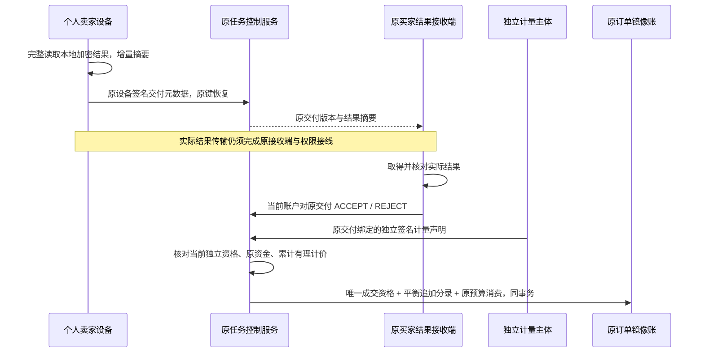

# R026 交付签收、独立计量与镜像账源码

状态：CODE_FIRST / SOURCE_ONLY / 未编译、未运行。此附录记录本次生产源码、实际依赖接线和测试源码，R026 全部 56 个任务、222 个子项继续开放。DEV-55 延后；增强隐私档维持真实证明门槛。本次没有启动数据库、模型、GPU、手机、浏览器或虚拟化环境。

## 主体、范围和信任关系

平台继续服务原买家与原个人卖家的 C2C 合同。设备、GPU 和手机归提供方所有，原任务保留 order / buyer / seller / device / resource / attempt / lease / 合同摘要和双围栏。当前源码接入 PLAINTEXT / STANDARD 原生文本结果元数据；三种文本请求仍使用原 OpenAI Chat、OpenAI Responses 或 Anthropic Messages 档位。媒体、GPU 租赁、基础 E2E 和增强档继续使用各自资格和计量规则，本附录不能被用来启用这些档位。

实际结果跨设备传输、本地签收程序、独立计量声明生产端及真实资格仍在总待办内。Web/Taro 当前提供元数据、原停止请求和账单入口；页面不能根据已展示的摘要自行生成“已核对结果”回执。

## 编号与源码实现约束

| 编号 | 需求与约束 | 源码状态 |
|---|---|---|
| DA-001 | 交付作用域固定原任务、尝试、租约、订单、卖家、设备、资源、物理代次、任务围栏、合同/清单/环境摘要 | 已写，未验证 |
| DA-002 | 原设备 Ed25519 签名使用独立消息域，固定序列化和原报告字节 | 已写，未验证 |
| DA-003 | 输出按 UTF-8 原字节拼接摘要，SSE 分块边界不影响摘要，无第二份完整内容缓冲 | 已写，未验证 |
| DA-004 | 完整 EOF、认证结果数量、终止原因和持久化元数据齐全后，保存首次原交付报告 | 已写，未验证 |
| DA-005 | 每个原尝试仅一份 revision=1 完整结果；换键重放相同内容恢复原报告，差异冲突 | 已写，未验证 |
| DA-006 | 报告只保存元数据及签名，不保存 prompt、输出文本、路径、URL、节点代码或调用凭据 | 已写，未验证 |
| DA-007 | 当前原设备证明与卖家角色在提交/重放前核验，历史签名仍按原租约核对 | 已写，未验证 |
| DA-008 | 原任务尝试围栏判定结果归属；执行清理和物理资源复用后仍可提交原结果，不触碰下一拥有者 | 已写，未验证 |
| DA-009 | 取消/失败/非当前尝试的迟到结果登记为 STALE，保留正式终态与预算 | 已写，未验证 |
| DA-010 | 签收截止=min(完成时间+120秒,原任务总期限)，不延长执行租约或原总期限 | 已写，未验证 |
| DA-011 | 原买家当前账户绑定交付 ID、revision、清单摘要、本地核对结果摘要及 expected_job_version | 已写，未验证 |
| DA-012 | 接受、拒绝和取消共享 order→job 锁序及乐观版本；唯一 acceptance 和正式终态不可替换 | 已写，未验证 |
| DA-013 | 拒绝或取消只写原决定/撤权/STOPPING；清理、实际用量、费用与退款保留独立确认 | 已写，未验证 |
| DA-014 | 原签收请求与安全响应同事务幂等保存；原角色撤销后不能借旧幂等响应越权 | 已写，未验证 |
| DA-015 | 设备上报数量保持候选身份，计费须独立计量主体签名及当前独立审核证据 | 已写，未验证 |
| DA-016 | 独立 pin 固定 key ID、公开密钥、计量主体、证据引用和摘要；最多16项，缺配置保持未知 | 已写，未验证 |
| DA-017 | 计量主体与审核者均区别于原买卖双方，彼此独立，核对当前 METER_AUTHORITY/METER_REVIEWER 角色 | 已写，未验证 |
| DA-018 | 资格精确绑定模型/tokenizer/模板摘要、后端、环境、计数档位及原交付，拒绝复用设备签名为计量签名 | 已写，未验证 |
| DA-019 | 保留原始 input/output/cache read/cache creation/reasoning 字段；缺失与显式0区分 | 已写，未验证 |
| DA-020 | OpenAI 总量含缓存输入/推理输出，只验证子集；Anthropic 输入按互斥普通输入+缓存读+缓存写累计 | 已写，未验证 |
| DA-021 | 计量声明和原设备报告数量一致，且不越原输入输出上限；签名绑定完整原作用域和声明时间 | 已写，未验证 |
| DA-022 | 签收先到或计量先到均可；两者齐备前保留预算，不估扣、不编造0、不自动接受 | 已写，未验证 |
| DA-023 | 按合同输入/输出 M token 双有理费率计算整单累计费用，本次费用为累计向上取分差额 | 已写，未验证 |
| DA-024 | 成交前核对原独立计量批准、原实付 allocation、未决退款和已保留预算；历史/混合来源待复核 | 已写，未验证 |
| DA-025 | acceptance 来源唯一 qualification，原预算消费、镜像账、已接受用量归档同事务 | 已写，未验证 |
| DA-026 | 追加借贷分录按原来源唯一，借贷守恒；真实核验零价释放预算且不创建空凭证 | 已写，未验证 |
| DA-027 | GMV/佣金/卖家暂计收入/待占预算分列；渠道费 UNKNOWN、到账 NOT_QUALIFIED、is_final=false 和水位明确 | 已写，未验证 |
| DA-028 | 六个既有控制操作、同 Claims/DB 的原生宿主和可选独立公开 pin 文件实际接线 | 已写，未验证 |
| DA-029 | Taro/React 账单及任务查询/停止，安全命令 journal、原键恢复、会话/订单代次、严格数据解析 | 已写，未验证 |
| DA-030 | 前向020、DATA079—081、原验收/独立计量/资格/预算一致性约束及测试源码定义 | 已写，未迁移/未执行 |
| DA-031 | 一次同卖家合格设备重派、已知失败/未知查询、旧上下文围栏及原总期限/预算保持 | 待完整源码 |
| DA-032 | E2E 换端重封、真实接收端验证和本地签名回执、隐私端密文结果传输 | 待完整源码/真实证据 |
| DA-033 | 媒体正式资产交付、图/视频/音频/3D 独立计量、租赁最终可用区间的统一账单投影 | 待完整源码 |
| DA-034 | 独立计量生产端及模型/tokenizer/模板组合资格、权限生命周期和真实结果接收程序接线 | 待完整源码/真实资格 |
| DA-035 | 持久验收超时 worker、权威未知结果查询、拒绝/部分结果争议和选择性最小举证 | 待完整源码 |
| DA-036 | 含买方费/渠道费/佣金/已赚取价款的累计退款差额冲正，续租/到账结算/对账 | 待完整源码 |
| DA-037 | 资金或计量批准失效后的独立复核恢复、历史资金/账务导入、混合来源校核 | 待完整源码 |
| DA-038 | GF031 全部旧正向夹具升级；本次新正向夹具走原签名支付/原分配，既有范围继续登记 | 待其余源码 |
| DA-039 | 全部56/222生产源码、真实依赖和测试源码完成后，统一编译/测试/调试及真实设备/协议组合验证 | 当前禁止提前推进测试 |
| DA-040 | R026整轮验收、双语文档最终同步、新页面截图/录屏/GIF，DEV55延后、增强档无证明关闭 | 待前置完成 |

## 原设备客户端工作逻辑

`PreparedExecution.Output` 包装原加密结果读取能力。包装器增量 SHA-256 计入实际交给消费者的字节，完整 EOF 后读取已认证数量和终止状态，将首次报告写入已有受认证主机 journal。报告范围包含原租约所有身份及两个围栏。当前必须在原执行 hard deadline 内完成首次报告保存；重新读取已保存的结果不能重签完成时间、生成新报告或再次调用模型。

`Host.ReportDelivery` 只显式发送已保存报告，恢复键由固定原报告摘要产生；成功响应核对原尝试、原清单/输出摘要、大小和有界验收截止，再记录原确认。网络未知保留原报告。主机重启可恢复元数据，即使原本地结果内容已清除也不能重新生成内容补齐。

`Host.ReportIndependentUsage` 接收外部独立签名声明，将首次声明持久保存后转发；`RecoverIndependentUsage` 恢复原声明。设备客户端不拥有独立计量私钥。原响应严格绑定 job，不能用另一任务的有效响应清除原待确认操作。生产端、第三方证据、完整声明签名以及内容接收链仍须后续完成。

原本地 AES-GCM 结果暂存与客户端加密方案继续沿用。此档为可信明文执行域；当前设备签名报告和存储加密不能作为 E2E、卖家不可见或增强隐私资格。

## 独立计量与费用细则

公开 pin 配置文件入口为 `P11_INDEPENDENT_METERS_FILE`，档位 `P11_INDEPENDENT_METER_PINS_1`；配置内容只有 `key_id/public_key/authority_id/evidence_ref/evidence_digest`。配置不能创建资格。证据种类 `TOKEN_METER_AUTHORITY_1`，范围必须精确包含 `profile_id/key_id/public_key/authority_id/model_digest/tokenizer_digest/template_digest/backend_id/kernel_environment_digest/counter_profile_id` 十项。

证据要求当前 APPROVED、有效时间窗口、固定摘要、独立审核者和当前两类角色；原角色、审批及主体行在核验时受锁保护。计量私钥归独立主体，公开 pin 与当前设备公开密钥保持分离。核验后归档原声明字节及其摘要、计量主体、审核者、数量和原交付摘要，历史核验事实不可修改或删除。

OpenAI 总量档位中，`cache_read_tokens≤input_tokens`、`reasoning_tokens≤output_tokens`，不额外增加这些子集；独立缓存创建计价尚未支持。Anthropic 互斥输入档位要求明确的缓存读/写数量，`输入合计=普通输入+缓存读+缓存写`；推理数量仍是输出子集。任何未知总量、未知档位、超界、重叠或不匹配原模型配方均拒绝核验。

价格以原合同双费率固定：`F(I,O)=ceil(I×input_numerator/(input_denominator×1,000,000)+O×output_numerator/(output_denominator×1,000,000))` 分。本次费用为 `F(旧累计I+本次I,旧累计O+本次O)-旧累计已计费用`；不逐块、不逐次重复向上取整。佣金也用累计差额，暂计卖家收入=本次费用−本次佣金，渠道费用保留 UNKNOWN。GPU 服务按小时的原方案继续执行，不因本附录改成按媒体件数收费。

## 金融事实、并发和未知处理

签收与取消均先核对当前原买家会话，再锁原订单、原任务。签收绑定 expected_job_version、原尝试和唯一交付；数据库唯一 acceptance 和终态保护共同阻止两个正式结果。REJECT 生成原拒绝决定和 FAILED 终态；CANCEL 撤销原活跃租约并将仍由原尝试占用的资源设为 STOPPING。清理通过原签名清理链独立确认。

接受结果本身可以先于独立用量到达；用量核验也可以先于买家接受到达。缺少任一条件时继续保留全部原预算。满足条件后，在同一事务内生成 `ACCEPTANCE` 来源资格、原订单累计费用差额、非托管镜像分录、已接受用量归档和预算消费。当前独立批准撤销可阻止尚未消费的计费。签收消费前再次读取并锁定当前证据、主体和角色，严格核对十项授权范围，并以当前批准公钥重验原归档声明的签名、摘要和数量；授权范围或公钥变更均保留原预算，不能沿用旧核验直接生成新账单。已记录的历史金融事实继续保留，后续应通过有来源的冲正处理。

原资金必须来自已验证的原支付分配。任何尚未明确失败的原退款阻止新的消费；本段不自行解除退款占用。历史/混合成交来源、缺失费用政策、买方费用分支、原预算不足等进入保留或冲突处理；完整恢复由 DA-036/037 继续实现。

镜像分录使用 SERVICE_CONSUMED_MIRROR、SELLER_EARNED_PROVISIONAL_MIRROR 和 PLATFORM_COMMISSION_ACCRUED_MIRROR。它们记录原交易事实，不能提现、支付或据此显示实际到账。原已计费零价无需构造空分录。

## 控制面、页面和数据记录

| 原操作 | 路径 | 当前源码功能 |
|---|---|---|
| registerAttemptDelivery | POST /runner/attempts/{attempt_id}/deliveries | 当前签名设备提交原结果元数据 |
| recordAttemptUsage | POST /runner/attempts/{attempt_id}/usage | 转发并核验原独立计量声明 |
| getJob | GET /jobs/{job_id} | 当前原买家/卖家查询元数据和独立计费状态 |
| recordBuyerReceipt | POST /jobs/{job_id}/receipts | 原买家当前账户对原文本交付接受/拒绝 |
| cancelJob | POST /jobs/{job_id}/cancel | 原买家发起原任务停止请求 |
| getOrderBill | GET /orders/{order_id}/bill | 原双方查询暂计账单及水位 |

API 使用既有账户/原设备认证、Cookie CSRF/Origin、原幂等键和 no-store 规则。原生宿主 `Completion` 必须与当前 `Claims` 和身份/交易 DB 一致。缺少原租约验证配置时服务关闭；独立计量 pin 可单独缺省，此时允许查询/买家决定并保留未知用量。

Taro 小程序和 React/Vite Web 沿用 NB04 视觉约束，挂载交付/账单、原任务查询、停止、原操作恢复入口。它们明确展示渠道待确认和暂计状态。共享 core 严格解析枚举、金额守恒、原交付和原任务；安全 journal 只保存原操作元数据，未知响应复用原键和正文。会话或订单变化使旧异步回调失效；待恢复记录保留在原账户下。

前向020新增 DATA-079 `native_result_deliveries`、DATA-080 `native_usage_verifications`、DATA-081 `accepted_usage_settlements`，并为原 acceptance 增加明确档位和请求/版本字段。原始001—019及原端侧DDL/source元数据保持原字节。020包含原身份绑定、不可变声明/决定、唯一终态、原签收+独立用量+预算+账务一致性及原资金约束，尚未迁移。数据库函数体执行、实际并发和真实组合效果均留待全量代码完成后的集中验证。

## 测试源码及推进边界

本次定义协议签名/消重/缺证边界、完整原支付分配后的交付/签收/计量/账务、接受与取消竞争、清理和资源复用、独立批准撤销、设备伪造计量拒绝、历史不可变、HTTP认证/CSRF，以及前端跨账户、未知恢复、损坏 journal 和跨任务响应拒绝。原主机真实 journal 结果读取测试源码扩展了签名报告持久化断言。

这些定义尚未编译或执行。不能将完整签名的合成夹具视为真实渠道、独立计量服务、物理内核、E2E 或 GPU 证明。全部开发工作完成前继续维护本轮实现表和全量未收口表，统一测试和媒体更新在后续准入阶段执行。

## DA 测试源码定义索引

| 编号 | 定义 | 源码 | 类型 | 状态 |
|---|---|---|---|---|
| DA-T001 | TestOpenAIInclusiveCacheAndReasoningNeverAddedTwice | dev/src/shared/resultwire/result_test.go | NEW_DEFINITION | 未编译/未运行 |
| DA-T002 | TestAnthropicDisjointInputIncludesReadAndCreationExactlyOnce | dev/src/shared/resultwire/result_test.go | NEW_DEFINITION | 未编译/未运行 |
| DA-T003 | TestMissingTotalsAreNotZeroUsage | dev/src/shared/resultwire/result_test.go | NEW_DEFINITION | 未编译/未运行 |
| DA-T004 | TestTokenCounterOverlapAndUnsupportedProfilesFail | dev/src/shared/resultwire/result_test.go | NEW_DEFINITION | 未编译/未运行 |
| DA-T005 | TestDisjointCacheRequiresExplicitCountsAndBounds | dev/src/shared/resultwire/result_test.go | NEW_DEFINITION | 未编译/未运行 |
| DA-T006 | TestFixedModelTokenizerTemplateAndBackendRequired | dev/src/shared/resultwire/result_test.go | NEW_DEFINITION | 未编译/未运行 |
| DA-T007 | TestDeliverySignatureBindsOriginalOwnerAndPhysicalFence | dev/src/shared/resultwire/result_test.go | NEW_DEFINITION | 未编译/未运行 |
| DA-T008 | TestDeliverySignatureBindsAllCompletedOutputMetadata | dev/src/shared/resultwire/result_test.go | NEW_DEFINITION | 未编译/未运行 |
| DA-T009 | TestIncompleteFailureAndUnboundedOutputCannotBeSigned | dev/src/shared/resultwire/result_test.go | NEW_DEFINITION | 未编译/未运行 |
| DA-T010 | TestResultSignatureRejectsNonCanonicalCounterTimeAndSignature | dev/src/shared/resultwire/result_test.go | NEW_DEFINITION | 未编译/未运行 |
| DA-T011 | TestIndependentMeterSignatureCannotBeReplacedByDeviceSignature | dev/src/shared/resultwire/result_test.go | NEW_DEFINITION | 未编译/未运行 |
| DA-T012 | TestMeterSignatureCoversRawTokenProfileAndRecipe | dev/src/shared/resultwire/result_test.go | NEW_DEFINITION | 未编译/未运行 |
| DA-T013 | TestCompletionBuyerAcceptanceAloneKeepsOriginalBudgetHeld | dev/src/tests/integration/completion_billing_test.go | NEW_DEFINITION | 未编译/未运行 |
| DA-T014 | TestCompletionVerifiedUsageBeforeAcceptanceDoesNotCreateCharge | dev/src/tests/integration/completion_billing_test.go | NEW_DEFINITION | 未编译/未运行 |
| DA-T015 | TestCompletionAcceptanceAndUsageCommitOneBalancedOriginalBill | dev/src/tests/integration/completion_billing_test.go | NEW_DEFINITION | 未编译/未运行 |
| DA-T016 | TestCompletionLateVerifiedUsageCanBillAlreadyAcceptedOriginal | dev/src/tests/integration/completion_billing_test.go | NEW_DEFINITION | 未编译/未运行 |
| DA-T017 | TestCompletionMissingMeterConfigurationNeverPromotesNativeCounts | dev/src/tests/integration/completion_billing_test.go | NEW_DEFINITION | 未编译/未运行 |
| DA-T018 | TestCompletionChangedDeliveryCannotReplaceOriginalWithAnotherKey | dev/src/tests/integration/completion_billing_test.go | NEW_DEFINITION | 未编译/未运行 |
| DA-T019 | TestCompletionDecisionRejectsChangedVersionAndLocallyReviewedDigest | dev/src/tests/integration/completion_billing_test.go | NEW_DEFINITION | 未编译/未运行 |
| DA-T020 | TestCompletionCancelAndAcceptanceHaveOneOriginalWinner | dev/src/tests/integration/completion_billing_test.go | NEW_DEFINITION | 未编译/未运行 |
| DA-T021 | TestCompletionLateResultCannotReviveCanceledJobOrFreePhysicalOwner | dev/src/tests/integration/completion_billing_test.go | NEW_DEFINITION | 未编译/未运行 |
| DA-T022 | TestCompletionRevokedMeterApprovalKeepsUnbilledAcceptanceHeld | dev/src/tests/integration/completion_billing_test.go | NEW_DEFINITION | 未编译/未运行 |
| DA-T023 | TestCompletionChangedMeterScopeKeepsUnbilledAcceptanceHeld | dev/src/tests/integration/completion_billing_test.go | NEW_DEFINITION | 未编译/未运行 |
| DA-T024 | TestCompletionRejectedResultNeverCreatesQualificationOrReleasesUnknownUsage | dev/src/tests/integration/completion_billing_test.go | NEW_DEFINITION | 未编译/未运行 |
| DA-T025 | TestCompletionBillIsParticipantScopedProvisionalAndNotPayout | dev/src/tests/integration/completion_billing_test.go | NEW_DEFINITION | 未编译/未运行 |
| DA-T026 | TestCompletionArchivesAndDecisionCannotBeMutatedOrDeleted | dev/src/tests/integration/completion_billing_test.go | NEW_DEFINITION | 未编译/未运行 |
| DA-T027 | TestCompletionResultCanRegisterAfterCleanupAndPhysicalResourceReuse | dev/src/tests/integration/completion_billing_test.go | NEW_DEFINITION | 未编译/未运行 |
| DA-T028 | TestCompletionDeviceKeyCannotForgeIndependentlyPinnedMeter | dev/src/tests/integration/completion_billing_test.go | NEW_DEFINITION | 未编译/未运行 |
| DA-T029 | TestHTTPCompletionReadsNeedOriginalServiceAndCurrentSession | dev/src/api/tests/completion_http_test.go | NEW_DEFINITION | 未编译/未运行 |
| DA-T030 | TestHTTPCompletionDecisionKeepsCookieCsrfBoundary | dev/src/api/tests/completion_http_test.go | NEW_DEFINITION | 未编译/未运行 |
| DA-T031 | TestHTTPCompletionCancelWithoutConfiguredAuthorityCannotAct | dev/src/api/tests/completion_http_test.go | NEW_DEFINITION | 未编译/未运行 |
| DA-T032 | billing parser never labels provisional mirror as final or paid out | dev/src/frontend/packages/core/tests/completion.test.ts | NEW_DEFINITION | 未编译/未运行 |
| DA-T033 | verified charge requires matching conserved amounts and qualified journal | dev/src/frontend/packages/core/tests/completion.test.ts | NEW_DEFINITION | 未编译/未运行 |
| DA-T034 | job parser rejects fabricated accepted delivery or current attempt | dev/src/frontend/packages/core/tests/completion.test.ts | NEW_DEFINITION | 未编译/未运行 |
| DA-T035 | unknown cancellation survives restart with the exact original body and key | dev/src/frontend/packages/core/tests/completion.test.ts | NEW_DEFINITION | 未编译/未运行 |
| DA-T036 | malformed or cross-job success keeps the original uncertain command | dev/src/frontend/packages/core/tests/completion.test.ts | NEW_DEFINITION | 未编译/未运行 |
| DA-T037 | corrupt pending metadata is preserved and cannot authorize another operation | dev/src/frontend/packages/core/tests/completion.test.ts | NEW_DEFINITION | 未编译/未运行 |
| DA-T038 | foreign local review receipt cannot accept current metadata | dev/src/frontend/packages/core/tests/completion.test.ts | NEW_DEFINITION | 未编译/未运行 |
| DA-T039 | explicit local receipt creates a bounded content-free decision command | dev/src/frontend/packages/core/tests/completion.test.ts | NEW_DEFINITION | 未编译/未运行 |
| DA-T040 | logout during late metadata read cannot restore prior owner state | dev/src/frontend/packages/core/tests/completion.test.ts | NEW_DEFINITION | 未编译/未运行 |
| DA-T041 | account change during key generation cannot persist or send an old command | dev/src/frontend/packages/core/tests/completion.test.ts | NEW_DEFINITION | 未编译/未运行 |
| DA-T042 | TestHostResultCapabilityReadsOriginalAfterComputeCleanup | dev/src/client/node/host_result_test.go | EXTENDED_EXISTING | 未编译/未运行 |
