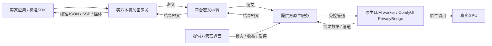

# 低开销隐私执行完整方案

P11｜技术v1.0增补｜2026-10-29｜完整实施设计，产品尚未实现。U：允许新增隐私档可嵌入LLM内核，保留LM Studio兼容选项；不启动本地Docker/WSL/VM/QEMU/模拟器。本方案取代前次评估中尚未选择的原生实现分支，LP与性能验证均未执行。

## 1. 确定采用的方案

采用“买方本机加密网关＋平台密文中转＋供给端低权限原生执行服务＋管道直连内核＋任务文件加密”。模型直接使用原生CPU/GPU后端，不增加虚拟机、整盘解密层、GPU虚拟化或模型副本。面向初级/中级用户的常规操作防护，具体攻击动作沿用[LP-01—LP-14](附录-本地内容隐私防护与分级验收.md)，不宣称抵御完整系统接管、程序注入或高级内存提取。

| 平台/能力 | 隐私档确定路线 | 兼容路线 |
| --- | --- | --- |
| Windows/Linux LLM | C++原生worker嵌入llama.cpp C API；不开llama-server/HTTP/WS端口 | lms＋llmster＋runtime继续封装；本机HTTP/诊断未封闭前不得取得相应本地隐私资格 |
| Windows/Linux图像/视频/音频/3D | 完整ComfyUI环境＋固定PrivacyBridge入口＋有限白名单＋加密输入/输出桥；隐私入口不启动ComfyUI Web服务 | 原有HTTP适配只用于明确选择的其他能力档，不透传给隐私订单 |
| Android | 固定LMA源码二开，内部Java/JNI调用本机引擎，增加轻量加解密/私有任务存储 | 个人聊天/自用API保留，但不得读取共享任务内容 |

新增`LLAMA_CPP_NATIVE`是独立引擎身份，不冒称LM Studio内核。GGUF架构、量化、tokenizer、模板、上下文、工具格式与后端各自核验；不能从LM Studio能加载推导原生worker必然兼容。初始文本非流/流；视觉等功能逐组合发布，不以“同一权重”保证逐字相同输出。

Taro支付宝小程序承担市场/合同/支付/订单和轻管理；React＋Vite Web承担复杂配置与管理。E2E内容数据仍进入买家本机或明确配对的可信LAN网关，不把小程序/Web业务服务器当解密端。部署/公网HTTPS/可观测性继续延后。

## 2. 进程、权限与本地调用



桌面每设备一个Go原生服务；NodeAgent、卖方解密、BoundRelayCore、资源门闩在同一服务中为逻辑模块，不为每请求启动一套网关。每GPU只允许当前所需的一类worker占用执行槽；worker可复用，模型/内核按需加载，不同时常驻两份大模型来维持两种引擎“在线”。多GPU按物理resource_id独立仲裁。

Windows使用独立低权限服务身份，服务SID/目录ACL明确；Linux使用独立非root服务用户。安装注册需要的系统权限由用户知情选择，日常不保持管理员/root。UI使用本人可访问的有限控制通道，只有状态、版本、安装同意、资源、收益和停止功能，无读正文、解密、任意路径、shell或原生引擎代理能力。默认不捆绑Electron/常驻Chromium；托盘/CLI可运行，复杂设置复用Web页面，关闭页面不影响服务。

数据通道优先使用父进程创建、仅定向继承给指定worker的匿名管道；控制/取消另有小管道，避免被大媒体写入堵塞。Windows限定继承句柄清单，父端禁止继承，worker不继承平台认证/更新密钥；Linux明确传递FD并关闭其余FD，桌面UI得不到数据FD。不用stdin终端文本解析模拟接口，不把prompt或钥放命令行/环境变量。子进程stderr仅安全错误码，stdout为内部帧，不能混入推理日志。

管道传受限二进制帧，外层32位长度、命令类型与小型JSON元数据，DATA承载原始字节；最大数据记录64KiB，元数据最大64KiB。内部消息含command_id、attempt/token、resource_generation、deadline、环境摘要与受限正文引用，沿用现有适配器上下文；不是给买方增加私有请求字段。OS受控管道是本地访问边界，不声称其自身是网络加密或能挡住进程句柄劫持。

若特定组件必须命名管道/Unix socket，显式ACL/目录权限并核对端点身份，拒绝远程或错误账号。隐私worker不监听TCP，普通浏览器、Fiddler或loopback抓包没有可抓取的模型正文HTTP。管理页面即使被读取也只有允许元数据；不靠随机端口或隐藏进程达到防护。

## 3. 买方客户端与加密链路

1. 买家安装原生网关，绑定本人身份，在小程序/Web确认卖家、模式、实际引擎、隐私政策、预算和环境摘要。凭路由凭据绑定合同，不改标准请求JSON；未配置不能默认代购或转明文。
2. 本机SDK使用OpenAI Chat/Responses或Anthropic Messages的已验证子集；媒体继续走已发布OpenAI兼容档位。localhost入口需认证/Host与Origin核验，LAN入口另经显式配对和受保护连接；LAN主机是买家信任的明文处理方。
3. 网关核接收端身份、公钥/撤销及合同环境；首次信任通过独立渠道/证书链确认，不仅信平台自己返回的公钥。双方设备身份/内容接收/回执/更新签名用途分离。
4. 平台先建立INPUT_PENDING/PREPARED上下文，尚无执行权、尚不锁GPU。买方对JSON、附件、SSE内的私密头/错误/usage和媒体正文进行端点加密，平台只收密文、签名及必要路由信息。
5. 输入完整性、资金、许可、版本、磁盘与执行容量通过后，签发ISSUED租约。卖方服务核签名/上下文/双围栏才交worker；接到数据不等于可以推理。
6. worker返回输出，由服务边收边加密并写有界密文spool/发送；结果密钥只封装给买家。买方网关认证、恢复原标准响应、解码验收并发送签名回执；没有回执不自动计成功成交。

密码路线沿用libsodium：每对象/方向随机流钥，sealed box封装给已确认端点，secretstream XChaCha20-Poly1305负责认证分块，独立Ed25519签身份与上下文。sealed box不认证发送者，需已有认证与签名；不以Base64、token ID、混淆或压缩替代加密。版本/跨Go-C++-Android向量和封装仍须冻结评审，不能把本文当已验证密码产品。

AAD绑定协议版本、合同、卖家/接收端/钥版本、order/job/attempt/token、方向、对象/流、epoch、交付版与序号。执行租约另签resource_id/resource_generation、deadline及内核环境。认证失败、重放、换端、超限、截断均拒绝，不把失败正文回传平台诊断。

## 4. 传输：顺序加密、二进制帧与背压

既有JSON密文帧仍作为`JSON_COMPAT`候选配置。新增低开销`BINARY_STREAM_1`作为本方案两端与中转统一实现的协议档位，必须进入双方批准的protocol_profile_ids、签名流头和合同协议政策；不是把二进制数据伪称符合旧JSON Schema。

| 项目 | BINARY_STREAM_1实施定义 |
| --- | --- |
| 建流 | 有界JSON流头包含完整既有上下文、suite/序列化档位、epoch、流header及sealed钥引用；身份签名覆盖它们。流头最大16KiB，端点验证后进入二进制数据阶段 |
| 记录格式 | `body_len:uint32be`＋`sequence:uint64be`＋`secretstream_ciphertext`；body_len包含seq与ciphertext，不含自身；拒绝越界/溢出/重复冲突。数字语义映射到已有十进制计数器，不能丢精度 |
| 解密后格式 | 8字节内部头：type:u8、flags:u8、reserved:u16、payload_len:u32，后接payload；未知type/flags、非零reserved、长度冲突拒绝。HEADERS/DATA/USAGE/ERROR/END/CANCEL均在密文内 |
| 大小 | 解密后整条记录≤65536字节，DATA正文≤65528；ciphertext≤65553，body_len≤65561，含长度前缀最多65565字节 |
| 记录开销 | 满块的记录层额外37字节，相对65528字节DATA约0.06%；不含建流、WebSocket/TCP等开销。避免为大媒体Base64增加约1/3体积 |
| 小流延迟 | 最多聚合8ms或达到块上限即发送；HEADERS/终态/取消及时flush，不按每token做公钥运算或每条做身份签名；JSON/SSE原字节保留，不改工具参数/事件顺序 |
| 缓冲 | 每方向收/发各2×64KiB，重排上限沿用32帧/2MiB；单流总配额4MiB由各阶段共享，不能每阶段各拿4MiB；达到配额背压，不增长队列 |
| 结束 | 业务END本身作为最后记录用库TAG_FINAL加密，承诺此前数量/摘要/结果状态；不另发空FINAL。socket关闭不替代完整终态；中途ERROR后须失败END或明确中断 |
| 重连 | 只重传原持久密文及原序号，或核准全新epoch/钥/header；不恢复旧加密状态继续发，不重复执行。HTTP/SSE连接已断时如实报中断，不假装普通SDK支持跨请求续流 |

中转只解帧边界和有界外层信息，不解析正文，不重编码密文、不压缩已加密媒体。握手材料验证后可缓存当次身份结果；每记录仍认证并检查顺序。双方未支持此档位时，低开销SKU不能悄悄改走Base64大对象；可明确选另一报价/档位。

END中的DATA计数/摘要针对此前DATA正文、record_count针对此前全部记录，不含END自身（该记录使用TAG_FINAL），避免自引用；整个最终密文对象的摘要在封装完成后由外层交付清单承诺。64MiB媒体上限指明文文件，密文对象另留格式开销，最多66MiB；两者均在准入/签名政策中检查，不能把密文多出的认证字节当成超额生成。

secretstream仍是顺序流，不能拿第N块直接随机解密。对标准Range，买方先完成顺序认证并放入自己的受权文件/加密分段缓存，再按Range提供；不在平台解密、不把本地分段格式混同传输suite。

## 5. 存储：只加密任务数据，不加密模型和整个系统

模型、tokenizer、公开配方与获准引擎包使用只读原生文件，保持mmap/原生加载路径；不在每次推理前解密数十GB权重。身份私钥在提供方专用账号的DPAPI/适用秘密库或Android Keystore保护，文件ACL独立；内容流钥与临时工作区钥按对象独立、优先只在执行侧RAM短存，不放普通SQLite或相邻配置文件。

输入、输出和中间文件有三种受控路径：小文本直接有界内存；顺序媒体用读写流；需随机读取的已完成输入用独立的`LOCAL_SEGMENTED_1`加密缓存。不得先写普通PNG/MP4再加密，不向提供方挂载可浏览明文的解密盘，不建整段视频RAM盘。

`LOCAL_SEGMENTED_1`本地缓存设计：每对象独立随机32字节钥，固定1MiB明文段；每段以全新secretstream header作为独立单消息FINAL流加密，AAD绑定对象ID、合同/attempt、用途、段号与明文长度。随机header及状态不得复用，不在此层手造nonce。终态manifest也是独立认证加密对象，绑定总长、段数及各段密文摘要；完整输入manifest核验前不交解码器。每段先认证再向解码器交字节，拒绝跨对象替换和截断。

此格式是待评审的本地封装，不是把一个长secretstream任意seek；只支持完成对象的只读随机访问，不提供原地覆写。读取端最多缓存桌面4段/Android2段、LRU有界；改写产生新对象/钥/manifest，不复用旧位置。数据目录只有随机对象名、密文段和密文manifest，状态库只保存不可逆内容之外的身份/围栏/后端ID/密文引用。

输入可从网络密文顺序解密并重封为本地分段缓存，完成后删除不需要的原密文副本；转换不持GPU锁，有磁盘配额，绝不将整对象同时保留两份明文在RAM。输出优先直接形成网络密文spool；仅后端确需随机读自己的已完成中间对象时额外建分段缓存。

重启时优先恢复围栏、后端ID和密文；RAM钥丢失则不能假装继续访问临时明文。向买方申请在有效合同内重新授权/重封或结束失败，原推理是否已运行先query确认；不能盲目重跑/重扣。已加密完成给买家的结果可按原密文重传，无需留节点正文钥。

## 6. 媒体完整数据路径

| 能力 | 执行与输入 | 输出写入路径 |
| --- | --- | --- |
| 文本 | Go方言映射→管道→C++ worker→llama C API；JSON/上下文≤既定2MiB，KV按合同限额 | 增量token转标准事件字节→管道→CPU流加密；不收集整段对话以便打印 |
| 图片 | ComfyPrivacyBridge将已认证输入作为受限file-like或张量交批准节点，模型与节点照常用原生GPU | 受控PNG编码器写入加密sink，禁PreviewImage、默认SaveImage和prompt元数据路径 |
| 视频 | 批准的分块解码/VAE配方，帧批大小按原配方；禁止新增全片RGB副本用于加密 | 固定FFmpeg管道或libavformat回调编码为可流式fMP4，再加密；不落帧目录/普通临时MP4 |
| 音频 | LMA/Comfy获准本地引擎，采样与声音许可按SKU | 已知长度WAV或支持顺序输出的FLAC等批准格式直接加密；标准请求不支持的格式提前拒绝，不偷换格式 |
| 3D | 固定网格/材质/纹理管线，限制几何与展开体积，不执行资产脚本 | 导出器先计算GLB布局/总长，再分段序列化给sink；不重复复制整套网格/纹理到加密缓冲 |

ComfyPrivacyBridge从固定版本的执行器接入，进度与query仅写安全状态，保留真实prompt/backend ID供恢复/取消，不公开graph/history/原生UI。全环境仍可替换，但PrivacyBridge、输出节点、编码器和依赖与模型配方共同进入环境摘要，升级未复验不接隐私订单。普通venv不是插件隔离边界。

对必须得到可seek普通路径、会私自落盘或缓存全片的第三方节点，必须改为file-like/AVIO回调/分段接口后才进隐私白名单；不能用几十GB RAM盘或事后删文件硬兼容。这里交付的是上述完整受控能力包，非任意ComfyUI工作流兼容承诺。

fMP4是合同明确的MP4封装候选，需要实际标准SDK/解码器验证；不能偷偷改变已售产物规格。买方确需普通非分片MP4时，在其本机可做无重编码remux，另记转换结果，不篡改原交付密文摘要/验收对象。额外变换不占提供方GPU；编码器是否用CPU或既定硬件编码按原SKU，不为加密增加GPU计算任务。

Android仍在LMA内部Java/JNI路径执行，不额外启动完整Go/Node/Python或第二份LMA进程；JNI使用同一密码库。任务密文在内部存储，短时钥不入WebView、个人聊天、相册、logcat或备份；通知只显示共享状态及停止。模型native组件随受签APK更新，模型数据独立下载。

## 7. GPU调度：不改变一张卡一套锁

控制面选同卖家已披露合格设备与精确环境；新增隐私LLM不能生成另一张“虚拟显卡”。Comfy、原生LLM、LM Studio、自用、租赁和维护全部绑定同一resource_id、资源代次和本地门闩。

```text
输入加密上传/验完整性/密文缓存与空间预留（不锁GPU）
→ 资金/资格/期限核准
→ 原子取得资源代次并发ISSUED租约
→ 本地核双围栏，按需加载唯一所选模型，真实执行
→ 输出编码/密封完成，停止执行并清任务张量/上下文
→ 确认CLEANING完成，签清理结果，资源FREE
→ 密文上传重传/买方验收/结算（不额外持GPU锁）
```

实际编码仍需GPU/NVENC时该阶段继续持锁；不能因为生成结束就提前把同卡给下一任务。保留安全的只读模型权重缓存可减少下一同模型请求冷启动；买家KV/历史/中间张量必须隔离和释放。切换引擎前卸载旧模型并确认显存足够，不让两个大引擎相互挤占。

计算租约过期后没有继续推理权。计算与交付权限分别检查：不可变密文的补传/买方回执只按原任务token、交付版与受限对象权限校验，不要求继续持有资源，也不能因此获新GPU执行权；全局资源代次增加不能使原合法密文失去交付资格。旧worker的计算/清理回调必须匹配当前本地占用owner与代次，绝不能清掉下一任务。此为调度实现细则，不自动新增现有API字段。

控制/租约续期/取消使用独立队列和管道，不排在图像/视频数据后；CPU加密worker桌面默认最多2个、Android1个，按实际CPU余量限速，不更改模型线程/精度/上下文偷偷换性能。输入缓存与输出spool达配额先停止新准入，不继续占卡等无限上传。租赁子任务共会话资源锁，不能每次子任务交付就释放租赁占有。

取消先禁止新decode/采样迭代，在实际后端检查点停算；llama公开abort回调不能当作CUDA即时中断保证。需等待当前GPU提交完成，超时只终止本程序拥有的worker并隔离资源，确认停止/清理才可复用，不杀个人进程或重置整张卡。断网、休眠和重启仍沿原期限/双围栏规则执行。

## 8. 内存、性能与磁盘预算

下表均为D验收目标，非实测承诺。“额外”以同机同版本裸引擎/相同配方为基准，包括服务、桥接、密码库、缓存及序列化开销；模型/推理张量按相同输入比较峰值差，不能换模型、量化、后端或降低结果质量来过关。

| 项目 | 桌面目标 | Android目标 |
| --- | --- | --- |
| 加密引入的GPU任务/模型副本 | 0；加解密全部CPU，权重只加载一份 | 0；复用原引擎 |
| 后台新增内存（无设置/预览页） | 空闲≤64MiB，单GPU活动≤96MiB | 空闲≤12MiB，活动≤24MiB |
| 受控内容缓冲 | 单活动资源合计≤16MiB；同进程总池≤32MiB，多卡不得无界叠加 | 合计≤8MiB |
| 暖机后稳态推理差 | 吞吐回退≤3%，端到端p95增加≤5% | 端到端p95增加≤8% |
| 短文本新增首包耗时 | p95≤20ms；聚合最多8ms | p95≤30ms |
| 取消/续期分发 | 服务到worker控制管道p95≤50ms；不等同GPU瞬时停算 | 同目标，后台限制独立验证 |
| 后台任务/缓冲排队 | 每GPU一活动任务，额外待交付对象≤2个 | 一活动任务，额外待交付对象≤1个 |

买方网关目标：后台空闲≤48MiB、单流活动≤80MiB，受控内容缓冲≤16MiB，不计用户主动打开的媒体预览/SDK自身副本。超过2MiB的标准JSON按原规则提前拒绝；单媒体≤64MiB且配方可更低。base64响应需要时从文件分块编码输出JSON，不先形成整份base64字符串；第三方SDK若整体解析仍会占用其自己的内存，应按对象大小提示/限额，不能虚报整个调用链零额外内存。

磁盘先为输入缓存转换、最大密文输出和重传预留空间。每活动资源默认256MiB业务spool预算，可配置但受设备总盘预算；当64MiB对象及格式开销不能装入剩余额度时准入前拒绝。spool用尽后新单暂停，现有单按背压/期限结束，不扩容RAM或无限攒结果。读写限速避开模型加载高峰；环境/模型首次校验在激活/维护阶段做，任务只核已批准摘要/打开文件身份，不每次重hash数十GB权重。

实现不得额外创建模型副本/全片帧副本/全对象base64副本。操作系统文件缓存、驱动缓存与代码载入也应纳入实测，不能只统计Go heap。设置页/预览页另列内存；不把“关掉界面后的数字”冒充界面开启时的总量。

性能验证做同机同输入A/B：固定版本/温度条件/模型权重/上下文/采样/图与编码器，先暖机，各至少30次；分别记裸执行、包裹但无密码处理的测试基线、完整隐私链路，记录p50/p95、峰值RSS/PSS/提交内存、VRAM、CPU、读写及网络字节。小文本首包、长文本吞吐、64MiB输入、图/视频/音频/3D均覆盖；Windows、真实Linux、Android真机分别测。测试基线绕过只能用于本机测试构建，不在正式客户端留下可启用的明文开关。此为功能资源验证，不搭可观测性系统。

超过预算先减少拷贝/线程/缓冲、改进流式导出或不发布该SKU；不能降级加密、换卖家、改模型质量或缩短产物而继续原单。慢设备依据真实预算限制能力/并发，所有设备不保证同一性能数字。

## 9. 版本、恢复与对提供方的透明度

环境摘要包括worker、llama库/后端、Comfy/Python/依赖/白名单/PrivacyBridge/编解码器或LMA APK native、协议档位与配方；签名批准后进入能力、报价合同、执行租约与本地任务。模型/配方分别许可，LM Studio再分发/收费许可不由新增MIT内核代替。

更新先停新准入/排空，取得同资源维护门闩，校新环境、实测资格后切换。有效任务/租赁不热换；回滚不能恢复撤销版本、旧token、旧账证或未经重新授权的内容钥。模型保留/卸载由提供方选择，个人历史与文件不误删。

提供方看组件、版本/来源/许可、模型、节点、资源、电量/温控、任务阶段/时长与收益，拥有暂停/排空/紧急停止；不显示正文/结果，也不提供“诊断时导出买家内容”按钮。进程与网络活动不隐藏，不以隐私名义防止用户卸载或偷偷跑任务。

买方本机可按本人授权把最终结果写成普通文件，这是交付功能；也可选本地密文缓存并临时预览。平台与卖家默认不得得到该目录访问权。正文纠纷由买家选择性披露，不设计平台万能密钥；高级攻陷/恶意改写边界按合同明示。

## 10. 开发落点、完成条件与来源

新增规划路径：`dev/src/client/adapters/llama-native/`、`dev/src/client/native-worker/`、`dev/src/client/adapters/comfyui/privacy-bridge/`、`dev/src/client/protocol/binary-stream/`、`dev/src/client/crypto-gateway/secure-store/`；Windows/Linux系统端仍在原路径，Android仍在LMA派生目录。当前仅路径规划，未写产品源码或构建真实内核。

| 工作包 | 必须交付的结果 | 完成证据 |
| --- | --- | --- |
| PE-01 | 独立服务身份、受限UI、匿名数据/控制管道 | 正常启停、错误账号拒绝、FD/句柄不泄漏 |
| PE-02 | llama C API worker、GPU选择、模型/上下文、流/取消/清理 | 标准SDK请求、真实GPU、无TCP内容端口、单模型与双围栏 |
| PE-03 | 买方/卖方密码模块与BINARY_STREAM_1 | 库/跨端向量、身份/重放/截断/重连/负载篡改拒绝，平台全链无明文 |
| PE-04 | LOCAL_SEGMENTED_1、顺序sink、故障与密钥生命周期 | seek只读正确、段/manifest篡改拒绝、内存/磁盘有界、恢复不重跑 |
| PE-05 | Comfy私有入口、受控媒体输入/输出、节点白名单 | 图/视频/音频/3D各完整交付且无普通temp/预览/history旁路 |
| PE-06 | LMA轻量内部调用与加密存储 | 获授权真机、无个人历史/API泄露、后台/停止/资源与计费正确 |
| PE-07 | 共GPU门闩、交付阶段解耦及更新恢复 | 满负载传输时取消/续约正常、旧代次不影响下一任务、租赁不误释放 |
| PE-08 | LP全套＋同机A/B性能与内存预算 | 独立设备证据、各版本/能力通过后才开放对应SKU |

PE-01—PE-08均DESIGN/NOT_EXECUTED，承接原56个DEV任务，不虚增完成数量。机器摘要见[低开销方案策略](contracts/private-execution-plan-v1.0.json)，由`scripts/供给端内核数据.py`生成；现有环境/能力/适配器Schema同步增加LLAMA_CPP_NATIVE，全部销售开关仍false。

原DEV-23扩展为“原生隐私LLM与LM Studio兼容内核”，两个分支分别核许可/能力；E03仅约束LM Studio分支，不阻止具备自身许可证据的原生worker。DEV-18/21/22/30/31/37/44/51分别承接调度、隔离、Comfy、加密、盲转、媒体、Android和A/B验证，开发任务机器附件同步细化。

技术事实依据：[llama.cpp官方与C API](https://github.com/ggml-org/llama.cpp)、[llama.h取消/后端接口](https://github.com/ggml-org/llama.cpp/blob/master/include/llama.h)、[libsodium顺序加密](https://doc.libsodium.org/secret-key_cryptography/secretstream)、[LM CLI连接源码](https://github.com/lmstudio-ai/lms/blob/main/src/createClient.ts)、[LM日志源码](https://github.com/lmstudio-ai/lms/blob/main/src/subcommands/log.ts)、[Windows子进程管道](https://learn.microsoft.com/en-us/windows/win32/procthread/creating-a-child-process-with-redirected-input-and-output)、[FFmpeg封装文档源](https://github.com/FFmpeg/FFmpeg/blob/master/doc/muxers.texi)。以上在线分支是核对材料，不是已冻结的发行版本，二进制/补丁/许可/跨端密码与设备资格须在实现中固化。

## 11. 加密协议实施细节的统一依据

[技术08](08-端到端加密协议与密钥实现设计.md)统一签名/AAD/钥封装、流头/记录/END字节语义、轮换撤销、静态接收钥前向保密限制、计算与交付分权、回执/故障恢复和E2E-01—20；本方案负责本地执行/媒体/资源预算。机器源分别生成[执行清单](contracts/private-execution-plan-v1.0.json)与[加密清单](contracts/e2e-protocol-plan-v1.0.json)，均不可售/未执行。

补齐规则：建流前缀header_len为4字节大端且不含自身，JSON流头≤16KiB；C先于sealed材料构造，H包含sealed材料而排除signature，记录AAD绑定H摘要和body_len/sequence，避免循环。INPUT不预填未知的输出交付版或资源代次；OUTPUT先保留交付版，实际资源代次在ISSUED签名租约核。新二进制档位须补channel协商/版本契约后才能启用，不能沿旧JSON channel冒充已支持。

临时钥清理与密文文件留存分开；已完整密封给买方的结果补传不需要留正文钥。LOCAL_SEGMENTED_1 manifest候选上限64KiB，段缓存计入共享内容预算。买方静态钥丢失平台无法恢复旧结果，撤销不能收回既有明文；普通端点不借此宣称完整前向保密或硬件增强。

## R021 原生 LLM 接线进展

[原生LLM受限管道与可替换worker](附录-原生LLM受限管道与可替换worker.md)冻结NK-001—042：独立本机包/模型/模板摘要、固定C API、类型化P11_LLAMA_PIPE_1、真实tokenizer前置、原owner一次提交、独立取消、两个64KiB输出缓冲和同步后清理。当前Windows合成C ABI实进程测试与真实模型/GPU/LP/E2E资格分开登记；节点CLI执行仍关闭，LM Studio/ComfyUI/LMA、公共输出/ACK及可信usage继续待完工。普通调用账户和Job Object不能替代独立低权限服务。

## R022 结果交付增量

R022 新增 [RC-001—060](附录-原生文本结果加密保管与标准协议交付.md)：原生输出先独立加密保管，计算清理与原结果读取分别授权；三文本 JSON/SSE 仅属 PLAINTEXT/STANDARD 局部源码，不授予 E2E/LP、可信用量、最终 ACK 或资金资格。CLI 执行继续关闭，全部未收口验收保留。
