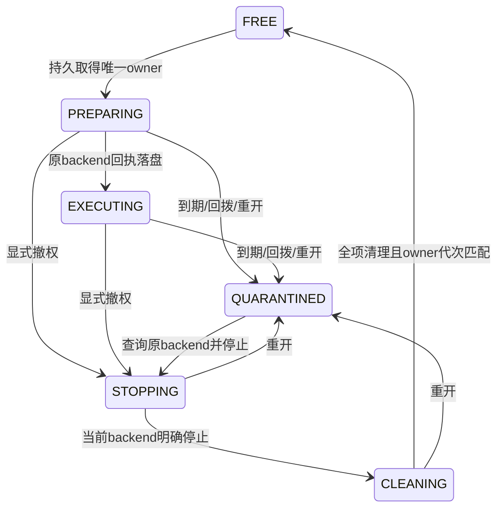

# 原生执行收件箱与资源门闩实施细则

R010｜需求v3.0 / 技术v1.0 / NB04｜控制与元数据实现；完整内核执行、内容E2E、可信usage和支付未验收。

本轮将提供方的执行前保护落入 `dev/src/client/protocol/executionlease`、`client/execution` 和现有 `p11-node`。它是原生执行端的持久化基座，沿用既有OpenAPI Lease，不新建替代交易合同。平台仍为31/93控制操作、65领域表；001—005迁移保持原字节。端侧另有5张SQLite元数据表，不计入平台65表。

客户端只提供显式 `execution-init`、`execution-status` 两个新命令，不领取任务、开启模型、接受prompt或签发售卖资格。状态继续 `execution_enabled=false`、心跳UNKNOWN。平台租约签发/TX-04、独立信任锚发行与撤销、KernelRegistry、真实backend、定时停止循环及租赁会话接入仍待完成；不能仅凭本轮库的BeginSubmit许可启动用户设备。

## 1. 模块与完整约束编号

| 编号 | 实现职责 | 强制约束 | 对应开发项 |
| --- | --- | --- | --- |
| NEX-001 | Lease严格DTO与验签 | 对应权威Lease；未知/重复/大小写别名/null标量拒绝；16KiB上限 | DEV-18.02、DEV-53 |
| NEX-002 | 独立批准计划绑定 | seller/device/order/job/attempt/resource/双围栏/能力/manifest/hash/env/合同及硬截止逐项匹配；不得照抄入站租约构造计划 | DEV-18.02、DEV-21 |
| NEX-003 | 有限签名档位 | P11_EXECUTION_LEASE_ED25519_1；32字节独立平台公钥、64字节Ed25519签名；没有在线信任配置入口 | DEV-18.02、DEV-53 |
| NEX-004 | 明确一次初始化 | 已登记本人设备、无待恢复控制命令、本地未记录撤销；加密日志先锚定，再建库；无reset/force/free命令 | DEV-21.03 |
| NEX-005 | 原生命名与文件保护 | 继承节点OS独占锁/本人目录权限；SQLite/WAL/SHM不经符号链接或reparse路径；Windows本地盘URI，拒绝UNC库 | DEV-21.02、DEV-53 |
| NEX-006 | 元数据库耐久配置 | WAL、FULL同步、foreign_keys、STRICT表、immediate事务；一连接；缺库不隐式重建 | DEV-21.03、DEV-51 |
| NEX-007 | 物理资源唯一 | 同一物理摘要只能有一个resource_id；LM Studio/llama.cpp/ComfyUI不能各造一个GPU槽位 | DEV-18.01、DEV-24.01 |
| NEX-008 | 本地/维护与JOB门闩 | LOCAL和MAINTENANCE受同门闩控制；不能用本地调用伪造JOB或RENTAL权 | DEV-18.01、DEV-24.01 |
| NEX-009 | 双远端高水位 | job token与跨job资源generation分别持久；十进制完整uint64，不经float或SQLite有符号整数转换 | DEV-18.02 |
| NEX-010 | 本地owner代次 | 受管本地使用、维护、JOB每次占有共同递增；与平台资源代次分开，溢出关闭、不重置 | DEV-24.01 |
| NEX-011 | 原命令收件与去重 | command_id唯一、lease_id唯一、规范元数据hash；异载荷拒绝，重复只返回QUERY_ONLY | DEV-21.03、DEV-51.01 |
| NEX-012 | 一次提交预留 | RECEIVED→SUBMITTING先提交SQLite，外部backend固定request key=lease_id；此步骤后不盲目重提 | DEV-21.03、DEV-51.02 |
| NEX-013 | backend映射 | 原backend ID持久；迟到正查询可补用于停止，不能替换另一backend或恢复执行 | DEV-20.02、DEV-21.03 |
| NEX-014 | 签名续租 | 完整新Lease、更高revision、相同owner/内容引用/合同/硬截止；持久成功后才更新内存短截止 | DEV-18.03 |
| NEX-015 | 绝对与单调截止 | 两者任一到期隔离；时钟回拨关闭新执行；普通Ack/HTTP成功/心跳/NO_CHANGE无续权 | DEV-18.03、DEV-20.01 |
| NEX-016 | 重开与异常退出 | 每次重新打开元数据库，所有未释放owner进入QUARANTINED，磁盘ACTIVE不允许继续执行 | DEV-20.04、DEV-21.03 |
| NEX-017 | 先查询再停止 | 恢复返回原request/backend；UNKNOWN/RUNNING/失联/PID不存在均不当停算；只操作受管backend | DEV-20.02、DEV-20.04 |
| NEX-018 | 清理前不复用 | 显式STOPPING→当前backend确认停止→CLEANING；停算/撤权/工作区清理全真及清理摘要才FREE | DEV-20.03 |
| NEX-019 | 清理比较owner | resource_id、owner、mode、本地代次同时匹配；旧清理/停止/迟到backend不能影响下一owner | DEV-18.04、DEV-20.03 |
| NEX-020 | 容量与安全投影 | 128资源、4096收据、2MiB页缓存、mmap=0、16384页上限；无自动删历史；UI不收正文 | DEV-21、DEV-24.04、DEV-53 |

上述编号指源码组件，不表示完整DEV子项通过。平台批准、真实引擎、物理资源识别、定时撤权/停止/删除与签名回报没有整链路证据；全部56项及222未收口子项仍保留。

## 2. 租约签名域与验签次序

新档位只用于平台执行控制，与P11_DEVICE_ED25519_1请求证明、客户内容密钥、sealed box和secretstream签名完全分开。平台公钥必须从未来受信发行/轮换流程获得；客户端不能从同一入站租约或请求参数接受公钥。当前CLI没有安装平台钥或输入租约的命令，因此没有绕过尚未实现的信任/审批路径。

签名消息是UTF-8编码的ASCII字段，固定顺序，每项以LF结束。依次为：profile；lease_id；job_id；attempt_id；order_id；seller_id；device_id；resource_id；resource_lock_generation；capability_id；execution_manifest_ref；execution_manifest_hash；kernel_environment_digest；lease_revision；issued_at；not_before；hard_deadline；fencing_token；expires_at；contract_hash；input_asset_refs数量；按原顺序逐项asset ID；envelope_ref（没有时为空行）。signature字段不进入自身消息。零输入的省略数组与空数组等价，null数组拒绝。

ID使用权威ASCII ID规范，hash为64位小写十六进制；计数器为规范十进制字符串。时间为规范UTC RFC3339Nano，2000—2100年；执行不采用控制证明的±60秒宽限。要求 `not_before <= issued_at <= now < expires_at <= hard_deadline`、`issued_at < expires_at`，单次签发不超过45秒。硬截止必须与独立批准计划一致；批准计划还须在后续发行端受合同/总任务截止约束。当前固定档位不接受任意放宽的服务器配置。

解析上限和精确字段检查→时间/计数器/引用/档位检查→使用既有受信公钥验Ed25519→逐项批准计划绑定→当前时间检查→得到不可被外部JSON构造或修改的Verified→在本地事务重新检查当前时间/本人身份/资源/历史。测试使用公开合成钥和独立固定字节向量，没有生成生产签名钥。

## 3. 元数据库与节点锚定

| 表/文件 | 保存内容 | 不保存的客户数据 |
| --- | --- | --- |
| metadata | 档位、安装/库/设备/卖家绑定摘要、DDL摘要、最高墙钟读数 | 无内容密钥和正文 |
| resources | 唯一物理摘要、remote_high/local_high、当前owner/mode/phase/停算标记 | 无GPU显存或模型张量 |
| inbox | 原lease的严格类型元数据、hash、本地代次、phase、backend ID、清理摘要 | 无prompt、输出、媒体、任意URL或文件路径 |
| receipts | 原command_id→lease_id/hash、RECEIVE/RENEW类型 | 无原始HTTP正文 |
| job_fences | job token最高值及原lease引用 | 无账单或资金余额 |
| state.enc | 原控制日志及新增随机execution_store_id锚定 | 不增加客户内容钥 |

初始化顺序是显式本人命令→既有登记身份检查→确认SQLite及侧文件均不存在→在原AES-GCM/OS钥库日志保存随机库锚→私有创建空库并同步→创建版本1模式、绑定和摘要→再输出安全状态。中途失败保留原锚；不能重试初始化抹掉历史，必须保持关闭并按独立恢复程序处理。缺少state/OS钥/库文件或绑定不一致时不生成替代身份。旧R008/R009日志没有该可选字段时仍可控制通信；只有显式初始化才能新增执行元数据。

SQLite当前**不是加密内容库**，仅包含上表限定元数据，由本人目录权限保护；state.enc锚和控制私钥沿用AES-GCM、Windows DPAPI/Linux Secret Service。客户内容传输/落盘加密仍按技术08与低开销隐私方案独立实现，本轮没有完成它们。不能用SQLite元数据或DPAPI测试宣称LP/E2E已通过。

WAL/FULL只是本地耐久策略，实际进程退出恢复通过不等于断电或恶意文件回滚防护。程序升级不能换schema/最高代次回退；未来变更须独立前向端侧迁移。当前只识别版本1及固定DDL摘要，未知模式保持关闭。SQLite硬件介质、文件系统写入保证及同用户高级篡改不在本轮已验证范围。

## 4. 资源状态与提交



Receive在同一immediate事务写原收据、RECEIVED、job最高token及资源owner/generation；提交失败整体回滚并使当前Store中毒关闭。资源占用或隔离时，即使签名正确也不准入。新的跨job资源代次必须严格大于历史高水位；同job新lease的token也必须严格增加。原lease重复只查，不重新取得owner。

BeginSubmit先将RECEIVED持久改SUBMITTING，再返回固定原request key。真正适配器必须具备按该key查历史/当前执行状态的能力；丢回执或SUBMITTING恢复只query，不能自动重试submit。如果后端不能证明请求不存在，应保持执行未知和隔离，而不是猜测失败。返回的EXECUTING是控制状态记录，不足以证明真实GPU运行、可信usage或可收费成果。

LOCAL/MAINTENANCE与JOB共用资源、本地代次和owner比较。真实硬件发现必须为同卡各内核提供相同物理摘要；当前库的唯一约束不能识别卖家故意伪造不同摘要，也不能接管用户自主运行的非受管进程。受管多引擎、自用、并发、显存/温度探测仍需后续物理机验收。RENTAL签名会话及父会话/子任务尚未接入，不能通过AcquireLocal传入RENTAL逃避授权。

## 5. 续约、重开和清理

内存保存已验证的短截止及进程内单调截止。新签名续约必须保持SameOwner所有固定字段，只允许递增revision及向后推进issued/expires，不能改变内容引用、环境、硬截止或卖家。持久化新修订成功后才能更新内存截止。已到期、停止、清理或重开的owner不能被续约复活。普通状态查询/心跳/HTTP200没有延期作用。

重开一律隔离未释放owner并清空内存执行许可；保留原backend、租约元数据及双围栏。恢复阶段只能查、停、清。当前R010选择保守恢复：同一旧owner完成清理后才复用，不实现重开后原任务继续推理。时钟回拨隔离只触发一次，之后保持新执行关闭，但不反复覆盖STOPPING/CLEANING，因而原任务仍能完成清理。

停止必须由将来的可信适配器确认当前原request/backend。RUNNING、UNKNOWN、网络失败、HTTP断开、PID消失都不等于停算；ABSENT仅允许有权威原request查询、且此前没有已知backend ID的情况。当前库接收的是适配器观察结果，不会凭空证明backend已停。回收前还需撤销令牌/句柄、释放KV及张量、关闭属于当前owner的输入输出和密钥、核工作区删除；本轮只实现证据状态机与比较更新，没有实施真实文件/显存清理或向平台发送签名CleanupWrite。

FinishCleanup要求work_stopped/tokens_revoked/workspace_cleared全部为真、规范清理摘要，以及当前CLEANING/停算记录和完整owner/本地代次匹配。失败保留原占用；过期TTL从不直接FREE。清理完成保留job/resource最高值与收据；旧清理、迟到backend或旧停止均不能更改下一owner。GPU释放后合法密文补传的独立交付scope仍待实现，不因本地资源释放而自动删除交付权。

## 6. 容量、性能与使用边界

同一个p11-node进程内打开SQLite，一连接，2MiB页缓存、mmap=0、内存临时存储、WAL每64页检查点、最多16384页（4KiB默认页约64MiB）。当前128资源/4096收据达到上限即停止新准入，没有静默删收据/围栏的自动压缩。可恢复历史压缩和独立证据存档另行开发。该限制是源码配置和局部测试结果，不是整机RAM、吞吐、首token、GPU调度或低开销PE实测；没有加载模型副本、VM或RAM盘。

初始化只核本地已登记/未记录撤销状态，不等于当前平台执行授权；后续执行必须走独立现行授权/资格校验。本人完成登记后可显式运行：

```text
p11-node execution-init --state <本人绝对私有状态目录>
p11-node execution-status --state <同一目录>
```

第一次只初始化，不创建物理资源或开售；第二条只输出档位、收据数量及resource/state/代次安全投影。没有prompt、签名、backend、输入引用或客户输出。命令使用现有OS进程锁，不能与另一个持有同目录的run并发启动；未来UI应走受控IPC，而不是绕开锁读SQLite。身份撤销后仍须保留本地查询与清理能力，但不得再取得新执行权。

## 7. 实际验证与后续接入门槛

R010新增20项顶层Go局部用例，总计92项；包括独立签名字节向量、跨任务双围栏、并发一次提交、真实SQLite失败回滚、WAL中SUBMITTING后子进程直接退出、时钟/续约/清理，以及实际Windows DPAPI/SQLite/WAL/SHM权限。双端浏览器另运行真实Windows二进制execution-init/status，各自保持0任务/0资源/未执行；OAuth、审核与硬件资格仍为显式合成夹具。见[实际报告](../../dev/tests/evidence/R010-验证报告.md)和[全部待办](../../dev/progress/R010-本轮实现与完整待办.md)。

开发期发现Windows file URI错误，修正为 `file:///E:/...`；[首次失败原始事件](../../dev/tests/evidence/R010-execution-unit-attempt1.jsonl)保留。随后时钟回拨测试揭示隔离反复覆盖清理状态，改为一次隔离加持续关闭新执行，并在最终回归继续覆盖该故障。

后续依次完成独立平台钥发行/撤销与TX-04→受签KernelRegistry/实际物理识别→受控adapter和RuntimeSupervisor停止计时循环→权限隔离/任务加密与真实E2E→按租赁父owner共门闩→可信usage/资金/交付状态收口。真实Windows/Linux×ComfyUI/llama.cpp/LM Studio、Android LMA、LP-01—14、PE-01—08、E2E-01—20及80主验收/96完整NB场景保持未执行。DEV-55部署/HTTPS/可观测性继续延后。

依赖选择以[modernc SQLite官方说明](https://pkg.go.dev/modernc.org/sqlite@v1.61.0)和本仓库校验后的go.mod/go.sum为准：固定modernc.org/sqlite v1.61.0及其实际要求的modernc.org/libc v1.79.0，保持CGO_ENABLED=0原生构建。发布清单同时携带驱动BSD、内嵌SQLite与第三方许可说明；不把本模块清单当完整产品SBOM或法律授权。
