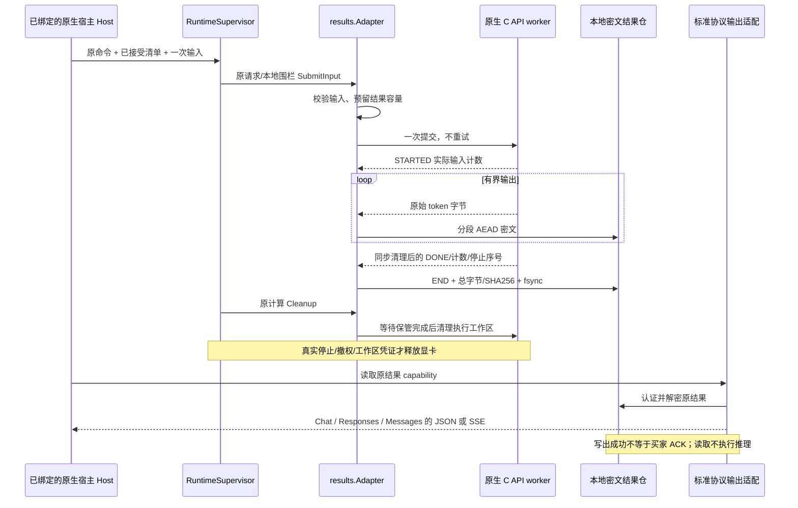

# 原生文本结果加密保管与标准协议交付 · R022

本增量落实 NB04 设计约束下的底层结果交付，不改变 C2C 角色、买卖双方原订单、三种交易模式或页面计量单位。个人卖家出租自己的闲置资源；平台不能用其他卖家/设备替换已经确认的履约方。GPU 租赁仍以小时计价；LLM 按输入、输出各自的 M token 费率计价。原始推理计数只是协议候选，不能直接入资金账。

本轮可运行源码覆盖 **PLAINTEXT / STANDARD 的原生纯文本结果保管与输出适配**。本地密文文件不等于买家到执行端的端对端加密，也不等于供给方不可见的 LP/PE。真实模型、GPU、隔离执行身份、正式 SDK 独立认证、完整外网内容传输、可信 usage、最终 ACK、收单/结算与完整组合验收均未完成。`execution_enabled` 继续为 false。

## 1. 模块与完整调用顺序

源码路径：`dev/src/client/results/`、`dev/src/client/protocol/textoutput/`、`dev/src/client/supervisor/text_output.go`、`dev/src/client/execution/result_binding.go`、`dev/src/client/node/host_agent.go`。这些是可信嵌入端口，没有自动启动的内容 HTTP 服务。

1. 初始化独立空结果目录 `runtime/…`，打开 `results.Store`。目录带独占标记；已有标记或孤儿密文时拒绝启动，交由显式恢复，不自动删除或重构密钥。
2. 可信安装/嵌入代码用 `results.New(approvedNativeAdapter, store)` 包装已批准的原生适配器，再把该包装对象放入原 HostKernel。
3. 继续沿原有 `Begin → Prepare → NewSupervisor → RunSupervised → ticket.Start` 路径提交。原输入只借用一次，返回时清空；恢复不能重送正文。
4. 结果抽取器独立排空内核输出。监督器 Cleanup 等待抽取器保管完毕或明确失败，再向原内核索取原清理凭证。
5. 原 `ticket.Output(ctx)` 查验持久 inbox 的原 lease/resource/local generation/manifest，返回独立读取能力。旧计算已释放或资源已被下一 owner 使用时，仍只定位旧结果。
6. `textoutput.Render(ctx, sink, output, limits)` 选择原清单中的协议和 stream 参数，消费认证后的结果。每条路径都关闭读者；默认不销毁原结果，允许在保留期内显式重读。
7. 所有者调用原请求的 `Discard`，或到期撤权，随后删除密文并销毁进程中的密钥引用。程序关闭必须分别关闭结果仓、监督器和底层内核；一个对象退出不能冒充其他对象已清理。

## 2. 编号约束

| 编号 | 约束 | 实现/验收边界 |
| --- | --- | --- |
| RC-001 | 结果 capability 绑定原请求、物理资源、本地 generation、环境、完整 manifest digest | 不使用当前 owner 反查替代原订单 |
| RC-002 | 原 Host / Supervisor / 已接受清单必须属于同一执行账本 | 不能通过任意 Work 形成对外授权 |
| RC-003 | 持久 inbox 在原提交后才允许结果绑定校验 | RECEIVED 状态拒绝；不授予执行资格 |
| RC-004 | 已释放资源和下一 owner 不覆盖旧结果身份 | 原 inbox 校验独立于 resources 当前持有者 |
| RC-005 | 包装器不能安装包、自批硬件或签发销售/资金资格 | 原 KernelRegistry / 许可门槛保留 |
| RC-006 | 只接收已批准的 PLAINTEXT/STANDARD 三个纯文本 profile | 不静默降为兼容内核，不开启 E2E/LP/PE |
| RC-007 | 原生 CheckInput 完成后才预留密文结果槽位 | 原模型/正文摘要/协议/输出上限校验沿用 |
| RC-008 | 每个原请求仅进入一次 native SubmitInput | 重读结果不重新推理；1024 原请求墓碑上限 |
| RC-009 | 准备中的 Query 为 UNKNOWN | 尚未完成的预检不能声明 ABSENT |
| RC-010 | 仅完成的入内核前拒绝可返回 ABSENT | 包含精确原 Work；缺内存记录/重启不能当作未执行 |
| RC-011 | 已进入 native Submit 后的错误按不明执行处理 | 原查询/取消/清理，不重提、不换卖家 |
| RC-012 | 关闭/保留期撤权要传播到正在提交的原请求 | 返回后再核撤权并取消原 native request |
| RC-013 | 默认 16 结果槽位，每结果物理密文预算 8 MiB，总预留 128 MiB | 全额预留包含头、分帧和认证标签 |
| RC-014 | 配置最多 32 槽位/每结果 32 MiB/总预算 512 MiB | 不允许槽位数 × 每结果预算超过总预算 |
| RC-015 | 默认保留 5 分钟，可配 1 秒—30 分钟 | 保留不能续推理租期/资金期限 |
| RC-016 | 默认排空宽限 5 秒，可配 100 毫秒—10 秒 | 从原 HardDeadline 加固定宽限，不从心跳滚动延后 |
| RC-017 | 每密文记录最多 65536 明文字节，最多 131072 记录 | 在分配/读取前验长、验序号 |
| RC-018 | 结果目录必须是绝对路径并拒绝符号链接替代 | 文件身份还须逐次开启验证 |
| RC-019 | 独占标记与空目录准入防止无声复用旧结果仓 | 异常退出需显式恢复；不自动清孤儿目录 |
| RC-020 | 磁盘文件只含固定头及 AEAD 记录 | prompt/正文/停止词/内容密钥不以明文落盘 |
| RC-021 | 每结果独立随机 256 位 AES-GCM 密钥 | 密钥仅进程内；丢失后不恢复、不重新推理 |
| RC-022 | 随机 nonce 前缀 + 单调记录序号 | 单密钥不重复 nonce；序号耗尽拒绝 |
| RC-023 | AAD 包含整个固定头和当前记录前缀 | 绑定原结果、防改类型、长度、次序及跨结果替换 |
| RC-024 | options、STARTED、TEXT、FINAL 顺序固定 | 额外记录、未知类型、重复/缺失序号均失败 |
| RC-025 | options 在密文中保存 include_usage 和原停止词 | 不扩展 UI/日志等元数据暴露面 |
| RC-026 | FINAL 包含输入/输出计数、原因、停止词序号、总字节和 SHA256 | 与抽取字节及 STARTED 交叉校验 |
| RC-027 | 仅完整文件 fsync 成功后才承认完整结果 | 不是断电持久性验收；不同文件系统仍待专项验证 |
| RC-028 | END 后不允许任何尾随字节，实际文件尺寸须一致 | 截断、加尾、调换头、密文篡改不得形成成功结果 |
| RC-029 | 单结果同时只允许一个读者 | 关闭后可显式重读同一 ResultID，不自动重连 |
| RC-030 | 已撤权读者停止继续供给明文 | 已交付给买家的字节无法追回 |
| RC-031 | 活跃读者未关闭不释放文件配额 | 到期先撤权，读者关闭后重试删除 |
| RC-032 | 文件删除失败继续占有配额，重复 Discard/Close 可重试 | 不把未知磁盘空间冒充可用容量 |
| RC-033 | 容量溢出/写盘失败取消原推理并继续排空 | 不积累无界内存；成功 END 不生成 |
| RC-034 | 抽取停止不等于真实推理已停止 | Query/同步清理凭证仍来自原 native adapter |
| RC-035 | 计算 Cleanup 与结果保管分别定义工作区 | 释放显卡不等待买家网络读取/最终 ACK |
| RC-036 | 原生输出原有 128 KiB 缓冲界限保留 | 不引入全量明文中间队列或逐 token fsync |
| RC-037 | 原生管道版本升级为 P11_LLAMA_PIPE_2 | 不兼容的旧 worker READY 拒绝，不猜测旧字段 |
| RC-038 | STARTED 新增实际输入 token 数 | 必须 >0 且不超过原输入上限 |
| RC-039 | DONE 新增匹配的原停止词数组序号 | 无匹配用 UINT32_MAX；命中时必须落在原列表内 |
| RC-040 | STARTED/DONE 输入计数必须一致 | 不符、未知停止序号和额外停止序号保持 UNKNOWN |
| RC-041 | 三个 profile 分别生成原生 JSON 与 SSE | 不把 Responses/Anthropic 偷换为 Chat |
| RC-042 | 原 token 片段允许切断 UTF-8 字符 | 增量拼接最多 3 字节尾片；非法/末尾截断失败 |
| RC-043 | Chat 最终 finish_reason 正确映射 stop/length | 不发工具调用、图片、音频等未实现字段 |
| RC-044 | Chat 流仅在原 include_usage=true 时发 usage | 普通 chunk usage=null，末尾 choices=[] 用量块，再 [DONE] |
| RC-045 | Anthropic message_start 使用实际 input_tokens | 输出初始 0；message_delta 是累计 output_tokens |
| RC-046 | Anthropic stop_sequence 返回实际命中的原字符串 | end_turn/max_tokens 时为 null，不猜测停止词 |
| RC-047 | Responses 事件序号单调且 item/content 索引固定 | created→item→part→delta→text.done→part.done→item.done→completed/incomplete |
| RC-048 | Responses 的 store=false 不变，最终全文与流式文本一致 | length 对应 incomplete/max_output_tokens |
| RC-049 | 默认 JSON 响应最多 512 KiB，单 SSE JSON 64 KiB，聚合文本 512 KiB | 参数最大分别 8 MiB/256 KiB/8 MiB；总 SSE 字节还受文本和有限事件数约束 |
| RC-050 | delta 按最坏 JSON 转义预算和 UTF-8 边界切片 | 不能用截断正文换取通过 |
| RC-051 | Responses 最终事件包含重复全文，会先触及 EventBytes | 激活前必须在能力预检中显式协商；本轮尚未接通该生产准入 |
| RC-052 | 全部终止事件先编码验限，再发送任何成功尾部 | 最终事件过大时不能先发 text.done 等部分终止序列 |
| RC-053 | 原生错误、无认证 END、UTF-8 错误或已知写入失败不得继续写成功尾 | 已写出的字节无法撤回；末次写入/flush 失败仍返回错误，不生成成功 Receipt 或可计费事实 |
| RC-054 | Sink 必须遵守 context 与有限写期限 | 泛用 io.Writer 不足；HTTP 包装不支持 SetWriteDeadline 则拒绝 |
| RC-055 | 渲染器每条路径关闭原读者 | 不等于删除原结果/撤销其他执行/确认买家接收 |
| RC-056 | Receipt 只说明本地写入端已接收哪些字节 | 不生成最终 ACK、trusted usage、结算资格或付款状态 |
| RC-057 | 本地错误为固定文案，不含正文、文件路径、密钥或停止词 | 不添加内容日志/普通面板预览 |
| RC-058 | 0600 与本地 AES-GCM 不能证明 Windows 私有身份 ACL/LP | 相同调用账号运行边界继续公开；清零为尽力处理，无可证明内存擦除声明 |
| RC-059 | 不使用虚拟化，不增设内核内容 localhost HTTP 服务 | Linux 仅 Go 交叉构建，未执行原生 C++/真实 GPU |
| RC-060 | 当前仅局部源码验收，全部 56 任务和 222 未收口子项保留 | 不以合成 ABI、控制端媒体或后续通过消除历史失败/实际业务待验收 |

## 3. 本地密文文件格式

这是进程内保管格式 `P11_LOCAL_RESULT_1`，**不能作为网络 E2E 信封或现有分块密文协议的替代品**。

| 区段 | 字节 | 含义 |
| --- | ---: | --- |
| 固定头 | 8 | `P11RES01` |
| 固定头 | 32 | 原 TextDescriptor 的 JSON SHA256，包括完整原清单和随机 ResultID |
| 固定头 | 8 | 每结果随机 nonce 前缀 |
| 记录前缀 | 1 | options=1、STARTED=2、TEXT=3、FINAL=4 |
| 记录前缀 | 4 | 从 0 开始的大端序号 |
| 记录前缀 | 4 | 大端明文字节数，分配前验限 |
| 记录正文 | N+16 | AES-256-GCM 密文和 16 字节标签 |

nonce 为 8 字节前缀 + 4 字节序号；AAD 为固定头 48 字节 + 记录前缀 9 字节。STARTED 明文为 4 字节输入计数。FINAL 明文为 56 字节：输入 u32、输出 u32、停止序号 u32、原因 u8、保留零字节 3、总正文 u64、正文 SHA256 32。所有整数为大端。

执行工作区、结果仓和协议写出分别有边界。结果密钥不落盘，所以重启后不能继续解密；失去内存记录的 Query 为 UNKNOWN，旧目录也不能原地重新初始化。运行中盘写或 fsync 的底层系统调用可能受原生存储阻塞，当前没有证明可强制取消该系统调用；清理只能保留资源并等待，不能伪造成功。因此本轮不把结果仓接成默认长期守护进程。

## 4. 协议事实与验证范围

协议依据：[OpenAI Chat 流式事件](https://developers.openai.com/api/reference/resources/chat/subresources/completions/streaming-events)、[OpenAI Responses 流式事件](https://developers.openai.com/api/reference/resources/responses/streaming-events)、[Anthropic 流式规范](https://platform.claude.com/docs/en/build-with-claude/streaming)、[Anthropic Messages 创建](https://platform.claude.com/docs/en/api/typescript/messages/create)。只实现项目现有纯文本字段档位；上游协议新增字段须显式修订后接入，不能推测支持。

17 项新增常规 Go 用例涵盖原结果跨清理保管、密文攻击、额度/保留期、关闭竞态、原绑定、错误终止和三协议 JSON/SSE。三协议 × 两种响应形式 × 三种停止原因经真实受控 HTTP 往返，再由既有严格转发器校验。另有 1 项新增构建标签测试，真实启动 Windows worker + 合成 C ABI DLL，逐一串接抽取、密文保管、清理、标准协议输出；该组共 6 项，与常规 275 项分开统计。

合成 ABI 没有模型权重或 GPU；严格转发器不是官方 SDK；上述验证不能证明真实 tokenizer/驱动性能、CUDA 停算、断电恢复或 LP/E2E。当前证据、首轮失败和所有完整待办见 [R022 验证报告](../../dev/tests/evidence/R022-验证报告.md) 与 [R022 全部待办](../../dev/progress/R022-本轮实现与完整待办.md)。

## 5. 下一阶段收口条件

接入真实批准模型和原生驱动后验证输出与取消；补齐独立执行身份及白名单文件/管道 ACL；在持久能力预检中约束 Responses 最终事件预算；接通原对象/授权结果通道及最终 ACK；独立官方 SDK 消费认证；验证本地吞吐、内存上限和存储故障；将经验证 usage 送入原订单计费与资金状态机。它们分别归 DEV-07/17/20/21/23/26/27/29/30/31/37/38/39/53/54/56，不属于本地写出 Receipt 的隐含能力。

## R023 固定包与真实内核增量

R023 新增 [NF-001—048](附录-真实原生LLM包校验与本机接入.md)：固定真实包、独立本机选择摘要、PIPE_3三库、只读kernel-inspect及本机CUDA小模型验证。包检查和测试不授予挂牌/执行、LP/E2E、可信用量、ACK或资金资格；CLI内容执行继续关闭。完整产品与性能验收仍待。

## R025 当前宿主与正文交接约束

以[NH-001—040](附录-原生宿主内核接线与输入驻留绑定.md)为当前装配、输入与结果句柄生命周期约束。R025接通独立批准的原生Host会话、原物理GPU与持久任务、加密结果仓和三协议交付；密文资产摘要保持原义，解密正文另以仅驻内存的原租约/清单/字节凭据校验。宿主拥有worker和结果读取句柄并在关闭时排空、撤权及等待退出，未知原owner不释放。当前限PLAINTEXT/STANDARD；生产资金/usage/ACK/SDK、崩溃恢复、完整LM Studio/ComfyUI/LMA、E2E/LP/性能与80/96完整验收仍待，全56任务222子项保持开放。
