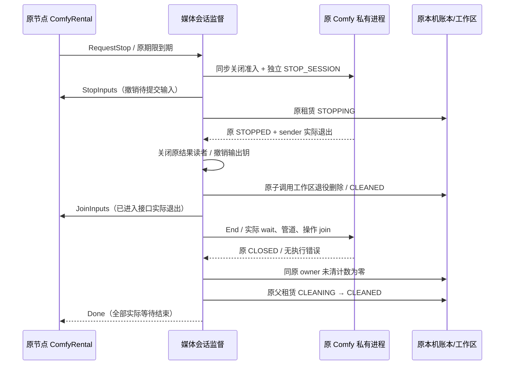

# 原租赁媒体会话监督与停止回收源码（MS-001—036）

本文承接 RN-001—110、CE-001—036、MW-001—044、CH-001—036 和 WS-001—030。当前为 R026 `CODE_FIRST / SOURCE_ONLY_UNVERIFIED`：新增生产源码、实际叶子适配接线和测试源码，尚未编译、测试或实际执行。源码检查点不代表本开发轮完成，全部 56 任务、222 子项仍待收口。

本附录将已有原租内媒体子调用接入节点持有的会话生命周期。租赁买卖双方、订单、合同、设备、物理资源代次、原环境及配方不变。GPU 按**小时**计费；LLM 输入、输出分别按 **M token** 计费。媒体调用仍在原 `RENTAL_SESSION` 内，不创建替代文本任务、attempt、按结果收费或假 usage。

## 1. 模块与持有关系

| 模块 | 生产源码 | 责任 |
|---|---|---|
| 原媒体会话监督 | `dev/src/client/rentalmedia/{types,runtime}.go` | 准备期/原授权/独立单调截止、唯一活动子调用、结果保留及原会话清理投影 |
| 真实 Comfy 叶子转换 | `dev/src/client/rentalmedia/comfy.go` | 将原 `RentalMediaAdapter`/`MediaCall`/`MediaCustody` 接入独立媒体类型，不伪装文本 Backend |
| 原节点会话 | `dev/src/client/node/rental_comfy_owned.go` | 打开前登记、准备启动、一次授权、最多一个未提交输入、本机 API 持有和结束等待 |
| 原生独立停工通道 | `dev/src/client/adapters/comfyworker/{process,media_session}.go` | 先关闭内容准入，再发私有控制帧；等待实际进程、管道及已进入操作退出 |
| 原环境引用 | `dev/src/client/comfyenv/use.go` | `Use.Join` 等实际原引用释放，取消不代替退出 |
| 原账本未清项 | `dev/src/client/execution/rental_outstanding.go` | 统计同一个当前 owner 的未清子调用/工作区，单独不构成停工证据 |
| 共用节点关闭 | `dev/src/client/node/rental_native.go` | 同时等待文本/媒体两个会话集合，实际退出前保留原节点锁、账本和主密钥 |

`OpenComfy` 是当前生产组合入口。原 `OpenPreparedComfy` 继续作为可信宿主的底层准备原语；它本身没有完整会话监督或本机 API/输入持有，不能用它直接宣称完整接入。

## 2. 完整编号与约束表

表中“源码已写”只描述代码状态。所有验收均未执行；末四项仍未完成生产接线。

| 编号 | 需求/约束 | 源码状态及具体行为 |
|---|---|---|
| MS-001 | 媒体独立类型 | `rentalmedia.Control/Backend/Child/Result/Reader`，不接受文本描述符、文本输出或外部 JSON 停工旗标 |
| MS-002 | 原主体与双围栏 | 构造时逐一核对 Hold、原准备摘要/批准摘要、环境/配方、原媒体 Policy；后续始终使用原 local generation |
| MS-003 | 节点先登记后启动 | 同一物理资源在文本/Comfy 两个集合互斥；合计资源上限，节点关闭/损坏时拒绝打开 |
| MS-004 | 原准备准入 | 仅原 PREPARING 和原准备截止可打开 Use；准备加载不等于平台 ready、支付或共享执行授权 |
| MS-005 | 失败启动可追踪 | 即使 `OpenPrepared` 返回错误但存在尚未退出的隐藏子进程，仍通过原 Use.Join 保持节点持有 |
| MS-006 | 节点持有生命周期 | 打开请求只控制打开阶段；成功后由节点持续持有，页面/HTTP 打开请求结束不会丢失运行所有权 |
| MS-007 | 先启动监督再授权 | 本机 Ready 仅表示监督器开始运行；不提交平台设备 ready，不增加可计费区间 |
| MS-008 | 一次原授权 | AttachControl→原签名 ALLOW→原 current→独立 Verifier→同一个私有 AUTHORIZE/ACK；缺一步不能接收输入 |
| MS-009 | 不替换付费条款 | 本入口授权一次；不同 grant/terms/hard deadline 不可覆盖同会话，付费续租继续走独立未完成门槛 |
| MS-010 | 独立单调截止 | 独立定时协程不等 SQL、scope 检查或控制交换返回；过期先撤权/停工，旧窗口不能被迟到 ALLOW 复活 |
| MS-011 | 原签名控制轮询 | 独立、有界的原控制交换；错误不推导 ALLOW，不创建新授权或重新锚定墙钟期限 |
| MS-012 | 原输入容量 | ComfyRental 最多一份尚未提交的密封输入，或一次正在封装的输入；已进入封装/API 均纳入节点等待 |
| MS-013 | 输入所有权 | SealMediaInput 在拒绝时也关闭已经转交的素材 Source；过期/撤回取消读取并等待实际返回，不留 detached reader |
| MS-014 | 本地密封内容 | 沿用 WS 的 RAM AES-GCM/有界分块；不记录原 prompt/内容钥。该本机密封不是网络 E2E 或卖方不可见证明 |
| MS-015 | 仅提交本人输入 | 节点只消费本会话持有的输入指针，先移出待提交集合；伪造/重复输入不能重发模型 |
| MS-016 | 原 inbox 只提交一次 | 每会话一个未清子调用，最多缓存 4096 原调用号；已出现的号仅查询，不能重新预留/启动 |
| MS-017 | 原子调用绑定 | 返回 Child 的原 ID、session、resource、local generation、grant/digest、密文摘要、配方与输入一致才接受 |
| MS-018 | 缺句柄保持未知 | Submit 已预留后丢失 Child 时，不能从 nil 推导 ABSENT 或释放；撤回后保持原 owner 等待独立恢复 |
| MS-019 | 停工先于账证 | RequestStop 同步禁止后续内容/授权，先触发独立原生控制，再写 STOPPING 或回收输入/输出 |
| MS-020 | 队列再次准入 | metadata 检查后、拿到写槽后、原生帧写入前重核停止闩；原生已进入 I/O 必须继续实际等待 |
| MS-021 | 独立控制与有限强停 | STOP_SESSION 使用独立管道、250ms 请求预算；最多等待实际进程 5s 后强停。强停不补造 CLOSED/停工证明 |
| MS-022 | 子调用取消 | 认证 CANCEL_SELF→同原调用 tombstone→原本机 STOPPING；取消 ACK 本身不推进 CLEANING |
| MS-023 | 实际 STOPPED 与 sender join | 必须原 Child.Observation STOPPED、原 backend ID 非空、Child.Done 实际关闭；UNKNOWN/ABSENT 均不能代替停工 |
| MS-024 | 成功结果保留 | 已停止的成功调用仍保留原结果，直到主动关闭/丢弃、保留期或撤权；子调用结束不释放父租赁 |
| MS-025 | 单一结果读者 | 每结果至多一次打开，Output 的值副本共享 opaque 状态；每次 Read/Seek 重核原 EXPORT_SELF 和当前授权 |
| MS-026 | EOF 与释放分离 | EOF 不自动关闭、ACK、计量或确认成交；Close 只释放本机读者持有，仍需原子调用清理 |
| MS-027 | 输入拥有者真实退出 | Runtime 调用 InputOwner.StopInputs，并在父租赁清理前等待所有输入钥撤销和已进入本机 API/setup 实际退出 |
| MS-028 | 关闭钩子可重入 | sync.Once 只关闩和收集引用；外部生命周期钩子在 Once 返回后调用，避免 Runtime 与节点相互撤回死锁 |
| MS-029 | 完整原会话证据 | 原子调用/工作区均清理、结果钥撤销、实际进程/管道/操作退出、真实 CLOSED 且无 native error，才构造本机证明 |
| MS-030 | 原会话清理 CAS | 原 STOPPING→CLEANING→CLEANED，所有原 grant 撤回；只解除本机物理占用，不释放平台资金或结算资格 |
| MS-031 | 超时继续持有 | 调用方 Close 超时不关闭 Done；后台实际等待并保留节点 OS 锁/主密钥/账本/原环境引用 |
| MS-032 | 两类会话统一排空 | 节点关闭等待 NativeRental 与 ComfyRental；内核/媒体 Owner 重初始化时也拒绝两个集合存在的情况 |
| MS-033 | 公开兼容媒体交付 | **待接线**：OpenAI/Anthropic 兼容请求、实际媒体响应/本人资产、受限范围读取、最终 ACK；不开放原生私有管道给买方 |
| MS-034 | 平台付费租赁闭环 | **待接线**：独立双方 ready、可信小时可用水位、付费续租/断线、平台停工回报/原号恢复/资金释放；本机 Ready/CLOSED 均不能代替 |
| MS-035 | 真实完整内核与资格 | **待完成**：实际 Python/Torch/codec/node/model/recipe 包、受限系统身份、跨系统真实进程/驱动/GPU/性能、E2E/LP 资格及崩溃后独立物理对账 |
| MS-036 | 全量代码后统一验证 | **待完成**：全部 56/222 剩余生产代码和依赖/测试源码后统一编译、测试、调试、组合验收。DEV-55 延后，增强档无证明关闭 |

## 3. 生产调用顺序

1. 在原节点打开已批准的内核登记及媒体 Owner，创建原 ProviderRental。批准计划和私有进程的环境、原 GPU UUID/PCI、配方都由原准备清单固定。
2. 调用 `ProviderRental.OpenComfy(ctx, plan, selection, policy, options)`。节点在加载前记下会话，取得原 Use，打开私有进程，绑定原工作区/媒体适配器，再启动媒体监督。
3. 在原平台准备和资金流程允许时调用 `ComfyRental.Authorize(ctx, verifier, credential, approved)`。凭据只在本机验证/使用；原 SQLite 不落 Bearer、prompt 或内容钥。
4. 买方原请求经后续公开兼容入口归一化后，交由 `SealMediaInput` 接收参数及有界素材，再 `Invoke`。当前本机 API 不自动开启 HTTP、修改系统代理、下载模型或安装节点。
5. 用相同原认证调用 `Query`、`Cancel`、`Output`、`DiscardResult`。打开的 Output 提供带 context 的 Read/Seek/Close；调用者必须显式 Close，不能以读到 EOF 代替确认。
6. 授权到期、原平台撤权、提供方停止或节点关闭都会触发同一停止链。正常子结果释放后可清理该子调用并在原租期内接收后续调用；父租赁持续占用。
7. 会话终止后，先等未提交输入及已进入本机 API，再验证实际叶子停止/工作区/输出钥证据，最后投影原本机父租赁清理。缺证据保留隔离，不切换卖家、设备、模型、CPU 或隐私档。

这是可信宿主 Go API 的调用顺序，公开 SDK/用户界面接线仍属于 MS-033/034。不是可直接运行的端到端使用宣称。

## 4. 撤权及实际等待顺序

存在卡住的读取、系统调用、进程或控制交换时，独立停止闩仍生效，但 Done 和原节点资源不会提前释放。后台等待是真实拥有者的一部分；不能用新会话绕开它，也不能从 PID 不见、nil 句柄、HTTP 取消确认或计数为零补造物理证明。

## 5. 结果、内存及时间边界

| 项目 | 当前源码边界 |
|---|---|
| 同一媒体会话 | 一个未清子调用；清理后允许原租期内下一次调用 |
| 未提交本机输入 | 最多一份或一次正在封装；拒绝额外素材并关闭已经转交的 Source |
| 参数/素材/输出 | 沿用 WS：参数 1MiB、最多 4 素材/合计 64MiB、输出上限 64MiB、64KiB 分块；原工作区预留 130MiB、总未清配额 2GiB |
| 结果持有 | 默认 5 分钟，可设 1 秒—30 分钟；原授权/租赁期限优先，保留期不延长租期 |
| 元数据轮询 | 默认 200ms，可设 10ms—1s；原签名控制轮询默认/上限 10s，下限 100ms |
| 元数据/后端短调用 | 各默认 2s，范围 20ms—5s；会话结束证据使用剩余整体关闭期限 |
| 会话关闭预算 | 默认 12s，允许 1—40s；超时不是放锁条件，后台继续等实际退出 |
| 原生停工 | 独立控制写 250ms，实际退出等待 5s 后强停；管道部分写入失败可直接使原流 UNKNOWN |
| 密钥/读者 | 结果句柄副本共用一次关闭状态，原进程最终退出会撤销结果托管；原 Use.Join 在目录关闭/引用移除后返回 |

上述上限来自源码设计，不是性能、GPU 占用或内存占用实测结论。没有启动 ComfyUI、加载模型、安装包、执行 SQL 迁移或测试真实设备。

## 6. 本机清理证据的含义

`RentalOutstanding` 只按当前原 owner 读取未清调用和工作区数量；跨 owner/代次拒绝。它不观察物理 GPU，零计数也不能单独进入清理。

实际 Comfy Backend 的 `End` 还要求所有原子调用清理、实际 CLOSED、无 native error/失败帧、原进程和管道退出、适配器已进入操作退出、原结果托管撤销。返回的 `MediaSessionProof.ManifestHash` 是用于本机清理账证的**原作用域清理摘要**，不是替换原准备清单摘要。运行时构造时和每次状态读取仍独立核对原准备及批准摘要。

这些是可信本机叶子的证据投影，不是对恶意设备所有者的远程证明；不改变 STANDARD/基础 E2E/增强档的隐私标签。缺独立物理崩溃恢复与完整平台回报接线时，不从重开 SQLite、进程缺席或旧证明恢复授权。平台资金释放、可信计时水位及结算仍须独立业务证据。

## 7. 源码检查点及后续

新增实现编号为 `IMP-R026-046—050`；新增测试只写定义，由当前增量整理器生成 MS-T 索引。RN/CE/MW/CH/WS 历史源码和未验证状态保留，不重新运行旧整理器覆盖。双语 README、系统说明、完整 56/222 表随本检查点同步。

本次没有新增或修改 SQL。已发布平台双份 001—015、端侧 schema.sql/host-schema.sql/native002/native003 及其 source.json 原字节保持，后续只追加前向版本。继续禁止 Docker/WSL/QEMU/模拟器等本地虚拟化；本阶段不启动编译/测试/核验器/数据库/引擎/浏览器/真机。全部代码齐备后再统一验证。

## MS 测试源码定义索引

| 编号 | 测试定义 | 源码 | 状态 |
|---|---|---|---|
| MS-T001 | TestMediaSupervisorRejectsForeignLocalPolicyBeforeAdmission | dev/src/client/rentalmedia/runtime_test.go | 未编译/未运行 |
| MS-T002 | TestMediaSupervisorPreservesOriginalRentalAndQueryOnlyReplay | dev/src/client/rentalmedia/runtime_test.go | 未编译/未运行 |
| MS-T003 | TestMediaSupervisorRetainsParentUntilResultIsExplicitlyReleased | dev/src/client/rentalmedia/runtime_test.go | 未编译/未运行 |
| MS-T004 | TestMediaSupervisorCopiedOutputClosesOneOwnedReader | dev/src/client/rentalmedia/runtime_test.go | 未编译/未运行 |
| MS-T005 | TestMediaSupervisorEOFDoesNotForgeBuyerAcceptanceOrRelease | dev/src/client/rentalmedia/runtime_test.go | 未编译/未运行 |
| MS-T006 | TestMediaSupervisorExpiryRevokesOpenOutputBeforeCleanup | dev/src/client/rentalmedia/runtime_test.go | 未编译/未运行 |
| MS-T007 | TestMediaSupervisorFailedStoppedChildNeedsNoInventedOutput | dev/src/client/rentalmedia/runtime_test.go | 未编译/未运行 |
| MS-T008 | TestMediaSupervisorCancelAcknowledgementAloneCannotClean | dev/src/client/rentalmedia/runtime_test.go | 未编译/未运行 |
| MS-T009 | TestMediaSupervisorDeadlineStopsBeforeBlockedControlExchangeJoins | dev/src/client/rentalmedia/runtime_test.go | 未编译/未运行 |
| MS-T010 | TestMediaSupervisorLateControlCannotReviveExpiredMonotonicWindow | dev/src/client/rentalmedia/runtime_test.go | 未编译/未运行 |
| MS-T011 | TestMediaSupervisorMissingChildAfterReservationRetainsOriginalOwner | dev/src/client/rentalmedia/runtime_test.go | 未编译/未运行 |
| MS-T012 | TestMediaSupervisorBadSessionProofCannotReleaseParent | dev/src/client/rentalmedia/runtime_test.go | 未编译/未运行 |
| MS-T013 | TestMediaSupervisorSuccessfulSyntheticSessionUsesOriginalCleanupCAS | dev/src/client/rentalmedia/runtime_test.go | 未编译/未运行 |
| MS-T014 | TestMediaSupervisorWaitsActualBackendJoinAfterCallerTimeout | dev/src/client/rentalmedia/runtime_test.go | 未编译/未运行 |
| MS-T015 | TestMediaSupervisorUnsubmittedInputOwnerMustJoinBeforeParentRelease | dev/src/client/rentalmedia/runtime_test.go | 未编译/未运行 |
| MS-T016 | TestMediaSupervisorCannotReplaceInputOwnerAfterWatchStarts | dev/src/client/rentalmedia/runtime_test.go | 未编译/未运行 |
| MS-T017 | TestMediaSupervisorEnteredSubmitKeepsDoneAndOwnerUntilActualReturn | dev/src/client/rentalmedia/runtime_test.go | 未编译/未运行 |
| MS-T018 | TestComfyMediaStopLatchesBeforeControlAndCannotExtendDeadline | dev/src/client/adapters/comfyworker/media_session_test.go | 未编译/未运行 |
| MS-T019 | TestComfyMediaChildSuccessRequiresActualStopAndSenderJoin | dev/src/client/adapters/comfyworker/media_session_test.go | 未编译/未运行 |
| MS-T020 | TestComfyMediaEndRefusesUncleanedOriginalChildBeforeProcessClose | dev/src/client/adapters/comfyworker/media_session_test.go | 未编译/未运行 |
| MS-T021 | TestComfyUseJoinCannotTreatCancellationAsActualClaimRelease | dev/src/client/comfyenv/use_join_test.go | 未编译/未运行 |
| MS-T022 | TestComfyUseUnclaimedCloseReleasesJoinAndZeroUseCannotForgeIt | dev/src/client/comfyenv/use_join_test.go | 未编译/未运行 |
| MS-T023 | TestNodeComfyInputDiscardKeepsForeignEnvelopeAndRevokesOriginal | dev/src/client/node/rental_comfy_owned_test.go | 未编译/未运行 |
| MS-T024 | TestNodeComfyStopInputsWaitsEnteredLocalSetupBeforeJoin | dev/src/client/node/rental_comfy_owned_test.go | 未编译/未运行 |
| MS-T025 | TestNodeCloseJoinsBothNativeAndComfyOwnersBeforeMasterRelease | dev/src/client/node/rental_comfy_owned_test.go | 未编译/未运行 |
| MS-T026 | TestRentalOutstandingBindsOriginalOwnerAndKeepsStoppingChildren | dev/src/client/execution/rental_outstanding_test.go | 未编译/未运行 |
| MS-T027 | TestRentalOutstandingZeroDoesNotCreateSessionStopEvidence | dev/src/client/execution/rental_outstanding_test.go | 未编译/未运行 |

## R026 MG-001—036 原租赁媒体入口与加密缓存源码 / Original-rental media gateway source

R026新增[MG-001—036](附录-原租赁媒体兼容入口与加密缓存源码.md)：原租赁本机STANDARD媒体入口、Images/明确旧版Videos/WAV speech/Responses资产映射、严格请求/独立scope、AES-GCM暂存/原HMAC幂等/提交前缓存配额、完整认证结果后加密缓存/本人单Range和原节点真实join源码。37项新增测试定义均未编译/运行。公开SDK/网络监听/E2E媒体传输/最终ACK、双方ready/可信小时计量/付费续租/物理停工对账/平台资金释放、完整实际配方/低权限/性能仍待。全部56任务222子项开放；无SQL变更或迁移。完整生产代码/实际依赖/测试源码齐备后统一验证，本次不是开发轮完成。
