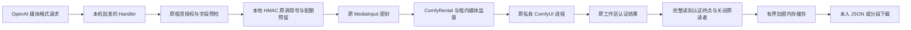

# 原租赁媒体兼容入口与加密缓存源码

状态：`CODE_FIRST / SOURCE_ONLY_UNVERIFIED`，2026-11-06。本文记录 MG-001—036 的需求、生产接线和后续资格门槛。源码已写不表示已编译、测试、运行推理、完成 SDK 兼容或允许挂牌。当前不启动监听器、数据库、模型、GPU、APK、手机或浏览器，也不执行迁移或核验器。全部 56 任务、222 子项继续开放。

本入口承接 [MS 原租赁媒体会话监督](附录-原租赁媒体会话监督与停止回收源码.md)、[WS 原媒体工作区](附录-租内媒体工作区与结果托管源码.md)和[统一协议要求](../协议/统一API与本地加密网关需求.md)。本次没有 SQL 变更；平台 001—015 双份迁移以及已发布端侧 DDL、native002/native003 和来源记录保持原字节。

## 1. 交付边界与生产连接

`dev/src/gateway/media/` 实现一个由原节点持有的本机 HTTP Handler，承载批准的 OpenAI 媒体请求格式。它不自行选择卖家，不新建文本 T1 任务或另售作品，不下载模型、安装节点、启动引擎或创建监听端口。执行仍是 `GPU_RENTAL / STANDARD / COMFYUI` 下的原 `RENTAL_SESSION` 子调用，沿原订单、买家、卖家、设备、物理资源和双围栏进入同一私有 Comfy 叶子。

可信宿主先完成原准备、完整环境/配方批准和 `ComfyRental.Authorize`，再调用 `ComfyRental.OpenMediaGateway`。节点覆盖调用方传入的 Prepared、Policy、Session、原生命周期和停止钩子，实际端口固定为原 `ComfyRental` 的核验、密封、调用、状态、导出、取消和丢弃接口。映射配置来自可信宿主的独立批准记录，不能由请求正文或 URL 指定；当前没有完成该记录的产品 UI、平台能力发布或网络接入。



这条链路不是平台公开 Base URL、远程 SDK 发布、网络端对端加密、硬件增强隐私或 Android 接入。普通节点本机内存和执行链仍由设备所有者控制，原始 prompt 在解析和推理期间必然存在于内存；本地缓存加密不能改变这一点。

## 2. 完整编号与约束表

| 编号 | 需求与边界 | 本次源码行为或未完成门槛 |
|---|---|---|
| MG-001 | 原节点组合入口 | `OpenMediaGateway` 绑定实际原会话；拒绝未授权、正在关闭或重复打开 |
| MG-002 | 原主体与双围栏 | Prepared/Policy/manifest/approval/recipe、原工作流、原授权和本地代次沿用；不跨卖家、设备或隐私档回退 |
| MG-003 | 本地独立映射 | 明确 profile、原工作流 model、prompt/尺寸/时长/声音/图片槽位和固定默认值；不收任意 graph 或安装命令 |
| MG-004 | 映射不可歧义 | 槽位唯一、默认值有限且不能覆盖槽位；只接受字符串/数值，克隆配置后使用 |
| MG-005 | 图片格式 | Images generations JSON、edits multipart，单张 PNG；`n=1`，不接多图批量或流式图像 |
| MG-006 | 旧视频格式 | 冻结 legacy Videos 子集，必须明确批准；自己的工作流别名，不冒称可调用当前 Sora 服务 |
| MG-007 | 时长映射 | `4/8/12` 秒；批准的 seconds 槽位，或 frames=seconds×固定 FPS 并同时写入 FPS 槽位；不得把秒当帧或暗加偏移 |
| MG-008 | WAV 语音 | Audio speech 只接受明确 `wav`、批准声音和 speed=1；不把默认 MP3 请求静默变成 WAV |
| MG-009 | 音频与 3D 资产 | Responses background + 固定严格 JSON schema，返回本人 file_id、MIME 与字节数；不发明官方 3D 路径 |
| MG-010 | 协议隔离 | 不把 Anthropic Messages 当媒体生成接口；既有文本协议继续沿独立文本入口 |
| MG-011 | 请求身份 | 每个请求验证同一个原 Bearer；model 列表也需本人权限；不接 Cookie 或另一套 API key |
| MG-012 | 操作 scope | INVOKE、QUEUE_SELF、EXPORT_SELF、CANCEL_SELF 分别检查；同步返回和异步返回所需附加权限在提交前核验 |
| MG-013 | 本机请求边界 | Host/Origin 明确白名单；拒绝绝对形式 URL、重复关键头、编码路径歧义、代理头和 SSE Accept |
| MG-014 | 严格 JSON | 最多 2 MiB，拒绝重复键、未知字段、null 歧义、原始 graph、路径、远程会话和未支持格式 |
| MG-015 | 有界 multipart | 有界流读取，不调用 ReadForm、不写明文临时文件；最多 12 部分，单标量 64 KiB、单 PNG 64 MiB |
| MG-016 | 输入图片边界 | 只接 PNG；头部尺寸上限与像素数预检，拒绝外部 URL/file_id；不以客户端文件名构建路径 |
| MG-017 | 加密暂存 | 独立随机 AES-256-GCM 钥、64 KiB 分块和序号 nonce；错误、消耗和关闭时清理拥有的缓冲 |
| MG-018 | 原输入交接 | 暂存读取时逐块消费，再由原 MediaInput 密封；原封装接口接管资产 Source，失败也关闭 |
| MG-019 | 幂等键绑定 | 本机随机钥 HMAC 绑定规范参数、响应格式和资产明文字节；同键同正文只查询原调用，改正文返回冲突 |
| MG-020 | 原调用上限 | 至多 4096 条原记录，随机无键调用号；失败/未知不自动换键、重派或重新生成 |
| MG-021 | 提交前结果配额 | 每次新调用先预留 Policy 的最坏输出长度；总缓存有效载荷上限 64 MiB，容量不足在 Seal/Invoke 前拒绝 |
| MG-022 | 原结果状态 | 区分 durable phase、实际 STOPPED、实际成功和结果可读；取消 ACK 不等于停止，查询不确定不销毁缓存 |
| MG-023 | 完整认证后提供下载 | 原输出从头完整读到认证终点、验证实际长度/类型头并关闭原读者后，才建立可重复缓存 |
| MG-024 | 缓存生命周期 | 结果首次完成锚定保留期；查询和下载不续期，过期清缓存钥并保留原键墓碑，不能重新生成 |
| MG-025 | 图片结果 | 返回有界 b64_json 或配置的本人认证 URL；URL 不含 Bearer，不是匿名公开链接 |
| MG-026 | 单范围下载 | 本人 file/video content、单个 bytes Range、206/416 与明确长度；多范围、If-Range、缩略图等拒绝 |
| MG-027 | 导出独立权限 | 缓存/未缓存导出均走 EXPORT_SELF，逐块重核；不会为导出暗中要求 QUEUE_SELF |
| MG-028 | 本人异步资源 | Videos/Responses 只展示原资源；无伪进度、无原 prompt 回显、无伪 usage；取消后只在实际停止时宣告 cancelled |
| MG-029 | 有界 I/O | 总时限、逐写时限、有限并发和单上传；取消打断 Body，加入实际回调后再归还 HTTP 资源 |
| MG-030 | 断流与错误 | 写出失败不补成功 JSON 尾；ServeHTTP 必要时中止响应；Outcome 只是本地写事实，不是买家 ACK |
| MG-031 | 原节点关闭 | 停准入与原私有执行，等待实际 HTTP、暂存、缓存和过期协程结束后清钥；超时保持 owner 未完成 |
| MG-032 | 测试源码与工程边界 | 合成夹具移入模块内 testsupport，旧 client/internal 门面保留；定义边界用例，不运行或冒充硬件证据 |
| MG-033 | 完整公开 SDK/传输 | 待接平台已确认路由、网络监听与生命周期、正式客户端版本契约、E2E 媒体传输和最终 ACK；当前只完成本机 STANDARD Handler 源码 |
| MG-034 | 收费与可售资格 | 待独立双方 ready、可信小时区间、付费续租、真实渠道、物理停工对账与平台资金释放；没有按作品、调用或 token 给租内媒体加费 |
| MG-035 | 实际环境资格 | 待完整引擎/模型/节点归档、真实输出尺寸/时长/格式、OS 受限身份、内存/性能、Linux/Android/设备组合资格；仅头部预检不算完整解码 |
| MG-036 | 全量代码后验证 | 全部生产代码、实际依赖接线、测试源码齐备后统一编译、测试和调试；全 56/222 与 80/96 产品验收仍开放，DEV-55 延后 |

MG-001—032 为本次源码记录；MG-033—036 保留未完成。所有编号均未验收。测试定义索引由本次专用整理器生成，不表示用例运行。

## 3. 请求档位和默认行为

| 本机档位 | 请求入口 | 模型与结果 | 必须明确的限制 |
|---|---|---|---|
| `P11_OPENAI_IMAGES_RENTAL_1` | POST `/v1/images/generations`、`/v1/images/edits` | 原批准 workflow_id；PNG 的 b64_json 或本人 URL | 单图；PNG；尺寸来自映射白名单；默认 b64_json；不默认支持 GPT-image 全字段 |
| `P11_OPENAI_VIDEOS_LEGACY_RENTAL_1` | POST `/v1/videos`、GET `/v1/videos/{id}`、GET `/v1/videos/{id}/content` | 原工作流；冻结旧 Video 对象结构与 MP4 content | 必须显式 legacy 批准；秒数 4/8/12；原子集尺寸四选；只有 variant=video |
| `P11_OPENAI_SPEECH_RENTAL_1` | POST `/v1/audio/speech` | 原工作流与批准 voice；WAV 字节 | 明确 response_format=wav，最多 4096 字符且受总字节上限约束；speed 只允许 1 |
| `P11_RESPONSES_ASSET_RENTAL_1` | POST `/v1/responses`、GET `/v1/responses/{id}`、POST `/v1/responses/{id}/cancel` | 原工作流；background response 的结构化资产文本 | GLB 或 WAV；固定 schema；background=true、store=true；拒绝任意工具/会话/事件流 |

`GET /v1/models` 只返回此 Handler 绑定的一个工作流别名，需 QUEUE_SELF；`created=0` 是未知发布时间占位，不是已发布证据。Images、Speech、Assets 的 `GET /v1/files/{file_id}/content` 只导出同一个 Handler 的原结果；不接受系统文件名、原生 backend_id 或外部 file_id。

视频尺寸只接受批准集合与以下冻结集合的交集：`720x1280`、`1280x720`、`1024x1792`、`1792x1024`。真实配方不能生成这些尺寸/时长时应保持该组合关闭，不能改写结果元数据来假装支持。帧数模式例如 4 秒 × 24 FPS = 96 帧，同时写入固定 FPS 槽位；实际模型可能有 4n+1 等限制，此时需另行批准并实现正确的配方，当前不会暗补一帧或修改用户秒数。

2026-11-06 阅读官方 [Videos create](https://developers.openai.com/api/reference/resources/videos/methods/create)、[retrieve](https://developers.openai.com/api/reference/resources/videos/methods/retrieve)、[content](https://developers.openai.com/api/reference/resources/videos/methods/download_content) 时，页面已标注 Sora API 于 **2026-09-24 关闭**。因此本项目只将其作为需明确选择的旧格式兼容，不能写“当前官方 Sora API 可用”。[Images](https://developers.openai.com/api/reference/resources/images/methods/generate) 和 [Audio speech](https://developers.openai.com/api/reference/resources/audio/subresources/speech/methods/create) 也只参考已列出的字段，不承诺所有官方模型、SDK 默认值或未来版本均兼容。

## 4. 原权限、重放与缓存

| 动作 | 提交/读取前所需原 scope | 状态改变的范围 |
|---|---|---|
| 图片/语音同步创建 | INVOKE + EXPORT_SELF | 只创建一次原子调用并读取其结果 |
| 视频/资产异步创建 | INVOKE + QUEUE_SELF | 只创建一次并返回原资源元数据；完成后取结果仍需 EXPORT_SELF |
| 查询资源/列模型 | QUEUE_SELF | 查询；若需要完整物化成功结果，会独立重核 EXPORT_SELF；无该权限不破坏原结果 |
| 下载/Range | EXPORT_SELF | 只读取原缓存；无缓存时用 ExportStatus 观察同一原调用，不借 QUEUE_SELF |
| Responses cancel | CANCEL_SELF + QUEUE_SELF | 请求取消原执行并查询原状态；不将取消回包当停工证明 |

Bearer 不进入资源 URL、响应元数据、日志或本机幂等表。Handler 生命周期内使用独立随机 HMAC 钥；进程重启丢钥后不恢复旧幂等授权，不自动重新调用。原生持久调用记录仍由原 ledger 管理；公开网络入口的持久恢复和原号协调仍属于 MG-033。

最坏输出配额在调用前预留。完成后可缩到实际缓存字节；失败/过期只释放本机缓存计数，不释放 GPU owner、合同预算、资金或小时计量。查询暂时失败/授权暂不可用保留原条目；只有真实失败、取消后实际停止、缓存失效等确定状态才清理相应缓存。仍未知的原执行必须由原会话监督继续持有。

缓存以每对象随机钥和序号绑定的 AES-GCM 分块保存于内存；正文从不作为本层临时文件落盘。结果源先完整认证，再允许重复 Range 读取；每次只解一个 64 KiB 块，不把未认证的原生 seek/部分输出直接对外转发。首次完成时间固定保留期限，默认 5 分钟，可批准 1 秒—30 分钟；原租赁到期/撤权可提前关闭整个 Handler。

## 5. 使用逻辑与请求例

以下是源码合同示例，不是当前已启动的服务、可用卖家、付费授权或运行证据。Base URL、原 Bearer、工作流别名和白名单均由已确认的原路由/可信宿主提供。正文不加入买家自填 seller/order 或引擎路径。

图片：批准 workflow 为 `portrait_png` 且尺寸包含 1024x1024 时：

```json
{"model":"portrait_png","prompt":"清晨的山间小屋","size":"1024x1024","n":1,"response_format":"b64_json","output_format":"png"}
```

若选择 URL，则配置宿主批准的同 Host PublicBaseURL；后续下载仍需同一个有效原 Bearer。最坏 PNG 输出不能在 2 MiB JSON 内编码时，b64_json 在提交前拒绝；由调用者明确选择 URL，程序不悄悄转换响应格式。

旧视频：批准原 workflow `short_motion`，且明确启用 legacy 档位时：

```json
{"model":"short_motion","prompt":"固定镜头下雨滴落入水面","seconds":"4","size":"1280x720"}
```

创建返回自己的 `video_<id>`，之后按原 id 查询/下载。只在原执行实际停止、成功输出完整认证并建立缓存后返回 completed/100%；执行过程中 progress=0 表示没有可信百分比，不伪造平滑进度。输入图仅支持批准的单个 PNG multipart `input_reference`，或 JSON 内 `data:image/png;base64,...`；不抓取任意远程 URL。

语音：

```json
{"model":"speech_wav","input":"你好，欢迎使用共享算力。","voice":"approved_voice","response_format":"wav","speed":1}
```

音频/3D 资产：

```json
{
  "model":"shape_glb",
  "input":"一个低多边形花盆模型",
  "background":true,
  "store":true,
  "text":{"format":{
    "type":"json_schema","name":"mesh_asset_v1","strict":true,
    "schema":{
      "type":"object","additionalProperties":false,
      "properties":{"file_id":{"type":"string"},"mime_type":{"type":"string"},"bytes":{"type":"integer"}},
      "required":["file_id","mime_type","bytes"]
    }
  }}
}
```

完成后 `output[].content[].text` 是 schema 指定的资产引用 JSON；`usage=null`，不是文本 token 计费。`store=true` 在此子集中只表示原 Handler 有期限的本机资源保留，不是官方平台永久会话或跨进程恢复承诺。

## 6. 内存、I/O、停止与失败细则

| 边界 | 当前源码值 | 含义与实际验证限制 |
|---|---|---|
| JSON | 2 MiB | 读入后严格解析；prompt 默认上限由 Mapping 明确设置且不超过 64 KiB |
| HTTP 请求头 | 16 KiB | Handler 累计检查；真正网络服务还必须在分配前配置相应 Header 限额 |
| multipart | 66 MiB 读取预算、12 部分 | 使用标准库 multipart 的独立头部上限，不宣称每部分头只有 16 KiB；标准库头解析可额外占约 10 MiB |
| 输入资产 | 单 PNG 最多 64 MiB | 预检宽高 <=8192、像素数 <=16777216；这是头部预检，实际解码/展开由原配方资格另验 |
| 输出缓存 | 所有条目有效载荷合计 64 MiB | 不含 GCM tag、slice/metadata、GC 留存、私有内核内存；原生输出实际长度受 Policy 更小上限约束 |
| 明文 scratch | 每读者 64 KiB | 另有有界 JSON/string 解析、类型头和短暂密封缓冲；不声称内存中完全没有明文 |
| HTTP 并发 | 默认 2，可批准 1—4 | 当前单个上传/提交链；HTTP 并发不增加原 GPU 并发或突破一个原活动子调用 |
| 请求总时限 | 默认 90 秒，1 秒—10 分钟 | 不能突破原 hard deadline；轮询、完整缓存和写出都受此界限 |
| 单写时限 | 默认 5 秒，20 毫秒—10 秒 | ResponseController 必须真正支持读写期限，否则拒绝承载 |

加密暂存被消费后立即清零并撤销旧块引用，但 Go 回收不等于立即归还进程内存；旧/新密封块可短时同时占堆。单上传、缓存容量和分块限制只给出源码预算，不能代替整机峰值、GPU 吞吐和低内存验证。大量视频和高分辨率资产超限应明确拒绝，不默认解压/转码或 CPU 回退。

原节点关闭先关闭新内容准入，再请求原私有进程停工，并取消 HTTP 读写。Handler 归属的实际请求、Body 关闭回调、过期协程及缓存清理全部结束后才发出自身 Done；节点把它加入 InputOwner.Join，父层不会因为等待超时就释放主钥、ledger 或物理 owner。强杀、CLOSED、实际进程退出和平台解除隔离继续沿 MS/WS 的独立证据门槛。

已通过 CANCEL_SELF/QUEUE_SELF 前置检查的取消意图使用独立原子标记发布，不等待下载持有的缓存锁或原生取消回包。后续导出分块、缓存物化和图片成功尾均检查该标记；已进入底层写操作的字节不能撤回。原生取消返回 UNKNOWN 时也保持本机导出撤回，但不会因此把资源宣告为实际停止或释放物理 owner。

错误在写头前返回有界标准 JSON；部分二进制/base64 写出后失败则中止，不追加成功尾、第二个 JSON 或空 200。取消请求成功、缓存建成、HTTP Complete、Content-Length 写完都不是买家最终接受、可信 usage、付费小时或平台资金释放。

## 7. 源码索引与后续工作

| 源码 | 责任 |
|---|---|
| `dev/src/gateway/media/mapping.go` | profile、批准映射约束和原 Session 端口 |
| `request.go` / `ingest.go` | 严格公开请求、有限规范参数、输入加密暂存 |
| `service.go` | 原调用 HMAC、提交前配额、完整结果缓存和 owner 生命周期 |
| `http.go` / `response.go` | 身份/Host/Origin、路由、错误、资源对象、Range/base64 有界写出 |
| `dev/src/client/rentalmedia/status.go` | 原调用查询和独立导出状态；不把 ACK/metadata 当实际停止 |
| `dev/src/client/node/rental_media_gateway.go` | 绑定实际原 ComfyRental，替换外部可伪造的 Session/生命周期 |
| `dev/src/internal/testsupport/rentaltest/` | 仅测试合成身份与 metadata；禁止生产导入，不构成实际引擎证据 |

下一步继续全量生产源码：原确认路由/媒体上传下载/公开 SDK 和加密传输、最终 ACK/独立保留、双方 ready/可信小时计量/付费续租/物理停工对账、真实内核包/配方/设备资格以及其余 56/222 接线。测试源码与这些生产接线齐备后再统一进入编译、测试、调试与真实组合验收；不因本附录而开启 DEV-55 或增强隐私标签。

## MG 测试源码定义索引

| 编号 | 测试定义 | 源码 | 状态 |
|---|---|---|---|
| MG-T001 | TestMediaMappingCannotBorrowAnotherPreparationOrRecipe | dev/src/gateway/media/media_test.go | 未编译/未运行 |
| MG-T002 | TestMediaVideosRequireExplicitLegacyApprovalAndPublishedSizes | dev/src/gateway/media/media_test.go | 未编译/未运行 |
| MG-T003 | TestMediaMappingCopiesOwnerChoicesAndRejectsDuplicateSlots | dev/src/gateway/media/media_test.go | 未编译/未运行 |
| MG-T004 | TestMediaRequestRejectsAmbiguityAndUnapprovedFieldsBeforeSeal | dev/src/gateway/media/media_test.go | 未编译/未运行 |
| MG-T005 | TestMediaMissingBearerCannotReadInputOrRevealModel | dev/src/gateway/media/media_test.go | 未编译/未运行 |
| MG-T006 | TestMediaHostOriginAndCookieAreCheckedBeforeOriginalAdmission | dev/src/gateway/media/media_test.go | 未编译/未运行 |
| MG-T007 | TestMediaAnthropicMessagesCannotPretendToGenerateMedia | dev/src/gateway/media/media_test.go | 未编译/未运行 |
| MG-T008 | TestMediaIdempotentVideoReplaysQueryWithoutAnotherSubmission | dev/src/gateway/media/media_test.go | 未编译/未运行 |
| MG-T009 | TestMediaCacheCapacityIsReservedBeforeAnotherNativeSeal | dev/src/gateway/media/media_test.go | 未编译/未运行 |
| MG-T010 | TestMediaSameKeyChangedPromptConflictsWithoutAnotherSubmission | dev/src/gateway/media/media_test.go | 未编译/未运行 |
| MG-T011 | TestMediaVideoResourceDoesNotRetainOriginalPromptOrBearer | dev/src/gateway/media/media_test.go | 未编译/未运行 |
| MG-T012 | TestMediaSpeechRequiresActualWAVAndApprovedVoiceBeforeInput | dev/src/gateway/media/media_test.go | 未编译/未运行 |
| MG-T013 | TestMediaResponsesAssetRequiresDeclaredStrictSchemaAndBackground | dev/src/gateway/media/media_test.go | 未编译/未运行 |
| MG-T014 | TestMediaVideoReferenceRejectsExternalURLBeforeNetworkOrSeal | dev/src/gateway/media/media_test.go | 未编译/未运行 |
| MG-T015 | TestMediaMultipartDuplicateFieldsDoNotReachOriginalInput | dev/src/gateway/media/media_test.go | 未编译/未运行 |
| MG-T016 | TestMediaEncryptedStagingSupportsAuthenticatedRepeatedRanges | dev/src/gateway/media/media_test.go | 未编译/未运行 |
| MG-T017 | TestMediaStagingOwnershipConsumptionErasesPriorCipherBlocks | dev/src/gateway/media/media_test.go | 未编译/未运行 |
| MG-T018 | TestMediaStagingTamperingCannotReturnPlaintext | dev/src/gateway/media/media_test.go | 未编译/未运行 |
| MG-T019 | TestMediaStagingLimitAndPNGDimensionsAreBounded | dev/src/gateway/media/media_test.go | 未编译/未运行 |
| MG-T020 | TestMediaBodyHMACUsesAssetPlainBytesAndResponseFormat | dev/src/gateway/media/media_test.go | 未编译/未运行 |
| MG-T021 | TestMediaVideoFramesAreDerivedOnlyFromApprovedRate | dev/src/gateway/media/media_test.go | 未编译/未运行 |
| MG-T022 | TestMediaExpiredCacheCannotReanchorRetentionOrReturnBytes | dev/src/gateway/media/media_test.go | 未编译/未运行 |
| MG-T023 | TestMediaBase64ImageUsesCompletedCacheWithoutFabricatedUsage | dev/src/gateway/media/media_test.go | 未编译/未运行 |
| MG-T024 | TestMediaSingleRangeResponseReturnsExactAuthenticatedBytes | dev/src/gateway/media/media_test.go | 未编译/未运行 |
| MG-T025 | TestMediaInvalidRangeReturns416WithoutNativeResubmission | dev/src/gateway/media/media_test.go | 未编译/未运行 |
| MG-T026 | TestMediaInterruptedWriterCannotProduceSuccessfulJSONTail | dev/src/gateway/media/media_test.go | 未编译/未运行 |
| MG-T027 | TestMediaGatewayRedactsKeysAndLocalAssetContent | dev/src/gateway/media/media_test.go | 未编译/未运行 |
| MG-T028 | TestMediaCloseInterruptsOwnedBodyBeforeErasingGatewayKeys | dev/src/gateway/media/media_test.go | 未编译/未运行 |
| MG-T029 | TestMediaCloseTimeoutRetainsOwnerUntilEnteredSubmitActuallyReturns | dev/src/gateway/media/media_test.go | 未编译/未运行 |
| MG-T030 | TestMediaResponseScopesArePreflightedBeforeNativeInput | dev/src/gateway/media/media_test.go | 未编译/未运行 |
| MG-T031 | TestMediaExportOnlyCredentialCanReadCompletedOriginalCache | dev/src/gateway/media/media_test.go | 未编译/未运行 |
| MG-T032 | TestMediaUncachedExportObservesUnderExportScopeOnly | dev/src/gateway/media/media_test.go | 未编译/未运行 |
| MG-T033 | TestMediaUncertainQueryCannotDestroyOriginalEncryptedResult | dev/src/gateway/media/media_test.go | 未编译/未运行 |
| MG-T034 | TestMediaCancelledAdmissionCannotReserveCacheOrOriginalID | dev/src/gateway/media/media_test.go | 未编译/未运行 |
| MG-T035 | TestMediaCancelIntentStopsFollowingChunksWithoutWaitingForReaderLock | dev/src/gateway/media/media_test.go | 未编译/未运行 |
| MG-T036 | TestMediaStateSeparatesActualStoppedResultFromDurableExecutionPhase | dev/src/client/rentalmedia/status_test.go | 未编译/未运行 |
| MG-T037 | TestMediaStateCancelACKCannotFabricateStoppedOrAvailableResult | dev/src/client/rentalmedia/status_test.go | 未编译/未运行 |
