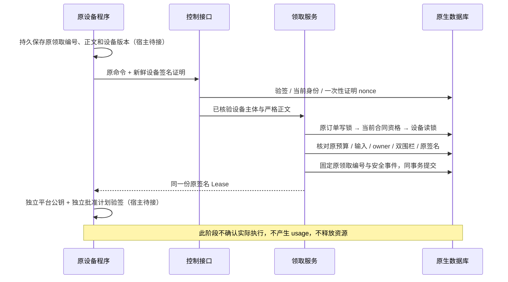

# 原设备签名领取与原租约交付

R018｜需求 v3.0 / 技术 v1.0 / NB04｜源码子集已实施，整体产品验收未执行。

本章接续 EI-001—030，增加 CL-001—028。买方实际文本已由 R017 校验、加密落盘并取得首租约，本轮让**原合同绑定的设备**通过签名控制接口领取这份租约。平台返回执行元数据，不返回 prompt、内容解密钥或内核命令。领取不是设备确认接收、执行成功或计费依据。

## 1. 系统位置与交付范围

`Preflight → Ready → Issue` 继续是独立配置的内部应用服务。本轮新增 `Claims.Claim`、标准控制操作 `POST /v1/p11/runner/leases/claim`、原生客户端 `PrepareLeaseClaim` 和只校验格式的 `UnverifiedClaim`。当前注册 **35/93** 个控制操作；未增加公开 OpenAI/Anthropic 模型监听，未提供输入或 manifest 下载，也没有自动领取守护进程。

三种文本请求档位沿用原协议；控制面领取采用原有 ED25519_DEVICE_1 设备签名，与模型 SDK 的 OpenAI/Anthropic 请求规范职责不同。当前原生 CLI 仍报告 `execution_enabled=false`，不因出现领取接口就自动启用模型或 GPU。Android LMA 的 APK、真实推理和执行槽仍须分别实现。



## 2. 编号需求与验收约束

| 编号 | 需求约束 | 实施与验收边界 |
|---|---|---|
| CL-001 | 仅已验证设备主体可以领取 | 会话、SDK key、其他设备和缺 `device:execute` scope 拒绝；不从正文构造主体 |
| CL-002 | 请求正文严格遵循权威 LeaseClaimWrite | 只接受 device_id、capability_id、claim_key、expected_device_version；额外字段、重复字段由严格解码拒绝 |
| CL-003 | 原领取编号先确定 | claim_key 是原命令 ID，8—128 字符且满足 ID 格式，与 Idempotency-Key 完全相同；不是 lease ID |
| CL-004 | 结果未知只恢复原命令 | 宿主须在网络前保存原键/原正文；重发仅更换设备证明 nonce/时间/签名，不更换命令编号 |
| CL-005 | 证明绑定整个控制请求 | 方法、authority、URI、content-type、原幂等键、If-Match 与正文摘要均由既有设备签名覆盖 |
| CL-006 | 证明 nonce 不能重放 | 沿用 R007 设备一次性证明登记；同一凭证重放 401，新证明加原命令可恢复；证明事务独立于业务事务 |
| CL-007 | 原键永久指向原租约 | 先以 device/原命令摘要取得事务 advisory 锁，等待后重新读取；010 的 device/key_digest 唯一约束和不可改字段独立于普通 24 小时幂等记录，不因通用缓存过期就改领下一单 |
| CL-008 | 首次选择必须唯一 | 只查询原设备、原卖家、指定 capability 的当前原生首租约；没有候选 404，多候选 409，不自动挑单或跨卖家调度 |
| CL-009 | 原买方授权仍须有效 | 从不可变 job 取得原 buyer、SDK key、route，再核当前用户、BUYER 角色、key 未撤销/到期、原 route scope；不是代客户新购 |
| CL-010 | 原订单和同单资金复核 | 复用已确认路由读取；原订单、同一支付宝 ORDER/SETTLED 持久事实、显式 SANDBOX/PRODUCTION、退款与到期条件仍有效 |
| CL-011 | 原设备和卖家资格复核 | 当前 SELLER 角色、本人 seller profile、ED25519 身份摘要、ONLINE、心跳、共享策略、设备版本和当前证据/发布门槛分别核对 |
| CL-012 | 读取已占用调用不索取新额度 | 只绕过“新调用次数/余额不足”造成的外观 SUSPENDED；原整笔预算必须 RESERVED 且金额等于原单次上限 |
| CL-013 | 原输入只验证密文元数据 | 原 job/order/buyer 归属、READY、输入档位、类型、期限、字节上限和实际密文 SHA-256 须与原 manifest 一致；不解密、不返回正文 |
| CL-014 | 只交付当前原 owner | 原 attempt、job 当前 attempt、job fence、物理资源 generation、ACTIVE owner、原 expires 均一致；不借别的预算或资源 |
| CL-015 | 租期不被领取延长 | 原签发时间、硬截止、45 秒以内 expires 与签名全部保留；当前资格或资金期限缩短到原 expires 之前时拒绝交付，不重签 |
| CL-016 | 核验来自独立原数据 | 服务端 Plan 从原 SQL 关系构造，并用显式保留的 issuer 公钥核原签名；不能只信伴随 manifest 自述的 ID |
| CL-017 | 公钥历史缺失关闭 | 领取服务只复制 1—16 把显式 Ed25519 公钥；原 issuer key ID 无对应公钥、错误签名或服务关闭时拒绝，不换用新签名 |
| CL-018 | 加锁顺序一致 | 原设备/原命令 advisory锁 → 原买方身份/key → 原订单 WRITE → 路由/资金/目录资格 → 设备 SHARE → job/attempt/lease/资源；等待原订单前不持设备或卖家行锁 |
| CL-019 | 保留心跳直接写锁 | 新 RequireDeviceReadTx 仅用于不更新 devices 的交付读取；原心跳和设备控制继续用直接 WRITE 身份锁，不改成读后升级 |
| CL-020 | 领取和安全事件原子提交 | 首次固定 claim 六字段与 ExecutionLeaseClaimed 六项安全 ID 事件同事务；缺事件回滚，不含正文、内容钥或完整请求 |
| CL-021 | 领取不改执行状态 | 不把 lease/attempt 改 ACKED/RUNNING，不完成 DELIVER_EXECUTION_LEASE 任务，不写 usage/成交资格，不消费或释放预算/物理锁；通用元数据队列认领和耗尽更新均只接受自身白名单类型 |
| CL-022 | 过期、撤权和 owner 变化不回放凭证 | 已领取也须重核当前条件；失败返回错误，原 claim、预算、资源仍保留；不自动重派或将超时视为清理证明 |
| CL-023 | 提交不确定不发送成功 | 服务只在确认事务提交后返回 Lease；CommitUnknown 返回错误，调用方用原命令和新证明恢复；提交后再次检查本机时间未过原 expires |
| CL-024 | HTTP 服务显式启用 | P11_LEASE_VERIFIERS_FILE 未配置时该操作返回 503；文件严格解码、最多 8192 字节，profile 必须正确，不允许私钥字段或默认信任 |
| CL-025 | 原生客户端不自动执行 | PrepareLeaseClaim 冻结原命令；UnverifiedClaim 只验证 16 KiB 内格式，返回未验证字节，不生成 Plan、不批准 KernelRegistry、不调用 Submit |
| CL-026 | 普通传输不冒称隐私增强 | 本轮仍 PLAINTEXT/STANDARD；输入 AES-GCM 为平台落盘防护。设备/平台独立信任、E2E/LP/PE 是不同待办 |
| CL-027 | 历史和围栏不改写 | 010 只追加六列、一 FK、一唯一索引及守卫；001—009、端侧 SQLite 原字节保留。历史 UNBOUND_CLAIM，不反推已领取或授权 |
| CL-028 | 当前证据分层 | 原生 PG/HTTP/SQLite、合成资金/资格、浏览器 H5、原生小程序构建分别记录；不代替真机/GPU/真实支付或完整产品验收 |

## 3. 请求、响应与配置

正文示例中的 `claim_original_001` 在宿主内保存后才发送；同一次领取的 header 与正文必须一致。

```json
{
  "device_id": "device_original",
  "capability_id": "capability_original",
  "claim_key": "claim_original_001",
  "expected_device_version": 1
}
```

成功 200 的正文是权威 `Lease` 本体，恢复同一份时带 `Idempotency-Replayed: true`。响应不包含 manifest 全文、输入下载 URL、prompt 或内容钥。设备仍需通过独立渠道取得已批准计划和平台公钥，不能从这个响应自行构造全部信任依据。

`p11-api` 可通过 `P11_LEASE_VERIFIERS_FILE` 配置 **P11_LEASE_VERIFIERS_1** 文件，字段仅 `profile_id` 与 `keys`。keys 映射 issuer ID 到无填充、规范 base64url 的 32 字节 Ed25519 公钥；同时必须配置 P11_PAYMENT_ENVIRONMENT。文件置于本项目忽略的 `runtime/`，不在命令行、截图、日志或文档保存真实配置。它是**服务器核验用公钥清单**，不替代提供方独立信任的安装/批准流程。

| 状态 | 典型原因 | 恢复规则 |
|---|---|---|
| 400 | 原键与 header 不同、正文越界/未知字段 | 修正新意图；不可把原未知写改成另一个操作 |
| 401 | 设备证明失效/重放、当前身份不再有效 | 未知业务结果仍保留原命令；身份重新验证后再按原命令查询式恢复 |
| 403 | 用户会话或 SDK key 代领、缺执行 scope | 不以买方权限替代提供方设备证明 |
| 404 | 没有该原设备/能力的当前候选 | 不创建 attempt、不空闲资源、不自动轮询换键 |
| 409 | 原键异输入、别的 claim 已绑定、版本/owner/期限/资格变化 | 保留原单/预算/owner，进入原请求恢复或人工处理 |
| 503 | 未配置公钥、缺原公钥、验签失败、服务关闭 | 修复原配置，不补签/续租/静默换设备 |

## 4. 持久化、隐私和页面约束

010 的新字段为 `claim_profile`、`claim_device_id`、`claim_key_digest`、`claim_request_digest`、`claim_device_version`、`claimed_at`。claim_key 为随机命令 ID，只持久保存摘要；claim_request_digest 仅覆盖控制元数据，不能拿客户 prompt 摘要替代它。字段首次写入后不可清空、换键、换设备或改时间，已领取 Lease 保留原签名。平台当前仍 65 表，累计 664 列、113 外键。

SQL 守卫核结构、原 owner、版本、时序和事件原子性，**不验证 Ed25519、真实硬件、当前业务全资格或实际支付宝收单**；应用服务和独立真实验收各负其责。平台计数仍受已发布 signed-bigint 上限约束。旧迁移不改，旧 SQLite 五张元数据表不增加 prompt/内容钥。

NB04 五页及十个辅助界面的视觉约束不变。本轮不伪造“模型已运行”的前端状态或新增不可用按钮；页面中 GPU 以小时计价、LLM 输入/输出分别以 M token 计价，手机仍显示具体型号（如摩托罗拉 X30）。当前新能力以原生控制接口测试为证，页面截图只展示实际已有流程。

## 5. 开发映射、验证与后续

对应 DEV-02/06/11/17/18/51/53。DEV-18 的“原租约领取”组件向前推进，但同卖家重派、真正设备 ACK/进度、输入/manifest 受限交付、设备独立信任、受签内核批准、宿主持久命令和实际监督执行仍待接线。DEV-25/26 的标准模型入口与 relay Grant、DEV-38 可信 usage、真实资金/结算、Android 内核、GPU 租赁及 E2E/LP/PE 保持开放。

专项命令为 `python -B -X utf8 dev/tools/原生数据库验证.py --round R018 --suite claim`；完整回归去掉 `--suite claim`。专项通过不能替代完整原生、双端浏览器和当前构建证据。首批16项专项、第一次完整回归221通过/1失败（通用队列误领执行投递任务）及其修正均单列于 [开发过程记录](../../dev/tests/evidence/R018-development-attempts.json)。完整验证与每项状态见 [本轮报告](../../dev/tests/evidence/R018-验证报告.md) 和 [全部 56 任务](../../dev/progress/R018-本轮实现与完整待办.md)。

R016 曾出现原清理截止内的时序失败，根因尚未证明；后续通过不清除这个风险。全部 56 任务及 222 个待收口子项继续保留，部署/HTTPS/运维/可观测性仍延后。测试仅使用本项目临时原生数据库和自建浏览器，结束关闭实例、标签与预览，不启动虚拟化。
