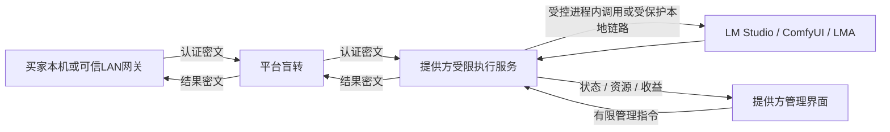

# 本地内容隐私防护与分级验收

P11｜技术v1.0增补｜需求v3.0｜2026-10-29｜用户已确认防护目标，以下为待实现方案；所有LP专项均NOT_EXECUTED。没有安装或启动任何真实内核、虚拟化环境或Android模拟器。

低开销完整方案（最新用户确认）：用户允许新增隐私档可嵌入LLM内核，LM Studio继续保留兼容。采用llama.cpp C API原生worker、ComfyUI私有管道入口、LMA内部JNI；买卖端加密/平台盲转，任务数据加密而模型保留原生加载，不使用VM/RAM盘/常驻第二份模型。输入准备和密文交付不额外占GPU锁，控制与大数据通道分离。内存/性能为待实测验收预算，完整链路、二进制协议、媒体、恢复及PE-01—PE-08见[完整实施方案](附录-低开销隐私执行完整方案.md)。当前尚未实现或通过设备/密码/性能验证。

## 1. 当前目标与既有隐私档位的关系

U：不以抵御高级内存分析为本次目标；阻止提供方通过常用界面、文件、日志、接口和抓包直接得到买家的原始prompt或生成内容，并增加简单改包、改节点的成本。保护范围包括system/对话/工具参数、附件、图片/音视频/3D产物及可直接还原它们的缓存。设备主人仍须知道运行了什么组件、模型、节点和资源，并能暂停、排空、强停和退出。

“初级/中级”不是可测的技术边界。本设计以第8节的具体动作验收，目标是提高获取成本，不承诺所有同等经验的攻击者都无法绕过。高级内存/GPU提取、注入与动态挂钩、内核/驱动控制、虚拟机监控器修改和完整客户端逆向不作为本次通过条件。管理员夺权、替换整套程序或在Python节点插入内容导出也可能绕过原生防护；它们不能被说成天然困难，简单改节点仍要列入检查，不能仅靠“高水平攻击不考虑”予以忽略。

本次是本地防护要求的收敛：普通硬件可以成为候选，TEE/专用保密显卡不作为首期前置。原先的硬件增强档保留为独立远期能力，当前没有已验证供给。

| 维度 | 继续使用的定义 | 本次新增要求 |
| --- | --- | --- |
| 三种服务模式 | E2E、GPU_RENTAL、PLAINTEXT | 不新增第四种模式 |
| 对平台的正文保护 | E2E的PLATFORM_BLIND，端点与密码实现仍须验证 | 本地防护不能替代E2E，也不把明文模式改称平台不可见 |
| 对提供方的日常访问防护 | 本地内容隐私防护，是独立的产品/执行策略 | 默认不展示、不留普通副本，封闭文件/日志/API等直接出口，逐引擎验收 |
| 对不受信主机管理员的硬件保护 | 原有ATTESTED_CONFIDENTIAL | 原生隔离、加密盘和普通VM均不取得该标签 |

公开表述建议：“平台端到端加密；提供方界面不展示任务内容，执行端采取本地隐私防护。设备所有者针对性修改系统或程序仍可能获取内容。”明确已验证系统/引擎/版本和防护范围，不能宣传“设备主人绝对不可见”。此策略不要求买方修改OpenAI/Anthropic的标准请求JSON。

## 2. 推荐架构：先做原生隔离

解密、协议转换、推理、后处理和结果加密均放在受限执行侧，提供方管理UI只接必要元数据。平台Sub2API类明文网关不参与E2E解密；卖方内置BoundRelayCore仍按合同处理标准方言。内容在本地执行时仍需明文，但不经卖家页面、普通管理API、通用文件接口或终端输出。

此处受保护的本地链路属于内容防护功能，不恢复公网HTTPS、证书部署、运维或可观测性规划；有关TLS只讨论真实引擎连接是否仍暴露明文。

D：Windows/Linux优先采用独立低权限执行身份；Windows服务身份与具体服务SID/ACL一并设计，Linux使用独立服务用户及严格目录/Unix socket权限。卖家日常桌面账号与执行身份分离；仅把同一个登录账号下的进程分成两个exe不算隔离。服务安装权限及用途向提供方解释，程序日常不以管理员/root运行。无法建立该边界的用户进程兼容方案，不冒充已经通过同一组本地防护验收。

UI有停止、资源和收益权限，无正文读取、任意文件下载、执行shell、日志订阅、解密或任意引擎透传权限。Windows命名管道显式设置最小DACL并核调用方身份，拒绝远程连接；Linux核socket目录/凭据。控制接口与传内容的内部通道分开。随机端口/路径只能减少偶然访问，不能作为认证。

Windows服务的用户安全上下文及命名管道访问检查有系统机制支持；默认管道权限不能直接视作私密配置。以上是实现设计，未证明当前LM Studio可在该身份下独立运行。[服务用户安全上下文](https://learn.microsoft.com/en-us/windows/win32/services/service-user-accounts)、[命名管道访问控制](https://learn.microsoft.com/en-us/windows/win32/ipc/named-pipe-security-and-access-rights)。

## 3. 文件、密钥、日志与恢复

| 项目 | 必须满足的要求 |
| --- | --- |
| 任务工作区 | 每attempt/租赁子任务独立，随机名称；输入、输出、图与中间文件凡需持久化均使用成熟认证加密；模型、公开配方及交易状态不必整盘加密 |
| 文件加密实现 | 优先在写盘前加密的输入/输出桥；不得先向普通output/temp写PNG或MP4再事后打包加密。必须随机寻址/seek的编码器需支持经评审的加密临时工作区，否则该能力不取得对应防护资格 |
| 临时解密 | 只在受限执行路径中按需使用，不向卖家可访问的目录、共享挂载、剪贴板或文件选择器导出。隐藏目录/改扩展名/普通ZIP密码不算实现 |
| 钥分离 | 传输、工作区、设备身份和签名用途分离；每任务独立工作区钥，不硬编码全局钥或由job_id推导。OS秘密库/Android Keystore保护静态身份，内容钥尽量短存 |
| 命令行与日志 | 不传入prompt/钥/正文作为命令行或普通环境变量；stdout/stderr、异常栈上下文、SQL、崩溃报告与诊断包不含内容；只留安全原因码、阶段、计量与必要版本 |
| 媒体与缓存 | 关闭提供方预览/自动播放/缩略图和任务资产扫描；不得写相册/媒体库。无公开prompt元数据，缓存、KV和工作流历史按买家隔离 |
| 明文存活期 | 优先流式/内存处理，正常完成尽早释放；不要求把全部大视频一次装入RAM。节点中间结果、CPU后处理及编解码一并约束 |
| 恢复 | 持久化租约、围栏、后端ID、密文、清理待办；不因加密工作区恢复而回绕账证。内容钥若仅在内存，崩溃后不可假装无损恢复：先查真实后端状态，需买家重新授权/重封时遵守当前合同，否则失败清理，不盲目重跑或重复收费 |
| 留存与退出 | 成功结果可按原政策留密文用于重传；不为方便重传长期保留可解密的本地正文钥。原有终态/失败/离线清理上限继续适用；释放钥不是SSD安全擦除证明 |

普通加密文件或加密卷在被解锁时，授权进程仍可访问明文。若方案向宿主挂载一个卖家可以浏览的解密盘，哪怕底层镜像加密，也不能通过“直接翻文件”验收。模型/引擎可以正常查看，任务内容不能混入其源码、节点目录或个人LM Studio配置。

不新增内核驱动、自定义密码算法、强制关闭用户杀毒软件或偷偷更改整机备份/交换文件策略。应用可控制的dump/备份/日志出口必须关闭或脱敏；不能用这一点冒充已经控制全部OS副本。

## 4. Windows/Linux：分别处理两类内核

### 4.1 LM Studio：先证明日志与本地传输可封闭

继续使用用户确定的lms CLI＋llmster＋可替换推理runtime。需在固定版本上证明独立身份/配置域/模型服务归属，专用实例不复用卖家的个人GUI会话、历史或诊断通道。CLI只供监督进程调用，不能把终端输出或完整CLI控制代理给提供方管理UI。

官方`lms log stream`可以读取模型收发文本；不能用“不在外壳保存日志”“删除lms.exe”“--quiet”推定后台诊断能力已经关闭。需验证日常提供方账号不能直接订阅此实例的日志，服务身份的诊断凭据/发现文件/控制接口不能经其他API泄漏。官方API认证可作为入口限制，但不自动证明日志订阅或整个daemon管理面使用相同策略。[日志能力](https://lmstudio.ai/docs/cli/serve/log-stream)、[API认证](https://lmstudio.ai/docs/developer/core/authentication)。

普通Bearer认证不加密正文。官方server-start文档描述的是HTTP API，未提供本项目已验证的端到端本地TLS方案。因此，“网关HTTPS → 本机HTTP llmster”仍有明文最后一跳，能用loopback抓包读取时不得通过LP-05。候选为官方支持且实测的受保护直连，或实际隔离的执行环境；不能杜撰`--https`/`--disable-prompt-log`参数，也不能以没有搜索到参数证明厂商永远不支持。[本地HTTP服务](https://lmstudio.ai/docs/cli/serve/server-start)。

两项未通过时，LM Studio的普通服务路线仍可继续开发，但不得标“已防本机抓包/日志读取”。需对买家披露并由其选择相应较弱服务；已要求本地防护的订单不派给它，不静默降级。可替换内核机制保留，换引擎或启用普通VM须另验许可、兼容性与合同，不能在已付订单中偷换。

### 4.2 ComfyUI：源码内封闭出口

ComfyUI可以做源码级集成，默认不启动其买卖家可访问的原生Web页面。适配器依然能受权提交/查询/取消，外部入口继续是标准OpenAI/Anthropic协议。

1. **本地链路**：优先评估进程内桥/受限IPC；使用HTTP服务时，TLS直接终止于ComfyUI进程，适配器校验固定端点证书或等价受评审身份材料，不使用忽略证书错误。不留可直连的明文HTTP旁路。
2. **原生鉴权**：认证与授权在真实服务路由生效，覆盖`/prompt`、`/queue`、`/history`、`/view`、`/ws`及所选版本的资产/扩展接口；仅在外层代理鉴权而后端裸露不合格。UI凭据无权访问内容路由。
3. **预览与落盘**：关闭采样预览并去掉固定图中的PreviewImage类输出；替换/封装SaveImage与各媒体保存节点，在首次持久化前加密。禁prompt元数据、资产索引及内容日志，核PNG/视频/音频/3D全部支路。
4. **节点权限**：沿用有限白名单和导入前完整清单检查，平台任务不加载未批准节点/Manager。受限目录不由日常账号随意改写；替换某个Python文件、插入导出节点或更改启用目录应使原装客户端拒绝准入，形成新环境必须重新验证。
5. **替换兼容**：隐私补丁单独版本化，与ComfyUI、Python、节点、依赖共同进入`kernel_environment_digest`。上游更新未复验之前不继承防护资格；不可为了保持“最新”自动覆盖补丁。

官方存在本地TLS、关闭元数据/预览等启动选项，但不是本项目固定版本的实测证据；这些开关也不能替代原生路由鉴权、输出桥与节点核查。`--disable-manager-ui`仅关界面/端点，文档注明后台任务仍可能继续；不把它当完全禁用Manager。`--offline`也不代表Python节点不能联网。源码补丁及依赖按实际许可证提供。[ComfyUI启动选项](https://docs.comfy.org/development/comfyui-server/startup-flags)。

节点能按声明读取PROMPT/EXTRA_PNGINFO，允许节点运行即信任其代码及依赖。普通Hash自检不能证明掌握系统的人没有替换检查器；不把“上报原摘要”当成硬件远程证明。[隐藏输入与PNG元数据](https://docs.comfy.org/custom-nodes/backend/more_on_inputs)。

## 5. Android：LMA源码二开的默认防护

沿用固定LMA基座及Java服务/WebView边界，在本项目派生实现。平台任务直接进入内部EngineHost/native桥与统一执行门闩，不经过个人聊天页面，不自动保存到对话历史；个人API与共享任务无正文互读权限。

- 内部调用优先同进程/JNI；确需Binder时组件不导出或核调用者身份/权限。共享任务不暴露给原本地/LAN裸HTTP API；仅禁互联网入口不等于封闭本机入口。
- 密文放应用内部私有目录，短时内容钥与身份钥分离，静态钥按设备实际能力使用Keystore；不写外部共享存储、相册、Downloads、WebView本地存储或剪贴板。
- WebView桥、前台通知、任务列表、logcat、异常与导出诊断只含状态/资源/收益；通知保留停止入口。关闭发布包调试/WebView调试，备份与设备迁移规则排除任务内容和秘密。
- 受签发布APK、组件签名与版本核对、适当混淆可以增加简单改包成本；不能宣称R8/加壳形成机密执行边界。root/动态注入等超出本次保护范围，不要求用户root，也不把开发者模式本身等同内容泄露。

内部私有存储的系统访问限制与Keystore可支持这一实际目标，但Keystore只保护钥使用/提取，未把LMA明文推理移入TEE；所有者控制系统后的读取能力不因此消失。[应用专有文件](https://developer.android.com/training/data-storage/app-specific)、[Android Keystore](https://developer.android.com/privacy-and-security/keystore)。

## 6. 加密磁盘沙箱与普通QEMU：有价值，暂不作为必装底座

在本次威胁边界下，普通VM配加密任务盘确实可以增加门槛：提供方直接翻宿主目录看不到PNG/工作流，个人LM Studio难以直接连进专用来宾实例，修改执行代码也多一道边界。无需先实现TEE才能具有这些价值。

要使隔离成立，解密、内置转发、引擎、日志、编解码及结果加密必须同处VM内；不用共享目录传明文，不把来宾控制台/root凭据/执行shell作为卖家管理功能。来宾任务盘自行解锁优于把统一口令公开保存在宿主配置；若密钥仍由宿主服务持有，只能宣称减少日常访问/离线复制，不声称排除宿主管理员。普通VM没有可信测量放钥保证。

VM不是免费解决GPU接入：虚拟显示/3D加速不等于CUDA/所需计算后端可用。实际方案需验证GPU分配、Windows显示卡占用、暂停/恢复、双引擎、资源门闩及模型/磁盘/内存成本；不能把QEMU CPU模拟推理当作闲置GPU供给。Android不强行套桌面VM方案。

| 路线 | 本次目标适配性 | 实施选择 |
| --- | --- | --- |
| 原生低权限隔离＋密文文件＋封闭内容接口 | 适合日常查看/普通工具防护，兼容现有端侧路线 | 首期推荐；LM Studio的HTTP/诊断边界必须单独核实 |
| 普通VM＋加密来宾任务盘＋受控管理面 | 能额外隔离环境和文件，增加修改门槛 | 后续针对合格设备可选，不要求全部C2C卖家必装 |
| CPU/GPU完整保密执行 | 针对更强主机对手 | 超出本次必要投入，保持独立增强档研究 |

QEMU官方明确传统宿主可访问来宾状态；这限制绝对保密声明，不否定当前降低日常可见性的价值。镜像加密的格式、密钥与快照另见[前次详细评估](../评审/加密沙箱与QEMU保密执行可行性评估-2026-10-29.md)及[QEMU保密来宾说明](https://www.qemu.org/docs/master/system/confidential-guest-support.html)。本项目本地禁虚拟化约束继续执行；此处只做产品方案评估。

## 7. C2C展示、环境绑定与成本

提供方可看到引擎/版本/模型/节点/许可、资源占用、任务阶段/匿名标识、时长、成交和费用，并决定是否安装、何时共享、价钱和停止；不以隐私为名隐藏运行组件或后台获利。买家看实际卖家、协议模式、经过验证的本地防护范围、仍需信任的处理方及价费。

获授权的订阅/API Relay可对卖方本地采用同类界面/文件/日志防护，但外部上游仍须接收调用内容；“平台盲转＋本地防护”不能据此宣传上游也不可见。

防护策略版本、补丁版本和LP记录需绑定精确环境摘要、SKU与合同政策版本；这是新增实施要求，不是当前控制API已经存在的新字段。现有`privacy_profile`枚举不更名；如需要扩展机器字段，后续先冻结独立本地策略契约再同步Schema，不把它塞入标准模型请求或混用ATTESTED_CONFIDENTIAL。

设计机器策略由`scripts/供给端内核数据.py`生成至[供给内核策略](contracts/provider-kernel-policy-v1.0.json)的`local_content_protection`；其中所有设备测试仍未执行、销售开关为false，不是软件已启用防护的配置。

防护失败先停止该防护资格的新准入；在途按原合同结束或失败/退款，不悄悄换弱档。未知节点/隐私补丁缺失/内容出口重新开放均触发重新核查；签名和本机自检可防误改、简单替换，不能据此保证不受信卖家实际运行了所声称代码。买家对重要机密仍应选信任的卖家或未来经完整验证的硬件档位。

商业上优先复用原生引擎/服务/密文流，避免让每位闲置设备卖家承受整台VM的安装体积、内存和GPU兼容成本；这是设计取舍，未测出百分比开销或额外收入。不要求电商式平台自营设备/保底收益来补足供给。加密、隔离和清理的性能开销在各能力基准中单列，不能先承诺“零损耗”。

## 8. 专项验收与实施顺序

以下是待执行验收清单，承接既有80项主验收，不新增已实现声明。每个记录写实际设备/OS/引擎与补丁版本、是否提权、工具、动作与结果；不能只说“中级用户测试通过”。使用获授权的测试正文与带标识的测试产物，不用真实买家内容。

| 编号 | 检查动作 | 通过条件 |
| --- | --- | --- |
| LP-01 | 用提供方UI、通知、管理API及导出诊断查看任务 | 无prompt/结果/缩略图/结果URL/解密入口，资源/收益/停止正常 |
| LP-02 | 运行中及结束后浏览、复制任务目录/普通SQLite/缓存 | 无可直接读出的正文和媒体；复制密文不能从相邻固定钥解开 |
| LP-03 | 浏览器/curl访问实际引擎的历史、队列、文件、WS与资产接口 | 未授权拒绝，UI权限不能读取，适配器仍可正确恢复/取消 |
| LP-04 | 提供方桌面账号运行lms日志订阅，查看Comfy控制台/logcat | 无模型收发正文；删CLI外壳但后台仍可读时判失败 |
| LP-05 | 常见代理及有权限的loopback抓包，检查网关到真实引擎最后一跳 | 无可还原正文/钥；记录是否需提权。单独验证TLS外壳后裸HTTP旁路，发现则失败 |
| LP-06 | 用固定工作流生成带标识的图/视频/音频/3D，检查保存路径/元数据 | 首次持久化前已加密，未在temp/媒体库生成普通副本或预览 |
| LP-07 | 简单修改节点/Python文件、添加导出节点、开启Manager或旧日志选项 | 原装客户端在导入/接单前拒绝或使防护资格失效；不冒充能抵御检查器也被改写的完整恶意客户端 |
| LP-08 | 从卖家控制API调用任意路径读取、shell、诊断订阅、结果下载 | 拒绝，业务停止/版本查询等正当功能仍可用 |
| LP-09 | 切换两个买家、个人聊天、自用API与不同租赁子任务 | 历史/KV/中间态/密钥不串用，同一资源门闩有效 |
| LP-10 | 取消、到期、崩溃、断电重启、升级与回滚 | 实际停止/恢复状态可信；不为恢复泄露正文、不重跑/重扣，密文/钥按政策清理 |
| LP-11 | 复制已结束工作区、检查备份/诊断/迁移副本 | 无本程序产生的可解密普通残留，不宣称已排除全部OS/恶意副本 |
| LP-12 | 简单APK解包改包及替换组件、Android本地API/WebView尝试读平台任务 | 原装发布路径校验，未授权入口拒绝；平台任务不落个人会话/相册；无root前提 |
| LP-13 | 相同内核上游更新后复验日志、鉴权、输出、插件 | 新摘要重新取得本地防护资格，旧结果不自动继承 |
| LP-14 | 若研究VM方案，浏览宿主目录/共享盘/管理端和原生个人引擎 | 无直接正文出口，模型实际在已声明GPU执行；本项本地不执行 |

实施顺序D：先梳理所有内容出口与LP测试动作 → ComfyUI源码桥/输出与路由改造、LMA内部调用与私有存储 → 原生低权限执行/UI权限隔离 → LM Studio专用身份/诊断/本地传输PoC → 任务级加密工作区与故障恢复 → 跨能力LP验收。前几项原型允许并行设计，不把其中任何单项通过写成全平台“本地不可见”。普通VM在GPU与安装可行性另有证据后再评估是否值得提供；未启动任何本地虚拟化。

## R021 原生 LLM 接线进展

[原生LLM受限管道与可替换worker](附录-原生LLM受限管道与可替换worker.md)冻结NK-001—042：独立本机包/模型/模板摘要、固定C API、类型化P11_LLAMA_PIPE_1、真实tokenizer前置、原owner一次提交、独立取消、两个64KiB输出缓冲和同步后清理。当前Windows合成C ABI实进程测试与真实模型/GPU/LP/E2E资格分开登记；节点CLI执行仍关闭，LM Studio/ComfyUI/LMA、公共输出/ACK及可信usage继续待完工。普通调用账户和Job Object不能替代独立低权限服务。

## R022 结果交付增量

R022 新增 [RC-001—060](附录-原生文本结果加密保管与标准协议交付.md)：原生输出先独立加密保管，计算清理与原结果读取分别授权；三文本 JSON/SSE 仅属 PLAINTEXT/STANDARD 局部源码，不授予 E2E/LP、可信用量、最终 ACK 或资金资格。CLI 执行继续关闭，全部未收口验收保留。

## R023 固定包与真实内核增量

R023 新增 [NF-001—048](附录-真实原生LLM包校验与本机接入.md)：固定真实包、独立本机选择摘要、PIPE_3三库、只读kernel-inspect及本机CUDA小模型验证。包检查和测试不授予挂牌/执行、LP/E2E、可信用量、ACK或资金资格；CLI内容执行继续关闭。完整产品与性能验收仍待。

## R024 当前物理显卡约束

当前私有握手为PIPE_4，环境域为P11_LLAMA_ENV_2；旧版握手仅作历史证据。以[GI-001—032](附录-物理显卡身份探测与启动绑定.md)为当前启动身份约束。R024增加Windows NVIDIA整卡UUID/PCI探测及PIPE_4启动复核；显式GPU选择和环境摘要绑定实际身份，同UUID别名不能绕过共享门闩。只读gpu-discover不加载模型、不准入共享，LocalInfo仅含安全元数据。本机观测不构成远程证明或LP/E2E/性能/usage/ACK/资金资格；Linux/AMD/手机实际接入与完整LM Studio隔离封装仍待。全56任务222子项、80/96完整验收保持开放。

## R025 当前宿主与正文交接约束

以[NH-001—040](附录-原生宿主内核接线与输入驻留绑定.md)为当前装配、输入与结果句柄生命周期约束。R025接通独立批准的原生Host会话、原物理GPU与持久任务、加密结果仓和三协议交付；密文资产摘要保持原义，解密正文另以仅驻内存的原租约/清单/字节凭据校验。宿主拥有worker和结果读取句柄并在关闭时排空、撤权及等待退出，未知原owner不释放。当前限PLAINTEXT/STANDARD；生产资金/usage/ACK/SDK、崩溃恢复、完整LM Studio/ComfyUI/LMA、E2E/LP/性能与80/96完整验收仍待，全56任务222子项保持开放。
