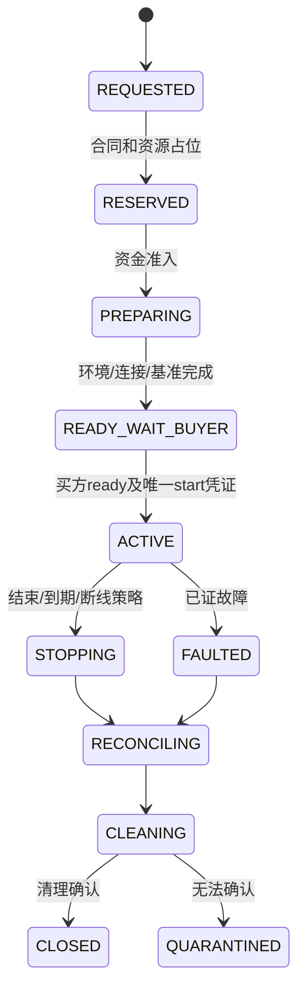

# 订单、调度、执行租约与租赁状态机

P11｜v3.0｜2026-10-29｜关联F08—F17、F31/F35/F36、F41—F47、F53/F59/F64/F77。下述为工程状态合同草案。

## 1. 独立状态轴

Quote、Admission、Order、Payment、Job/Attempt、Delivery/Acceptance、RentalSession、Refund、SellerSettlement分别持久化；不以一个status混合。每个转换要求actor、旧版本、前置条件、幂等ID、发生/接收时间和证据，变更与outbox同事务提交。

| 对象 | 主要状态 | 关键不变量 |
| --- | --- | --- |
| Quote | VALID/EXPIRED/CONSUMED/CANCELED | 固定seller/价费/模式/版本，过期不隐式续价 |
| Admission | REQUESTED/GRANTED/EXPIRED/RELEASED | 输入/资金资格/容量复核，不等同支付到账或永久占卡 |
| Order | CREATED/WAITING_PAYMENT/READY/FULFILLING/DELIVERY_PENDING/COMPLETED/CLOSED/REVIEW | COMPLETED依履约/接受及该模式最终支付证据，不靠前端跳转 |
| Payment | CREATED/PENDING/AUTHORIZED/SETTLED/FAILED/UNKNOWN/CLOSED | 可履约授权与最终实收分开，UNKNOWN查原单 |
| Job | INPUT_PENDING/QUEUED/RUNNING/VALIDATING/WAITING_BUYER/ACCEPTED/FAILED/CANCELED/UNVERIFIED | 一个job仅一个accepted_attempt，终态竞争条件更新 |
| Attempt | PREPARED/ISSUED/ACKED/RUNNING/UPLOADING/DELIVERED/EXPIRED/CANCELED/REJECTED | PREPARED仅加密上下文，无执行权；当前已签租约token才有正式写回权限 |
| Refund | REQUESTED/PROCESSING/SUCCEEDED/FAILED/UNKNOWN | 原退款ID查询，不能超出可退实际金额 |

## 2. 报价、输入与执行准入

报价初拟15分钟，不等于占GPU。密文EncryptionIntent先确认接收端；业务单创建后可生成INPUT_PENDING/PREPARED的job/attempt/token/recipient上下文，供买方认证加密上传与封装，此阶段不占GPU且不得执行。待输入受意向有效期及合同截止限制，超时按未执行处理。公开参数足以筛规格，私密参数仅端点校验。输入/封装就绪和有效可履约凭证后，初拟90秒准入窗口再次核seller、owner、模式/许可/地区/版本、资源和预算；上下文端点变化先买方重封，不能直接发执行权。

数据库事务按固定锁序取得order/job/resource记录，比较版本，创建attempt与单调token、资源占有/截止和outbox；提交后才下发执行消息。客户端签名校验/ack与本地后端ID持久化。发件箱重发允许，重复领取只返回原映射，不再次执行。

初期每节点一槽；每买方初拟最多2个活动服务任务，每SKU待排/预留上限min(20,2×合格在线节点数)，扣除租赁/清理占用。超限返回可理解重试提示，不排无限队列。卖家自用保留用于准入，已承诺整卡不能被自用静默抢占。

## 3. 执行租约与fencing

心跳初拟10秒、租约45秒，平台可信时间决定有效性；心跳带当前work_item/attempt/token、seq和安全资源状态。客户端壁钟/重放心跳不能延租，撤证/失效立刻停止新执行权。旧token结果只能隔离作故障证据，不能覆盖当前结果/接受/账。

节点失联后先撤旧attempt执行权并隔离，不能假设TTL到期就证明GPU已停止/清理。只有同卖家披露的另一合格设备才可最多一次重派；无备机则失败。可能重复算力由公示责任处理，不重复正式收费。

明文完整上传后转独立平台验收租约，节点不用无限续租等待验收；验收进程重启可从持久状态继续。加密完整密文/清单到达转WAITING_BUYER，收到合法签名接受才写ACCEPTED。两类不得调用同一个解码验收函数。

## 4. 期限、重派与取消竞争

图像300秒总处置期限从输入就绪且可履约开始，包含排队、最多一次重派、上传和验收；视频/文本按SKU独立冻结。加密补封装/接受窗口各初拟120秒且不延长原期限，实际截止取剩余总期限和窗口的较早者。

| 竞争 | 决策事务 | 结果 |
| --- | --- | --- |
| 取消vs首次启动 | 比较job状态/版本，冻结取消或发执行权 | 未启动取消全退；已运行按该类合同 |
| 取消vs有效接受 | 单一条件更新/终态版本 | 只保留一个有效分支，关联账务一次 |
| 旧结果vs新attempt | 检查当前token/attempt及接受唯一键 | 旧结果隔离，无第二正式产物/收益 |
| 支付晚到vs准入过期 | 查原Payment后重新核能力/原约可履行性 | 不自动换卖家/涨预算；无法履约退款/释放 |
| 回执vs期限到达 | 按服务端接收/合约时钟规则比较版本 | 明确晚到策略，不因客户端改时钟翻转已终态 |
| SDK重试vs结果未知 | 稳定幂等ID查原状态 | 不盲发第二次购买；无稳定键不按正文猜 |

跨卖家必须原单结束、处理未用资金、新卖家/报价确认、关联新单；旧新单保留独立证据与资金链。自动重选也受事前明确卖家范围/次数/预算，不用全局账号池透明切换。

## 5. 租赁状态机

占位90秒、准备120秒、买方ready等待120秒为初拟不同窗口；只能在真实支付协议允许时使用，不把90秒占位理解为覆盖所有准备。进入PREPARING时按政策延持资源锁并设置相应新截止，未进入则占位到期释放。准备失败/买方不确认不计租时。

ACTIVE起表事务要求资源锁、环境/模型版、端到端连接/基准、有效支付能力和买方ready同时成立，创建唯一started_at与起表证据。此前买方不能执行工作任务，避免“未起表但可无限算”。

## 6. 租时确认与停止

每10秒记录有序可用区间，保存start/end、平台接收水位、来源/证据和可信度。区间不重叠，ACK不能补认任意离线长段；平台重启未知空档不收费。失联只计至最后可确认点，45秒检测等待不自动计费，有更早故障证据可冲正。

买方断线默认60秒可用宽限后停，主动选择继续也不可超时间/预算。续租需先确认新时长/预算/价版、实际付款能力，再延本地和平台有效期；未确认不执行。到期节点本地撤权/停工，重启不恢复过期会话。

停止流程：幂等stop→冻结可计费截止→撤工作区token→中止当前受控任务→出最终计量/退款→清目录/缓存/钥→残留检查及签名ack→解资源锁。清理未知/失败隔离；不能仅靠时间TTL重新出租。故障换设备/卖家须重新确认，不在同会话悄换。

## 7. 恢复、补偿与运维

协调器从租约、资源锁、outbox、后端映射和账事件恢复，不依赖内存队列。查询/重放先校验终态与唯一键；资金未知查原渠道，结果已接受不再执行。恢复期间相关新售可关闭，保留查询/售后。

补偿是业务状态/资金冲正事件，不是删除旧记录。停电、锁竞争、数据库重启、对象上传中断、验收进程故障、消息重复20次、网络分区和时钟回拨均列为故障注入；只在本项目有权控制的环境实施，当前全部未执行。

## 环境版本与维护准入

报价/合同冻结允许的device/capability/kernel_environment集合；签发lease重复绑定实际摘要，租赁grant绑定环境及允许配方。维护将设备停新准入，按原环境完成或取消在途后取得同资源本地维护门闩；不是额外可卖槽。查询/取消沿原环境和backend ID，未知执行不能切新内核盲重跑；同卖家重派也不能使用合同之外的新环境。
