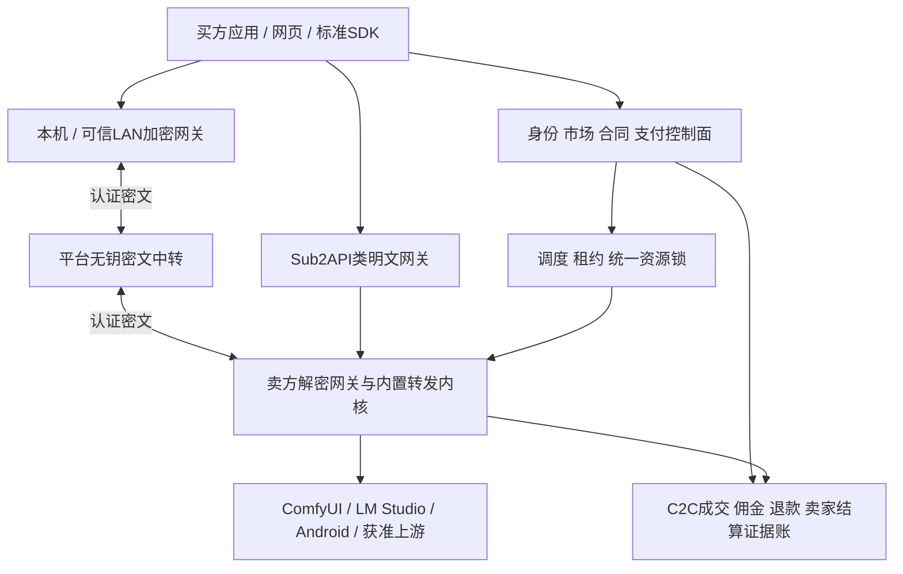

# 算力共享平台项目白皮书

P11｜v3.0｜2026-10-29｜C2C闲置设备算力市场｜需求与项目设计白皮书

低开销完整方案（最新用户确认）：用户允许新增隐私档可嵌入LLM内核，LM Studio继续保留兼容。采用llama.cpp C API原生worker、ComfyUI私有管道入口、LMA内部JNI；买卖端加密/平台盲转，任务数据加密而模型保留原生加载，不使用VM/RAM盘/常驻第二份模型。输入准备和密文交付不额外占GPU锁，控制与大数据通道分离。内存/性能为待实测验收预算，完整链路、二进制协议、媒体、恢复及PE-01—PE-08见[完整实施方案](../技术开发/附录-低开销隐私执行完整方案.md)。当前尚未实现或通过设备/密码/性能验证。

本地隐私目标修订（2026-10-29）：用户将当前目标收敛为拦住初级/中级用户的日常查看与普通工具读取、增加本地拦截成本，不以高级内存分析为验收目标。首期推荐原生低权限隔离、任务级密文工作区及文件/日志/引擎API出口封闭；TEE/保密GPU不是此前提，普通VM只作可选评估。这是独立的本地防护策略，不新增服务模式、不把普通端改标ATTESTED_CONFIDENTIAL；原有硬件增强保留为独立远期能力。既有“基础档所有者可见”表示技术上仍可能访问，不表示默认向提供方展示内容。具体动作与LP-01—LP-14见[本地防护规范](../技术开发/附录-本地内容隐私防护与分级验收.md)，全部待实现/未执行。

当前实施范围以[本轮修订](../技术开发/附录-本轮范围与端侧选型修订.md)为准：React/Taro支付宝小程序优先、React/Vite Web；部署/HTTPS/运维和可观测性延后。转发与支付宝收单已展开到技术详规，历史需求ID和未执行状态保留。

当前状态：需求已细化，已进入源码实施；R001原生后端基础与选定数据库/服务测试见[独立证据](../../dev/tests/evidence/R001-验证报告.md)及[实施进度](../../dev/progress/README.md)。完整平台尚未交付，80项功能的完整主验收仍为设计/未执行。本文可用于立项、产品评审、研发拆分和参赛材料准备，不能作为已有交易平台、支付资格、设备性能或收益的证明。

当前供给内核路线：Windows/Linux隐私LLM以llama.cpp原生worker封装，LM Studio的lms CLI＋llmster＋runtime保留兼容；图像/视频/音频/3D以完整ComfyUI原生内核及有限节点白名单封装；Android基于LMA源码二开。Linux原生双引擎保留。详见[内核封装与替换规范](../技术开发/附录-供给端内核封装与替换规范.md)，当前均设计待实现，第三方许可/实机证据未取得。

## 1. 项目主张

用户拥有但暂时用不上的显卡、手机和获授权模型服务，可以在自己允许的时间、资源和价格范围内向其他用户提供计算服务。买方购买明确结果、可核验模型用量或一段可用GPU时间；平台降低发现、接入、调度、计量和交易的成本，收取明确佣金/服务费。

这个市场的供给主体始终是自愿挂牌的用户。平台不默认采购闲置容量、持有供给库存、经营自有GPU池或承诺保底收益。设备离线、自用与异构性能是市场必须管理的现实条件，不能靠无依据的“无限供给”宣传掩盖。

产品有三个入口：端对端加密服务、受控显卡租赁、明文服务。它们共用C2C身份、挂牌、订单、资源锁和证据账，但分别采用适合自身的内容权限、验收与计量规则。OpenAI/Anthropic兼容接口贯穿模型和媒体数据请求，使买方能使用既有应用/SDK接入。

## 2. 已确认范围与成立条件

| 已确认要求 | 产品落实 |
| --- | --- |
| C2C用户供给 | 个人自助入驻、自主挂牌/定价/时段、实际卖家付款前确认、真实评价与退出 |
| Windows/Linux＋GPU | Windows LLM封装lms＋llmster＋可替换runtime；媒体封装ComfyUI完整可替换环境及有限节点白名单，覆盖图/视频/音频/3D；Linux保留原生双引擎，共资源锁 |
| Android供给 | 基于LMA源码二开的真实本地推理与转发；充电、网络、温度、内存与前台生命周期约束 |
| 三模式 | 明文任务、平台不可见的基础加密任务、受控整卡租赁；增强加密另有证据门槛 |
| 两档加密 | 基础档平台不可见、执行所有者可见；增强档保护平台及设备管理员之外的完整执行边界 |
| 双协议和转发内核 | OpenAI Chat/Responses及Anthropic Messages基础子集；明文Sub2API类服务；端侧内置同类内核 |
| 本地/LAN加解密 | 买方兼容API加密程序、平台无钥中转、卖方解密执行程序，响应反向保护 |

成立必须同时满足买方愿意真实付费并复购、卖方费后回报值得持续提供、平台扣除实际变量成本后贡献可持续。设备注册量、在线量、GMV或纸面需求数量不能代替这三个判断。

## 3. 用户和核心场景

创作者可能购买一次批准的图像/视频/音频/3D工作流结果；开发者可能将应用指向已确认卖家和预算的兼容API；需要反复调参的买方可租用受控整卡应用空间。对素材、代码或上下文敏感的用户使用本地加密网关，并选择自己能接受的执行方信任边界。

桌面卖方在不使用设备时开放经过基准的能力，明确自己的电费、损耗和被打扰成本；Android卖方在自愿充电/非计费网络窗口提供实测文本等轻量能力。手机不因具备某款SoC便获得GPU/NPU、生图或商业可售标签。

平台运营负责规则、许可与能力准入、市场秩序和故障处置；客服基于必要证据处理售后，财务核对资金与应结款。任何后台角色都不能凭职务解开加密订单内容。角色旅程与页面字段见[交互详规](02-用户角色与页面交互.md)。

## 4. 市场与交易结构

卖家A直接向买家B履约，平台与双方分别建立平台服务关系。卖家设置未来挂牌价与时段，平台可提供建议价但不得静默替卖家决定。买方付款前看到实际卖家、服务能力、处理方、隐私档位、总费用、时限和退款规则。

订单冻结buyer/seller、挂牌及版本、设备集合、模型/工作流/协议/环境版本、区域、模式/隐私、挂牌价/平台费率/费用承担、预算、时限、验收及数据政策。报价到执行之间必须再次验证卖家、资源及授权；冻结合同不能随之后挂牌修改而改变。

同订单最多一次在同一卖家已披露合格设备内重派，保持原预算和总期限。跨卖家先结束原交易和处理未用款，再经买方确认新卖家/报价建立关联新单；账户池和模型别名不能绕过这条边界。加密换端需要买方重新确认接收端并封装密钥。

## 5. 服务与隐私矩阵

| 产品 | 买到的权益 | 内容可见方 | 成交证据 |
| --- | --- | --- | --- |
| 明文标准任务 | 一次符合冻结规格的结果或批准用量 | 平台、履约卖方和必要上游 | 平台技术验收或可信usage |
| 基础E2E任务 | 指定端处理且平台不读输入输出 | 买方与卖方执行端；获授权上游按合同可见 | 买方签名接受或获准用量证据 |
| 增强E2E任务 | 在被证明的保护边界处理 | 买方与受证明代码 | 完整新鲜证明、买方放钥及接受 |
| 标准GPU租赁 | 明确时间内可用的整卡受控应用空间 | 平台/卖方可能可见，需披露 | 双端就绪后确认可用时长 |

Android整卡出租、增强手机、增强上游API、任意代码裸机、默认租赁加密均不属于自动可售组合。加密保护和资源交付是独立维度，未来组合必须单独验证。具体界限见[服务合同详规](04-服务目录与三模式业务规则.md)。

## 6. 产品全景

平台包括买方市场与订单中心、卖方挂牌与设备中心、原生供给客户端、买方本地加密程序、兼容协议网关、调度/资源锁、计量与交易账、客服/评价/申诉、运营/财务后台，以及版本/许可/证据发布系统。

基础网页支持市场发现、报价、合同、支付协同、状态查询、账单和售后；API用户通过预先确认的路由与预算接入，不能因为没有私有JSON字段就被默认转成明文。原生程序负责真实设备生命周期、端点密钥、局域网接入与本机执行；用户可以兼具买卖角色，但凭据与任务隔离。

每条主流程都有可理解的加载、无供给、过期、权限拒绝、预算不足、等待支付、执行中、故障、待验收、退款中和已到账状态。页面的“完成”“可提现”“增强加密”只由对应证据产生，不能为了体验合并状态。

## 7. 系统架构

初期采用模块化控制面与原生工作进程，不以复杂微服务集群为前提。业务并发写入需支持事务、唯一约束及行锁的关系数据库；任务与交易通过事务发件箱传递。密文服务在内容权限、密钥、对象空间和日志方面独立，不能仅通过UI隐藏同一个解密接口。

平台、桌面与手机复用协议/安全合同；内核的实际语言、构建与依赖在源码锁定后验证。参考Sub2API只复用合格的协议/连接器能力，默认的跨卖家轮转、余额充值、第二套收费账和正文遥测不进入本产品。所有本地实施均走原生环境，禁止Docker/WSL/虚拟机/模拟器。

## 8. 标准API与端侧转发

文本入口为/v1/chat/completions、/v1/responses、/v1/messages的已发布子集，分别验证认证、版本、消息/内容块、工具往返、usage、结束原因、错误与SSE。图像/视频通过对应OpenAI媒体入口适配批准工作流，不能把内部job_id/202响应假装成同步完成结果。

每种模型/端/版本有明确支持、未验证、拒绝的能力表。跨协议转换保留语义和真实模型身份；不支持的角色、思考/缓存/工具/状态引用不能被静默丢弃或编造。模型发现不等于就绪，接口长得相似不等于所有厂商客户端都可原样运行。详见[网关详规](05-统一协议与网关详细设计.md)。

买方程序向标准SDK呈现普通API，将请求加密为自有传输信封；卖方解密后调用内置转发内核，输出在离开端点前加密，买方还原JSON、SSE与媒体。平台只核必要路由、大小、期限、签名和密文完整性。LAN主机属于用户明确信任的处理端，默认不开放匿名代理。

## 9. 加密与可信执行

基础E2E不保护执行所有者读取明文。端点身份必须独立确认，防止平台主动替换公钥；本地程序、更新、路由与回执也需要可核验的发布物和绑定。内容钥不上传平台，不设置万能恢复钥，丢钥不能由客服恢复历史内容。

请求、响应、工具参数、媒体、私密URL和错误正文都在保护范围。分块绑定合同、接收端、方向、尝试、序号和终块；篡改、重放、截断及缺少终态不能被解释为完整成功。密文大小、时间、卖家和必要计费数量仍可能被平台看到，不承诺匿名或消除全部侧信道。

增强档需要CPU解密/协议转换/内核、CPU-GPU通信、模型执行、编码、缓存、日志/转储、回传加密的完整证明。普通Windows/Linux进程、HTTPS、Keystore/DPAPI或整卡独占都不能替代该证据。原生保密路线仍需实际合格用户设备；平台不以自营专用机器代替C2C增强供给。详见[密钥与威胁模型](06-端对端加密与密钥生命周期.md)。

## 10. 执行可靠性与租赁

任务租约初拟45秒、心跳10秒，以平台可信时间和单调递增token隔离旧尝试。资源锁覆盖同GPU所有引擎、挂牌与模式，以及租赁准备/活动/清理。手机自用、个人API与共享任务也共用执行门闩。分布式系统可能重复计算，通过唯一接受/账务事件限制重复交付和收费，不宣称执行恰好一次。

图像任务总期限初拟300秒，包含排队、最多一次重派、上传与对应验收；加密补放钥及买方验收窗口受原总期限约束。流中断不能拼接另一卖家新生成内容伪造续流；无稳定幂等键时也不能按相同正文认定SDK重试。

租赁需要资源、环境、连接和基准就绪，买方确认后才起表。准备、初始加载、等待就绪和清理不收费；ACTIVE中的正常空闲及可用模型切换可计时。失联检测尾段不自动计费，结束撤权/停任务/清理确认后才复用，清理未知的资源隔离。详见[状态机](07-订单调度与租赁状态机.md)。

## 11. 计量与交易资金

任务按完整合格交付、模型服务按可信用量、租赁按确认可用时间形成各自成交证据。GPU利用率、电费估计、协议usage和正式账单分别记录；卖家签名能证明来源，不单独证明用量真实。加密订单不能为算token把正文送回平台。

金额用CNY整数分，价格与数量用明确单位/精度；佣金初拟整单按最终保留成交额向下取整。租费初拟按可确认毫秒累计、整段同价汇总向上取整且受预算限制。重复传输、内部尝试、心跳、会话子请求不能多收一笔。GMV、平台收入、卖家净额、退款、渠道费与平台责任补偿分别核算。

实际收费须有允许该服务和个人卖家的资金路径。Machine Pay的按量收款方向不自动证明个人卖家收款、分账、托管、预算冻结或出款能力。不能用平台普通账户归集再私下转账、或自建可提现钱包替代资格；未知交易先查原单，不重复扣退。详见[支付结算](08-计费支付结算与争议.md)。

## 12. 交易信任、内容和治理

基本信誉来自真实订单与明确样本，供给为空时不造好评，关联自买自卖不制造收入/声誉。暂停新售、排空、限制、封禁与申诉需有理由、范围和证据，卖家退出保留合法历史结算。平台自身过错、卖家设备责任、买方操作及原因不明分别判断，不默认每次失败都由平台无限兜底。

明文可按披露目的预检、技术验收与受权排障；加密仅由规定端点执行内容政策，客服在买方选择性披露后查看特定证据。某能力如果必须平台看到正文才能合法运行，就不开放相冲突的加密SKU。所有订单默认不用于训练或公开示例。

平台需要按实际活动核验身份、许可、信息公示、评价、税费/报送、数据和内容义务。交易相关必要信息与素材分离保存；适用至少3年交易信息留存时按法定要求保留，不能因此保存全部提示词/密钥。适用公共生成服务和生成内容标识要求时，在交付/导出链路落实，不能只放网页脚注。详见[数据权限](09-数据字典权限与审计.md)及[风险登记](13-商业模型运营与风险登记.md)。

## 13. 运营与可持续商业

先验证一个清楚的需求场景，再验证各端各模式供给。受控试点仍由自愿用户挂牌，至少两位卖家和独立买家；同卖家故障重派另外要求该卖家有两台真实合格设备，不能用两位卖家各一台冒充。试点样本用于发现问题，不用于夸大统计SLA或市场规模。

平台贡献=明确佣金/服务费－平台承担渠道费－中转/存储/验证等变量成本－实际损失和变量支持/获客成本。卖方回报还须扣电费、损耗、网络和自用机会成本。抽佣提高可能伤害供给意愿，抽佣太低可能被小额支付及带宽吃掉；两边同时观察，不从GMV推导盈利。

缺少需求访谈、真实交易、机型功耗、用户复购和支付成本时，任何比例或数量均为H假设。Android供给的单请求价值和持续稳定性尤其要单独验证；增强加密和视频也不因技术新颖就自动有溢价。

## 14. 非功能和运维

普通查询初拟20并发、10分钟压测下p95≤1秒且失败率<1%，不含推理/上传/外部支付；内测可用性月度目标99%，计划停机计入，未满月标观察中，不作商业SLA。备份RPO初拟24小时、RTO4小时，资金通过官方查单和对账补齐；恢复演练不接生产密钥、不触发重复出款。

日志只记安全元数据、trace、状态、证据引用和原因码。告警覆盖隐私错路由、越权、重复收费、未清理复用、支付差异、异常离线与错误率。版本更新有签名、依赖清单、先排空和回滚；密钥与内容从不进入普通导出/崩溃遥测。详见[非功能与运行手册](11-非功能与运维发布.md)。

## 15. 实施路线和交付边界

| 关口 | 主要产物 | 出口证据 |
| --- | --- | --- |
| G0 许可与契约 | 目标模型/机型、Sub2API锁定、支付/个人卖家路径、协议/密码方案 | 对应E项可执行；未过组合保持禁售 |
| G1 原生接入 | 六桌面组合（两OS各ComfyUI/原生隐私LLM/LM兼容）、Android、资源锁、明文兼容网关 | 真推理、能力/取消/恢复/清理、协议版本证据 |
| G2 三模式基础 | 双端加密、密文SSE/媒体、租赁就绪/计量及唯一账 | 各模式完整交易和故障演练 |
| G3 增强及授权扩展 | 全路径真实证明、视频配方、获准上游 | 分别满足P1/P1-AUTH，而非共用一张演示截图 |
| G4 发布与试点 | 80项追踪、适用共同验收、真实C2C结算与运营手册 | 对应发布范围无阻断，实际用户与贡献数据可复核 |

不承诺完整范围四周完成。团队规模、技术选型、硬件和外部接入尚未冻结，故采用任务依赖和出口门槛，不给没有依据的固定交付日期或开发成本。全部P0是完整目标范围，单一路径的演示完成不能宣布全平台验收通过。

## 16. 支付宝黑客松的项目呈现

Machine Pay与按需算力方向相符，但具体参赛渠道、个人卖家资金模式和有效交易统计仍需官方确认。项目演示应真实展示卖家挂牌、买家确认、支付凭证、执行/验收、卖家结算及佣金；增强/订阅未过的功能明确标未开放。

项目保存的官方细则列出初赛产品完整度30%、支付集成度25%、商业化成熟度25%、作品影响力20%；决赛另行现场路演，不能将初赛权重当最终决赛算法。本日官网复核了四类关注点及提交日历，动态细则页完整复查受限，交件前再核。商业化数据应以官方有效交易去重用户口径为准，不用本地注册数、刷单或GMV代替。[官方活动](https://aipay.alipay.com/community/events/payathon-2026)、[细则入口](https://render.alipay.com/p/yuyan/180022670000190962/index.html#/activity-rules)。

本日官网列报名截至2026-12-01、作品提交截至12-09、12-26决赛，均以赛事后续通知为准；项目工期不能倒推为全部能力届时必然就绪。参赛材料包和演示脚本见[验收交付](12-验收矩阵与交付计划.md)。

## 17. 文档、决策与工程入口

完整导航见[阅读基线](00-阅读导航与需求基线.md)。[80项实施规格](15-需求逐项实施规格.md)把功能逐一分解；[数据](09-数据字典权限与审计.md)、[接口](10-接口事件与错误契约.md)、[配置决策](14-决策记录配置与待验证事项.md)提供工程边界与可机器读取草案。

产品源代码仍为空目录；本次只构建文档、契约、追踪和离线阅读产物。所有外部E项均给出证据责任人与退出条件，文档可以完成而这些能力继续未开放。后续实现必须以实际通过的组合发布，不能借白皮书措辞绕过验证。

## 18. 一手依据与引用范围

双协议、Sub2API、LMA及LM Studio依据见[协议核查](../资料/Sub2API与双协议接入核查-2026-10-29.md)、[端侧核查](../资料/LMA与LMStudio接入核查-2026-10-29.md)；本项目未因这些公开资料取得对外服务许可或SDK兼容认证。

资金能力核对[Machine Pay官方](https://aipay.alipay.com/products/machine-pay)，平台义务参考[电子商务法](https://www.samr.gov.cn/zfjcj/tzgg/art/2023/art_d337c3291e8b40459ca03dea54395856.html)，个人数据处理参考[个人信息保护法](https://www.cac.gov.cn/2021-08/20/c_1631050028355286.htm)。公共生成式服务适用性和标识分别参考[暂行办法](https://www.cac.gov.cn/2023-07/13/c_1690898327029107.htm)、[标识办法官方说明](https://www.cac.gov.cn/2025-03/14/c_1743654685896173.htm)，具体分类及义务按实际服务、主体和地区核定。

密码与序列化设计参考[RFC9180](https://www.rfc-editor.org/rfc/rfc9180)、[RFC8785](https://www.rfc-editor.org/rfc/rfc8785)，增强裸机候选参考[NVIDIA CBM](https://docs.nvidia.com/confidential-computing/bare-metal/dev/)。引用标准不是密码实现、硬件兼容或完整威胁模型已经通过的证明。

## 本轮端对端加密实施细则

已将双端位置、钥用途与生命周期、独立信任/轮换/撤销/丢钥、sealed/签名/AAD字节边界、BINARY_STREAM_1/JSON_COMPAT/LOCAL_SEGMENTED_1分层、PREPARED/ISSUED与双围栏、终态/回执、原密文恢复和计算/交付分权纳入[加密白皮书](06-端对端加密与密钥生命周期.md)与[技术08权威源](../技术开发/08-端到端加密协议与密钥实现设计.md)。当前候选统一libsodium，HPKE保留独立未来suite；静态接收钥不承诺完整前向保密。

平台无内容私钥/万能恢复钥；卖方受控服务必须处理明文，但默认UI/文件/日志/抓包出口不得提供内容，仍以普通工具防护为本轮目标。二进制channel协商/Schema、独立密码评审、20项E2E细化场景及真机/性能仍未完成，不能用文档/Schema结构检查代替安全或可售证据。
