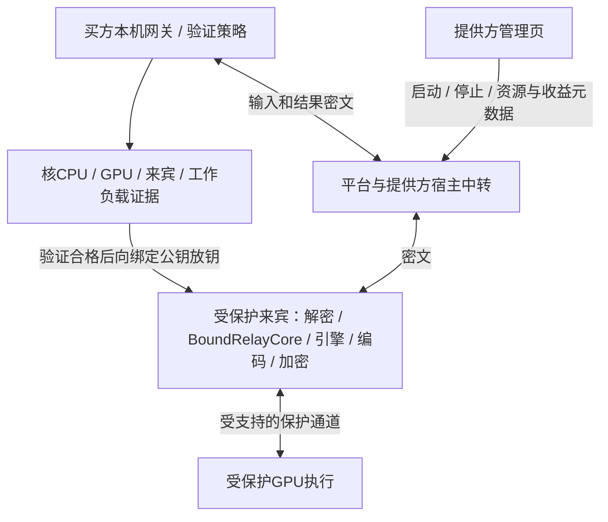

# 加密磁盘沙箱、QEMU与保密虚拟机可行性评估

P11｜2026-10-29｜继续评估，非已批准实施方案。未安装、配置或启动任何本地沙箱、QEMU、KVM、Hyper-V、Docker、WSL或模拟器，未做硬件/性能/密码验收。本项目本地禁虚拟化约束与原生客户端基线保留；讨论候选产品路线不等于授权本机试验。

本地隐私目标修订（2026-10-29）：用户后续明确不考虑高级内存分析，当前目标为拦住日常查看与普通工具、提高本地拦截门槛。因此，本文关于不能抵御主机管理员的技术边界继续成立，但不再据此把TEE/保密GPU作为首期必要条件；原生隔离/密文任务文件/封闭内容出口可作为实用方案，普通VM具有可选隔离价值。当前实施取舍以[本地内容隐私防护与分级验收](../技术开发/附录-本地内容隐私防护与分级验收.md)为准，均待验证。

## 1. 判断结论

在提供方设备上封装一个带加密磁盘的沙箱或虚拟机，在技术上可以实现。它有助于减少普通用户浏览任务目录、复制离线任务盘和意外残留，也可将第三方程序与个人环境分开。它不能单独保证拥有宿主机管理员权限的设备所有者无法读取运行中的prompt和产物。

要把不受信宿主机排除在运行期信任边界之外，需要硬件支持的保密执行。桌面虚拟化候选是QEMU/KVM配合经验证的AMD SEV-SNP或Intel TDX；GPU任务还要有受保护GPU及其通信路径、完整工作负载验证和买家控制的放钥策略。普通QEMU、加密qcow2、CPU虚拟化开关、GPU直通、vTPM或“禁用调试按钮”均不能各自替代这些条件。

| 执行形态 | 主要价值 | 防设备管理员读取运行内容 | 对本项目的判定 |
| --- | --- | --- | --- |
| 原生受限进程＋加密任务目录 | 文件权限、少留存、离线数据保护 | 不满足 | 可作为普通端的内容最小化设计 |
| 普通系统沙箱＋加密盘 | 约束应用权限、减少环境污染和日常访问 | 不满足 | 是隔离选项，不能升级增强标签 |
| 普通QEMU/KVM/Hyper-V VM＋加密盘 | 独立OS/依赖、整环境替换及离线任务盘保护 | 不满足 | 隔离价值成立，不能宣传对宿主保密 |
| CPU保密VM，全部计算在其受保护CPU内 | 在指定威胁模型下保护内存和CPU状态 | 条件成立；仍信任来宾软件/管理员 | CPU服务可单独研究，不能伪称GPU服务 |
| CPU保密VM＋未经保护的GPU/宿主推理代理 | CPU侧一部分数据受保护 | 不满足GPU全路径要求 | 不作为增强GPU供给 |
| CPU保密VM＋合格GPU保护路径＋完整证明与放钥 | 支持针对不受信宿主的GPU机密计算 | 在经验证范围和剩余假设内可行 | 增强档的条件性研究路线 |
| Android AVF/pKVM protected VM | 受保护的移动执行边界 | 有相应体系能力，须验证设备/权限/负载 | 不等同普通第三方LMA App可直接使用 |

QEMU官方明确区分传统虚拟机中宿主对来宾内存/状态的访问能力与Confidential Guest机制。[QEMU保密来宾说明](https://www.qemu.org/docs/master/system/confidential-guest-support.html)

## 2. 磁盘加密必须问清由谁解密

### 2.1 宿主侧加密镜像

例如由QEMU块层解锁加密qcow2/LUKS镜像。若密钥在宿主文件、管理服务或QEMU进程中可用，拥有宿主权限的人不是被该密码方案排除的对象。密钥不显示在UI和不写命令行可减少泄露，不能把掌握进程的系统所有者排除在外。

QEMU镜像文档支持LUKS格式，同时指出其保护qcow2的payload而非整个qcow2头；旧式qcow AES-CBC格式已被视为有设计缺陷。此处不把“镜像已加密”当作所有元数据、完整性或运行期保护都成立。[镜像格式](https://www.qemu.org/docs/master/system/images.html)

QEMU secret对象用于安全传入后端凭据，避免命令行/日志直接泄露；这种管理机制没有声称能抵御掌握宿主的管理员。[QEMU秘密传入说明](https://www.qemu.org/docs/master/system/secrets.html)

### 2.2 来宾内部加密任务盘

让VM内部自行解密任务盘，比把任务盘密钥交给宿主块层更接近目标。普通VM仍会在来宾RAM中产生密钥/明文，而宿主可以访问传统来宾状态，所以还缺运行期保护。

更合适的候选组合是：可信只读来宾系统＋在受保护来宾内部生成/接收的每会话密钥＋来宾内部加密的可写任务盘。宿主只接触任务盘密文，内容密钥、盘密钥和模型许可密钥分别管理；公共模型权重是否加密可独立决定。

加密不自动提供磁盘防篡改、防回滚或克隆检测。系统镜像/节点包需认证加载，可写状态需按协议检查完整性和新鲜度；会话状态与平台当前租约、最高围栏代次共同校验。销毁密钥只能在实际所有副本/备份/恢复规则成立时帮助降低旧盘暴露风险，不能证明磁盘物理字节已擦除。

## 3. 普通QEMU为什么仍不足以对抗主机所有者

QEMU是虚拟机执行/设备仿真工具，其硬件加速与保密边界是不同问题。普通VM的宿主负责分配和管理来宾状态，远程发来盘密钥也无法使普通VM内存脱离宿主控制。

官方monitor本身提供内存导出与状态检查能力，说明普通虚拟机并未把宿主监控者视为不可访问内容的对手。软件封装隐藏monitor、关闭管理端口和给来宾设置root密码可减少误用；设备所有者仍可替换宿主组件或观察运行进程，不能据此获得保密保证。[QEMU Monitor](https://www.qemu.org/docs/master/system/monitor.html)

可能接触内容的还包括普通RAM快照、来宾控制台、串口日志、共享目录、剪贴板、图形显示和宿主侧推理/编码代理。只加密虚拟磁盘而把内存状态或缩略图写入宿主普通文件，也会失去原目标。QEMU磁盘文档明确说明VM快照可包含CPU、RAM与设备状态；不能把磁盘加密范围外的快照假定为已保护。

Windows Sandbox等普通隔离产品的主要用途包括安全运行未知应用、减少它对主机的影响；不能只凭“使用硬件虚拟化”推导为抵御恶意主机管理员的保密VM。[Windows Sandbox官方说明](https://learn.microsoft.com/en-us/windows/security/application-security/application-isolation/windows-sandbox/)

## 4. 真正可研究的增强路线

候选形态为受支持宿主上的QEMU/KVM＋CPU TEE＋合格GPU保护。CPU候选采用SEV-SNP或TDX，不把普通AMD-V/VT-x、SME或老SEV的不同保证混写成同一等级。[AMD SEV-SNP来宾](https://www.qemu.org/docs/master/system/i386/amd-memory-encryption.html)、[Intel TDX说明](https://www.qemu.org/docs/master/system/i386/tdx.html)

这是候选信任边界，未搭建。必须共同满足：

1. CPU、主板/固件、宿主内核/KVM、QEMU、来宾固件/内核与选定保护机制构成经过验证的组合；不能用不具备TEE的CPU通过纯软件仿真来伪造可信硬件证据。
2. 来宾启动验证到实际工作负载加载的链路完整。仅证明启动固件不等于验证其之后加载的ComfyUI节点、Python依赖、权重和编码器。固定kernel_environment_digest之外，还需建立它与启动/运行测量的可核关联，不接受宿主自报hash代替证据。
3. 受信加载器在保护区内核验批准镜像、模型和白名单闭包；拒绝未批准版本、调试策略及泄露出口。提供方保留选择批准能力包的权利，但无读取正文的来宾root、guest-exec、调试或任意代码入口。
4. 买方或符合其策略的独立验证/钥服务核新鲜挑战、证书/撤销、当前安全版本、测量、CPU/GPU及接收公钥绑定，再通过受保护通道放钥。只有宿主转述“验证成功”或发送任意自选公钥不成立。平台也不能绕过买方策略放钥。
5. GPU部分必须支持实际保护模式、独立证据及与CPU保护区的安全通信。标准GPU passthrough/独占只决定分配关系，不等于GPU机密计算；IOMMU也不能单独替代此条件。CPU保密VM把明文交给宿主LM Studio或不合格GPU时，完整路径仍不满足。
6. 解密、tokenizer/预处理、模型推理、中间产物、音视频/3D编码、结果加密均在适用保护边界内。宿主提供的网络和块设备只接触密文；不能导出明文到共享目录、普通剪贴板、屏幕、声卡或宿主FFmpeg。受信程序本身仍须避免泄露。
7. 重启、升级和撤销导致重新验证与新的会话身份/钥。复制盘、恢复快照、迁移或克隆不能复用旧授权无限执行；本地时间/快照不决定最高围栏值与资金事实。初期不支持的恢复形态明确关闭，不能仅靠删除monitor开关防恶意宿主回滚。

NVIDIA当前威胁模型将宿主OS、hypervisor与VMM排除在运行期信任边界之外，但仍信任来宾软件/管理员及验证放钥服务。CPU证据和GPU证据不能互相替代；GPU的显存访问控制与链路保护应按具体架构说明，不能统一宣传成所有GPU存储均采用同一种加密。[NVIDIA CVM威胁模型](https://docs.nvidia.com/confidential-computing/virtual-machines/threat-model)

该方案保护机密性/完整性须服从硬件威胁模型，不能阻止提供方断电、断网和停止服务，也不能让有漏洞的批准节点自动变安全。证明合格不是结果质量、实际耗时或按token收费正确性的证明，原有买方验收/交易证据规则仍适用。

## 5. Windows、Linux与Android的实际适配性

### 5.1 Windows闲置电脑

QEMU有Windows WHPX硬件加速后端，但这说明能使用宿主虚拟化加速，不意味着提供了TDX/SNP保密能力。QEMU的TDX文档描述的是KVM配合TDX的前置条件；不能把同一工具在Windows可运行推导为同一保密GPU组合已可用。[WHPX](https://www.qemu.org/docs/master/system/whpx.html)

还要分别解决可用GPU分配、驱动与模型加速，虚拟显示设备不是“支持CUDA且对宿主保密”的证明。若买家任务在VM里，而GPU计算转给宿主上的普通引擎，敏感内容会重新暴露。QEMU原生存在也不能推出LM Studio/ComfyUI不改动即可工作或无性能损耗。

所以对当前Windows消费级电脑路线，合理定位仍是原生内容最小化/基础E2E；普通VM可研究隔离收益，不能把所有显卡经软件包升级成增强供给。若未来更换为专用Linux主机，则是提供方主动接受的新供给规格，不应悄改其个人系统。

### 5.2 Linux与合格专业设备

这是较接近官方公开CVM GPU组合的研究入口。截至本次核查，NVIDIA Dev支持表给出特定TDX/SEV-SNP平台、Hopper/Blackwell和Ubuntu宿主/来宾组合；R595 TRD1的GA发布说明还明确列出具体GPU SKU，包括H100 PCIe及RTX PRO 6000 Blackwell Server Edition等。这里的专业Server Edition不能扩大解释为全部GeForce RTX或所有RTX PRO产品。

[官方Dev支持组合](https://docs.nvidia.com/confidential-computing/virtual-machines/dev/supported-platforms)、[R595 GA发行说明](https://docs.nvidia.com/595trd1-trusted-computing-solutions-release-notes.pdf)。Dev文档不代表本项目的稳定版本选型，GA组件支持也不代表任意宿主/固件/来宾组合都获准；实施时必须锁定整套受支持版本，不能直接复制旧示例。

现有文档的相关CVM模式要求整GPU分配给一个CVM，GPU共享方式存在限制。这会降低卖家同时用该卡游戏/创作并出售保密槽的可行性，须按当前官方模式和基准分别判断，不承诺切出少量显存即可保密共享。

如果只卖CPU能力，可单独研究CPU保密VM，减少GPU依赖；模型性能与成本另验，不把它销售为GPU加速服务。增强GPU设备仍由合格用户自愿挂牌，平台不采购、自营或保底收益，保持C2C主体关系。

### 5.3 Android

Android并非只有普通模拟器路线。AVF/pKVM的protected VM设计可将来宾内存与Android宿主分开，原则上与这里的目标相关；设备供应商、启动链及固件等仍在其信任假设内。[AOSP安全模型](https://source.android.com/docs/core/virtualization/security)

但当前AOSP框架README说明这些Java接口为SystemApi并需要受限MANAGE_VIRTUAL_MACHINE权限，普通第三方应用不能据此默认调用；不同Android版本、机型及OEM集成必须再核。开发时adb授予权限的示例不构成面向市场的分发方案。[AVF API与权限](https://android.googlesource.com/platform/packages/modules/Virtualization/+/HEAD/libs/framework-virtualization/README.md)

若能合法获得相应系统能力，也须把实际native推理负载、模型认证、输入/输出、证明与放钥迁入该边界。LMA原Java/WebView/引擎运行正常不证明Microdroid负载可直接工作；GPU/NPU通道、依赖和实际性能均未证明，CPU-only负载也需单独验证。普通Android上用户自行启动QEMU不等于获得pKVM保护。

## 6. 对现有内核封装的影响

| 当前组件 | 若研究完整保密VM | 保留的限制 |
| --- | --- | --- |
| RuntimeSupervisor | 增加来宾环境适配与身份/生命周期检查的候选端口 | 宿主管理器只能管资源/启动停止，不持内容钥；不修改当前原生主路线 |
| lms＋llmster＋runtime | 真实推理进程必须在合格保护区中，所用OS/加速/许可另验 | 宿主CLI管理一个普通外部daemon不能获得增强；不假定闭源发行物已支持所选CVM |
| 完整ComfyUI | Python、节点、依赖和编码工具纳入批准镜像与认证加载 | 安全VM中的恶意节点仍可泄密；白名单/网络出口限制继续必要 |
| 有限节点安装 | 提供方选择批准包，在新环境构建/验证后重新发布测量 | 不能在已证明的活动环境中任意pip/Manager升级，还沿用原证明 |
| 加密/BoundRelayCore | 解密与标准协议映射进入受保护来宾 | 买方仍用标准OpenAI/Anthropic入口；平台与宿主只盲转 |
| 租赁和恢复 | 合同/执行授权额外绑定经验证来宾身份、当前环境与保护档位 | 仍共资源门闩；禁止静默降档、跨卖家、复制旧快照续权 |

这是一条额外的增强适配器路线，涉及设备资格、固件/来宾支持、验证和钥释放、故障恢复、版本更新，而不是把安装包输出为一个qcow2文件就完成。具体代码路径、接口和数据库变更在路线接受后另做设计；本次不改机器契约或任务完成状态。

## 7. 商业可行性与建议

普通加密沙箱的商业价值在环境一致、少污染个人电脑、降低日常内容暴露；但会增加镜像体积、内存/磁盘占用、冷启动和GPU兼容成本，实际成本须测，不能预报一个未经基准的性能损耗百分比。原生方案若已能达到同等隐私档位，就不能只为“看起来更安全”要求全部卖家安装VM。

完整CVM GPU服务的价值是向有更强隐私需求的买家提供可验证边界，代价是合格供给稀少、固件与软件组合复杂、整卡排他、升级复验和设备长期在线要求。可售价格、买家愿付与卖家净收益均待真实验证，不因保密标签自动获得溢价。Android另有OEM/系统权限门槛。

建议分为三个独立决定：普通端继续执行已选原生内核和内容最小化；普通加密VM只作为隔离候选，不授增强标签；严格管理员不可见服务仅研究完整CPU/GPU保密执行，缺合格用户供给时保持不可用。研究CVM并不意味着本地禁虚拟化约束已解除。

## 8. 后续验证问题与通过条件

以下仅为待执行研究，不安装工具、不运行虚拟机，不能据此标记通过：

- V01：分别以普通用户和授权宿主管理员检查普通加密VM的盘、RAM、控制台与临时文件。若管理员能读，记录为普通VM的边界；不能仅凭关闭UI视为增强。
- V02：固定CPU/GPU SKU、主板/固件、宿主/来宾/驱动/QEMU及库版本，取得官方适用性与可核证据。只有VT-x/SVM、TPM或加密盘而无适用TEE时拒绝增强资格。
- V03：验证CPU/GPU证据、新鲜挑战、调试状态、撤销/最低安全版本、受信加载链与保护区接收公钥。错误公钥、宿主伪造摘要、旧证明或未批准节点不能取得钥。
- V04：用授权虚构标记检查受保护RAM、GPU通信、磁盘/交换/快照、控制台、错误、预览/编码/节点网络出口，确保保护声明覆盖真实输入至输出全路径。
- V05：验证升级/回滚/复制盘/暂停/恢复/迁移/克隆与当前job/attempt/资源围栏/nonce的关系。未支持形态关闭，不恢复旧支付副作用或旧执行权。
- V06：分别做LLM和图/视频/音频/3D的真实协议、取消、清理、质量、冷启动/稳定性能和用户自用影响基准。Android另核系统权限、protected能力、native负载和CPU/GPU/NPU事实。
- V07：保持买家原有隐私确认、卖家明确安装/权限确认和资源控制；设备缺货或保护失效不回落普通设备。增强仍按C2C当前成交、验收与结算规则处理。

全部V01—V07均NOT_EXECUTED。QEMU官网master页面在本次访问标为11.1.50开发文档，一些证明/快照/迁移说明仍有版本特定限制；“能启动”不能替代上述通过条件。本项目本轮只做资料评估，没有浏览器新标签或虚拟化进程。

前序评估：[提供方内容不可见性](提供方内容不可见性评估-2026-10-29.md)。现行基线：[内核封装](../技术开发/附录-供给端内核封装与替换规范.md)、[加密模式](../模式/01-端对端加密模式需求.md)。本记录不自动变更这两份实施规范或授权其本地试验。
