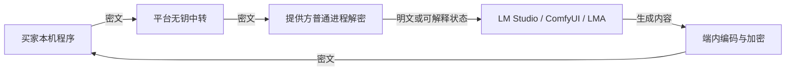

# 算力提供方内容不可见性：可行性与处理建议

P11｜2026-10-29｜评估建议，未实施、未做设备/内存/密钥/侧信道测试。承接用户希望供给客户端无法有效看到原始prompt和生成内容的目标；本次未把普通设备改标为增强档，也未改动80项主需求的编号。

本地隐私目标修订（2026-10-29）：用户后续明确不考虑高级内存分析，当前目标为拦住日常查看与普通工具、提高本地拦截门槛。因此，本文关于不能抵御主机管理员的技术边界继续成立，但不再据此把TEE/保密GPU作为首期必要条件；原生隔离/密文任务文件/封闭内容出口可作为实用方案，普通VM具有可选隔离价值。当前实施取舍以[本地内容隐私防护与分级验收](../技术开发/附录-本地内容隐私防护与分级验收.md)为准，均待验证。

## 1. 结论与威胁边界

应分别判断“提供方界面不展示内容”“平台无法解密内容”“掌握设备管理员权限的提供方仍无法读取内容”。目前的LM Studio CLI、完整ComfyUI及LMA二开路线可以设计前两项；普通明文执行不能保证第三项。

如果“客户端无法看到”连受信推理代码处理明文都不允许，要求进一步成为密文计算。TEE方案仍允许受保护代码在保护区内处理明文，只限制谁能从外部读取；全同态加密/安全多方计算则是另一套计算协议，不能与普通端点加密混同。

| 目标 | 当前路线可行性 | 应当如何表述 |
| --- | --- | --- |
| 卖家管理页没有prompt、图片/音视频预览或模型回答 | 可以开发；要封闭历史、缓存和管理API等旁路 | 提供方界面不展示任务内容 |
| 平台中转、存储和管理员无法取得正文 | 通过已独立核验买卖端及密钥的E2E设计实现；本项目尚未验证 | 对平台加密，执行节点仍须受信 |
| 卖家即使修改程序、控制OS、读取进程也无法取得正文 | 当前普通进程路线不满足；须额外证明完整保护路径 | 仅完整验证后的增强档可声明相应保证 |
| 所有普通GPU/手机均能原样运行现有引擎且抵御设备管理员 | 现有设计无此能力，不应承诺 | 缺合格增强供给时显示不可用，不自动降级 |

范围覆盖输入/附件、原始prompt、system/历史/工具数据、生成结果和可重建内容的中间状态；所选公开模型、任务类型、大小、时间和资源等仍可能泄漏使用特征。此评估不承诺隐藏所有元数据或消除所有侧信道。

## 2. 现有加密链路的暴露位置

R、E、O位于提供方控制的普通系统内。网络和文件加密可以保护运输与存储，无法阻止系统所有者在解密后、生成中、结果加密前观察或修改程序。只把内容钥放进DPAPI、TPM或Android Keystore，也不意味着解密后的数据和整个推理路径受保护。

根据Android官方说明，Keystore防提取的保证针对密钥；应用或系统被攻破时仍可能被利用来调用相关密钥。由此不能推定普通LMA进程具有受保护模型执行能力。[Android Keystore](https://developer.android.com/privacy-and-security/keystore)

## 3. 三条内核路线的具体影响

### 3.1 Windows LM Studio CLI

lms/llmster与实际推理runtime仍处理请求、模板、token、上下文及输出。官方文档展示lms log stream可观察推理输入；因此仅关闭平台客户端自己的日志不够，必须核对选定版本daemon/runtime的日志、订阅接口、历史与崩溃转储行为。是否能关闭所有内容留存仍待实测，不在此假设存在某个未验证flag。[LM Studio官方工具调用与输入日志示例](https://lmstudio.ai/docs/developer/openai-compat/tools)

可替换runtime有利于未来增加合格适配器，但替换机制本身没有提供保密内存。即使封装不显示任何请求，掌握系统权限的所有者仍可能观察普通推理进程。工具调用结果、RAG资料、system和历史上下文均按同一敏感等级处理。

### 3.2 Windows ComfyUI完整环境

普通工作流可能经prompt/队列/历史、WebSocket预览、节点输出、输入输出目录、PNG元数据和第三方节点外发暴露内容。官方节点机制允许节点取得完整PROMPT和EXTRA_PNGINFO；当前SaveImage源码会写出图片，并在启用元数据时嵌入prompt，PreviewImage还使用临时目录。[官方节点文档](https://docs.comfy.org/custom-nodes/backend/more_on_inputs)、[当前上游源码](https://github.com/Comfy-Org/ComfyUI/blob/master/nodes.py)

因此不能沿用默认保存/预览链路后再以隐藏UI宣称内容不落盘。需要按固定版本修改输出配方与适配器，核查图像、视频、音频、3D各类保存器和外部编码工具。白名单只能限制批准代码；用户控制OS时，普通进程仍没有抵御主机管理员的保护边界。

### 3.3 Android LMA源码二开

共享任务不进入私人聊天数据库、WebView会话历史、通知正文、剪贴板、系统相册或公共下载目录；结果不出现在提供方预览中。平台任务、本地API及聊天执行仍共资源门闩，不能为隐藏任务另开不可控后台槽。

APK签名、应用私有目录、Android沙箱和硬件密钥是必要保护措施，不能据此将整个LMA模型、native内存、输入输出自动声明为抵御root/主机控制者。当前没有验证把LMA完整工作负载放入合格受保护执行环境的路径。

## 4. 普通供给端可以立即纳入的开发要求

下列是建议新增的内容最小化验收，不表示已完成；该层用于减少日常暴露，仍属于普通或基础加密执行。

1. 提供方管理API仅返回任务随机标识、公开模型/配方、资源用量、状态、时限和结算摘要；不返回prompt、回答、缩略图、媒体播放地址、资产预览、附件名称或带内容的错误。
2. 卖家没有买方结果领取权限。买家标准API经本机网关解密后的结果只向买家授权程序返回；不把密钥、可解密预览或可还原内容发送给卖家管理页。
3. 引擎控制面与卖家管理页分离；专用实例、受限本地通道、任务范围授权。关闭UI旁路不能只依赖loopback地址——同一主机上的普通进程和管理员也能访问或修改本地服务，必须如实保留该限制。
4. 不把prompt/回复放进命令行、环境变量、SQLite任务账、运行状态、文件名、内容哈希索引、stderr或错误上报；不启用正文日志订阅。各第三方内核本身的内容留存行为需逐版本核验，无法满足的组合不获得相应声明。
5. ComfyUI逐项关闭管理页预览与推送，替换/约束SaveImage、PreviewImage及音视频/3D保存路径；按版本核验元数据开关。优先在受控内存中编码并立即加密，仅密文进入持久目录；第三方节点或编码器需要明文临时文件时，不能声明该SKU完全不落明文盘。
6. 输入、输出、prompt/KV/前缀缓存和ComfyUI中间结果按买家/订单隔离，不在不相干订单间复用私人内容。模型公共权重缓存可单独管理；任务完成及时释放私密缓存和钥。回收内存/删除文件不能证明恶意所有者未提前复制，也不承诺普通内存/SSD可验证安全擦除。
7. 崩溃转储、交换/休眠、AV/索引、临时文件与备份纳入实际泄露面检查；禁转储或清理策略不能被宣传为抵御主机管理员的加密边界。
8. 保留提供方对运行程序、组件版本、模型/节点清单、资源占用、权限、共享时段和收益的可见性；暂停、排空、紧急停止继续可用。正文隐藏不授权平台秘密安装程序、扩大权限或持续占用设备。

这一层的合适承诺是“提供方界面不展示内容，尽量减少内容留存；基础加密对平台隐藏正文，执行者仍需信任”。不应写“显卡所有者无法获取”。

## 5. 严格增强档需要改变的执行边界

买家本机程序先验证新鲜远程证明，核硬件、启动状态、受信工作负载、模型/节点和kernel_environment_digest，再将会话钥交给证明绑定的保护区公钥；平台和提供方普通进程只转发密文。证据或身份不符时不放钥、不静默降级。

保护区需覆盖解密/标准协议转换、tokenizer/预处理、CPU与GPU内存及通信、推理、解码/编码、缓存和结果加密。仅证明GPU、把后处理交回普通Python/FFmpeg，或把接收钥绑定到普通卖方进程都不满足目标。NVIDIA官方说明也强调CPU和GPU证据必须组合评估；批准代码的漏洞、日志/调试和钥释放策略仍在信任假设内。[NVIDIA虚拟机模式威胁边界](https://docs.nvidia.com/confidential-computing/virtual-machines/threat-model)

引用上述模式仅用于解释边界，本项目继续禁止本地Docker/WSL/虚拟机/模拟器，不实施依赖被禁环境的方案。原生路线必须另行证明，不能直接套入虚拟机示例。

特别需要修正对“裸机保密计算”的理解：NVIDIA CBM官方Dev方案把租户/模型所有者的OS、驱动、特权软件及管理员纳入信任边界，保护基础设施所有者之外的资产；它不替租户终端用户隔离租户管理员。本项目若卖家仍掌握运行OS管理员权限，单用CBM名义无法得出“卖家看不到买家内容”。若需真正交接整机和管理权限，则已改变普通闲置电脑边自用边共享的产品前提，须另立供给规格和买家信任政策。[CBM威胁模型](https://docs.nvidia.com/confidential-computing/bare-metal/threat-model)

不能凭H100/Blackwell等系列名称或“有TPM/TEE”即获得增强标签。具体SKU、CPU、OS、固件、驱动、互联和软件组合须以官方支持与实际证明共同判断；本项目尚无合格组合，也未证明现有LM Studio/ComfyUI/LMA可以原样获得该保护。[NVIDIA保密计算入口与兼容矩阵](https://docs.nvidia.com/confidential-computing/)

增强供给仍可来自合格用户自愿挂牌，保持C2C。供给不足时增强目录缺货，不能调普通设备代履约，也不以平台采购、自营机器补成默认方案。普通GPU/手机维持适合其实际隐私能力的服务。

## 6. 其他方案的实际价值

| 方案 | 有效作用 | 无法据此承诺的内容 |
| --- | --- | --- |
| token ID、base64、压缩、代码混淆 | 数据表示或增加检查成本 | 无法形成密码保密；已知tokenizer可还原token |
| 买家先脱敏再提交 | 将姓名、账号、真实标识替换为占位符；买家保留映射 | 任务语义、上下文及输出仍可能泄漏；也可能影响生成效果 |
| 买家跑文本编码器，仅发embedding | 卖方不直接接收原始文本字节 | embedding仍携带语义并存在逆向恢复研究，不能等同密文 |
| 买家做VAE/最终解码，仅回传latent | 减少卖家默认输出文件、缩略图或最终编码 | 卖方可保留latent并用相应公开解码器还原内容，不能保证结果不可见 |
| 签名客户端、节点白名单、自报环境hash | 版本/依赖合规和内容泄露面控制 | 无硬件保护的自报hash不能证明实际执行过程未被主机修改/观察 |
| 全同态加密FHE | 在适合的专门运算中以密文计算 | 需要模型量化、支持运算及编译/精度/性能验证，不是给当前HTTP请求加密即可继续调用普通内核 |
| 安全多方计算MPC | 在明确腐败阈值/不串通假设下研究私密计算 | 须另做算子、通信、鲁棒性与恶意方协议；不能默认C2C账号彼此独立或简单拆任务即安全 |

embedding恢复研究只证明存在泄露攻击，不表示每个模型/任意长度都可准确恢复原prompt。[原始研究：Text Embeddings Reveal (Almost) As Much As Text](https://arxiv.org/abs/2310.06816)。FHE需要转换/编译及权衡的技术依据见[Concrete ML编译](https://docs.zama.org/concrete-ml/explanations/compilation)和[混合模型](https://docs.zama.org/concrete-ml/guides/hybrid-models)；不据此宣称任意LM Studio模型或ComfyUI工作流已有可用密文版本。

## 7. 建议的产品决定与验证次序

建议保留既有基础/增强两档；把“卖家界面不展示内容”作为所有普通供给端的设计要求，独立于隐私标签。第一步实施第4节内容最小化，在买家侧披露执行者仍可访问的边界。敏感数据必须防设备所有者读取时，只可使用通过第5节验证的增强设备；无供给则拒绝任务或由买家在自己可信设备执行。

普通设备如果希望增加实际保护，可在买方程序加入可选脱敏预检，但不能让“已脱敏”自动升级为增强标签。embedding/latent拆分可作为性能/留存优化实验；全同态/MPC单独作为研究任务，不阻塞现有基础功能，也不计入已完成保护能力。

最小可执行验证建议：

- 固定LM版本：用经授权的虚构标记输入，检查CLI/daemon/runtime日志订阅、历史与转储，核封装层之外的内容暴露。
- 固定ComfyUI配方：检查WebUI/API/WS、队列/历史、PNG和各媒体元数据、临时文件、外部编码器及每个白名单节点；验证密文回传与无内容管理接口。
- 固定LMA派生版本：检查聊天库/WebView、logcat、通知、相册/缓存、模型上下文残留；自用/平台任务隔离且共门闩。
- 在授权测试设备上以普通用户与管理员/调试控制者分别测试。普通进程能被管理员取得内容时，将其记录为该档位限制，不能只凭UI未显示判增强通过。
- 增强独立验证证书/证明新鲜度、度量与接收钥绑定、CPU/GPU全路径、升级/撤销/调试/证明失效拒绝放钥，以及受信代码内的泄露路径。代码签名不代替此测试。

全部验证NOT_EXECUTED；本次仅只读核对官方资料，没有启动浏览器、内核、GPU或手机。

关联基线：[三模式加密需求](../模式/01-端对端加密模式需求.md)、[白皮书密钥生命周期](../白皮书/06-端对端加密与密钥生命周期.md)、[端到端实现设计](../技术开发/08-端到端加密协议与密钥实现设计.md)、[供给内核规范](../技术开发/附录-供给端内核封装与替换规范.md)。本评估不代替正式方案冻结与真实安全验收。

后续已补充[加密沙箱与QEMU保密执行评估](加密沙箱与QEMU保密执行可行性评估-2026-10-29.md)：区分宿主/来宾盘加密、普通VM与CPU/GPU完整保密VM，并单列Android AVF/pKVM权限和适配条件；仍仅研究，未启动本地虚拟化或修改现行原生路线。
