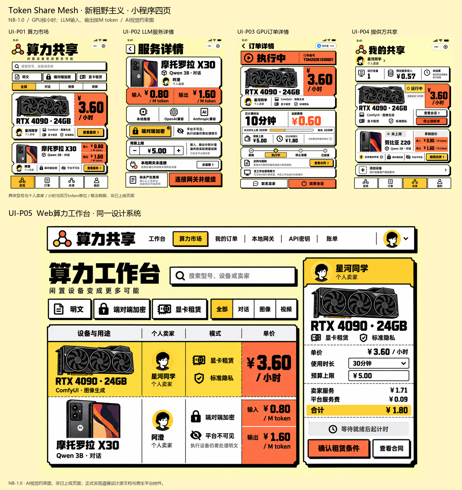

# 五张最终视觉约束图 · NB-1.0

用户选定04新粗野主义。四张小程序+一张Web；GPU价格按小时，LLM输入/输出按M token。具体型号、卖家、费率均为示例；源码阶段见[实施登记](../../../dev/progress/README.md)。

| 页面 | 原图 | 尺寸 |
| --- | --- | --- |
| UI-P01 小程序-算力市场 | [查看](UI-P01-小程序-算力市场.png) | 1024x1536 |
| UI-P02 小程序-LLM服务详情 | [查看](UI-P02-小程序-LLM服务详情.png) | 1024x1536 |
| UI-P03 小程序-GPU订单详情 | [查看](UI-P03-小程序-GPU订单详情.png) | 1024x1536 |
| UI-P04 小程序-提供方共享 | [查看](UI-P04-小程序-提供方共享.png) | 1024x1536 |
| UI-P05 Web-算力工作台 | [查看](UI-P05-Web-算力工作台.png) | 1536x1024 |

[完整设计入口](../../../dev/design/新粗野主义-v1.0/README.md) · [合订本](../../../dev/design/新粗野主义-v1.0/设计规范合订本.md)

[设计令牌](../../../dev/design/新粗野主义-v1.0/design-tokens.json) · [示例数据](../../../dev/design/新粗野主义-v1.0/示例数据.json) · [逐张目视记录](production/visual-review.json)

图像仅通过用户指定sub2-image-gen、gpt-image-2.5、high、PNG生成。预览由五张真实生成图等比缩放拼合。P04补齐系统页头后复查；旧版只保存在历史，不计入五张最终主稿。

图片不代表交互、真机、支付、密码或性能已验收。细小生成字形/系统胶囊以文案与原生平台控件为准；设备插画不作为真实硬件证明。
